# Adrenal Disorders I: Adrenal Physiology, Conn's Syndrome & Cushing's Syndrome
**Internal Medicine Department** | Source: `12-adrenal gland physiology cushing syndrome.pdf` (44 slides)

> **Legend:** ⭐ = high-yield · *[added]* = not on slides. Images marked "Slide N" come from the lecture; "Added diagram" = drawn for these notes.

> 🔗 **Bridge from earlier lectures:**
> - **Pituitary I–II:** ACTH from basophils, CRH control, and trans-sphenoidal surgery. **Cushing disease = an ACTH-secreting pituitary microadenoma.**
> - **Hypertension:** Conn's and Cushing's were on the **endocrine** list of secondary HTN, and **spironolactone/eplerenone** were the "aldosterone antagonist" drugs.
> - **Lung cancer:** **SCLC/carcinoid → ectopic ACTH**.
> - **Physiology (hormones):** steroids are lipid-soluble and act on **intracellular receptors**.

---

## 1. Title / Objectives

| Domain | Objective | Likely tested as |
|---|---|---|
| Knowledge | Pathophysiology and aetiology of adrenal disorders | Zone → hormone; RAAS |
| Knowledge | ⭐ Epidemiology, manifestations, complications, management of **hyper**adrenalism | Conn's (HTN + ↓K), Cushing's (features, tests) |
| Knowledge | Causes and manifestations of hirsutism | (Lecture 13) |
| Skill | ⭐ Interpret investigations → diagnosis | Aldosterone/renin ratio; dexamethasone tests; ACTH |
| Skill | Evidence-based management | Adrenalectomy vs MRA; trans-sphenoidal surgery |
| Skill | Emergencies | Hypokalaemic paralysis; post-op adrenal insufficiency |

**Main subtopics:** anatomy and physiology (histology, steroidogenesis, RAAS) → **primary hyperaldosteronism / Conn's** (causes, picture, investigations, treatment, DDx) → **Cushing's** (causes: pituitary, adrenal, ectopic, exogenous; picture) → **investigations** (screening, confirmation, differentiation, localisation, DDx) → **treatment and Nelson's syndrome**.

---

## 2. Main Content (Lecture Order)

### 2.1 Anatomy & Histology (Slides 4–6) ⭐

| Layer | Hormone | Control |
|---|---|---|
| **Capsule** | — | — |
| ⭐ **Zona Glomerulosa** (outer) | **Mineralocorticoids** (aldosterone) | **RAAS** (angiotensin II), **K⁺** |
| ⭐ **Zona Fasciculata** (middle, largest) | **Glucocorticoids** (cortisol) | **ACTH** |
| ⭐ **Zona Reticularis** (inner) | **Androgens** (DHEA) | **ACTH** |
| **Medulla** (chromaffin cells, neuroectoderm) | **Catecholamines** | **Preganglionic sympathetic** fibres |

> **Mnemonic: "GFR – Salt, Sugar, Sex"**: **G**lomerulosa = salt, **F**asciculata = sugar, **R**eticularis = sex. "The deeper you go, the sweeter it gets."

- **Cortex:** **mesodermal**, **90% of the gland**, outer yellow layer, steroid-secreting. Partly controlled by the anterior pituitary; regulates metabolism and maintains normal electrolyte balance.
- **Medulla:** **neuroectodermal**, dark inner layer, richly innervated by **preganglionic sympathetic fibres**.

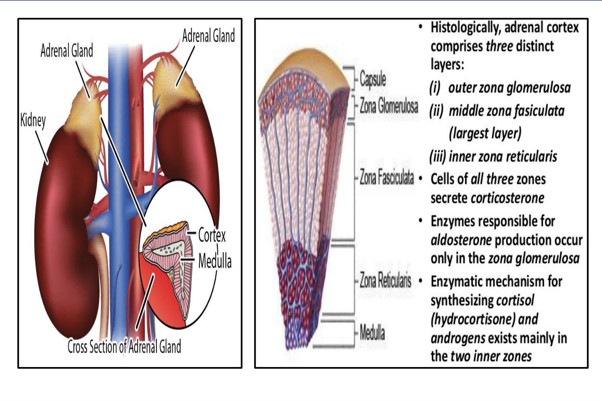 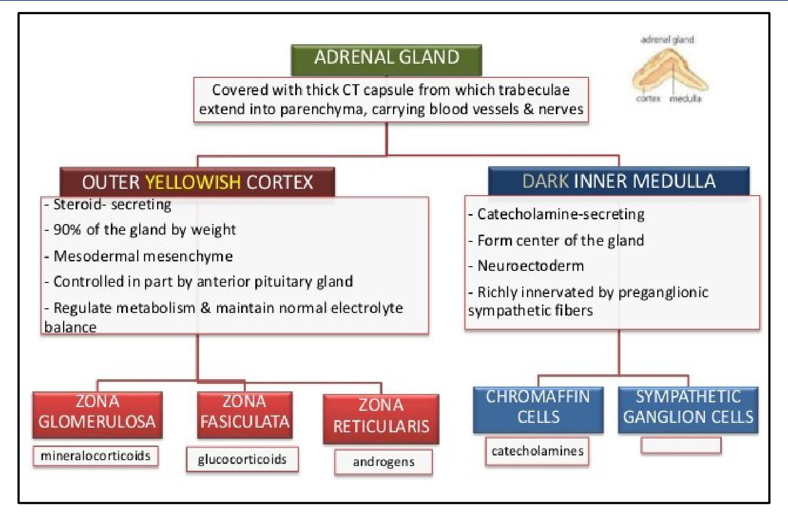

### 2.2 Steroid Synthesis (Slide 7) ⭐
**Cholesterol → pregnenolone →** three pathways:
- **Mineralocorticoid:** progesterone →(**21**)→ deoxycorticosterone →(**11β**)→ corticosterone →(**18**)→ **aldosterone**
- **Glucocorticoid:** 17-OH-pregnenolone → 17-OH-progesterone →(**21**)→ 11-deoxycortisol →(**11β**)→ **cortisol**
- **Androgen:** (17,20-lyase) → **DHEA** → androstenedione → **testosterone** →(5α-reductase)→ DHT; aromatase → oestrogens

**Key enzymes:**
- **17α-hydroxylase** sends steroids to the cortisol and sex-steroid pathways.
- **21-hydroxylase** and **11β-hydroxylase** are needed for **both** aldosterone and cortisol.
- This is the key to the CAH types in lecture 13.

### 2.3 Physiology by Zone (Slides 8–10)
**1. Zona glomerulosa → aldosterone → Na⁺ and water retention** (and K⁺/H⁺ excretion *[added]*).

- **RAAS (slide 8):** ↓ BP or volume → juxtaglomerular renin → angiotensinogen → angiotensin I →(ACE, lungs)→ angiotensin II → vasoconstriction + **aldosterone** → Na/water retention → BP ↑ (negative feedback).

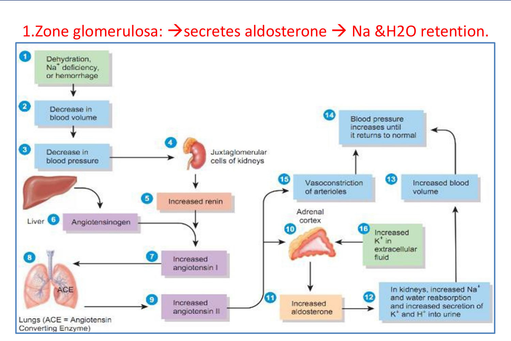

**2. Zona fasciculata → glucocorticoids (cortisol). Metabolic effects (and effects in excess):**

| Target | Effect |
|---|---|
| **Fat** | Mobilisation; **in excess → deposition in abnormal sites** |
| **Protein** | **Catabolic**; in excess → **muscle wasting and osteoporosis** |
| **Carbohydrate** | ↑ **gluconeogenesis**, ↓ muscle glucose uptake; in excess → **hyperglycaemia** |
| **Water and electrolytes** | **Na⁺ and water retention, K⁺ excretion** |
| **Blood (marrow)** | ↑ **RBCs**; ↓ **eosinophils and lymphocytes** |
| **Other** | **Androgenic**, **anti-allergic**, **anti-inflammatory** (in excess ↓ fibrous tissue, destroys elastic fibres) |

**3. Zona reticularis → sex hormones**, mainly androgens (+ a little oestrogen and progesterone).
- Main androgen: **dehydroepiandrosterone (DHEA)**: protein anabolism, male secondary sexual characteristics.
- End products: **17-ketosteroids** (urine).
- Under **ACTH** control.
- **Androgen sources:** ♂ adrenal + testes; ♀ adrenal (*[added]* + ovary).

> 🔁 **Recap: Physiology.** Cortex (mesoderm, 90%): glomerulosa = aldosterone (RAAS, K⁺), fasciculata = cortisol (ACTH), reticularis = androgens (ACTH). Medulla (neuroectoderm) = catecholamines. Cortisol: gluconeogenesis, protein catabolism, fat redistribution, Na retention, ↑RBC, ↓eosinophils and lymphocytes, anti-inflammatory.
> 🔗 **Link:** Too much of the outermost hormone (aldosterone) gives the commonest curable cause of secondary hypertension.
> ▶️ **Up next: Conn's syndrome.**

---

### 2.4 Conn's Syndrome (Primary Hyperaldosteronism): Causes (Slides 11–12) ⭐
1. ⭐ **Aldosterone-producing adrenal adenoma: 60%** (Conn's adenoma)
2. **Bilateral zona glomerulosa hyperplasia: 40%**
3. **Aldosterone-producing carcinoma** (rare)

*[added] More recent data show bilateral hyperplasia now outnumbers adenoma in screening series. The slide's 60/40 is the classic textbook split.*

### 2.5 Clinical Picture (Slides 13–14) ⭐

| # | Feature | Detail |
|---|---|---|
| 1 | ⭐ **Hypertension** | May be severe (Na retention) |
| 2 | ⭐ **Hypokalaemia** | **Apathy, paraesthesia**; **arrhythmias** (extrasystoles); **intestinal atony → constipation → paralytic ileus**; **muscle weakness → episodic paralysis**; **impaired glucose tolerance** (K⁺ needed for insulin release and action) |
| 3 | **Metabolic alkalosis** | Heavy urinary H⁺ loss → **tetany** |
| 4 | ⭐ **NO oedema** | Because of **aldosterone escape** |
| 5 | **Polyuria** | K⁺ diuresis + **hypokalaemic nephropathy** (renal concentrating defect) |

**Aldosterone escape (slide 14):**
- **Definition:** escape from the Na-retaining effect of excess aldosterone in conditions such as primary hyperaldosteronism or congestive heart failure.
- **Mechanism:** Na and water retention → ↑ volume → **ANP** secretion and pressure natriuresis → compensatory diuresis → **"escape" from oedema and hypernatraemia**.
- **Pearl:** in **oedematous** disorders (HF, cirrhosis, nephrotic) the escape mechanism is **impaired**, so oedema worsens.

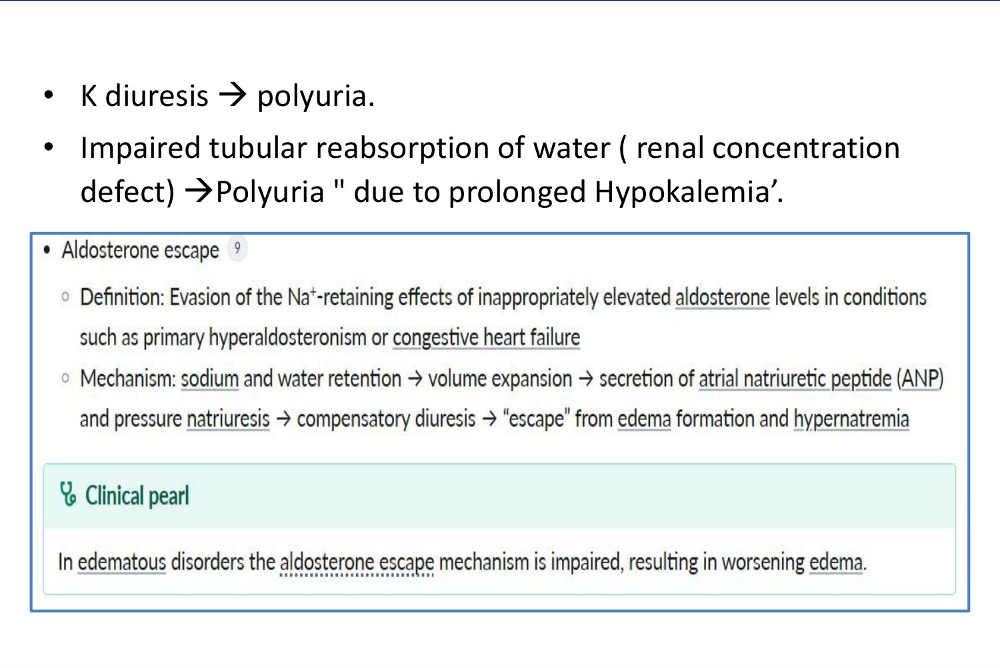

### 2.6 Investigations (Slides 15–17, 21) ⭐

| Group | Finding |
|---|---|
| **Biochemistry** | **Hypokalaemia** (N 3.5–5) · **hypernatraemia** (N 140; *[added]* usually high-normal) · **alkalosis** (↑ HCO₃⁻; N 22–30) |
| **Urine** | **Polyuria** · **↑ K⁺, ↓ Na⁺** · **↑ aldosterone excretion** (N 12–50 µg/24 h) |
| ⭐ **Plasma renin** | **↓ in 1ry** (stays low on Na restriction). **↑ in 2ry hyperaldosteronism**. ⭐ **Stop antihypertensives before measuring** |
| **Plasma aldosterone** | **High** (N 3–10 ng/dL) |
| **Imaging** | **US, adrenal CT** |

**Confirmatory testing (slide 17)** shows that aldosterone production is **non-suppressible** (not regulated by RAAS):
- ⭐ **Oral sodium loading:** high Na intake for 3 days, 24-h urine aldosterone on day 3. **> 12 µg/day** = primary hyperaldosteronism highly likely.
- ⭐ **Saline infusion:** baseline renin and aldosterone, NS over 4 h, repeat. **Aldosterone > 10 ng/dL** = very probable.
- **Others:** **fludrocortisone suppression**, **captopril suppression**.
- **Interpretation:** aldosterone **suppresses** → primary unlikely. **No suppression** → **primary confirmed**.

**Diagnostic algorithm (slide 21)** ⭐
1. Suspect (HTN + hypokalaemia) → **plasma aldosterone (PAC) + renin activity (PRA)**:
    - **↑ PAC, ↑ PRA** → **secondary** (renal artery stenosis, renin-secreting tumour, CKD) → treat the cause
    - **↑ PAC, ↓ PRA, PAC/PRA > 20** → **confirmatory test** → **primary**
    - **↓ PAC, ↓ PRA** → **pseudo-hyperaldosteronism** (CAH, exogenous mineralocorticoid, Cushing's) → treat the cause
2. Primary → **adrenal CT**:
    - **malignancy suspected** → surgery
    - **not malignant** → ⭐ **adrenal venous sampling**:
        - **unilateral** → **adrenalectomy**
        - **bilateral** → **aldosterone antagonists** (eplerenone, spironolactone)

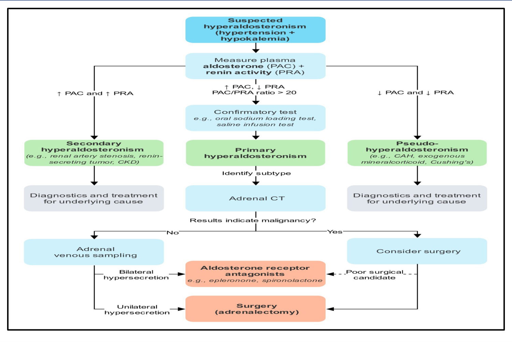

### 2.7 Treatment (Slide 18)
1. ⭐ **Surgical removal of the adenoma** (*[added]* laparoscopic adrenalectomy), **after correcting the electrolytes**.
2. **Medical** for **bilateral adrenal hyperplasia**:
    - **Amiloride (40 mg/day)** is preferred to **spironolactone**, because spironolactone causes **gynaecomastia and impotence** with chronic use.
    - *[added]* **Eplerenone** (selective MRA) avoids the anti-androgen effects.

### 2.8 Differential Diagnosis (Slides 19–20)
**A. Hypertension + hypokalaemia (pseudo-hyperaldosteronism and mimics):**
- **Malignant or renal HTN** with **secondary hyperaldosteronism**
- **Diuretic-induced hypokalaemia** in a hypertensive patient
- **Cushing's syndrome**, **CAH** (11β and 17α), rarely **juxtaglomerular hyperplasia**
- **Exogenous mineralocorticoids** (*[added]* liquorice)
- **K-losing nephropathies with HTN**: **Bartter's** (*[added]* actually normotensive), **Liddle's**

**B. Other causes of hypokalaemia** and **familial periodic paralysis**.

**1ry vs 2ry hyperaldosteronism (slide 20):**

| | **1ry** | **2ry** |
|---|---|---|
| **Source** | **Adrenal gland** | **Renal artery stenosis, heart failure, nephrotic syndrome, liver cirrhosis** |
| **Aldosterone** | **+++** | + |
| **Renin** | ⭐ **↓↓** | ⭐ **↑↑** |
| **HTN** | Mild (slide) | **No HTN, except renal artery stenosis → severe** |
| **Initiating event** | Aldosterone ↑ → Na retention → ↑ volume → ↓ renin | ↓ blood volume → ↑ renin → ↑ aldosterone → Na retention |

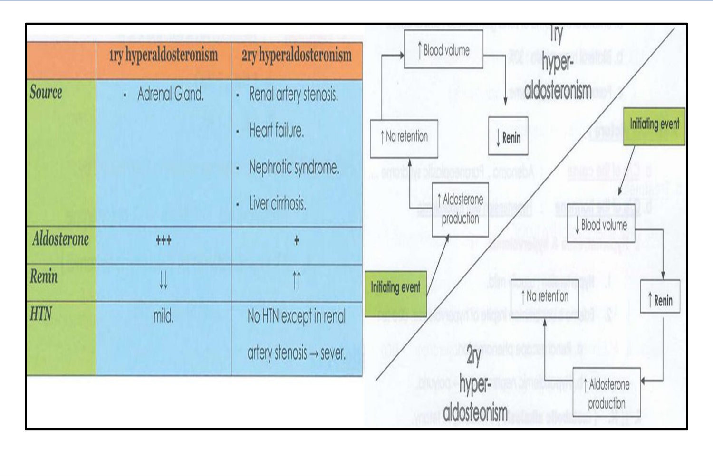

> 🔁 **Recap: Conn's.** Adenoma 60%, bilateral hyperplasia 40%, rarely carcinoma. HTN + hypokalaemia (weakness, paralysis, ileus, arrhythmia, IGT, polyuria) + metabolic alkalosis (tetany), with **no oedema** (aldosterone escape). Labs: ↑ aldosterone, **↓ renin** (stop antihypertensives first), ARR > 20, then confirm non-suppression (oral salt load > 12 µg/day, saline infusion > 10 ng/dL). CT → adrenal venous sampling → unilateral: adrenalectomy; bilateral: MRA/amiloride.
> 🔗 **Link:** The middle zone's hormone in excess gives a far more visible syndrome.
> ▶️ **Up next: Cushing's syndrome.**

---

### 2.9 Cushing's Syndrome: Causes (Slides 22–24) ⭐

| Type | Share | Detail |
|---|---|---|
| **A. Endogenous** | Rare (**1/million/year**) | |
| 1. ⭐ **Pituitary = Cushing DISEASE** | **75%** of endogenous | **80% from a basophil microadenoma** secreting ACTH; the rest may be hypothalamic |
| 2. **Adrenal Cushing** | **20%** | **Autonomous cortisol** from an adenoma, carcinoma or hyperplasia |
| 3. **Ectopic ACTH** | (~5%) | **Bronchogenic carcinoma, pulmonary carcinoid**; thymoma; ovarian or pancreatic carcinoma |
| **B. Exogenous ("Cushingoid")** | ⭐ **Commonest overall** *[added]* | Prolonged **corticosteroid** therapy |

**Cushing's syndrome vs disease (slide 24):**
- **Syndrome** = hypercortisolism from **any** cause.
- **Disease** = specifically a **pituitary ACTH-secreting tumour**.

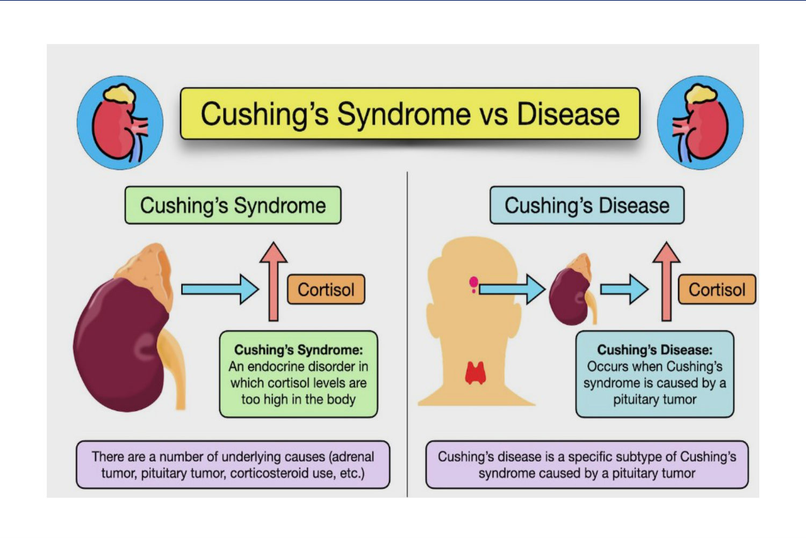

### 2.10 Clinical Picture (Slides 25–29) ⭐

| Group | Features |
|---|---|
| **A. Fat redistribution** | ⭐ **Moon face** (bloated cheeks) · ⭐ **buffalo hump** (interscapular) · **truncal obesity** (breasts, abdomen) with **hollow buttocks and thin limbs** ("**lemon on matchsticks**") |
| **B. Protein catabolism** | **Muscle wasting → proximal myopathy** · ⭐ **osteoporosis** (kyphosis, height loss, **pathological fractures**) · **bruises and purpura** · **delayed wound healing** · ⭐ **striae rubrae** (purple, wide, over the breasts, abdomen and thighs) |
| **C. Carbohydrate** | **Hyperglycaemia**; **DM in 15%** (insulin-resistant "**steroid diabetes**") |
| **D. Fluid and electrolytes** | **Na retention → HTN** · **hypokalaemia → polyuria, alkalosis** |
| **E. General** | **Plethoric face** (polycythaemia) · ⭐ **psychiatric**: **depression** commonest · in children: **obesity + stunted growth** |
| **F. Sexual** | **Women** (adrenal androgen excess): **amenorrhoea, acne, hirsutism** · **Men**: ↓ libido, impotence |
| **G. Clues to the cause** | ⭐ **Virilisation → adrenal carcinoma** · ⭐ **hypokalaemic alkalosis, myopathy and hyperpigmentation → ECTOPIC** (classic cushingoid features often absent) · **children → adrenal carcinoma** · **adult men, especially smokers → ectopic** · **women of childbearing age → pituitary** |

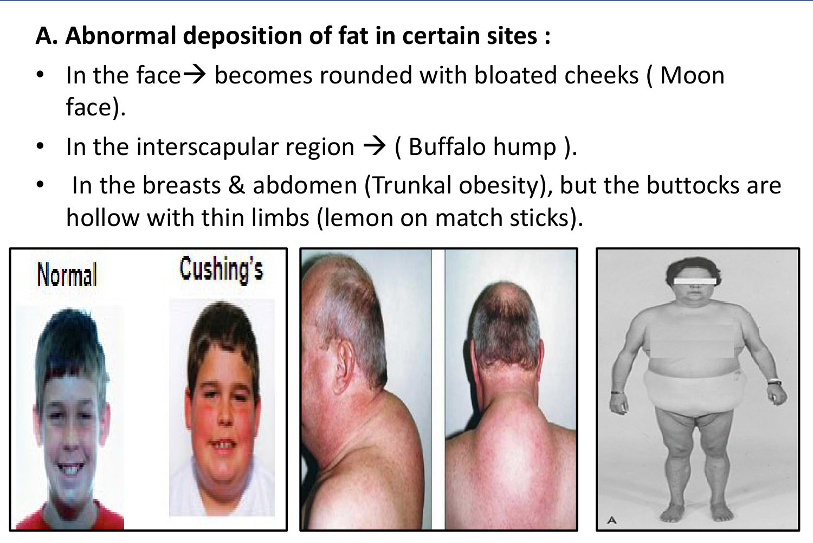 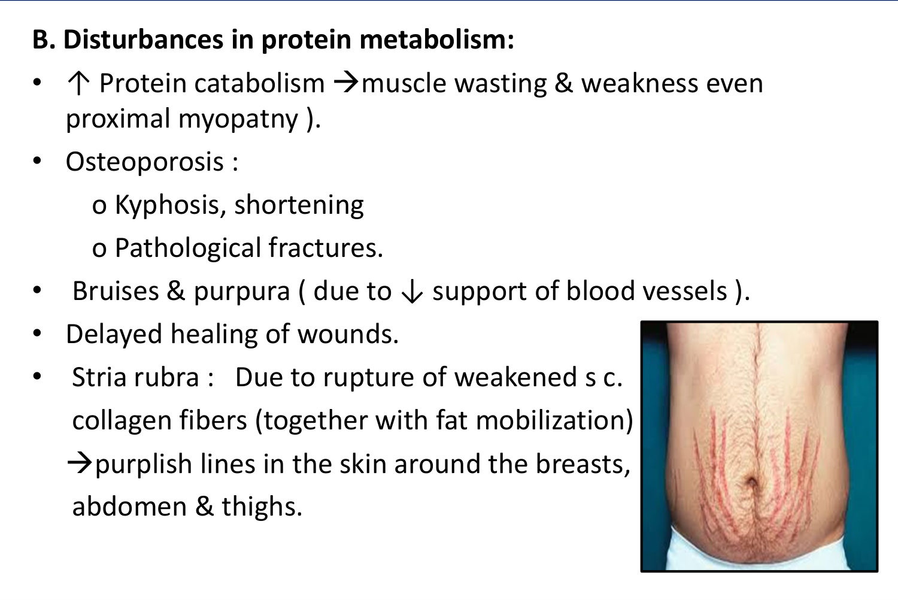

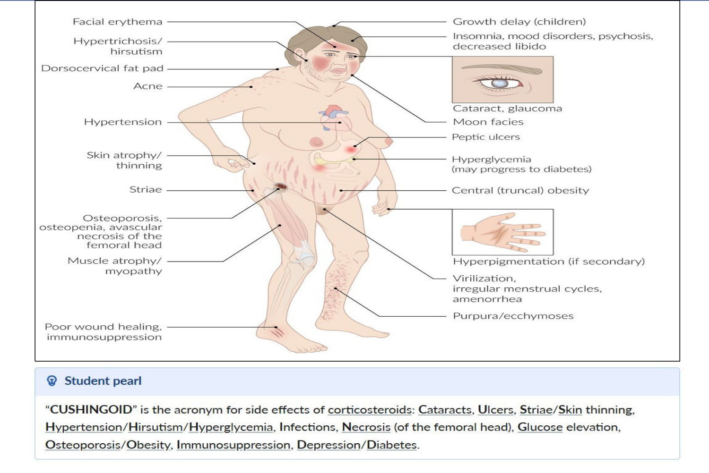

> ⭐ **Mnemonic (slide 29): CUSHINGOID** = **C**ataracts · **U**lcers · **S**triae/**S**kin thinning · **H**ypertension/**H**irsutism/**H**yperglycaemia · **I**nfections · **N**ecrosis (femoral head) · **G**lucose elevation · **O**steoporosis/**O**besity · **I**mmunosuppression · **D**epression/**D**iabetes.
> *[added] Most discriminating signs vs simple obesity: **proximal myopathy, easy bruising, wide purple striae (> 1 cm), thin skin**.*

### 2.11 Investigations (Slides 30–33) ⭐

**1. Suggestive:**
- **hypokalaemic alkalosis**, hypernatraemia
- **↑ RBC, ↓ lymphocytes and eosinophils**
- **impaired glucose tolerance**
- X-ray: **osteoporosis**, unsuspected fractures

**2. Confirmatory (hypercortisolism):**

| Test | Detail |
|---|---|
| **Plasma cortisol** | N **5–20 µg/dL at 8 am**. ⭐ **The earliest sign is loss of diurnal variation** (normally 4 pm cortisol < 50% of 8 am), then persistent elevation |
| ⭐ **24-h urinary free cortisol** | **Most reliable index of hypercortisolism** (± 17-OH-corticosteroids) |
| ⭐ **Overnight dexamethasone suppression** | **1 mg at 11 pm** → 8 am cortisol **< 7 µg/dL excludes** hypercortisolism (*[added]* modern cut-off < 1.8 µg/dL) |

**3. Differentiate the three forms:**

| Test | **Pituitary** | **Adrenal** | **Ectopic** |
|---|---|---|---|
| ⭐ **Plasma ACTH** | **High** | **Low or absent** | **Very high** |
| ⭐ **High-dose dexamethasone** (2 mg 6-hourly × 2 days) | **≥ 50% suppression** of cortisol / 17-OHCS | **No effect** | **No effect** |

**4. Localisation:**
- **Adrenal:** abdominal **US and CT**, adrenal venography.
- **Pituitary:** sellar X-ray detects only **10–15%**; **CT detects 85% of microadenomas**; **MRI is better**.
- **Ectopic:** **CXR** for bronchial carcinoma.
- **Pearl (slide 33):** in **Cushing disease**, CT/MRI shows **bilateral hyperplasia** of the zona fasciculata and reticularis (ACTH drive).

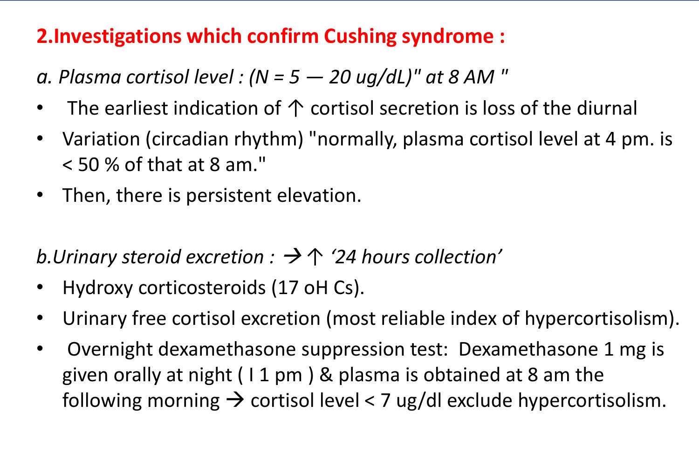 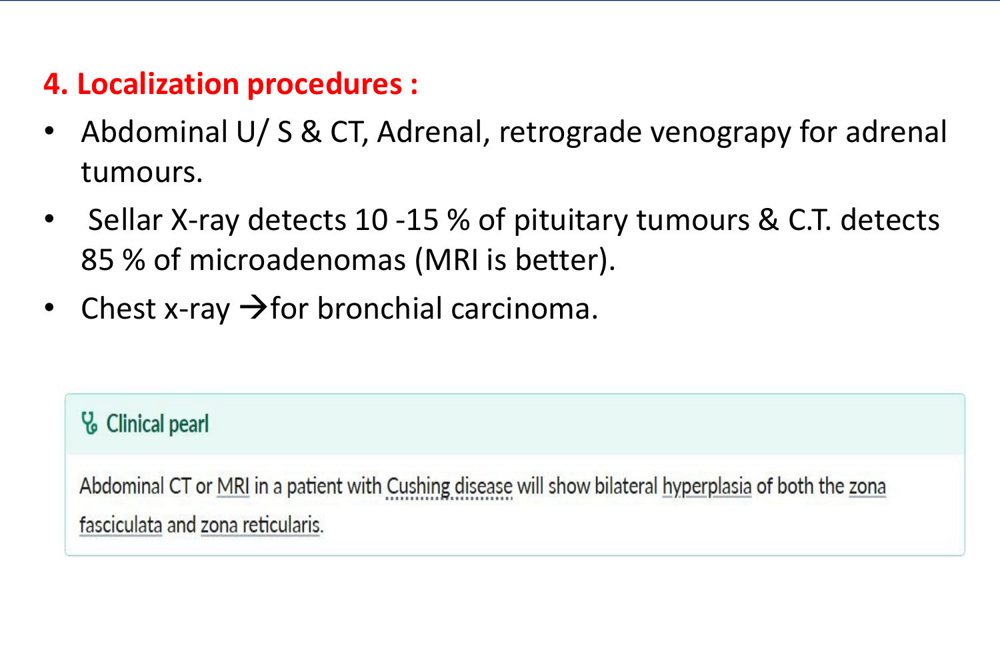

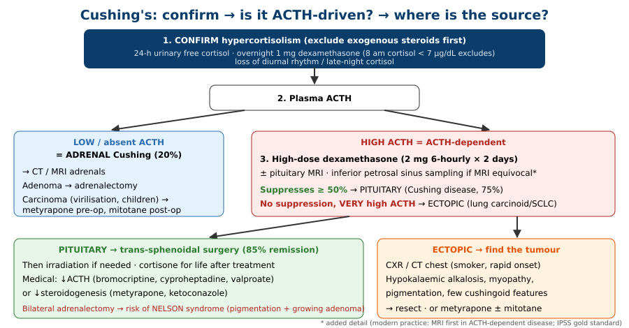

### 2.12 Differential Diagnosis (Slide 34)
- **Simple obesity, essential HTN and DM** (alone or combined): obesity is **generalised**; cortisol and urinary end products are **normal**.
- **Other causes of obesity:** myxoedema, Fröhlich's syndrome. Other causes of hirsutism and osteoporosis.
- ⭐ **Oral oestrogen-containing contraceptives:** ↑ **cortisol-binding globulin** → ↑ total plasma cortisol (not a true excess). *[added] Use urinary free cortisol.*
- **Liver cell failure:** impaired cortisol metabolism → Cushing-like features with raised cortisol, but liver disease dominates.
- ⭐ **Pseudo-Cushing's:** **chronic alcoholism, severe illness, depression, obesity** → mild ↑ cortisol and **absent diurnal variation**.

### 2.13 Treatment (Slides 35–37) ⭐

| Cause | Treatment |
|---|---|
| ⭐ **Pituitary Cushing** | **(a) Trans-sphenoidal hypophysectomy**: **85% remission**. **(b) Irradiation** (proton beams, alpha particles). After treatment: **cortisone for life** (if insufficient). **(c) Medical**: ↓ ACTH release (**bromocriptine, cyproheptadine** (hypothalamic serotonin antagonist), **sodium valproate** (GABA-transaminase inhibitor)); ↓ steroidogenesis |
| **Adrenal adenoma** | **Removal** |
| **Adrenal carcinoma** | **Removal**. **Pre-op: metyrapone** (blocks 11-deoxycortisol → cortisol). **Post-op: mitotane** (adrenolytic) for residual disease |
| **Ectopic** | **Surgical removal of the tumour**, or **metyrapone ± mitotane** |

**Pearls:**
- Patients who develop **adrenal insufficiency after surgery** need **lifelong glucocorticoid replacement**.
- **Enzyme inhibitors** (metyrapone, **ketoconazole**) **suppress cortisol synthesis**; **glucocorticoid antagonists** (*[added]* mifepristone) block cortisol action in the tissues.

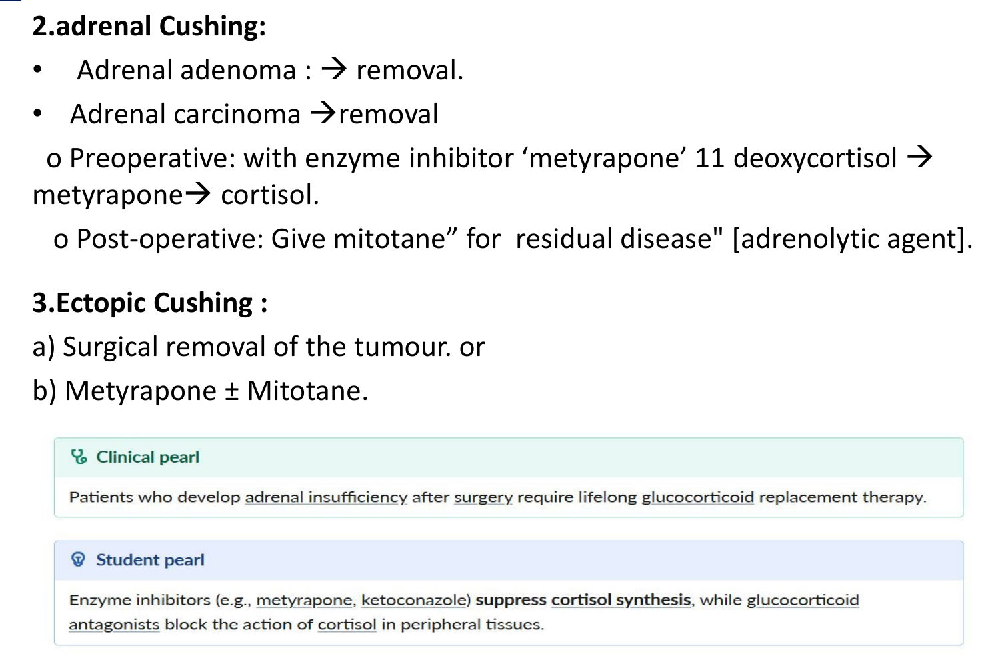 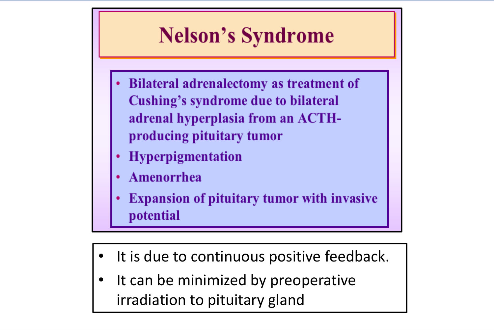

**Nelson's syndrome (slide 37)** ⭐
- **Cause:** **bilateral adrenalectomy** as treatment for Cushing's from bilateral adrenal hyperplasia due to an ACTH-producing pituitary tumour.
- **Features:**
    - **hyperpigmentation**
    - **amenorrhoea**
    - **expansion of the pituitary tumour**, with **invasive potential**
- **Mechanism:** **loss of cortisol negative feedback** (the slide says "continuous positive feedback").
- **Prevention:** **pre-operative pituitary irradiation**.

> 🔁 **Recap: Cushing's.**
> - **Causes:** exogenous steroids (commonest overall); endogenous: pituitary 75% (Cushing disease), adrenal 20%, ectopic (SCLC, carcinoid).
> - **Features:** moon face, buffalo hump, truncal obesity, thin limbs, proximal myopathy, osteoporosis, bruising, purple striae, HTN, DM 15%, depression, hirsutism.
> - **Clues:** virilisation → carcinoma; hypoK + pigmentation → ectopic.
> - **Confirm:** urinary free cortisol (most reliable), overnight 1 mg dex (< 7 excludes), loss of diurnal rhythm.
> - **Find the source:** ACTH (low = adrenal; high = pituitary; very high = ectopic); high-dose dex suppresses only pituitary. MRI pituitary, CT adrenal, CXR.
> - **Treatment:** trans-sphenoidal (85%), adrenalectomy, metyrapone/mitotane. Bilateral adrenalectomy → Nelson's.

---

## 3. High-Yield Comparison Tables

### Table A: Adrenal Zones
| Zone | Hormone | Regulator | Excess | Deficiency |
|---|---|---|---|---|
| Glomerulosa | Aldosterone | Angiotensin II, K⁺ | **Conn's** | Addison's (1ry only) |
| Fasciculata | Cortisol | ACTH | **Cushing's** | Addison's / 2ry AI |
| Reticularis | Androgens | ACTH | Virilisation (carcinoma, CAH) | ↓ axillary and pubic hair (♀) |
| Medulla | Catecholamines | Sympathetic | **Pheochromocytoma** | — |

### Table B: Hypertension + Hypokalaemia by Renin and Aldosterone
| Renin | Aldosterone | Diagnosis |
|---|---|---|
| **↓** | **↑** | **Primary hyperaldosteronism** (Conn's adenoma, bilateral hyperplasia) |
| **↑** | **↑** | **Secondary**: renal artery stenosis, renin-secreting tumour, diuretics, malignant HTN, CHF, cirrhosis |
| **↓** | **↓** | **Pseudo**: Cushing's, CAH (11β/17α), exogenous mineralocorticoid, **liquorice**, **Liddle's** *[added]* |

### Table C: Cushing's Subtypes
| | **Pituitary** | **Adrenal** | **Ectopic** |
|---|---|---|---|
| Share | 75% | 20% | ~5% |
| Typical patient | **Woman of childbearing age** | **Child** (carcinoma); adult (adenoma) | **Older male smoker** |
| ACTH | ↑ | **↓** | **↑↑** |
| High-dose dex | **Suppresses** | No | No |
| Pigmentation | ± | **No** | **Yes** |
| HypoK alkalosis | Mild | Mild | **Marked** |
| Clue | Gradual, classic features | **Virilisation (carcinoma)** | Rapid, weight loss, myopathy, few classic signs |
| Imaging | **Pituitary MRI** | **Adrenal CT** | **CXR / CT chest** |
| Rx | **Trans-sphenoidal** | **Adrenalectomy** (± metyrapone/mitotane) | **Resect tumour** / metyrapone ± mitotane |

### Table D: Dexamethasone Tests
| Test | Dose | Purpose | Interpretation |
|---|---|---|---|
| **Overnight (low-dose)** | **1 mg at 11 pm** | **Screen / confirm** | 8 am cortisol **< 7 µg/dL → excludes** |
| **High-dose** | **2 mg 6-hourly × 2 days** | **Pituitary vs others** | **≥ 50% suppression → pituitary**; no effect → adrenal/ectopic |

---

## 4. Rules, Exceptions, Patterns

| Rule | Exception / nuance |
|---|---|
| Aldosterone excess → oedema? | **No oedema** in Conn's (aldosterone escape); oedema appears in **2ry** states |
| Measure renin as is | **Stop antihypertensives first** (they alter renin) |
| Spironolactone for Conn's | Lecture prefers **amiloride** (no gynaecomastia/impotence); *[added]* eplerenone |
| Adenoma on CT = cause | Confirm lateralisation with **adrenal venous sampling** before surgery |
| Cushing's = pituitary | Pituitary is commonest **endogenous** cause; **exogenous steroids** are commonest overall *[added]* |
| Cushing's = obese, round face | **Ectopic** may lack classic features (rapid course): **hypoK + pigmentation + myopathy** |
| High plasma cortisol = Cushing's | **OCP** (↑ CBG), **liver failure**, **pseudo-Cushing's** (alcohol, depression, obesity) |
| High-dose dex suppresses cortisol | **Only pituitary** (ACTH partly feedback-sensitive) |
| Bilateral adrenalectomy cures Cushing disease | **Nelson's syndrome**: pigmentation + enlarging pituitary tumour |
| Hypokalaemia → weakness | Can cause **episodic paralysis, ileus and IGT** |

---

## 5. Clinical Correlations
- **Young hypertensive on 3 drugs with K⁺ 2.8** → screen for **Conn's** (aldosterone:renin ratio).
- **Hypertensive on a thiazide with low K⁺** → could be the drug, but persistent hypokalaemia off diuretics → Conn's.
- **Liquorice eater with HTN, low K⁺, low renin and low aldosterone** → pseudo-hyperaldosteronism *[added]*.
- **Woman of 30 with weight gain, depression, irregular menses, purple striae, proximal weakness** → **Cushing disease** (lecture case).
- **Older male smoker, rapid weakness, weight loss, pigmentation, K⁺ 2.5, ACTH very high** → **ectopic ACTH (SCLC)**.
- **Child with Cushing's features + virilisation** → **adrenal carcinoma**.
- **Asthma patient on long-term oral prednisolone with moon face** → **exogenous (iatrogenic) Cushing's**. *[added]* Don't stop abruptly (→ adrenal crisis, lecture 13).
- **Alcoholic with cushingoid look and mildly raised cortisol** → **pseudo-Cushing's**: features resolve with abstinence.

---

## 6. Rapid Revision (Last-Day)
1. **GFR = salt, sugar, sex**: glomerulosa (aldosterone, RAAS), fasciculata (cortisol, ACTH), reticularis (androgens, ACTH); medulla = catecholamines.
2. Cortisol: gluconeogenesis, protein catabolism, fat redistribution, Na retention/K loss, ↑RBC, ↓eosinophils and lymphocytes, anti-inflammatory.
3. **Conn's:** adenoma **60%**, bilateral hyperplasia **40%**, carcinoma rare.
4. **HTN + hypokalaemia** (weakness, paralysis, ileus, arrhythmia, IGT, polyuria) + **metabolic alkalosis** (tetany) + **NO oedema** (aldosterone escape).
5. **↑ aldosterone, ↓ renin**, **ARR > 20**; **stop antihypertensives** before renin.
6. Confirm: **oral Na load** (urine aldosterone > 12 µg/day) or **saline infusion** (aldosterone > 10 ng/dL); fludrocortisone and captopril tests.
7. Then **adrenal CT → adrenal venous sampling** → unilateral: **adrenalectomy**; bilateral: **MRA / amiloride** (amiloride 40 mg avoids gynaecomastia).
8. **2ry hyperaldosteronism:** ↑ renin (RAS, HF, nephrotic, cirrhosis). **Pseudo:** ↓ renin, ↓ aldosterone (Cushing's, CAH, exogenous MC, Liddle's).
9. **Cushing's:** **pituitary 75%** (basophil microadenoma), **adrenal 20%**, **ectopic** (bronchogenic carcinoma, carcinoid, thymoma); **exogenous** = commonest overall.
10. **Moon face, buffalo hump, truncal obesity, thin limbs, proximal myopathy, osteoporosis, bruises, purple striae, HTN, DM 15%, plethora, depression, hirsutism/amenorrhoea.**
11. **Virilisation → carcinoma; hypoK + pigmentation + myopathy → ectopic; children → carcinoma; smokers → ectopic; women of childbearing age → pituitary.**
12. Confirm: **loss of diurnal rhythm** (earliest), **24-h urinary free cortisol** (most reliable), **overnight 1 mg dex** (< 7 excludes).
13. Source: **ACTH** low (adrenal) / high (pituitary) / very high (ectopic); **high-dose dex** (2 mg 6-hourly × 2 days) suppresses **pituitary only**.
14. Localise: adrenal CT, pituitary **MRI** (CT 85%; X-ray 10–15%), CXR.
15. DDx: simple obesity, **OCP (↑ CBG)**, liver failure, **pseudo-Cushing's** (alcohol, depression).
16. Treatment: **trans-sphenoidal (85%)**, irradiation, bromocriptine/cyproheptadine/valproate; adrenal → removal (**metyrapone pre-op, mitotane post-op**); ectopic → resect or metyrapone ± mitotane. Lifelong steroids if insufficiency develops.
17. **Nelson's:** bilateral adrenalectomy → pigmentation + amenorrhoea + expanding invasive pituitary tumour; prevent with pre-op pituitary irradiation.

---

## 7. Exam-Style Questions

**Q1 (lecture case 1, slides 38–39).** A 32-year-old woman has weight gain, weakness, irregular menses, depression, difficulty rising from a chair, HTN, plethoric face, central obesity and violaceous striae. Midnight cortisol is high twice, 24-h urinary cortisol is high, and **ACTH is elevated (136 pg/mL)**. Next step in evaluation?
A. MRI head with contrast · B. Inferior petrosal sinus sampling · C. High-dose dexamethasone suppression test · D. Low-dose dexamethasone suppression test · E. CT abdomen · F. Ketoconazole · G. Bilateral adrenalectomy

> **Answer: A. MRI of the head with contrast.** *[reasoning added; key not on slides]*
> - Hypercortisolism is already **confirmed** (two late-night cortisols + urinary free cortisol), so **D is redundant**.
> - **ACTH is high = ACTH-dependent**. A woman of childbearing age with gradual classic features most likely has **Cushing disease**. Current guidance images the **pituitary first** (MRI). If MRI is negative or equivocal → **IPSS (B)**.
> - **⚠️ Lecture caveat:** this lecture's algorithm (slide 32) uses the **high-dose dexamethasone test (C)** to separate pituitary from ectopic. If the examiner follows the slides, **C** is defensible. Know both.
> - **CT abdomen (E)** is for **ACTH-independent** (low ACTH) disease.
> - F and G are treatment, not evaluation.

**Q2 (lecture case 2, slides 40–41).** A 42-year-old hypertensive man (BP 150/102) has **K⁺ 2.8**. Off enalapril: **aldosterone 35 ng/dL, renin 0.4**, and oral salt loading **fails to suppress** aldosterone. Next step?
a) Adrenal venous sampling · b) Spironolactone · c) Fludrocortisone suppression test · **d) Adrenal CT scan** · e) Adrenalectomy · f) MRI abdomen

> **Answer: d. Adrenal CT.** *[reasoning added]*
> - **Primary hyperaldosteronism is confirmed** (high ARR + non-suppression).
> - Next is **subtype identification with adrenal CT** (slide 21), then **adrenal venous sampling (a)** to lateralise before surgery.
> - **c** is another confirmatory test, which is no longer needed.
> - **e** comes before lateralisation, which is wrong.
> - **b** is treatment for bilateral disease or poor surgical candidates.

**Q3.** Which finding best suggests **ectopic ACTH** rather than pituitary Cushing's?
A. Purple striae · B. Buffalo hump · **C. Hypokalaemic alkalosis with hyperpigmentation and rapid myopathy** · D. Suppression on high-dose dexamethasone · E. Woman aged 30

> **Answer: C** (slide 28).
> - D and E favour **pituitary**.

**Q4.** A hypertensive man has K⁺ 2.9, ↑ aldosterone and ↑ renin. Most likely?
A. Conn's adenoma · **B. Renal artery stenosis (secondary hyperaldosteronism)** · C. Liddle's syndrome · D. Exogenous mineralocorticoid · E. 11β-hydroxylase deficiency

> **Answer: B.**
> - ↑ renin + ↑ aldosterone = **secondary** (slides 20–21).
> - **A** has ↓ renin.
> - **C, D and E** have ↓ renin and ↓ aldosterone.

**Q5.** Years after bilateral adrenalectomy for Cushing disease, a patient develops deep skin pigmentation, headaches and a bitemporal field defect. Diagnosis?
A. Addison's disease · **B. Nelson's syndrome** · C. Ectopic ACTH · D. Haemochromatosis · E. Adrenal crisis

> **Answer: B** (slide 37).
> - Loss of cortisol feedback → **ACTH-secreting pituitary tumour enlarges** (field defect) with **hyperpigmentation**.

---

## 8. Exam Pitfalls & Traps
- **Conn's has NO oedema.** Aldosterone escape is the reason, and it is an MCQ favourite.
- **Stop antihypertensives before measuring renin.** ACEI/ARBs and diuretics ↑ renin; β-blockers ↓ renin *[added]*.
- **Slide 15 lists "hypernatraemia"** in Conn's. Na⁺ is usually **high-normal** because of aldosterone escape *[added]*.
- **Slide 18 prefers amiloride** over spironolactone (anti-androgen effects). Standard guidelines use **spironolactone/eplerenone** for bilateral hyperplasia *[added]*.
- **Slide 19 lists Bartter's** among hypertensive K-losing states. Bartter's is **normotensive** (unlike Liddle's) *[added]*.
- **Overnight dex cut-off:** the slide says **< 7 µg/dL** excludes. Modern guidelines use **< 1.8 µg/dL** (more sensitive) *[added]*. Use the lecture value in the lecture exam.
- **Next step after confirmed ACTH-dependent Cushing's:** the lecture uses **high-dose dex**; current practice is **pituitary MRI**, then IPSS. Read the stem (slides vs AMBOSS-style).
- **"Cushing's disease" ≠ "Cushing's syndrome".** Disease = pituitary only.
- **OCP users** have ↑ total cortisol from ↑ CBG. Use **urinary free cortisol**.
- **Nelson's mechanism:** the slide says "continuous positive feedback"; strictly it is **loss of negative feedback** from cortisol.
- **Metyrapone** blocks **11β-hydroxylase** (11-deoxycortisol → cortisol). **Mitotane** is **adrenolytic**.
