# Adrenal Disorders II: Adrenal Insufficiency, Addisonian Crisis, CAH, Pheochromocytoma, Hypogonadism & Hirsutism
**Internal Medicine Department** | Source: `13-Adrenal insufficiency – CAH – Pheochromocytoma.pdf` (52 slides)

> **Legend:** ⭐ = high-yield · *[added]* = not on slides. Images marked "Slide N" come from the lecture; "Added diagram" = drawn for these notes.

> 🔗 **Bridge from earlier lectures:**
> - **Adrenal I:** zones and the steroid pathway (21-, 11β-, 17α-hydroxylase). Too much cortisol was Cushing's; here it is **too little**.
> - **Pituitary II:** **Simmonds disease vs Addison's** (pale vs pigmented, normal vs high K⁺) and the rule **steroid before thyroxine**.
> - **Hypertension:** pheochromocytoma's **5 P's** and metanephrines; **α before β**.
> - **Hyperparathyroidism / Thyroid 2:** **MEN 2A** (medullary thyroid cancer + pheo + parathyroid). This lecture's case.
> - **Pituitary I:** prolactin and Klinefelter (hypogonadism).

---

## 1. Title / Objectives

| Domain | Objective | Likely tested as |
|---|---|---|
| Knowledge | Aetiology of adrenal disorders | Autoimmune 80%, TB, Waterhouse–Friderichsen |
| Knowledge | ⭐ Manifestations and management of **hypo**adrenalism | Pigmentation, ↓Na ↑K, ACTH stimulation test |
| Knowledge | Causes and manifestations of **hirsutism** | PCOS vs CAH vs tumour |
| Skill | ⭐ Interpret investigations | 1ry vs 2ry vs 3ry AI; CAH enzyme from BP and K⁺ |
| Skill | ⭐ Emergency management | **Adrenal crisis: hydrocortisone 100 mg IV + saline + dextrose immediately** |
| Skill | ⭐ Pheochromocytoma management | **α-blockade before β-blockade** |

**Main subtopics:** Addison's (causes, picture, investigations, DDx) · adrenal crisis · CAH (17α, 21, 11β) · pheochromocytoma · male hypogonadism · hirsutism.

---

## 2. Main Content (Lecture Order)

### 2.1 Addison's Disease (Chronic Adrenal Failure): Causes (Slide 5) ⭐

| Type | Causes |
|---|---|
| **A. Primary** (adrenal) | ⭐ **Autoimmune adrenalitis: 80% of primary**. Alone or with other autoimmune endocrinopathies (**T1DM, hypothyroidism**, hypogonadism, hypoparathyroidism, pernicious anaemia) = ⭐ **Schmidt syndrome** (*[added]* APS-2) · ⭐ **TB of the adrenals: 10–20%** · **bilateral adrenalectomy**, congenital enzyme defects · **sarcoidosis, metastases, amyloidosis, haemochromatosis** |
| **B. Secondary** | **Hypopituitarism** (Simmonds disease) |
| **C. Tertiary** | ↓ **CRH**. ⭐ **Commonest cause: sudden withdrawal of chronic glucocorticoid therapy** |

- **Clinical pearl:** secondary and tertiary AI are **far more common** than primary.
- *[added]* Other primary causes: adrenal haemorrhage (anticoagulants, **Waterhouse–Friderichsen**), HIV/CMV, fungal infection, adrenoleukodystrophy, drugs (ketoconazole).

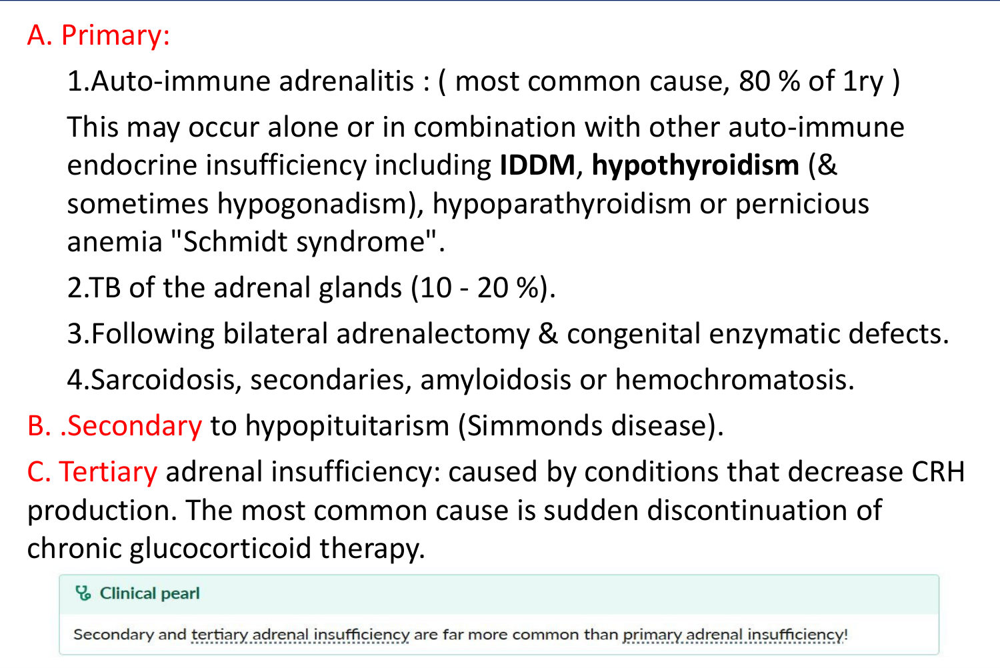

### 2.2 Clinical Picture (Slides 7–11) ⭐
**Onset:** usually **insidious**, in adult life; slowly progressive.

| # | Feature | Detail |
|---|---|---|
| 1 | **Asthenia** | **Muscle weakness** (+ **cramps** from hyponatraemia), **weight loss** (lack of cortisol, hyperkalaemia, hypoglycaemia) |
| 2 | ⭐ **Hypotension** | ⭐ **SBP ≥ 110 mmHg (slide: "→ 110") excludes Addison's**. **Postural hypotension** is common (hypovolaemia, dehydration) |
| 3 | **Hypoglycaemia** | Drowsiness, hunger pain, even **coma** |
| 4 | ⭐ **Hyperpigmentation** (skin and mucous membranes) | **Sites:** face, neck, groins, axillae, **nipples**, **friction areas**, **scars**, umbilicus, sun-exposed areas; **mouth, tongue, rectum** (buccal mucosa). **Mechanism:** ↓ cortisol → **↑ ACTH → ↑ MSH (and lipotropin)**; destruction of the medulla diverts tyrosine to **melanin**. ⭐ **NOT a feature of Simmonds disease** |
| 5 | **Loss of adrenal androgen** | **↓ axillary and pubic hair in WOMEN** (men keep testicular androgen); **infertility and amenorrhoea** |
| 6 | **GIT** | Nausea, vomiting, **diarrhoea** (even steatorrhoea) |
| 7 | **Polyuria** | **Na diuresis**. Renal-angle tenderness in adrenal TB |
| — | **Addisonian crisis** | May be the first presentation |

**Clinical pearl:** **signs of aldosterone deficiency** (salt craving, hyperkalaemia, hypotension) separate **primary** from secondary/tertiary.

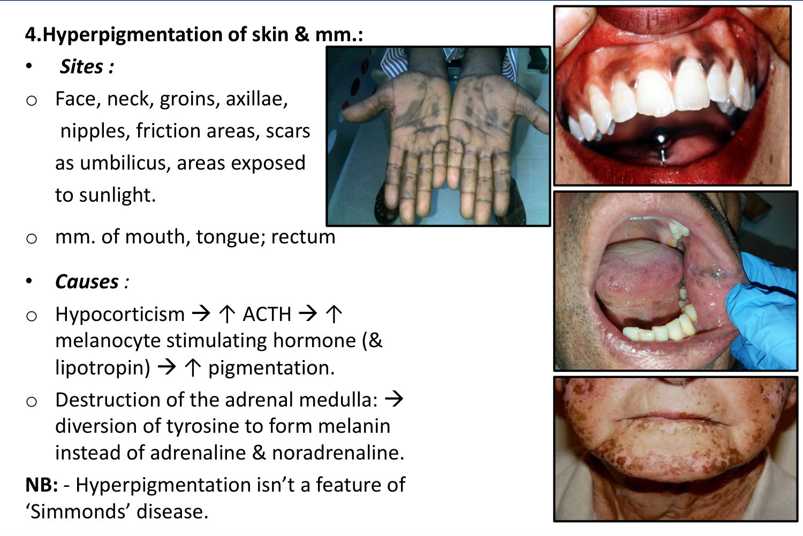 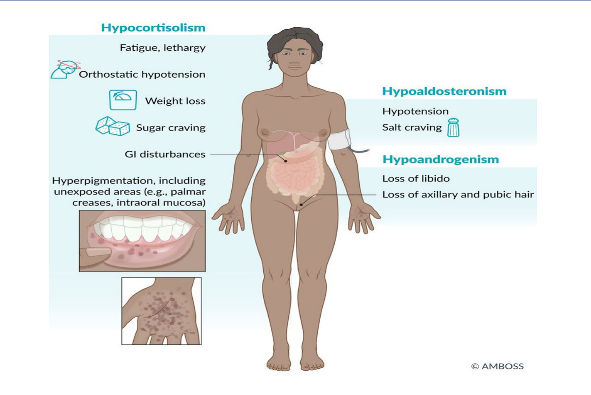

**Slide 11: features by hormone and level** ⭐

| Hormone loss | Clinical | Labs | 1ry | 2ry | 3ry |
|---|---|---|---|---|---|
| **Hypoaldosteronism** | Hypotension, **salt craving** | **↓Na, ↑K, normal anion gap metabolic acidosis** | ✓ | **Absent** | **Absent** |
| **Hypocortisolism** | Weight loss, anorexia, fatigue, depression, myalgia, weakness, **GI symptoms**, **sugar craving**, orthostatic hypotension | **Hypoglycaemia, hyponatraemia** | ✓ | ✓ | ✓ |
| **Hypoandrogenism** | ↓ libido, ↓ axillary and pubic hair | **↓ DHEA-S** | ✓ | ✓ | ✓ |

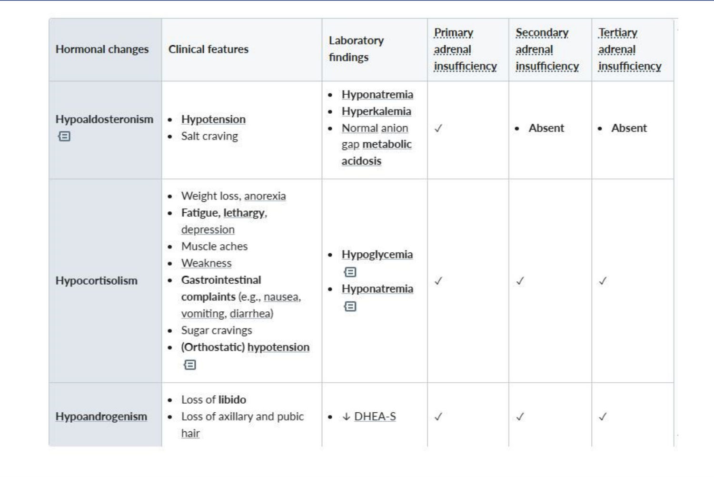

### 2.3 Investigations (Slides 12–15) ⭐

| # | Test | Finding |
|---|---|---|
| 1 | **Plasma cortisol** | **↓** (morning) |
| 2 | ⭐ **Morning ACTH** (if cortisol low) | **Primary → ↑ ACTH**; **secondary/tertiary → low or normal** |
| 3 | **24-h urine** | ↓ cortisol, 17-OHCS, 17-ketosteroids |
| 4 | ⭐ **ACTH (cosyntropin) stimulation test: GOLD STANDARD** | **Normal: cortisol ↑ ≥ 6 µg/dL above basal** (*[added]* modern: peak ≥ 18 µg/dL). **Primary → no response**. **Secondary → normal response**. **Tertiary → none or mild** (adrenal atrophy from lack of stimulation) |
| 5 | **Biochemistry** | ⭐ **↓ Na, ↓ Cl; ↑ K; acidosis; ↑ Ca; ↓ glucose** |
| 6 | **Urine** | ↑ volume; **↑ Na and Cl, ↓ K excretion** |
| 7 | **Blood picture** | **Normochromic anaemia, haemoconcentration, eosinophilia, lymphocytosis** |
| 8 | **Cause** | **Adrenal antibodies** (*[added]* 21-hydroxylase Ab) → autoimmune; **X-ray: adrenal calcification** (TB), pulmonary TB |

**Slide 14 summary (and caution):**

| | Morning cortisol | Morning ACTH | ACTH stimulation |
|---|---|---|---|
| **Primary** | ↓ | **↑** | **No increase** |
| **Secondary/tertiary** | ↓ | **↓** | **Increase** |
| **Long-standing secondary/tertiary** | ↓ | ↓ | **No or very little increase** (atrophy) |

⚠️ **Caution:** keep a **low threshold for screening**. **Up to 50% of patients present in adrenal crisis**, often from a missed or delayed diagnosis.

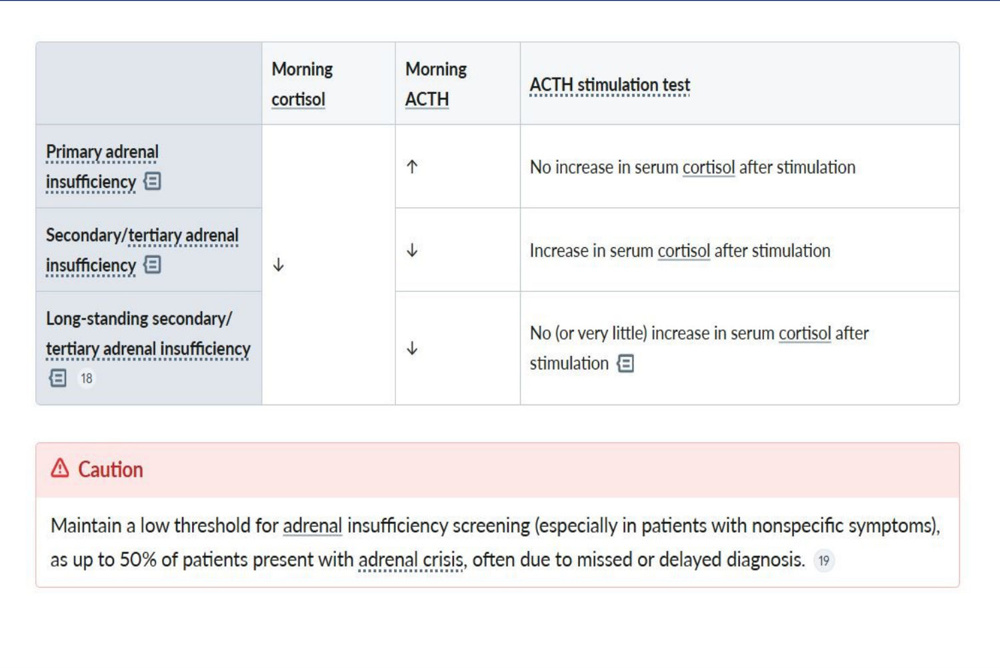 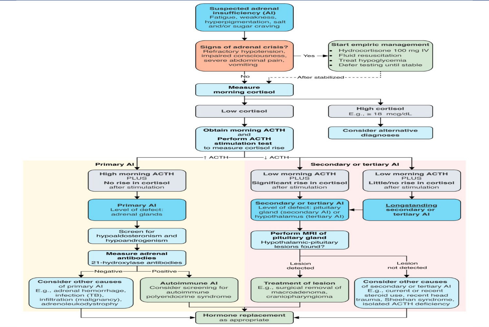

**Algorithm (slide 15):**
1. Suspected AI: **signs of crisis?** → **empiric hydrocortisone 100 mg IV, fluids, treat hypoglycaemia; defer testing until stable**.
2. Otherwise measure **morning cortisol**:
    - **high (≥ 18 µg/dL)** → consider alternative diagnoses
    - **low** → **morning ACTH + ACTH stimulation test**
3. Interpret:
    - **↑ ACTH + no rise** = **primary** → screen for hypoaldosteronism and hypoandrogenism → **adrenal (21-hydroxylase) antibodies**:
        - positive → autoimmune; screen for **polyendocrine syndrome**
        - negative → haemorrhage, infection (TB), malignancy, adrenoleukodystrophy
    - **↓ ACTH + rise** = **secondary/tertiary** → **pituitary MRI**:
        - lesion → treat it (macroadenoma, craniopharyngioma)
        - none → recent steroid use, head trauma, **Sheehan**, isolated ACTH deficiency

### 2.4 Differential Diagnosis (Slide 16)
1. **Secondary hypoadrenalism** (no pigmentation, normal K⁺)
2. **Other causes of pigmentation:** racial, **haemochromatosis**, porphyria, acanthosis nigricans, neurofibromatosis
3. **Asthenia + pigmentation:** **pellagra**, **CML** (especially on **busulfan**), **CRF**, chronic **arsenic** poisoning, thyrotoxicosis, advanced malignancy, malabsorption

### 2.5 Treatment (Slide 17) ⭐
**A. Replacement:**
- **Glucocorticoid:** **prednisolone 5 mg morning + 2.5 mg evening** (*[added]* or hydrocortisone 15–25 mg/day in 2–3 doses)
- ⭐ **Mineralocorticoid:** **fludrocortisone 0.1 mg** (slide: "every other day"; *[added]* usually daily), **primary only**
- **Active TB → anti-TB therapy**

**B. Stress dosing ("sick-day rules"):**

| Situation | Action |
|---|---|
| **Minor illness** (dental extraction, URTI) | ⭐ **Double the dose** until resolved |
| **Elective major surgery** | **Hydrocortisone 100 mg IV the night before**, then **100 mg every 8 h**; taper over **3–5 days** to the usual dose |
| **Catastrophes / emergencies** (trauma, MI, major emergency surgery) | **Treat as acute adrenal failure** |

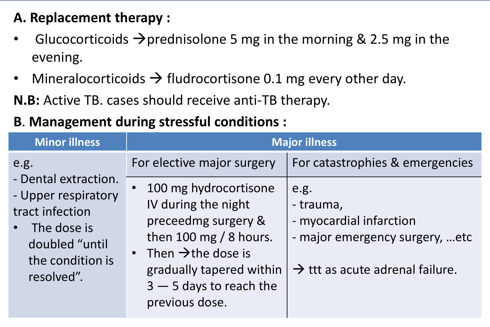

> 🔁 **Recap: Chronic AI.** Primary: autoimmune 80% (Schmidt), TB 10–20%, metastases, haemorrhage. Secondary: pituitary. Tertiary: steroid withdrawal (commonest overall). Features: weakness, weight loss, postural hypotension (SBP ≥ 110 excludes), hypoglycaemia, **pigmentation (primary only)**, ↓ female body hair, GI upset, salt craving. Labs: ↓Na ↑K acidosis ↑Ca ↓glucose, eosinophilia. ACTH stimulation (gold standard): primary no rise + high ACTH; secondary rise + low ACTH. Treatment: prednisolone 5 + 2.5 mg + fludrocortisone 0.1 mg (primary); double the dose for minor illness, IV hydrocortisone for surgery.
> 🔗 **Link:** Untreated or stressed, chronic insufficiency decompensates within hours.
> ▶️ **Up next: Adrenal crisis.**

---

### 2.6 Acute Adrenal Failure: Addisonian Crisis (Slides 18–21) ⭐
**Causes:**
1. **Undiagnosed patient** presenting spontaneously or with intercurrent illness
2. ⭐ Patient on cortisone facing severe illness **without increasing the dose**
3. ⭐ **Sheehan syndrome treated with thyroxine alone, without cortisone**
4. **After bilateral adrenalectomy** or pituitary surgery
5. ⭐ **Sudden corticosteroid withdrawal**
6. ⭐ **Acute meningococcal septicaemia → adrenal haemorrhage** = **Waterhouse–Friderichsen syndrome**
7. **Medical therapy for adrenal carcinoma** (metyrapone, mitotane)
8. **Massive adrenal vein thrombosis** (pregnancy, puerperium, burns)

**Clinical picture:**
- **Sudden** severe weakness, **confusion**, ⭐ **abdominal pain**, anorexia, nausea, **vomiting**, diarrhoea
- **Dehydration → hypotension → shock**
- **Untreated → coma and death within 24 h**

**Caution:** most adrenal insufficiency is subclinical and only shows during **stress** (surgery, trauma, infection), when the cortisol requirement rises. ⭐ **Consider adrenal crisis in any patient with hypotension refractory to fluids and/or vasopressors.**

**Investigations:** ↓ Na, ↑ K, ↓ cortisol.

**Treatment (slide 21)** ⭐
1. **Correct volume and electrolytes**: **IV saline + glucose 10%**
2. ⭐ **Hydrocortisone (Solu-Cortef) 100 mg IV**, then **100 mg IV infusion every 8 h** (in 5% glucose), tapering to the maintenance dose **within 5 days**
3. **Fludrocortisone 0.1 mg/day**, added when hydrocortisone has fallen to **100 mg/day** (*[added]* high-dose hydrocortisone has enough mineralocorticoid effect)
4. **Treat infection** and other precipitating factors

> ⭐ **The 5 S's (slide 21):** **S**alt (0.9% saline) · **S**ugar (50% dextrose) · **S**teroids (**hydrocortisone 100 mg IV once, then 200 mg over 24 h**) · **S**upport (saline for hypotension and electrolytes) · **S**earch (for the underlying cause).

⚠️ **Caution:** adrenal crisis is life-threatening. **Start high-dose hydrocortisone IMMEDIATELY, without waiting for diagnostic confirmation.** *[added] Draw cortisol and ACTH first if it doesn't delay treatment. If testing is needed later, use **dexamethasone**, because it doesn't cross-react with the cortisol assay.*

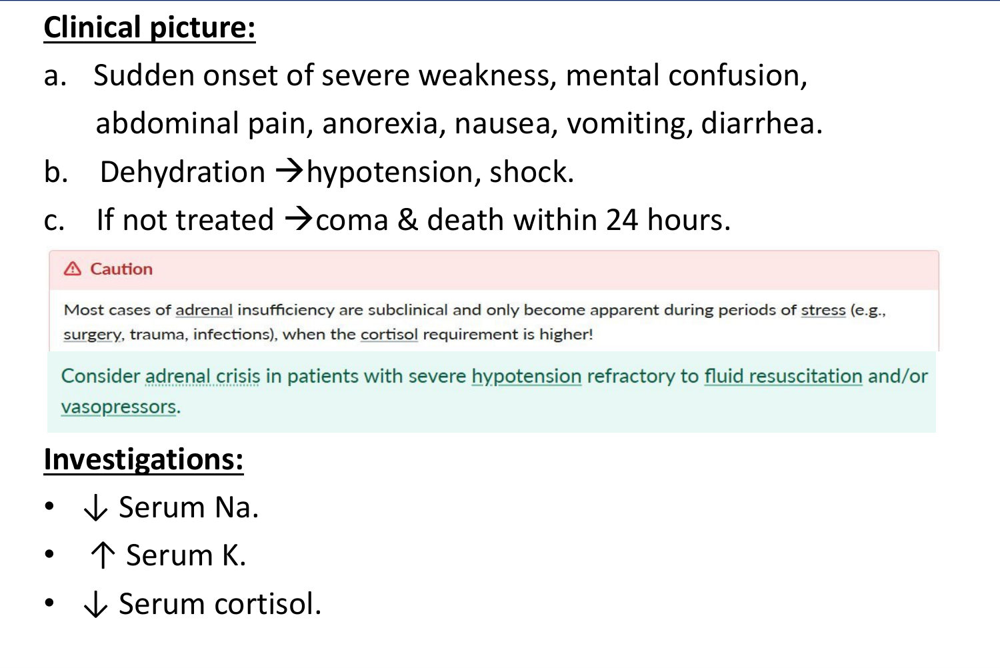 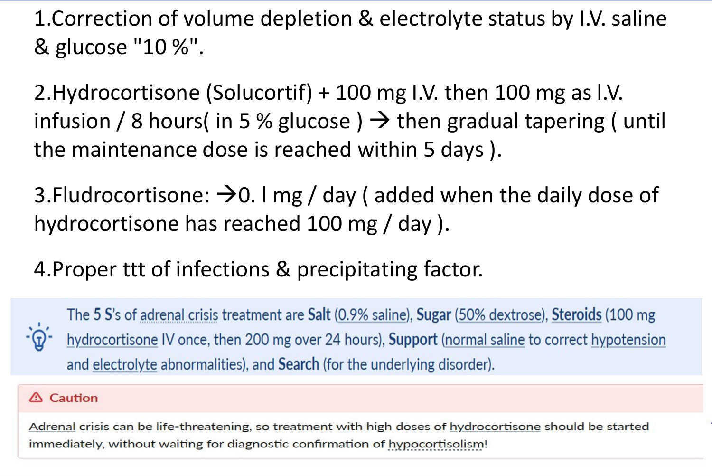

> 🔁 **Recap: Crisis.** Triggers: illness without stress dosing, steroid withdrawal, thyroxine before steroid in Sheehan, adrenalectomy, meningococcaemia (Waterhouse–Friderichsen), adrenal vein thrombosis. Shock, abdominal pain, vomiting, confusion → death within 24 h. Give hydrocortisone 100 mg IV now (no waiting), then 100 mg every 8 h; IV saline + dextrose; fludrocortisone when hydrocortisone ≤ 100 mg/day; treat the trigger.
> 🔗 **Link:** Some patients are born unable to make cortisol because of a single missing enzyme.
> ▶️ **Up next: Congenital adrenal hyperplasia.**

---

### 2.7 Congenital Adrenal Hyperplasia (Adrenogenital Syndrome) (Slides 22–26) ⭐
**Definition:** inherited (*[added]* **autosomal recessive**, slide 24 pedigree: 1 in 4 affected, 2 in 4 carriers) enzyme defects in cortisol synthesis → **↓ cortisol → ↑ ACTH → adrenal hyperplasia + ↑ synthesis of the hormones proximal to the block** (shunted to androgens).

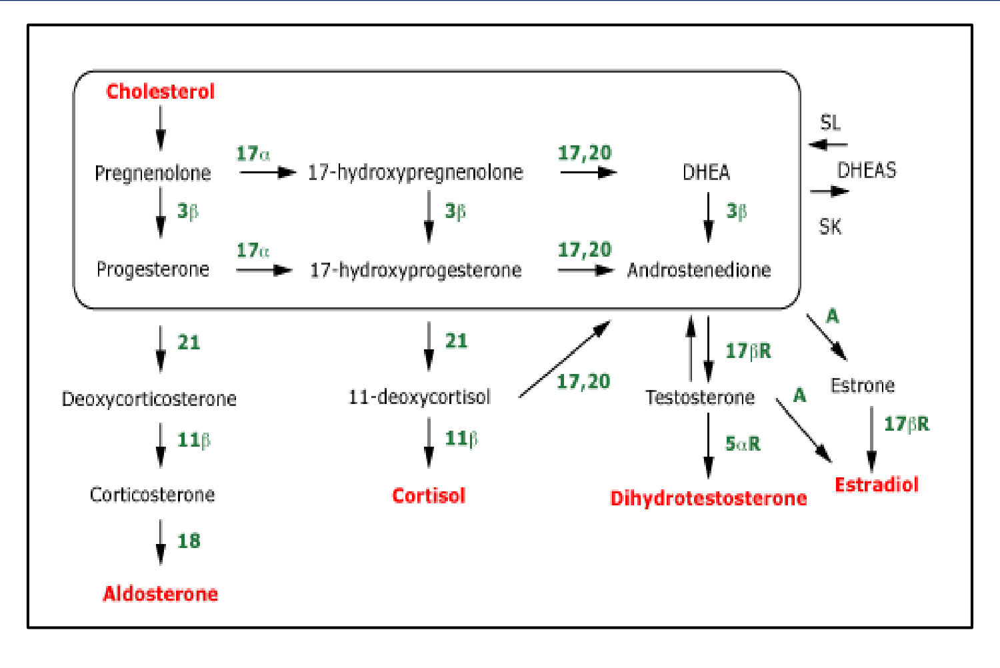 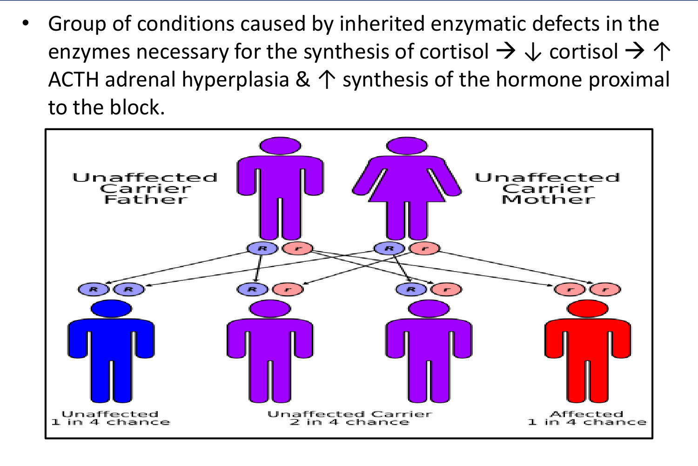

| Enzyme ↓ | Frequency | Hormonal changes | ⭐ Clinical features |
|---|---|---|---|
| ⭐ **21-hydroxylase** | ⭐ **Commonest form** (*[added]* ~95%) | **↓ glucocorticoids AND mineralocorticoids**; **↑ sex steroids** | ⭐ **Salt-losing syndrome** (↓ aldosterone): **hypotension, hyperkalaemia** · **Androgen excess:** girls → **pseudohermaphroditism** (big clitoris, small vagina, fused enlarged labia mimicking a scrotum, **normal internal genitalia**); boys → **precocious puberty** (macrogenitosomia praecox) **without spermatogenesis** (small testes), masculinisation, deep voice, **premature epiphyseal fusion → dwarfism** |
| **11β-hydroxylase** | **~10%** | **↑ 11-deoxycorticosterone** (a mineralocorticoid), 11-deoxycortisol and **androgens**; ↓ cortisol | ⭐ **Hypertension** (+ hypokalaemia *[added]*) · **virilisation** → female pseudohermaphroditism · **precocious puberty** |
| **17α-hydroxylase** | **Extremely rare** | **↓ glucocorticoids AND sex hormones**; **↑ mineralocorticoids** | ⭐ **HTN + hypokalaemia** · females: **sexual infantilism** (no puberty) · males: **pseudohermaphroditism** (undervirilised) |

> **Mnemonic** *[added]*: Look at the number.
> - **"1" first (17, 11) → HTN** (mineralocorticoid builds up).
> - **"1" second (21, 11) → virilisation** (androgens build up).
> - **11β** has both → **HTN + virilisation**.
> - **21** → **hypotension + virilisation** (salt-wasting).
> - **17** → **HTN + no androgens** (infantilism / undervirilised males).

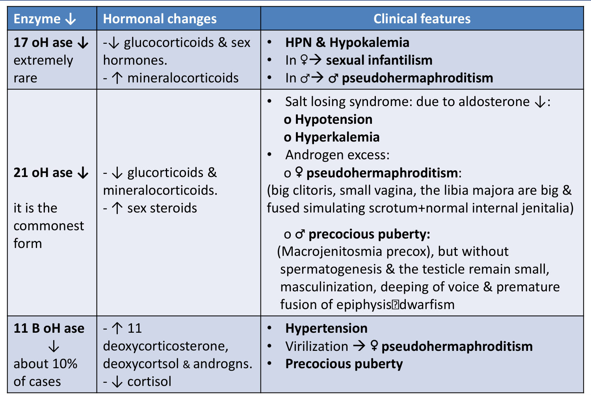

*[added] Diagnosis of 21-OH deficiency: ⭐ **↑ 17-hydroxyprogesterone** (neonatal screening). 11β: ↑ 11-deoxycortisol. Salt-wasting crisis in a newborn boy at 1–3 weeks is easily missed (normal genitalia).*

**Treatment (slide 26):**
1. **Replacement:**
    - **Prednisolone 7.5 mg/day** replaces cortisol and **suppresses ACTH**, which → **↓ BP** (hypertensive forms) and **↓ androgens** (virilising forms).
    - **Fludrocortisone 0.1 mg/day** in **mineralocorticoid-deficient** (salt-losing) forms.
2. **Surgical correction** of female pseudohermaphroditism.

- **Pseudohermaphroditism** = **phenotypic** sex disturbance; **true hermaphroditism** = **chromosomal** sex disturbance. They are told apart by **sex chromatin** (karyotype).
- **Pearl:** CAH patients **need glucocorticoid replacement for life**, and **stress dosing** during infection, illness or surgery.

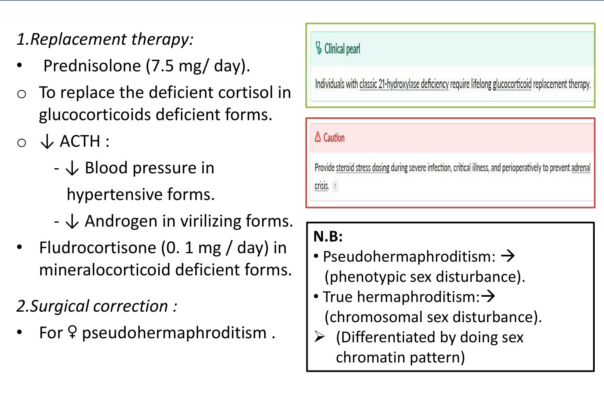

> 🔁 **Recap: CAH.** AR enzyme block → ↓ cortisol → ↑ ACTH → hyperplasia + shunting. **21-OH (commonest):** salt loss (↓BP, ↑K) + virilisation (ambiguous girls, precocious boys, short adults); ↑ 17-OHP. **11β (~10%):** HTN + virilisation (↑ DOC). **17α (rare):** HTN + hypoK + no sex steroids (infantile girls, undervirilised boys). Treatment: prednisolone (suppresses ACTH) ± fludrocortisone; genital surgery; stress dosing.
> 🔗 **Link:** Moving from cortex to medulla, the catecholamine tumour.
> ▶️ **Up next: Pheochromocytoma.**

---

### 2.8 Pheochromocytoma (Slides 27–35) ⭐
**Definition:** a **catecholamine-releasing tumour** (*[added]* of chromaffin cells). Commonly a **benign solitary adenoma**, more on the **right**.

> ⭐ **Rule of 10s:** **10% bilateral · 10% malignant · 10% extra-adrenal** (*[added]* paraganglioma) **· 10% in children** (*[added]* also 10% familial, 10% normotensive; modern data show ~30–40% hereditary).

- ⭐ **Familial:** part of **MEN 2** (*[added]* 2A and 2B): pheochromocytoma, **medullary thyroid carcinoma**, **hyperparathyroidism** = **Sipple's syndrome** (MEN 2A). *[added] Also VHL, NF1, SDH mutations.*

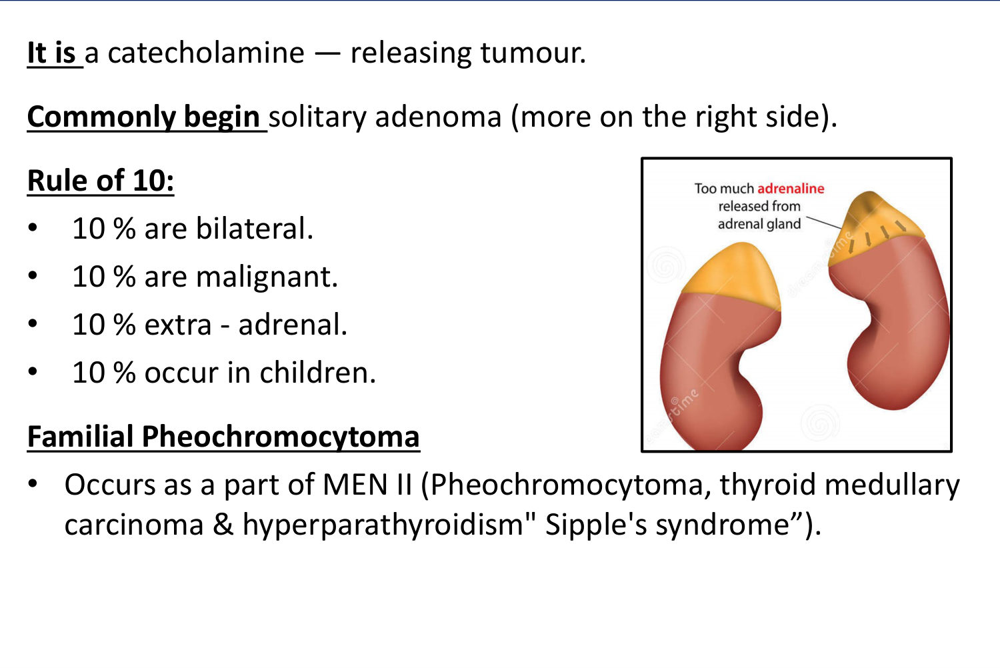 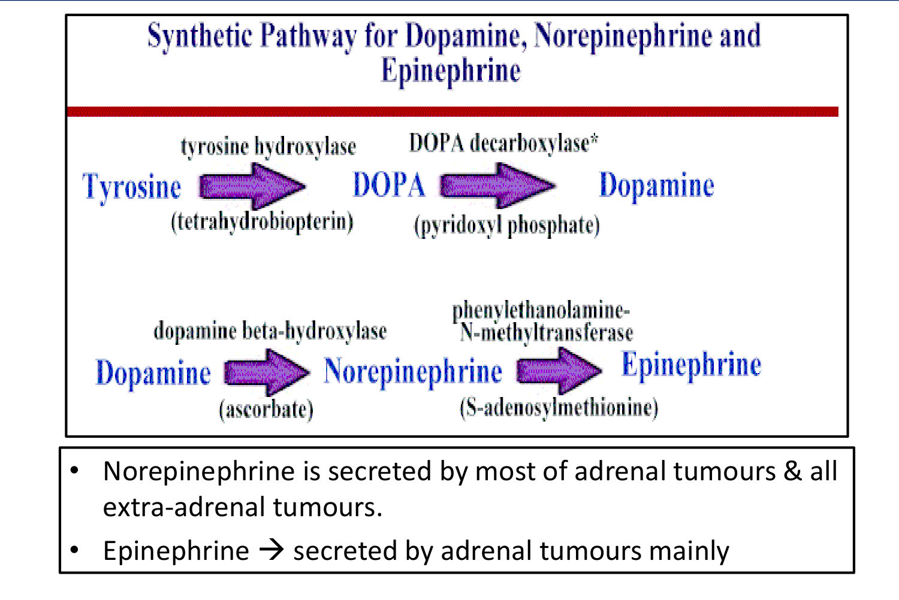

**Catecholamine synthesis (slide 29):**
1. **Tyrosine** →(tyrosine hydroxylase)
2. **DOPA** →(DOPA decarboxylase)
3. **Dopamine** →(dopamine β-hydroxylase)
4. **Noradrenaline** →(PNMT)
5. **Adrenaline**

- **Noradrenaline** is secreted by **most adrenal** and **all extra-adrenal** tumours.
- **Adrenaline** comes **mainly from adrenal** tumours. *[added]* PNMT needs high local cortisol, which is only present in the adrenal.

**Clinical manifestations (slides 30–31):**
- ⭐ **Episodic headache, palpitations (rapid heartbeat), sweating, anxiety**, lasting minutes or longer, variable in severity and frequency
- Nausea, vomiting, **tremor**, chest or abdominal pain
- **Cold hands and feet, pale skin, facial pallor** (α-vasoconstriction)
- ⭐ **Hypertension: paroxysmal in 50%, persistent in 50%**; **postural hypotension** can occur
- **Complications** of HTN in the CVS and CNS (*[added]* catecholamine cardiomyopathy, stroke, MI)
- **Constipation, ischaemic enterocolitis**
- **Masses** in the abdomen or neck
- **Metabolic:** **diabetogenic** (β: ↑ glycogenolysis; α: ↓ insulin secretion)
- ⭐ **Attack triggers:**
    - **pressure on the tumour** (palpation, micturition *[added]*)
    - **exercise**
    - **food** (cheese, alcohol: tyramine)
    - **drugs**, especially **β-blockers**
    - **labour**
- **Pearls:**
    - **5 P's** = **P**ressure (HTN), **P**ain (headache), **P**erspiration, **P**alpitations, **P**allor.
    - Patients may be **asymptomatic** (incidentaloma).

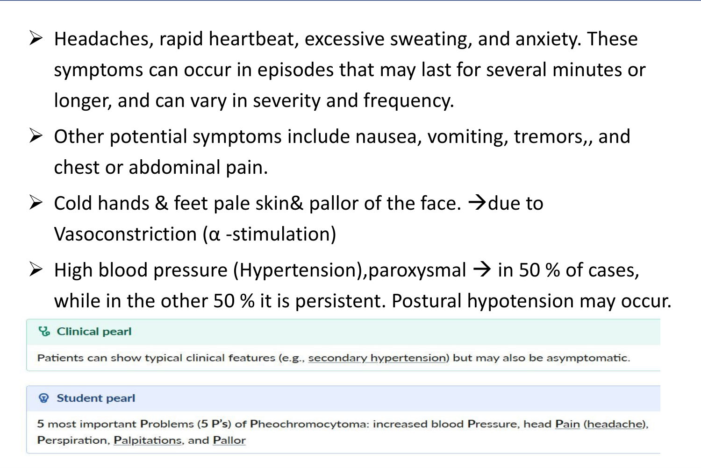

**Investigations (slides 32–33)** ⭐

| # | Test | Note |
|---|---|---|
| 1 | **24-h urine**: ⭐ **metanephrines** (highly sensitive), **free catecholamines**, **VMA** (N 2–6 mg/day) | **False-positive VMA** from **vanilla, chocolate, aspirin** |
| 2 | ⭐ **Plasma free metanephrines** | **Highly sensitive** (*[added]* best initial test) |
| 3 | **Plasma catecholamines** | |
| 4 | **Stimulation tests** (infrequent episodes): **glucagon 1 mg IV** (provokes an attack in 90%), **histamine 50 µg IV** | ⚠️ **Phentolamine must be available** (*[added]* largely obsolete, dangerous) |
| 5 | ⭐ **Clonidine suppression test** (0.3 mg) | Plasma noradrenaline **falls to normal at 3 h in essential HTN**, **not in pheochromocytoma** |
| 6 | **Localisation** | **US, CT, MRI**, **radio-isotope scanning** (*[added]* MIBG, Ga-68 DOTATATE PET); **SVC/IVC venous sampling** for extra-adrenal tumours not found radiologically |

> ⭐ **Order** *[added]*: **biochemistry FIRST (metanephrines), imaging SECOND.** Never biopsy a suspected pheo (→ crisis).

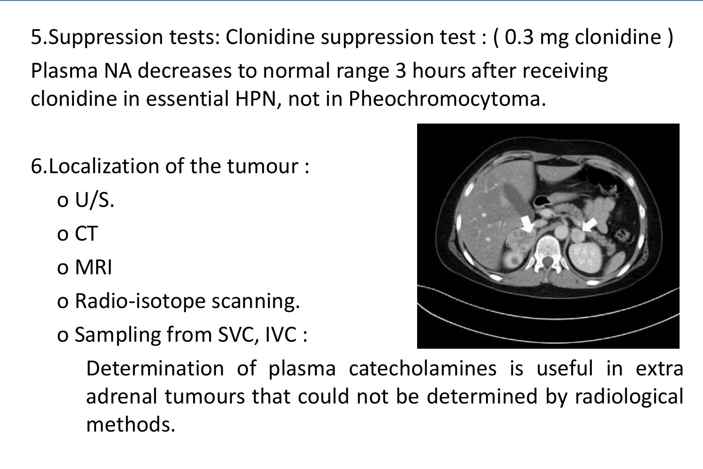

**Treatment (slides 34–35)** ⭐

**A. Surgical:** **stabilise BP with sodium nitroprusside or phentolamine → then surgical removal** (*[added]* laparoscopic adrenalectomy after 10–14 days of α-blockade + high salt and fluids).

**B. Medical:**
- **1. Acute therapy (severe HTN / crisis):**
    - bed rest
    - ⭐ **phentolamine (Regitine) 2–5 mg IV every 5 min**
    - **sodium nitroprusside** 100 mg in 500 mL 5% glucose
    - **propranolol 1–2 mg IV every 5 min** for arrhythmia, **only after adequate α-blockade**
- **2. Prolonged therapy** (e.g., surgery delayed by a recent MI):
    - ⭐ **phenoxybenzamine (Dibenzyline)**: long-acting **α-blocker**, 10 mg twice daily (↑ by 10–20 mg/day up to 40–200 mg/day)
    - **propranolol 20–40 mg/day** **after α-blockade**
    - **metyrosine**: **tyrosine hydroxylase inhibitor**, pre-operatively or in **inoperable** cases

> ⭐ **Student pearl:** treat **PHE**ochromocytoma with **PHE**noxybenzamine, and remember **A**lpha blockers go **A**head, **B**eta blockers **B**ehind.

⚠️ **Caution (slide 35):** **starting β-blockers before α-blockers is contraindicated.** It blocks peripheral β₂ vasodilatation → **unopposed α-stimulation** → vasoconstriction → **life-threatening hypertensive crisis**.

⚠️ **Slide 34 caution:** treat a hypertensive crisis from pheo with **IV antihypertensives that target catecholamine excess** (phentolamine, clevidipine, nicardipine) and **avoid β-blockers**.

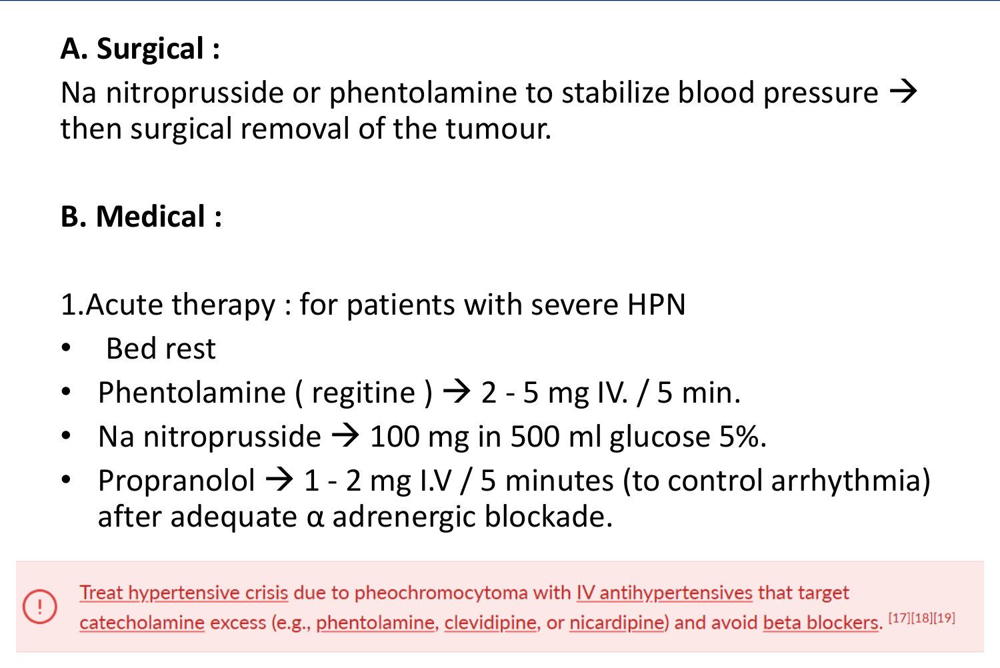 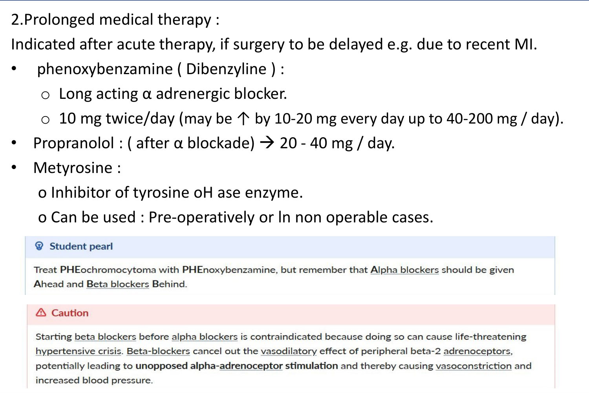

> 🔁 **Recap: Pheochromocytoma.** Catecholamine tumour; rule of 10s; MEN 2A (Sipple). Episodic headache, sweating, palpitations, pallor; paroxysmal (50%) or sustained HTN; postural drop; hyperglycaemia. Triggers: palpation, exercise, tyramine, β-blockers, labour. Tests: plasma or urine **metanephrines** (most sensitive), VMA (false +ve with vanilla, chocolate, aspirin), clonidine non-suppression; then CT/MRI/MIBG. Treatment: **α first** (phenoxybenzamine; acutely phentolamine/nitroprusside), **β after**, metyrosine, then surgery.

---

### 2.9 Male Reproductive Notes: Hypogonadism (Slides 36–38)
- **Leydig cells → testosterone** → feeds back ↓ LHRH → ↓ **LH**.
- **Sertoli cells → inhibin** → ↓ **FSH**; also **Müllerian-inhibiting factor**.
- Most circulating testosterone is bound to **SHBG**.

| ⭐ Pattern | Meaning |
|---|---|
| **↓ LH, ↓ FSH** (↓ testosterone) | **Pituitary/hypothalamic** = **hypogonadotrophic hypogonadism** (*[added]* Kallmann, prolactinoma) |
| **↑ LH, ↑ FSH, ↓ testosterone** | ⭐ **Primary testicular disease**: irradiation, **myotonic dystrophy**, **cystic fibrosis**, ⭐ **Klinefelter** |
| **Normal/↑ LH, FSH and testosterone** | **End-organ (androgen) resistance** |
| **↓ testosterone with NO features** of hypogonadism | **↓ SHBG** (free testosterone normal) |

**Treatment:**
- **Androgen replacement IM, not oral** (liver toxicity).
- Pituitary causes → as before (hMG/hCG for fertility).
- **Hypothalamic causes → pulsatile LHRH** (portable pump).

### 2.10 Hirsutism (Slides 39–47) ⭐
**Definitions:**
- **Hirsutism** (females only) = ↑ hair in **androgen-dependent, male-pattern** areas: face, chest, lower back, lower abdomen, inner thighs.
- **Hypertrichosis** = excess hair **anywhere on the normal body-hair distribution**, in **either sex** (androgen-independent).

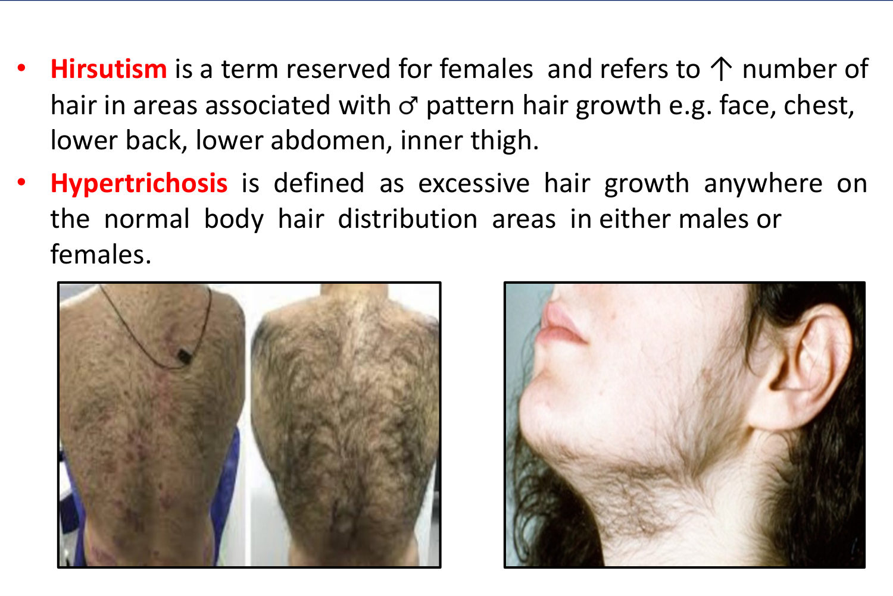 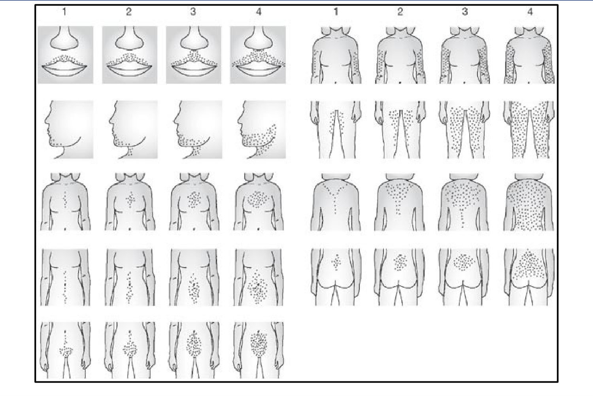

*[added] Slide 41 = **modified Ferriman–Gallwey score**: 9 body areas each scored 0–4; **≥ 8** = hirsutism.*

**Hair facts (slides 42–43):**
- The number of follicles is **set at birth**; hair grows from pilosebaceous units continuously in a **mosaic** pattern (asynchronous).
- Synchronised cycles → transient alopecia or excess.
- **Types:**
    - **lanugo** (fetal)
    - **vellus** (fine adult body hair)
    - **terminal** (thick, pigmented: scalp, pubic)
- **Androgen-sensitive** areas: face, neck, chest, abdomen, axillae, upper arms, inner thighs, pubic hair, part of the scalp.
- **Androgen-independent** areas: forearms, hands, lower legs.

**Causes (slide 44):**

| **Androgen-independent** (hypertrichosis) | **Androgen-dependent** (hirsutism) |
|---|---|
| **Constitutional, familial, racial** | **Ovarian:** neoplastic (**arrhenoblastoma** = Sertoli–Leydig); non-neoplastic: **idiopathic hirsutism**, ⭐ **PCOS** (*[added]* commonest cause) |
| **Starvation, anorexia nervosa** | **Adrenal:** neoplastic (**virilising adrenal tumour**); non-neoplastic: **CAH**, **Cushing's** |
| **Drugs: minoxidil, phenytoin, diazoxide** (*[added]* ciclosporin) | **Drugs: androgens** (*[added]* danazol, anabolic steroids) |

**Diagnostic approach (slide 47)** ⭐
1. **Male-pattern** distribution = **hirsutism**; **generalised** = **hypertrichosis**.
2. **History of drugs before onset?** (OCPs, **danazol, testosterone, anabolic steroids, metoclopramide, methyldopa, phenothiazines, reserpine**) → stop or replace the drug, follow up for regression.
3. **No features of hyperandrogenism** → **idiopathic hirsutism (IH)**.
4. Hyperandrogenism → **rate of onset**:
    - **Gradual, no virilisation = benign** → **PCOS** or **CAH**
    - ⭐ **Rapid onset with virilisation = malignant** → **ovarian** or **adrenal tumour**

| | Testosterone | DHEA-S | Cortisol | 17-OHP | LH/FSH |
|---|---|---|---|---|---|
| **PCOS** | N/↑ | N | N | N | **N/↑** (*[added]* LH:FSH > 2) |
| **CAH** | N/↑ | **↑** | N/↓ | ⭐ **↑** | N |
| **Ovarian tumour** | ⭐ **N/↑ (often > 200 ng/dL)** | **N** | N | N | N/↑ |
| **Adrenal tumour** | ↑ | ⭐ **↑** | **↑** | N | N |

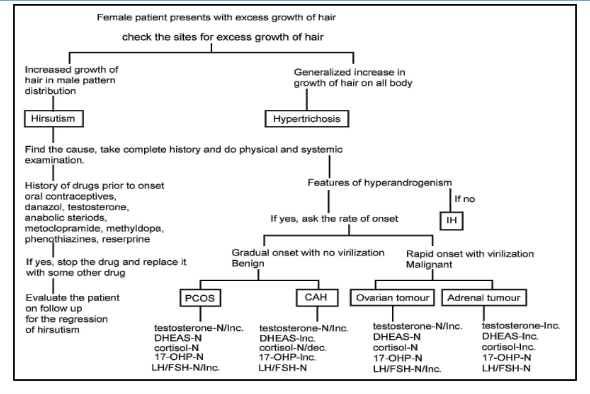

> **Rule** *[added]*: **testosterone very high + normal DHEA-S → ovary**; **DHEA-S very high → adrenal**. **↑ 17-OHP → CAH.**

**Treatment (slides 45–46):**
1. **Treat the cause:** stop the drug, remove tumours, treat medical disorders. ⭐ **Weight reduction = 1st-line for PCOS** in overweight women.
2. **Target organ:**
    - **androgen-receptor competition** at follicles: **spironolactone, flutamide, ketoconazole, cyproterone acetate**
    - **5α-reductase inhibitor**: **finasteride**
    - *[added]* combined OCP is first-line systemic therapy
3. **Recent: eflornithine (Vaniqa 13.9% cream):** irreversibly inhibits **ornithine decarboxylase** (rate-limiting step of follicular polyamine synthesis). Improvement over **4–8 weeks**; minor skin irritation.
4. **Cosmetic:**
    - **Bleaching:** irritation, pruritus, discolouration.
    - ⭐ **Shaving does NOT worsen hirsutism.** It is a good short-term option for facial hair: no effect on anagen rate or duration or on hair diameter; the blunt tip only *looks* thicker.
    - **Plucking/waxing:** scarring, folliculitis, hyperpigmentation.
    - **Depilatory creams:** irritant dermatitis.
    - **Electrolysis:** painful, erythema, scarring.
    - **Laser.**

> 🔁 **Recap: Hypogonadism and hirsutism.**
> - **Hypogonadism:** ↓LH/FSH = pituitary; ↑LH/FSH + ↓T = testicular (Klinefelter); normal/↑ all = resistance. Testosterone IM, not oral; pulsatile LHRH for hypothalamic causes.
> - **Hirsutism** = male-pattern hair in women (androgen-dependent); hypertrichosis = generalised (drugs: minoxidil, phenytoin, diazoxide).
> - **Causes:** PCOS, idiopathic, CAH (↑17-OHP), Cushing's, tumours (rapid + virilisation; ovary ↑T, adrenal ↑DHEA-S).
> - **Treatment:** weight loss (PCOS), anti-androgens (spironolactone, cyproterone, flutamide), finasteride, eflornithine, cosmetic (shaving does not worsen it).

---

## 3. High-Yield Comparison Tables

### Table A: Primary vs Secondary vs Tertiary Adrenal Insufficiency
| | **Primary (Addison's)** | **Secondary (pituitary)** | **Tertiary (hypothalamic)** |
|---|---|---|---|
| Commonest cause | **Autoimmune 80%** (TB 10–20%) | Pituitary tumour/Sheehan | ⭐ **Steroid withdrawal** |
| ACTH | **↑** | ↓/N | ↓/N |
| **Pigmentation** | ⭐ **Yes** | **No** (pale) | No |
| **Aldosterone** | **↓ → hyperK, salt craving, NAGMA** | **Normal** | Normal |
| ACTH stimulation | **No rise** | **Rise** (unless long-standing) | None/mild |
| Fludrocortisone | **Yes** | No | No |

### Table B: CAH Types
| Enzyme | BP | K⁺ | Androgens | Female | Male | Marker *[added]* |
|---|---|---|---|---|---|---|
| **21-OH** (commonest) | **↓ (salt-losing)** | **↑** | **↑** | **Virilised** (ambiguous) | **Precocious puberty** | **↑ 17-OHP** |
| **11β-OH** (~10%) | **↑** | ↓ | **↑** | Virilised | Precocious | ↑ 11-deoxycortisol, ↑ DOC |
| **17α-OH** (rare) | **↑** | **↓** | **↓** | **Sexual infantilism** | **Undervirilised** (pseudohermaphrodite) | ↑ DOC, ↓ 17-OHP |

### Table C: Adrenal Crisis vs Pheochromocytoma Crisis
| | **Adrenal crisis** | **Pheo crisis** |
|---|---|---|
| BP | **Shock** (refractory hypotension) | **Severe paroxysmal HTN** (± postural drop) |
| Glucose | **↓** | **↑** |
| Na/K | **↓Na, ↑K** | N |
| Skin | Pigmented (primary) | **Pale**, sweaty |
| Treatment | **Hydrocortisone 100 mg IV + saline + dextrose** | **Phentolamine / nitroprusside**, then α-blocker; **no β-blocker first** |

### Table D: Hirsutism Causes by Labs (Slide 47)
| Cause | Onset | Key lab |
|---|---|---|
| **PCOS** | Gradual | N/↑ T, ↑ LH/FSH |
| **CAH** | Gradual | **↑ 17-OHP**, ↑ DHEA-S |
| **Ovarian tumour** | **Rapid + virilisation** | **↑ T**, normal DHEA-S |
| **Adrenal tumour** | **Rapid + virilisation** | **↑ DHEA-S**, ↑ cortisol |
| **Idiopathic** | Gradual | All normal |
| **Drugs** | After the drug | — |

---

## 4. Rules, Exceptions, Patterns

| Rule | Exception / nuance |
|---|---|
| Adrenal insufficiency → pigmentation | **Only primary** (↑ ACTH/MSH); secondary/tertiary are **pale** |
| AI → hyperkalaemia | **Only primary** (aldosterone lost); secondary keeps the RAAS |
| Confirm the diagnosis first | ⭐ **Crisis: treat immediately** with hydrocortisone; test later |
| Replace thyroid and adrenal | ⭐ **Steroid before thyroxine** (Sheehan: thyroxine alone → crisis) |
| Fludrocortisone in AI | **Primary only**; in crisis, add it when hydrocortisone is ≤ 100 mg/day |
| Women lose body hair in AI | Men don't (testicular androgen) |
| CAH → virilisation | **17α** → **no** androgens (infantilism) |
| CAH → salt loss | **11β and 17α → hypertension** (DOC accumulates) |
| β-blocker for tachycardia | ⭐ **Never first in pheo**: α-blockade first |
| Paroxysmal HTN = pheo | Only **50%** are paroxysmal; 50% sustained; some normotensive |
| VMA raised = pheo | **False positive**: vanilla, chocolate, aspirin |
| Shaving worsens hair | **No**: it only looks thicker |
| Hirsutism = hypertrichosis | Hirsutism is **androgen-dependent, male-pattern, women only** |

---

## 5. Clinical Correlations
- **Thin, tired woman with tanned skin, dark buccal patches, BP 90/60, Na 128, K 5.8, vitiligo and hypothyroidism** → **autoimmune Addison's (Schmidt/APS-2)** → ACTH stimulation → hydrocortisone + fludrocortisone.
- **Patient on long-term prednisolone who stops abruptly before surgery and becomes hypotensive** → **tertiary AI / crisis** → IV hydrocortisone.
- **Child with meningococcal purpura and refractory shock** → **Waterhouse–Friderichsen**.
- **Sheehan patient started on thyroxine alone who collapses** → precipitated crisis.
- **Newborn girl with ambiguous genitalia; newborn boy vomiting with K 7.2 at 2 weeks** → **21-OH CAH (salt-wasting)** → ↑ 17-OHP.
- **Hypertensive child with virilisation** → **11β-OH CAH**.
- **Hypertensive 16-year-old girl with absent puberty and low K⁺** → **17α-OH CAH**.
- **Young woman with episodic headache, sweating, palpitations, a thyroid nodule and high calcitonin** → **MEN 2A** → metanephrines **before** thyroid surgery (lecture case).
- **Hypertensive given propranolol, then BP rockets** → undiagnosed **pheo** (unopposed α).
- **Woman with rapid-onset hirsutism, clitoromegaly, deep voice, testosterone 300 ng/dL** → **ovarian (Sertoli–Leydig) tumour**.

---

## 6. Rapid Revision (Last-Day)
1. Primary AI: **autoimmune 80%** (± Schmidt: T1DM, hypothyroid, pernicious anaemia), **TB 10–20%**, adrenalectomy, infiltration. Secondary: hypopituitarism. **Tertiary: steroid withdrawal (commonest overall).**
2. Weakness, weight loss, **postural hypotension (SBP ≥ 110 excludes)**, hypoglycaemia, **pigmentation (palmar creases, buccal mucosa, scars, nipples; primary only)**, ↓ female axillary and pubic hair, GI symptoms, polyuria, **salt craving**.
3. Labs: **↓Na ↓Cl ↑K acidosis ↑Ca ↓glucose**; eosinophilia, lymphocytosis, normocytic anaemia.
4. **Morning ACTH:** ↑ primary, ↓/N secondary. **ACTH stimulation = gold standard:** normal ↑ ≥ 6 µg/dL; **primary no rise**, secondary rise, tertiary/long-standing little.
5. Cause: adrenal antibodies; adrenal calcification (TB).
6. Treatment: **prednisolone 5 mg am + 2.5 mg pm + fludrocortisone 0.1 mg (primary)**; minor illness → **double**; major surgery → **hydrocortisone 100 mg IV night before, then 100 mg every 8 h, taper over 3–5 days**.
7. **Crisis triggers:** illness without dose increase, **steroid withdrawal**, **Sheehan on thyroxine alone**, adrenalectomy, **Waterhouse–Friderichsen**, metyrapone/mitotane, adrenal vein thrombosis.
8. Crisis: weakness, confusion, **abdominal pain**, vomiting, **shock** → death within 24 h. Suspect in **fluid/pressor-refractory hypotension**.
9. **Hydrocortisone 100 mg IV immediately** (don't wait), then 100 mg every 8 h; **saline + glucose**; fludrocortisone when hydrocortisone ≤ 100 mg/day; treat the cause. **5 S's.**
10. **CAH:** AR; ↓ cortisol → ↑ ACTH → hyperplasia. **21-OH** (commonest): salt-losing + virilisation. **11β** (10%): **HTN** + virilisation. **17α** (rare): **HTN + hypoK** + sexual infantilism / male pseudohermaphroditism.
11. CAH treatment: **prednisolone 7.5 mg/day** (↓ ACTH) ± **fludrocortisone 0.1 mg**; surgery for ambiguous genitalia; lifelong, with stress dosing.
12. **Pheo:** rule of 10s; right side more often; **MEN 2A (Sipple)**; noradrenaline from all extra-adrenal tumours, adrenaline from adrenal ones.
13. **5 P's**; cold pale extremities; HTN **50% paroxysmal / 50% sustained**; postural hypotension; hyperglycaemia; triggers: tumour pressure, exercise, cheese/alcohol, **β-blockers**, labour.
14. Tests: **urine and plasma metanephrines (most sensitive)**, VMA (false +ve with vanilla, chocolate, aspirin), **clonidine suppression** (normal falls; pheo doesn't), CT/MRI/isotope scan, caval sampling.
15. Treatment: **α first** (**phenoxybenzamine**; acute **phentolamine 2–5 mg IV** or nitroprusside) → **β after** (propranolol) → **metyrosine** if inoperable → **surgery**.
16. **Hypogonadism:** ↓LH/FSH = pituitary; ↑LH/FSH ↓T = testicular (Klinefelter, CF, myotonic dystrophy, irradiation); testosterone **IM** (not oral).
17. **Hirsutism** = male-pattern hair in women. Causes: **PCOS**, idiopathic, CAH, Cushing's, tumours (rapid + virilisation), drugs. Hypertrichosis drugs: **minoxidil, phenytoin, diazoxide**.
18. Treatment: weight loss (PCOS), spironolactone/flutamide/cyproterone/ketoconazole, finasteride, **eflornithine** (ODC inhibitor), cosmetic (**shaving doesn't worsen it**).

---

## 7. Exam-Style Questions

**Q1 (lecture case, slides 48–49).** A 30-year-old woman has an enlarging painful neck swelling, episodic throbbing headaches, sweating and palpitations, HR 112, BP 140/90, a 3-cm thyroid nodule, normal TSH, and **calcitonin 300 ng/dL** (N < 5). Which lab abnormality is most likely?
a) ↑ Serum gastrin · b) ↑ Serum cortisol · c) ↑ Urinary 5-HIAA · d) ↑ Serum T3 · **e) ↑ Plasma metanephrines**

> **Answer: e.** *[reasoning added; key not on slides]*
> - **High calcitonin + thyroid nodule = medullary thyroid carcinoma.**
> - With **episodic headache, sweating and palpitations** → **pheochromocytoma** → **MEN 2A (Sipple)** (slide 28).
> - Wrong options:
>     - gastrin = MEN 1 / ZES
>     - 5-HIAA = carcinoid
>     - T3 = thyrotoxicosis (TSH is normal)
>     - cortisol = Cushing's
> - *[added]* **Remove the pheo first** (after α-blockade), then the thyroid.

**Q2.** A 45-year-old woman has fatigue, weight loss, postural dizziness and **pigmented palmar creases and buccal mucosa**. Na 127, K 5.9, glucose 3.2 mmol/L. Morning cortisol is low and **ACTH is high**; cortisol does not rise after cosyntropin. Treatment?
A. Hydrocortisone alone · **B. Glucocorticoid + fludrocortisone** · C. Thyroxine first · D. Fludrocortisone alone · E. Bromocriptine

> **Answer: B.**
> - **Primary AI** (pigmentation, hyperkalaemia, high ACTH, no response) needs **both** glucocorticoid **and mineralocorticoid** replacement (slide 17).
> - A would suit secondary AI.

**Q3.** A known Addison's patient arrives with vomiting, abdominal pain, confusion and BP 70/40 after 3 days of gastroenteritis. First step?
A. Await cortisol result · B. ACTH stimulation test · **C. Hydrocortisone 100 mg IV + IV saline and dextrose immediately** · D. Fludrocortisone 0.1 mg PO · E. Dopamine infusion

> **Answer: C.**
> - **Adrenal crisis**: treat immediately **without waiting for confirmation** (slide 21).
> - Fludrocortisone is added later, once hydrocortisone is ≤ 100 mg/day.

**Q4.** A newborn girl has ambiguous genitalia, and on day 10 develops vomiting, hypotension, **Na 124 and K 7.0**. Which enzyme is deficient and what is the diagnostic test?
A. 11β-hydroxylase; 11-deoxycortisol · **B. 21-hydroxylase; 17-hydroxyprogesterone** · C. 17α-hydroxylase; DOC · D. Aromatase; oestradiol · E. 5α-reductase; DHT

> **Answer: B.**
> - **Salt-wasting + virilisation** = **21-OH deficiency** (slide 25). *[added]* ↑ 17-OHP.
> - 11β gives **hypertension**.

**Q5.** A patient with paroxysmal hypertension and raised plasma metanephrines is to have surgery. Which pre-operative regimen is correct?
A. Propranolol, then phenoxybenzamine · **B. Phenoxybenzamine, then propranolol once α-blocked** · C. Propranolol alone · D. Hydralazine alone · E. No preparation needed

> **Answer: B.**
> - **α-blockers ahead, β-blockers behind** (slide 35). A β-blocker first → unopposed α → hypertensive crisis.

**Q6.** A 26-year-old woman has 3 months of rapidly worsening facial hair, clitoromegaly and a deepening voice. Testosterone is markedly raised and DHEA-S is normal. Likely source?
A. PCOS · B. 21-OH CAH · **C. Ovarian androgen-secreting tumour** · D. Adrenal carcinoma · E. Idiopathic

> **Answer: C.**
> - **Rapid + virilisation = malignant/tumour**.
> - **High testosterone with normal DHEA-S → ovary** (slide 47).
> - An adrenal tumour would raise **DHEA-S**.

---

## 8. Exam Pitfalls & Traps
- **Pigmentation and hyperkalaemia = PRIMARY AI only.** Secondary/tertiary are pale with normal K⁺ (link to Simmonds disease).
- **SBP ≥ 110 "excludes Addison's"** (slide 7). That is the lecture's rule of thumb; don't over-apply it in a compensated patient.
- **ACTH stimulation threshold:** the slide says a rise of **≥ 6 µg/dL above basal**. Modern guidelines use **peak ≥ 18 µg/dL** *[added]*.
- **Fludrocortisone dose:** slide 17 says **"0.1 mg every other day"**, while the crisis and CAH slides say **0.1 mg/day**. Standard maintenance is **0.05–0.2 mg daily** *[added]*.
- **Crisis hydrocortisone:** the lecture gives **100 mg IV, then 100 mg every 8 h**; the 5 S's box says **100 mg then 200 mg/24 h**. Both are ≈ 200–300 mg/day. Never delay the first 100 mg.
- **Sheehan + thyroxine alone → crisis.** Steroid always goes first.
- **CAH 11β vs 21:** both virilise; **11β → HTN**, **21 → salt-wasting hypotension**.
- **17α-OH:** HTN + hypoK + **no sex steroids** (girls don't go through puberty).
- **Pheo:** **never a β-blocker first**; **never biopsy**; check metanephrines **before** surgery for MTC in MEN 2.
- **VMA false positives:** vanilla, chocolate, aspirin.
- **Glucagon and histamine provocation tests** (slide 32) are **dangerous and obsolete** *[added]*; know them as lecture content only.
- **Hirsutism ≠ hypertrichosis.** Minoxidil, phenytoin and diazoxide cause **hypertrichosis** (androgen-independent).
- **Shaving does not worsen hirsutism.** Slide 46 is explicit.
