# Approach to Skin Lesions
**Dr. Taha Habibullah, Consultant Dermatology** | Source: `Approach_to_Skin_Lesions.pdf` (56 slides)

> **Legend:** ⭐ = high-yield · *[added]* = not on slides. Images marked "Slide N" come from the lecture; "Added diagram" = drawn for these notes. The lecture has **no answer key** for its case; the answer below is **[reasoning added; key not on slides]**.

> 🔗 **Bridge from earlier lectures:**
> - **Pituitary 1 / Adrenal 1 / Adrenal 2:** **hirsutism** work-up by source:
>   - ovary: **PCOS**
>   - adrenal: **Cushing's**, tumours, *[added]* CAH
>   - pituitary: **hyperprolactinaemia, acromegaly**
>   - drugs: **anabolic steroids**
> - **Hypertension / HF (Reihan):** **β-blockers** induce or flare **psoriasis**.
> - **Tuberculosis (Kotb):** **erythema nodosum** (tender nodules; TB, sarcoid); **mycobacterial culture** of skin biopsies.
> - **Haematology 2:** **vitiligo** clusters with **pernicious anaemia** and autoimmune thyroid disease.
> - **FUO & Travel Medicine:** rash patterns as clues: **rose spots** (typhoid), dengue rash/tourniquet test.
> - **Psychiatry:** quality-of-life impact, measured with the **DLQI**.
> - **Psychotropic medication:** *[added]* lithium flares psoriasis and acne.

---

## 1. Title / Objectives

| Domain | Objective | Likely tested as |
|---|---|---|
| Knowledge | Analyse history and examination findings in skin disease | Exacerbating/relieving factors; drug triggers; occupational clues |
| Skill | ⭐ Differentiate conditions by **morphology and distribution**; plan diagnostics | Wood's lamp colours; Auspitz/Nikolsky/dermatographism; biopsy type and transport medium |

**Main subtopics (slide 3):**
- dermatological **history framework**
- systematic **skin examination**
- **investigations**: dermoscopy, biopsy, patch testing, **Wood's lamp**

> ⚠️ **Coverage gap:** **patch testing** is listed in the subtopics but never taught. *[added]* It is the test for **allergic (type IV) contact dermatitis**: allergens are applied under occlusion on the back and read at **48 h and 96 h**.

**Framework (slide 4):** **History → Examination → Investigation → Management.**

---

## 2. Main Content (Lecture Order)

### 2.1 Dermatological History: Structure (Slide 5)
The same skeleton as any history, with skin-specific content:
1. Chief complaint
2. **History of presenting illness**
3. Past medical history
4. Systemic review
5. **Medications and allergies**
6. **Family history**
7. **Social and occupational history**
8. **Travel and environmental exposure**

### 2.2 History of Presenting Illness (Slides 6–12) ⭐⭐

| Item | What to ask |
|---|---|
| **Onset** | When did the rash start? **First episode or recurrent?** |
| **Time course of individual lesions** | How long has each lesion been present? How long before it disappears? *[added: < 24 h → urticaria]* |
| **Pattern of onset and spread** | Where did it start, and how did it spread? |
| **Site of first lesion** | *[added: herald patch → pityriasis rosea]* |
| **Symptoms** | **Itchy? Painful? Burning? Tingling?** *[added: tingling before vesicles → HSV/VZV]* |
| **Exacerbating / relieving factors** | Below |
| **Previous biopsy** | Result |
| **Previous treatment** | Below |
| ⭐ **Quality of life** | Effect on sleep, activities, social life, confidence, job; assessment tool: **Dermatology Life Quality Index (DLQI)** |

**Pigmented or suspicious lesions (slide 9): ask about evolution:**
- **growth** or change in size?
- change in **shape/outline**?
- change in **colour**?
- **new symptoms**: **bleeding, pain, itch**?

*[added]* These map onto the **ABCDE** of melanoma: **A**symmetry, **B**order irregularity, **C**olour variation, **D**iameter > 6 mm, **E**volution. "E" is the most important and is exactly what slide 9 asks about.

**Exacerbating factors (slide 10):**

| Factor | Example |
|---|---|
| **UV exposure** | Flare of **lupus** and **rosacea** |
| **Temperature** | **Hot drinks** flare **rosacea** |
| ⭐ **Drugs** | **β-blocker-induced psoriasis** |
| **Pregnancy** | Flare of **psoriasis** (slide) |
| **Supplements** | **Anabolic steroids → acne** |

*[added]* Psoriasis often *improves* in pregnancy, though it can flare (especially pustular psoriasis of pregnancy) and commonly flares **postpartum**. The slide's example is narrower than reality.

**Relieving factors (slide 11):**

| Factor | Example |
|---|---|
| **UV exposure** | **Sun improves psoriasis** (basis of **phototherapy**) |
| **Moisturising** | Helps **dry skin in dermatitis** |
| **Drugs** | **Antihistamines in urticaria** |

> ⭐ **UV is both:** it **worsens lupus and rosacea** but **improves psoriasis**.

**Previous treatment (slide 12):**
- **steroid-responsive disease?** (supports an inflammatory dermatosis)
- **partial response → altered morphology**: ⭐ **tinea incognito** (topical steroid on a fungal infection removes the scale and active edge)
- **treatment-induced allergic/irritant contact dermatitis** (e.g. to a topical)
- ⭐ **hydroquinone-induced (exogenous) ochronosis**: paradoxical blue-black pigmentation after long-term bleaching cream
- **systemic treatment, phototherapy, laser** history

### 2.3 Past Medical History, Medications, Family & Social History (Slides 13–19) ⭐

**Past medical history and systemic review (slide 13):**
- **related comorbidities**
- **skin signs of systemic disease**, e.g. **PCOS** (acne, hirsutism, *[added]* acanthosis nigricans) and **diabetes** (*[added]* necrobiosis lipoidica, acanthosis, infections)
- ⭐ **contraindications to treatment**, e.g. **methotrexate in liver disease**

**Medications and allergies (slide 14):**
- contraindications
- drug interactions
- **drug-induced disease**, e.g. *[added]* SJS/TEN from allopurinol, carbamazepine, sulfonamides; fixed drug eruption

**Family history (slide 15):**

| Purpose | Conditions |
|---|---|
| **Genetic inheritance** | **Atopic dermatitis, psoriasis, ichthyosis, melanoma** |
| **Outbreak in family (contagious)** | **Chickenpox, scabies, lice** |

**Social and occupational history (slides 16–17):**

| Factor | Effect |
|---|---|
| ⭐ **Smoking** | Aggravates **lupus** and **hidradenitis suppurativa** |
| ⭐ **Alcohol** | Worsens **rosacea**; **interacts with methotrexate** (hepatotoxicity) |
| **Sun exposure** | Sunburn, pigmentation, **wrinkles**, **skin cancer** |
| **Sport** | **Palmar calluses in weightlifters**; **athlete's foot in runners** |
| ⭐ **Work-related contact dermatitis** | Irritant or allergic; look for a **time relation to exposure** and **improvement on vacation** |
| **Work-related infection** | ⭐ **Milker's nodules**, ⭐ **orf** |

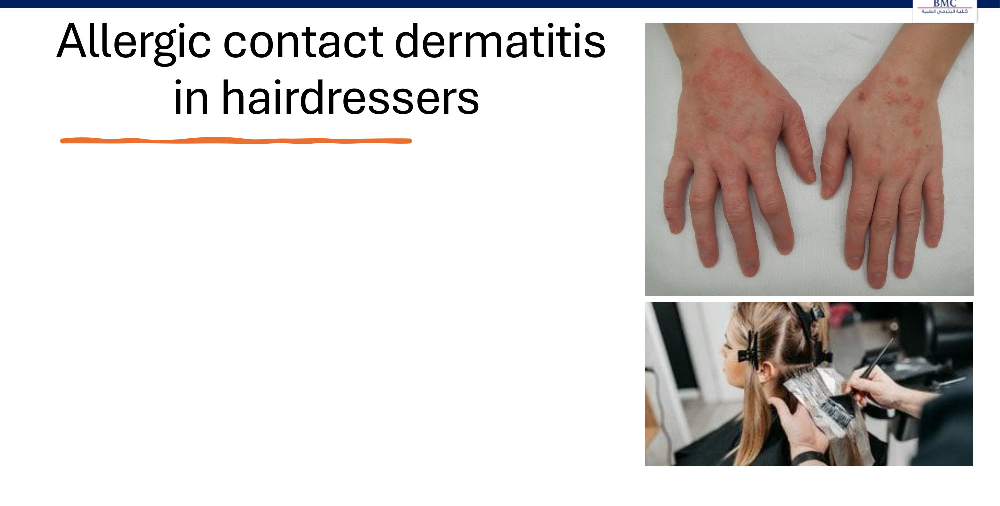

*[added]* Hairdressers react to **para-phenylenediamine (PPD)** in hair dye and to glyceryl thioglycolate.

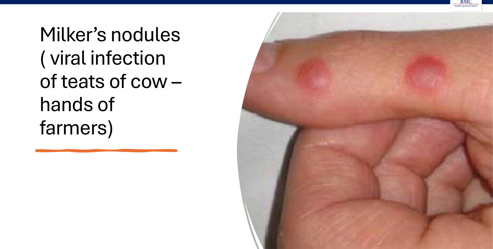

**Milker's nodules:**
- viral infection from **cows' teats**
- lesions on **farmers' hands**
- *[added]* paravaccinia, a **parapoxvirus**
- the clinically identical **orf** comes from **sheep/goats**
- both are self-limiting

> 🔁 **Recap: History.**
> - **Lesion timeline:** onset, recurrence, duration of each lesion, spread, first site, symptoms.
> - **Triggers:** UV (lupus/rosacea ↑, psoriasis ↓), **β-blockers → psoriasis**, anabolic steroids → acne, hot drinks → rosacea.
> - **Treatment history:** tinea incognito, hydroquinone ochronosis.
> - **Background:** methotrexate + liver disease/alcohol; smoking → lupus/HS; family history (atopy, psoriasis, melanoma; scabies outbreaks).
> - **Occupation:** vacation improvement = occupational dermatitis; milker's nodules/orf.
> - **Quality of life:** DLQI.
>
> 🔗 **Link:** history narrows the list; **morphology** clinches the diagnosis.
>
> ▶️ **Up next: Skin examination.**

### 2.4 Skin Examination: Principles (Slides 20–22) ⭐⭐

**Setting (slide 20):**
- ⭐ **proper light**; **natural sunlight is best**
- **complete skin exam is ideal**, to detect **patterns or hidden lesions**
- include ⭐ **mucous membranes, scalp, hair and nails**
- **tools:** **magnifying lens, side lighting, dermatoscope, Wood's lamp**

**Visual and tactile inspection: steps of morphology (slide 21):**
1. ⭐ **Primary and secondary lesions**
2. **Colour**
3. **Shape**
4. **Configuration / arrangement**
5. **Distribution**

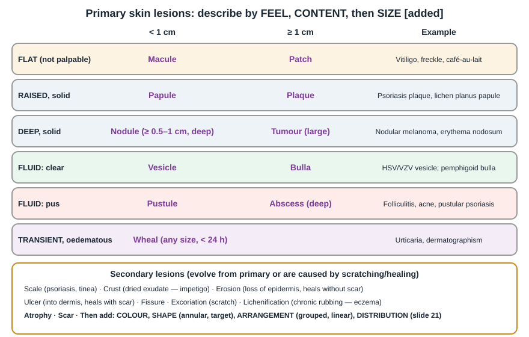

> *[added]* The lecture names "primary and secondary lesions" (and the summary slide lists macules, papules, plaques, nodules) but never defines them. The diagram fills that gap; the definitions are standard.

**Palpation (slide 22):**

| Property | Example condition |
|---|---|
| **Temperature** (warm) | **Cellulitis, abscess** |
| **Tenderness** | ⭐ **Erythema nodosum**, **neuroma** |
| **Consistency** | **Nodular melanoma** (firm), **neurofibroma** (soft, "button-hole" sign *[added]*), **cyst** |
| **Infiltration** (firm, indurated) | **Cutaneous lymphoma, morphoea** |
| **Texture** | **Pityriasis versicolor** (fine scale on scratching; *[added]* "evoked scale") |

### 2.5 Mucosa, Nails, Hair (Slides 23–26) ⭐

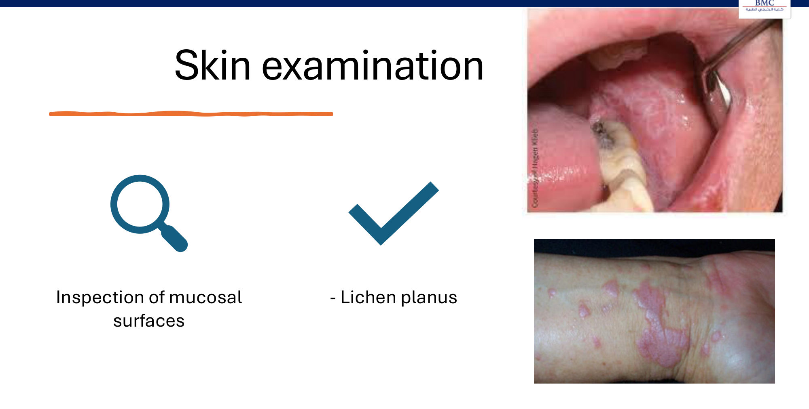

- **Mucosa:** ⭐ **lichen planus**. *[added]* White lacy **Wickham's striae** on the buccal mucosa; skin lesions are **purple, polygonal, pruritic, planar papules**. Associated with **hepatitis C** (slide 47).

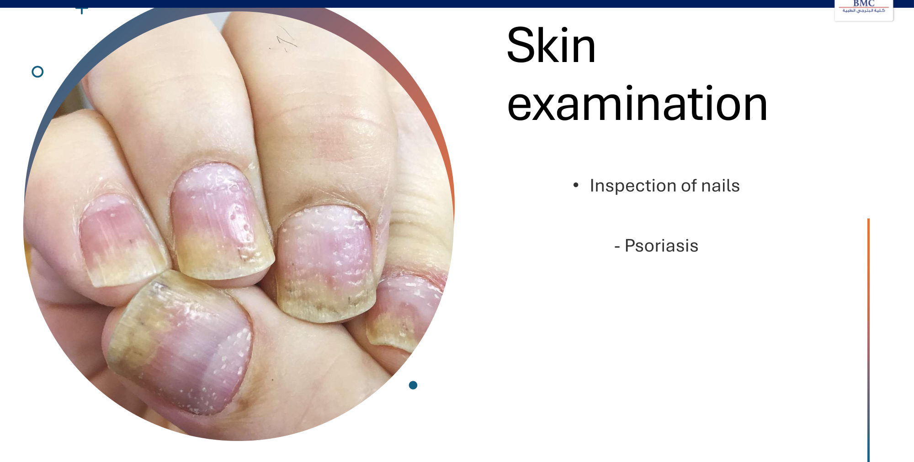

- **Nails:** ⭐ **psoriasis**. *[added]* Pitting, **onycholysis**, **oil-drop/salmon patch**, subungual hyperkeratosis; nail disease predicts **psoriatic arthritis**.

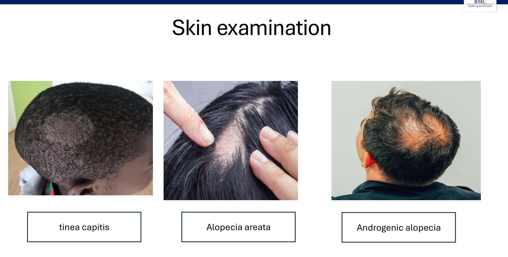

**Hair: alopecia (slide 25):**

| Type | Clue *[added]* |
|---|---|
| **Tinea capitis** | Scaly patch, broken hairs, ± lymphadenopathy, children; **Wood's lamp blue-green if *Microsporum*** |
| **Alopecia areata** | Smooth round patch, **exclamation-mark hairs**; autoimmune (vitiligo, thyroid) |
| **Androgenetic alopecia** | Vertex/frontotemporal (men); diffuse crown thinning (women) |

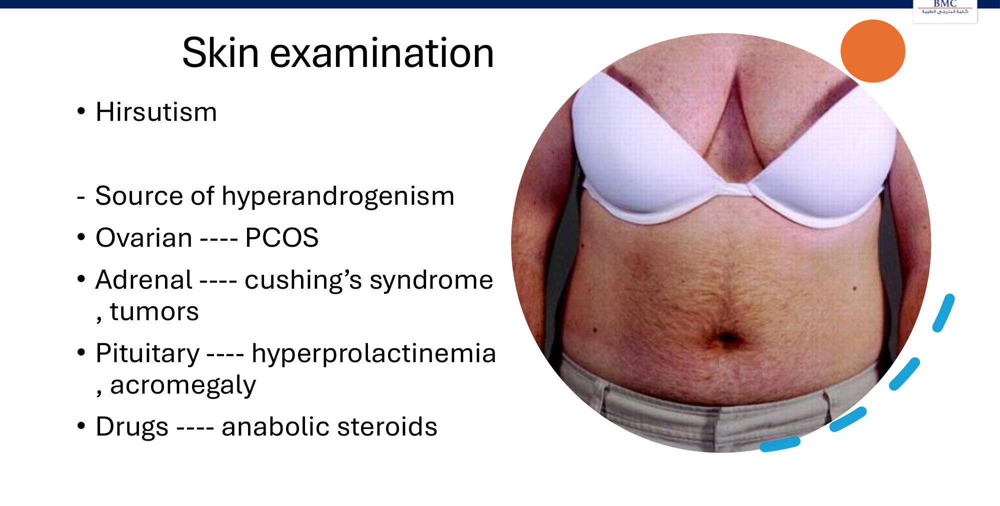

**Hirsutism: source of hyperandrogenism (slide 26):**

| Source | Causes |
|---|---|
| **Ovarian** | ⭐ **PCOS** (*[added]* ovarian tumour if rapid virilisation) |
| **Adrenal** | **Cushing's syndrome**, **tumours** (*[added]* **CAH**; DHEAS very high in adrenal carcinoma) |
| **Pituitary** | **Hyperprolactinaemia, acromegaly** |
| **Drugs** | **Anabolic steroids** |

### 2.6 Instruments: Dermoscopy & Wood's Lamp (Slides 27–33) ⭐⭐⭐

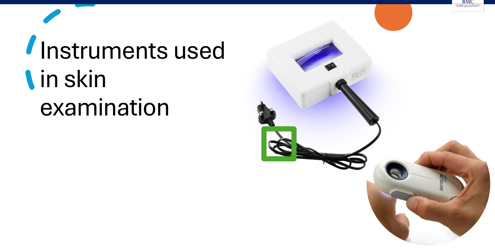

**Dermatoscopy (slides 28–29):**
- **hand-held magnifier** with (slide) **non-polarised light** (*[added]* polarised and contact non-polarised versions both exist)
- lesions and eruptions have **specific dermoscopic features**
- ⭐ main use: **atypical features of suspicious pre-cancerous or cancerous (pigmented) lesions**, *[added]* i.e. melanoma vs benign naevus

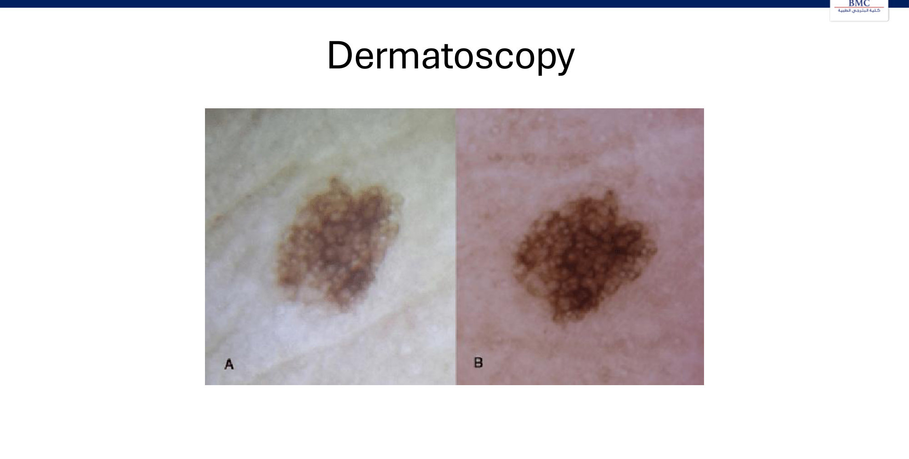

**Wood's lamp (slides 30–31):**
- **low-energy UV** (*[added]* UVA ~365 nm), examined in a **dark room**
- detects **fluorescent conditions** or the **borders** of some lesions
- ⭐ **normal skin does not fluoresce**

| Colour | Condition | Organism / substance |
|---|---|---|
| ⭐ **Coral red** | **Erythrasma** | ***Corynebacterium minutissimum*** (porphyrins) |
| **Yellow** (*[added]* yellow-green / coppery-orange) | **Pityriasis versicolor** | ***Malassezia furfur*** |
| **Bright (blue-)white** | ⭐ **Vitiligo** (depigmentation accentuated) | — |
| **Blue-green** | ⭐ **Tinea capitis** | ***Microsporum*** spp. |
| **Pink / pink-red** | **Porphyrins in urine** (*[added]* porphyria cutanea tarda) | — |

*[added]* **Other Wood's lamp uses:**
- **green**: *Pseudomonas* infection
- **vitiligo vs hypopigmentation**: vitiligo is depigmented → bright; pityriasis alba and postinflammatory hypopigmentation are less accentuated
- **melasma depth**: epidermal pigment is accentuated, dermal pigment is not

⚠️ *[added]* **Trap:** most tinea capitis in the Middle East/US is ***Trichophyton tonsurans*** (endothrix), which **does NOT fluoresce**. **A negative Wood's lamp does not exclude tinea capitis.** Send hair for KOH and culture.

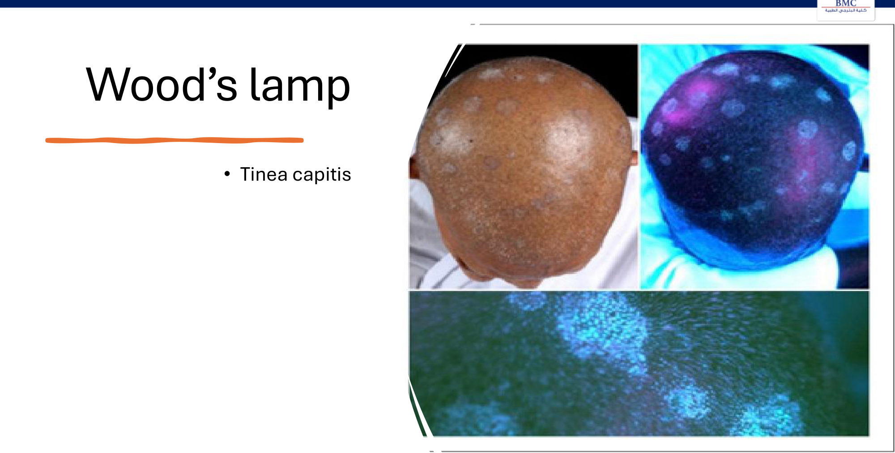

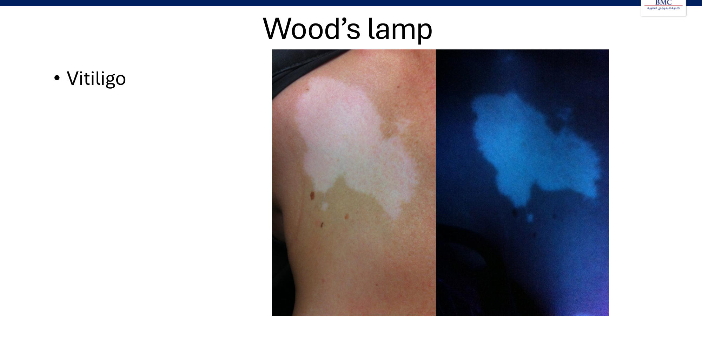

> 🔁 **Recap: Examination & instruments.**
> - **Setting:** daylight, whole skin + mucosa/scalp/hair/nails.
> - **Morphology order:** primary/secondary → colour → shape → arrangement → distribution.
> - **Palpation:** warm (cellulitis), tender (erythema nodosum), infiltrated (lymphoma, morphoea).
> - **Dermoscopy:** suspicious pigmented lesions.
> - **Wood's lamp colours:** **red erythrasma**, **yellow pityriasis versicolor**, **white vitiligo**, **blue-green *Microsporum***, **pink urine porphyrins**.
>
> 🔗 **Link:** some diagnoses come from **bedside manoeuvres** rather than instruments.
>
> ▶️ **Up next: Dermatological signs.**

### 2.7 Dermatological Signs (Slides 34–37) ⭐⭐⭐

| Sign | How to elicit | Positive in |
|---|---|---|
| ⭐ **Auspitz sign** | **Remove the scale** → **pinpoint bleeding** | ⭐ **Psoriasis** (*[added]* dilated tortuous papillary capillaries under a thin suprapapillary epidermis) |
| ⭐ **Nikolsky sign** | **Lateral finger pressure** on affected skin → **upper epidermis dislodges from lower layers**; on a blister → **lateral extension** of the blister (*[added]* = Asboe-Hansen / bulla-spread sign) | ⭐ **TEN**, **SSSS**, **pemphigus vulgaris** |
| ⭐ **Dermatographism** | **Stroke the skin** with a tongue depressor/spatula → **wheal and flare within minutes** | ⭐ **Urticaria** (*[added]* symptomatic dermographism, the commonest physical urticaria) |

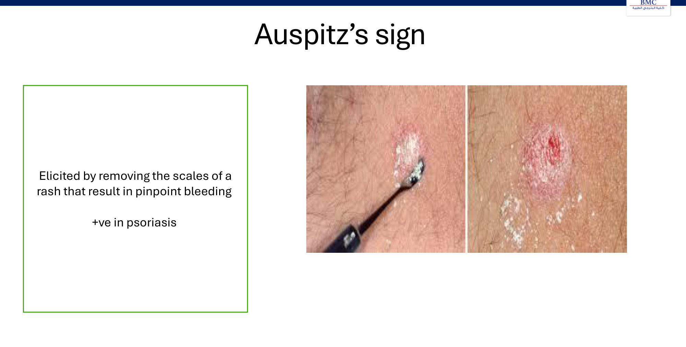

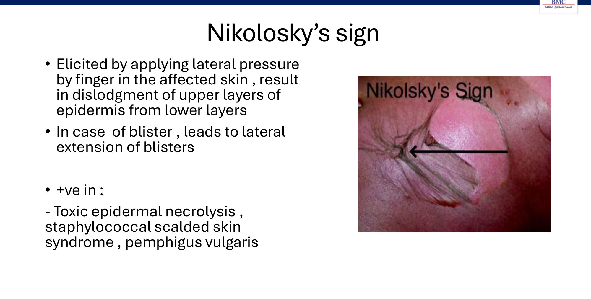

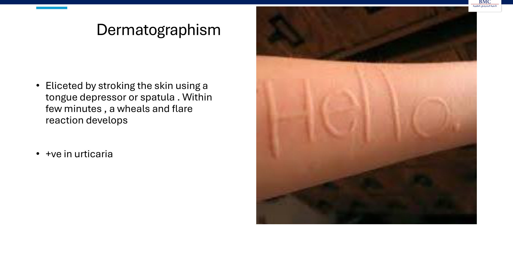

*[added]* **Nikolsky: what's positive and why:**

| Positive (split is **intraepidermal** or the epidermis is necrotic) | **Negative** (split is **subepidermal**) |
|---|---|
| **Pemphigus vulgaris** (anti-desmoglein 3 ± 1; suprabasal) | ⭐ **Bullous pemphigoid** (anti-BP180/230; tense bullae) |
| **SSSS** (exfoliative toxin cleaves desmoglein 1; granular layer; **mucosa spared**) | Dermatitis herpetiformis |
| **TEN/SJS** (full-thickness necrosis; **mucosa involved**, drug trigger) | Bullous impetigo (localised) |

### 2.8 Investigations: Skin Biopsy (Slides 38–46) ⭐⭐

**Indications (slide 40):**
1. ⭐ **suspicious growth**: rule malignancy in or out
2. ⭐ **blistering disorders** (e.g. **bullous pemphigoid**)
3. **some inflammatory disorders**
4. **confirming tissue infection**

**Three tests on skin specimens (slides 41–43):**

| Test | Medium | Stain / method | Use |
|---|---|---|---|
| **1. Histopathology** | ⭐ **Formalin** | **H&E** | Most diagnoses, tumours |
| **2. Direct immunofluorescence (DIF)** | ⭐ **Michel's solution** (*[added]* never formalin) | Antibodies conjugated to a **fluorescent dye** | ⭐ **Blistering (autoimmune bullous) diseases**, vasculitis, lupus *[added]* |
| **3. Tissue culture** | ⭐ **Normal saline** (sterile) | Culture | **Infection** (bacteria, mycobacteria, fungi) |

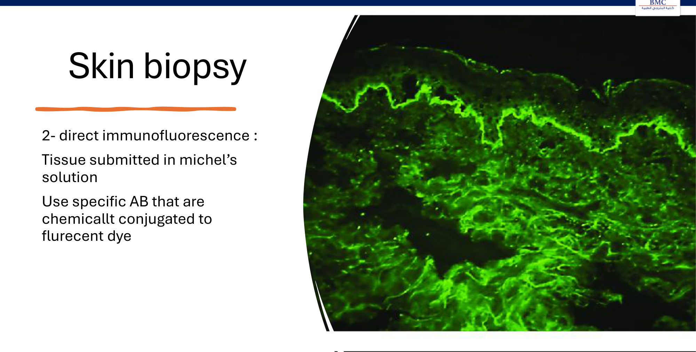

*[added]* **DIF patterns and site:**
- **pemphigus**: **intercellular "fishnet"** IgG/C3
- **bullous pemphigoid**: **linear** IgG/C3 at the **basement membrane**
- **dermatitis herpetiformis**: granular IgA in the dermal papillae
- biopsy **perilesional** skin for DIF, and the **lesion edge** for H&E

**Types of skin biopsy (slides 44–46):**

| Type | Tool | Sample depth | Best for *[added]* |
|---|---|---|---|
| **Shave** | **Razor** blade | **Epidermis + part of dermis** | Superficial/raised lesions (seborrhoeic keratosis, BCC); **not** for suspected melanoma (cuts across depth) |
| ⭐ **Punch** | **Circular punch** (2–8 mm) | ⭐ **All 3 layers: epidermis, dermis, superficial fat** | Inflammatory rashes, DIF, small lesions |
| ⭐ **Excisional** | **Scalpel** (elliptical) | **Entire lump or a deep block** | ⭐ **Suspected melanoma** (full depth for Breslow thickness, 1–3 mm margin), cysts, larger tumours |

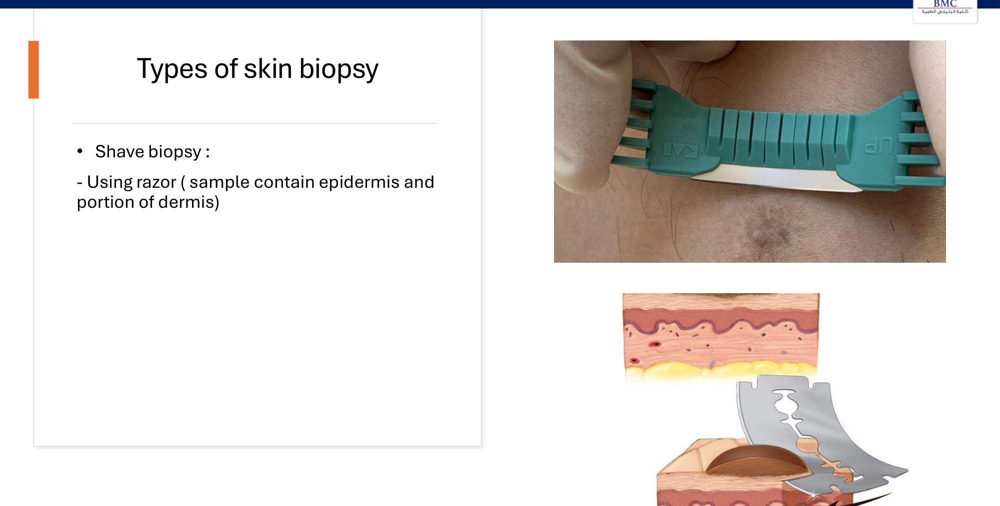

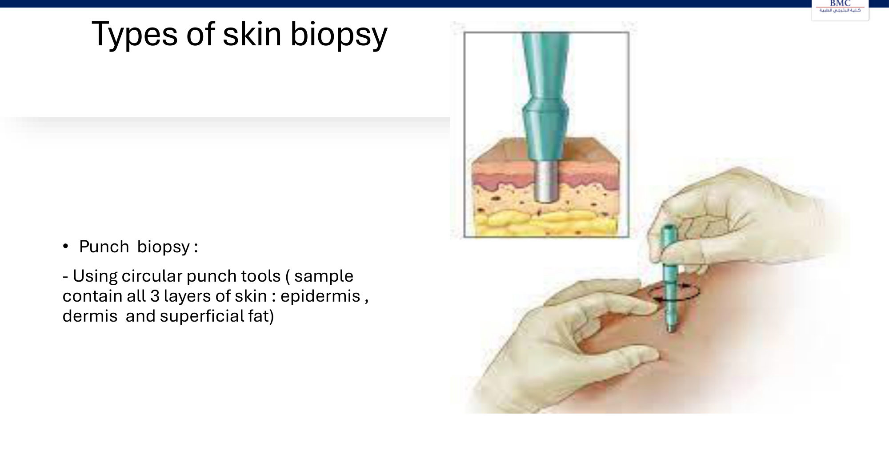

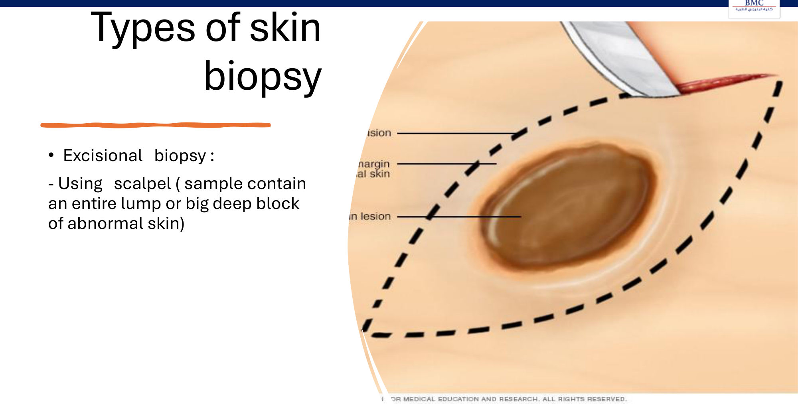

### 2.9 Investigations: Blood & Microbiology (Slides 47–51) ⭐

**Blood work-up (slide 47):**

| Purpose | Example |
|---|---|
| **Screen for an underlying systemic cause** | **Itch** (*[added]* FBC, ferritin, renal/liver/thyroid tests, glucose), **hair loss** (*[added]* ferritin, TSH) |
| **Screen for associated systemic disease** | ⭐ **Lichen planus → hepatitis C** |
| **Hormonal studies** | **Acne/hirsutism → PCOS** (*[added]* testosterone, DHEAS, LH/FSH, prolactin) |
| ⭐ **Drug monitoring** | **Isotretinoin** (*[added]* lipids, LFTs, pregnancy test), **methotrexate** (*[added]* FBC, LFTs, renal) |

**Microbiological tests (slide 48):**
- **swab** for microscopy, culture and sensitivity
- **swab/scraping of a vesicle base** for viral tests
- **skin scraping, plucked hair, nail** for fungal tests
- ⭐ **bedside direct microscopy** for **scabies and fungi**

| Organism | Samples | Tests |
|---|---|---|
| **Fungi** (slide 49) | **Skin scraping, nail clipping, plucked hair** | ⭐ **KOH microscopy** (hyphae); **fungal culture**; **biopsy with fungal stain** (*[added]* PAS) |
| **Bacteria & mycobacteria** (slide 50) | Swab from **vesicles, pustules, erosions, ulcers** | **Staining and microscopy** (Gram, *[added]* ZN); **bacterial/mycobacterial culture**; **biopsy for tissue culture** |
| **Viruses** (slide 51) | Swab/scrape from the **base** of vesicles, erosions, ulcers | ⭐ **Tzanck smear** (*[added]* multinucleated giant cells; **HSV and VZV**; can't tell them apart); ⭐ **PCR** (*[added]* test of choice); **direct fluorescent antibody**; viral culture; biopsy |

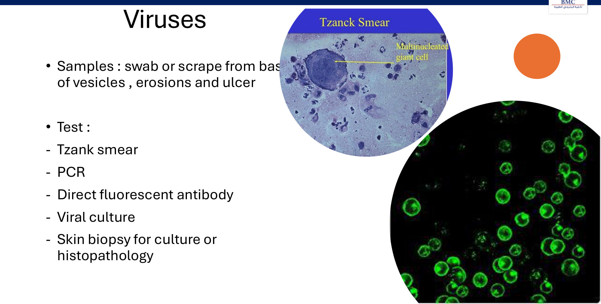

> 🔁 **Recap: Investigations.**
> - **Biopsy indications:** suspected cancer, **blistering disease**, inflammation, infection.
> - **Transport medium:** **formalin (H&E)**, **Michel's (DIF)**, **saline (culture)**.
> - **Biopsy type:** **shave** = epidermis + part of dermis; **punch** = all 3 layers; **excision** = whole lesion.
> - **Blood tests:** systemic cause, **lichen planus → HCV**, PCOS hormones, isotretinoin/MTX monitoring.
> - **Microbiology:** **KOH** for fungi; Gram/culture for bacteria; **Tzanck/PCR** for vesicles.

### 2.10 Summary & Case (Slides 52–54)

**Summary slide:**
- detailed history (onset, progression, triggers, drugs)
- systematic exam with **morphology** (macules, papules, plaques, nodules)
- **targeted tools**: **dermoscopy** at the bedside, **biopsy** as the definitive test

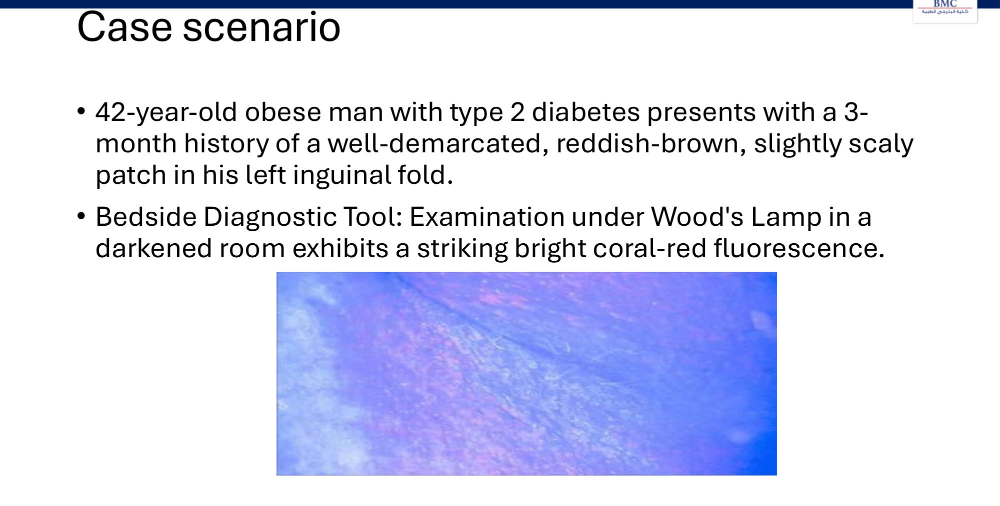

See Q1 in §7.

---

## 3. High-Yield Comparison Tables

### Table A: Wood's Lamp Colours

| Colour | Diagnosis | Cause |
|---|---|---|
| **Coral red** | **Erythrasma** | *C. minutissimum* (porphyrin) |
| **Yellow / yellow-green** | **Pityriasis versicolor** | *Malassezia furfur* |
| **Bright blue-white** | **Vitiligo** | Absent melanin |
| **Blue-green** | **Tinea capitis** | ***Microsporum*** (not *T. tonsurans*) *[added]* |
| **Pink-red (urine)** | **Porphyria** | Uroporphyrins *[added: PCT]* |
| **Green** *[added]* | *Pseudomonas* | Pyoverdin |
| **None** | **Normal skin** | — |

### Table B: Bedside Signs

| Sign | Elicitation | Disease |
|---|---|---|
| **Auspitz** | Scrape scale → **pinpoint bleeding** | **Psoriasis** |
| **Nikolsky** | Lateral pressure → **epidermis shears / blister spreads** | **Pemphigus vulgaris, SSSS, TEN** (*[added]* **negative in bullous pemphigoid**) |
| **Dermatographism** | Stroke → **wheal and flare** in minutes | **Urticaria** |
| *[added]* **Koebner** | Trauma → new lesions along the trauma line | **Psoriasis, lichen planus, vitiligo** (and warts, molluscum: pseudo-Koebner) |
| *[added]* **Darier** | Rub lesion → urticates | **Mastocytosis** (urticaria pigmentosa) |

### Table C: Skin Biopsy

| | Shave | Punch | Excisional |
|---|---|---|---|
| Tool | Razor | Circular punch | Scalpel |
| Depth | Epidermis + part of dermis | **Epidermis + dermis + fat** | Whole lesion |
| Use *[added]* | Superficial lesions | **Rashes, DIF** | **Suspected melanoma** |

### Table D: Specimen Transport

| Test | Medium |
|---|---|
| H&E histology | **Formalin** |
| **DIF** | **Michel's solution** |
| Culture | **Normal saline** |

### Table E: Exacerbating / Relieving Factors

| Factor | Worsens | Improves |
|---|---|---|
| **UV/sun** | **Lupus, rosacea** (*[added]* porphyria, polymorphic light eruption) | **Psoriasis** (*[added]* atopic dermatitis often) |
| **Drugs** | **β-blockers → psoriasis**; **anabolic steroids → acne** (*[added]* lithium → psoriasis/acne) | **Antihistamines → urticaria** |
| **Smoking** | **Lupus, hidradenitis suppurativa** (*[added]* palmoplantar pustulosis) | — |
| **Alcohol** | **Rosacea**; **MTX interaction** | — |
| **Heat / hot drinks** | **Rosacea** | — |
| **Moisturisers** | — | **Dry skin/dermatitis** |

---

## 4. Rules, Exceptions, Patterns

| Rule | Exception / nuance |
|---|---|
| UV is harmful to skin | **UV improves psoriasis** (phototherapy) but **worsens lupus and rosacea** |
| Steroid response confirms inflammation | **Tinea incognito**: steroids partly suppress a fungal infection → atypical morphology; **KOH before steroids** |
| Bleaching creams lighten | **Hydroquinone → exogenous ochronosis** (darkening) |
| Tinea capitis fluoresces blue-green | *[added]* Only ***Microsporum***; ***T. tonsurans*** (commonest) **doesn't** → negative Wood's lamp ≠ no tinea |
| Normal skin under Wood's lamp | **Doesn't fluoresce** |
| Nikolsky positive = pemphigus | Also **SSSS and TEN**; *[added]* **negative in bullous pemphigoid** |
| Biopsy in formalin | **DIF needs Michel's**; culture needs **saline** |
| Shave biopsy for pigmented lesions | *[added]* ❌ For suspected melanoma → **excisional** (full thickness for Breslow depth) |
| Occupational dermatitis | **Improves on vacation**; look for a time relation to exposure |
| Psoriasis "flares in pregnancy" (slide) | *[added]* Often **improves** in pregnancy and flares **postpartum** |

**Pattern recognition:**
- **obese diabetic + reddish-brown groin patch + coral-red fluorescence** → **erythrasma**
- **scaly plaques + nail pitting + pinpoint bleeding on scraping** → **psoriasis**
- **flaccid blisters + oral erosions + Nikolsky +** → **pemphigus vulgaris**
- **tense blisters in an elderly patient + Nikolsky −** → **bullous pemphigoid** *[added]*
- **purple polygonal papules + lacy oral striae** → **lichen planus** → **check HCV**
- **farmer + nodules on fingers after milking** → **milker's nodules**

---

## 5. Clinical Correlations

- **Prescribing a β-blocker** to a patient with psoriasis may flare it. Ask about skin disease when starting antihypertensives (link to the HTN lecture).
- **Methotrexate for psoriasis:**
  - check **liver disease and alcohol** (contraindication and interaction)
  - monitor **FBC/LFTs**
  - *[added]* give folic acid (link to Haematology 2: methotrexate → folate deficiency)
- **Isotretinoin:**
  - monitor **lipids and LFTs**
  - *[added]* **pregnancy prevention** (teratogen)
- **Hirsutism** → endocrine work-up (PCOS, Cushing's, CAH, prolactin, acromegaly). Rapid virilisation → tumour.
- **Lichen planus** → **hepatitis C** serology.
- **Before topical steroids on a scaly rash** → **KOH scraping** to avoid tinea incognito.
- **Blistering disease** → **two biopsies**: lesional (formalin, H&E) + perilesional (**Michel's, DIF**) *[added]*.
- **Suspicious pigmented lesion** → history of **evolution** (ABCDE) + **dermoscopy** → **excisional biopsy**.

---

## 6. Rapid Revision (Last-Day)

- **Approach:** history → exam → investigation → management.
- **History sections:** CC, HPI, PMH, systemic review, **drugs/allergies**, **family**, **social/occupational**, **travel/environment**.
- **HPI:** onset, first vs recurrent, **duration of individual lesions**, onset/spread pattern, **first site**, symptoms (itch, pain, burning, tingling), triggers, previous biopsy/treatment, **QoL (DLQI)**.
- **Suspicious pigmented lesion:** **growth, shape, colour change, bleeding/pain/itch** (evolution).
- **Exacerbating factors:**
  - **UV → lupus, rosacea**
  - **hot drinks → rosacea**
  - **β-blocker → psoriasis**
  - **pregnancy → psoriasis** (slide)
  - **anabolic steroids → acne**
- **Relieving factors:** **sun → psoriasis**; **moisturiser → dermatitis**; **antihistamine → urticaria**.
- **Previous treatment:** **tinea incognito**; treatment-induced contact dermatitis; **hydroquinone ochronosis**.
- **Background history:**
  - PMH: PCOS, DM; **methotrexate contraindicated in liver disease**
  - family history: atopic dermatitis, psoriasis, ichthyosis, melanoma; outbreaks of chickenpox, scabies, lice
- **Social and occupational history:**
  - **smoking → lupus, hidradenitis**
  - **alcohol → rosacea, MTX interaction**
  - sun → burn, pigment, wrinkles, cancer
  - sport → **weightlifters' palmar calluses, runners' athlete's foot**
  - **work contact dermatitis improves on vacation**
  - **milker's nodules (cow teats), orf**
  - hairdressers → allergic contact dermatitis
- **Exam setting:** **natural daylight**, complete exam incl. **mucosa, scalp, hair, nails**; tools: lens, side light, dermatoscope, Wood's lamp.
- **Morphology order:** **primary/secondary → colour → shape → arrangement → distribution**.
- **Palpation clues:**
  - **warm**: cellulitis/abscess
  - **tender**: erythema nodosum, neuroma
  - **consistency**: nodular melanoma, neurofibroma, cyst
  - **infiltrated**: cutaneous lymphoma, morphoea
  - **texture**: pityriasis versicolor
- **Mucosa, nails, hair:**
  - **mucosa: lichen planus**; **nails: psoriasis**
  - **alopecia**: tinea capitis, areata, androgenetic
  - **hirsutism**: ovarian (PCOS), adrenal (Cushing's, tumour), pituitary (prolactin, acromegaly), drugs (anabolic)
- **Dermoscopy:** hand-held, **suspicious pigmented / pre-cancerous lesions**.
- **Wood's lamp:**
  - low-energy UV; **normal skin doesn't fluoresce**
  - **red = erythrasma (*C. minutissimum*)**
  - **yellow = pityriasis versicolor (*M. furfur*)**
  - **bright white = vitiligo**
  - **blue-green = tinea capitis (*Microsporum*)**
  - **pink = urine porphyrins**
- **Bedside signs:**
  - **Auspitz** (scale off → pinpoint bleeding) = **psoriasis**
  - **Nikolsky** (lateral pressure → epidermis separates / blister spreads) = **TEN, SSSS, pemphigus vulgaris**
  - **dermatographism** (stroke → wheal and flare) = **urticaria**
- **Biopsy indications:** malignancy, **blistering (pemphigoid)**, inflammation, infection.
- **Biopsy specimens:** **formalin/H&E**; **DIF in Michel's**; **culture in saline**.
- **Biopsy types:** **shave** (razor; epidermis + part of dermis), **punch** (all 3 layers incl. fat), **excisional** (scalpel; whole lesion).
- **Blood tests:** systemic cause of itch/hair loss; **LP → HCV**; **PCOS hormones**; **isotretinoin/MTX monitoring**.
- **Microbiology:**
  - **fungi**: scraping/nail/hair → **KOH**, culture, biopsy
  - **bacteria/mycobacteria**: swab → stain, culture, tissue culture
  - **viruses**: vesicle-base swab → **Tzanck, PCR, DFA**, culture, biopsy
  - **bedside microscopy for scabies and fungus**

---

## 7. Exam-Style Questions

**Q1. (Lecture case)** A 42-year-old obese man with type 2 diabetes has a 3-month, well-demarcated, **reddish-brown, slightly scaly patch** in the **left inguinal fold**. Wood's lamp in a dark room shows **bright coral-red fluorescence**. Diagnosis and cause of the fluorescence?
A. Tinea cruris (*T. rubrum*) · **B. Erythrasma (*Corynebacterium minutissimum*)** · C. Intertriginous candidiasis · D. Inverse psoriasis

> **Answer: B** *[reasoning added; key not on slides]*.
> - **Coral-red fluorescence = erythrasma** (slide 31): *C. minutissimum* produces **porphyrins** (coproporphyrin III).
> - Obesity and diabetes are classic risk factors (warm, moist flexures).
> - **Why not the others:**
>   - **tinea cruris** has an **active scaly advancing edge with central clearing** and **doesn't fluoresce** (*Trichophyton*)
>   - **candidiasis**: beefy-red with **satellite pustules**, no coral fluorescence
>   - **inverse psoriasis**: shiny red, non-scaly, no fluorescence
> - *[added]* **Treatment:** topical **erythromycin/clindamycin** or fusidic acid; oral erythromycin/clarithromycin if extensive.

**Q2.** A 55-year-old has flaccid blisters and painful **oral erosions**. Lateral pressure on normal-looking skin next to a blister shears off the epidermis. Which sign is this, and which biopsy medium confirms the diagnosis by immunofluorescence?
A. Auspitz sign; formalin · **B. Nikolsky sign; Michel's solution** · C. Dermatographism; saline · D. Koebner phenomenon; formalin · E. Darier sign; Michel's

> **Answer: B** (slides 36, 42).
> - Nikolsky positive → **pemphigus vulgaris** (also TEN, SSSS).
> - **DIF** specimen goes in **Michel's**. *[added]* Expect an intercellular IgG "fishnet" pattern.

**Q3.** A patient with silvery scaly plaques on the elbows has pinpoint bleeding when the scale is scraped off. The rash began after a new antihypertensive. Most likely culprit drug?
A. Amlodipine · **B. Propranolol** · C. Hydrochlorothiazide · D. Lisinopril · E. Doxazosin

> **Answer: B** (slides 10, 35).
> - **Auspitz sign = psoriasis**; **β-blockers** induce or flare it.
> - *[added]* Lithium, antimalarials and abrupt steroid withdrawal also flare psoriasis.

**Q4.** A pigmented lesion on the back has grown and changed colour over 6 months and now bleeds occasionally. Dermoscopy shows atypical features. Best biopsy?
A. Shave · B. 2-mm punch from the edge · **C. Excisional biopsy with narrow margin** · D. KOH scraping · E. Tzanck smear

> **Answer: C** *[slides 9, 28, 46 + added]*.
> - Suspected **melanoma** → excise the **whole lesion** so **Breslow depth** can be measured.
> - A shave biopsy may transect the lesion and under-stage it.

**Q5.** A child has a scaly patch of hair loss with broken hairs. Wood's lamp shows **no fluorescence**. Best next step?
A. Diagnose alopecia areata; topical steroid · **B. Plucked hairs and scalp scrapings for KOH and fungal culture** · C. Reassure: tinea capitis excluded · D. Punch biopsy for DIF · E. Hormonal studies

> **Answer: B** *[slides 25, 31, 49 + added]*.
> - Only ***Microsporum*** fluoresces blue-green. ***T. tonsurans***, the commonest cause, doesn't.
> - A negative Wood's lamp does not exclude tinea; confirm with KOH and culture.

**Q6.** A dairy farmer has two firm, red-violet nodules on his fingers 1 week after milking cows. Diagnosis?
A. Orf · **B. Milker's nodules** · C. Sporotrichosis · D. Cutaneous anthrax · E. Pyogenic granuloma

> **Answer: B** (slides 17, 19).
> - **Cows' teats → milker's nodules** (parapoxvirus). **Orf** comes from **sheep/goats**.
> - *[added]* Self-limiting in 4–8 weeks.

---

## 8. Exam Pitfalls & Traps

| Trap | Correct thinking |
|---|---|
| Any red groin rash = tinea cruris | ❌ **Coral-red fluorescence = erythrasma** (bacterial; *C. minutissimum*) |
| Negative Wood's lamp excludes tinea capitis | ❌ *[added]* ***T. tonsurans*** doesn't fluoresce; do KOH and culture |
| Normal skin fluoresces faintly → abnormal | ❌ **Normal skin doesn't fluoresce** (slide) |
| Nikolsky positive in all blistering disease | ❌ **TEN, SSSS, pemphigus vulgaris**; *[added]* **negative in bullous pemphigoid** |
| Auspitz sign = lichen planus | ❌ **Psoriasis** |
| Dermatographism = vasculitis | ❌ **Urticaria** |
| Put every skin biopsy in formalin | ❌ **DIF → Michel's**; **culture → saline** |
| Punch biopsy reaches only the dermis | ❌ **All 3 layers incl. superficial fat** |
| Shave biopsy for suspected melanoma | ❌ *[added]* **Excisional** (full thickness) |
| Sun always worsens skin disease | ❌ **Improves psoriasis**; worsens lupus and rosacea |
| Steroid cream for every itchy scaly rash | ❌ **Tinea incognito**; scrape for KOH first |
| Hydroquinone always lightens | ❌ Long-term use → **exogenous ochronosis** |
| Milker's nodules = orf | ❌ Same virus family; **cows** (milker's) vs **sheep/goats** (orf) |
| Patch testing taught in this lecture | ⚠️ Listed in the subtopics but **not taught**; *[added]* for **allergic contact dermatitis**, read at 48/96 h |
| Lichen planus is purely a skin disease | ❌ Screen for **hepatitis C** (slide 47) |
