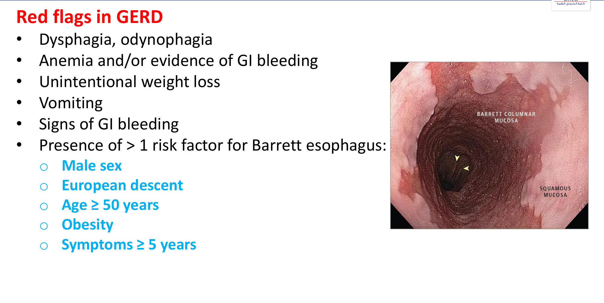
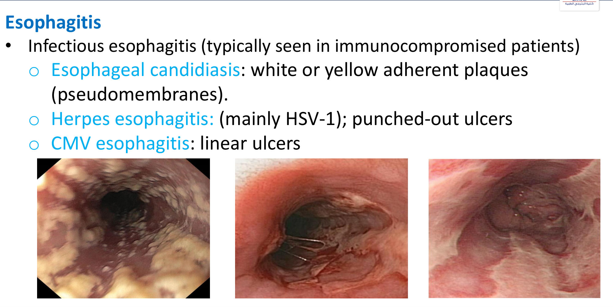
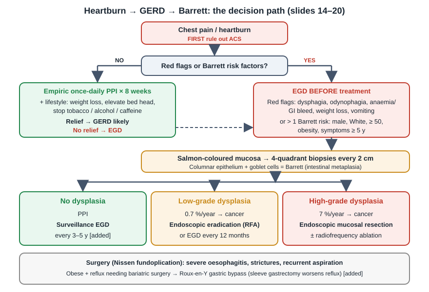
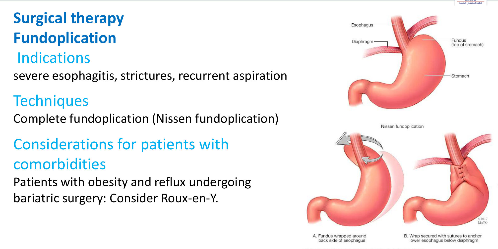
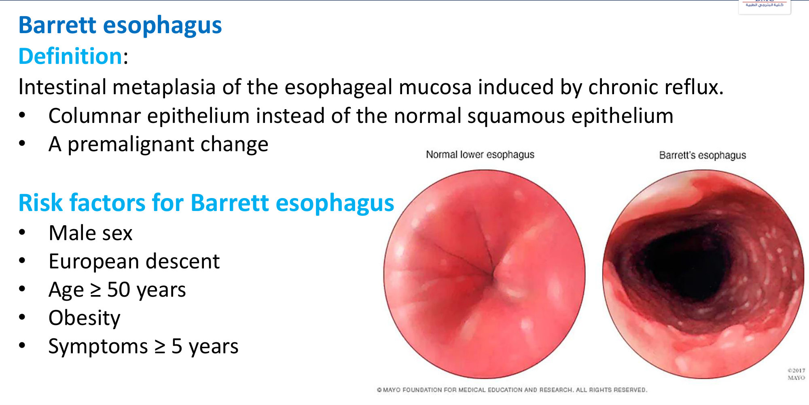
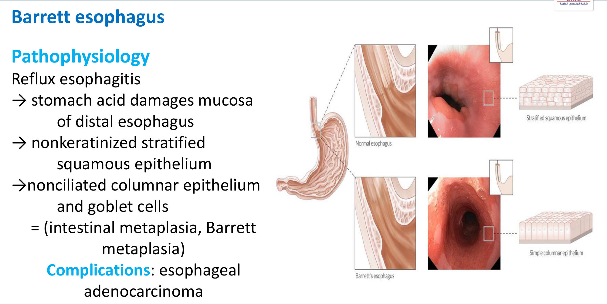
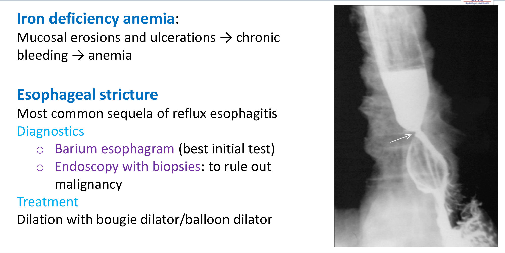
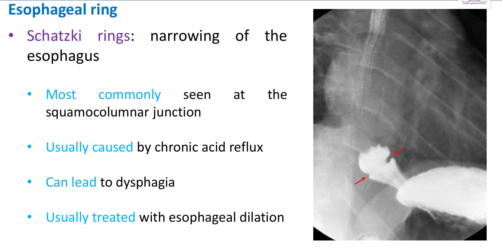

# Gastro-oesophageal Reflux Disease (GERD): Approach to a Case of Heartburn
**Dr. Muhammad Reihan, Associate Professor of Medicine** | Source: `GERD.pdf` (25 slides)

> **Legend:** ⭐ = high-yield · *[added]* = not on slides. Images marked "Slide N" come from the lecture; "Added diagram" = drawn for these notes. The lecture has **no answer key** for its case; the answer below is **[reasoning added; key not on slides]**.

> 🔗 **Bridge from earlier lectures:**
> - **CAD / ECG (Reihan, same lecturer):** retrosternal burning can be **ACS**. Slide 14: "**rule out life-threatening causes (ACS) first**". *[added]* ECG + troponin before labelling it reflux. **Nitrates lower LES tone** (slide 8): the anti-anginal itself can cause heartburn.
> - **Asthma / COPD (Kotb):** GERD is both a **risk factor** and a **complication**:
>   - **asthma** and **chronic cough** (nocturnal)
>   - **chronic bronchitis**
>   - **aspiration pneumonia** (link: Pneumonia lecture)
> - **Restrictive Lung Disease (Kotb):** **scleroderma** → oesophageal dysmotility → severe GERD; *[added]* reflux/micro-aspiration is linked to **ILD/IPF**.
> - **Haematology 1:** **iron-deficiency anaemia** from oesophageal erosions. IDA in GERD is a **red flag** → EGD.
> - **Gastric Tumours:**
>   - adenocarcinoma of the **distal oesophagus/GEJ** arises from **Barrett**; *[added]* the squamous cell type is linked to smoking/alcohol
>   - **H. pylori triple therapy** (case option D) treats peptic ulcer, not Barrett

---

## 1. Title / Objectives

| Domain | Objective | Likely tested as |
|---|---|---|
| Knowledge | ⭐ Mechanisms and risk factors: **GEJ dysfunction** and **impaired acid clearance** | Transient LES relaxations; nitrates/caffeine; obesity, pregnancy; smoking ↓ saliva; hiatal hernia |
| Knowledge | Typical, atypical and **extra-oesophageal** manifestations | Cough, hoarseness, asthma, aspiration |
| Skill | ⭐ Stepwise diagnosis: **empiric PPI trial vs upfront EGD** | Red flags; Barrett risk factors; pH monitoring not routine |
| Skill | Management: **lifestyle, PPI, surgical referral** | Nissen indications; Roux-en-Y in obesity; Barrett surveillance/ablation |

**Main subtopics (slide 4):**
- definition and pathophysiology
- aetiology and risk factors
- clinical features
- differential diagnosis
- diagnostics
- treatment
- **Barrett oesophagus**
- complications

---

## 2. Main Content (Lecture Order)

### 2.0 Opening Case (Slides 5–6)
**Presentation:**
- **58-year-old man**, **12 years of recurrent heartburn**
- **nocturnal cough** for 1 year (extra-oesophageal GERD)
- not seen a doctor for 8 years
- **30 pack-years**; OTC antacid only
- **BMI 31** (obese); exam and CBC normal
- **EGD:** **dark-pink (salmon) mucosa extending 2 cm above the GEJ**
- **biopsy:** **columnar epithelium with goblet cells** + ⭐ **low-grade dysplasia**

**Next step?** → ⭐ **B. Endoscopic radiofrequency ablation** *[reasoning added; key not on slides]*:
- columnar epithelium + goblet cells = **Barrett oesophagus** (intestinal metaplasia)
- slide 20: for **low-grade dysplasia**, **endoscopic eradication** is first; **surveillance every 12 months** is an acceptable alternative
- *[added]* LGD must first be **confirmed by a second, expert GI pathologist**; give **high-dose PPI** alongside

**Why not the others:**
- **A (repeat EGD in 24 months):** the interval is too long. Even the LGD surveillance alternative is **12 months**. *[added]* 3–5 years is for non-dysplastic Barrett.
- **C (oesophagectomy):** for **invasive cancer**; overtreatment for LGD
- **D (PPI + clarithromycin + metronidazole):** *H. pylori* eradication; no role in Barrett
- **E (radiotherapy):** for cancer
- **F (Nissen fundoplication):** controls reflux but **does not reverse metaplasia or eliminate dysplasia**

### 2.1 Definitions (Slide 7) ⭐

| Term | Definition |
|---|---|
| **Gastro-oesophageal reflux** | Regurgitation of stomach contents into the oesophagus (can be physiological) |
| ⭐ **GERD** | Reflux causing **troublesome symptoms** (typically **heartburn or regurgitation**) **and/or oesophageal injury/complications** |

### 2.2 Aetiology: Mechanisms (Slide 8) ⭐⭐

**A. Gastro-oesophageal junction dysfunction:**
1. ⭐ **↑ frequency of transient LES relaxations (TLESRs)** (*[added]* the **main** mechanism; not swallow-related)
2. **imbalance between intragastric and LES pressures:**
   - **↓ LES tone**: **caffeine, nitroglycerin** (*[added]* also CCBs, anticholinergics, theophylline, progesterone, alcohol, chocolate, peppermint, fatty food)
   - **↑ intragastric pressure**: **pregnancy, delayed gastric emptying, obesity**
3. **anatomical GEJ abnormalities** (*[added]* **hiatal hernia** displaces the LES above the crural diaphragm)

**B. Impaired oesophageal acid clearance:**
- **↓ salivation** (e.g. **smoking**); saliva bicarbonate neutralises acid
- **↓ peristalsis** (*[added]* scleroderma, diabetes)

### 2.3 Risk Factors (Slide 9) ⭐

| Category | Risk factors |
|---|---|
| Lifestyle | **Smoking, caffeine, alcohol, stress** |
| ↑ Abdominal pressure | **Obesity, pregnancy** |
| Motility/connective tissue | ⭐ **Scleroderma** (*[added]* smooth-muscle atrophy → aperistalsis + incompetent LES) |
| Anatomy | ⭐ **Sliding hiatal hernia**, present in **≥ 90 % of patients with severe GERD** |
| Respiratory | **Asthma** (bidirectional: *[added]* bronchodilators lower LES tone; hyperinflation alters the crura) |

### 2.4 Clinical Features (Slides 10–12) ⭐⭐

| Typical | Atypical | Extra-oesophageal |
|---|---|---|
| ⭐ **Heartburn** (retrosternal burning) | **Chest pressure** (mimics angina) | ⭐ **Chronic non-productive cough** |
| ⭐ **Regurgitation** | **Belching** | ⭐ **Hoarseness** (reflux laryngitis) |
| **Dysphagia** | **Aspiration pneumonia** features | *[added]* asthma, dental erosion, globus, sinusitis |

**Aggravating factors:**
- **lying down shortly after meals**
- certain foods and drinks
- *[added]* bending, large/fatty meals

**Red flags in GERD (slide 12):**

| Red flag |
|---|
| ⭐ **Dysphagia, odynophagia** |
| ⭐ **Anaemia and/or GI bleeding** |
| ⭐ **Unintentional weight loss** |
| **Vomiting** |
| **> 1 risk factor for Barrett oesophagus** (below) |

*[added]* Slide 12 lists "GI bleeding" twice.

**Barrett risk factors** (slide 12; repeated slide 18):
- **male sex**
- **European descent (White)**
- **age ≥ 50**
- **obesity**
- **symptoms ≥ 5 years**
- *[added]* also smoking, family history of Barrett/oesophageal adenocarcinoma, hiatal hernia; ACG uses **≥ 3 risk factors** for screening

**Mnemonic for the Barrett risk factors, "OLD, WHITE, OBESE MALE with a LONG HISTORY":** age ≥ 50 · White/European · obesity · male · symptoms ≥ 5 years.

### 2.5 Differential Diagnosis (Slide 13) ⭐

**Infectious oesophagitis** (typically **immunocompromised**):

| Organism | Endoscopy |
|---|---|
| ***Candida*** | ⭐ **White/yellow adherent plaques (pseudomembranes)** |
| **HSV** (mainly HSV-1) | ⭐ **Punched-out** (small, "volcano") ulcers |
| **CMV** | ⭐ **Linear** (large, shallow, longitudinal) ulcers |

*[added]* **Other DDs not on the slide:**
- **ACS** (slide 14 says rule out first)
- **eosinophilic oesophagitis** (young atopic man, food impaction, **rings/furrows**, PPI-resistant)
- **pill oesophagitis** (doxycycline, NSAIDs, bisphosphonates, KCl)
- **peptic ulcer disease**, **achalasia**, **oesophageal cancer**, **functional heartburn**

### 2.6 Diagnostics (Slides 14–15) ⭐⭐⭐

**Approach (slide 14):**
1. **All patients:** ⭐ **rule out life-threatening causes of chest pain (ACS)** first
2. **Typical symptoms without red flags:**
   - treat as GERD: ⭐ **empiric once-daily PPI trial**
   - **relief after 8 weeks of PPI → GERD likely**
3. **Red flags** (slide 15): ⭐ **refer for EGD before starting treatment**

| ⭐ **EGD indications** (slide 15) |
|---|
| **Red flags** |
| **Risk factors for Barrett oesophagus** |
| **No improvement after the PPI trial** |

**Oesophageal pH monitoring:**
- ⭐ **not a routine diagnostic test**
- *[added]* used for **PPI-refractory** symptoms with a normal EGD, **before anti-reflux surgery**, or when the diagnosis is uncertain; off PPI, 24-h catheter or 96-h wireless capsule
- *[added]* **Manometry** before surgery excludes achalasia/aperistalsis

### 2.7 Treatment (Slides 16–17) ⭐⭐

**Pharmacological:**
- ⭐ **PPI at standard dose** (*[added]* omeprazole 20 mg, 30–60 min before breakfast, for 8 weeks; then the lowest effective dose / on demand)
- *[added]* step up to **twice daily** if partial response
- *[added]* **H2RAs / alginates** for breakthrough nocturnal symptoms
- *[added]* **long-term PPI risks**: B12, Mg²⁺ and iron deficiency, *C. difficile*, fractures (link: Haematology 2)

**Lifestyle:**
- "physical recommendations"
- ⭐ **weight loss in obesity** (*[added]* most effective lifestyle measure)
- ⭐ **elevate the head of the bed** (*[added]* for nocturnal symptoms; avoid eating 2–3 h before bed)
- **avoid triggers**: **tobacco, alcohol, caffeine**

**Surgical therapy (slide 17):**
- **Fundoplication** indications (slide):
  - ⭐ **severe oesophagitis**
  - **strictures**
  - **recurrent aspiration**
  - *[added]* also PPI-intolerant, large hiatal hernia, regurgitation-dominant symptoms, patient preference
- **Technique:** ⭐ **complete (360°) Nissen fundoplication**: the gastric fundus is wrapped around the lower oesophagus
- **Obesity + reflux needing bariatric surgery:** ⭐ **Roux-en-Y gastric bypass** (*[added]* sleeve gastrectomy worsens reflux)

> 🔁 **Recap: GERD.**
> - **Mechanisms:** TLESRs, ↓ LES tone (caffeine, nitrates), ↑ gastric pressure (obesity, pregnancy), **hiatal hernia**, ↓ clearance (smoking, dysmotility).
> - **Symptoms:** heartburn, regurgitation, dysphagia; cough, hoarseness.
> - **Diagnosis:** rule out ACS → no red flags = **8-week PPI trial**; red flags or Barrett risk = **EGD first**; pH study not routine.
> - **Treatment:** PPI + weight loss + bed elevation; **Nissen** for severe oesophagitis, stricture, aspiration; **Roux-en-Y** if obese.
>
> 🔗 **Link:** years of acid injury drive the key premalignant complication.
>
> ▶️ **Up next: Barrett oesophagus.**

### 2.8 Barrett Oesophagus (Slides 18–20) ⭐⭐⭐

**Definition:**
- ⭐ **intestinal metaplasia** of the oesophageal mucosa caused by **chronic reflux**
- **columnar** epithelium replaces the normal **squamous** epithelium
- a **premalignant** change

**Pathophysiology (slide 19):**
1. reflux oesophagitis: acid damages the distal oesophageal mucosa
2. **non-keratinised stratified squamous** epithelium is replaced by
3. **non-ciliated columnar epithelium with goblet cells** = **intestinal (Barrett) metaplasia**

⭐ **Complication:** **oesophageal adenocarcinoma** (distal third / GEJ).

**Management and surveillance (slide 20):**
- **Endoscopy** with **four-quadrant biopsies every 2 cm** of the suspicious **salmon-coloured** mucosa (*[added]* Seattle protocol)

| Histology | Malignant transformation | Management |
|---|---|---|
| *[added]* **No dysplasia** | ~0.2–0.5 %/yr | PPI; surveillance EGD every **3–5 years** |
| ⭐ **Low-grade dysplasia** | ⭐ **0.7 % per year** | **Endoscopic eradication** (RFA); **or surveillance EGD every 12 months** (acceptable alternative) |
| ⭐ **High-grade dysplasia** | ⭐ **7 % per year** | **Endoscopic treatment of mucosal irregularities**; **eradication of dysplasia** via **endoscopic mucosal resection** and/or **radiofrequency ablation** |

*[added]* Oesophagectomy is reserved for **invasive** cancer beyond the mucosa. **Fundoplication does not cause Barrett regression**.

**Mnemonic for the transformation rates, "LOW = 0.7, HIGH = 7":** move the decimal point one place: low-grade 0.7 %/yr, high-grade 7 %/yr.

### 2.9 Other Complications (Slides 21–23) ⭐⭐

| Complication | Key points |
|---|---|
| **Iron-deficiency anaemia** | Mucosal **erosions/ulcers → chronic bleeding** → IDA |
| ⭐ **Oesophageal (peptic) stricture** | **Commonest sequela of reflux oesophagitis**. **Diagnosis:** ⭐ **barium oesophagram (best initial test)**; then **EGD with biopsies to rule out malignancy**. **Treatment:** **dilation (bougie or balloon)** (*[added]* + long-term PPI) |
| ⭐ **Schatzki ring** | Thin narrowing ring, **most often at the squamocolumnar junction**; **usually caused by chronic reflux**; causes **dysphagia** (*[added]* intermittent solid-food impaction, "steakhouse syndrome"); **treated with dilation** |
| **Aspiration complications** | **Aspiration pneumonia**, **chronic bronchitis**, **asthma**, **reflux laryngitis (hoarseness)** |

*[added]* **Dysphagia pattern clues:**
- **progressive solids-only** → stricture or cancer
- **intermittent solids** → ring/web
- **solids + liquids from onset** → motility disorder (achalasia, scleroderma)

---

## 3. High-Yield Comparison Tables

### Table A: Empiric PPI vs EGD First
*[slides 14–15]*

| Empiric PPI trial (8 weeks) | EGD **before** treatment |
|---|---|
| Typical heartburn/regurgitation | **Red flags**: dysphagia, odynophagia, anaemia, GI bleeding, weight loss, vomiting |
| No red flags | **> 1 Barrett risk factor**: male, White, ≥ 50, obese, symptoms ≥ 5 y |
| ≤ 1 Barrett risk factor | **No response to PPI** |

### Table B: Infectious Oesophagitis

| | *Candida* | HSV | CMV |
|---|---|---|---|
| Endoscopy | **White/yellow plaques** (pseudomembranes) | **Punched-out** small ulcers | **Linear**, large shallow ulcers |
| Host | Immunocompromised, inhaled steroids *[added]* | Immunocompromised | Immunocompromised (AIDS, transplant) |
| Treatment *[added]* | Fluconazole | Aciclovir | Ganciclovir |

### Table C: Barrett Management by Grade

| Grade | Cancer risk/yr | Action |
|---|---|---|
| No dysplasia *[added]* | ~0.3 % | PPI; EGD every 3–5 y |
| **LGD** | **0.7 %** | **RFA** (or EGD every **12 months**) |
| **HGD** | **7 %** | **EMR ± RFA** |
| Invasive cancer *[added]* | — | Oesophagectomy / oncology |

### Table D: Surgical Options

| Situation | Operation |
|---|---|
| Severe oesophagitis, stricture, recurrent aspiration | **Nissen (360°) fundoplication** |
| Obese + reflux, bariatric candidate | **Roux-en-Y gastric bypass** |

### Table E: Stricture vs Schatzki Ring

| | Peptic stricture | Schatzki ring |
|---|---|---|
| Cause | Chronic reflux oesophagitis | Chronic reflux (usually) |
| Site | Distal oesophagus | **Squamocolumnar junction** |
| Dysphagia *[added]* | **Progressive**, solids | **Intermittent**, solids (food bolus) |
| First test | **Barium oesophagram** → EGD + biopsy | Barium / EGD |
| Treatment | **Bougie/balloon dilation** | **Dilation** |

---

## 4. Rules, Exceptions, Patterns

| Rule | Exception / nuance |
|---|---|
| Heartburn = GERD → PPI | **Rule out ACS first** (slide 14) |
| Empiric PPI trial | **Not if red flags or > 1 Barrett risk factor** → EGD first |
| pH monitoring confirms GERD | **Not routine**; *[added]* for refractory symptoms / pre-surgery |
| Fundoplication cures Barrett | ❌ Controls reflux; **dysplasia still needs endoscopic eradication/surveillance** |
| Barrett LGD → watch | **Eradication (RFA) preferred**; 12-monthly surveillance is the acceptable alternative |
| Obese GERD patient → sleeve gastrectomy | ❌ *[added]* Sleeve worsens reflux → **Roux-en-Y** (slide 17) |
| Nitrates for chest pain | **Lower LES tone** → can worsen reflux |
| Smoking only affects the lungs | ↓ saliva → **impaired acid clearance**; Barrett risk factor *[added]* |
| Stricture → endoscopy first | **Barium oesophagram is the best initial test** (slide 21), then EGD + biopsy |
| Asthma and GERD | **Bidirectional**: asthma is a risk factor (slide 9) and a complication (slide 23) |

**Pattern recognition:**
- **heartburn + nocturnal cough + hoarseness** → extra-oesophageal GERD
- **> 50 y, White, obese, male, long reflux + salmon mucosa + goblet cells** → **Barrett**
- **long GERD + progressive solid dysphagia, no weight loss** → **peptic stricture** (weight loss → cancer)
- **intermittent food sticking at a meal** → **Schatzki ring**
- **immunocompromised + odynophagia + white plaques** → **Candida**
- **scleroderma + severe GERD** → aperistalsis + LES failure

---

## 5. Clinical Correlations

- **Chest pain in the ED:** ECG/troponin first. "GI cocktail" relief does **not** exclude ACS *[added]*.
- **Patients on nitrates/CCBs** (CAD/HTN lectures) may develop or worsen reflux. Consider this before escalating PPIs.
- **Chronic cough with a normal CXR:** **GERD, asthma, upper-airway cough (post-nasal drip)** *[added]* are the big three; plus ACE inhibitors.
- **Obesity:**
  - **weight loss** is the most effective lifestyle measure
  - bariatric surgery → **Roux-en-Y** for refluxers
- **IDA in a GERD patient** → EGD (red flag); also look for other GI sources (link: Haematology 1).
- **Long-term PPIs** *[added]*: review the indication. Risks include B12 and Mg²⁺ deficiency, *C. difficile*, fractures. Barrett patients **do** need long-term PPI.
- **Barrett screening:** men with chronic GERD plus other risk factors (≥ 50, White, obese, smoker, family history).

---

## 6. Rapid Revision (Last-Day)

- **Definition:** GERD = reflux causing **troublesome symptoms** (heartburn/regurgitation) **and/or injury/complications**.
- **Mechanisms:**
  - **GEJ dysfunction**: ↑ **transient LES relaxations**; ↓ LES tone (**caffeine, nitroglycerin**); ↑ intragastric pressure (**pregnancy, delayed gastric emptying, obesity**); anatomical (hiatal hernia)
  - **↓ acid clearance**: **↓ saliva (smoking)**, **↓ peristalsis**
- **Risk factors:** **smoking, caffeine, alcohol, stress, obesity, pregnancy, scleroderma, sliding hiatal hernia (≥ 90 % of severe GERD), asthma**.
- **Symptoms:**
  - **typical**: heartburn, regurgitation, dysphagia
  - **atypical**: chest pressure, belching, aspiration pneumonia
  - **extra-oesophageal**: **chronic dry cough, hoarseness**
  - worse **lying down after meals**
- **Red flags:** **dysphagia/odynophagia, anaemia/GI bleed, weight loss, vomiting, > 1 Barrett risk factor**.
- **Barrett risk factors:** **male, European/White, ≥ 50, obesity, symptoms ≥ 5 years**.
- **DDx: infectious oesophagitis:**
  - ***Candida***: **white/yellow plaques**
  - **HSV-1**: **punched-out ulcers**
  - **CMV**: **linear ulcers**
- **Diagnosis:**
  - **rule out ACS** → no red flags: **once-daily PPI trial; relief at 8 weeks = GERD likely**
  - red flags → **EGD before treatment**
  - **EGD indications**: red flags, Barrett risk factors, **PPI failure**
  - **pH monitoring not routine**
- **Treatment:**
  - **standard-dose PPI**
  - **weight loss**, **elevate head of bed**, avoid **tobacco, alcohol, caffeine**
- **Surgery:**
  - **Nissen (complete) fundoplication** for **severe oesophagitis, strictures, recurrent aspiration**
  - obese + bariatric → **Roux-en-Y**
- **Barrett oesophagus:**
  - **intestinal metaplasia**: squamous → **non-ciliated columnar + goblet cells**; premalignant → **adenocarcinoma**
  - surveillance: **4-quadrant biopsies every 2 cm** of salmon mucosa
  - **HGD 7 %/yr** → **EMR ± RFA**
  - **LGD 0.7 %/yr** → **endoscopic eradication**, or **EGD every 12 months**
- **Other complications:**
  - **IDA** (erosions)
  - **stricture**: commonest sequela; **barium swallow first**, EGD + biopsy, **bougie/balloon dilation**
  - **Schatzki ring**: at the **squamocolumnar junction**, reflux, dysphagia, **dilation**
  - **aspiration**: pneumonia, chronic bronchitis, asthma, **reflux laryngitis**

---

## 7. Exam-Style Questions

**Q1. (Lecture case)** A 58-year-old obese smoker has 12 years of heartburn and a nocturnal cough. EGD shows salmon-pink mucosa 2 cm above the GEJ; biopsy shows **columnar epithelium with goblet cells and low-grade dysplasia**. Next step?
A. Repeat EGD in 24 months · **B. Endoscopic radiofrequency ablation** · C. Oesophagectomy · D. Omeprazole + clarithromycin + metronidazole · E. External-beam radiotherapy · F. Nissen fundoplication

> **Answer: B** *[reasoning added; key not on slides]*.
> - **Barrett with LGD** → **endoscopic eradication** (slide 20). The acceptable alternative is EGD in **12**, not 24, months.
> - C/E are for cancer. D is *H. pylori* therapy. F doesn't eliminate dysplasia.
> - *[added]* Confirm LGD with an expert pathologist; continue PPI.

**Q2.** A 32-year-old woman has 3 months of postprandial heartburn and regurgitation, no weight loss, dysphagia, anaemia or vomiting, and a normal ECG. Best next step?
A. Urgent EGD · **B. Empiric once-daily PPI for 8 weeks + lifestyle advice** · C. 24-h pH monitoring · D. Barium swallow · E. Nissen fundoplication

> **Answer: B** (slide 14). Typical symptoms, no red flags, < 2 Barrett risk factors. Relief at 8 weeks → GERD likely.

**Q3.** Which patient needs **EGD before** starting a PPI?
A. 28-year-old with heartburn after spicy meals · **B. 55-year-old man with heartburn and new progressive dysphagia to solids** · C. 35-year-old pregnant woman with heartburn · D. 40-year-old with nocturnal regurgitation relieved by antacids · E. 25-year-old with belching

> **Answer: B** (slides 12, 15). **Dysphagia** is a red flag, and he has > 1 Barrett risk factor (male, ≥ 50).

**Q4.** A patient with long-standing GERD has slowly progressive dysphagia to solids without weight loss. Best **initial** test?
**A. Barium oesophagram** · B. CT chest · C. Manometry · D. pH monitoring · E. Chest X-ray

> **Answer: A** (slide 21).
> - Suspected **peptic stricture**: barium oesophagram first, then **EGD + biopsy** to exclude malignancy, then **dilation**.
> - *[added]* Many guidelines go straight to EGD; for this lecture, barium first.

**Q5.** An HIV-positive patient (CD4 50) has severe odynophagia. EGD shows **long, linear, shallow ulcers** in the distal oesophagus. Most likely organism?
A. *Candida* · B. HSV-1 · **C. CMV** · D. *H. pylori* · E. EBV

> **Answer: C** (slide 13).
> - **Linear ulcers = CMV**; punched-out = HSV; plaques = *Candida*.
> - *[added]* Treatment: ganciclovir.

**Q6.** An obese patient (BMI 42) with severe, PPI-dependent GERD wants bariatric surgery. Which procedure does the lecture recommend?
A. Sleeve gastrectomy · B. Gastric band · **C. Roux-en-Y gastric bypass** · D. Nissen fundoplication alone · E. Biliopancreatic diversion

> **Answer: C** (slide 17). It treats obesity **and** reflux. *[added]* Sleeve gastrectomy worsens GERD.

---

## 8. Exam Pitfalls & Traps

| Trap | Correct thinking |
|---|---|
| Heartburn → PPI straight away | ❌ **Rule out ACS first** |
| Empiric PPI for everyone | ❌ **Red flags or > 1 Barrett risk factor → EGD before treatment** |
| pH monitoring to diagnose GERD | ❌ **Not routine** |
| Barrett LGD → repeat EGD in 2 years | ❌ **RFA**, or EGD in **12 months** |
| Barrett HGD → oesophagectomy | ❌ **Endoscopic resection ± RFA**; surgery is for invasive cancer *[added]* |
| Fundoplication reverses Barrett | ❌ It controls reflux only; dysplasia management is unchanged |
| *H. pylori* eradication for Barrett | ❌ Irrelevant (*[added]* *H. pylori* may even be inversely associated) |
| Barrett = squamous metaplasia | ❌ **Squamous → columnar (with goblet cells)** = intestinal metaplasia |
| Barrett → squamous cell carcinoma | ❌ **Adenocarcinoma** |
| HGD 0.7 %, LGD 7 % | ❌ Reversed: **LGD 0.7 %/yr, HGD 7 %/yr** |
| Obese GERD → sleeve gastrectomy | ❌ **Roux-en-Y** |
| Stricture → EGD as the first test | ⚠️ Lecture: **barium oesophagram first**, then EGD + biopsy |
| HSV → linear ulcers | ❌ **HSV punched-out; CMV linear** |
| Nitrates are safe in GERD | ⚠️ **Lower LES tone** |
| Chronic cough is pulmonary | ⚠️ GERD causes **chronic non-productive cough** and **hoarseness** |
