# Haematological Disorders 1: Haematopoiesis, CBC Interpretation & Iron-Deficiency Anaemia
**Internal Medicine Department (lecturer not named on slides)** | Source: `1-_Hematopesis_and_CBC_interperetation-Iron_defeciency_anemia.pdf` (49 slides)

> **Legend:** ⭐ = high-yield · *[added]* = not on slides. Images marked "Slide N" come from the lecture; "Added diagram" = drawn for these notes. The lecture has **no answer key** for its case; the answer below is **[reasoning added; key not on slides]**.

> 🔗 **Bridge from earlier lectures:**
> - **Heart Failure / CAD (Reihan):**
>   - **anaemic heart failure** = high-output state
>   - transfusion threshold is higher with **IHD or HF (Hb < 10 g/dL)** than otherwise (Hb < 7)
>   - *[added]* IV iron improves symptoms in HFrEF with iron deficiency (ferritin < 100, or 100–299 with TSAT < 20 %), the same thresholds as slide 37
> - **Tuberculosis (Kotb):**
>   - TB is the prototype **anaemia of chronic disease** and a cause of **very high ESR (> 100)**
>   - *[added]* **isoniazid** → **sideroblastic anaemia** (B6 antagonism)
> - **Gastric Tumours:**
>   - **gastrectomy, atrophic gastritis and gastric carcinoma** reduce iron absorption (no HCl → no ferric→ferrous conversion)
>   - occult GI blood loss → IDA; **an older man with IDA = GI malignancy until proven otherwise** *[added]*
> - **FUO & Travel Medicine Pt 1:**
>   - **malaria** = parasites in RBCs on the blood film
>   - hookworm (*Ancylostoma*) = travel-acquired IDA
> - **Thyroid lectures:** **hypothyroidism** → non-megaloblastic **macrocytosis**.

---

## 1. Title / Objectives

| Domain | Objective | Likely tested as |
|---|---|---|
| Knowledge | Pathophysiology and aetiology of anaemia | Compensations (2,3-DPG, EPO, hyperdynamic circulation) |
| Knowledge | ⭐ Epidemiology, manifestations, complications, management | IDA features (koilonychia, pica); iron dosing; transfusion thresholds |
| Skill | ⭐ Interpret manifestations and investigations | CBC indices; iron panel; microcytic DD table |
| Skill | Evidence-based management | Oral vs parenteral iron; response timeline |
| Skill | Recognise emergencies | Transfusion if Hb < 7, or < 10 with IHD/HF |

**Main subtopics (slide 3):**
- blood components and reference ranges (CBC, ESR)
- haematopoiesis sites, stages, requirements
- RBC morphology and inclusions
- **IDA** (pathogenesis, iron panel, treatment)
- **DD of microcytic anaemia** (IDA, ACD, thalassaemia, sideroblastic)

---

## 2. Main Content (Lecture Order)

### 2.1 Blood Overview & the CBC Report (Slides 4–5)

**Plasma:**
- straw-coloured, sticky
- **~90 % water**, plus nutrients, hormones, ions (Na⁺, K⁺)
- **5–7 % protein**: **albumin** (carrier), **globulins** (mainly immunoglobulins), **fibrinogen** (clotting)

**Serum** = the fluid left **after coagulation** = **plasma minus clotting factors**.

**Cells:** RBCs, WBCs, platelets.

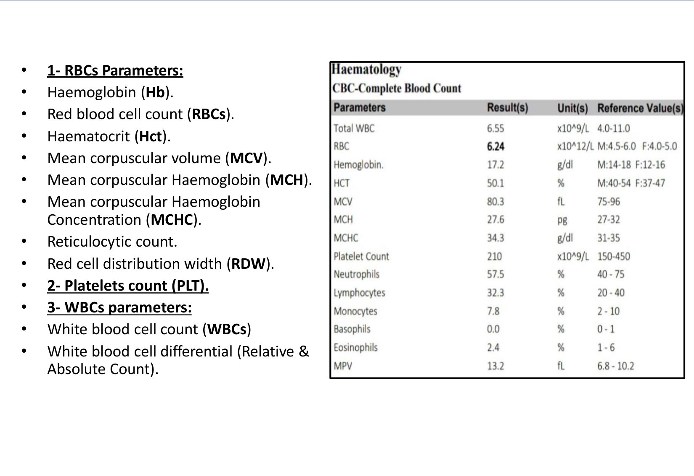

| CBC section | Parameters |
|---|---|
| **1. RBC parameters** | Hb, RBC count, **Hct**, **MCV, MCH, MCHC**, **reticulocyte count**, **RDW** |
| **2. Platelets** | PLT count |
| **3. WBC parameters** | WBC count; differential (relative and **absolute**) |

### 2.2 Haematopoiesis (Slides 6–10) ⭐

**Haematopoiesis** = development, differentiation and maturation of **all** blood cells from **pluripotent stem cells**.
- **Erythropoiesis** is regulated by **erythropoietin** (EPO, from the kidney).

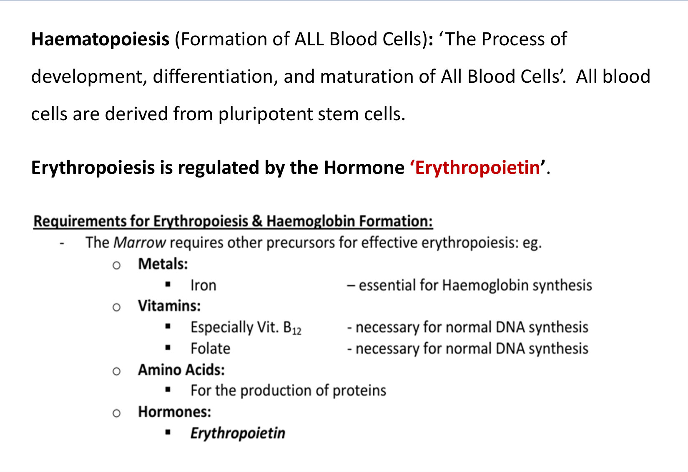

**Requirements for erythropoiesis (slide 6):**

| Group | Item | Why |
|---|---|---|
| Metals | **Iron** | Hb synthesis |
| Vitamins | **B12, folate** | DNA synthesis |
| Amino acids | — | Protein (globin) synthesis |
| Hormones | **Erythropoietin** | Drive |

**Sites over a lifetime:**

| Period | Site |
|---|---|
| **3rd week IU** | **Yolk sac** |
| **3rd month** | **Liver and spleen** |
| **4th month** | Bone marrow starts contributing |
| **Childhood & adult** | **Bone marrow only** (medullary cavity) |
| **Adult marrow** | **Ends of long bones** (femoral head) + **flat bones** (skull, sternum, pelvis, ribs) |
| **Extreme demand** (e.g. chronic haemolysis) | Liver and spleen again = ⭐ **extramedullary haematopoiesis** |

**Leucocytes:**
- **granulocytes and monocytes**: marrow, **myeloid lineage**
- **lymphocytes**:
  - **primary lymphoid organs**: marrow, **thymus**
  - **secondary lymphoid organs**: spleen, lymph nodes, tonsils, adenoids, Peyer's patches

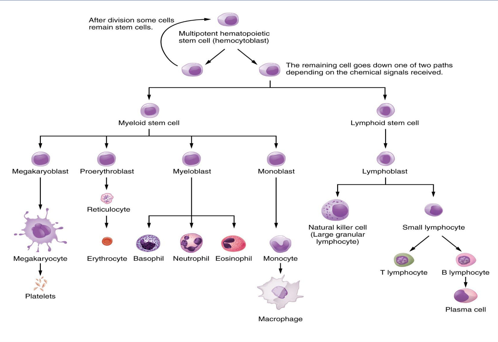

**Erythroid maturation:** totipotent → pluripotent → committed erythroid stem cell → **proerythroblast → erythroblast → normoblast → reticulocyte** (residual RNA reticulum) → **RBC**.

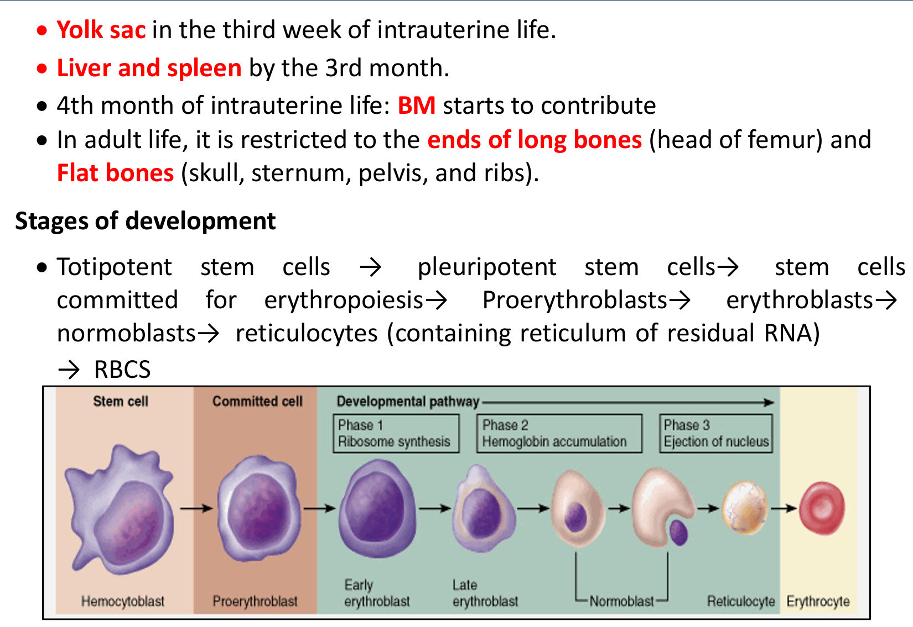

### 2.3 Haematological Indices (Slides 11–16) ⭐⭐

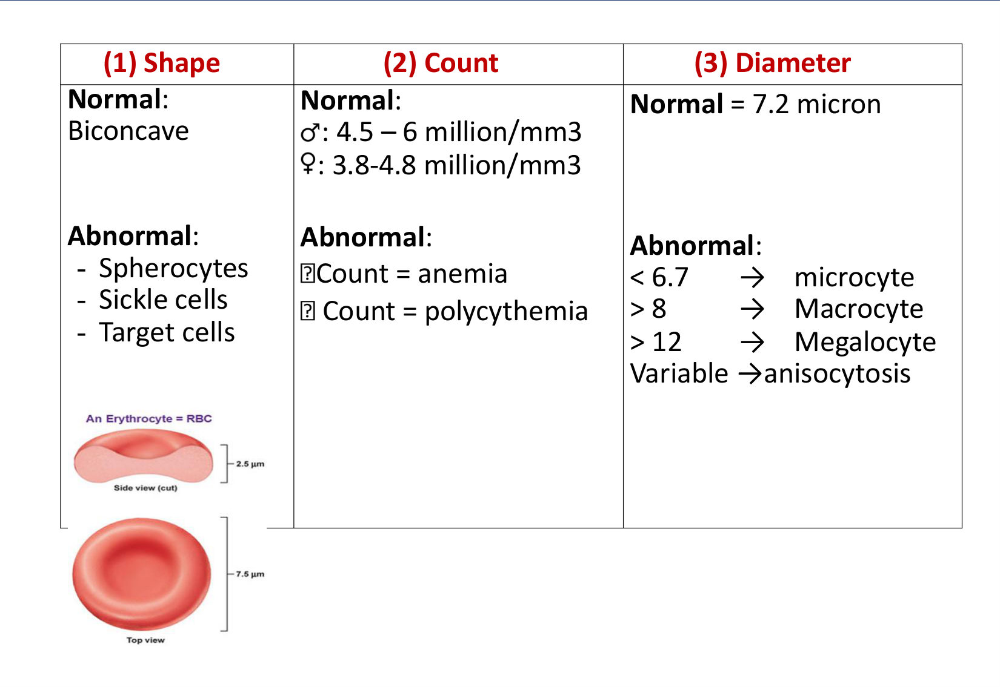

| # | Index | Normal (slides) | Abnormal / meaning |
|---|---|---|---|
| 1 | **Shape** | Biconcave | Spherocytes, sickle cells, target cells |
| 2 | **RBC count** | ♂ **4.5–6** × 10⁶/mm³; ♀ **3.8–4.8** | ↓ anaemia; ↑ polycythaemia |
| 3 | **Diameter** | **7.2 µm** | **< 6.7 microcyte**; **> 8 macrocyte**; **> 12 megalocyte**; variable = **anisocytosis** |
| 4 | **Hct (PCV)** | **~45 %** | ↑ **dehydration or polycythaemia**; ↓ **hypervolaemia or anaemia** |
| 5 | **MCV** | **78–98 fL** | **> 100 macrocytic**; **< 78 microcytic** |
| 6 | **Hb** | ♂ **13.5–16** g/dL; ♀ **11.5–13.5** | ↓ anaemia or hypervolaemia; ↑ polycythaemia or dehydration |
| 7 | **MCHC** | **32–36 %** | = Hb ÷ Hct × 100 |
| 8 | **MCH** | **~30 pg** | = Hb ÷ RBC × 10 |
| 10 | **Reticulocytes** | **0.2–2 %** | Index of **marrow activity** |

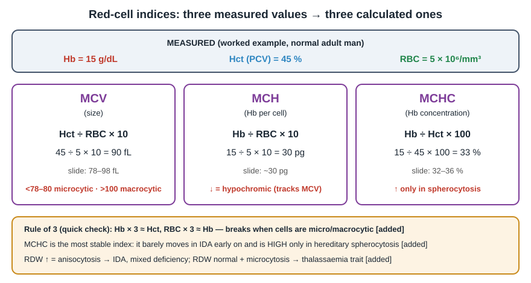

> ⚠️ **Slide inconsistencies:**
> - **MCV cut-off:** slide 12 = **< 78 / 78–98 / > 100**. The flowchart (slide 28) = **< 80 / 80–100 / > 100**. Lecture 2 uses **> 115** for megaloblastic. Learn **< 80 microcytic, > 100 macrocytic**; the megaloblastic range is often > 115.
> - **Hb lower limits:** slide 13 gives **♀ 11.5–13.5 and ♂ 13.5–16**, but slide 22 defines anaemia as **Hb < 12 (♀) / < 13 (♂)** (WHO). Use **< 13 ♂ / < 12 ♀** for the definition.

**ESR (slides 14–15):**
- **Mechanism:** RBCs carry **negative charges** and repel each other. **Albumin keeps the charge; fibrinogen and globulins neutralise it** → **rouleaux** → faster sedimentation.
- **Method:** **Westergren** (blood + sodium citrate); read at the end of the 1st and 2nd hours.

| Normal ESR | 1st h | 2nd h |
|---|---|---|
| Male | **5 mm** | 8 mm |
| Female | **10 mm** | 16 mm |

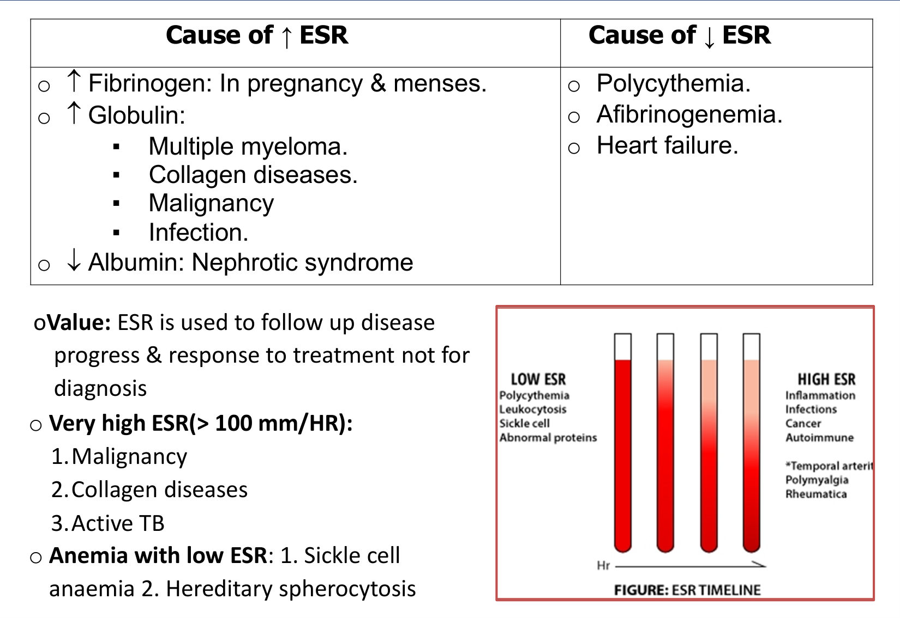

| ↑ ESR | ↓ ESR |
|---|---|
| ↑ **Fibrinogen**: pregnancy, menses | **Polycythaemia** |
| ↑ **Globulin**: **multiple myeloma**, collagen disease, malignancy, infection | **Afibrinogenaemia** |
| ↓ **Albumin**: **nephrotic syndrome** | **Heart failure** |
| *[added]* anaemia itself raises ESR | **Sickle cell anaemia, hereditary spherocytosis** (abnormal shape → no rouleaux) |

**Using the ESR:**
- ⭐ ESR is for **following disease progress and treatment response**, **not diagnosis**.
- ⭐ **ESR > 100 mm/h:** **malignancy** (*[added]* esp. myeloma), **collagen disease** (*[added]* GCA/PMR), **active TB**.

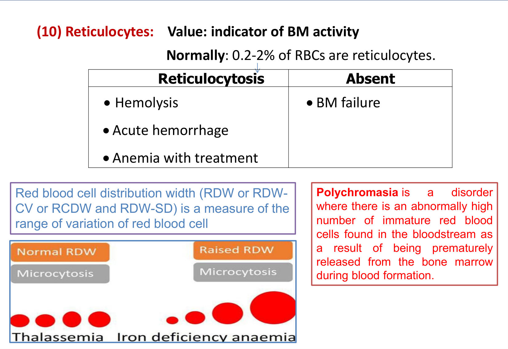

| Reticulocytosis | Absent reticulocytes |
|---|---|
| **Haemolysis**, **acute haemorrhage**, **anaemia under treatment** (e.g. after iron/B12) | ⭐ **Bone-marrow failure** |

**Related measures:**
- **RDW** = range of variation in RBC size. **↑ RDW** = anisocytosis (e.g. **IDA**); **normal RDW + microcytosis** → **thalassaemia** (slide image).
- **Polychromasia** = many immature RBCs (reticulocytes) released prematurely from the marrow → bluish cells on the film.

### 2.4 Value of the Blood Film (Slides 17–20) ⭐

| Finding | Meaning |
|---|---|
| **Anisocytosis** (size variation) | Megaloblastic or iron deficiency (non-specific); **↑ RDW** |
| **Poikilocytosis** (shape variation) | Non-specific |
| ⭐ **Basophilic stippling** (punctate basophilia) | **Lead poisoning, thalassaemia** |
| **Polychromasia** | Causes of ↑ reticulocytes |
| **Intra-RBC parasites** | **Malaria** |
| ⭐ **Howell–Jolly bodies** (nuclear remnants) | **Megaloblastic anaemia, post-splenectomy** |

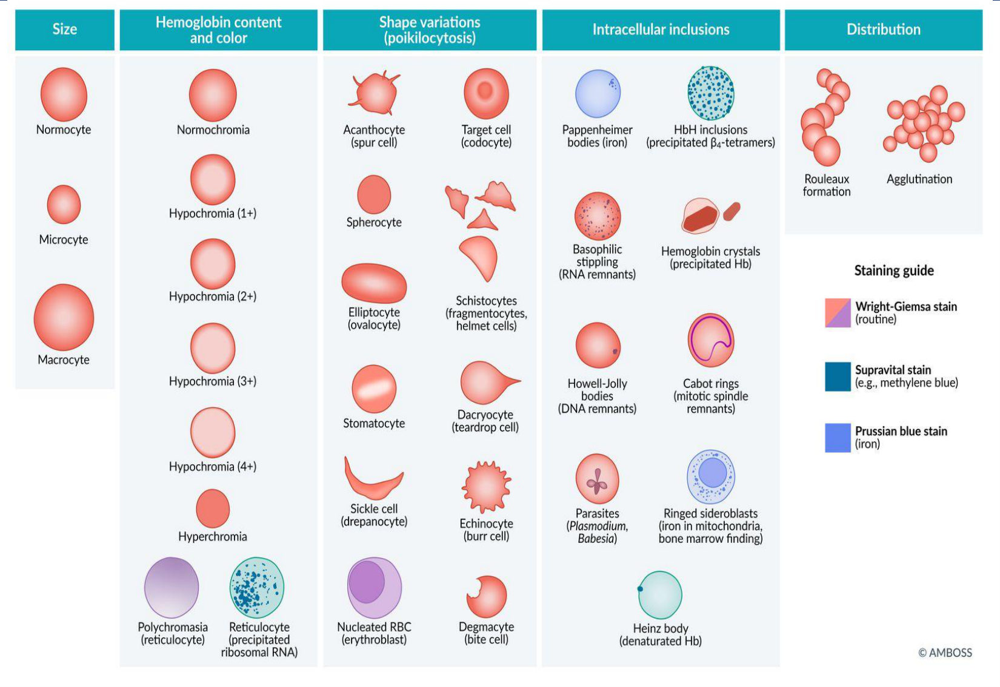

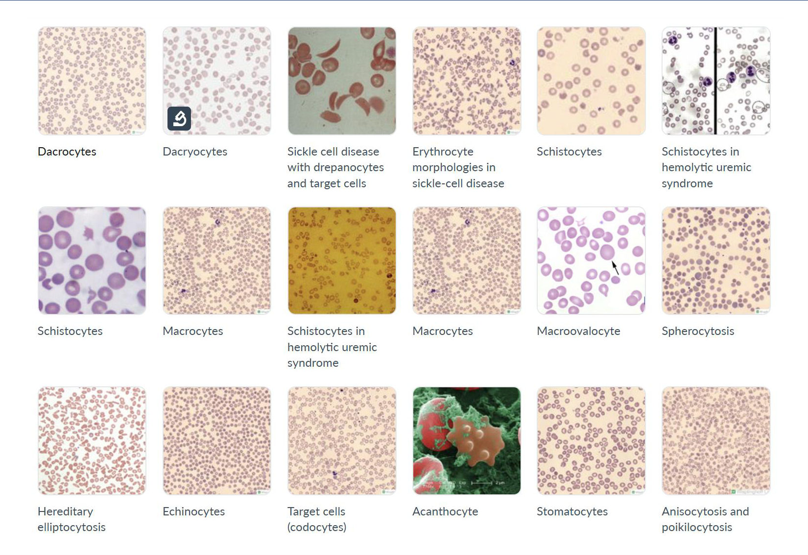

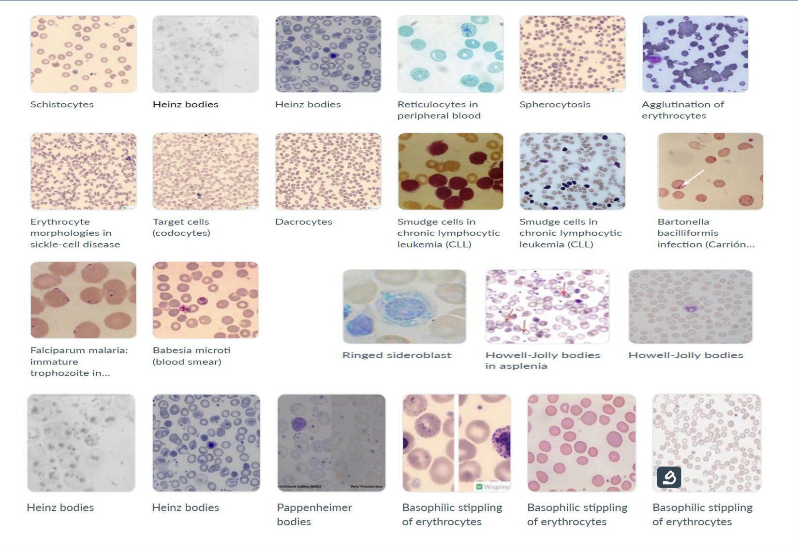

*[added]* **Shape-to-disease quick list:**

| Cell | Disease |
|---|---|
| **Schistocytes** | MAHA (DIC, TTP, HUS, prosthetic valve) |
| **Spherocytes** | HS, warm AIHA |
| **Target cells** | Thalassaemia, liver disease, HbC, post-splenectomy |
| **Teardrop cells** | Myelofibrosis |
| **Bite cells / Heinz bodies** | **G6PD deficiency** |
| **Acanthocytes** | Liver disease |
| **Pencil cells** | IDA |

> 🔁 **Recap: CBC basics.**
> - **Formation:** marrow is the only adult site (extramedullary under stress); requirements = iron, B12/folate, amino acids, EPO.
> - **Indices:** MCV < 80 / > 100; MCHC 32–36; retics 0.2–2 % (absent = marrow failure).
> - **ESR:** monitoring, not diagnosis; > 100 = myeloma/collagen/TB.
> - **Film:** stippling = lead/thal; Howell–Jolly = megaloblastic/asplenia.
>
> 🔗 **Link:** the indices exist to **classify anaemia by MCV**, which is the backbone of the rest of the lecture.
>
> ▶️ **Up next: Anaemia in general.**

### 2.5 Anaemia: Definition & Compensation (Slide 22) ⭐

**Definition:**
- ↓ O₂-carrying capacity of blood
- **Hb < 12 g/dL (♀)** or **< 13 g/dL (♂)**

**Compensatory mechanisms:**
1. **Hyperdynamic circulation**: short circulation time, **high cardiac output**
2. **↑ Erythropoietin** (kidney) → more RBCs
3. ⭐ **↑ O₂ delivery**: **↑ 2,3-DPG** → **right shift** of the O₂-dissociation curve (Hb releases O₂ more easily)
4. **Redistribution** of blood to vital organs (brain)

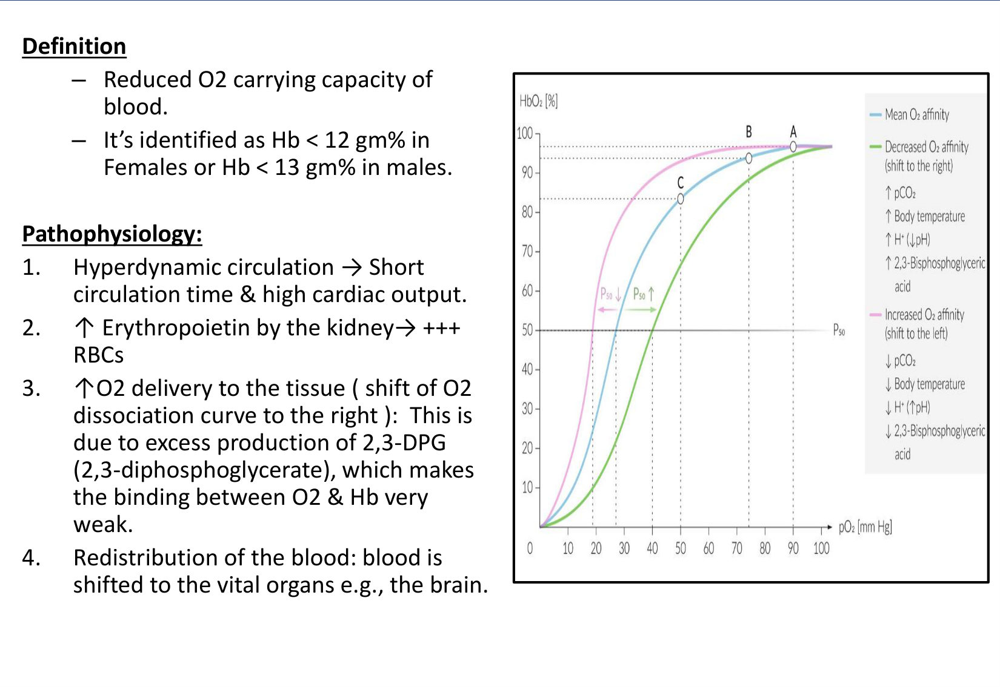

### 2.6 Anaemia: Clinical Picture (Slides 23–24)

**A. General features of any anaemia:**

| System | Features |
|---|---|
| **Pallor** | Conjunctiva, palms, nail beds |
| **CNS** | Dizziness, **tinnitus**, poor concentration, blurred vision; tingling/numbness (peripheral neuropathy) |
| **CVS** (hyperdynamic) | **Tachycardia, palpitations**, capillary pulsation, **wide pulse pressure (water-hammer pulse)**, **functional (flow) murmurs**, ⭐ **anaemic heart failure** |
| **GIT** | Dyspepsia, anorexia |
| **Renal** | Polyuria, proteinuria (hypoxia → renal vasodilatation) |
| **Reproductive** | Amenorrhoea or menorrhagia |
| **Oedema** | Hypoxic capillary leak + **hypoproteinaemia** (co-existing malnutrition) + anaemic HF |

**B.** Features specific to each anaemia. **C.** Features of the cause.

### 2.7 Anaemia: Investigations, Treatment, Classification (Slides 25–28) ⭐⭐

**Investigations:**
- **A.** All anaemias: ↓ RBCs and PCV, ↑ ESR
- **B.** Type by indices (below)
- **C.** Cause of the anaemia
- **D.** Underlying aetiology

| Type | MCV | MCH | MCHC |
|---|---|---|---|
| **Microcytic hypochromic** | ↓ | ↓ | ↓ |
| **Normocytic normochromic** | N | N | N |
| **Macrocytic normochromic** | ↑ | N | N |

**Treatment of any anaemia (slide 26):**
1. **Treat the cause**
2. ⭐ **Transfuse if:** **Hb < 7 g/dL**, **or HF**, **or ischaemic heart disease**

**Classification (slide 27):**
- **By aetiology:** deficiency · marrow failure · haemolytic · haemorrhagic
- **By red-cell type:**

| Normocytic normochromic | Microcytic hypochromic | Macrocytic normochromic |
|---|---|---|
| **Marrow failure** | ⭐ **Iron deficiency** | **Megaloblastic**: **B12 or folate** |
| **Acute haemorrhage** | **Thalassaemia** | **Non-megaloblastic**: **liver failure, hypothyroidism, myelodysplasia, alcoholism** |
| **Haemolysis** | **Sideroblastic** | |
| | **Anaemia of chronic disease** | |
| | **Chronic lead poisoning** | |

**Mnemonic for microcytic anaemia (slide 42), "IRON LAST":** **IRON** deficiency · **L**ead · **A**naemia of chronic disease · **S**ideroblastic · **T**halassaemia.

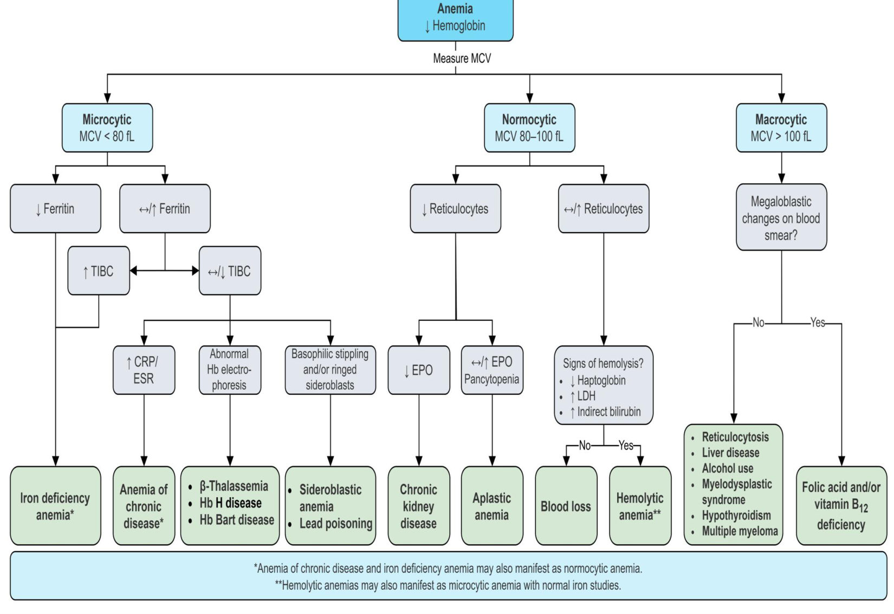

**Slide 28 algorithm:**

| Branch | Next test → diagnosis |
|---|---|
| **Microcytic (< 80)** | **↓ ferritin** → **IDA** · **N/↑ ferritin** → ↑ TIBC → IDA; N/↓ TIBC → **↑ CRP/ESR** (**ACD**), **abnormal Hb electrophoresis** (**β-thal, HbH, Hb Bart**), **basophilic stippling / ringed sideroblasts** (**sideroblastic, lead**) |
| **Normocytic (80–100)** | **↓ retics** → ↓ EPO (**CKD**) or N/↑ EPO + pancytopenia (**aplastic**) · **N/↑ retics** → haemolysis signs (↓ haptoglobin, ↑ LDH, ↑ indirect bilirubin)? Yes = **haemolytic**; No = **blood loss** |
| **Macrocytic (> 100)** | **Megaloblastic changes on film?** Yes → **folate/B12** · No → **reticulocytosis, liver disease, alcohol, MDS, hypothyroidism, multiple myeloma** |

Footnotes on the slide:
- **ACD and IDA can be normocytic** early on
- **haemolytic anaemias** may appear microcytic with normal iron studies

> 🔁 **Recap: Anaemia general.**
> - **Definition:** Hb < 13 ♂ / < 12 ♀.
> - **Compensation:** hyperdynamic circulation, EPO, **2,3-DPG right shift**, redistribution.
> - **Classification:** by MCV; **transfuse < 7** (or with HF/IHD).
>
> 🔗 **Link:** the commonest microcytic anaemia, and the commonest anaemia worldwide, is iron deficiency.
>
> ▶️ **Up next: Iron deficiency anaemia.**

### 2.8 Iron Physiology (Slides 30–31) ⭐⭐

| Item | Detail |
|---|---|
| **Sources** | Meat, liver, spinach |
| **Requirement** | **10 mg/day ingested, ~1 mg absorbed** |
| **Absorption** | **Ferric (Fe³⁺) → ferrous (Fe²⁺)** in the stomach by **HCl**; absorbed in the **duodenum** via the **apoferritin transport system**, which is saturable (**~10 % of intake absorbed**; **mucosal block theory**) |
| **Functions** | **Myoglobin & Hb**; haem enzymes (**cytochrome oxidase, catalase**) |
| **Storage** | **~1 g** as **ferritin or haemosiderin** in the RES |
| **Circulating ferritin** | ♀ **10–200 ng/mL**, ♂ **15–400**; **1 µg/L ferritin ≈ 10 mg stored iron** |
| **Transport** | Bound to **transferrin**, normally **~30 % saturated** |

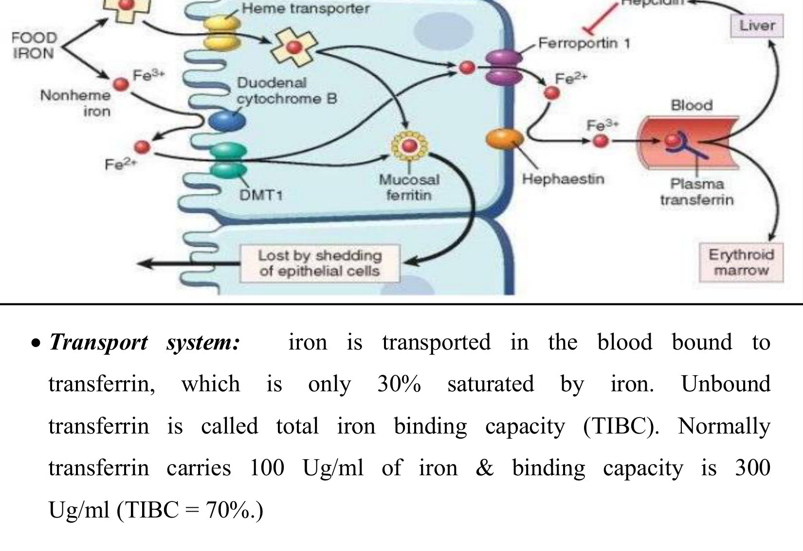

*[added]* **Slide 31 diagram mechanics:**
- **DMT1** takes Fe²⁺ into the enterocyte
- iron leaves via **ferroportin**, then is oxidised by **hephaestin** and loaded onto transferrin
- ⭐ **Hepcidin** (from the liver) **blocks ferroportin** → iron trapped in enterocytes and macrophages. This is the mechanism of **anaemia of chronic disease**.

> ⚠️ **Slide 31 error:** it says "unbound transferrin is called TIBC … TIBC = 70 %".
> - **TIBC is the total binding capacity**: **~300 µg/dL** (slide: "300", units given as µg/mL).
> - The **unsaturated** fraction (~70 %) is the **UIBC**.
> - **Serum iron ~100 µg/dL ÷ TIBC 300 = ~30 % saturation.**
> - Slide 34 repeats the error ("iron binding capacity N = 70 %").

### 2.9 IDA: Aetiology (Slide 32) ⭐

| Mechanism | Causes |
|---|---|
| **↓ Intake** | Starvation, dysphagia, prolonged parenteral feeding without iron; **infants on milk only after 6 months** (maternal stores used up) |
| **↓ Absorption** | **Gastrectomy**, gastric carcinoma, **atrophic gastritis**, **malabsorption** (*[added]* **coeliac**), excess **phytate/phosphate** *[added: PPIs, tea]* |
| ⭐ **↑ Loss** | **Chronic bleeding**: peptic ulcer, varices, gastritis, **colon cancer**, piles, haematuria, haemoptysis, **menorrhagia**, metrorrhagia; ⭐ ***Ancylostoma duodenale*** (hookworm; "common cause in Egypt") |
| **↑ Requirement** | **Pregnancy, lactation**, puberty, convalescence |

### 2.10 IDA: Clinical Picture (Slide 33) ⭐

**I.** General anaemia features.

**II. Specific features.** The enzyme defect hits **high-turnover epithelial cells** first:
- **red glazed tongue** (atrophic glossitis) *[added: angular stomatitis]*
- dyspepsia
- ⭐ **koilonychia** (spoon nails) with loss of lustre
- **hair loss**
- ⭐ **pica** (eating unusual substances; *[added]* **pagophagia** = ice)
- *[added]* **Plummer–Vinson syndrome** = IDA + **oesophageal web** (dysphagia) + glossitis; premalignant (post-cricoid SCC)

**III. Features of the cause**, e.g. **hookworm**:
- epigastric pain, constipation
- **parotid enlargement** ("endemic parotitis")
- perverted appetite
- **pellagra** (co-existing malnutrition)

### 2.11 IDA: Investigations (Slide 34) ⭐⭐

**Steps:**
1. **↓ Hb, ↓ Hct, ↓ RBCs, ↑ ESR**
2. **Type:** **microcytic hypochromic**: ↓ MCV, ↓ MCHC
3. **Cause (iron studies):**

| Test | IDA | Normal (slide) |
|---|---|---|
| **Serum iron** | ↓ | **70–140 µg/dL** |
| **TIBC** | ⭐ **↑** | (slide: "N = 70 %"; see the error flagged above) |
| **Transferrin saturation** | **↓** | **25–50 %** |
| ⭐ **Ferritin** | **↓** (most specific) | |
| **Bone marrow** | **Hypercellular with normoblasts** *[added: ⭐ absent stainable iron (Prussian blue) = gold standard]* | |

4. **Aetiology:**
   - hookworm → **eosinophilia**, stool for worm/ova
   - **faecal occult blood**
   - **endoscopy** (*[added]* bidirectional: OGD + colonoscopy in men and post-menopausal women)
   - **platelets may rise** with active blood loss
5. ⭐ **Therapeutic test:** iron → **reticulocytosis**

### 2.12 New ASH 2026 Ferritin Guidelines (Slides 35–37) ⭐⭐

> *[added]* I can't verify this guideline independently; it postdates my reliable knowledge. It is reproduced exactly as on the slides. The lecturer clearly considers it high-yield ("NEW").

**What changed (slide 35):**
1. **Ferritin cut-offs go up in every group studied**
2. **With inflammation, use ferritin + TSAT together**
3. **Labs should use clinical decision limits**, not population reference ranges

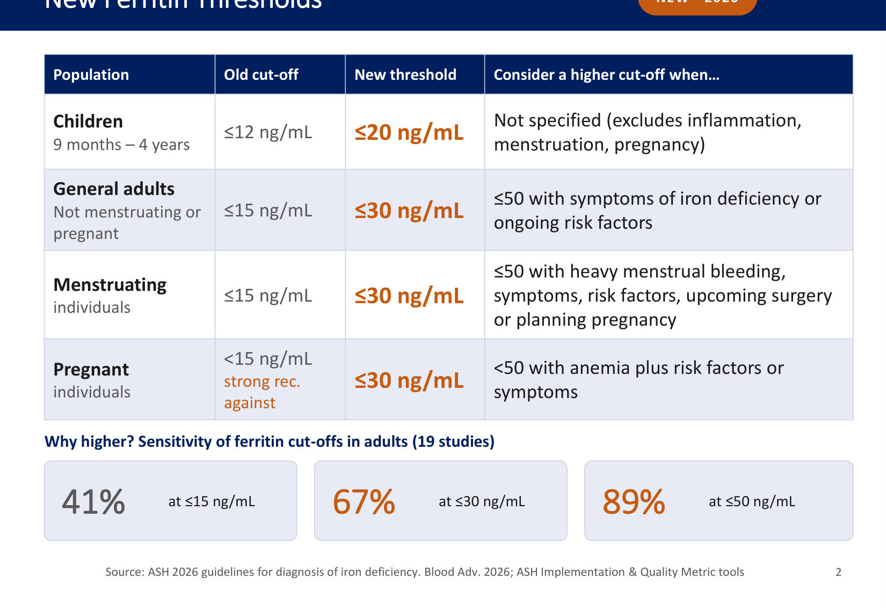

| Population | Old cut-off | ⭐ **New threshold** | Consider a higher cut-off when… |
|---|---|---|---|
| **Children 9 mo–4 y** | ≤ 12 ng/mL | **≤ 20 ng/mL** | Not specified (excludes inflammation, menstruation, pregnancy) |
| **General adults** (not menstruating/pregnant) | ≤ 15 | **≤ 30** | **≤ 50** with symptoms of ID or ongoing risk factors |
| **Menstruating** | ≤ 15 | **≤ 30** | **≤ 50** with heavy menstrual bleeding, symptoms, risk factors, upcoming surgery, planning pregnancy |
| **Pregnant** | < 15 (strong rec. against) | **≤ 30** | **< 50** with anaemia plus risk factors or symptoms |

**Why higher? Sensitivity of ferritin cut-offs in adults (19 studies):**
- **41 %** at ≤ 15
- **67 %** at ≤ 30
- **89 %** at ≤ 50

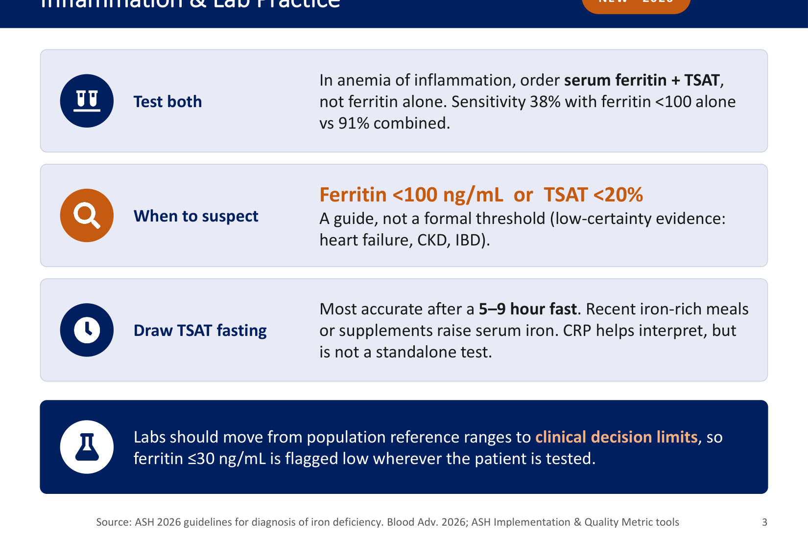

**Inflammation & lab practice (slide 37):**
- ⭐ **Test both** ferritin and TSAT in anaemia of inflammation, **not ferritin alone**. Sensitivity is **38 % with ferritin < 100 alone vs 91 % combined**.
- **When to suspect ID with inflammation:** **ferritin < 100 ng/mL or TSAT < 20 %**. This is a guide, not a formal threshold (low-certainty evidence: **HF, CKD, IBD**).
- **Draw TSAT fasting** (most accurate after a **5–9 h fast**); recent iron-rich meals or supplements raise serum iron. **CRP helps interpretation but is not a standalone test.**
- Labs should flag **ferritin ≤ 30 ng/mL as low** wherever the patient is tested.

### 2.13 IDA: Treatment (Slides 38–39) ⭐⭐

**I. Iron replacement**

**1. Oral iron** (**ferrous gluconate, ferrous sulphate**):
- **Side effects:** ⭐ **black stool** (DD melaena), **constipation**, nausea, vomiting, gastric ulcers
- **Duration:** **4–10 weeks** until Hb is normal, **then small doses for 3–6 months to refill stores**
- **Expected response:**
  - ⭐ **reticulocytes rise on day 4**, peak/persist ~**12 days**
  - ⭐ **Hb starts rising after 1 week**, by **~1 g/dL per week**
- *[added]* Alternate-day dosing improves absorption (less hepcidin rise). Take with vitamin C; avoid tea and PPIs.

**2. Parenteral iron** (**iron dextran IM/IV, iron sorbitol IM**; *[added: modern IV = ferric carboxymaltose, iron sucrose]*):
- **Indications** (oral not usable):
  - **peptic ulcer**
  - **malabsorption**
  - **oral side effects**
  - ⭐ **need for rapid correction (late pregnancy)**
  - **failure of oral iron**
- **Complications:** **allergy/anaphylaxis** (esp. iron dextran), thrombophlebitis, **haemochromatosis** (iron overload)

**II. Treat the cause:**
- hookworm → **mebendazole 100 mg BID × 3 days**
- treat peptic ulcer

**III. Transfusion if:**
- **Hb < 7 g/dL**
- ⭐ **IHD or HF with Hb < 10 g/dL**

> 🔁 **Recap: IDA.**
> - **Absorption:** 10 mg in, 1 mg absorbed (duodenum, Fe²⁺, needs HCl).
> - **Causes:** chronic blood loss (GI, menorrhagia, hookworm), ↓ absorption, ↑ need.
> - **Clinical:** koilonychia, pica, glossitis.
> - **Labs:** ↓ iron, **↑ TIBC**, ↓ TSAT, **↓ ferritin** (ASH 2026: **≤ 30**; ferritin + TSAT if inflamed).
> - **Treatment:** oral iron 4–10 weeks + 3–6 months (retics day 4, Hb +1 g/week); IV when oral fails or speed is needed; transfuse < 7 (< 10 with IHD/HF).
>
> 🔗 **Link:** the other microcytic anaemias look like IDA clinically but differ in **iron studies**.
>
> ▶️ **Up next: Sideroblastic anaemia, ACD and the microcytic DD.**

### 2.14 Sideroblastic Anaemia (Slide 40) ⭐

**Pathophysiology:**
- iron **cannot be incorporated into haem** because of a defect in **ALA synthase** (*[added]* the rate-limiting haem enzyme, B6-dependent)
- unused iron deposits as **haemosiderin in mitochondria** → ⭐ **ringed sideroblasts** (iron granules ringing the nucleus)
- most are destroyed in the marrow; some reach the blood

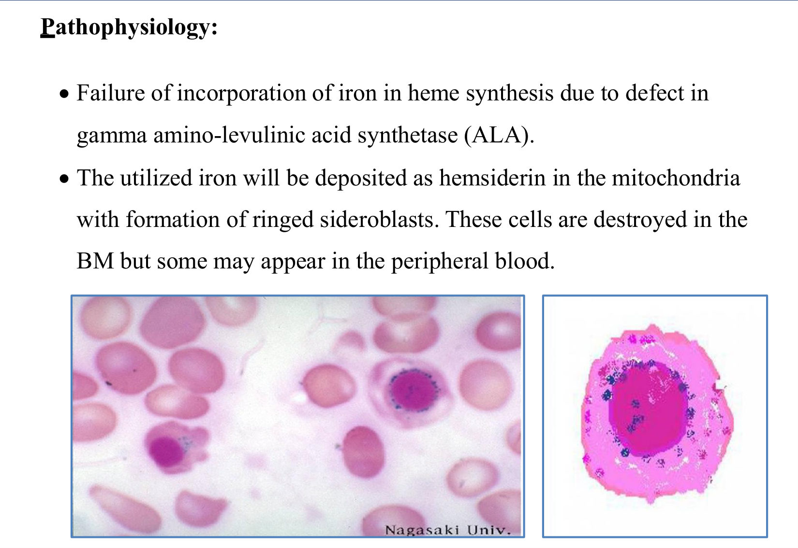

> ⚠️ **Slide error:** "**gamma** amino-levulinic acid synthetase" should be **δ-aminolevulinic acid (ALA) synthase**.

*[added]* **Causes:**
- hereditary: X-linked ALAS2
- acquired: **alcohol, isoniazid (B6 deficiency), lead**, copper deficiency, **MDS (RARS)**
- treat with **pyridoxine** where relevant

### 2.15 Anaemia of Chronic Disease (Slide 41) ⭐

| Item | Detail |
|---|---|
| **Aetiology** | **Chronic infection (TB)**, **chronic inflammation (RA)**, **malignancy** |
| **Pathogenesis** | ↓ RBC survival · **reduced EPO response** · ⭐ **↓ iron release from stores** to erythroblasts (*[added]* **hepcidin ↑**) |
| **Clinical** | As IDA |
| **Investigations** | As IDA **but**: ⭐ **↓ TIBC**, marrow with **excess stainable iron**, **↑ acute-phase reactants** |
| **Treatment** | Of the cause |

> ⚠️ Slide 41 writes "excess stainable **sideroblasts**" and "Reduced **EPF**". ACD has **excess stainable iron in macrophages** (not ringed sideroblasts) and a blunted **EPO** response.

### 2.16 DD of Microcytic Hypochromic Anaemia (Slides 42–43) ⭐⭐⭐

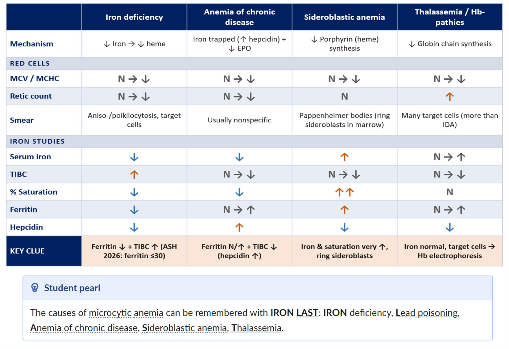

| | **Iron deficiency** | **ACD** | **Sideroblastic** | **Thalassaemia / Hb-pathies** |
|---|---|---|---|---|
| **Mechanism** | ↓ iron → ↓ haem | **Iron trapped (↑ hepcidin) + ↓ EPO** | ↓ porphyrin (haem) synthesis | ↓ globin chain synthesis |
| **MCV / MCHC** | N → ↓ | N → ↓ | N → ↓ | N → ↓ |
| **Retic count** | N → ↓ | N → ↓ | N | **↑** |
| **Smear** | Aniso/poikilocytosis, target cells | Usually non-specific | **Pappenheimer bodies** (ringed sideroblasts in marrow) | **Many target cells** (more than IDA) |
| **Serum iron** | ↓ | ↓ | **↑** | N → ↑ |
| **TIBC** | ⭐ **↑** | ⭐ **N → ↓** | N → ↓ | N → ↓ |
| **% saturation** | ↓ | ↓ | **↑↑** | N |
| **Ferritin** | ⭐ **↓** | **N → ↑** | **↑** | N → ↑ |
| **Hepcidin** | ↓ | **↑** | ↓ | ↓ |
| **Key clue** | **Ferritin ↓ + TIBC ↑** (ASH 2026: ferritin ≤ 30) | **Ferritin N/↑ + TIBC ↓** (hepcidin ↑) | **Iron and saturation very ↑, ringed sideroblasts** | **Iron normal, target cells → Hb electrophoresis** |

**Clinical pearls (slide 43):**
- **IDA and ACD** can be **normocytic early** and **microcytic later**.
- **Marrow failure** (myeloproliferative malignancy, MDS) can be **micro-, normo- or macrocytic**.
- ⭐ **IDA and thalassaemia trait** are the **commonest causes of microcytosis**.
- **Basophilic stippling** → **lead poisoning or sideroblastic anaemia**. **Ringed sideroblasts are usually absent in lead poisoning**, which helps separate them.
- ⚠️ **Caution:** **low ferritin confirms IDA**, but **high ferritin does not rule it out** (ferritin is an acute-phase reactant).

### 2.17 Haemorrhagic Anaemia (Slide 44) ⭐

**Chronic haemorrhage:** behaves as **IDA** (microcytic hypochromic).

**Acute haemorrhage** (> 1 L lost acutely):

| Time | Finding |
|---|---|
| **Immediately** | **Proportional loss of RBCs and plasma → PCV NORMAL**; ↓ platelets and neutrophils within hours |
| **Within 1 day** | Interstitial fluid moves into vessels → **haemodilution → ↓ PCV** |
| **After 3–4 days** | ↑ marrow activity → **reticulocytosis** |

⭐ **Pearl:** **Hb and Hct can be normal initially** after acute haemorrhage. They fall only after plasma volume is restored (spontaneously or by IV fluids). *[added]* Shock lecture link: never use the first Hb to judge acute blood loss.

### 2.18 Case & Summary (Slides 45–47)
See Q1 in §7.

---

## 3. High-Yield Comparison Tables

### Table A: Anaemia by MCV
*[slides 25, 27, 28]*

| Microcytic (< 80) | Normocytic (80–100) | Macrocytic (> 100) |
|---|---|---|
| IDA, ACD (late), thalassaemia, sideroblastic, lead | Marrow failure, acute haemorrhage, haemolysis, CKD, early IDA/ACD | **Megaloblastic**: B12, folate |
| | | **Non-megaloblastic**: liver, alcohol, hypothyroidism, MDS, myeloma, reticulocytosis |

### Table B: Iron Studies Cheat Sheet
See §2.16. Remember: **TIBC moves opposite to ferritin**: IDA = ferritin ↓ / TIBC ↑; ACD = ferritin ↑ / TIBC ↓.

### Table C: Oral vs Parenteral Iron

| | Oral | Parenteral |
|---|---|---|
| Agents | Ferrous sulphate, gluconate | Iron dextran (IM/IV), iron sorbitol (IM) |
| Use | First line | PU, malabsorption, oral intolerance, **late pregnancy**, oral failure |
| Side effects | **Black stool**, constipation, GI upset, ulcers | **Anaphylaxis**, thrombophlebitis, iron overload |
| Duration | 4–10 weeks + **3–6 months** for stores | Calculated total dose *[added]* |

### Table D: Reticulocytes

| ↑ (reticulocytosis) | Absent / low |
|---|---|
| Haemolysis, acute bleed (after 3–4 days), **response to treatment** (iron day 4) | **Aplastic anaemia**, untreated deficiency, ACD, CKD |

### Table E: Transfusion Thresholds (slides 26, 39)

| Situation | Transfuse at |
|---|---|
| General | **Hb < 7 g/dL** |
| **IHD or HF** | **Hb < 10 g/dL** (slide 39) |

---

## 4. Rules, Exceptions, Patterns

| Rule | Exception / nuance |
|---|---|
| Low ferritin = IDA | **High ferritin does NOT exclude IDA** (acute-phase reactant) → add **TSAT**; with inflammation suspect ID if ferritin < 100 or TSAT < 20 % |
| IDA is microcytic | **Early IDA/ACD is normocytic** |
| Microcytic anaemia = iron deficiency | **Thalassaemia trait** is equally common → **normal ferritin, normal RDW, target cells** → Hb electrophoresis |
| Anaemia raises ESR | **Sickle cell and HS lower ESR** |
| Acute bleed → low Hb | **Hb/Hct normal at first**; falls within 24 h |
| Basophilic stippling | **Lead** (no ringed sideroblasts) vs **sideroblastic** (ringed sideroblasts) vs **thalassaemia** |
| Oral iron → black stool | **Not melaena**: stool is formed and not tarry *[added]*; check FOBT if in doubt |
| Transfuse at Hb < 7 | **IHD/HF → < 10** |
| Iron absorption | Needs **acid** → gastrectomy, atrophic gastritis, *[added]* PPIs ↓ absorption |
| Ferritin cut-off ≤ 15 (old) | **ASH 2026: ≤ 30** (adults, menstruating, pregnant); **≤ 20** in children 9 mo–4 y |

**Pattern recognition:**
- **elderly man + IDA** → GI malignancy work-up (OGD + colonoscopy) *[added]*
- **NSAID use + IDA** → peptic ulcer/gastritis bleeding
- **koilonychia + dysphagia + glossitis** → Plummer–Vinson *[added]*
- **microcytosis + very high iron + ringed sideroblasts** → sideroblastic
- **microcytosis + ferritin ↑ + TIBC ↓ + RA/TB** → ACD

---

## 5. Clinical Correlations

- **Elderly man with IDA** (the slide case): **diet + NSAIDs** explain it, but an *[added]* **endoscopic search for GI malignancy** is still mandatory.
- **Black stool on oral iron vs melaena:** ask about tarry, sticky, foul stool and haemodynamic change. *[added]* Iron stool is dark green-black and formed.
- **IHD/HF patients** tolerate anaemia badly (angina, anaemic HF) → transfuse at **Hb < 10**.
- **Pregnancy:**
  - iron needs rise
  - **IV iron in late pregnancy** when rapid correction is needed
  - ASH 2026 ferritin threshold **≤ 30**, or **< 50** with anaemia + risk factors/symptoms
- **Hookworm** (*Ancylostoma duodenale*):
  - eosinophilia + IDA
  - treat with **mebendazole 100 mg BID × 3 days** + iron
  - travel/endemic exposure (bridge to Travel Medicine)
- **Lab practice:**
  - draw **TSAT fasting**
  - **CRP** helps interpret ferritin
  - ferritin **≤ 30 flagged low** wherever tested

---

## 6. Rapid Revision (Last-Day)

- **Plasma & serum:** plasma 90 % water, 5–7 % protein (albumin, globulin, fibrinogen). **Serum = plasma − clotting factors.**
- **Haematopoiesis sites:** **yolk sac (wk 3) → liver/spleen (mo 3) → marrow (from mo 4)**. Adult marrow = ends of long bones + flat bones. Extramedullary = liver/spleen under stress.
- **Erythroid maturation:** proerythroblast → erythroblast → normoblast → **reticulocyte (RNA)** → RBC.
- **Requirements:** **iron, B12, folate, amino acids, EPO**.
- **RBC normals:**
  - count ♂ 4.5–6, ♀ 3.8–4.8 × 10⁶
  - diameter **7.2 µm** (< 6.7 micro, > 8 macro, > 12 megalocyte)
  - Hct **45 %**
  - MCV **78–98** (use < 80 / > 100)
  - Hb ♂ 13.5–16, ♀ 11.5–13.5
  - MCHC **32–36 %**
  - MCH **~30 pg**
  - retics **0.2–2 %**
- **ESR:**
  - normal ♂ 5, ♀ 10 mm in the 1st h (Westergren)
  - ↑ fibrinogen/globulin, ↓ albumin
  - ↓ in polycythaemia, afibrinogenaemia, HF, **sickle cell, HS**
  - **> 100: malignancy, collagen, TB**
  - monitoring, not diagnosis
- **Blood film:**
  - **stippling: lead, thal**
  - **Howell–Jolly: megaloblastic, asplenia**
  - **↑ RDW: IDA**
- **Anaemia definition:** **Hb < 13 ♂ / < 12 ♀**.
- **Compensation:** hyperdynamic circulation, EPO, **2,3-DPG → right shift**, redistribution.
- **General anaemia features:** pallor, tinnitus, palpitations, **water-hammer pulse, flow murmur, anaemic HF**, oedema.
- **Transfusion:** **< 7**, or **< 10 with IHD/HF**.
- **Microcytic causes = IRON LAST:** **IDA, lead, ACD, sideroblastic, thalassaemia**.
- **Macrocytic causes:** megaloblastic (B12/folate) vs non-megaloblastic (liver, alcohol, hypothyroid, MDS).
- **Iron physiology:**
  - 10 mg/day in, **1 mg absorbed**
  - **Fe³⁺ → Fe²⁺ by HCl**, duodenum
  - 1 g stored (ferritin/haemosiderin)
  - transferrin ~30 % saturated
  - **hepcidin blocks ferroportin**
- **IDA causes:** chronic blood loss (PU, colon cancer, menorrhagia, **hookworm**), gastrectomy/atrophic gastritis/malabsorption, ↑ need (pregnancy, puberty), milk-only infants > 6 months.
- **IDA features:** **glossitis, koilonychia, pica**, hair loss. Hookworm: parotid enlargement, pellagra.
- **IDA labs:**
  - **↓ iron (N 70–140), ↑ TIBC, ↓ TSAT (N 25–50 %), ↓ ferritin**
  - marrow: no stainable iron *[added]*
  - **therapeutic test → retics**
- **ASH 2026 ferritin thresholds:**
  - **≤ 30** (adults, menstruating, pregnant); **≤ 20** children 9 mo–4 y
  - **≤ 50** if symptoms/risk
  - inflammation: **ferritin + TSAT** (< 100 or < 20 %)
  - sensitivity 41/67/89 % at 15/30/50
- **IDA treatment:**
  - **oral ferrous sulphate/gluconate** for 4–10 weeks + 3–6 months
  - **retics day 4**, Hb +1 g/dL/week from week 1
  - black stool, constipation
  - **IV iron**: PU, malabsorption, intolerance, **late pregnancy**, failure; risk of anaphylaxis
  - hookworm: **mebendazole 100 mg BID × 3 d**
- **Sideroblastic anaemia:** **δ-ALA synthase** defect → **ringed sideroblasts**, **↑ iron, ↑↑ TSAT, ↑ ferritin**.
- **ACD:** TB/RA/cancer; **hepcidin ↑**; **ferritin N/↑, TIBC ↓**, marrow iron ↑.
- **Thalassaemia:** iron normal, **target cells**, ↑ retics → **Hb electrophoresis**.
- **Acute haemorrhage:** **PCV normal at first** → ↓ in 24 h (haemodilution) → retics at **3–4 days**.

---

## 7. Exam-Style Questions

**Q1. (Lecture case)** A 78-year-old widower has 6 months of fatigue, headache and occasional upper abdominal pain. He takes HCTZ, metformin and **ibuprofen** for shoulder pain, and his diet is **mostly potatoes and eggs**. He has pallor and a mild postural tremor; rectal exam is normal. The film shows RBCs with **increased central pallor and anisocytosis**. Underlying cause?
a) Lead poisoning · b) Folate deficiency · c) Marrow failure · d) Intravascular haemolysis · e) ↓ EPO · f) B12 deficiency · **g) Iron deficiency**

> **Answer: g** *[reasoning added; key not on slides]*.
> - **Increased central pallor = hypochromia**; anisocytosis = ↑ RDW. Together they mean **IDA**.
> - Mechanism: **poor intake** (potatoes/eggs are poor in haem iron) plus **NSAID-induced GI blood loss** (epigastric pain).
> - **Why not the others:**
>   - **Lead (a):** abdominal pain and tremor tempt, but there is no exposure history, and you'd expect **basophilic stippling**.
>   - **Folate/B12 (b, f):** macrocytosis and hypersegmented neutrophils, not hypochromia.
>   - **(c)** marrow failure → pancytopenia. **(d)** intravascular haemolysis → jaundice, haemoglobinuria. **(e)** ↓ EPO (CKD) → normocytic.
> - *[added]* An older man with IDA still needs **OGD + colonoscopy**.

**Q2.** A woman with RA has Hb 10 g/dL, MCV 76 fL, serum iron ↓, **TIBC ↓**, **ferritin 180 ng/mL**, CRP ↑. Diagnosis?
A. IDA · **B. Anaemia of chronic disease** · C. β-thalassaemia trait · D. Sideroblastic anaemia · E. Lead poisoning

> **Answer: B** (slides 41–42).
> - Ferritin N/↑ + **TIBC ↓** + inflammation, driven by **hepcidin**.
> - **Caveat** (slide 37): with inflammation, coexisting ID is suspected if **ferritin < 100 or TSAT < 20 %**. Here ferritin is 180, so check TSAT.

**Q3.** A patient starts oral ferrous sulphate for IDA. When should the **reticulocyte count** first rise, and how fast should Hb climb?
A. Day 1; 3 g/dL/week · **B. Day 4; ~1 g/dL/week from week 1** · C. Week 3; 0.5 g/dL/month · D. Day 10; 2 g/dL/day · E. No change for 3 months

> **Answer: B** (slide 38).
> - Retics rise on day **4** and persist ~12 days. Hb starts rising after **1 week**, by **~1 g/dL/week**.
> - Continue for **3–6 months after Hb normalises** to refill stores.

**Q4.** Microcytic anaemia with **serum iron ↑, TSAT ↑↑, ferritin ↑** and **ringed sideroblasts** in the marrow. Defect?
A. Globin chain synthesis · **B. δ-aminolevulinic acid synthase (haem synthesis)** · C. Hepcidin excess · D. Ferroportin loss · E. Spectrin

> **Answer: B** (slides 40, 42).
> - Iron can't enter haem → mitochondrial iron ring. *[added]* Think alcohol, isoniazid, lead, MDS; try pyridoxine.

**Q5.** A 60-year-old with known IHD has Hb 8.5 g/dL from chronic GI loss, with exertional angina. Most appropriate?
A. Oral iron only and recheck in 3 months · **B. Transfuse (Hb < 10 with IHD), then iron + find the source** · C. Wait until Hb < 7 · D. IV iron dextran without investigation · E. EPO

> **Answer: B** (slide 39). Transfusion threshold is **< 10 g/dL in IHD/HF**, versus < 7 in general.

**Q6.** A non-pregnant, non-menstruating adult has fatigue, Hb normal, ferritin **24 ng/mL**, CRP normal. According to the ASH 2026 guidelines on the slides:
A. Normal; ferritin > 15 · **B. Iron deficient; the new adult threshold is ≤ 30 ng/mL** · C. Needs bone-marrow iron stain · D. Iron deficient only if TSAT < 5 % · E. ACD

> **Answer: B** (slides 35–36). The old threshold was ≤ 15. ≤ 50 may be used with symptoms or ongoing risk.

---

## 8. Exam Pitfalls & Traps

| Trap | Correct thinking |
|---|---|
| "TIBC = 70 %" (slides 31, 34) | ❌ TIBC is a **capacity (~300 µg/dL)**; **saturation ~30 %**; the 70 % is the **unsaturated** fraction |
| Normal ferritin excludes IDA | ❌ Ferritin is an **acute-phase reactant**; use **ferritin + TSAT** in inflammation |
| Ferritin ≤ 15 = cut-off | ⚠️ **ASH 2026 (slides): ≤ 30** in adults, menstruating and pregnant |
| ACD has high TIBC | ❌ **ACD: TIBC ↓**; IDA: TIBC ↑ |
| All microcytic anaemia → iron | ❌ **Thalassaemia trait** (normal ferritin, target cells) gets **no iron**; check Hb electrophoresis |
| Acute GI bleed with normal Hb → minor | ❌ **Hb/Hct normal initially**; falls after haemodilution |
| ESR diagnoses disease | ❌ It **monitors** disease and treatment |
| Anaemia always ↑ ESR | ❌ **Sickle cell, HS → ↓ ESR** |
| Stop oral iron when Hb normalises | ❌ Continue **3–6 months** to refill stores |
| Black stool on iron = melaena | ⚠️ Expected side effect; melaena is tarry and with haemodynamic change *[added]* |
| Transfuse everyone at Hb < 10 | ❌ **< 7** generally; **< 10 only with IHD/HF** |
| Ringed sideroblasts in lead poisoning | ❌ Usually **absent** in lead; present in sideroblastic anaemia |
| "Gamma"-ALA synthase (slide 40) | ❌ **δ-ALA synthase** |
| MCV < 78 vs < 80 | ⚠️ The slides use both; **< 80** is standard |
| ACD marrow has "excess sideroblasts" (slide 41) | ❌ **Excess stainable iron in macrophages**; ringed sideroblasts = sideroblastic anaemia |
