# Haematological Disorders 2: Megaloblastic, Aplastic & Haemolytic Anaemias (HS, G6PD)
**Internal Medicine Department (lecturer not named on slides)** | Source: `2-_Megaloplastic-aplastic-Hemogobinopathies.pdf` (45 slides)

> **Legend:** ⭐ = high-yield · *[added]* = not on slides. Images marked "Slide N" come from the lecture; "Added diagram" = drawn for these notes. The lecture has **no answer key** for its case; the answer below is **[reasoning added; key not on slides]**.

> ⚠️ **Coverage gap:** the file is named "…**Hemoglobinopathies**", but the slides contain **no thalassaemia or sickle-cell content**. Both appear only as names in the haemolytic aetiology list (slide 27). Slide 3's subtopics also omit them. Expect a separate lecture, or ask the lecturer whether they are examinable from this deck. Thalassaemia's iron profile is in **Heme 1, §2.16**.

> 🔗 **Bridge from earlier lectures:**
> - **Heme 1 (CBC & IDA):**
>   - **macrocytic** branch of the MCV algorithm
>   - **Howell–Jolly bodies** on the film
>   - **reticulocytes**: absent in marrow failure, ↑ in haemolysis
>   - transfusion threshold **Hb < 7**, or with HF/IHD
> - **FUO & Travel Medicine Pt 1:**
>   - **primaquine/tafenoquine haemolysis in G6PD deficiency** ("check G6PD first")
>   - **malaria** is an infective cause of haemolysis
>   - ***Salmonella* osteomyelitis in sickle cell**
> - **Substance Use Disorders (Khrad):** **alcohol** → folate deficiency and macrocytosis. **Wernicke** (confusion, nystagmus, ataxia) = **B1**, the lecture-case distractor.
> - **Thyroid 1:** **carbimazole ("Neomercazole")** → agranulocytosis/aplastic anaemia. **Pernicious anaemia** clusters with **autoimmune thyroiditis/Graves**.
> - **Gastric Tumours:** **pernicious anaemia → ↑ gastric carcinoma**; **gastrectomy → B12 deficiency** (loss of intrinsic factor).
> - **Lung Cancer (Kotb):** small-cell (oat-cell) carcinoma appears in the slide list of red-cell aplasia causes.
> - **Valvular / IE (Reihan):** **prosthetic and calcific aortic valves** → mechanical (schistocytic) haemolysis.
> - **Tuberculosis (Kotb):** **ileal TB** → B12 malabsorption; **disseminated TB** → marrow failure.

---

## 1. Title / Objectives

| Domain | Objective | Likely tested as |
|---|---|---|
| Knowledge | Pathophysiology and aetiology of anaemia | Folate trap; MMA vs homocysteine; Heinz bodies |
| Knowledge | ⭐ Manifestations, complications, management | SCD; pernicious anaemia autoimmunity; crises; splenectomy indications |
| Skill | ⭐ Interpret investigations | MCV > 115, hypersegmented PMNs; absent retics; LDH/haptoglobin; osmotic fragility, EMA |
| Skill | Evidence-based management | B12 IM for life; folate 5 mg; never folate alone in B12 deficiency |
| Skill | Emergencies | Aplastic infection risk; haemolytic crisis; G6PD trigger avoidance |

**Main subtopics (slide 3):**
- **megaloblastic anaemia** (B12 and folate: pathogenesis, neurology)
- **aplastic anaemia** and the pancytopenia work-up
- **haemolysis basics** (intravascular vs extravascular)
- **G6PD deficiency** (oxidants, Heinz bodies, bite cells)

Hereditary spherocytosis is also taught (slides 36–37).

---

## 2. Main Content (Lecture Order)

### 2.1 Vitamin B12: Physiology (Slide 5) ⭐⭐

| Item | Detail |
|---|---|
| **Source** | ⭐ **Animal sources only** (not plants) |
| **Requirement** | **1 µg/day** |
| **Absorption** | Binds **intrinsic factor** (from **gastric parietal cells**) → absorbed in the ⭐ **terminal ileum** via a specific receptor |
| **Transport** | **Transcobalamin II** |
| **Stores** | ⭐ **Liver; enough for 2–3 years** *[added: deficiency takes years to appear]* |
| **Function** | **DNA synthesis** in dividing cells; ⭐ **myelination** of nerve fibres |

### 2.2 B12 Deficiency: Aetiology (Slides 6–7) ⭐⭐

**1. ↓ Intake:**
- dysphagia, starvation
- ⭐ **vegans/vegetarians**

**2. ↓ Absorption:**
- **gastrectomy, gastritis, gastric carcinoma** (loss of IF)
- ⭐ **Addisonian pernicious anaemia** (autoimmune):
  - classically **northern Europe**; **F > M**; rare **< 30 years**
  - genetic (**HLA-A3, B7**)
  - **three antibody types:**
    1. **anti-parietal cell** antibodies
    2. **blocking** antibodies: stop **B12 binding to IF**
    3. **binding** antibodies: stop the **IF–B12 complex binding the ileal receptor**
  - associated autoimmunity: **thyroiditis, vitiligo** (slide 10 adds **Addison's, Graves'**)
- **ileal disease:**
  - **regional ileitis (Crohn's)**, **ileal TB**
  - ***Diphyllobothrium latum*** (fish tapeworm)
  - **malabsorption**
  - *[added]* ileal resection, blind-loop bacterial overgrowth, **metformin**, PPIs

**3. ↑ Requirement:** pregnancy, malignancy.

**4. ↓ Storage:** liver cirrhosis (uncommon).

**5. Other:** **congenital transcobalamin II deficiency**.

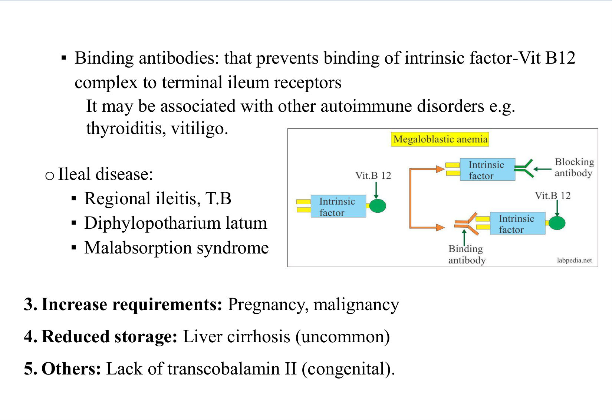

*[added]* **Note on the antibodies:** **anti-IF antibodies** (blocking) are the **specific** test for pernicious anaemia (~50 % sensitive, ~100 % specific). Anti-parietal cell antibodies are sensitive but non-specific.

### 2.3 B12 Deficiency: Pathogenesis (Slides 8–9) ⭐

**Mechanism:**
- DNA synthesis (B12-dependent) lags behind cytoplasmic growth (RNA unaffected)
- → **nuclear–cytoplasmic asynchrony** → delayed division → ⭐ **megaloblasts**

| Site | Consequence |
|---|---|
| **Bone marrow** | ⭐ **Ineffective erythropoiesis**: megaloblasts die in the marrow → **↑ LDH, ↑ serum iron, ↑ marrow haemosiderin**; platelets destroyed → **thrombocytopenia**; WBCs destroyed → **↑ serum muramidase (lysozyme)** |
| **Peripheral blood** | Released cells are destroyed further in the RES → ⭐ **pancytopenia**. RBCs: anisocytosis, poikilocytosis, **Cabot rings, Howell–Jolly bodies**; ↓ platelets; **leucopenia with hypersegmented neutrophils** |
| **GIT** | **Epithelial atrophy** (rapid turnover) |
| **CNS** | **Defective myelination** → impaired conduction |

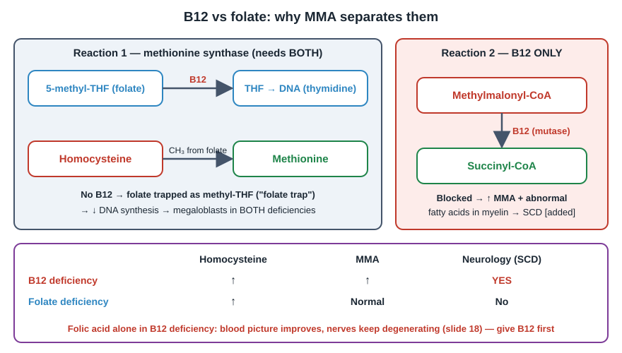

### 2.4 B12 Deficiency: Clinical Picture (Slide 10) ⭐⭐

**1.** General anaemia features *[added: often a lemon-yellow tinge from mild haemolysis plus pallor]*.

**2. Specific features:**

| System | Feature |
|---|---|
| **Blood** | **Bleeding tendency** (↓ platelets); **infection** (↓ WBCs) |
| **GIT** | ⭐ **Red glazed tongue** (glossitis); dyspepsia, nausea, vomiting; **diarrhoea**; **hepatosplenomegaly** |
| **CNS** | ⭐ **Subacute combined degeneration (SCD)** of the cord |

**Pearls on slide 10:**
- SCD affects the **spinocerebellar tracts, lateral corticospinal tracts and dorsal columns**
- ⭐ **Always consider B12 deficiency when evaluating dementia**

*[added]* **SCD clinically:**
- **dorsal columns:** ↓ vibration and proprioception, **+ Romberg**, sensory ataxia
- **corticospinal:** spastic weakness, **extensor plantars**
- combined with **peripheral neuropathy:** **absent ankle jerks**
- cognitive change ("megaloblastic madness")
- neurology can occur **without anaemia**

**3. Features of the cause (pernicious anaemia):**
- other autoimmune disease: Addison's, vitiligo, Graves'
- ⭐ **↑ gastric carcinoma** risk

### 2.5 B12 Deficiency: Investigations (Slides 11–13) ⭐⭐⭐

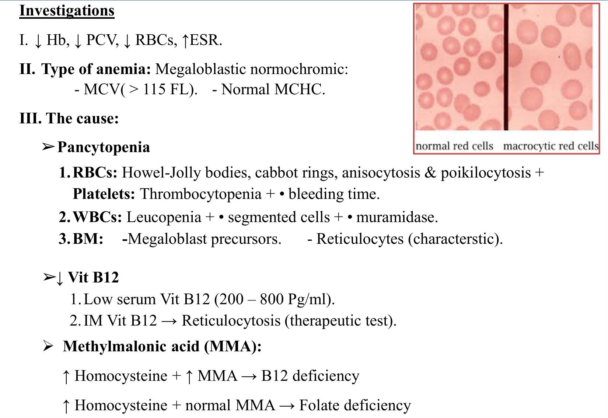

1. ↓ Hb, ↓ PCV, ↓ RBCs, ↑ ESR
2. **Type:** **megaloblastic, normochromic**: ⭐ **MCV > 115 fL**, **normal MCHC**
3. **Cause:**

| Domain | Findings |
|---|---|
| **Pancytopenia** | RBCs: **Howell–Jolly bodies, Cabot rings**, aniso/poikilocytosis · platelets: thrombocytopenia + ↑ bleeding time · WBCs: leucopenia + ⭐ **hypersegmented neutrophils** (*[added]* ≥ 6 lobes, or > 5 % with 5 lobes) + ↑ muramidase |
| **Bone marrow** | **Megaloblastic precursors**; reticulocytes (the slide says "characteristic"; see note) |
| **↓ B12** | Low serum B12 (slide: "200–800 pg/mL", which is actually the **normal** range); ⭐ **IM B12 → reticulocytosis** (therapeutic test) |
| ⭐ **MMA & homocysteine** | **↑ homocysteine + ↑ MMA → B12 deficiency** · **↑ homocysteine + normal MMA → folate deficiency** |

> ⚠️ **Slide 11 issues:**
> - **"Low serum B12 (200–800 pg/mL)"**: 200–800 is the **normal range**. Deficiency is **< 200 pg/mL** *[added]*; 200–300 is borderline, so check MMA.
> - **"BM: Reticulocytes (characteristic)"**: an arrow was probably lost. Megaloblastic anaemia has a **low reticulocyte count** (ineffective erythropoiesis). The rise after IM B12 is the therapeutic test.
> - The "•" symbols in "• bleeding time", "• segmented cells" and "• muramidase" are lost **↑** arrows.

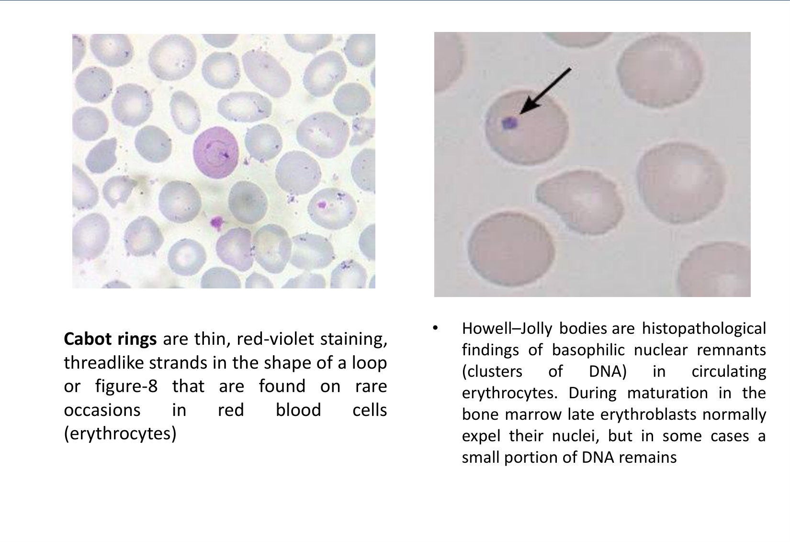

- **Howell–Jolly bodies:** basophilic **nuclear remnants (DNA)** left when late erythroblasts don't fully expel the nucleus.
- **Cabot rings:** thin red-violet **loop or figure-8 strands** in RBCs.

**4. Aetiology (slide 13):**
- **Pernicious anaemia:**
  - **antibodies**
  - **gastric function test for achlorhydria**
  - ⭐ **endoscopy to exclude gastric carcinoma**
- **Malabsorption work-up**
- **Schilling test** (*[added: historical, no longer available]*):
  - **procedure:** **1000 µg B12 IM** (saturates binding sites) → then **1 µg oral radiolabelled B12**
  - **normal:** **≥ 25 %** of the label appears in 24 h urine
  - **abnormal:** **< 5 %** → malabsorption

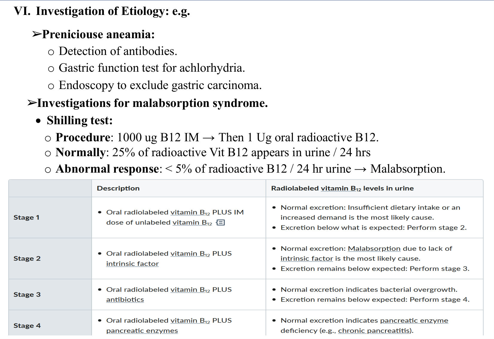

| Stage | Oral radiolabelled B12 plus… | Normal excretion means |
|---|---|---|
| **1** | IM unlabelled B12 | **Dietary** deficiency / ↑ demand (if low → stage 2) |
| **2** | **Intrinsic factor** | ⭐ **Pernicious anaemia** (IF lack) (if low → stage 3) |
| **3** | **Antibiotics** | **Bacterial overgrowth** (if low → stage 4) |
| **4** | **Pancreatic enzymes** | **Pancreatic insufficiency** (chronic pancreatitis) |

### 2.6 B12 Deficiency: Treatment (Slide 14) ⭐

**I. Replacement:**
- **hydroxocobalamin 100 µg IM daily** until RBC count reaches **5 million/mm³**
- then **one ampoule IM monthly for life** in malabsorption (pernicious anaemia)

**II.** Treat the cause.

**III. Transfuse** if **Hb < 7** or **HF/IHD**.

*[added]* **Notes:**
- UK practice is **1 mg IM** (3×/week for 2 weeks, then every 2–3 months); high-dose **oral** B12 works even in pernicious anaemia
- check **K⁺** early: hypokalaemia can occur as new cells take up K⁺
- iron deficiency may be unmasked as cells regenerate

> 🔁 **Recap: B12.**
> - **Physiology:** animal foods only; **IF + terminal ileum**; 2–3-year liver stores.
> - **Causes:** **pernicious anaemia** (3 antibodies; ↑ gastric ca), gastrectomy, ileal disease, fish tapeworm, vegans.
> - **Clinical:** pancytopenia, glossitis, **SCD** (dorsal columns, corticospinal, spinocerebellar), dementia.
> - **Labs:** **MCV > 115**, **hypersegmented PMNs**, **↑ LDH**, **↑ MMA + ↑ homocysteine**.
> - **Treatment:** IM hydroxocobalamin, lifelong in PA.
>
> 🔗 **Link:** folate gives the **same blood picture** (the methionine-synthase step needs both), but **no neurology and normal MMA**.
>
> ▶️ **Up next: Folate deficiency.**

### 2.7 Folate Deficiency (Slides 15–18) ⭐⭐

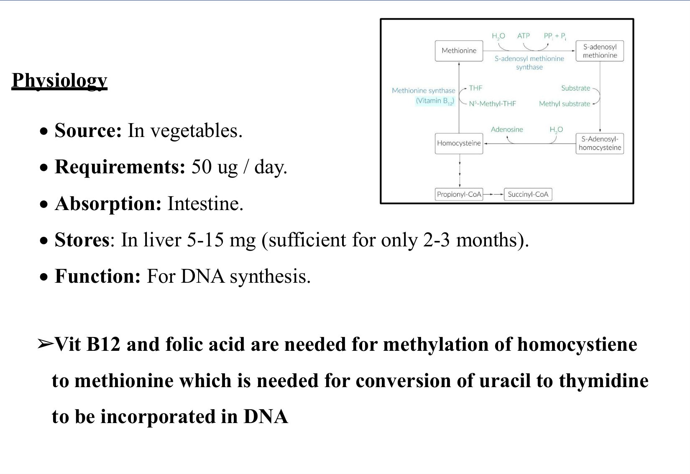

| Item | Folate (vs B12) |
|---|---|
| **Source** | **Vegetables** (B12: animal) |
| **Requirement** | **50 µg/day** (B12: 1 µg) |
| **Absorption** | Intestine (*[added]* jejunum) (B12: terminal ileum + IF) |
| **Stores** | Liver **5–15 mg**: ⭐ **only 2–3 months** (B12: 2–3 years) |
| **Function** | DNA synthesis |

**Why both vitamins matter:** B12 and folate are both needed to **methylate homocysteine → methionine**, which is needed to convert **uracil → thymidine** for DNA.

**Aetiology:**
1. **↓ Intake:** anorexia, ⭐ **alcoholism**, low vegetable intake
2. **↓ Absorption:** malabsorption; drugs: **anticonvulsants** (*[added]* phenytoin), methotrexate
3. **↓ Storage:** liver cirrhosis
4. ⭐ **↑ Requirement:** **pregnancy**, malignancy, **haemodialysis**, **haemolytic anaemia**
5. **↑ Utilisation / antagonism:** ⭐ **methotrexate, trimethoprim** (DHFR inhibitors)

**Clinical:** as B12, **except no CNS manifestations**.

**Investigations:**
- ↓ Hb, PCV, RBCs; ↑ ESR; type as B12
- **low serum folate** (N **6–20 ng/mL**)
- **↑ homocysteine** (normal MMA)
- **FIGLU test** (historical): histidine → FIGLU → glutamate; in folate deficiency **urinary FIGLU ↑**
- *[added]* **red-cell folate** reflects stores better than serum folate

**Treatment:**
1. **Folic acid 5–15 mg orally daily** (*[added]* usually 5 mg daily for 4 months)
2. Treat the cause (e.g. stop methotrexate; *[added]* folinic acid rescue)
3. Transfusion if needed

**Student pearl:** folic acid supplementation for anyone **planning or capable of pregnancy** → prevents **neural tube defects**.

⭐⭐ **NB (slide 18):** **empirical folic acid in B12 deficiency worsens the CNS disease**, because it consumes the already-low B12. *[added]* Folate corrects the blood picture while the neuropathy progresses. **Always give B12 first, or both, until B12 deficiency is excluded.**

> 🔁 **Recap: Folate.**
> - **Physiology:** vegetables; **3-month stores**.
> - **Causes:** alcohol, pregnancy, haemolysis, dialysis, **methotrexate/trimethoprim/anticonvulsants**.
> - **Clinical:** same blood picture as B12; **no neurology**; **MMA normal**.
> - **Treatment:** **5 mg folic acid**; never give folate alone if B12 might be low.
>
> 🔗 **Link:** megaloblastic anaemia causes **pancytopenia with a cellular marrow**. Aplastic anaemia causes **pancytopenia with an empty marrow**; they sit in the same pancytopenia DD.
>
> ▶️ **Up next: Aplastic anaemia.**

### 2.8 Bone-Marrow Failure (Aplastic Anaemia): Types & Aetiology (Slides 20–21) ⭐⭐

**Types (slide 20):**

| Type | Examples |
|---|---|
| **Unipotent: red cells** | **↓ EPO: renal failure**; **anti-EPO / red-cell aplasia: oat-cell (small-cell) carcinoma, thymoma** (slide); ⭐ **aplastic crisis of haemolytic anaemias** (parvovirus) |
| **Unipotent: platelets** | ⭐ **TAR syndrome**: **T**hrombocytopenia + **A**bsent **R**adii |
| **Unipotent: WBCs** | Idiopathic, congenital |
| ⭐ **Pluripotent** | Stem-cell failure → **pancytopenia: empty marrow and empty blood** |

> *[added]* **Thymoma** → **pure red cell aplasia** is the classic association (autoimmune). Small-cell carcinoma is a less typical example.

**Aetiology of pluripotent failure (slide 21):**
1. ⭐ **Idiopathic (50 %)**: **autoimmune cytotoxic T-cell** suppression of the marrow
2. **Irradiation** (e.g. radioactive phosphorus)
3. ⭐ **Drugs ("anti's"):**
   - **antithyroid: Neomercazole (carbimazole)**
   - "anti-emetic": **chlorpropamide**
   - **antibiotic: chloramphenicol**
4. **Chemicals:** **benzene**, insecticides
5. **Infections:** disseminated TB, **EBV, hepatitis** (*[added]* seronegative hepatitis; **parvovirus B19** = red-cell aplasia)
6. **Immune:** SLE
7. **Marrow replacement:** leukaemia, lymphoma (**myelophthisic anaemia**)

> ⚠️ **Slide error:** chlorpropamide is listed as an "**anti-emetic**". It is a **sulfonylurea (antidiabetic)**. *[added]* Other classic drug causes: **carbamazepine, phenytoin, gold, NSAIDs (phenylbutazone), sulfonamides**, cytotoxics.

### 2.9 Aplastic Anaemia: Clinical, Investigations, Treatment (Slides 22–24) ⭐⭐

**Clinical:**
1. General anaemia features
2. **↓ Platelets:** purpura, bleeding
3. **↓ WBCs:** infection, especially **fungal/opportunistic**. Infection affects sites already colonised by bacteria (e.g. mouth), and **there is no pus** (no neutrophils).
4. Features of the cause, e.g. **skeletal deformities** (*[added]* Fanconi anaemia: short stature, thumb/radial anomalies, café-au-lait spots)
5. *[added]* **No splenomegaly**. Splenomegaly suggests another diagnosis (hypersplenism, leukaemia, myelofibrosis).

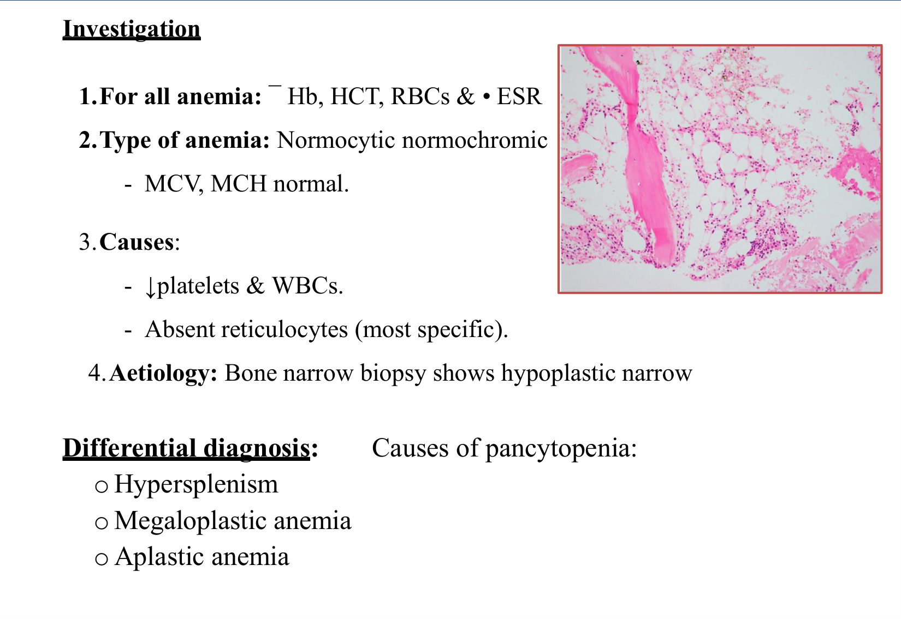

**Investigations:**
1. ↓ Hb, Hct, RBCs; ↑ ESR
2. **Type:** **normocytic normochromic** (*[added]* often mildly macrocytic)
3. ↓ platelets and WBCs; ⭐ **absent reticulocytes (most specific)**
4. ⭐ **Bone-marrow biopsy: hypoplastic (fatty) marrow**. *[added]* Trephine biopsy, not aspirate (aspirate gives a "dry tap").

**DD of pancytopenia (slide 23):**
- **hypersplenism**
- **megaloblastic anaemia**
- **aplastic anaemia**
- *[added]* also marrow infiltration (leukaemia, myelofibrosis), PNH, SLE, sepsis

**Treatment (slide 24):**

| Category | Measures |
|---|---|
| **1. Supportive** | **Packed RBCs**; **platelets**; **avoid trauma** (shaving, **IM injections**); antibiotics (**imipenem**) + **antifungal + antiviral** |
| **2. Marrow stimulation** | **Steroids**; **androgens** (↑ RBCs); **GM-CSF** (↑ WBCs); **lithium** |
| **3. Treat the cause** | Idiopathic: **immunosuppression** (slide: prednisone); **stop the drug** |
| **4.** ⭐ **Bone-marrow transplantation** | (definitive) |

> ⚠️ **Outdated on slide** *[added]*: current first line for severe aplastic anaemia is:
> - **HSCT** (young patient with a matched sibling)
> - otherwise **immunosuppression with ATG + ciclosporin + eltrombopag**
>
> Steroids alone, lithium and androgens are historical or adjunct. Use irradiated, leucodepleted blood products, and limit transfusions in transplant candidates.

> 🔁 **Recap: Aplastic anaemia.**
> - **Types:** unipotent (red-cell aplasia, TAR, neutropenia) vs pluripotent (pancytopenia).
> - **Causes:** **50 % idiopathic (T-cell)**, **carbimazole/chloramphenicol**, benzene, radiation, hepatitis/EBV, SLE.
> - **Findings:** normocytic, **absent retics**, **hypocellular trephine**; no splenomegaly *[added]*.
> - **Treatment:** supportive (no IM injections) → immunosuppression / **BMT**.
>
> 🔗 **Link:** aplasia = **production failure, no retics**. Haemolysis is the opposite: **destruction with high retics**.
>
> ▶️ **Up next: Haemolytic anaemia.**

### 2.10 Haemolytic Anaemia: Physiology & Aetiology (Slides 26–28) ⭐⭐

**Physiology (slide 26):**
- **Definition:** **shortened RBC life span**; normal = ⭐ **120 days**.
- The marrow compensates (up to 6–8× output). Anaemia appears when life span falls to **1/6–1/8 of normal (15–20 days)** = **uncompensated** haemolysis.
- ⭐ **Site:** **90 % extravascular** (RES: spleen, liver) and **10 % intravascular**.

**Causes (slides 27–28):**

| **1. Corpuscular (intrinsic)** | **2. Extracorpuscular (extrinsic)** |
|---|---|
| **A. Membrane:** **hereditary spherocytosis**, hereditary elliptocytosis, **PNH** | **A. Mechanical:** **prosthetic or sclero-calcific aortic valve**; **MAHA**: **DIC, HUS, malignant HTN, scleroderma, TTP** |
| **B. Enzyme:** ⭐ **G6PD deficiency**, **pyruvate kinase deficiency** | **B. Hypersplenism** |
| **C. Haemoglobin:** **thalassaemia, sickle cell** (not taught here) | **C. Immune:** **autoimmune** (**warm or cold** AIHA); **alloimmune** (**incompatible transfusion, Rh incompatibility**) |
| | **D. Infective:** sepsis, **malaria**, haemolytic streptococci (*[added]* *Clostridium perfringens*) |
| | **E. Toxic:** **snake/spider venom, lead, staphylococcus, copper** (Wilson) |

> ⚠️ **Slide 28 layout error:** **TTP** is printed as item 5 under the *immunological* heading, where it breaks into the numbering. It belongs with **MAHA** (mechanical). Slide 28 also numbers MAHA causes 1–4 and continues to 5 under the next heading.

### 2.11 Haemolytic Anaemia: Clinical Picture (Slides 29–32) ⭐⭐

**I.** Anaemia features (when uncompensated).

**II. Extravascular haemolysis:**
- **Bone:** **expansion of bone ends** → **mongoloid facies** (frontal bossing, maxillary overgrowth) (*[added]* chronic childhood haemolysis, thalassaemia major)
- **Hepatosplenomegaly:** extramedullary haematopoiesis + haemolysis + haemosiderosis
- **Jaundice:**
  - **acholuric/indirect**
  - the liver can raise conjugation **~8×**, so jaundice appears only with severe haemolysis
  - ⭐ **pigment gallstones**
- ⭐ **Haemosiderosis** (transfusional/haemolytic iron overload):
  - cardiomyopathy, **"bronze diabetes"**, skin ulcers
  - interstitial lung fibrosis, **testicular atrophy**, renal tubular defects
- **Dark stool**; **urine darkens on standing** (urobilinogen → urobilin)

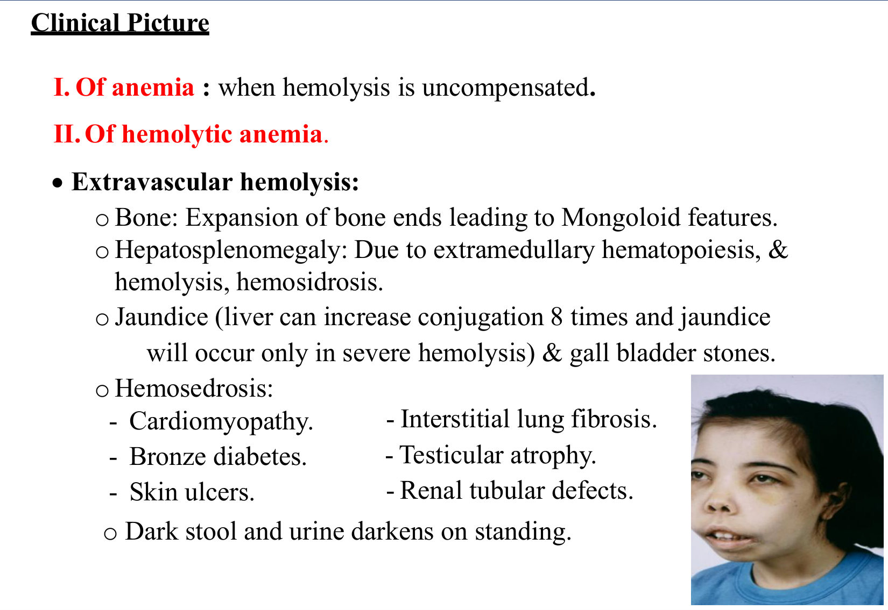

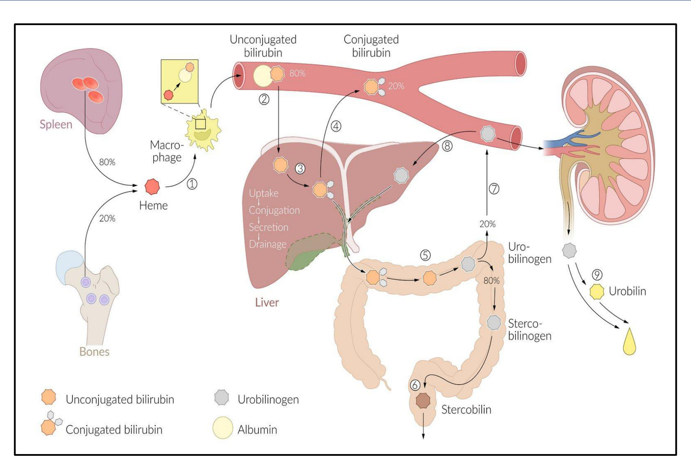

**Crises (slide 31):**

| Crisis | Cause | Pallor | Jaundice/bilirubin | Retics |
|---|---|---|---|---|
| **Haemolytic** | ↑ haemolysis (infection, drugs) | ↑ | ⭐ **↑** | ↑ |
| ⭐ **Aplastic** | ⭐ **Parvovirus B19** | ↑ | **No change** | *[added]* **↓↓ (absent)** |
| **Megaloblastic** | **Folate (and B12) depletion** from ↑ demand | ↑ | — | ↓ + **pancytopenia**, neuro/GI features |

*[added]* **Sequestration crisis** (sickle cell: spleen pools blood, Hb falls with splenomegaly) is not on the slides.

**III. Intravascular haemolysis (slide 32):**
- free Hb in plasma → filtered by the kidney → ⭐ **haemoglobinaemia + haemoglobinuria**
- this happens **after the binding proteins are exhausted**: **haptoglobin**, **haemopexin** (research use), albumin
- *[added]* also **haemosiderinuria** (days later), dark urine, and AKI in massive haemolysis

### 2.12 Haemolytic Anaemia: Investigations & Treatment (Slides 33–35) ⭐⭐

1. ↓ Hb, RBCs, Hct; ↑ ESR
2. **Type:** **mostly normocytic normochromic** (*[added]* MCV may rise with reticulocytosis)
3. **Haemolysis markers:**

| Test | Finding |
|---|---|
| **RBC survival** | Shortened (**⁹⁹ᵐTc / ⁵¹Cr-labelled RBCs**) |
| ⭐ **LDH** | **↑** |
| **Skull X-ray** | Marrow expansion: widened medulla, thin cortex, ⭐ **"hair-on-end"** |
| ⭐ **Bilirubin** | **↑ total, mainly indirect**; **↑ urine urobilinogen**, ↑ faecal stercobilinogen |
| **Iron** | ↑ serum iron and ferritin, ↓ TIBC |
| **Ultrasound** | Hepatosplenomegaly, **gallstones** |
| **WBCs & platelets** | **↑** (hyperactive marrow) |
| ⭐ **Reticulocytes** | **↑ (reticulocytosis)** |
| **Intravascular** | ⭐ **↓ haptoglobin**, ↓ haemopexin |

*[added]* Also order a **direct antiglobulin (Coombs) test** to separate immune from non-immune haemolysis, and a **blood film** (spherocytes, schistocytes, bite cells).

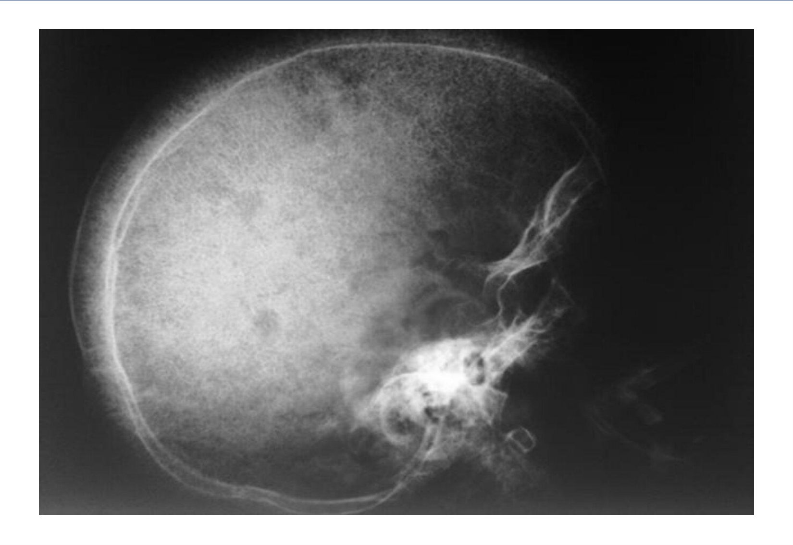

⭐ **Clinical pearl (slide 35):** **haptoglobin is low in BOTH intravascular and extravascular haemolysis**, so it **should not be used to tell them apart**. Haemoglobinuria and haemosiderinuria point to intravascular haemolysis *[added]*.

**Treatment (slide 35):**
1. **Blood transfusion**
2. **Folic acid** (and B12) replacement (↑ demand, to prevent megaloblastic crisis)
3. ⭐ **Iron chelation: desferrioxamine SC** (*[added]* oral deferasirox, deferiprone)
4. **Splenectomy** (selected)
5. Treat the cause

### 2.13 Hereditary Spherocytosis (Slides 36–37) ⭐⭐

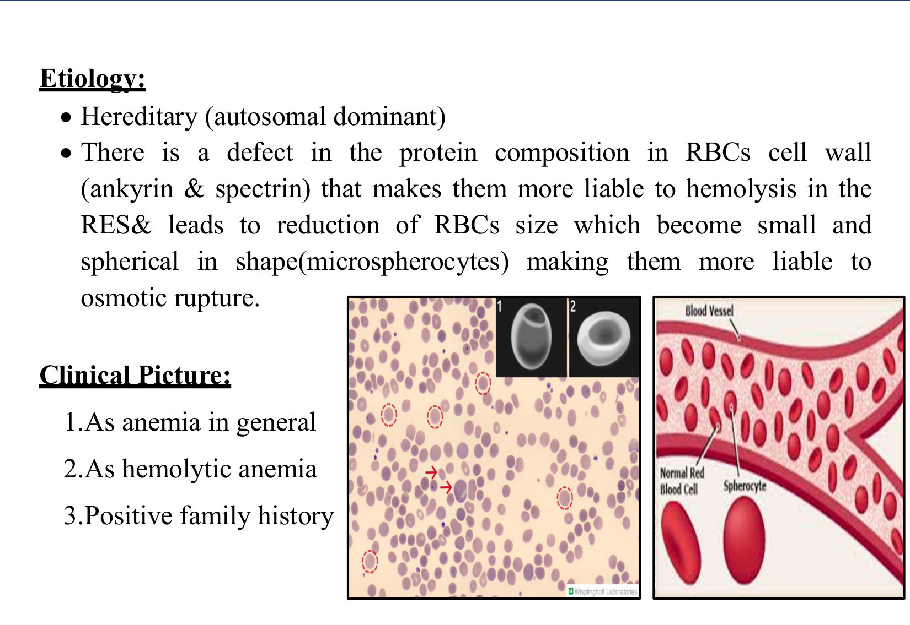

**Aetiology & pathogenesis:**
- **autosomal dominant** (*[added]* ~75 %)
- ⭐ defect in membrane proteins **ankyrin and spectrin** (*[added]* also band 3, protein 4.2)
- RBCs lose membrane → **small spherical cells (microspherocytes)** → trapped and destroyed in the **spleen (RES)**, and **osmotically fragile**

**Clinical:** general anaemia + haemolytic features + ⭐ **positive family history** (*[added]* jaundice, splenomegaly, gallstones, parvovirus aplastic crisis).

**Investigations:**
1. Anaemia and haemolysis markers
2. **Type:** "**microcytic hyperchromic**" (*[added]* MCV often normal; the defining feature is ⭐ **↑ MCHC**)
3. **Specific:** **spherocytes** on the film (no central pallor)
4. **Osmotic fragility test:**
   - RBCs placed in graded NaCl dilutions
   - **normal:** haemolysis **starts at 0.4 % and is complete at 0.33 %**
   - **HS:** haemolysis **starts at 0.6 %** (↑ fragility)
5. ⭐ **EMA binding test** (eosin-5′-maleimide flow cytometry): **most sensitive and specific**
6. *[added]* **DAT negative**, which separates HS from warm AIHA (also spherocytic)

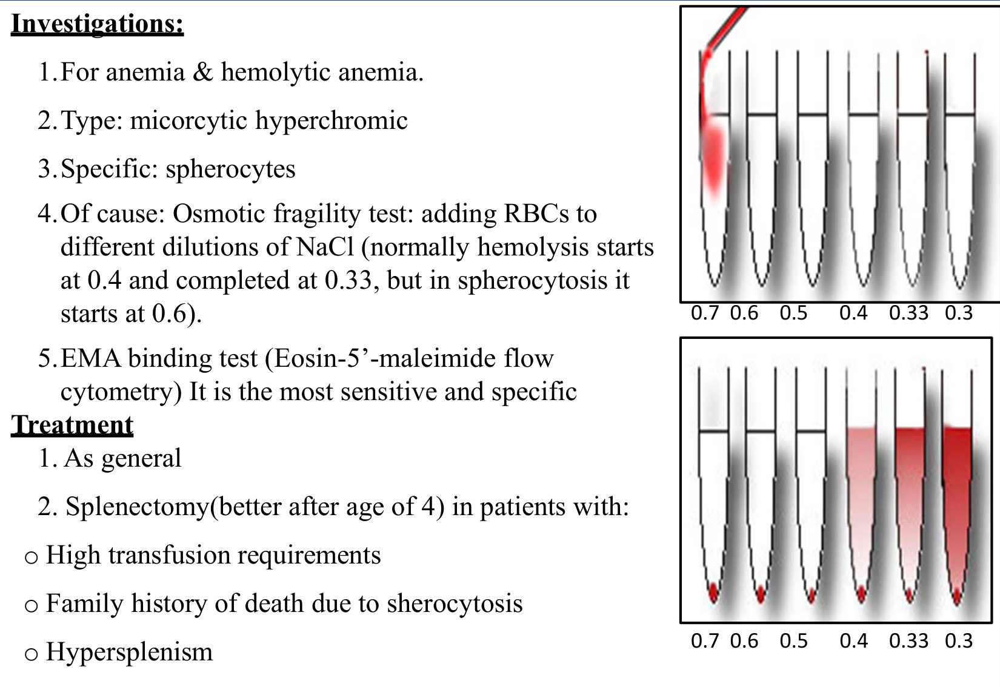

**Treatment:**
1. General (folic acid, transfusion as needed)
2. ⭐ **Splenectomy** (**better after age 4**) for:
   - **high transfusion requirement**
   - **family history of death from spherocytosis**
   - **hypersplenism**
3. *[added]* Before splenectomy, **vaccinate** (pneumococcus, meningococcus, Hib). Afterwards, **Howell–Jolly bodies** appear on the film (link to Heme 1). Consider cholecystectomy if gallstones are present.

### 2.14 G6PD Deficiency (Slides 38–40) ⭐⭐⭐

**Inheritance:** ⭐ **X-linked**: **males affected**, **females carriers**.

**Pathogenesis (slide 38):**
1. **G6PD** is the **first step of the hexose monophosphate (pentose phosphate) shunt**
2. the shunt makes **NADPH**, which regenerates **reduced glutathione** from oxidised glutathione
3. reduced glutathione is the **first defence against oxidation of Hb to methaemoglobin**
4. ↓ G6PD → oxidation of membrane **SH groups** and **Hb denaturation** → Hb precipitates on the membrane = ⭐ **Heinz bodies** → cells removed in the **RES** (*[added]* splenic macrophages "bite" them out → ⭐ **bite cells**)

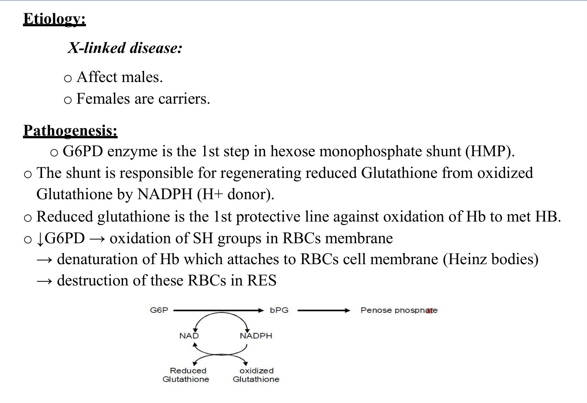

**Clinical picture (slide 39): haemolysis triggered by oxidants:**
1. ⭐ **Infection** (commonest trigger *[added]*)
2. ⭐ **Drugs:**
   - **antimalarials** (*[added]* **primaquine**, tafenoquine, dapsone)
   - **anti-TB drugs**
   - **sulpha drugs**
   - **antipyretics: aspirin** (high dose)
   - **synthetic vitamin K**
   - *[added]* nitrofurantoin, rasburicase, methylene blue
3. **Metabolic acidosis** (e.g. **DKA**)
4. ⭐ **Uncooked fava beans (favism)**

**Variants and favism (slide 39):**

| Variant | Defect | Severity |
|---|---|---|
| **G6PD A⁻** ("African"; slide: "negros") | Enzyme deficient in **ageing RBCs only** | **Mild**, self-limiting |
| ⭐ **G6PD Mediterranean** | Deficient in **young RBCs too** | ⭐ **Severe haemolysis** (*[added]* common in Saudi Arabia / Middle East) |

**Favism (slide's model):** needs **two defective genes**: the **G6PD gene**, plus a second gene defect that releases **O₂ free radicals** when fava beans are metabolised.

**Investigations (slide 40):**
1. Anaemia and haemolysis markers (*[added]* largely **intravascular** → haemoglobinuria, dark urine)
2. **Specific:**
   - ⭐ **Heinz bodies** during the attack, stained with **methyl violet** (supravital; *[added]* invisible on routine Romanowsky stain, which shows **bite/blister cells**)
   - ⭐ **↓ G6PD activity**, measured **2 months after the last haemolytic attack**. Young RBCs made during the crisis have **normal G6PD levels** → **false-normal** result during or just after the attack.

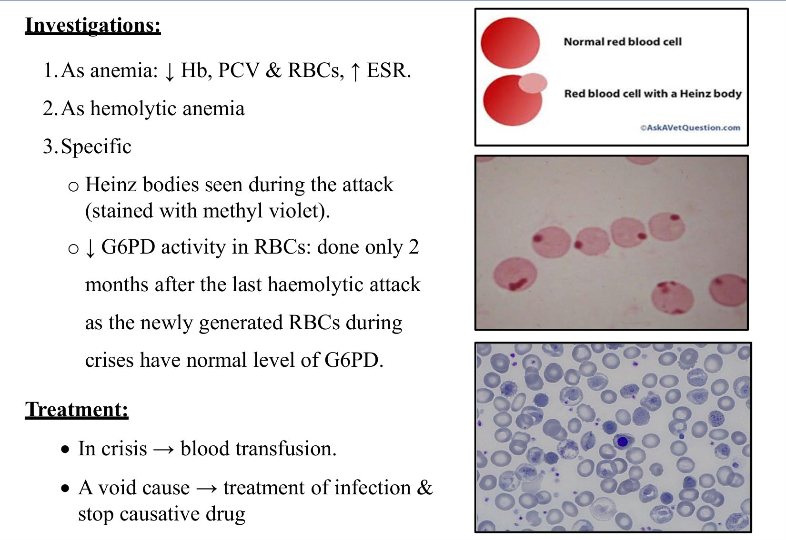

**Treatment:**
- **crisis:** **blood transfusion**
- ⭐ **avoid the cause**: treat infection, stop the drug, avoid fava beans
- *[added]* hydration; counsel the patient; check G6PD before primaquine/dapsone/rasburicase

> 🔁 **Recap: Haemolysis.**
> - **Basics:** RBC life 120 d; anaemia when < 15–20 d; **90 % extravascular**.
> - **Causes:** intrinsic (membrane/enzyme/Hb) vs extrinsic (mechanical/MAHA, hypersplenism, immune, infective, toxic).
> - **Markers:** **↑ LDH, ↑ indirect bilirubin, ↑ retics, ↓ haptoglobin** (low in both types), hair-on-end skull, gallstones.
> - **Crises:** **aplastic = parvovirus, no ↑ bilirubin**.
> - **HS:** AD, spectrin/ankyrin, **↑ osmotic fragility (starts 0.6 %)**, **EMA** best, **splenectomy after age 4**.
> - **G6PD:** X-linked, HMP shunt/NADPH/glutathione → **Heinz bodies, bite cells**; triggers = infection, primaquine, sulpha, **fava**, DKA; **assay 2 months after the attack**.

### 2.15 Case & Summary (Slides 41–43)
See Q1 in §7.

---

## 3. High-Yield Comparison Tables

### Table A: B12 vs Folate Deficiency
*[slides 5–18 + added]*

| | **Vitamin B12** | **Folate** |
|---|---|---|
| Source | **Animal only** | **Vegetables** |
| Daily need | **1 µg** | **50 µg** |
| Absorption | **IF + terminal ileum** | Jejunum *[added]* |
| Stores | **2–3 years** | **2–3 months** |
| Key causes | **Pernicious anaemia**, gastrectomy, ileal disease (Crohn's, TB), *D. latum*, vegans, *[added]* metformin | **Alcohol**, poor diet, **pregnancy**, haemolysis, dialysis, **methotrexate, trimethoprim, anticonvulsants** |
| Blood picture | Megaloblastic, MCV > 115, **hypersegmented PMNs**, pancytopenia | Same |
| **Neurology (SCD)** | ⭐ **Yes** | ❌ **No** |
| Homocysteine | ↑ | ↑ |
| ⭐ **MMA** | **↑** | **Normal** |
| Special tests | Antibodies (anti-IF, anti-parietal), Schilling (historical) | FIGLU (historical), red-cell folate |
| Treatment | **Hydroxocobalamin IM** (lifelong in PA) | **Folic acid 5–15 mg PO** |
| Trap | — | ⚠️ **Folate alone in B12 deficiency worsens neurology** |

### Table B: Pancytopenia DD
*[slide 23 + added]*

| | Megaloblastic | Aplastic | Hypersplenism |
|---|---|---|---|
| MCV | **↑↑ (> 115)** | N (or mildly ↑) | N |
| Retics | ↓ | ⭐ **Absent** | N/↑ |
| Marrow | **Hypercellular, megaloblastic** | ⭐ **Hypocellular, fatty** | Hypercellular |
| Spleen | ± mild | **Not enlarged** *[added]* | ⭐ **Enlarged** |
| Film | Hypersegmented PMNs, Howell–Jolly, Cabot rings | Unremarkable | Unremarkable |

### Table C: Intravascular vs Extravascular Haemolysis
*[slides 26, 29, 32–35 + added]*

| | **Extravascular (90 %)** | **Intravascular (10 %)** |
|---|---|---|
| Site | Spleen/liver macrophages | Within vessels |
| Examples | **HS**, warm AIHA, thalassaemia, sickle cell | **G6PD crisis**, PNH, **mismatched transfusion**, MAHA, malaria, mechanical valves |
| Splenomegaly | ✅ | Usually ❌ |
| Hb in plasma/urine | ❌ | ✅ **Haemoglobinaemia, haemoglobinuria**, haemosiderinuria |
| Haptoglobin | ↓ (slide pearl) | ↓↓ |
| Bilirubin, LDH | ↑ | ↑ (LDH very ↑) |

### Table D: Haemolytic Crises

| | Haemolytic | **Aplastic** | Megaloblastic |
|---|---|---|---|
| Cause | Infection, drugs | **Parvovirus B19** | Folate/B12 exhaustion |
| Bilirubin | **↑** | **Unchanged** | — |
| Retics | ↑ | **Absent** | ↓ |
| Extra | — | — | Pancytopenia, neuro/GI |

### Table E: HS vs G6PD Deficiency

| | **Hereditary spherocytosis** | **G6PD deficiency** |
|---|---|---|
| Inheritance | **AD** | **X-linked** (males) |
| Defect | **Membrane** (spectrin, ankyrin) | **Enzyme** (HMP shunt → ↓ NADPH → ↓ GSH) |
| Haemolysis | Chronic, **extravascular** (spleen) | **Episodic**, triggered, mainly **intravascular** |
| Film | **Spherocytes** | **Heinz bodies** (supravital), **bite cells** |
| Index | **↑ MCHC** | Normal between attacks |
| Test | **Osmotic fragility ↑**; ⭐ **EMA binding** | ⭐ **G6PD assay 2 months after the attack** |
| Treatment | Folate; **splenectomy (> 4 y)** for severe disease | **Avoid oxidants**; transfuse in crisis |

### Table F: Aplastic Anaemia Causes ("anti's" on the slide)

| Category | Examples |
|---|---|
| Idiopathic (50 %) | T-cell autoimmune |
| Drugs | **Carbimazole**, **chloramphenicol**, chlorpropamide (slide); *[added]* carbamazepine, gold, sulfonamides, cytotoxics |
| Chemicals | **Benzene**, insecticides |
| Radiation | e.g. radioactive phosphorus |
| Infection | EBV, hepatitis, disseminated TB (*[added]* parvovirus → red cells only) |
| Immune | SLE |
| Replacement | Leukaemia, lymphoma (myelophthisis) |

---

## 4. Rules, Exceptions, Patterns

| Rule | Exception / nuance |
|---|---|
| Megaloblastic anaemia → give folate | ⚠️ **Never folate alone until B12 deficiency is excluded** (neurology worsens) |
| B12 deficiency = anaemia | **SCD/dementia can occur without anaemia** *[added]* |
| ↑ homocysteine = B12 deficiency | Also **folate**. **MMA** separates them (↑ only in B12) |
| B12 deficiency appears quickly | **2–3-year stores** → years; folate → months |
| Pancytopenia = marrow failure | Also **megaloblastic** and **hypersplenism** |
| Aplastic → retics low | ⭐ **Absent retics = most specific** |
| Haptoglobin separates intra- from extravascular | ❌ **Low in both** (slide 35) |
| Haemolytic crisis → ↑ jaundice | **Aplastic crisis (parvovirus): pallor ↑, bilirubin unchanged** |
| G6PD assay in a crisis | ❌ **False-normal** (young RBCs); test **2 months later** |
| G6PD → females spared | Carriers are usually unaffected; *[added]* lyonisation can make some symptomatic |
| HS = microcytic | *[added]* MCV often normal; **↑ MCHC** is the clue |
| Splenectomy for HS | Wait until **age > 4**; vaccinate first *[added]* |
| Thalassaemia/sickle cell (hemoglobinopathies in the file title) | **Not taught in this deck**; only listed |

**Pattern recognition:**
- **alcoholic + macrocytosis + hypersegmented PMNs + ↑ homocysteine, normal MMA** → **folate deficiency**. Neurological signs here = **Wernicke (B1)**, not SCD.
- **vitiligo/thyroid disease + glossitis + ataxia + ↓ vibration** → **pernicious anaemia** → anti-IF antibodies, endoscopy.
- **pancytopenia + no splenomegaly + absent retics + recent carbimazole/chloramphenicol** → **aplastic anaemia**.
- **jaundice + splenomegaly + gallstones + family history + ↑ MCHC** → **HS**.
- **Middle-Eastern male + dark urine after fava beans/primaquine/infection** → **G6PD deficiency**.

---

## 5. Clinical Correlations

- **Dementia work-up** always includes **B12** (slide pearl).
- **Metformin** (diabetes) and long-term **PPIs** → B12 deficiency *[added]*. Check B12 in a diabetic with neuropathy, which may not be diabetic.
- **Methotrexate / trimethoprim / phenytoin** → folate deficiency. Prescribe folate with methotrexate *[added]*.
- **Pregnancy:**
  - **folic acid** for anyone planning or capable of pregnancy (NTD prevention)
  - folate demand ↑ in pregnancy and haemolysis
- **Carbimazole** (Thyroid 1): warn the patient to report **sore throat or fever** → check FBC (agranulocytosis / aplasia).
- **Aplastic patients:**
  - **no IM injections, no shaving with blades**
  - neutropenic fever → **broad-spectrum (imipenem)** ± antifungal/antiviral
- **G6PD deficiency** is common in **Saudi Arabia (Mediterranean variant, severe)**:
  - test before **primaquine/tafenoquine** (Travel Medicine), **dapsone, rasburicase**
  - counsel about **fava beans**
- **Haemolytic anaemia, chronic:**
  - **folic acid** prophylaxis
  - watch for **gallstones**, **parvovirus aplastic crisis**
  - **iron overload** with transfusions → **desferrioxamine**

---

## 6. Rapid Revision (Last-Day)

- **B12 physiology:** **animal only**, 1 µg/day, **IF (parietal cells) + terminal ileum**, transcobalamin II, **liver stores 2–3 years**; DNA + **myelin**.
- **B12 causes:**
  - **pernicious anaemia** (northern Europe, F > M, > 30 y, **HLA-A3/B7**, 3 antibodies: anti-parietal, **blocking**, **binding**; + thyroiditis, vitiligo, Addison's, Graves'; ↑ **gastric cancer**)
  - gastrectomy, ileal disease (Crohn's, TB), ***D. latum***, vegans, TC-II deficiency
- **B12 pathogenesis:** nuclear–cytoplasmic asynchrony → megaloblasts → **ineffective erythropoiesis (↑ LDH, ↑ iron, ↑ muramidase)** → **pancytopenia**.
- **B12 clinical:** **glossitis**, diarrhoea, HSM, bleeding, infection; **SCD** (spinocerebellar, lateral corticospinal, dorsal columns); **dementia**.
- **B12 labs:**
  - **MCV > 115**, normal MCHC
  - **Howell–Jolly, Cabot rings, hypersegmented PMNs**, megaloblastic marrow
  - serum B12 low (< 200; slide's 200–800 = normal)
  - **↑ MMA + ↑ Hcy = B12**; **↑ Hcy + N MMA = folate**
  - therapeutic retic response
- **Schilling test:** 1000 µg IM then 1 µg oral labelled; normal ≥ 25 %, **< 5 % = malabsorption**; stage 2 + IF corrects in **PA**.
- **B12 treatment:** **hydroxocobalamin IM** (slide: 100 µg daily → monthly for life); transfuse if Hb < 7 or HF/IHD.
- **Folate:**
  - **vegetables**, 50 µg/day, **3-month stores**
  - causes: **alcohol**, pregnancy, haemolysis, dialysis, malabsorption, **MTX, trimethoprim, anticonvulsants**, cirrhosis
  - **no CNS**; serum folate N 6–20; **FIGLU ↑** (historical)
  - **folic acid 5–15 mg/day**
  - ⚠️ **never folate alone in B12 deficiency**; folate for anyone who could become pregnant (NTD)
- **Aplastic types:**
  - **unipotent**: red cells (↓ EPO in renal failure; thymoma/oat-cell; parvovirus aplastic crisis), **TAR**, neutropenia
  - **pluripotent** → pancytopenia
- **Aplastic causes:** **idiopathic 50 % (T-cell)**, radiation, **carbimazole, chlorpropamide, chloramphenicol**, **benzene**, insecticides, TB/EBV/hepatitis, SLE, myelophthisis.
- **Aplastic clinical:** bleeding, **fungal/opportunistic infection without pus**; skeletal deformity (Fanconi).
- **Aplastic labs:** normocytic, **absent retics (most specific)**, **hypoplastic marrow**. DD pancytopenia: hypersplenism, megaloblastic, aplastic.
- **Aplastic treatment:** RBCs, platelets, **no trauma/IM injections**, imipenem + antifungal + antiviral; steroids/androgens/GM-CSF/lithium (slide); immunosuppression; **BMT** (*[added]* ATG + ciclosporin + eltrombopag).
- **Haemolysis physiology:** RBC 120 d; anaemia when 15–20 d; **90 % extravascular**.
- **Haemolysis causes:**
  - **intrinsic**: membrane (**HS**, elliptocytosis, PNH), enzyme (**G6PD, PK**), Hb (thal, sickle)
  - **extrinsic**: mechanical (valves, **MAHA**: DIC, HUS, TTP, malignant HTN, scleroderma), hypersplenism, immune (warm/cold AIHA; transfusion, Rh), infection (malaria, sepsis), toxins (venom, lead, copper)
- **Extravascular features:** **mongoloid facies**, HSM, **indirect jaundice + pigment stones**, **haemosiderosis** (cardiomyopathy, bronze diabetes, testicular atrophy), urine darkens on standing.
- **Crises:** **haemolytic** (↑ bilirubin), ⭐ **aplastic = parvovirus (no ↑ bilirubin)**, megaloblastic (folate depletion).
- **Intravascular:** haemoglobinaemia/uria once **haptoglobin**/haemopexin/albumin are exhausted.
- **Haemolysis labs:**
  - **↑ LDH, ↑ indirect bilirubin, ↑ urobilinogen, ↑ retics**, ↑ WBC/platelets
  - **⁹⁹ᵐTc** RBC survival ↓
  - **hair-on-end** skull
  - ↑ iron/ferritin
  - **↓ haptoglobin (in both types; don't use it to discriminate)**
- **Haemolysis treatment:** transfusion, **folate**, **desferrioxamine SC**, splenectomy, treat the cause.
- **HS:**
  - **AD**, **spectrin/ankyrin** → microspherocytes
  - family history
  - **osmotic fragility: starts at 0.6 %** (normal 0.4 → 0.33 %)
  - **EMA most sensitive/specific**
  - **splenectomy after age 4** for transfusion need, family history of death, hypersplenism
- **G6PD:**
  - **X-linked**; HMP shunt → NADPH → reduced glutathione
  - deficiency → Hb oxidation → **Heinz bodies** → RES destruction
  - triggers: **infection, antimalarials, anti-TB, sulpha, aspirin, synthetic vit K, DKA, fava beans**
  - **A⁻ mild (old RBCs)** vs **Mediterranean severe (young RBCs)**
  - **methyl violet** Heinz bodies
  - **assay 2 months post-attack**
  - transfuse in crisis; **avoid triggers**

---

## 7. Exam-Style Questions

**Q1. (Lecture case)** A 44-year-old woman who drinks half a bottle of vodka daily is confused, with **horizontal nystagmus** and a **wide-based gait**. She takes omeprazole and HCTZ. Hb 9 g/dL; **homocysteine ↑, MMA normal**; film shows **hypersegmented neutrophils**. Cause of her **anaemia**?
**A. Folate deficiency** · B. Vitamin E deficiency · C. Iron deficiency · D. Vitamin B6 deficiency · E. Vitamin B1 deficiency · F. Vitamin B12 deficiency

> **Answer: A** *[reasoning added; key not on slides]*.
> - Hypersegmented PMNs = megaloblastic. **↑ homocysteine + normal MMA = folate** (slide 11). Alcohol is the classic cause (poor intake, ↓ absorption, ↓ hepatic storage).
> - **Distractors:**
>   - the confusion, nystagmus and ataxia are **Wernicke encephalopathy (B1, E)**, but B1 deficiency doesn't cause megaloblastic anaemia. *[added]* Give **thiamine before glucose**.
>   - **B12 (F)** would raise MMA
>   - omeprazole can lower B12 and iron, but MMA is normal and the cells are megaloblastic
>   - **B6 (D)** → sideroblastic, microcytic

**Q2.** A 60-year-old woman with vitiligo and hypothyroidism has glossitis, paraesthesiae, ↓ vibration sense, positive Romberg and extensor plantars. MCV 118 fL. Best **specific** confirmatory antibody, and one mandatory follow-up?
A. Anti-TPO; thyroid US · **B. Anti-intrinsic factor; upper GI endoscopy** · C. ANA; renal biopsy · D. Anti-tTG; colonoscopy · E. Anti-parietal cell; none needed

> **Answer: B** (slides 6–7, 10, 13).
> - **Pernicious anaemia with SCD.**
> - *[added]* **Anti-IF antibodies are specific**; anti-parietal cell antibodies are sensitive but non-specific.
> - **Endoscopy** because of the ↑ **gastric carcinoma** risk.

**Q3.** A GP gives empirical **folic acid** to a patient with macrocytic anaemia without checking B12. Two months later Hb has improved but **ataxia and numbness are worse**. Why?
A. Folate toxicity to nerves · **B. Unrecognised B12 deficiency; folate corrected the blood picture while consuming B12, worsening SCD** · C. Iron deficiency unmasked · D. Hypokalaemia · E. Coincidental MS

> **Answer: B** (slide 18). Always exclude or treat B12 deficiency before folate alone.

**Q4.** A 25-year-old has pancytopenia 2 months after a course of **chloramphenicol**. No splenomegaly, MCV 92, **reticulocytes 0.1 %**. Most informative test?
A. Serum B12 · B. Haptoglobin · **C. Bone-marrow trephine biopsy** · D. Osmotic fragility · E. G6PD assay

> **Answer: C** (slides 21, 23). **Hypocellular (fatty) marrow** confirms aplastic anaemia. Absent retics is the most specific blood finding.

**Q5.** A child with known HS develops a fever and rash. Pallor worsens, bilirubin is **unchanged** from baseline, and **retics are 0 %**. Cause?
A. Haemolytic crisis · **B. Aplastic crisis (parvovirus B19)** · C. Megaloblastic crisis · D. Sequestration crisis · E. Iron deficiency

> **Answer: B** (slide 31). Pallor ↑ without ↑ jaundice or bilirubin = aplastic crisis.

**Q6.** A 20-year-old Saudi man passes dark urine 2 days after a **fava bean** meal. Film: **bite cells**; supravital stain: **Heinz bodies**. His G6PD level during the episode is **normal**. Next step?
A. Diagnosis excluded; investigate PNH · **B. Repeat the G6PD assay ~2 months after the attack** · C. Splenectomy · D. Start primaquine · E. Osmotic fragility test

> **Answer: B** (slide 40). Young RBCs made during the crisis carry normal enzyme → **false-normal** result.

**Q7.** Which is the **most sensitive and specific** test for hereditary spherocytosis?
A. Osmotic fragility · B. Blood film · **C. EMA binding (flow cytometry)** · D. Coombs test · E. Haptoglobin

> **Answer: C** (slide 37).

---

## 8. Exam Pitfalls & Traps

| Trap | Correct thinking |
|---|---|
| Treat megaloblastic anaemia with folate first | ❌ **Exclude/treat B12 first**; folate alone worsens SCD |
| ↑ homocysteine = B12 | ❌ ↑ in **both**; **MMA ↑ only in B12** |
| Wernicke signs → B12 deficiency | ❌ **B1**; the anaemia in an alcoholic is usually **folate** |
| B12 "200–800 pg/mL" = low (slide 11) | ❌ That's the **normal** range; deficiency **< 200** |
| Megaloblastic marrow has high retics | ❌ **Ineffective erythropoiesis → low retics**; retics rise only after treatment |
| Anti-parietal cell Ab confirms PA | ⚠️ Sensitive, not specific; **anti-IF** is specific *[added]* |
| Pancytopenia → aplastic anaemia | ❌ Also **megaloblastic** and **hypersplenism**; **absent retics + hypocellular trephine** for aplasia |
| Aplastic anaemia with splenomegaly | ⚠️ Rethink: leukaemia, myelofibrosis, hypersplenism *[added]* |
| Chlorpropamide = anti-emetic (slide 21) | ❌ **Sulfonylurea** |
| Aplastic treatment = steroids/lithium (slide) | ⚠️ *[added]* **HSCT or ATG + ciclosporin + eltrombopag** |
| Haptoglobin tells intra from extravascular | ❌ **Low in both** (slide 35) |
| Aplastic crisis → deeper jaundice | ❌ **No** rise in bilirubin; **parvovirus**, absent retics |
| G6PD normal during the attack → excluded | ❌ **Retest at 2 months** |
| Heinz bodies on routine film | ❌ Need **supravital (methyl violet)** stain; routine film shows **bite cells** |
| G6PD affects women equally | ❌ **X-linked**: males |
| HS splenectomy in infancy | ❌ **After age 4** (sepsis risk); vaccinate *[added]* |
| HS is Coombs-positive | ❌ **DAT negative** (vs warm AIHA) *[added]* |
| "Hemoglobinopathies" covered in this deck | ❌ **Not taught**; only listed. See the coverage gap note |
