# Fever of Unknown Origin (FUO) & Travel Medicine, Part 1: An Approach to a Case of Fever
**Dr. Majed Alnabulsi, Internal Medicine** | Source: `FUOTravel_medicine_2.0.pdf` (42 slides)

> **Legend:** ⭐ = high-yield · *[added]* = not on slides. Images marked "Slide N" come from the lecture; "Added diagram" = drawn for these notes. The lecture has **no answer key** for its cases; the answers below are **[reasoning added; key not on slides]**.

> 🔗 **Bridge from earlier lectures:**
> - **Tuberculosis (Kotb):** TB, especially **extrapulmonary**, is the classic infectious cause of FUO. A **diagnostic trial of anti-TB therapy** is a last-resort FUO step. IGRA/TST appear in the obligatory FUO work-up.
> - **Infective Endocarditis (Reihan):** IE is on every FUO list. **Take blood cultures (n = 3) before any antibiotic**; empiric antibiotics are the commonest reason IE becomes "culture-negative".
> - **Cardiogenic shock / Resp failure–ARDS:** severe falciparum malaria → **shock/DIC** and **pulmonary oedema → ARDS**.
> - **Psychotropics / psychiatry:** **mefloquine** is avoided in psychiatric illness and seizures.
> - **Pneumonia (Kotb):** fever with relative bradycardia also points to atypical pneumonia (*Legionella*). Typhoid is the travel-medicine version.

---

## 1. Title / Objectives

| Domain | Objective | Likely tested as |
|---|---|---|
| Knowledge | Clinical manifestations and objective findings of FUO and travel illnesses | Classic FUO definition; 4 FUO categories |
| Knowledge | ⭐ Epidemiology, manifestations, complications, management | Malaria species, relapse, G6PD, artesunate; typhoid; traveller's diarrhoea |
| Skill | Interpret manifestations and investigations | Blood smear; blood vs stool culture timing |
| Skill | Apply an evidence-based management plan | Avoid empiric therapy in FUO; species-specific antimalarials |
| Value | Professional attitude | — |

**Topics (slide 3):** FUO → Malaria → Typhoid & Paratyphoid → Traveller's diarrhoea → generic "Approach to fever" (slides 31–34, repeated verbatim in Part 2).

---

## 2. Main Content (Lecture Order)

### 2.0 Opening Case (Slide 5 = Case Scenario 1, slide 37)
**Presentation:**
- **29-year-old woman**, returned from **rural India** 1 week ago (NGO house building)
- **chloroquine prophylaxis**: 1 dose a week before the trip, weekly after; last dose 2 days ago
- high fever, headache, myalgia
- **T 39.3 °C**, HR 102, RR 22, BP 112/78
- **jaundice**, soft non-tender abdomen
- **Hb 10 g/dL**
- smear: **fragmented RBCs + ring-shaped inclusions within RBCs**

**Most likely organism?** → ⭐ **B. *Plasmodium falciparum*** *[reasoning added; key not on slides]*:
- **intra-erythrocytic ring forms** = *Plasmodium*. This excludes **dengue, chikungunya and hepatitis A**, which are viruses without RBC inclusions. That answers the slide's own prompt: "which organism this **can't** be".
- **India = chloroquine-resistant *P. falciparum***, so chloroquine prophylaxis fails. Slide 23: chloroquine works only in Central America, Haiti and parts of the Middle East.
- **haemolysis** (anaemia, jaundice, fragmented RBCs) with high fever → falciparum, the species with high parasitaemia
- ***P. ovale*** is chloroquine-sensitive and usually milder (tertian, "usually less severe", slide 14)

### 2.1 FUO: Definitions (Slide 6) ⭐⭐

⭐ **Classic FUO** has three parts:
1. **temperature > 38.3 °C** on **multiple occasions**
2. lasting **> 3 weeks**
3. **no diagnosis despite 3 outpatient visits or 3 days in hospital**

| Category | Definition (slide 6) |
|---|---|
| **Classic** | > 38.3 °C, > 3 weeks, undiagnosed after **3 outpatient visits or 3 inpatient days** |
| **Nosocomial** | Hospitalised; **no infection present or incubating at admission**; unexplained after **3 days** of evaluation |
| **Neutropenic** | **ANC < 500/mm³** (or expected to fall below); unexplained after **3 days, including 2 days of culture incubation** |
| **HIV-associated** | Confirmed HIV; fever **> 4 weeks (outpatient)** or **> 3 days (inpatient)**; unexplained after appropriate work-up |

> ⚠️ **Slide inconsistency:** slide 6 writes "38.3 °C (100.1 °F)". 38.3 °C = **100.9 °F (≈ 101 °F)**, which is what the flowchart on slide 10 uses ("≥ 38.3 °C (≥ 101 °F)"). Learn **38.3 °C / 101 °F**.

### 2.2 FUO: Aetiology (Slides 7–8) ⭐

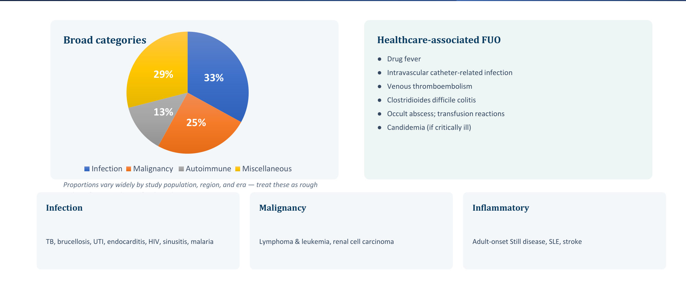

**Pie chart:**
- **Infection 33 %**
- **Malignancy 25 %**
- **Autoimmune 13 %**
- **Miscellaneous 29 %**

The slide warns these proportions **vary widely by population, region and era**, so treat them as rough orders of magnitude.

| Category | Slide examples |
|---|---|
| **Infection** | **TB, brucellosis**, UTI, **endocarditis**, HIV, sinusitis, malaria |
| **Malignancy** | **Lymphoma & leukaemia**, **renal cell carcinoma** |
| **Inflammatory** | **Adult-onset Still disease**, SLE, "stroke" |
| **Healthcare-associated FUO** | **Drug fever**; intravascular **catheter infection**; **VTE**; ***C. difficile* colitis**; occult abscess; **transfusion reactions**; **candidaemia** (if critically ill) |

> ⚠️ **Slide inconsistencies:**
> - **"Stroke"** is listed under *inflammatory* causes. It is not inflammatory, though central fever after stroke does occur. It may be a misplaced item.
> - The pie says "Autoimmune" but the box below says "Inflammatory". They mean the same group.

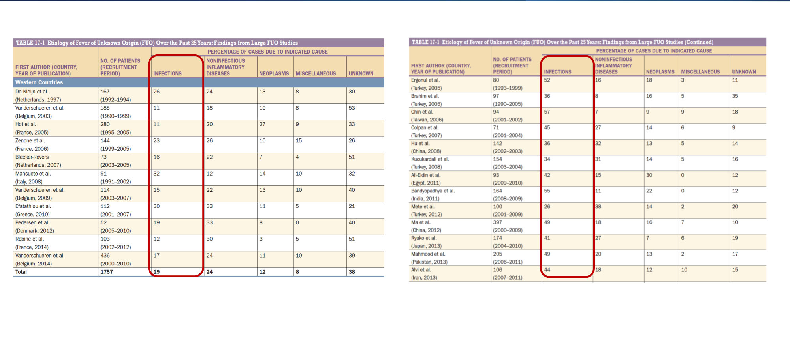

- **Slide 8** shows Harrison's table of FUO series (1990s–2010s, Western countries on the left, other countries on the right).
- The **infection column is circled**: infection is a **larger share in non-Western series**.
- **"Undiagnosed"** is a large group in recent Western series *[reading of table; exact numbers too small to transcribe reliably]*.

### 2.3 FUO: Clinical Features (Slide 9)
These features accompany fever without pointing to one cause:

| Feature | Definition |
|---|---|
| **Chills** | Subjective cold, often with shivering |
| **Rigors** | **Severe chills** with pronounced shivering and **teeth chattering** |
| **Night sweats** | **Drenching**, soaking clothes or bedding |
| **Change in mental status** | Especially at the **extremes of age** |

⭐ **Pearl:** look for **systemic clues to the cause**: skin changes, constitutional symptoms, **anaemia**, **unintentional weight loss**.

### 2.4 FUO: Patient Approach (Slides 10–11) ⭐⭐

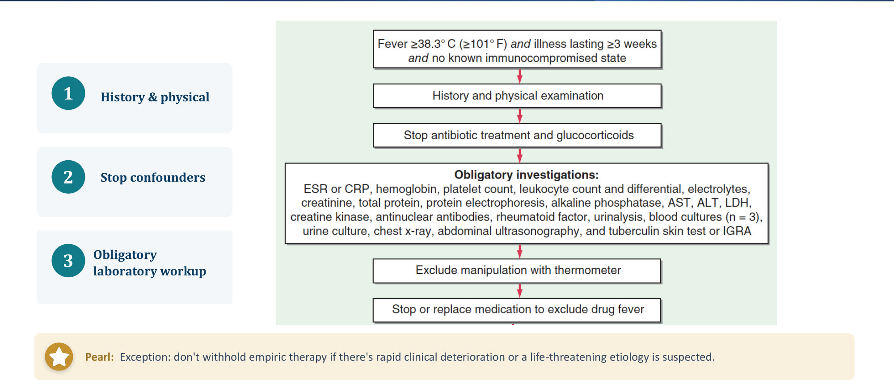

**Flowchart, in order:**
1. **Fever ≥ 38.3 °C (≥ 101 °F), illness ≥ 3 weeks, no known immunocompromise**
2. **History & physical examination**
3. ⭐ **Stop antibiotics and glucocorticoids** (the "confounders")
4. ⭐ **Obligatory investigations:**
   - **ESR or CRP**
   - Hb, platelets, **WBC with differential**
   - electrolytes, creatinine, total protein, **protein electrophoresis**
   - ALP, AST, ALT, **LDH**, **creatine kinase**
   - **ANA, rheumatoid factor**
   - urinalysis, **blood cultures (n = 3)**, urine culture
   - **chest X-ray**, **abdominal ultrasound**
   - **TST or IGRA**
5. **Exclude manipulation with the thermometer** (factitious fever)
6. **Stop or replace medication to exclude drug fever**

⭐ **Exception:** do **not** withhold empiric therapy if there is **rapid clinical deterioration** or a **life-threatening cause** is suspected.

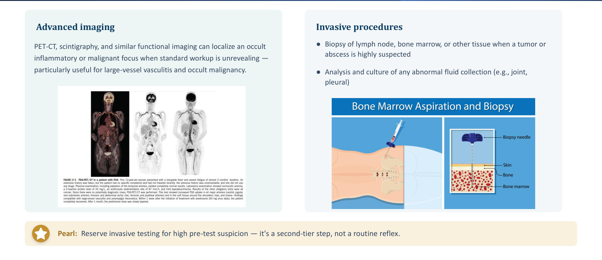

**Second tier, if the work-up is unrevealing:**
- **Advanced imaging:**
  - **PET-CT**, scintigraphy and similar functional imaging localise an occult inflammatory or malignant focus
  - especially useful for **large-vessel vasculitis** and **occult malignancy**
- **Invasive procedures:**
  - **biopsy** of lymph node, **bone marrow** or other tissue when tumour or abscess is strongly suspected
  - **analysis and culture of any abnormal fluid** (joint, pleural)
- ⭐ **Pearl:** invasive testing is reserved for **high pre-test suspicion**. It is a second-tier step, not a reflex.

### 2.5 FUO: Management (Slide 12) ⭐

| Principle | Detail |
|---|---|
| **Avoid empiric therapy** | **Antibiotics and glucocorticoids mask the disease** and delay diagnosis |
| **Know the exception** | Treat empirically only with **rapid deterioration** or a **suspected life-threatening cause** |
| **Treat the cause** | Once it is found |
| **Still undiagnosed?** | **Specialist consultation** |

⭐ **Pearl:** a specialist may try a **diagnostic trial** of:
- **anti-TB therapy**
- **colchicine** *[added: FMF]*
- **steroids**
- **anakinra (IL-1 receptor antagonist)** *[added: autoinflammatory disease, Still disease]*

*[added]* **Prognosis:** FUO that stays undiagnosed after a thorough work-up generally has a **good prognosis**.

> 🔁 **Recap: FUO.**
> - **Definition:** > 38.3 °C, > 3 weeks, undiagnosed after 3 visits or 3 inpatient days. Three other categories: nosocomial, neutropenic (ANC < 500), HIV.
> - **Causes:** infection > misc > malignancy > autoimmune.
> - **Approach:** stop antibiotics and steroids → obligatory panel (incl. **3 blood cultures**, **TST/IGRA**) → exclude **factitious** and **drug fever** → PET-CT → biopsy.
> - **Treatment:** no empiric treatment unless deteriorating.
>
> 🔗 **Link:** malaria is on the FUO infection list and is the first travel-medicine illness. Any fever in a traveller from an endemic area is **malaria until proven otherwise** *[added]*.
>
> ▶️ **Up next: Malaria.**

### 2.6 Malaria: Overview & Aetiology (Slides 13–14) ⭐

- **Protozoal** infection transmitted by the bite of an infected **female *Anopheles*** mosquito.
- **Where:** tropics and subtropics, especially **sub-Saharan Africa**, **South and Southeast Asia**, parts of the **Middle East** and **South America**.
- **Burden:** **~212 million cases/year**, **~429,000 deaths/year**.
- **Vaccine:** "No vaccine widely deployed historically"; antimalarial **resistance is increasing**.
  - *[added]* WHO now recommends RTS,S and R21 for children in endemic Africa. There is still no vaccine for travellers.

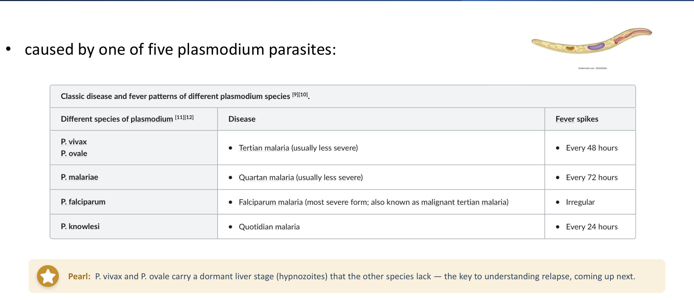

| Species | Disease | Fever spikes |
|---|---|---|
| ***P. vivax, P. ovale*** | **Tertian** malaria (usually less severe) | **Every 48 h** |
| ***P. malariae*** | **Quartan** malaria (usually less severe) | **Every 72 h** |
| ***P. falciparum*** | **Falciparum malaria**: **most severe**; "malignant tertian" | **Irregular** |
| ***P. knowlesi*** | **Quotidian** malaria | **Every 24 h** |

⭐ **Pearl:** ***P. vivax* and *P. ovale* carry a dormant liver stage (hypnozoites)** that the other species lack. This is the basis of **relapse**.

**Mnemonic for fever periodicity:** **"Quartan = 4th day = 72 h; Tertian = 3rd day = 48 h; Quotidian = daily"**. Counting is inclusive: day 1 fever → day 3 fever = 48 h.

### 2.7 Malaria: Life Cycle (Slides 15–16) ⭐

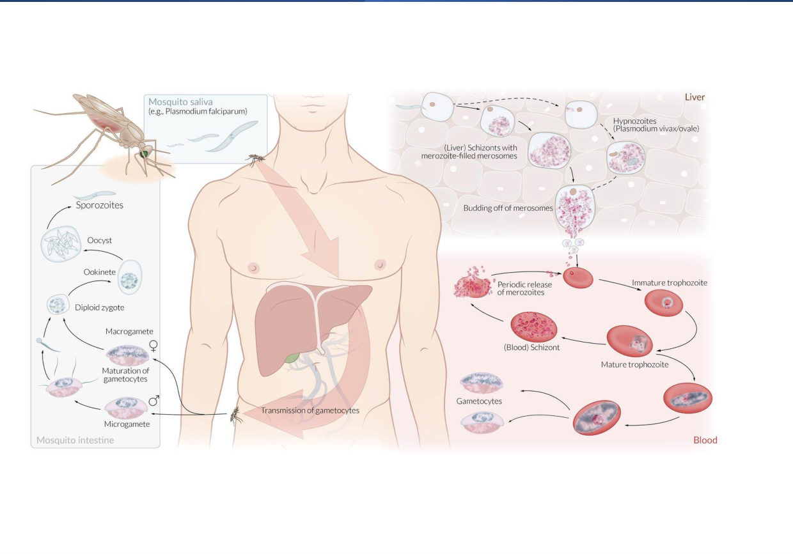

| Step | Event |
|---|---|
| 1. **Inoculation** | Anopheles injects **sporozoites** into the blood |
| 2. **Liver stage** | Sporozoites invade **hepatocytes**, multiply asexually → **schizonts full of merozoites** (no symptoms) |
| 3. **Blood stage** | Merozoites invade **RBCs** → **trophozoites** → **RBC schizonts** |
| 4. **Haemolysis & symptoms** | **RBC rupture** releases more merozoites. This **cyclical rupture causes fever and haemolysis** |
| 5. **Gametocytes** | Some merozoites become sexual **gametocytes** |
| 6. **Back to the mosquito** | A new mosquito ingests gametocytes → they mature → **salivary glands** → next host |

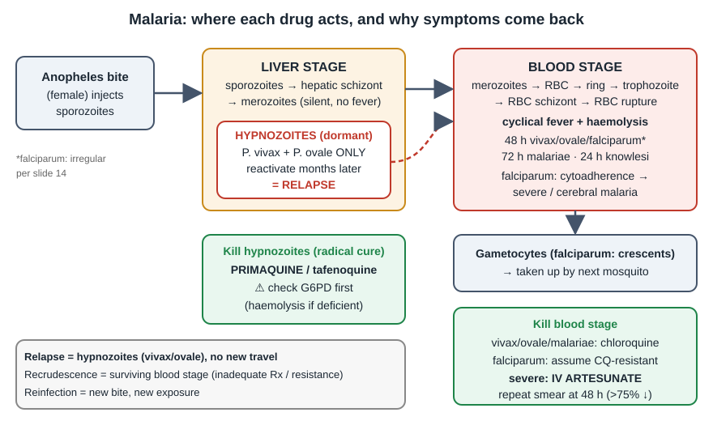

### 2.8 Relapse vs Recrudescence vs Reinfection (Slide 17) ⭐⭐

| | **Relapse** | **Recrudescence** | **Reinfection** |
|---|---|---|---|
| Mechanism | **Dormant liver hypnozoites reactivate** and re-seed the blood | **Blood-stage parasites persisted** at sub-microscopic levels and rebound | **New infection** from a new bite |
| Species | ⭐ ***P. vivax* and *P. ovale* only** | Any; classically ***P. falciparum*** or ***P. malariae*** | Any, with new exposure |
| Meaning / action | Needs **primaquine (or tafenoquine)** for radical cure; **check G6PD first** | **Inadequate treatment or drug resistance** | Distinguished by the **travel/exposure timeline**, not by testing alone |

⭐ **Pearl:** a patient treated successfully for malaria months ago, with the same illness now and **no new travel** → **relapse** (hypnozoite reactivation), **not treatment failure**. This is Case 3.

### 2.9 Malaria: Clinical Features (Slide 18)

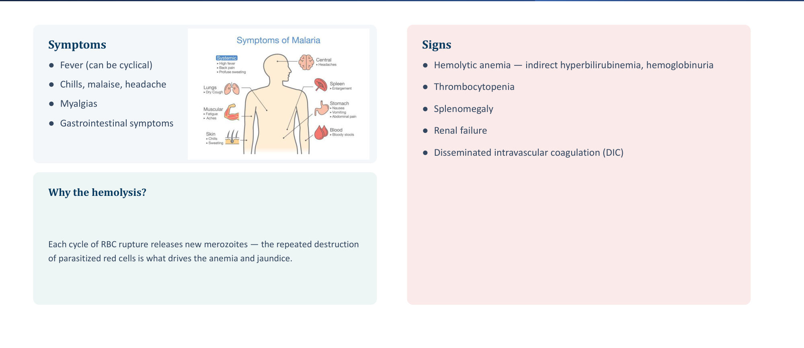

| Symptoms | Signs |
|---|---|
| **Fever (can be cyclical)** | **Haemolytic anaemia**: **indirect** hyperbilirubinaemia, **haemoglobinuria** |
| Chills, malaise, headache | **Thrombocytopenia** |
| Myalgia | **Splenomegaly** |
| GI symptoms | **Renal failure** |
| | **DIC** |

**Why the haemolysis?** Each cycle of RBC rupture releases new merozoites. **Repeated destruction of parasitised RBCs** drives the **anaemia and jaundice**.

### 2.10 Severe (Complicated) Malaria (Slide 19) ⭐⭐

⭐ **Almost always *P. falciparum*:** mature schizonts **bind vascular endothelium** (cytoadherence) → **capillary obstruction**.

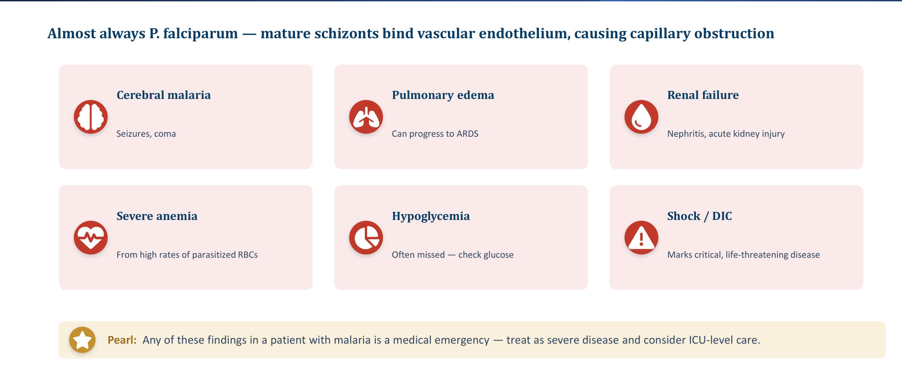

| Complication | Detail |
|---|---|
| **Cerebral malaria** | **Seizures, coma** |
| **Pulmonary oedema** | Can progress to **ARDS** |
| **Renal failure** | Nephritis, AKI *[added: "blackwater fever" = massive haemolysis → haemoglobinuria]* |
| **Severe anaemia** | High parasitised-RBC rate |
| ⭐ **Hypoglycaemia** | **Often missed: check glucose** *[added: worsened by quinine-induced insulin release]* |
| **Shock / DIC** | Critical, life-threatening |

⭐ **Pearl:** **any one** of these = **medical emergency** → treat as severe disease and consider **ICU**.

### 2.11 Malaria: Diagnostics (Slides 20–21) ⭐⭐

| Purpose | Tests |
|---|---|
| **Organ dysfunction** | CBC, comprehensive metabolic panel, LFTs, **coagulation panel** |
| **Parasitological** | ⭐ **Thick & thin blood smear (Giemsa/Wright)**, the **gold standard**. *[added: thick = detect; thin = species and % parasitaemia]* |
| | **Rapid antigen test**: faster, **less sensitive** |

**Smear clues:**
- **Schüffner granules** (fine **brick-red dots**) in RBCs → ***P. vivax* and *P. ovale***
- **crescent-shaped gametocytes** → ***P. falciparum***
- *[added]* falciparum also shows multiple rings per cell, **appliqué/headphone** forms, and RBCs of normal size; vivax/ovale enlarge the RBC; malariae shows **band forms**

⭐ **Don't stop at one:** a **single negative smear does not rule out malaria**. Repeat **every 12–24 h for 3 sets** before excluding it.

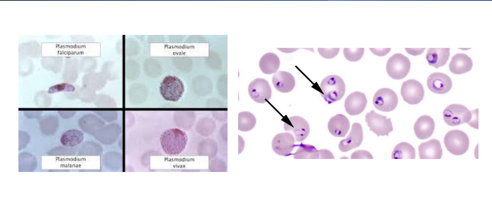

### 2.12 Malaria: Management (Slide 22) ⭐⭐

| Species | Treatment |
|---|---|
| ***P. vivax, P. ovale, P. malariae*** | **Chloroquine** |
| + *vivax / ovale* | **Add primaquine** to eradicate **hypnozoites** and prevent relapse |
| | ⚠️ **Check G6PD first**: primaquine → **severe haemolysis** in G6PD deficiency |
| ***P. falciparum*** | **Assume chloroquine resistance** |
| Uncomplicated (slide's options) | **Quinine + doxycycline**; **quinine + sulfadoxine/pyrimethamine**; **mefloquine**; **atovaquone/proguanil** |
| ⭐ **Severe disease** | **IV artesunate** (artemisinin) is the **drug of choice** |

⭐ **Monitoring:**
- repeat smears at **48 h**; expect **> 75 % fall in parasitaemia**
- consider **exchange transfusion** if parasitaemia **> 10–15 %**

> ⚠️ **Outdated on slide:** for **uncomplicated falciparum**, current WHO/CDC first line is an **artemisinin-based combination therapy (ACT)**, e.g. **artemether–lumefantrine** *[added]*. The slide's quinine/mefloquine options are alternatives. For the exam, know the slide list; in practice, ACT. Also *[added]*: chloroquine-resistant *P. vivax* exists (Indonesia/Oceania) → ACT.

### 2.13 Malaria: Prevention (Slides 23–24) ⭐

**Bite avoidance first:**
- **bed nets**, window screens, insecticides
- **repellent with 30–35 % DEET**

| Destination | Chemoprophylaxis |
|---|---|
| **Central America, Haiti, parts of the Middle East** | **Chloroquine** (still effective there) |
| **Most other endemic areas** | **Mefloquine** or **atovaquone/proguanil** |
| **Southeast Asia** | **Doxycycline** or **atovaquone/proguanil** (resistance to others common) |

| Drug | Side effect / contraindication (slide) |
|---|---|
| **Atovaquone/proguanil** | Avoid in **renal disease** and **pregnancy** |
| **Mefloquine** | Avoid with **seizures** or **psychiatric conditions** |
| **Chloroquine** | **Well tolerated, safe in pregnancy** |
| **Primaquine** | **Contraindicated in G6PD deficiency** (haemolysis) |

*[added]* **Timing:**
- **doxycycline**: start 1–2 days before, continue **4 weeks** after return; photosensitivity
- **mefloquine**: start ≥ 2 weeks before, continue 4 weeks after
- **atovaquone/proguanil**: start 1–2 days before, continue **7 days** after
- **chloroquine**: start 1–2 weeks before, continue 4 weeks after
- **mefloquine** is the option in **pregnancy** where there is chloroquine resistance

- **Slide 24** is a screenshot of the **CDC Travelers' Health** page ("Where are you going?").
- Message: check **destination-specific** advice before travel.

> 🔁 **Recap: Malaria.**
> - **Species & fever:** 5 species; vivax/ovale tertian 48 h, malariae quartan 72 h, falciparum irregular and severe, knowlesi 24 h.
> - **Relapse:** only vivax/ovale (hypnozoites) → **primaquine after G6PD**.
> - **Severe disease:** = falciparum (cerebral, ARDS, AKI, anaemia, **hypoglycaemia**, shock/DIC) → **IV artesunate**.
> - **Diagnosis:** thick/thin smear ×3.
> - **Prophylaxis:** chloroquine only in Central America/Haiti/parts of the Middle East.
>
> 🔗 **Link:** the next travel fever is also systemic and caught via **food/water** rather than a vector. It is the one with **relative bradycardia**.
>
> ▶️ **Up next: Typhoid.**

### 2.14 Typhoid & Paratyphoid: Overview & Clinical (Slides 25–26) ⭐⭐

- **Organism:** ***Salmonella enterica*** serotype **Typhi** and **Paratyphi (A, B, C)**.
- **Where:** poor sanitation: East and Southeast Asia, Africa, Central and South America.
- **Incubation:** **5–30 days**.
- **Transmission:** **faecal–oral** (contaminated food and water).

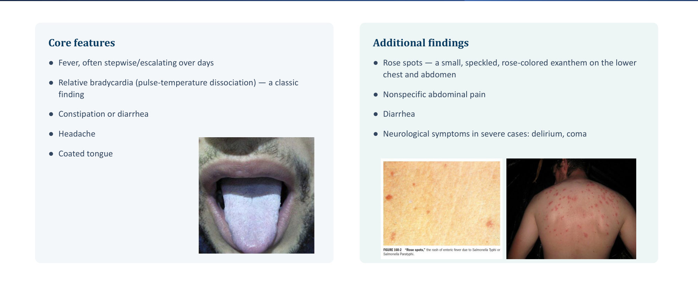

| Core features | Additional findings |
|---|---|
| Fever, often **stepwise/escalating** over days | ⭐ **Rose spots**: small, speckled, rose-coloured rash on the **lower chest and abdomen** |
| ⭐ **Relative bradycardia** (pulse–temperature dissociation) | Non-specific abdominal pain |
| **Constipation** or diarrhoea | Diarrhoea |
| Headache | **Neurological** in severe cases: **delirium, coma** |
| **Coated tongue** | *[added: hepatosplenomegaly, leukopenia]* |

*[added]* **Classic sequence:**
- week 1: **stepwise fever + constipation**
- week 2: **rose spots**, splenomegaly, "pea-soup" diarrhoea
- week 3: complications

### 2.15 Typhoid: Diagnostics & Management (Slide 27) ⭐

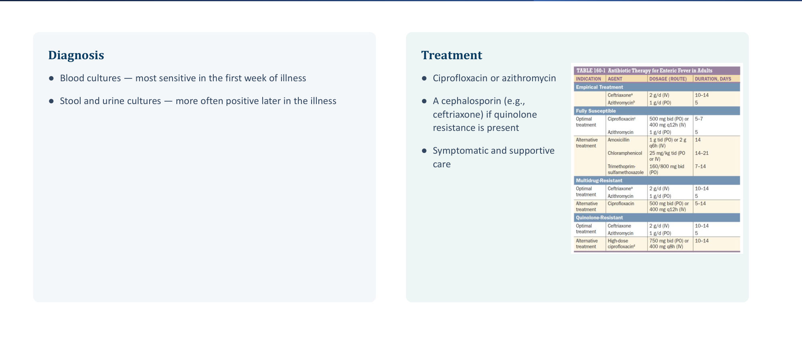

**Diagnosis:**
- ⭐ **Blood cultures**: **most sensitive in week 1**
- **stool and urine cultures**: positive **later** in the illness
- *[added]* **bone-marrow culture** is the most sensitive overall, even after antibiotics
- *[added]* the **Widal** test is unreliable

**Treatment:**
- **ciprofloxacin or azithromycin**
- **cephalosporin (ceftriaxone)** if **quinolone resistance**
- symptomatic and supportive care

**Harrison's table on the slide:**

| Situation | Optimal | Alternative |
|---|---|---|
| **Empirical** | Ceftriaxone; azithromycin | — |
| **Fully susceptible** | Ciprofloxacin; azithromycin | Amoxicillin, chloramphenicol, TMP-SMX |
| **Multidrug-resistant** | Ceftriaxone; azithromycin | Ciprofloxacin |
| **Quinolone-resistant** | Ceftriaxone; azithromycin | High-dose ciprofloxacin |

Doses are cropped off the slide.

### 2.16 Typhoid: Complications & Carrier State (Slide 28) ⭐

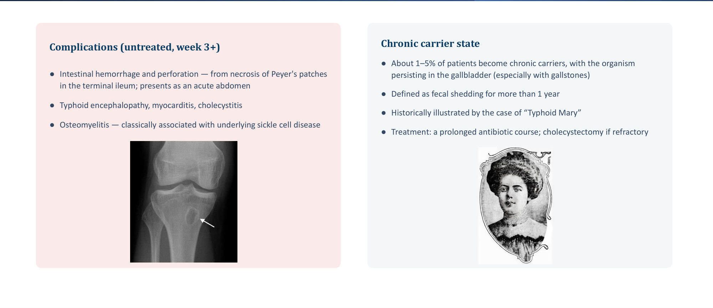

**Complications (untreated, week 3+):**
- ⭐ **Intestinal haemorrhage and perforation**: **necrosis of Peyer's patches in the terminal ileum** → **acute abdomen**
- typhoid **encephalopathy**, **myocarditis**, **cholecystitis**
- **osteomyelitis**: classically with **sickle cell disease**

**Chronic carrier state:**
- **1–5 %** of patients
- organism persists in the **gallbladder** (especially with **gallstones**)
- definition: **faecal shedding > 1 year**
- "**Typhoid Mary**"
- treatment: **prolonged antibiotics**; **cholecystectomy** if refractory

> 🔁 **Recap: Typhoid.**
> - *S.* Typhi/Paratyphi, faecal–oral, incubation 5–30 d.
> - **Clinical:** stepwise fever, **relative bradycardia**, **rose spots**, coated tongue, constipation → diarrhoea.
> - **Diagnosis:** **blood culture in week 1**; stool/urine later.
> - **Treatment:** cipro/azithro; ceftriaxone if quinolone-resistant.
> - **Complications:** **Peyer's patch perforation** in week 3; carrier = gallbladder.
>
> 🔗 **Link:** both typhoid and traveller's diarrhoea are faecal–oral. Typhoid is **systemic/invasive**; traveller's diarrhoea is usually **toxin-mediated, watery, self-limiting**.
>
> ▶️ **Up next: Traveller's diarrhoea.**

### 2.17 Traveller's Diarrhoea (Slides 29–30) ⭐

**Definition:**
- sudden **≥ 3 loose/watery stools per day**
- **plus ≥ 1** GI or systemic symptom: fever, cramps, nausea, abdominal pain, or blood in stool

**Onset:**
- usually **within 1 week of arrival**
- watery diarrhoea lasting **2–4 days**

| Aetiology | Note |
|---|---|
| ⭐ **Enterotoxigenic *E. coli* (ETEC)** | **> 50 % of cases** |
| *Campylobacter*, *Shigella*, *Salmonella* | Invasive bacteria |
| Parasites: ***Giardia***, ***Entamoeba***, ***Cryptosporidium*** | *[added: think parasites when diarrhoea lasts > 2 weeks]* |

⭐ **Pearl:** **dysentery** (bloody diarrhoea + fever) → ***Shigella* or *Entamoeba***, not the typical toxin-mediated picture.

| Risk & diagnostics | Management |
|---|---|
| Highest risk: **South & Southeast Asia, sub-Saharan Africa, Middle East, Latin America** | ⭐ **Fluid replacement**: the mainstay |
| Depends on trip type/duration and host factors | Antibiotics have a **limited role**: **fluoroquinolone, azithromycin, or rifaximin** for more severe cases |
| **Identifying the organism is usually unnecessary**; work-up only for **systemic illness or prolonged disease** | Symptomatic: **loperamide** or **diphenoxylate** (antimotility) |

*[added]*:
- avoid antimotility agents in **dysentery** (bloody, febrile)
- **azithromycin** is preferred for dysentery and in **Southeast Asia** (quinolone-resistant *Campylobacter*)
- **rifaximin** is for **non-invasive** diarrhoea only

### 2.18 Approach to Fever: Generic Framework (Slides 31–34)
These four slides are **repeated verbatim in Part 2**.

| Key history | Key physical | General work-up | Specific work-up |
|---|---|---|---|
| Severity, **duration, pattern** | **Vital signs** | CBC, BMP, LFTs | **ANA, RF** |
| Localising symptoms (rash, wheeze, cough, ear discharge) | HEENT | UA, urine culture | **LP** |
| **Night sweats, weight loss** | Neck | CXR, sputum culture | **Serology** |
| ⭐ **Travel history** | Heart (murmur → IE) | Stool analysis | **Abdominal imaging** |
| **Sick contacts; animal contact** | Lung | Viral antibodies | **TB** testing |
| Immunisations; **recent surgery**; **medications** | Abdomen, **skin** | | |

**Slide 33 differential:**

| Infections | Malignancy | Autoimmune | Miscellaneous |
|---|---|---|---|
| **TB (esp. extrapulmonary)**; abdominal / pelvic / dental **abscess**; **endocarditis**; **osteomyelitis**; sinusitis; **CMV, EBV, HIV**; Lyme; **prostatitis** | **Chronic leukaemia, lymphoma**, metastases, **RCC**, colon ca, **hepatoma**, MDS, pancreatic ca, sarcoma, (sarcoidosis) | **Adult Still's**, **PMR**, **temporal arteritis**, RA, rheumatic fever, **IBD**, reactive arthritis (Reiter's), **SLE**, vasculitides | **Drug fever**, cirrhosis complications, **factitious fever**, hepatitis (alcoholic, granulomatous, lupoid), **DVT** |

> ⚠️ **Slide 33 errors:**
> - **"Sinusitis" listed twice**
> - **"Rheumatoid fever"** should read **rheumatic fever**
> - **sarcoidosis** sits under *malignancies* (it is granulomatous, not malignant)
> - slide 34: "**Urine culutres**" (typo)

### 2.19 To Summarise (Slide 35)

| | Cause | Hallmark | Treatment |
|---|---|---|---|
| **Malaria** | *Plasmodium* spp. via *Anopheles* | **Cyclical fever, haemolytic anaemia, splenomegaly** | Species-specific; **artesunate for severe** |
| **Typhoid** | *S.* Typhi / Paratyphi | **Stepwise fever, relative bradycardia, rose spots** | **Cipro or azithro** |
| **Traveller's diarrhoea** | **ETEC** (mostly) | Watery diarrhoea **within 1 week of arrival** | **Fluids** ± antibiotic ± loperamide |

**Take-home points:**
- only **vivax/ovale relapse**; check **G6PD** before primaquine
- a **single negative smear** doesn't exclude malaria
- **rose spots + relative bradycardia + endemic travel = typhoid**

---

## 3. High-Yield Comparison Tables

### Table A: The Five *Plasmodium* Species
*[slides 14, 17, 20, 22 + added]*

| | *falciparum* | *vivax* | *ovale* | *malariae* | *knowlesi* |
|---|---|---|---|---|---|
| Fever cycle | **Irregular** | 48 h | 48 h | **72 h** | **24 h** |
| Severity | ⭐ **Most severe** | Usually mild | Mild | Mild | Can be severe *[added]* |
| Hypnozoites / relapse | ❌ | ✅ | ✅ | ❌ | ❌ |
| Smear clue | **Crescent gametocytes**, multiple rings | **Schüffner dots**, enlarged RBC | **Schüffner dots**, oval RBC *[added]* | Band forms *[added]* | Resembles malariae *[added]* |
| Treatment | **Assume CQ-resistant**; **IV artesunate if severe** | **CQ + primaquine** | **CQ + primaquine** | **CQ** | *[added]* ACT |
| Recrudescence classic | ✅ | — | — | ✅ (can persist years) | — |

### Table B: Malaria Prophylaxis Drug Selection

| Drug | Where | Avoid in |
|---|---|---|
| Chloroquine | Central America, Haiti, parts of Middle East | (well tolerated; **safe in pregnancy**) |
| Mefloquine | Most other areas | **Seizures, psychiatric illness** |
| Atovaquone/proguanil | Most areas incl. SE Asia | **Renal disease, pregnancy** |
| Doxycycline | **SE Asia** | *[added]* pregnancy, children < 8 y |
| Primaquine | (radical cure) | **G6PD deficiency** |

### Table C: Typhoid vs Traveller's Diarrhoea vs Malaria

| | Malaria | Typhoid | Traveller's diarrhoea |
|---|---|---|---|
| Route | **Anopheles bite** | **Faecal–oral** | **Faecal–oral** |
| Incubation | *[added]* ≥ 7 days (falciparum usually < 1 month; vivax/ovale up to months–years) | **5–30 days** | **< 1 week of arrival** |
| Key sign | Cyclical fever, haemolysis, splenomegaly | **Relative bradycardia, rose spots** | Watery diarrhoea, 2–4 days |
| Diagnosis | **Thick/thin smear ×3** | **Blood culture (week 1)** | Usually none |
| Treatment | Species-specific | Cipro/azithro; ceftriaxone if resistant | **Fluids** |

### Table D: FUO Categories
See §2.1. Memorise **3 weeks / 3 visits / 3 days**; **ANC < 500 + 2 days culture**; **HIV: > 4 weeks outpatient, > 3 days inpatient**.

### Table E: Culture Timing in Typhoid

| Week | Best specimen |
|---|---|
| 1 | **Blood** |
| 2–3 | **Stool, urine** |
| Any (incl. after antibiotics) | *[added]* **Bone marrow** |

---

## 4. Rules, Exceptions, Patterns

| Rule | Exception / nuance |
|---|---|
| FUO → **no empiric antibiotics/steroids** | **Rapid deterioration or life-threatening cause** → treat |
| Stop antibiotics and steroids before the FUO work-up | — |
| Malaria relapse = **vivax/ovale only** | Recurrence with *falciparum/malariae* = **recrudescence** or **reinfection** |
| Primaquine for radical cure | **Check G6PD first** |
| Chloroquine for non-falciparum | ***P. falciparum*: assume resistance** |
| **Severe malaria ≈ falciparum** | *[added]* *knowlesi* (and occasionally *vivax*) can be severe |
| Single negative smear | **≠ exclusion**; 3 sets, 12–24 h apart |
| Typhoid: **high fever + tachycardia expected** | **Relative bradycardia** is the classic exception |
| Traveller's diarrhoea: antibiotics rarely needed | **Severe / dysentery / systemic** → azithro, FQ, rifaximin |
| Loperamide for symptom relief | *[added]* **Not in dysentery** |
| Chloroquine prophylaxis | Works only in **Central America, Haiti, parts of the Middle East** |

**Pattern recognition:**
- **traveller + fever + haemolysis/jaundice + thrombocytopenia** → **malaria**
- **traveller + stepwise fever + relative bradycardia + rose spots + constipation** → **typhoid**
- **fever months after treated malaria, no new travel** → **vivax/ovale relapse**
- **sickle cell + osteomyelitis** → ***Salmonella***
- **gallstones + chronic shedding** → **typhoid carrier**

---

## 5. Clinical Correlations

- **Any fever in a returning traveller → think malaria first.** Smear ×3 even if the patient took prophylaxis (Case 1: chloroquine prophylaxis in India failed).
- **Hypoglycaemia** in severe malaria: check glucose in any confused or comatose patient. *[added]* Quinine worsens it.
- **G6PD deficiency** is common in the Middle East. *[added]* Always test before primaquine or tafenoquine; G6PD deficiency is prevalent in Saudi Arabia.
- **Typhoid perforation** presents as an acute abdomen in week 3 → surgical review.
- **Sickle cell patients** → *Salmonella* osteomyelitis.
- **Factitious fever:**
  - "exclude thermometer manipulation" is an obligatory FUO step
  - *[added]* clues: no tachycardia with fever, normal CRP, fever only when unobserved
- **Drug fever:**
  - the commonest healthcare-associated FUO cause
  - stop or replace the suspected drug
  - *[added]* β-lactams, anticonvulsants, sulfonamides; fever typically resolves within 48–72 h of stopping

---

## 6. Rapid Revision (Last-Day)

- ⭐ **Classic FUO:** > **38.3 °C (101 °F)**, > **3 weeks**, undiagnosed after **3 outpatient visits / 3 inpatient days**
- **Other FUO types:**
  - **nosocomial**: 3 days
  - **neutropenic**: ANC < 500, 3 days incl. 2 days culture
  - **HIV**: > 4 weeks outpatient / > 3 days inpatient
- **FUO causes:** infection 33 %, misc 29 %, malignancy 25 %, autoimmune 13 %
- **Healthcare-associated FUO:** **drug fever**, line infection, VTE, *C. diff*, abscess, transfusion, candidaemia
- **FUO approach:**
  - H&P → **stop antibiotics and steroids** → obligatory labs (**ESR/CRP, LDH, CK, ANA, RF, 3 blood cultures, CXR, abdominal US, TST/IGRA**)
  - → **exclude thermometer manipulation** → **exclude drug fever**
  - → PET-CT → biopsy (bone marrow / lymph node)
- **FUO treatment:**
  - **no empiric therapy** unless deteriorating
  - undiagnosed → specialist → trial of anti-TB / colchicine / steroids / **anakinra**
- **Malaria basics:** female ***Anopheles***; ~212 M cases, ~429 k deaths/yr
- **Malaria species:**
  - **vivax/ovale**: 48 h, **hypnozoites**
  - **malariae**: 72 h
  - **falciparum**: irregular, severe
  - **knowlesi**: 24 h
- **Life cycle:** sporozoite → liver schizont → merozoite → RBC trophozoite → schizont → rupture (fever) → gametocytes
- **Relapse / recrudescence / reinfection:**
  - **relapse** (vivax/ovale, hypnozoites, **primaquine after G6PD**)
  - **recrudescence** (persistent blood stage; falciparum/malariae; inadequate Rx or resistance)
  - **reinfection** (new bite)
- **Severe malaria (falciparum, cytoadherence):** cerebral, pulmonary oedema/ARDS, AKI, severe anaemia, **hypoglycaemia**, shock/DIC → **IV artesunate**, ICU
- **Diagnosis:**
  - **thick & thin smear** (gold standard), **×3, 12–24 h apart**; RDT faster but less sensitive
  - **Schüffner dots** = vivax/ovale; **crescent gametocytes** = falciparum
- **Malaria treatment:**
  - non-falciparum: **chloroquine** (+ **primaquine** for vivax/ovale)
  - falciparum: assume CQ resistance; quinine + doxy, quinine + SP, mefloquine, atovaquone/proguanil
  - monitoring: smear at **48 h, > 75 % drop**
  - **exchange transfusion > 10–15 %**
- **Prophylaxis:**
  - **DEET 30–35 %**, nets
  - CQ only in **Central America/Haiti/parts of Middle East**
  - **SE Asia: doxy or atovaquone/proguanil**
  - mefloquine ✗ seizures/psych
  - atovaquone/proguanil ✗ renal/pregnancy
  - **primaquine ✗ G6PD**
- **Typhoid:**
  - *S.* Typhi/Paratyphi A/B/C; **faecal–oral**; incubation **5–30 d**
  - **stepwise fever, relative bradycardia, rose spots, coated tongue**, constipation/diarrhoea, delirium
  - **blood culture (week 1)**; stool/urine later
  - **cipro or azithro**; **ceftriaxone** if quinolone-resistant
  - week 3+: **Peyer's patch perforation/haemorrhage**, encephalopathy, myocarditis, cholecystitis, **osteomyelitis (sickle cell)**
  - **carrier 1–5 %**, **gallbladder/gallstones**, shedding > 1 yr, "Typhoid Mary" → prolonged antibiotics ± cholecystectomy
- **Traveller's diarrhoea:**
  - **≥ 3 loose stools/day + 1 symptom**, within **1 week**, lasts **2–4 days**
  - **ETEC > 50 %**
  - **dysentery → Shigella/Entamoeba**
  - **fluids**; antibiotics (FQ/azithro/rifaximin) for severe; loperamide

---

## 7. Exam-Style Questions

**Q1. (Case Scenario 1)** A 29-year-old woman returns from rural India after taking weekly chloroquine prophylaxis. She has fever 39.3 °C, jaundice, Hb 10 g/dL, and a smear with fragmented RBCs and ring-shaped intra-erythrocytic inclusions. Most likely cause?
A. *P. ovale* · **B. *P. falciparum*** · C. Dengue virus · D. Chikungunya virus · E. Hepatitis A

> **Answer: B** *[reasoning added; key not on slides]*.
> - Ring forms inside RBCs = *Plasmodium*, which rules out C–E (viruses).
> - India has **chloroquine-resistant falciparum**, so prophylaxis failed.
> - Haemolysis with jaundice fits high parasitaemia.
> - *P. ovale* is chloroquine-sensitive and milder.

**Q2. (Case Scenario 2)** A 14-year-old girl returned from Indonesia 2 weeks ago. One week ago she had several days of low-grade fever and **constipation**. Now she has fever 39.3 °C, abdominal pain, profuse **non-bloody** diarrhoea, **hepatosplenomegaly** and a faint **salmon-coloured** maculopapular rash on the trunk. Causal organism?
A. *E. coli* · B. *C. difficile* · C. *Shigella dysenteriae* · **D. *Salmonella* Typhi**

> **Answer: D** *[reasoning added; key not on slides]*.
> - Stepwise fever with early **constipation** then diarrhoea, plus **rose spots** (salmon-coloured truncal rash) and **hepatosplenomegaly**, in a traveller → typhoid.
> - The timeline (onset ~1 week after return) fits the 5–30-day incubation.
> - **Why not the others:**
>   - ETEC (A) causes watery diarrhoea **within 1 week of arrival** without rash or organomegaly
>   - *Shigella* (C) → **bloody** dysentery
>   - *C. diff* (B) → antibiotic/healthcare exposure
> - **Next step:** **blood cultures**.

**Q3. (Case Scenario 3)** A 55-year-old woman has fever, chills, headache, nausea and scleral icterus. **Nine months ago** she had similar episodic fever after a trip to **Indonesia**, was treated with **chloroquine** and recovered. **No new travel.** The smear shows an enlarged parasitised RBC. Cause of recurrence?

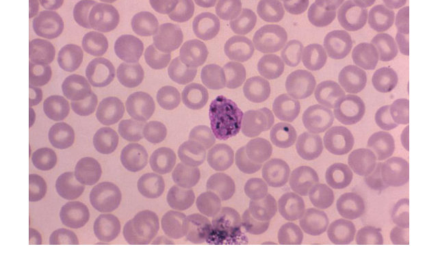
A. Decline in antibodies · B. Reinfection · C. Natural drug resistance · **D. Reactivation of dormant liver stage** · E. Dissemination within macrophages

> **Answer: D** *[reasoning added; key not on slides]*.
> - This is **relapse** from ***P. vivax/ovale* hypnozoites**.
> - Chloroquine alone kills only the blood stage. **Primaquine (after G6PD)** was needed for radical cure.
> - B needs new exposure. C (resistance) would cause early **recrudescence**, not recurrence after 9 months symptom-free.
> - E describes *Leishmania/Histoplasma*, not *Plasmodium*.

**Q4.** A patient has 4 weeks of fever to 38.6 °C. Three outpatient visits found no cause. She was started on empiric ceftriaxone and prednisolone by another clinic, and she is haemodynamically stable. Best next step?
A. Add vancomycin · **B. Stop antibiotics and glucocorticoids, then do the obligatory work-up** · C. PET-CT immediately · D. Bone-marrow biopsy · E. Trial of anakinra

> **Answer: B** (slides 10, 12).
> - Antibiotics and steroids **mask** the diagnosis.
> - The flowchart puts **stopping them before the obligatory labs**, including 3 blood cultures.
> - PET-CT and biopsy are **second tier**. Anakinra is a specialist trial for persistently undiagnosed FUO.
> - Empiric treatment is only for **rapid deterioration**.

**Q5.** A man treated for *P. vivax* is about to start primaquine. Which test must precede it?
A. Hb electrophoresis · **B. G6PD level** · C. ECG for QT · D. Creatinine · E. HIV test

> **Answer: B** (slides 17, 22, 23).
> - Primaquine (and tafenoquine) causes **severe haemolysis** in G6PD deficiency.

**Q6.** A traveller with *P. falciparum* has a GCS of 9 and glucose of 2.4 mmol/L. Best treatment?
A. Oral chloroquine · B. Oral atovaquone/proguanil · **C. IV artesunate + IV dextrose** · D. Primaquine · E. Doxycycline alone

> **Answer: C** (slide 19, 22).
> - Cerebral malaria and hypoglycaemia = **severe malaria**.
> - **IV artesunate** is the drug of choice; correct glucose.

---

## 8. Exam Pitfalls & Traps

| Trap | Correct thinking |
|---|---|
| "FUO = any fever without a source" | ❌ Needs **> 38.3 °C, > 3 weeks, and 3 visits / 3 inpatient days** of evaluation |
| 38.3 °C = 100.1 °F (slide 6) | ❌ **38.3 °C ≈ 101 °F** (slide 10 is correct) |
| Start empiric antibiotics/steroids in stable FUO | ❌ Masks the diagnosis; **only if deteriorating or life-threatening** |
| PET-CT/biopsy as first step | ❌ **Second tier** after the obligatory panel |
| Recurrent malaria months later = drug resistance | ❌ No new travel + vivax/ovale = **relapse (hypnozoites)** |
| Relapse with *P. falciparum* | ❌ Falciparum has **no hypnozoites**; recurrence = **recrudescence or reinfection** |
| Chloroquine + nothing else for vivax | ❌ Add **primaquine** (after **G6PD**) for radical cure |
| Chloroquine prophylaxis is fine for India/Africa/SE Asia | ❌ Only **Central America, Haiti, parts of the Middle East** |
| One negative smear excludes malaria | ❌ **3 smears, 12–24 h apart** |
| RDT is the gold standard | ❌ **Thick/thin smear** is; RDT is faster but **less sensitive** |
| Severe malaria = oral therapy | ❌ **IV artesunate**; ICU; check **glucose** |
| Mefloquine for a traveller with epilepsy/depression | ❌ Contraindicated → atovaquone/proguanil or doxy |
| Atovaquone/proguanil in pregnancy | ❌ Avoid (slide); chloroquine is safe where effective |
| Typhoid: stool culture first | ❌ **Blood culture in week 1**; stool/urine later |
| Fever + tachycardia always | ❌ Typhoid → **relative bradycardia** |
| Typhoid carrier → just more antibiotics | ⚠️ Prolonged antibiotics; **cholecystectomy if refractory** (gallstones) |
| Traveller's diarrhoea → stool culture + antibiotics routinely | ❌ **Fluids**; tests only for systemic/prolonged illness |
| Bloody febrile diarrhoea → loperamide | ❌ Dysentery (*Shigella/Entamoeba*); *[added]* avoid antimotility |
| Uncomplicated falciparum → quinine first line | ⚠️ Slide lists quinine combos; *[added]* current guidance = **ACT (artemether–lumefantrine)** |
