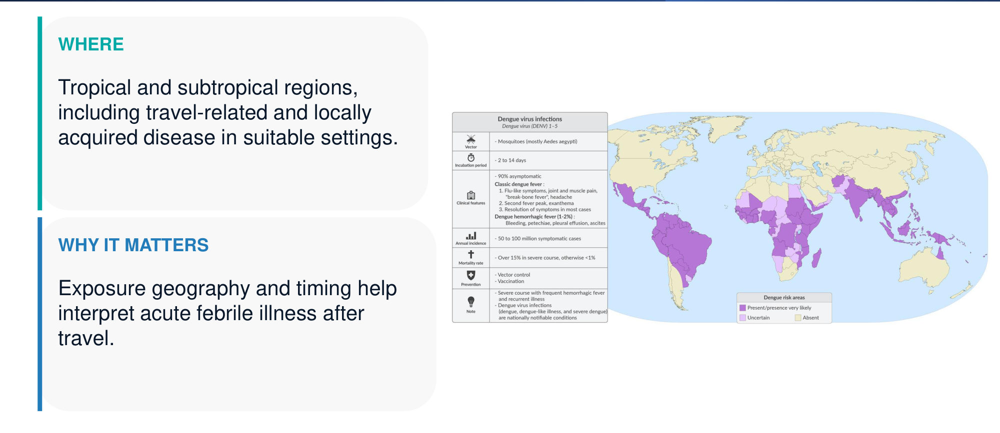
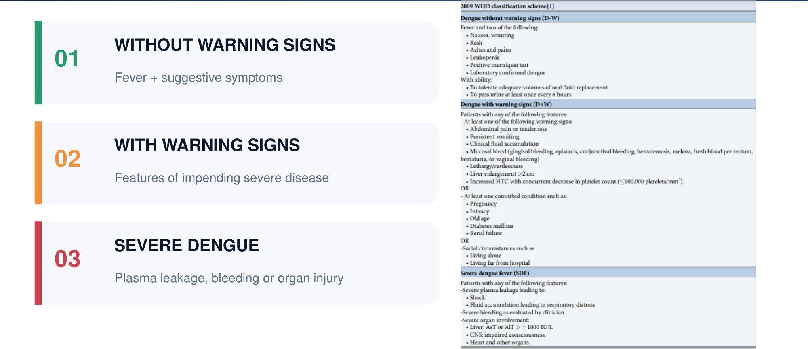
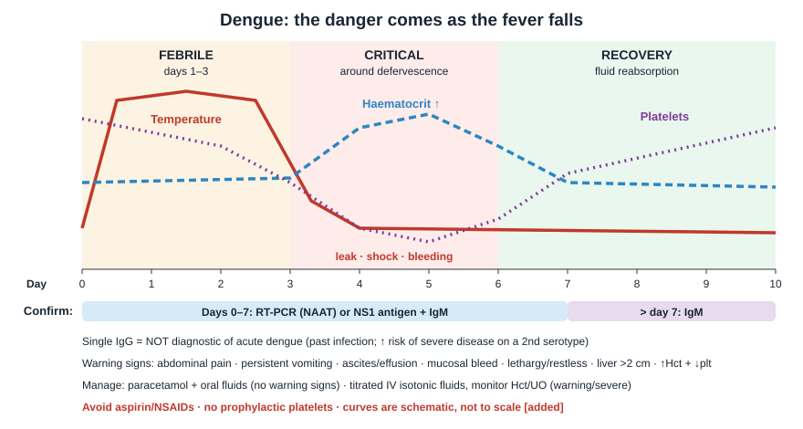
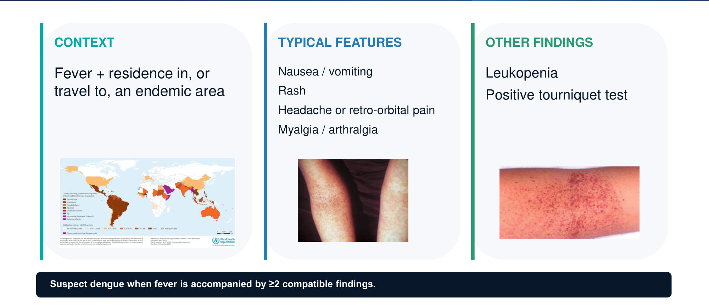
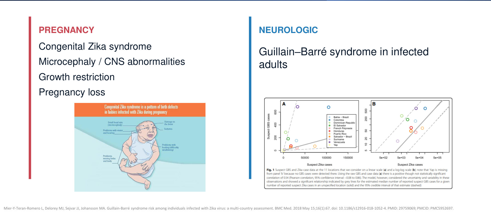
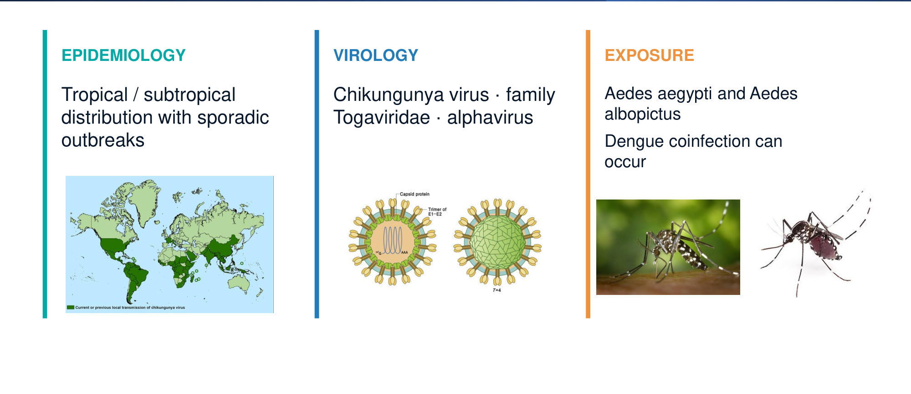
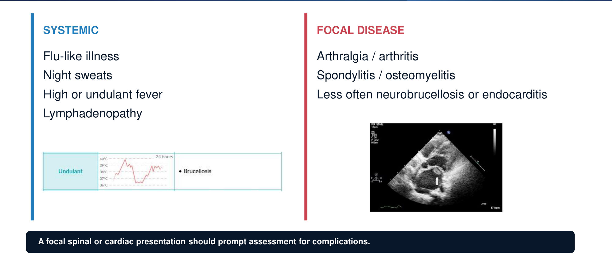
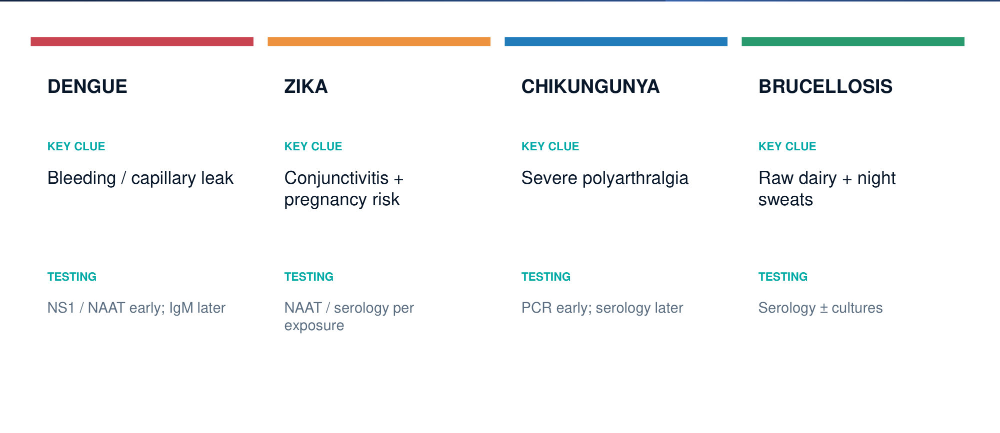

# Travel Medicine, Part 2: Dengue, Zika, Chikungunya, Brucellosis
**Dr. Majed Alnabulsi, Internal Medicine** | Source: `Travel_medicine_Part_two_2.0.pdf` (37 slides)

> **Legend:** ⭐ = high-yield · *[added]* = not on slides. Images marked "Slide N" come from the lecture; "Added diagram" = drawn for these notes. The lecture has **no answer key** for its cases; the answers below are **[reasoning added; key not on slides]**.

> 🔗 **Bridge from earlier lectures:**
> - **FUO & Travel Medicine Part 1 (same lecturer):**
>   - same "Approach to fever" slides (history, exam, DDx, work-up), repeated here as slides 27–30
>   - **brucellosis** was already on the FUO infection list
>   - malaria is still the first exclusion in a febrile traveller *[added]*
>   - the Part 1 Case 1 distractors (**dengue, chikungunya**) are taught here
> - **Tuberculosis (Kotb):** **brucellar spondylitis** vs **Pott's disease** (TB spine), both chronic febrile illnesses with night sweats. **Rifampin** is shared (doxy + rifampin for brucellosis).
> - **Infective Endocarditis (Reihan):** *Brucella* is a cause of **culture-negative endocarditis** *[added]* and the leading cause of brucellosis deaths.
> - **Cardiogenic shock lecture:** severe dengue = **hypovolaemic shock from plasma leak** → titrated isotonic fluids, monitor haematocrit.
> - **Pneumonia / ARDS:** dengue plasma leak → **pleural effusion, respiratory distress**.

---

## 1. Title / Objectives

| Domain | Objective | Likely tested as |
|---|---|---|
| Knowledge | Manifestations and objective findings of travel illnesses | Dengue warning signs; Zika conjunctivitis; chikungunya arthralgia |
| Knowledge | ⭐ Epidemiology, manifestations, complications, management | Aedes vector; congenital Zika; brucellosis exposure and regimen |
| Skill | Interpret manifestations and investigations | NS1/PCR early vs IgM later; rising Hct + falling platelets |
| Skill | Evidence-based management | No NSAIDs until dengue excluded; doxy + rifampin ≥ 6 weeks |
| Value | Professional attitude | — |

**Topics (slide 3):** Dengue → Zika → Chikungunya → Brucellosis → generic "Approach to fever" (slides 27–30).

---

## 2. Main Content (Lecture Order)

### 2.0 Opening Case (Slide 5 = Case Scenario 1, slide 33)
**Presentation:**
- **26-year-old primigravida, 22 weeks**
- vaginal bleeding + suprapubic pain for 2 h
- she has **no travel**; her **husband is a flight attendant** who often visits **South America and Southeast Asia**
- US: **fetal demise + placental detachment**
- stillborn fetus: **microcephaly**
- placental **RT-PCR: flavivirus**

**Which measure in pregnancy would most likely have prevented it?** → ⭐ **B. Use of condoms** *[reasoning added; key not on slides]*:
- **flavivirus + microcephaly + partner travelling to endemic areas** → **congenital Zika syndrome**
- she didn't travel, so the route is **sexual transmission** from the husband (slide 17), then **transplacental** spread
- slide 20: **use condoms or abstain** after possible exposure

**Why not the others:**
- **A** (unpasteurised dairy) → *Listeria/Brucella*
- **C** (ART) → HIV
- **D** (undercooked meat) → *Toxoplasma*, which can cause microcephaly but isn't a flavivirus
- **E**: **no Zika vaccine** exists

> ⚠️ Placental detachment (abruption) is **not a characteristic** Zika feature. The question hinges on the microcephaly + flavivirus.

### 2.1 Dengue: Epidemiology & Aetiology (Slides 6–7) ⭐

| Item | Detail |
|---|---|
| **Where** | Tropical and subtropical regions, including **travel-related** and **locally acquired** disease in suitable settings *[added: endemic in western Saudi Arabia, e.g. Jeddah, Makkah]* |
| **Why it matters** | **Exposure geography and timing** help interpret acute febrile illness after travel |
| **Pathogen** | ⭐ **Dengue virus (DENV 1–4)**, **RNA virus, genus *Flavivirus*** |
| **Vector** | ⭐ ***Aedes* mosquitoes**, particularly ***Aedes aegypti*** *[added: day-biting]* |

### 2.2 Dengue: Classification (Slide 8) ⭐⭐

**2009 WHO scheme:**

| Class | Slide-8 table contents |
|---|---|
| **01 Without warning signs (D–W)** | **Fever + 2 of:** nausea/vomiting, rash, aches and pains, **leukopenia**, **positive tourniquet test**, lab-confirmed dengue. **Ability to tolerate adequate oral fluids** and to **pass urine at least every 6 h** (i.e. outpatient-manageable) |
| **02 With warning signs (D+W)** | **≥ 1 warning sign** (abdominal pain/tenderness, persistent vomiting, clinical fluid accumulation, mucosal bleed, lethargy/restlessness, liver > 2 cm, **↑Hct with concurrent ↓platelets (≤ 100,000/mm³)**) **OR** a **comorbidity** (pregnancy, infancy, old age, diabetes, renal failure) **OR** **social** risk (living alone, living far from hospital) |
| **03 Severe dengue** | **Severe plasma leak** → **shock** or fluid accumulation with **respiratory distress**; **severe bleeding** (clinician-judged); **severe organ involvement**: liver **AST/ALT ≥ 1000 IU/L**, CNS (impaired consciousness), heart and other organs |

### 2.3 Dengue: Clinical Phases (Slide 9) ⭐⭐

| Phase | Timing | Features |
|---|---|---|
| **Febrile** | Days 1–3 (variable) | High fever, pain, rash |
| ⭐ **Critical** | **Around defervescence** | **Plasma leakage, shock, rising haematocrit** |
| **Recovery** | Fluid reabsorption | Clinical stabilisation *[added: watch for fluid overload, bradycardia, convalescent "islands of white in a sea of red" rash]* |

⭐ **Defervescence does NOT automatically mean improvement.**

### 2.4 Dengue Without Warning Signs (Slide 10)

| Context | Typical features | Other findings |
|---|---|---|
| Fever + **residence in or travel to an endemic area** | Nausea/vomiting; **rash**; headache or ⭐ **retro-orbital pain**; **myalgia/arthralgia** ("breakbone fever" *[added]*) | **Leukopenia**; **positive tourniquet test** |

⭐ Suspect dengue when fever comes with **≥ 2 compatible findings**.

*[added]* **Tourniquet test:**
- inflate the BP cuff midway between SBP and DBP for **5 min**
- positive if **≥ 10–20 petechiae per square inch**

### 2.5 Dengue With Warning Signs (Slide 11) ⭐⭐

| Domain | Warning sign |
|---|---|
| Abdominal | **Pain or tenderness** |
| Vomiting | **Persistent** |
| Leakage | **Ascites or pleural effusion** |
| Bleeding | **Mucosal** bleeding |
| Mental state | **Lethargy or restlessness** |
| Hepatomegaly | **Liver > 2 cm** |
| CBC trend | ⭐ **Rising haematocrit + falling platelets** |

**Mnemonic, 5 B/L domains: "Leak · Bleed · Brain · Belly · Blood"**
- **Leak** = ascites/effusion
- **Bleed** = mucosal
- **Brain** = lethargy/restlessness
- **Belly** = pain, persistent vomiting, liver > 2 cm
- **Blood** = ↑Hct + ↓platelets

⭐ Warning signs often appear **around defervescence**. **Reassess even when the fever improves.**

### 2.6 Severe Dengue (Slide 12) ⭐

| Plasma leakage | Severe bleeding | Organ involvement |
|---|---|---|
| **Shock** or **respiratory distress** from fluid accumulation | Clinically significant haemorrhage | Severe hepatic, neurological, cardiac or other organ dysfunction |

⭐ Severe dengue is **more likely after heterologous secondary infection** (a different serotype; *[added: antibody-dependent enhancement]*), **but can occur with primary infection**.

### 2.7 Dengue: Diagnostics (Slide 13) ⭐⭐

| Routine labs | Confirmation |
|---|---|
| **Leukopenia / neutropenia** | ⭐ **Days 0–7:** **NAAT (RT-PCR) or NS1 antigen, with IgM** |
| **Thrombocytopenia** | **After day 7:** **IgM** is often the primary test |
| **Elevated AST** | ⭐ **A single IgG is NOT useful** for acute dengue (it reflects past infection) |
| **Haematocrit trend** (plasma leak) | |

### 2.8 Dengue: Management (Slide 14) ⭐⭐

| No warning signs | Warning / severe |
|---|---|
| **Oral hydration** | **Observe or admit** as appropriate |
| **Acetaminophen** (paracetamol) | **Carefully titrated IV isotonic fluids** |
| **Close follow-up + return precautions** | Monitor **vital signs, urine output, Hct** |
| | **Blood products for significant bleeding** |

⭐ **Avoid aspirin/NSAIDs** (bleeding, platelet dysfunction). **No prophylactic platelet transfusions.**

*[added]* **Vaccines:**
- **Dengvaxia** only for seropositive people (it raises severe-dengue risk in seronegative people)
- **Qdenga (TAK-003)** is licensed in some countries
- neither is on the slides

> 🔁 **Recap: Dengue.**
> - **Organism and vector:** DENV 1–4 (flavivirus), *Aedes aegypti*.
> - **Clinical:** fever + retro-orbital pain, myalgia, rash, leukopenia, positive tourniquet.
> - **Critical phase:** **at defervescence**; watch **↑Hct + ↓plt**, warning signs.
> - **Testing:** **NS1/PCR ≤ day 7**, **IgM after**; IgG alone is useless.
> - **Treatment:** **paracetamol, fluids, no NSAIDs, no prophylactic platelets**.
>
> 🔗 **Link:** Zika shares the **flavivirus genus and *Aedes aegypti* vector**, which is why you "**assess for concomitant dengue before NSAIDs**" in Zika too. Zika is usually milder but **devastating in pregnancy**.
>
> ▶️ **Up next: Zika.**

### 2.9 Zika: Epidemiology, Aetiology, Transmission (Slides 15–17) ⭐

| Item | Detail |
|---|---|
| **Geography** | Tropical and subtropical areas; historical outbreaks in **Africa, Southeast Asia, Pacific islands, the Americas** |
| **History** | Large outbreaks in the Americas from **2015**, notably **Brazil**; check **current travel advisories** |
| **Pathogen** | **Zika virus**, ***Flavivirus***, an **arbovirus**; **positive-sense, single-stranded, enveloped RNA** |

**Transmission (slide 17), three routes:**

| # | Route | Detail |
|---|---|---|
| 01 | **Mosquito** | ***Aedes aegypti*** |
| 02 | ⭐ **Pregnancy** | **Transplacental → fetus** |
| 03 | ⭐ **Sexual** | **Partner-to-partner** |

*[added]* Blood transfusion is also a route.

### 2.10 Zika: Clinical Features (Slide 18)

| Many asymptomatic | Symptoms | Rash |
|---|---|---|
| A **large proportion** of infections cause no symptoms *[added: ~80 %]* | **Low-grade** fever; headache, myalgia, arthralgia; ⭐ **non-purulent conjunctivitis**; malaise | Often **maculopapular and pruritic** |

### 2.11 Zika: Complications (Slide 19) ⭐⭐

| Pregnancy: **congenital Zika syndrome** | Neurological (adults) |
|---|---|
| ⭐ **Microcephaly / CNS abnormalities** | ⭐ **Guillain–Barré syndrome** |
| **Growth restriction** | |
| **Pregnancy loss** | |

The slide cites a multi-country GBS risk analysis: Mier-y-Teran-Romero et al., *BMC Med* 2018.

### 2.12 Zika: Management (Slide 20) ⭐

| Treatment | Pregnancy & travel |
|---|---|
| **No specific antiviral** | ⭐ **Avoid travel** to areas with active Zika notices **during pregnancy** |
| **Supportive care** | ⭐ **Use condoms or abstain** after possible exposure |
| ⭐ **Assess for concomitant dengue before using NSAIDs** | **Preconception counselling** per current guidance |

**Testing:** consider molecular/serological tests based on **symptoms, pregnancy status and exposure**.

> 🔁 **Recap: Zika.**
> - **Organism:** flavivirus; transmitted by **mosquito, transplacental and sexual** routes.
> - **Clinical:** mostly asymptomatic; low fever, **conjunctivitis**, pruritic rash.
> - **Complications:** **microcephaly**, **GBS**.
> - **Prevention:** **condoms**, avoid travel in pregnancy.
> - **Treatment:** supportive; exclude dengue before NSAIDs.
>
> 🔗 **Link:** chikungunya uses the **same *Aedes* vectors** (plus *Ae. albopictus*). It is a **different family (alphavirus)**, and its signature is **severe joint pain**.
>
> ▶️ **Up next: Chikungunya.**

### 2.13 Chikungunya (Slides 21–23) ⭐

| Item | Detail |
|---|---|
| **Epidemiology** | Tropical/subtropical, **sporadic outbreaks** |
| **Virology** | ⭐ **Chikungunya virus**, family **Togaviridae**, **alphavirus** (not a flavivirus) |
| **Vector** | ***Aedes aegypti* and *Aedes albopictus*** |
| **Coinfection** | **Dengue coinfection can occur** |

| Classic clues | Diagnosis |
|---|---|
| Acute fever, malaise | **Exposure + clinical presentation** |
| ⭐ **Severe polyarthralgia** *[added: symmetric, small joints of hands/feet; name = "that which bends up"]* | **RT-PCR early** |
| Headache, myalgia | **Serology later** |
| Possible lymphadenopathy | |

⭐ **Joint symptoms may persist for months or longer**, even after the fever resolves.

**Management:**
- **acute:** supportive (hydration, rest, analgesia); **exclude dengue before NSAIDs**
- **complication:** **persistent arthralgia or inflammatory arthritis** may need follow-up
- most acute infections improve; **chronic musculoskeletal symptoms are the key distinction**

> 🔁 **Recap: Chikungunya.**
> - **Organism:** alphavirus (Togaviridae), *Aedes aegypti/albopictus*.
> - **Clinical:** **severe polyarthralgia**, sometimes chronic.
> - **Testing:** PCR early, serology later.
> - **Treatment:** supportive; NSAIDs only after dengue excluded.
>
> 🔗 **Link:** the last illness is **not vector-borne**. It is a **zoonosis caught from raw milk and livestock**, which is highly relevant in **Saudi Arabia**. It was already on the FUO list in Part 1.
>
> ▶️ **Up next: Brucellosis.**

### 2.14 Brucellosis: Overview (Slide 24) ⭐⭐

| Bacterium | Exposures |
|---|---|
| ***Brucella* species** | ⭐ **Unpasteurised dairy products** |
| **Small Gram-negative coccobacilli** | **Contact with infected animals / animal tissues** |
| **Zoonotic** infection | **Occupational exposure** (e.g. **veterinarians**) *[added: farmers, butchers, lab workers]* |

⭐ **In Saudi clinical practice, ask specifically about raw milk and livestock exposure.**
- *[added]* Raw **camel** milk is a classic local source.
- *[added]* *B. melitensis* (goats, sheep, camels) is the most common and most virulent species.

### 2.15 Brucellosis: Clinical Features & Diagnosis (Slide 25) ⭐

| Systemic | Focal disease |
|---|---|
| **Flu-like illness** | **Arthralgia / arthritis** *[added: sacroiliitis is classic]* |
| ⭐ **Night sweats** *[added: classically malodorous]* | ⭐ **Spondylitis / osteomyelitis** *[added: lumbar spine; vs TB thoracic]* |
| **High or undulant fever** | Less often **neurobrucellosis** or **endocarditis** |
| **Lymphadenopathy** *[added: + hepatosplenomegaly]* | *[added]* Epididymo-orchitis |

⭐ A **focal spinal or cardiac presentation** should prompt assessment for **complications**.

### 2.16 Brucellosis: Diagnosis & Management (Slide 26) ⭐⭐

| Diagnosis | Treatment |
|---|---|
| **Serology**: screening and confirmatory assays, **including agglutination** *[added: Rose Bengal screen; standard tube agglutination ≥ 1:160]* | ⭐ **Uncomplicated adult disease: doxycycline + rifampin, usually ≥ 6 weeks** |
| **Blood cultures** when indicated *[added: slow-growing; prolonged incubation]* | Regimens vary with **pregnancy, age, focal complications** |
| ⭐ **Inform the laboratory of suspected *Brucella*!** *[added: a leading cause of lab-acquired infection]* | *[added]* Alternative: doxy + **streptomycin/gentamicin**; spondylitis ≥ 12 weeks; pregnancy → rifampin ± TMP-SMX; children < 8 → TMP-SMX + rifampin |

### 2.17 Approach to Fever (Slides 27–30)
Identical to Part 1, slides 31–34. See the Part 1 notes (§2.18). The same slide errors are repeated:
- **"Sinusitis" twice**
- **"Rheumatoid fever"** for rheumatic fever
- **sarcoidosis** under malignancies
- "**culutres**"

**Key history for this lecture:**
- **travel** (dengue, Zika, chikungunya)
- **contact with animals** (brucellosis)
- **sexual partner's travel** (Zika)

### 2.18 To Summarise (Slide 31)

| | **Key clue** | **Testing** |
|---|---|---|
| **Dengue** | **Bleeding / capillary leak** | **NS1 / NAAT early; IgM later** |
| **Zika** | **Conjunctivitis + pregnancy risk** | NAAT / serology per exposure |
| **Chikungunya** | **Severe polyarthralgia** | **PCR early; serology later** |
| **Brucellosis** | **Raw dairy + night sweats** | **Serology ± cultures** |

---

## 3. High-Yield Comparison Tables

### Table A: The Three Aedes-Borne Arboviruses
*[slides + added]*

| | **Dengue** | **Zika** | **Chikungunya** |
|---|---|---|---|
| Family / genus | ***Flavivirus*** | ***Flavivirus*** | **Togaviridae / alphavirus** |
| Vector | *Ae. aegypti* | *Ae. aegypti* (+ **sexual, transplacental**) | *Ae. aegypti* **+ *Ae. albopictus*** |
| Fever | **High** | **Low-grade** | High, abrupt |
| Signature | **Retro-orbital pain, leukopenia, thrombocytopenia, bleeding/leak** | ⭐ **Non-purulent conjunctivitis**, pruritic rash | ⭐ **Severe polyarthralgia** (can be chronic) |
| Big complication | **Plasma leak → shock** (critical phase) | **Congenital Zika (microcephaly)**, **GBS** | **Chronic arthritis** |
| Early test | **NS1 or RT-PCR** (+ IgM), days 0–7 | NAAT/serology per exposure | **RT-PCR** |
| Late test | **IgM** | Serology | **Serology** |
| NSAIDs | ❌ **Avoid** | Only after **excluding dengue** | Only after **excluding dengue** |
| Thrombocytopenia | ⭐ **Marked** | Mild/rare *[added]* | Mild *[added]* |

### Table B: Dengue Classes → Disposition

| Class | Features | Disposition (slide 14) |
|---|---|---|
| Without warning signs | Fever + ≥ 2 findings; tolerates oral fluids; urine ≥ 6-hourly | **Home**: oral fluids, paracetamol, return precautions |
| With warning signs | Any warning sign **or** comorbidity **or** social risk | **Observe/admit**, titrated IV isotonic fluids |
| Severe | Shock/resp distress from leak, severe bleeding, AST/ALT ≥ 1000, CNS, heart | **Admit/ICU**, fluids, **blood products for bleeding** |

### Table C: Dengue Test Timing

| Day of illness | Test |
|---|---|
| **0–7** | **RT-PCR (NAAT) or NS1** + IgM |
| **> 7** | **IgM** |
| Any | **Single IgG: not diagnostic** |

### Table D: Brucellosis vs Spinal TB *[added, bridge to Kotb TB]*

| | Brucellar spondylitis | Tuberculous (Pott's) |
|---|---|---|
| Exposure | **Raw dairy, livestock** | TB contact, endemic area |
| Spine level | **Lumbar** (L4–5) | **Thoracic / thoracolumbar** |
| Bone destruction | Less; disc preserved early | **Marked**, gibbus, paraspinal "cold" abscess |
| Diagnosis | **Serology (agglutination)**, blood culture | Biopsy, AFB, culture, PCR |
| Treatment | **Doxy + rifampin** (± aminoglycoside), ≥ 12 weeks | RIPE, prolonged |

---

## 4. Rules, Exceptions, Patterns

| Rule | Exception / nuance |
|---|---|
| Fever settling = improvement | ❌ **Dengue: the critical phase starts at defervescence** |
| Severe dengue = secondary infection | Usually (**heterologous**), **but can occur in primary infection** |
| IgG proves infection | ❌ **Single IgG not useful** for acute dengue |
| NSAIDs for fever/arthralgia | ❌ Not in dengue; for Zika and chikungunya only **after excluding dengue** |
| Thrombocytopenia → give platelets | ❌ **No prophylactic platelets**; blood products only for **significant bleeding** |
| Zika = mosquito-borne only | ❌ Also **sexual** and **transplacental** → the non-travelling pregnant partner is at risk |
| Chikungunya = flavivirus like dengue/Zika | ❌ It is an **alphavirus (Togaviridae)** |
| Fever resolves → chikungunya over | ❌ **Arthralgia can persist months+** |
| Brucellosis treatment = 2 weeks | ❌ **≥ 6 weeks** of doxy + rifampin |
| Send blood cultures routinely | ⚠️ For *Brucella*, **tell the lab** (biohazard) |
| Dengue without warning signs → home | Unless **comorbidity** (pregnancy, infancy, elderly, DM, renal failure) or **social** risk → treated as "with warning signs" |

**Pattern recognition:**
- **traveller + fever + retro-orbital pain + leukopenia + platelets ↓ + gum bleeding** → **dengue (with warning signs)**
- **mild fever + conjunctivitis + pruritic rash ± pregnancy/partner travel** → **Zika**
- **fever + incapacitating symmetric polyarthralgia** → **chikungunya**
- **raw milk/livestock + undulant fever + night sweats + back pain** → **brucellosis**

---

## 5. Clinical Correlations

- **Dengue fluid strategy:**
  - the danger is **capillary leak** during the critical phase
  - give **titrated isotonic fluids** guided by **Hct, vital signs, urine output**
  - *[added]* overload in the recovery phase → pulmonary oedema; reduce fluids once leak stops
  - *[added]* **rising Hct + falling BP = leak**; **falling Hct + instability = bleeding** → transfuse
- **Analgesia in febrile travellers:** use **paracetamol** until dengue is excluded (Zika and chikungunya slides both say this).
- **Pregnancy counselling:**
  - avoid Zika-notice areas
  - **partners returning from endemic areas → condoms/abstinence**
  - *[added]* CDC: men ≥ 3 months, women ≥ 2 months before conception
- **Brucellosis in Saudi Arabia:**
  - endemic
  - take **raw camel/goat milk** and **livestock** history from every patient with prolonged fever or back pain
  - **warn the lab**
- **Neurological:** **GBS after Zika** → ascending weakness, areflexia *[added: IVIG/plasmapheresis]*.

---

## 6. Rapid Revision (Last-Day)

- **Dengue basics:**
  - **DENV 1–4**, ***Flavivirus***, ***Aedes aegypti***
  - classes: **without warning signs / with warning signs / severe** (WHO 2009)
- **Dengue phases:**
  - **febrile** (days 1–3)
  - ⭐ **critical (at defervescence: leak, shock, ↑Hct)**
  - **recovery** (reabsorption)
- **Dengue without warning signs:**
  - fever + endemic exposure + **≥ 2** of N/V, rash, headache/**retro-orbital** pain, myalgia/arthralgia, **leukopenia**, **positive tourniquet**
  - must tolerate oral fluids and pass urine 6-hourly
- **Warning signs:**
  - abdominal pain, persistent vomiting, **ascites/effusion**, **mucosal bleed**, lethargy/restlessness, **liver > 2 cm**, **↑Hct + ↓plt**
  - or comorbidity (pregnancy, infancy, old age, DM, renal failure) or social risk
- **Severe dengue:**
  - leak → **shock/resp distress**; **severe bleeding**; organ failure (**AST/ALT ≥ 1000**, CNS, heart)
  - ↑ after **heterologous secondary** infection
- **Dengue labs:**
  - leukopenia, thrombocytopenia, ↑AST, Hct trend
  - **days 0–7: RT-PCR or NS1 + IgM**; **> day 7: IgM**; **single IgG useless**
- **Dengue treatment:**
  - **oral fluids + paracetamol + follow-up** → or **admit + titrated IV isotonic fluids, monitor vitals/UO/Hct, blood for bleeding**
  - **no aspirin/NSAIDs, no prophylactic platelets**
- **Zika basics:**
  - **flavivirus** (+ssRNA, enveloped); **Brazil 2015**
  - spread by ***Ae. aegypti*, transplacental, sexual**
- **Zika clinical:**
  - mostly asymptomatic; **low-grade fever, non-purulent conjunctivitis, pruritic maculopapular rash**, arthralgia
  - complications: **congenital Zika (microcephaly, growth restriction, loss)**; **GBS**
- **Zika management:**
  - supportive; **exclude dengue before NSAIDs**
  - **avoid travel in pregnancy; condoms/abstain**; preconception counselling
- **Chikungunya:**
  - **alphavirus (Togaviridae)**; ***Ae. aegypti + Ae. albopictus***; dengue coinfection possible
  - **severe polyarthralgia** that **can persist months**
  - **PCR early, serology later**
  - supportive; NSAIDs after dengue excluded
- **Brucellosis:**
  - **small Gram-negative coccobacilli**, zoonosis
  - **unpasteurised dairy**, animals, vets; **ask about raw milk/livestock in Saudi**
  - flu-like, **night sweats**, **undulant fever**, lymphadenopathy; arthritis, **spondylitis**, neurobrucellosis, **endocarditis**
  - **serology (agglutination)** ± blood culture; **inform the lab**
  - **doxycycline + rifampin ≥ 6 weeks**

---

## 7. Exam-Style Questions

**Q1. (Case Scenario 1)** A 26-year-old primigravida at 22 weeks has a stillbirth with microcephaly. Placental RT-PCR shows a flavivirus. She hasn't travelled; her husband, a flight attendant, often visits South America and Southeast Asia. Which measure would most likely have prevented this?
A. Avoid unpasteurised dairy · **B. Condoms** · C. cART · D. Avoid undercooked meat · E. Vaccine

> **Answer: B** *[reasoning added; key not on slides]*.
> - **Congenital Zika** via **sexual transmission** from the travelling partner, then transplacental spread.
> - Slide 20: **condoms or abstinence** after possible exposure.
> - A = *Listeria/Brucella*; C = HIV; D = *Toxoplasma*; E = no Zika vaccine exists.

**Q2. (Case Scenario 2)** A 25-year-old returned from the Philippines 4 days ago. He has 4 days of fever (39.4 °C), arthralgia, myalgia, headache and **retro-orbital pain**; today his **gums bled**. Diffuse maculopapular rash; **WBC 3,200**, **platelets 89,000**; flavivirus detected. Causal pathogen?
A. Chikungunya · B. Zika · C. Hepatitis C · **D. Dengue virus**

> **Answer: D** *[reasoning added; key not on slides]*.
> - Retro-orbital pain, leukopenia, thrombocytopenia and **mucosal bleeding** → **dengue**.
> - **Gum bleeding = a warning sign** → **observe/admit**, titrated fluids, monitor Hct, avoid NSAIDs.
> - **Why not the others:**
>   - chikungunya is an **alphavirus** (and joint-dominant)
>   - Zika is mild with conjunctivitis and rarely causes bleeding
>   - HCV is a flavivirus but not an acute febrile haemorrhagic illness

**Q3.** A dengue patient's fever settles on day 4. He now has abdominal pain, Hct rising from 40 % to 48 %, and platelets 45,000/mm³. BP is normal. Best management?
A. Discharge, since the fever has resolved · B. Prophylactic platelet transfusion · **C. Admit, carefully titrated IV isotonic fluids, monitor vitals/UO/Hct** · D. Ibuprofen for pain · E. Start IgG testing

> **Answer: C** (slides 9, 11, 14).
> - **Defervescence = critical phase**: warning signs (abdominal pain, ↑Hct + ↓plt) mean plasma leak.
> - No prophylactic platelets; no NSAIDs; **IgG is not diagnostic**.

**Q4.** A patient presents on day 3 of fever after returning from Southeast Asia, and you suspect dengue. Best confirmatory test?
A. Single dengue IgG · **B. NS1 antigen or RT-PCR (with IgM)** · C. IgM only · D. Tourniquet test alone · E. Blood culture

> **Answer: B** (slide 13).
> - **Days 0–7: NAAT/NS1 + IgM**; after day 7, IgM. **Single IgG is useless.**

**Q5.** A 40-year-old Saudi shepherd drinks raw camel milk. He has 6 weeks of undulant fever, drenching night sweats, low-back pain and lumbar tenderness. Which is correct?
A. Treat with doxycycline for 7 days · **B. Serology (agglutination), warn the lab, doxycycline + rifampin ≥ 6 weeks (longer for spondylitis)** · C. Ceftriaxone monotherapy · D. Start anti-TB therapy without testing · E. NSAIDs and reassurance

> **Answer: B** (slides 24–26).
> - **Brucellosis with spondylitis**. Treatment: **doxy + rifampin ≥ 6 weeks**.
> - *[added]* Focal spinal disease needs **≥ 12 weeks**, often with an aminoglycoside.
> - **Inform the lab.**

**Q6.** Which arbovirus is an alphavirus, transmitted by both *Ae. aegypti* and *Ae. albopictus*, and causes arthralgia that can persist for months?
A. Dengue · B. Zika · **C. Chikungunya** · D. Yellow fever · E. West Nile

> **Answer: C** (slides 21–23).

---

## 8. Exam Pitfalls & Traps

| Trap | Correct thinking |
|---|---|
| Fever gone → dengue improving → discharge | ❌ **Critical phase at defervescence**; reassess, check Hct/platelets |
| Thrombocytopenia → prophylactic platelets | ❌ **Not given**; blood products only for significant bleeding |
| Ibuprofen/aspirin for dengue fever | ❌ **Paracetamol only** |
| Positive dengue IgG = acute dengue | ❌ **Single IgG not useful**; use **NS1/PCR ≤ day 7**, **IgM** later |
| IgM on day 2 is enough | ⚠️ Early IgM may be negative; **NS1/PCR** is the early test |
| Severe dengue only in second infections | ❌ More likely after **heterologous secondary infection**, but **can occur in primary** |
| Zika needs a mosquito bite | ❌ **Sexual + transplacental**; the non-travelling partner can be infected |
| Zika: give NSAIDs for arthralgia | ⚠️ **Exclude dengue first** |
| Chikungunya is a flavivirus | ❌ **Alphavirus (Togaviridae)** |
| Dengue + chikungunya are mutually exclusive | ❌ **Coinfection occurs** (shared *Aedes*) |
| Brucella: routine cultures, short course | ❌ **Warn the lab**; **doxy + rifampin ≥ 6 weeks** |
| Brucella is Gram-positive | ❌ **Small Gram-negative coccobacillus** |
| No travel → no travel illness | ❌ **Ask about the partner's travel** (Zika) and **raw dairy/livestock** (brucellosis is local in Saudi) |
