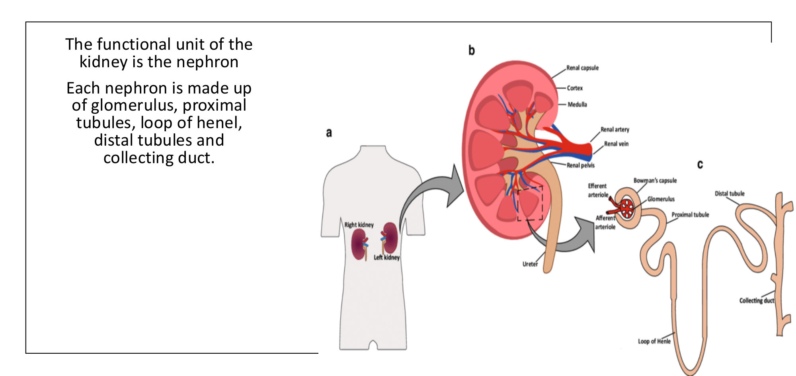
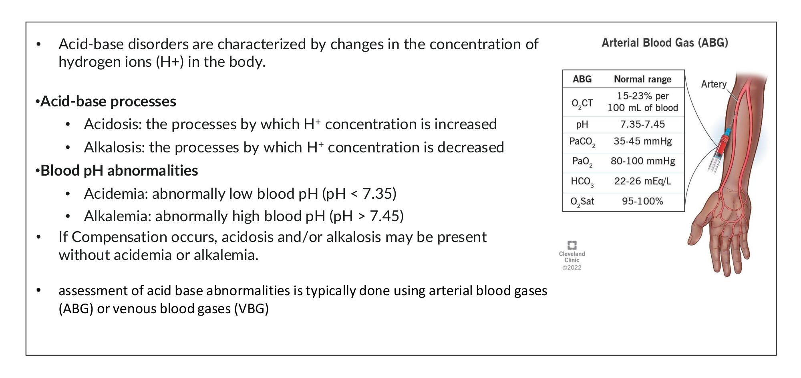
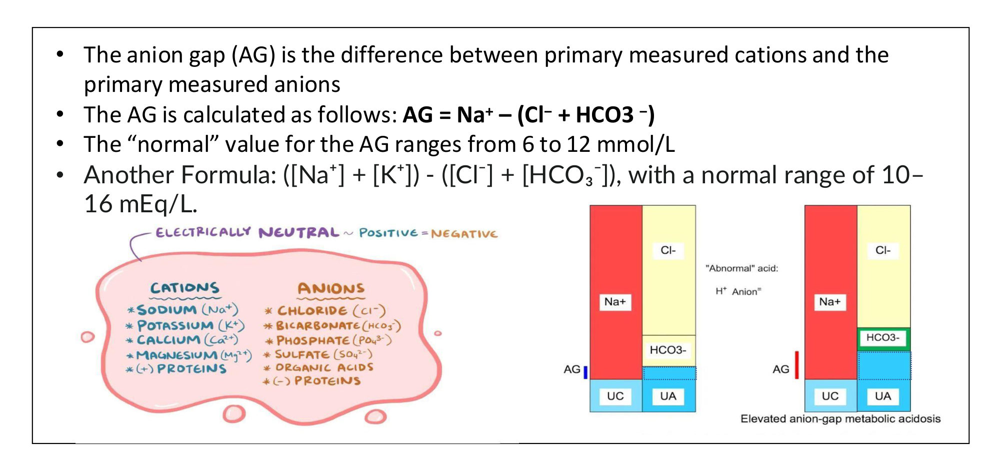
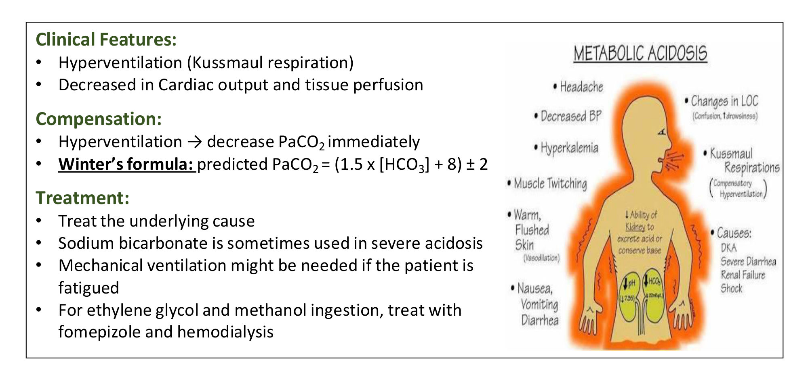
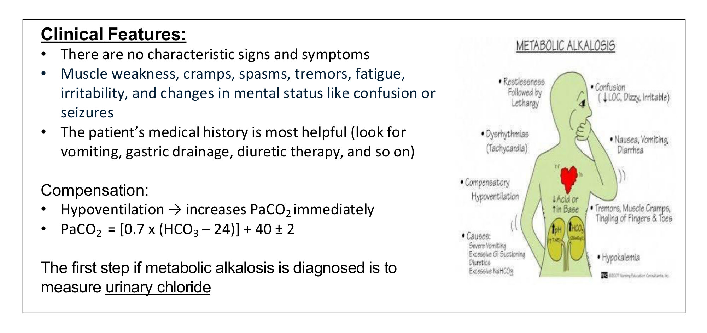
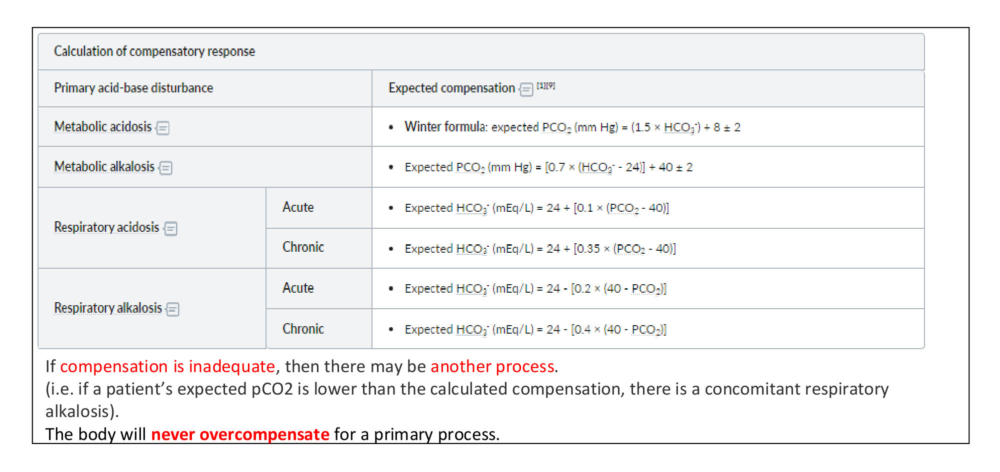
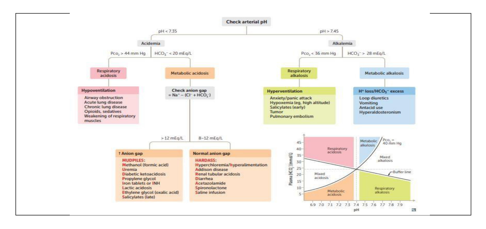
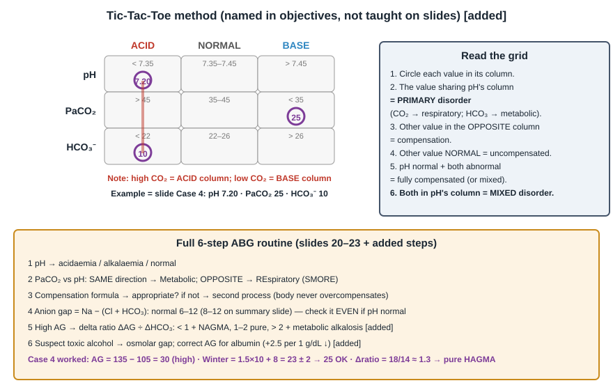
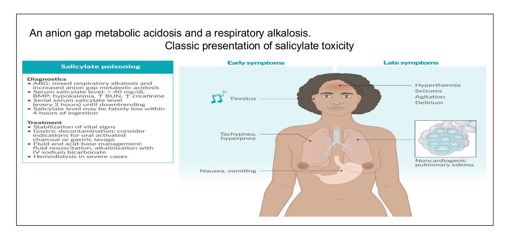

# Acid–Base Disorders
**Dr. Essam Kotb, Associate Professor, Internal Medicine** | Source: `15-_Acid_Base_Updated.pdf` (35 slides)

> **Legend:** ⭐ = high-yield · *[added]* = not on slides. Images marked "Slide N" come from the lecture; "Added diagram" = drawn for these notes. **Answer keys are on the slides** (red answers) for Cases 1, 2, 3 and 4. I checked each one against the lecture's own formulas; **Case 3's key is wrong** (see §2.11).

> 🔗 **Bridge from earlier lectures:**
> - **Respiratory Failure / ARDS (Kotb):** **type 2 (hypercapnic) failure = respiratory acidosis**. Same rule: **careful O₂ in COPD**; ventilate when pH < 7.0–7.25, mental deterioration or fatigue.
> - **COPD / Asthma / Sleep Apnoea (Kotb):**
>   - chronic CO₂ retainers → **chronic compensated respiratory acidosis** (Case 2)
>   - **obesity hypoventilation** (slide 10)
>   - a **"normal" PaCO₂ in a tiring asthmatic** is ominous *[added]*
> - **Pulmonary Vascular Disease (Kotb):** **PE → hypoxaemia → respiratory alkalosis**.
> - **Adrenal 1 & 2:**
>   - **Conn's (hyperaldosteronism)** and **Cushing's** → **chloride-resistant metabolic alkalosis** (+ hypokalaemia)
>   - **Addison's** → **normal-AG metabolic acidosis** (+ hyperkalaemia)
> - **Cardiogenic Shock (Reihan):** shock → **lactic acidosis** (HAGMA); **bicarbonate** is a rescue therapy for refractory shock.
> - **Substance Use (Khrad):** **ethanol**, **methanol**, **ethylene glycol**, **salicylate** poisoning; **propylene glycol** (lorazepam infusion vehicle *[added]*).
> - **Tuberculosis (Kotb):** **isoniazid (INH)** overdose → seizures → **lactic acidosis** (the "I" in MUDPILES).
> - **Pituitary 3:** **ADH** and osmolarity control (slide 7).
> - **GERD:** *[added]* repeated vomiting or NG suction → **chloride-responsive metabolic alkalosis** (Case 3).

---

## 1. Title / Objectives

| Domain | Objective | Likely tested as |
|---|---|---|
| Knowledge | Renal anatomy (nephron) and functions incl. **HCO₃⁻ handling** | Kidney = metabolic arm of pH control |
| Knowledge | ⭐ Acidosis vs acidaemia; buffers; **normal ABG ranges** | pH 7.35–7.45, PaCO₂ 35–45, HCO₃⁻ 22–26 |
| Knowledge | ⭐ Mechanisms, causes, features of the 4 primary disorders | MUDPILES / HARDASS; Cl-responsive vs Cl-resistant |
| Knowledge | Treatment: cause, O₂, ventilation, **bicarbonate, fomepizole/haemodialysis** | Toxic alcohols; Cl-responsive → saline |
| Skill | ⭐ Analyse an ABG: **simple vs compensated vs mixed** | Case questions |
| Skill | ⭐ **Anion gap** | AG = Na − (Cl + HCO₃) |
| Skill | **Tic-Tac-Toe** grid and **SMORE** | Identify the primary disorder |
| Skill | ⭐ **Compensation formulas** → appropriate or mixed | Winter's formula etc. |

> ⚠️ **Coverage gap:** the **"Tic-Tac-Toe" grid** is named in the objectives but **never taught** on the slides. It is drawn in the added diagram (§2.9).

**Topics (slide 3):** respiratory acidosis → respiratory alkalosis → metabolic acidosis → metabolic alkalosis → patient approach.

---

## 2. Main Content (Lecture Order)

### 2.1 Renal Anatomy & Function (Slides 4–7)

**Anatomy:**
- **retroperitoneal**, either side of the spine at **T12–L3**
- the **right kidney sits slightly lower** (liver)
- outer **cortex**, inner **medulla**
- **Nephron** (functional unit): **glomerulus → proximal tubule → loop of Henle → distal tubule → collecting duct**

| Function | Examples |
|---|---|
| **Excretory** | Waste products |
| **Regulatory** | Fluid volume and composition (incl. **pH**) |
| **Endocrine** | **Erythropoietin, renin, angiotensin, prostaglandins** |
| **Metabolic** | **Vitamin D activation**; degradation of small proteins (e.g. **insulin**) |

**Volume and osmolarity (slide 7):**
- ECF volume is set by **Na⁺ content** (filtration/reabsorption)
- **ANP** (atria, volume overload) opposes Na⁺ reabsorption
- osmolarity is controlled by **ADH (vasopressin)**, released with osmolarity changes of **< 1 %**

### 2.2 pH & Buffers (Slides 8–9) ⭐⭐

- pH reflects **[H⁺]**; balance is kept by **buffers + lungs + kidneys**.
- ⭐ **HCO₃⁻ is the most important buffer**:
  1. it is **consumed by metabolic acid**, making **CO₂ that is exhaled**
  2. it can be **regenerated by the kidney**
- **CO₂ + H₂O ⇌ H₂CO₃ ⇌ H⁺ + HCO₃⁻**: lungs control CO₂, kidneys control HCO₃⁻.

| Term | Meaning |
|---|---|
| **Acidosis** | **Process** raising [H⁺] |
| **Alkalosis** | **Process** lowering [H⁺] |
| ⭐ **Acidaemia** | **Blood pH < 7.35** |
| ⭐ **Alkalaemia** | **Blood pH > 7.45** |

⭐ With compensation (or a mixed disorder), **acidosis/alkalosis can exist without acidaemia/alkalaemia**. Assessment uses an **ABG** (or VBG).

**Normal ABG (slide 9):**

| Parameter | Normal |
|---|---|
| **pH** | **7.35–7.45** |
| **PaCO₂** | **35–45 mmHg** |
| **PaO₂** | **80–100 mmHg** |
| **HCO₃⁻** | **22–26 mEq/L** |
| O₂ content | 15–23 mL/100 mL |
| O₂ saturation | 95–100 % |

### 2.3 Respiratory Acidosis (Slides 10–11) ⭐⭐

**Basics:**
- **Definition:** **↑ PaCO₂, ↓ pH**
- **Mechanism:** **alveolar hypoventilation** → CO₂ retention

**Causes:**

| Level | Causes |
|---|---|
| **Central (CNS)** | **Drugs** (*[added]* opioids, benzodiazepines), **stroke**, trauma, haemorrhage |
| **Airway** | **Obstruction, asthma** |
| **Parenchyma** | **Emphysema**, pneumoconiosis, **bronchitis**, ARDS, barotrauma, pneumonia |
| **Neuromuscular** | Poliomyelitis, **kyphoscoliosis**, **myasthenia**, muscular dystrophies |
| **Miscellaneous** | **Obesity hypoventilation**, **ALS** |

**Clinical features (slide 11):** **somnolence**, **myoclonus with asterixis** (CO₂ flap), **headache** (cerebral vasodilatation); the picture of respiratory failure.

**Compensation (renal, takes days):**
- the kidney **↑ HCO₃⁻ reabsorption (PCT)** and **↑ H⁺ excretion (DCT)**

| | Rule |
|---|---|
| ⭐ **Acute** | **HCO₃⁻ ↑ 1 per 10 mmHg ↑ PaCO₂** → expected HCO₃⁻ = 24 + 0.1 × (PaCO₂ − 40) |
| ⭐ **Chronic** | **HCO₃⁻ ↑ 3.5 per 10 mmHg ↑ PaCO₂** → expected HCO₃⁻ = 24 + 0.35 × (PaCO₂ − 40) |

**Treatment:**
- **treat the cause**
- **O₂ if PaO₂ is low**, but ⚠️ **careful in COPD** (*[added]* target SpO₂ 88–92 %)
- **intubation and mechanical ventilation** for **severe acidosis (pH < 7)**, **mental deterioration**, or **impending respiratory fatigue** (*[added]* **NIV/BiPAP** first in COPD exacerbation with pH 7.25–7.35)

### 2.4 Respiratory Alkalosis (Slides 12–13) ⭐⭐

**Basics:**
- **Definition:** **↓ PaCO₂, ↑ pH**
- **Mechanism:** ↑ RR and/or tidal volume → **alveolar hyperventilation** → CO₂ washout

**Causes:**

| Group | Causes |
|---|---|
| **CNS stimulation** | **Pain, anxiety**, psychosis, **fever**, CVA, meningitis, encephalitis, tumour, trauma |
| **Hypoxaemia** | **High altitude**, pneumonia, pulmonary oedema, **severe anaemia**, ⭐ **PE** |
| **Drugs/hormones** | ⭐ **Pregnancy** (progesterone), ⭐ **salicylates (early)** |
| **Miscellaneous** | ⭐ **Sepsis** (early), **hepatic failure**, mechanical over-ventilation, heat exposure |

**Clinical features (slide 13):**
- light-headedness, dizziness, anxiety
- ⭐ **paraesthesia and perioral numbness** (*[added]* ↓ ionised Ca²⁺ → tetany, carpopedal spasm)
- confusion, chest discomfort

**Compensation:**

| | Rule |
|---|---|
| ⭐ **Acute** | **HCO₃⁻ ↓ 2 per 10 mmHg ↓ PaCO₂** → expected HCO₃⁻ = 24 − 0.2 × (40 − PaCO₂) |
| ⭐ **Chronic** | **HCO₃⁻ ↓ 4 per 10 mmHg ↓ PaCO₂** → expected HCO₃⁻ = 24 − 0.4 × (40 − PaCO₂) |

*[added]* Some texts use 5 for chronic alkalosis; learn the slide's **4**.

**Treatment:**
- **treat the cause**
- sometimes **no treatment needed** (e.g. **pregnancy**)
- **rebreathing into a paper bag** (anxiety)

> ⚠️ *[added]* **Paper-bag rebreathing** is **discouraged** now: it can cause **hypoxaemia**, and it can mask hyperventilation from **PE, MI, asthma or DKA**. Exclude organic causes first; coached slow breathing is safer.

> 🔁 **Recap: Respiratory disorders.**
> - **Respiratory acidosis:** ↑ CO₂ from hypoventilation (CNS, airway, parenchyma, neuromuscular, obesity) → somnolence, asterixis. HCO₃⁻ ↑ **1 (acute) / 3.5 (chronic)** per 10. Treat the cause, cautious O₂, ventilate if pH < 7.
> - **Respiratory alkalosis:** ↓ CO₂ from hyperventilation (anxiety, pain, hypoxaemia/PE, pregnancy, early salicylate, sepsis, liver failure) → paraesthesia. HCO₃⁻ ↓ **2 (acute) / 4 (chronic)** per 10.
>
> 🔗 **Link:** the metabolic disorders flip the logic: **HCO₃⁻ moves first**, and the lungs compensate **immediately**.
>
> ▶️ **Up next: Metabolic acidosis.**

### 2.5 Metabolic Acidosis: Causes & Anion Gap (Slides 14–15) ⭐⭐⭐

**Basics:**
- **Definition:** **↓ HCO₃⁻, ↓ pH**
- **Mechanism:** **↑ production/ingestion of H⁺** (gap) or **loss of HCO₃⁻** (non-gap)

**Anion gap (AG) (slide 15):**
- AG = difference between the main measured **cations** and **anions**
- ⭐ **AG = Na⁺ − (Cl⁻ + HCO₃⁻)**; **normal 6–12 mmol/L**
- alternative (with K⁺): **(Na⁺ + K⁺) − (Cl⁻ + HCO₃⁻)**; **normal 10–16**
- the summary flowchart (slide 24) uses **> 12 = high**, **8–12 = normal**

*[added]* **Albumin correction:** albumin is the main unmeasured anion. **Corrected AG = AG + 2.5 × (4 − albumin g/dL)**. Hypoalbuminaemia (sepsis, cirrhosis, nephrotic syndrome) can **hide** a high-gap acidosis.

| ⭐ **High AG: "MUDPILES"** | ⭐ **Normal AG (hyperchloraemic): "HARDASS"** |
|---|---|
| **M**ethanol (formic acid) | **H**yperalimentation (TPN; slide 24 adds hyperchloraemia) |
| **U**raemia | **A**cetazolamide |
| **D**KA (*[added]* + alcoholic and starvation ketoacidosis) | **R**enal tubular acidosis |
| **P**ropylene glycol | **D**iarrhoea (⭐ commonest) |
| **I**NH / **I**ron | **A**ddison's disease |
| **L**actic acidosis | **S**pironolactone |
| **E**thanol / **E**thylene glycol (oxalic acid) | **S**aline infusion (large volumes) |
| **S**alicylates (**late**) | |

*[added]* Modern alternative for the high-AG list, **"GOLD MARK"**: **G**lycols, **O**xoproline (paracetamol), **L**-lactate, **D**-lactate, **M**ethanol, **A**spirin, **R**enal failure, **K**etoacidosis.

### 2.6 Metabolic Acidosis: Clinical, Compensation, Treatment (Slide 16) ⭐⭐

**Clinical features:**
- ⭐ **Kussmaul respiration** (deep, rapid)
- **↓ cardiac output and tissue perfusion** (*[added]* severe acidaemia depresses myocardial contractility and vasopressor response)
- *[added]* hyperkalaemia (H⁺/K⁺ shift)

**Compensation:**
- **hyperventilation → ↓ PaCO₂ immediately**
- ⭐ **Winter's formula:** **expected PaCO₂ = 1.5 × HCO₃⁻ + 8 ± 2**
  - actual PaCO₂ **higher** than expected → **coexisting respiratory acidosis** (e.g. fatigue)
  - actual PaCO₂ **lower** → **coexisting respiratory alkalosis** (e.g. salicylates, sepsis)
  - *[added]* quick check: expected PaCO₂ ≈ the last two digits of the pH (pH 7.25 → ~25)

**Treatment:**
- **treat the cause** (*[added]* DKA: fluids + insulin + K⁺; lactic: perfusion)
- **sodium bicarbonate** sometimes in **severe acidosis** (*[added]* usually pH < 7.1–7.2, especially with AKI or bicarbonate-loss causes; little benefit in DKA)
- **mechanical ventilation** if the patient is fatiguing
- ⭐ **ethylene glycol and methanol → fomepizole + haemodialysis**

*[added]* **Toxic alcohols:**
- **fomepizole** blocks **alcohol dehydrogenase**, stopping formation of the toxic acids (formic acid → blindness; glycolic/oxalic acid → AKI, calcium oxalate crystals)
- an **osmolar gap > 10** suggests unmetabolised alcohol
- ethanol is the alternative ADH blocker

### 2.7 Metabolic Alkalosis (Slides 17–19) ⭐⭐⭐

**Basics:**
- **Definition:** **↑ HCO₃⁻, ↑ pH**
- **Mechanism:** **loss of H⁺** or **↑ HCO₃⁻ production/ingestion**

| | ⭐ **Chloride-responsive** (urine Cl⁻ **< 25 mEq/L**) | ⭐ **Chloride-resistant** (urine Cl⁻ **> 40 mEq/L**) |
|---|---|---|
| Causes (slide 17) | **Hypovolaemia** (contraction alkalosis); **renal losses (diuretics)**; **cystic fibrosis**; dietary chloride deficiency; *[added]* ⭐ **vomiting / NG suction** (commonest) | **Loop or thiazide diuretics**; ⭐ **hyperaldosteronism**; **Cushing syndrome**; **high alkali load** (antacids, alkalinisation therapy) |
| Volume *[added]* | **Depleted** | Often **normal/expanded** + **hypertension** (mineralocorticoid excess) |
| Treatment (slide 19) | ⭐ **Isotonic saline** (↑ urinary HCO₃⁻ excretion, corrects ECF loss) | Slide: consider **bicarbonate excess** → **acetazolamide** |

> ⚠️ **Slide inconsistencies:**
> - **Diuretics appear in both columns.** *[added]* Resolution: **after** diuretics have worn off, urine Cl⁻ is **low** (responsive); **during** active use, urine Cl⁻ is **high** (resistant).
> - **Vomiting**, the commonest cause and the subject of **Case 3**, is mentioned on slide 18 but **missing from the slide 17 cause table**.
> - **Urine Cl⁻ 25–40 mEq/L** is left undefined by the slide's cut-offs.
> - **Slide 19:** acetazolamide is used mainly for alkalosis with **volume overload** (e.g. post-diuresis in HF). For **chloride-resistant** alkalosis from **mineralocorticoid excess**, treat the cause *[added]*: **spironolactone/eplerenone**, adrenalectomy, **K⁺ repletion**.

**Clinical (slide 18):**
- **no characteristic signs**
- **muscle weakness, cramps, spasms, tremor**, fatigue, irritability, **confusion, seizures** (*[added]* ↓ ionised Ca²⁺, **hypokalaemia**, arrhythmias)
- ⭐ the **history** is most helpful: **vomiting, gastric drainage, diuretic therapy**

**Compensation:**
- **hypoventilation → ↑ PaCO₂ immediately**
- ⭐ **expected PaCO₂ = 0.7 × (HCO₃⁻ − 24) + 40 ± 2**
- *[added]* compensation is limited by hypoxaemia; PaCO₂ rarely exceeds ~55

⭐ **The first step once metabolic alkalosis is diagnosed: measure urinary chloride.**

> 🔁 **Recap: Metabolic disorders.**
> - **Metabolic acidosis:** ↓ HCO₃⁻. Calculate **AG = Na − (Cl + HCO₃)**: high (MUDPILES) vs normal (HARDASS). **Winter's: 1.5 × HCO₃ + 8 ± 2.** Kussmaul breathing. Treat the cause; HCO₃⁻ if severe; **fomepizole + dialysis** for methanol/ethylene glycol.
> - **Metabolic alkalosis:** ↑ HCO₃⁻. **Urine Cl⁻ first**: < 25 responsive (vomiting, volume loss → **saline**) vs > 40 resistant (aldosterone, Cushing's, alkali, active diuretics). **PaCO₂ = 0.7 × (HCO₃ − 24) + 40 ± 2.**
>
> 🔗 **Link:** all four disorders are pulled into one systematic routine.
>
> ▶️ **Up next: Patient approach.**

### 2.8 Patient Approach (Slides 20–23) ⭐⭐⭐

⭐ **pH and PaCO₂ are the most important values** (slide 20).

**Step 1: pH:**

| pH | Meaning |
|---|---|
| **< 7.35** | Acidaemia: primary **acidosis** |
| **> 7.45** | Alkalaemia: primary **alkalosis** |
| **7.35–7.45** | **Normal, or mixed** acidosis + alkalosis |

**Step 2: PaCO₂ (35–45)** ⭐ **SMORE**:
- **S**ame direction as pH → **M**etabolic
- **O**pposite direction → **RE**spiratory

| pH | PaCO₂ | Disorder |
|---|---|---|
| ↓ | ↑ | **Respiratory acidosis** |
| ↑ | ↓ | **Respiratory alkalosis** |
| ↓ | ↓ | **Metabolic acidosis** |
| ↑ | ↑ | **Metabolic alkalosis** |

**Step 3: HCO₃⁻ (22–26):**

| HCO₃⁻ | Means |
|---|---|
| **High** | Metabolic alkalosis **or** compensated respiratory acidosis |
| **Normal** | **Uncompensated** respiratory disorder |
| **Low** | Metabolic acidosis **or** compensated respiratory alkalosis |

**Step 4: PaO₂:** high = hyperoxaemia; low = hypoxaemia.

**Step 5: chronicity and compensation** using the formulas (table below).

**Step 6:** ⭐ **calculate the AG**. ⭐ **Check it even without acidaemia: a metabolic acidosis may be hiding.**

| ⭐ **Primary disorder** | **Expected compensation** (slide 23) |
|---|---|
| **Metabolic acidosis** | **PaCO₂ = 1.5 × HCO₃⁻ + 8 ± 2** (Winter's) |
| **Metabolic alkalosis** | **PaCO₂ = 0.7 × (HCO₃⁻ − 24) + 40 ± 2** |
| **Respiratory acidosis, acute** | **HCO₃⁻ = 24 + 0.1 × (PaCO₂ − 40)** |
| **Respiratory acidosis, chronic** | **HCO₃⁻ = 24 + 0.35 × (PaCO₂ − 40)** |
| **Respiratory alkalosis, acute** | **HCO₃⁻ = 24 − 0.2 × (40 − PaCO₂)** |
| **Respiratory alkalosis, chronic** | **HCO₃⁻ = 24 − 0.4 × (40 − PaCO₂)** |

**Mnemonic for the respiratory multipliers, "1-3.5 up, 2-4 down":** acidosis up by **1 / 3.5**; alkalosis down by **2 / 4** (acute / chronic, per 10 mmHg).

**Interpreting compensation:**
- ⭐ **inadequate compensation → another process.** E.g. if PaCO₂ is **lower** than the expected value → **concomitant respiratory alkalosis**.
- ⭐ **The body never overcompensates** for a primary process. A pH on the "other side" of 7.40 means a second disorder.

### 2.9 Summary Flowchart (Slide 24) ⭐

**Flowchart contents:**
- **Acidaemia (pH < 7.35):**
  - **PaCO₂ > 44** → respiratory acidosis (hypoventilation: airway obstruction, acute/chronic lung disease, opioids/sedatives, weak respiratory muscles)
  - **HCO₃⁻ < 20** → metabolic acidosis → **AG** (> 12 → MUDPILES; 8–12 → HARDASS)
- **Alkalaemia (pH > 7.45):**
  - **PaCO₂ < 36** → respiratory alkalosis (hyperventilation: anxiety/panic, hypoxaemia/high altitude, early salicylates, tumour, PE)
  - **HCO₃⁻ > 28** → metabolic alkalosis (**H⁺ loss / HCO₃⁻ excess**: loop diuretics, vomiting, antacids, hyperaldosteronism)

> ⚠️ **Threshold inconsistency:** the flowchart uses PaCO₂ > 44 / < 36 and HCO₃⁻ < 20 / > 28. The text slides use **35–45** and **22–26**. Use the text ranges for normal values; the flowchart cut-offs are pragmatic "clearly abnormal" values.

### 2.10 Salicylate Toxicity (Case 1 Answer, Slide 26) ⭐

| Feature | Detail |
|---|---|
| **ABG** | ⭐ **Mixed respiratory alkalosis (early, direct respiratory-centre stimulation) + high-AG metabolic acidosis (late)** |
| **Level** | Serum salicylate > 40 mg/dL; **repeat every 2 h until falling** (it may be falsely low within 4 h of ingestion) |
| **Other labs** | **Hypokalaemia**, ↑ BUN, ↑ creatinine |
| **Early symptoms** | ⭐ **Tinnitus**, tachypnoea/hyperpnoea, **nausea, vomiting** |
| **Late symptoms** | **Hyperthermia, seizures, agitation, delirium**; **non-cardiogenic pulmonary oedema** |
| **Treatment** | Stabilise; **activated charcoal** or gastric lavage; fluids; ⭐ **alkalinisation with IV sodium bicarbonate** (urine + serum); ⭐ **haemodialysis** in severe cases |

### 2.11 Cases (Slides 25–32): Verified ⭐⭐⭐

| Case | Data | Slide key | My check |
|---|---|---|---|
| **1** | pH 7.24, PaCO₂ 22, PaO₂ 92; Na 138, Cl 102, HCO₃⁻ 15 | **HAGMA + respiratory alkalosis: salicylate toxicity** | ✅ AG = 138 − 117 = **21** (high). Winter's = 1.5 × 15 + 8 = **30.5 ± 2**; actual **22 < 28.5** → extra **respiratory alkalosis** |
| **2** | COPD smoker; pH 7.33, PaCO₂ 55, HCO₃⁻ 30; Na 140, Cl 100 | **Chronic compensated respiratory acidosis** | ✅ Chronic expected HCO₃⁻ = 24 + 0.35 × 15 = **29.25** ≈ 30 (acute would be 25.5). AG = 10 (normal). *[added]* "Compensated" here means **appropriately (partially) compensated**: pH is still < 7.35 |
| **3** | 3 days of vomiting; pH 7.50, PaCO₂ 48, HCO₃⁻ 34; Na 138, Cl 92, K 3.2 | ❌ **E. "Acute uncompensated metabolic alkalosis"** | ⚠️ **The key contradicts the slide's own formula.** Expected PaCO₂ = 0.7 × (34 − 24) + 40 = **47 ± 2 (45–49)**; actual **48** → **appropriate respiratory compensation**. "Uncompensated" is wrong. See below |
| **4** | Sepsis, lactate 5; pH 7.20, PaCO₂ 25, HCO₃⁻ 10; Na 135, Cl 95 | **A. HAGMA with appropriate respiratory compensation** | ✅ AG = 135 − 105 = **30**. Winter's = 1.5 × 10 + 8 = **23 ± 2 (21–25)**; actual 25 → appropriate. *[added]* Delta ratio = (30 − 12)/(24 − 10) = 18/14 ≈ **1.3** → pure HAGMA (lactic) |

> ⚠️ **Case 3 in detail** *[analysis added]*:
> - The correct description is **metabolic alkalosis (chloride-responsive, from vomiting: H⁺ and Cl⁻ loss, volume contraction, hypokalaemia) with appropriate respiratory compensation**.
> - The "acute vs chronic" label in the options is **not meaningful** for metabolic disorders. Respiratory compensation is **immediate** (slide 18), and the compensation formula has no acute/chronic forms.
> - Among the options, the closest correct answers are **D or H ("compensated metabolic alkalosis")**, not E.
> - If the lecturer insists on E, they are probably using "uncompensated" to mean "pH still abnormal" (i.e. partially compensated). That conflicts with the formula taught on slides 18 and 23.
> - **Management:** **urine Cl⁻ (expect < 25)** → **IV 0.9 % saline + KCl**.
> - **Ask the lecturer** which wording they will accept.

---

## 3. High-Yield Comparison Tables

### Table A: The Four Primary Disorders

| | Resp. acidosis | Resp. alkalosis | Met. acidosis | Met. alkalosis |
|---|---|---|---|---|
| Primary change | **↑ PaCO₂** | **↓ PaCO₂** | **↓ HCO₃⁻** | **↑ HCO₃⁻** |
| pH | ↓ | ↑ | ↓ | ↑ |
| Compensation | ↑ HCO₃⁻ (renal, **days**) | ↓ HCO₃⁻ (renal) | ↓ PaCO₂ (**immediate**) | ↑ PaCO₂ (**immediate**) |
| Formula | **+1 / +3.5** per 10 | **−2 / −4** per 10 | **1.5 × HCO₃ + 8 ± 2** | **0.7 × (HCO₃ − 24) + 40 ± 2** |
| Clinical | Somnolence, asterixis, headache | Paraesthesia, perioral numbness, dizziness | **Kussmaul**, ↓ CO | Weakness, cramps, tremor, seizures |
| Key causes | COPD, sedatives, neuromuscular, obesity | Anxiety, PE, pregnancy, early salicylate, sepsis, liver failure | MUDPILES / HARDASS | Vomiting, diuretics, hyperaldosteronism, Cushing's, alkali |
| Key treatment | Cause, cautious O₂, **ventilate** | Cause (± none in pregnancy) | Cause, **NaHCO₃ if severe**, **fomepizole/HD** | **Saline** (Cl-responsive); treat cause (Cl-resistant) |

### Table B: High AG vs Normal AG Metabolic Acidosis

| | High AG (> 12) | Normal AG (6/8–12) |
|---|---|---|
| Mechanism | **Added acid** (unmeasured anion) | **HCO₃⁻ loss**, replaced by **Cl⁻** (hyperchloraemic) |
| Mnemonic | **MUDPILES** | **HARDASS** |
| Classic | DKA, lactic, renal failure, toxic alcohols, late salicylate | **Diarrhoea**, RTA, acetazolamide, saline, Addison's |
| *[added]* Next test | Lactate, ketones, creatinine, **osmolar gap**, salicylate level | **Urine AG** (negative = GI loss; positive = RTA) |

### Table C: Chloride-Responsive vs Chloride-Resistant Metabolic Alkalosis

| | Responsive | Resistant |
|---|---|---|
| **Urine Cl⁻** | **< 25 mEq/L** | **> 40 mEq/L** |
| Causes | **Vomiting/NG suction**, **remote diuretics**, hypovolaemia, CF, low-Cl diet | **Active diuretics**, **hyperaldosteronism**, **Cushing's**, **alkali load** (*[added]* Bartter/Gitelman, severe hypokalaemia) |
| Volume / BP *[added]* | Low volume | Normal/high, often **HTN** |
| Treatment | **0.9 % saline** (+ K⁺) | Slide: **acetazolamide**; *[added]* treat the cause, **spironolactone**, K⁺ |

### Table D: Compensation Speed

| Primary | Compensating organ | Speed |
|---|---|---|
| Metabolic | **Lungs** | **Minutes–hours** ("immediately") |
| Respiratory | **Kidneys** | **3–5 days** for full (chronic) compensation *[added]* |

---

## 4. Rules, Exceptions, Patterns

| Rule | Exception / nuance |
|---|---|
| Acidosis = acidaemia | ❌ With compensation or a **mixed** disorder, pH can be normal |
| Normal pH = no disorder | ❌ Check PaCO₂, HCO₃⁻ and **AG**: "**a metabolic acidosis may be hiding**" |
| Compensation returns pH to normal | ❌ **Never overcompensates**; usually **partial**; pH on the opposite side → second disorder |
| PaCO₂ lower than Winter's | **+ respiratory alkalosis** (salicylate, sepsis) |
| PaCO₂ higher than Winter's | **+ respiratory acidosis** (fatigue, sedation) |
| Salicylate = metabolic acidosis | **Early: respiratory alkalosis**; **late: HAGMA** → classic **mixed** picture |
| Diuretics → Cl-resistant | Only **while acting**; afterwards urine Cl⁻ falls → **responsive** |
| Give O₂ for hypoxaemia | ⚠️ **COPD/CO₂ retainers**: controlled O₂ (88–92 %) |
| Bicarbonate fixes acidosis | Only for **severe** cases (slide "sometimes"); treat the cause |
| Paper bag for hyperventilation | *[added]* ⚠️ Risky; exclude PE/MI/DKA |
| AG normal 6–12 | With K⁺ 10–16; summary slide 8–12; *[added]* correct for **albumin** |

**Pattern recognition:**
- **tinnitus + tachypnoea + HAGMA with low PaCO₂** → **salicylate**
- **visual loss + HAGMA + osmolar gap** → **methanol**
- **AKI + oxalate crystals + HAGMA** → **ethylene glycol**
- **diarrhoea + normal AG + ↓ K⁺** → GI HCO₃⁻ loss
- **vomiting + ↓ Cl⁻ + ↓ K⁺ + ↑ HCO₃⁻** → **Cl-responsive alkalosis**
- **HTN + ↓ K⁺ + ↑ HCO₃⁻ + urine Cl⁻ high** → **hyperaldosteronism**
- **COPD + ↑ PaCO₂ + HCO₃⁻ ≈ 24 + 0.35 × ΔPaCO₂** → **chronic respiratory acidosis**

---

## 5. Clinical Correlations

- **COPD exacerbation:**
  - acute-on-chronic respiratory acidosis: HCO₃⁻ falls **between** the acute and chronic expected values *[added]*
  - **controlled O₂**; **NIV** at pH 7.25–7.35; intubate if worse
- **DKA** *[added]*:
  - HAGMA with Kussmaul breathing and ketones
  - treat with fluids, insulin and **K⁺** (total-body K⁺ is depleted even if the serum level is high)
  - bicarbonate only if pH < 6.9
- **Sepsis:**
  - early **respiratory alkalosis** → later **lactic acidosis** (Case 4)
  - lactate drives resuscitation
- **Toxic alcohols** (methanol, ethylene glycol):
  - **fomepizole + haemodialysis** (slide)
  - *[added]* calculate the **osmolar gap**
- **Salicylate overdose:** **urinary alkalinisation with NaHCO₃**, serial levels, **haemodialysis** if severe. Never intubate without matching the high minute ventilation *[added]*.
- **Persistent vomiting / NG suction:**
  - **urine Cl⁻** first
  - **normal saline + KCl**
  - *[added]* paradoxical aciduria occurs in severe volume and K⁺ depletion
- **Hyperaldosteronism / Cushing's** (Adrenal lectures): **HTN + hypokalaemia + metabolic alkalosis**, saline-unresponsive.

---

## 6. Rapid Revision (Last-Day)

- **Kidney anatomy:** retroperitoneal, **T12–L3**, right lower; nephron = glomerulus → PCT → loop of Henle → DCT → collecting duct.
- **Kidney functions:**
  - excretory; regulatory (volume, pH)
  - **endocrine** (EPO, renin, angiotensin, prostaglandins)
  - **metabolic** (vitamin D, insulin breakdown)
  - ANP opposes Na⁺ reabsorption; **ADH** responds to < 1 % osmolarity change
- **Buffers:** **HCO₃⁻ is the key buffer**: consumed by acid → CO₂ exhaled; **regenerated by the kidney**.
- **Definitions:** **acidaemia pH < 7.35; alkalaemia > 7.45**; acidosis/alkalosis = processes.
- **Normal ABG:** **pH 7.35–7.45**, **PaCO₂ 35–45**, **PaO₂ 80–100**, **HCO₃⁻ 22–26**.
- **Respiratory acidosis:**
  - ↑ PaCO₂ from hypoventilation (CNS drugs/stroke, airway/asthma, COPD/ARDS/pneumonia, neuromuscular, obesity, ALS)
  - **somnolence, asterixis, headache**
  - HCO₃⁻ **+1 acute / +3.5 chronic** per 10
  - treat the cause, careful O₂ in COPD, **ventilate if pH < 7, mental decline or fatigue**
- **Respiratory alkalosis:**
  - ↓ PaCO₂ (pain, anxiety, fever, CNS, hypoxaemia, altitude, anaemia, **PE**, **pregnancy**, **early salicylate**, **sepsis**, **liver failure**)
  - **paraesthesia, perioral numbness**
  - HCO₃⁻ **−2 acute / −4 chronic** per 10
  - treat the cause; none in pregnancy; paper bag (slide; outdated)
- **Metabolic acidosis:**
  - **AG = Na − (Cl + HCO₃)**, normal **6–12** (with K⁺ 10–16)
  - **MUDPILES** vs **HARDASS**
  - **Kussmaul**, ↓ CO
  - **Winter's: PaCO₂ = 1.5 × HCO₃ + 8 ± 2**
  - treat cause ± **NaHCO₃**, ventilate if tired, **fomepizole + HD** for methanol/ethylene glycol
- **Metabolic alkalosis:**
  - **urine Cl⁻ first**: **< 25 responsive** (hypovolaemia, diuretics, CF, low Cl⁻, *[added]* vomiting) → **saline**
  - **> 40 resistant** (diuretics, **hyperaldosteronism, Cushing's, alkali load**) → slide: acetazolamide
  - compensation: **PaCO₂ = 0.7 × (HCO₃ − 24) + 40 ± 2**
  - weakness, cramps, tremor, confusion, seizures; history (vomiting, drainage, diuretics) is key
- **Approach:**
  - **pH → PaCO₂ (SMORE) → HCO₃⁻ → PaO₂ → compensation → AG**
  - **check AG even if pH is normal**
  - **never overcompensates**; inadequate compensation = second process
- **Salicylate toxicity:** **resp alkalosis + HAGMA**, **tinnitus**, N/V, hyperthermia, seizures, non-cardiogenic pulmonary oedema; **charcoal, bicarbonate alkalinisation, HD**.
- **Case keys:**
  1. salicylate (HAGMA + resp alkalosis)
  2. chronic compensated respiratory acidosis
  3. slide says **E** but the formula shows **appropriately compensated metabolic alkalosis**
  4. **HAGMA with appropriate compensation**

---

## 7. Exam-Style Questions

**Q1. (Slide Case 1)** ABG: pH 7.24, PaCO₂ 22, PaO₂ 92; Na 138, Cl 102, HCO₃⁻ 15. Most likely cause?

> **Answer:** **High-AG metabolic acidosis + respiratory alkalosis = salicylate toxicity** (slide 26).
> - AG = 21. Expected PaCO₂ (Winter's) = 30.5 ± 2; actual 22 is **too low** → additional respiratory alkalosis.

**Q2. (Slide Case 2)** A 68-year-old COPD smoker with worsening dyspnoea: pH 7.33, PaCO₂ 55, HCO₃⁻ 30; Na 140, Cl 100. Which describes the acid–base state?
**A. Chronic compensated respiratory acidosis** · B. Acute compensated respiratory acidosis · C. HAGMA · D. Normal-AG metabolic acidosis

> **Answer: A** (slide key, verified).
> - Chronic expected HCO₃⁻ = 24 + 0.35 × 15 ≈ **29**; acute would be ~25.5.
> - AG = 10, so no metabolic acidosis.

**Q3. (Slide Case 3)** A 35-year-old man with 3 days of vomiting: pH 7.50, PaCO₂ 48, HCO₃⁻ 34; Na 138, Cl 92, K 3.2. Best description and first diagnostic step?

> **Slide key: E (acute uncompensated metabolic alkalosis).**
> **My answer** *[reasoning added; key disputed]*: **metabolic alkalosis with appropriate respiratory compensation** (expected PaCO₂ 47 ± 2; actual 48).
> - This is the **chloride-responsive** type from gastric H⁺/Cl⁻ loss, volume contraction and hypokalaemia.
> - **First step: urine chloride** (expect < 25); **treat with 0.9 % saline + KCl**.

**Q4. (Slide Case 4)** A 70-year-old with sepsis, lactate 5: pH 7.20, PaCO₂ 25, HCO₃⁻ 10; Na 135, Cl 95.
**A. HAGMA with appropriate respiratory compensation** · B. HAGMA without appropriate compensation · C. NAGMA with appropriate compensation · D. NAGMA without

> **Answer: A** (slide key, verified). AG = 30; Winter's = 23 ± 2 (21–25); actual 25 → appropriate.

**Q5.** A man drank windscreen-washer fluid. He has blurred vision, pH 7.10, AG 28 and a raised osmolar gap. Specific treatment?
A. IV bicarbonate only · B. Isotonic saline · **C. Fomepizole + haemodialysis** · D. Acetazolamide · E. Paper-bag rebreathing

> **Answer: C** (slide 16). **Methanol** → formic acid (optic nerve toxicity). Fomepizole blocks alcohol dehydrogenase; haemodialysis removes the toxin.

**Q6.** A hypertensive woman has K⁺ 2.9, HCO₃⁻ 33, pH 7.49 and **urine Cl⁻ 60 mEq/L**. She takes no diuretics. Likely cause, and will saline correct it?
A. Vomiting; yes · **B. Primary hyperaldosteronism; no (chloride-resistant)** · C. Diarrhoea; yes · D. Addison's; no · E. Salicylates; yes

> **Answer: B** (slide 17). Chloride-resistant alkalosis (urine Cl⁻ > 40) with HTN + hypokalaemia → mineralocorticoid excess (link: Adrenal 1). Treat the cause.

**Q7.** ABG: pH 7.40, PaCO₂ 40, HCO₃⁻ 24; Na 140, Cl 100. Most accurate statement?
A. Normal acid–base status · **B. HAGMA (AG 16) with a coexisting metabolic alkalosis** · C. Compensated respiratory acidosis · D. Lab error

> **Answer: B** (slide 22: "check the AG even in the absence of acidaemia").
> - AG = 16 (high) despite normal pH/HCO₃⁻.
> - *[added]* Delta ratio = 4/0 → **metabolic alkalosis** offsets the acidosis (e.g. DKA with vomiting).

---

## 8. Exam Pitfalls & Traps

| Trap | Correct thinking |
|---|---|
| Normal pH → no disorder | ❌ **Calculate the AG**; mixed disorders can normalise pH |
| Compensation corrects pH fully | ❌ **Never overcompensates**; overshoot = second disorder |
| PaCO₂ low in metabolic acidosis → fine | ⚠️ Compare with **Winter's**; too low = **+ respiratory alkalosis** |
| Salicylates → pure metabolic acidosis | ❌ **Mixed**: early respiratory alkalosis + late HAGMA |
| Acute vs chronic applies to metabolic disorders | ❌ Only **respiratory** disorders have acute/chronic renal compensation; respiratory compensation of metabolic disorders is **immediate** |
| Case 3 "uncompensated" | ⚠️ PaCO₂ 48 = **expected (47 ± 2)** → compensated; the slide key conflicts with its own formula |
| Diuretics only cause Cl-responsive alkalosis | ❌ **Active use → urine Cl⁻ high** (resistant); remote use → low (responsive) |
| Every metabolic alkalosis → saline | ❌ Only **Cl-responsive**; resistant (aldosterone, Cushing's) needs cause-directed treatment |
| Bicarbonate for all metabolic acidosis | ❌ **Treat the cause**; HCO₃⁻ only if **severe** |
| High-flow O₂ in a hypercapnic COPD patient | ❌ **Controlled O₂** (88–92 %) |
| AG uses K⁺ | ⚠️ Standard AG = **Na − (Cl + HCO₃)** (6–12); with K⁺ 10–16 |
| Low albumin + normal AG = no gap acidosis | ❌ *[added]* **Correct the AG for albumin** |
| Paper bag for every hyperventilating patient | ❌ *[added]* Exclude **PE, MI, DKA, asthma** first |
| SMORE confusion | **Same** direction (pH & PaCO₂) = **Metabolic**; **Opposite** = **REspiratory** |
