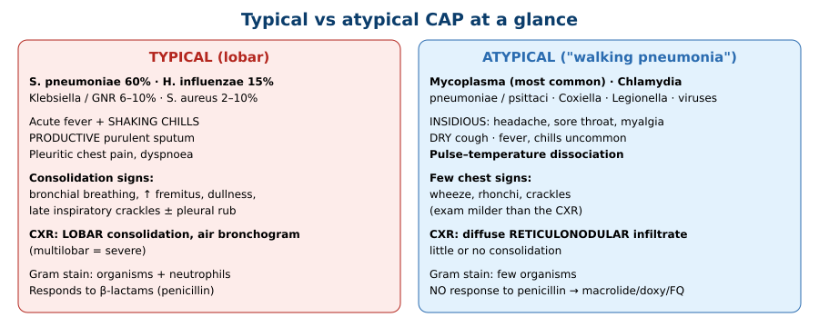
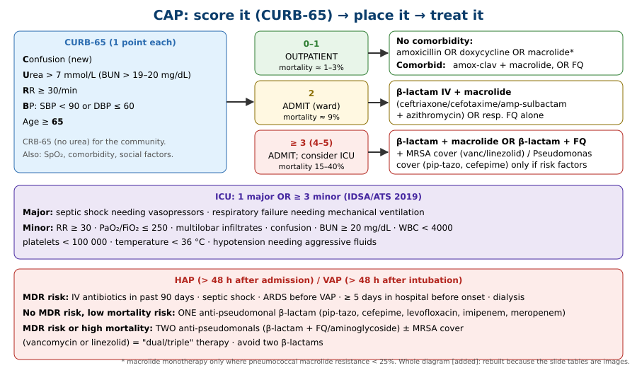

# Pneumonia: Approach to a Case of Cough
**Dr. Essam Kotb, Internal Medicine** | Source: `11-Pneumonia Updated.pdf` (Google Drive, W4)

> **⚠️ Text-only build (trial).** Made directly from Google Drive, which exposes only the slide **text**. The lecture's **images were not available**: CXR/CT pictures, the inpatient-vs-outpatient table, the CAP and HAP management tables, the classification mind-map graphic and the summary slide. Content that sat only in those images is rebuilt from standard guidance (IDSA/ATS 2019) and marked *[added]*. Upload the PDF and this note can be rebuilt with the original slides.

> **Legend:** ⭐ = high-yield · *[added]* = not in the slide text (standard source, or a reconstruction of an image-only slide).

> 🔗 **Bridge from earlier respiratory lectures (same lecturer):**
> - **COPD/asthma:** pneumonia is a trigger of exacerbations.
> - **Lung abscess / bronchiectasis / CF:** aspiration and suppurative pneumonia.
> - **Pleura:** **parapneumonic effusion → empyema** (Light's criteria; pH < 7.2 → drain).
> - **Pulmonary vascular:** PE mimics pneumonia (pleuritic pain, fever, infiltrate).
> - **Chest investigations:** consolidation signs and air bronchograms.

---

## 1. Title / Objectives

| Domain | Objective | Likely tested as |
|---|---|---|
| Knowledge | Define pneumonia; alveolar and interstitial inflammation | Definition |
| Knowledge | ⭐ Classify by **acquisition, microbe, site** | CAP vs HAP; lobar vs broncho vs interstitial |
| Knowledge | ⭐ CAP organisms: **typical vs atypical**; HAP organisms | "Fisherman with lobar consolidation → ?" |
| Knowledge | ⭐ Typical vs atypical: onset, symptoms, Gram stain, imaging, **penicillin response** | Pulse–temperature dissociation |
| Knowledge | Risk factors for pneumonia and aspiration | |
| Knowledge | Complications; prevention (pneumococcal and influenza vaccine, smoking cessation) | Vaccinate before discharge |
| Skill | Interpret findings; read CXR/CT (**lobar consolidation, air bronchogram, reticulonodular infiltrates**) | Image MCQ |
| Skill | ⭐ **CURB-65** → outpatient / ward / ICU | Lecture case 2 |
| Skill | ⭐ Empiric regimen by risk and severity; **MDR risk → dual/triple IV therapy** for HAP | Regimen MCQ |

**Main subtopics:** CAP · HAP · atypical pneumonia · aspiration pneumonia (definition, types, pathogenesis, presentation, diagnosis, management).

---

## 2. Main Content (Lecture Order)

### 2.1 Definition & Transmission
**Pneumonia** = respiratory infection with **inflammation of the alveolar space and/or the interstitial tissue** of the lungs.
- Most commonly from **aspiration of airborne pathogens** (mainly **bacteria**; also viruses and fungi).
- Can also result from **aspiration of stomach contents**.

### 2.2 Classification ⭐

| Basis | Types |
|---|---|
| **Acquisition** | **CAP** vs **HAP** (± healthcare-associated; pneumonia in the **immunocompromised host**) |
| **Microbe** | Bacterial vs viral vs fungal |
| **Site** | **Lobar** vs **bronchopneumonia** vs **interstitial (atypical)** |
| **Aetiology** (mind-map) | **Primary** vs **secondary** vs **suppurative** |
| **Special** | **Aspiration** |

*[added] **Lobar** = a whole lobe, uniform (classically pneumococcus). **Bronchopneumonia** = patchy, centred on bronchioles, often bilateral and basal (S. aureus, H. influenzae, Gram-negatives, elderly/bedbound). **Interstitial** = alveolar walls/septa (viruses, Mycoplasma).*

### 2.3 Typical CAP: Organisms ⭐
- ⭐ ***Streptococcus pneumoniae*: 60%** (the commonest cause of CAP)
- ***Haemophilus influenzae*: 15%**
- **Aerobic Gram-negative rods: 6–10%**: *Klebsiella* and other Enterobacteriaceae
- ***Staphylococcus aureus*: 2–10%**

### 2.4 Risk Factors
- **Old age, immobility**
- **Chronic disease:**
    - pre-existing **cardiopulmonary** disease (asthma, **COPD**, **HF**)
    - **airway abnormalities** (bronchiectasis, space-occupying lesions, **CF**)
- **Immunosuppression**: **HIV**, **diabetes**, immunosuppressive drugs
- ⭐ **Impaired airway protection** (aspiration risk): **altered consciousness** from stroke, seizure, anaesthesia, drugs, **alcohol**
- **Environment**: **crowding**; **contaminated water systems** (hotels, cruise ships → *Legionella*)
- **Surgery**

### 2.5 Typical CAP: Clinical Picture ⭐
- **Symptoms:**
    - **acute** fever with **shaking chills (rigors)**
    - **productive cough** with thick **purulent** sputum (*[added]* "rusty" in pneumococcus; "currant jelly" in *Klebsiella*)
    - **pleuritic chest pain**
    - dyspnoea
- **Signs:**
    - tachycardia, tachypnoea
    - ⭐ **consolidation signs**: **late inspiratory crackles, bronchial breath sounds, ↑ tactile and vocal fremitus, dullness to percussion**
    - **pleural friction rub** (pleurisy)
- **CXR:** ⭐ **lobar consolidation**. **Multilobar consolidation = very serious illness**.

> *Slides "Lobar PNA" ×2: CXR images not available.* **[image missing]**

### 2.6 Atypical CAP: "Walking Pneumonia" ⭐
- **Organisms:**
    - ⭐ ***Mycoplasma pneumoniae* (most common)**
    - *Chlamydia (Chlamydophila) pneumoniae*
    - ***Chlamydia psittaci*** (*[added]* birds)
    - ***Coxiella burnetii*** (Q fever; *[added]* farm animals)
    - ***Legionella*** spp.
    - **viruses**: influenza A/B, adenovirus, parainfluenza, RSV
- **Symptoms:**
    - **insidious** onset: headache, sore throat, fatigue, myalgia
    - ⭐ **dry cough** (no sputum)
    - fever, but **chills are uncommon**
- **Signs:**
    - ⭐ **pulse–temperature dissociation**: a **normal pulse despite high fever** suggests atypical CAP
    - wheeze, rhonchi, crackles
- **CXR:** ⭐ **diffuse reticulonodular infiltrates**; **absent or minimal consolidation**.

> *Two "Atypical CAP" image slides not available.* **[image missing]**

*[added] Organism clues:*

| Clue | Think |
|---|---|
| Young adult, dormitory, **cold agglutinins**, bullous myringitis, erythema multiforme | *Mycoplasma* |
| **Hyponatraemia, diarrhoea, confusion, ↑ LFTs**, hotel/cruise/air-conditioning | *Legionella* (**urinary antigen**) |
| **Birds** (parrots) | *C. psittaci* |
| **Farm animals**, parturient sheep/goats | *Coxiella* (Q fever) |
| Alcoholic, **currant-jelly sputum**, upper-lobe bulging fissure | *Klebsiella* |
| **After influenza**, cavitation, pneumatoceles | *S. aureus* |
| COPD smoker | *H. influenzae*, *Moraxella* |
| Aspiration, foul sputum, right lower lobe | Anaerobes (*Fusobacterium*, *Bacteroides*) |

### 2.7 Diagnostics ⭐
- **CXR (PA + lateral)**: first-line imaging
- **CBC**; **↑ CRP, ↑ ESR**; ⭐ **↑ serum procalcitonin** (bacterial)
- **Chest CT** (without contrast)
- **Sputum Gram stain and culture**; **blood cultures**
- **Influenza (flu swab) and COVID-19 testing**
- **↓ SpO₂** (pulse oximetry)
- ⭐ **Urinary antigen for *Legionella*** (when suspected) (*[added]* also pneumococcal urinary antigen)

> *Slides "CT Chest" and "Air Bronchogram": images not available.* **[image missing]**

*[added] **Air bronchogram** = air-filled bronchi visible against opacified (fluid-filled) alveoli. It is the hallmark of **alveolar consolidation** and helps distinguish it from effusion or collapse.*

### 2.8 Management: Where to Treat ⭐
The slide text says: **"Hospitalisation is indicated" / "Consider ICU admission"**. The scoring table itself was an **image** and was not available. Rebuilt with **CURB-65** (named in the objectives) and the IDSA/ATS ICU criteria *[added]*:

| CURB-65 *[added detail]* | Disposition |
|---|---|
| **0–1** | **Outpatient** |
| **2** | **Admit** (short stay or ward) |
| **≥ 3** | **Admit; consider ICU** (especially 4–5) |

### 2.9 Empiric Management ⭐
**General (slide text):**
- **Empiric antibiotics by severity and risk factors** (e.g., VAP vs CAP)
- **Antivirals** for influenza and COVID-19 as indicated
- **Identify and manage sepsis**; **fluid resuscitation** for septic shock
- **Respiratory support** as needed; **supplemental O₂** for hypoxia

**Outpatient options visible in the text:** **"Amoxicillin"** OR **"combination (amoxicillin + macrolide)"**. The rest of the CAP table was an image and is rebuilt below.

| Setting | Regimen *[added: IDSA/ATS 2019, except the amoxicillin lines]* |
|---|---|
| **Outpatient, healthy** | ⭐ **Amoxicillin** (slide) or doxycycline; macrolide only if local resistance < 25% |
| **Outpatient, comorbid** (COPD, DM, HF, CKD, alcohol, malignancy) | **Amoxicillin-clavulanate (or cephalosporin) + macrolide** (slide: "amoxicillin + macrolide"), OR **respiratory FQ** (levofloxacin, moxifloxacin) |
| **Inpatient, non-severe** | ⭐ **IV β-lactam (ceftriaxone / cefotaxime / ampicillin-sulbactam) + macrolide (azithromycin)**, OR respiratory FQ alone |
| **Severe / ICU** | **β-lactam + macrolide** or **β-lactam + FQ**; add **MRSA** (vancomycin/linezolid) or **Pseudomonas** (pip-tazo, cefepime, meropenem) cover only with risk factors |

### 2.10 Prevention
- ⭐ **Pneumococcal vaccine: give to ALL patients with CAP before discharge** unless already vaccinated.
- **Influenza vaccine.**
- **Smoking cessation.**

### 2.11 Hospital-Acquired Pneumonia ⭐
- **HAP:** onset **> 48 h after admission**, with **no evidence of the disease at admission**.
- *[added]* **VAP:** > 48 h after endotracheal intubation.
- The HAP management table was an image. Rebuilt from the objective "*assess MDR risk factors to select IV dual/triple empiric regimens*":

| | Regimen *[added]* |
|---|---|
| **MDR risk factors** | IV antibiotics in the **past 90 days**, **septic shock**, ARDS before VAP, **≥ 5 days in hospital** before onset, dialysis |
| **No MDR risk, low mortality** | **One** anti-pseudomonal agent: **pip-tazo, cefepime, levofloxacin, imipenem or meropenem** |
| **MDR risk / high mortality** | ⭐ **Two anti-pseudomonal agents from different classes** (β-lactam + FQ or aminoglycoside) **± MRSA cover (vancomycin or linezolid)** = "dual/triple" |

*[added] HAP organisms: **Pseudomonas**, **MRSA**, Klebsiella, E. coli, Enterobacter, Acinetobacter.*

### 2.12 Aspiration Pneumonia *(listed as a subtopic; no detail in the slide text)*
*[added]:*
- **Risk:** reduced consciousness (stroke, seizure, alcohol, sedation, anaesthesia), dysphagia, poor dentition.
- **Site:** **right lower lobe** when upright (superior segment of the lower lobe / posterior upper lobe when supine).
- **Aspiration pneumonitis** (chemical, Mendelson) vs **aspiration pneumonia** (anaerobes + oral flora).
- **Treatment:** ampicillin-sulbactam or clindamycin; risk of **lung abscess / empyema**.

### 2.13 Complications
- **Parapneumonic pleuritis**
- **Parapneumonic effusion** → ⭐ **empyema**
- **Lung abscess**
- **ARDS** → **respiratory failure**
- **Sepsis**

> *Summary slide: image, not available.* **[image missing]**

---

## 3. High-Yield Comparison Tables

### Table A: Typical vs Atypical CAP
| | **Typical** | **Atypical** |
|---|---|---|
| Organisms | **S. pneumoniae 60%**, H. influenzae 15%, GNR 6–10%, S. aureus 2–10% | **Mycoplasma (commonest)**, Chlamydia, Coxiella, Legionella, viruses |
| Onset | **Acute** | **Insidious** |
| Fever / chills | High fever + **shaking chills** | Fever, **chills uncommon** |
| Cough | **Productive, purulent** | **Dry** |
| Pulse | Tachycardia | **Pulse–temperature dissociation** |
| Exam | **Consolidation signs** | Wheeze, rhonchi, crackles (mild) |
| CXR | **Lobar consolidation** | **Diffuse reticulonodular**, minimal consolidation |
| Gram stain | Organisms + PMNs *[added]* | Few organisms *[added]* |
| Penicillin | **Responds** | **No response** (no cell wall / intracellular) *[added]* |

### Table B: CAP vs HAP
| | CAP | HAP / VAP |
|---|---|---|
| Definition | Acquired in the community | **> 48 h after admission** (VAP: > 48 h after intubation) |
| Organisms | Pneumococcus, H. influenzae, atypicals | **Pseudomonas, MRSA**, GNR, Acinetobacter *[added]* |
| Empiric | Amoxicillin ± macrolide → β-lactam + macrolide | **Anti-pseudomonal**: 1 agent, or **2 + MRSA cover** if MDR risk *[added]* |

### Table C: Consolidation vs Effusion on Exam *[added; links to Pleura lecture]*
| Sign | Consolidation | Effusion |
|---|---|---|
| Percussion | **Dull** | **Stony dull** |
| Fremitus | **↑** | **↓** |
| Breath sounds | **Bronchial** | **↓ / absent** |
| Crackles | Present | Absent |

---

## 4. Rules, Exceptions, Patterns

| Rule | Exception / nuance |
|---|---|
| Pneumonia → bacteria | Viruses (influenza, COVID-19) are common: test and give antivirals |
| Fever → tachycardia | **Pulse–temperature dissociation** in atypicals (*[added]* Legionella, Mycoplasma) |
| Penicillin for CAP | **Atypicals don't respond**: add a macrolide/doxycycline or use an FQ |
| Big CXR = sick patient | Atypicals: **CXR often looks worse than the exam** *[added]* |
| One lobe = typical | **Multilobar = severe** |
| Vaccinate later | ⭐ **Pneumococcal vaccine before discharge** |
| HAP = any hospital pneumonia | Only if onset is **> 48 h after admission** and absent at admission |
| Single agent for HAP | **MDR risk → dual anti-pseudomonal ± MRSA** |

---

## 5. Clinical Correlations
- **Elderly diabetic smoker with rigors, rusty sputum and right upper lobe consolidation** → pneumococcal CAP → CURB-65 → ceftriaxone + azithromycin if admitted.
- **Student with weeks of dry cough, headache, sore throat, normal pulse, patchy bilateral infiltrates** → *Mycoplasma* → macrolide or doxycycline.
- **Hotel guest with pneumonia, diarrhoea, confusion, Na 128** → *Legionella* → **urinary antigen**; FQ or azithromycin.
- **Post-stroke patient with right lower lobe pneumonia and foul sputum** → aspiration → amp-sulbactam.
- **Day 6 of admission, new fever and infiltrate after IV antibiotics** → **HAP with MDR risk** → pip-tazo + FQ ± vancomycin.
- **Persisting fever on antibiotics with an enlarging effusion** → tap for **empyema** (pH < 7.2 → drain) *[Pleura lecture link]*.

---

## 6. Rapid Revision (Last-Day)
1. Pneumonia = alveolar and/or interstitial inflammation, mostly from aspirated airborne pathogens.
2. Classify by **acquisition** (CAP/HAP), **microbe**, **site** (lobar/broncho/interstitial), **aspiration**.
3. Typical CAP: **S. pneumoniae 60%**, H. influenzae 15%, GNR 6–10%, S. aureus 2–10%.
4. Risks: age, immobility, COPD/asthma/HF, bronchiectasis/CF, HIV/DM/immunosuppression, **↓ consciousness** (aspiration), crowding, **contaminated water**, surgery.
5. Typical: acute fever, **rigors**, purulent sputum, pleuritic pain; **dull, ↑ fremitus, bronchial breathing, crackles**; **lobar consolidation** (multilobar = severe).
6. Atypical: **Mycoplasma** commonest; insidious, **dry cough**, few chills, **pulse–temperature dissociation**; **reticulonodular** CXR.
7. Tests: CXR, CBC, CRP/ESR, **procalcitonin**, sputum and blood cultures, flu/COVID swab, SpO₂, **Legionella urinary antigen**, CT.
8. **CURB-65**: Confusion, Urea > 7, RR ≥ 30, BP < 90/≤ 60, age ≥ 65 → **0–1 home, 2 admit, ≥ 3 ICU consideration** *[added detail]*.
9. Outpatient: **amoxicillin**, or **amoxicillin + macrolide** if comorbid (slide). Inpatient: **β-lactam + macrolide** or resp. FQ *[added]*.
10. Also: antivirals as indicated, sepsis care, fluids, O₂, respiratory support.
11. **Pneumococcal vaccine before discharge**; influenza vaccine; stop smoking.
12. **HAP > 48 h** after admission. **MDR risk → dual anti-pseudomonal ± MRSA** *[added detail]*.
13. Complications: pleuritis, **parapneumonic effusion/empyema**, abscess, **ARDS**, respiratory failure, **sepsis**.

---

## 7. Exam-Style Questions

**Q1 (lecture case 1).** A 53-year-old commercial fisherman has had fever, chills, malaise and **yellow-green productive cough for 1 day**. T 38.5, HR 96, RR 26, BP 98/62. **↑ fremitus and bronchial breath sounds**; CXR shows **right upper lobe consolidation**. He takes metoprolol and warfarin. Most likely pathogen?
a. M. tuberculosis · b. Pseudomonas · c. Fusobacterium · d. Mycoplasma · e. Legionella · f. S. aureus · g. S. pyogenes · h. H. influenzae · i. Histoplasma · **j. S. pneumoniae**

> **Answer: j. S. pneumoniae.** *[reasoning added; key not in slide text]*
> - **Acute onset (1 day)**, rigors, purulent sputum and **lobar consolidation** = typical CAP. Pneumococcus is the commonest cause (60%).
> - The occupation is a distractor (Blastomyces/Histoplasma suggest a subacute course).
> - The **metoprolol** explains the relatively low pulse.
> - **Legionella** would bring GI symptoms, hyponatraemia and an exposure history.
> - **Mycoplasma** is insidious with a dry cough.
> - **TB** is chronic.

**Q2 (lecture case 2).** A 67-year-old woman (HTN, DM, ex-smoker) has 2 days of fever, chest pain and purulent cough. T 39, HR 110, **RR 33**, **BP 143/88**, SpO₂ 94%, crackles over the right upper zone, WBC 12 300, **BUN 15 mg/dL**, alert. Next step?
a. Outpatient moxifloxacin · b. Inpatient cefepime + azithromycin + gentamicin · c. ICU, ceftriaxone + azithromycin · d. Outpatient azithromycin + amox-clav · **e. Inpatient azithromycin + cefotaxime** · f. ICU, amp-sulbactam + levofloxacin · g. Outpatient azithromycin · h. Inpatient ceftriaxone alone · i. ICU, aztreonam + levofloxacin

> **Answer: e.** *[reasoning added]*
> - **CURB-65 = 2**: age ≥ 65 (1) + RR ≥ 30 (1). She is not confused, BUN 15 is < 20, and BP is normal. Score 2 → **admit to the ward**.
> - Only **one** IDSA minor criterion (RR ≥ 30) and no major criterion → **no ICU**.
> - Non-severe inpatient CAP → **β-lactam (cefotaxime/ceftriaxone) + macrolide (azithromycin)**.
> - b is an MDR/HAP-type regimen.
> - h (ceftriaxone alone) misses atypical cover.

**Q3.** A patient has a high fever but a pulse of 78, a dry cough for 10 days, headache and diffuse reticulonodular infiltrates. What is the best empiric agent?
A. Amoxicillin · B. **Azithromycin (or doxycycline)** · C. Ceftriaxone · D. Vancomycin · E. Metronidazole

> **Answer: B.**
> - Atypical CAP (**pulse–temperature dissociation**). β-lactams don't cover atypicals.

**Q4.** Seven days into a hospital stay, after IV ceftriaxone for cellulitis, a patient develops fever, purulent sputum and a new infiltrate. What is the empiric therapy?
A. Amoxicillin · B. Ceftriaxone + azithromycin · C. **Piperacillin-tazobactam + levofloxacin + vancomycin** · D. Oral doxycycline · E. Clindamycin alone

> **Answer: C.**
> - **HAP with MDR risk** (IV antibiotics in the past 90 days, ≥ 5 days in hospital) → **dual anti-pseudomonal + MRSA cover** *[added: IDSA 2016]*.

**Q5.** Which finding indicates **severe** pneumonia on CXR?
A. Air bronchogram · B. Reticulonodular pattern · C. **Multilobar consolidation** · D. Blunted costophrenic angle · E. Hyperinflation

> **Answer: C** (slide: "multilobar consolidation indicates very serious illness").

---

## 8. Exam Pitfalls & Traps
- **Pneumococcus is still the commonest cause of CAP**, typical and overall. Mycoplasma is only the commonest **atypical** cause.
- **Pulse–temperature dissociation** points to atypicals. Watch for β-blockers (as in case 1) faking it.
- **Ceftriaxone alone** for admitted CAP misses atypicals; add azithromycin (or use an FQ).
- **HAP timing:** onset **> 48 h** after admission **and** absent at admission.
- **Pneumococcal vaccine before discharge** is a slide-specific management point.
- **Legionella:** diagnose with a **urinary antigen**. It doesn't Gram stain well.
- **This trial note is incomplete by design:** the CURB-65 thresholds, outpatient/inpatient/ICU table, CAP/HAP regimen tables and every X-ray were slide images. What appears here is the standard guideline content (*[added]*), **not** necessarily the lecturer's exact table. Check against the original slides before the exam.
