# Pneumonia: Approach to a Case of Cough
**Dr. Essam Kotb, Internal Medicine** | Source: `11-Pneumonia Updated.pdf` (34 slides)

> **Legend:** ⭐ = high-yield · *[added]* = not on slides. Images marked "Slide N" come from the lecture; "Added diagram" = drawn for these notes.

> 🔗 **Bridge from earlier respiratory lectures (same lecturer):**
> - **COPD/asthma:** pneumonia is the classic trigger of exacerbations.
> - **Lung abscess / bronchiectasis / CF:** aspiration and suppurative pneumonia.
> - **Pleura:** **parapneumonic effusion → empyema** (Light's criteria; pH < 7.2 → drain).
> - **Pulmonary vascular:** PE mimics pneumonia (pleuritic pain, fever, infiltrate).
> - **Chest investigations:** consolidation signs and air bronchograms.

---

## 1. Title / Objectives

| Domain | Objective | Likely tested as |
|---|---|---|
| Knowledge | Define pneumonia; alveolar and interstitial inflammation | Definition |
| Knowledge | ⭐ Classify by **acquisition, microbe, site** | CAP vs HAP vs VAP; lobar vs broncho vs interstitial |
| Knowledge | ⭐ CAP organisms (**typical vs atypical**) and HAP organisms | "Fisherman with lobar consolidation → ?" |
| Knowledge | ⭐ Typical vs atypical: onset, symptoms, **Gram stain**, imaging, **penicillin response** | Pulse–temperature dissociation |
| Knowledge | Risk factors for pneumonia and aspiration | |
| Knowledge | Complications; prevention (pneumococcal and influenza vaccine, smoking cessation) | Vaccinate before discharge |
| Skill | Read CXR/CT: **lobar consolidation, air bronchogram, reticulonodular infiltrates** | Image MCQ |
| Skill | ⭐ **CURB-65** → outpatient / inpatient / ICU | Lecture case 2 |
| Skill | ⭐ Empiric regimen by risk and severity; **MDR risk → IV dual/triple therapy** for HAP | Regimen MCQ |
| Value | Professional conduct in training facilities | |

**Main subtopics:** CAP · HAP · atypical pneumonia · aspiration pneumonia (definition, types, pathogenesis, presentation, diagnosis, management).

---

## 2. Main Content (Lecture Order)

### 2.1 Definition & Transmission (Slide 5)
**Pneumonia** = respiratory infection with **inflammation of the alveolar space and/or the interstitial tissue** of the lungs.
- Most commonly from **aspiration of airborne pathogens** (mainly **bacteria**; also viruses and fungi).
- Can also result from **aspiration of stomach contents**.

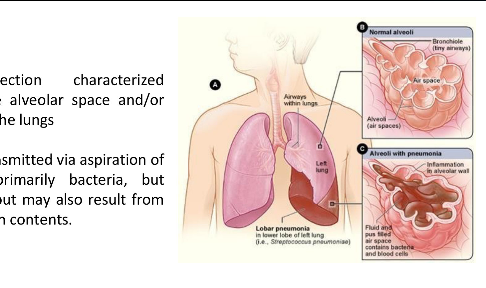

### 2.2 Classification (Slides 6, 8) ⭐

| Basis | Types |
|---|---|
| **Acquisition** | **CAP** vs **HAP** vs **VAP** (slide 6 graphic: HAP and VAP both start **> 48 h** after admission/intubation) |
| **Microbe** | Bacterial vs viral vs fungal |
| **Location** | **Bronchopneumonia** vs **lobar** vs **interstitial (atypical)** |
| **Aspiration** | Separate category |

**Slide 8 mind-map:**
- **By site:** lobar · interstitial · bronchopneumonia
- **By aetiology:** primary · secondary · suppurative
- **By mode of acquisition:** community-acquired · hospital-acquired · in the immunocompromised host · healthcare-associated

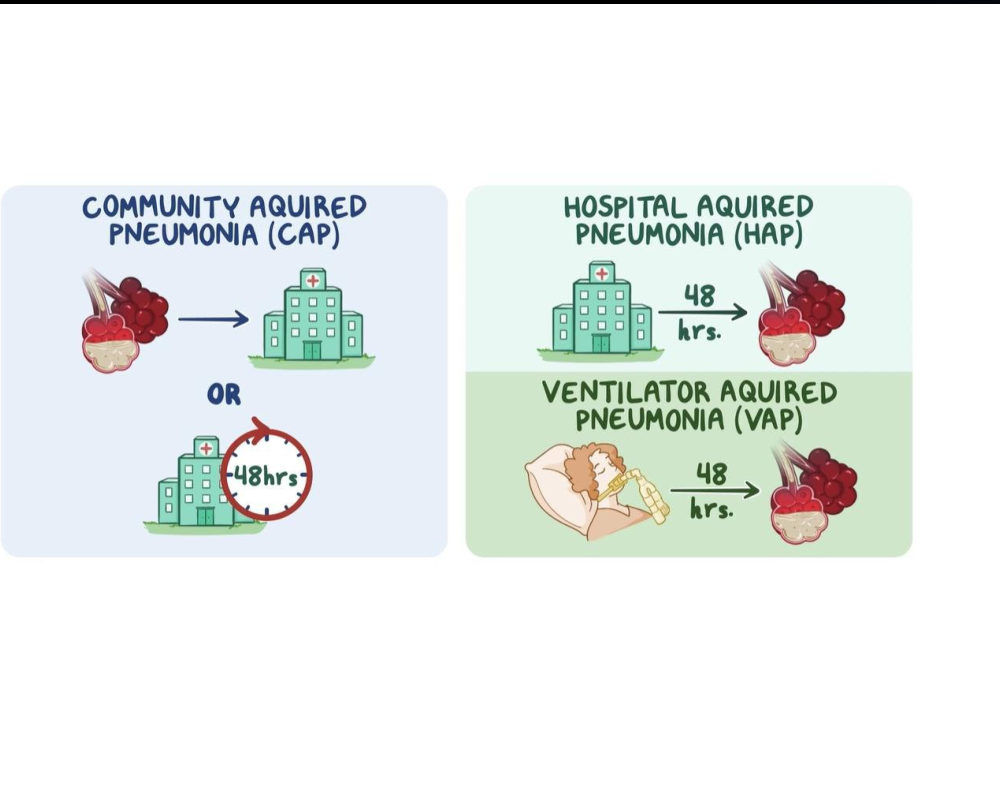 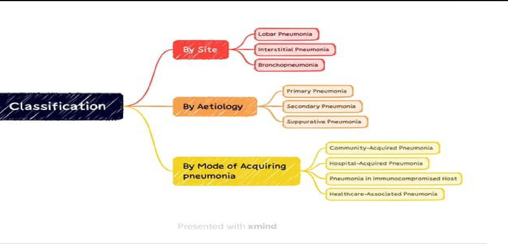

*[added] **Lobar** = a whole lobe, uniform (classically pneumococcus). **Bronchopneumonia** = patchy, centred on bronchioles, often bilateral and basal (S. aureus, H. influenzae, Gram-negatives, elderly/bedbound). **Interstitial** = alveolar walls/septa (viruses, Mycoplasma).*

### 2.3 Aetiology by Setting (Slide 7) ⭐

| **CAP**: likely pathogens | **HAP / VAP**: likely pathogens |
|---|---|
| ***Streptococcus pneumoniae*** | ⭐ ***Pseudomonas aeruginosa*** |
| ***Haemophilus influenzae*** | ⭐ **MRSA** |
| **MSSA** | ***Acinetobacter*** spp. |
| ***Mycoplasma pneumoniae*** | *S. pneumoniae* |
| ***Chlamydia pneumoniae*** | **Antibiotic-resistant Enterobacteriaceae** |
| ***Legionella*** | |
| **Respiratory viruses** (influenza, RSV) | |
| **Community-acquired MRSA** (cMRSA) | |
| **Antibiotic-susceptible Enterobacteriaceae** | |

*The slide shows **HCAP** (healthcare-associated) circled/struck out between CAP and HAP. *[added]* It was **removed** in the 2016–2019 IDSA/ATS guidelines; those patients are now managed as CAP with MDR risk assessment.*

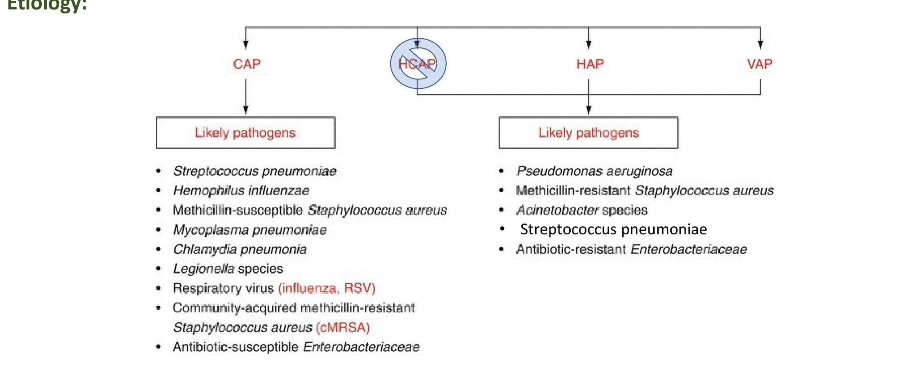

### 2.4 Community-Acquired: Typical vs Atypical (Slides 9–10) ⭐
- **Typical:** classical symptoms; ***S. pneumoniae* is the most common cause**.
- **Atypical:** may have an **insidious onset**; **pulmonary and extrapulmonary** symptoms.

**Typical CAP agents (slide 10):**
- ⭐ ***S. pneumoniae*: 60%**
- ***H. influenzae*: 15%**
- **Aerobic Gram-negative rods: 6–10%** (*Klebsiella* and other Enterobacteriaceae)
- ***S. aureus*: 2–10%**

**Slide 10 table: typical vs atypical**

| Variable | **Typical** | **Atypical** |
|---|---|---|
| Aetiology | *S. pneumoniae*, *H. influenzae* | *Mycoplasma*, *Chlamydophila pneumoniae*, *Legionella*, **TB, viral or fungal** |
| Presentation | **Sudden** fever, **chills**, **productive cough**, dyspnoea, chest pain | **Gradual** headache, **sore throat, body ache** |
| **Gram stain** | **Useful** | ⭐ **Useless (no cell wall)** |
| **Radiography** | **Lobar infiltrate** | **Dramatic changes: patchy or interstitial** |
| **Penicillin** | **Sensitive** | ⭐ **Resistant** |

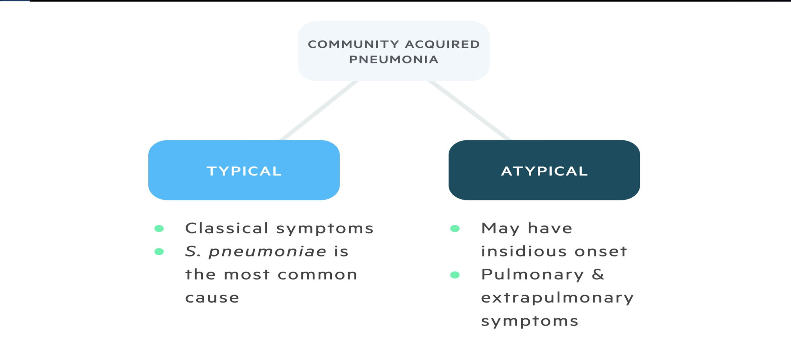 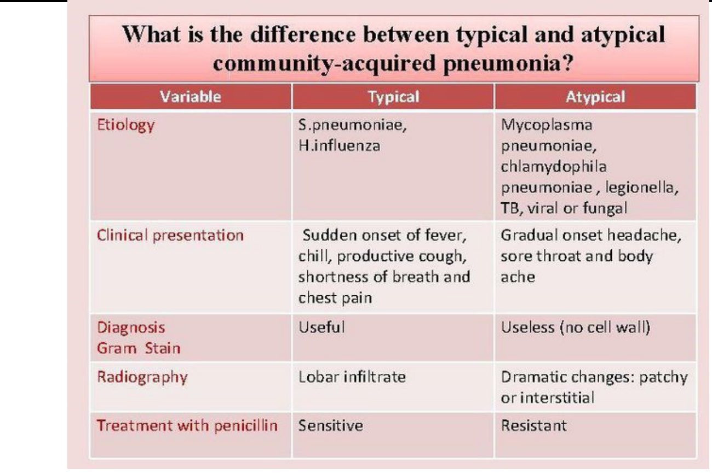

### 2.5 Risk Factors (Slide 11)
- **Old age, immobility** of any cause
- **Chronic disease:**
    - **cardiopulmonary** disease (asthma, **COPD**, **HF**)
    - **airway abnormalities** (**bronchiectasis**, space-occupying lesions, **CF**)
- **Immunosuppression**: **HIV**, **DM**, immunosuppressive therapy
- ⭐ **Impaired airway protection**: **altered consciousness** (stroke, seizure, anaesthesia, drugs, **alcohol**)
- **Environment**: crowded living; **contaminated water systems** (hotels, cruise ships → *Legionella*)
- **Surgery**

> **Mnemonic (slide 11 Osmosis graphic): "SALAMI"** = **S**moking · **A**dvanced age · **L**ung disease · **A**lcohol use · **M**alnutrition · **I**mmunocompromised.

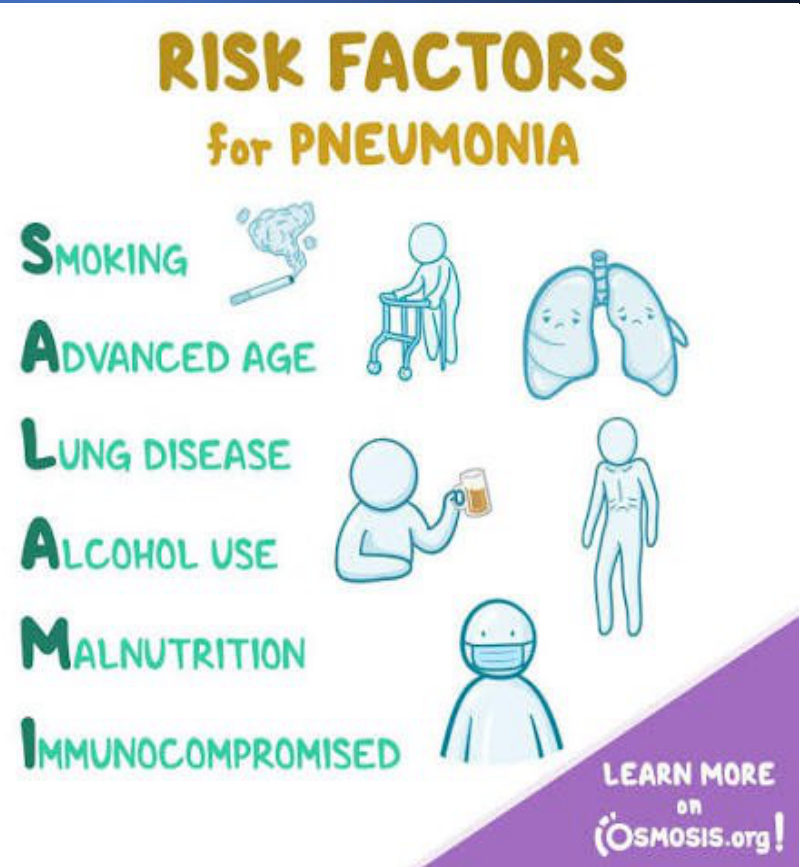

### 2.6 Typical CAP: Clinical Picture (Slides 12–14) ⭐
- **Symptoms:**
    - **acute** fever with **shaking chills (rigors)**
    - **productive cough** with thick **purulent** sputum (*[added]* rusty in pneumococcus; currant-jelly in *Klebsiella*)
    - **pleuritic chest pain**
    - dyspnoea
- **Signs:**
    - tachycardia, tachypnoea
    - ⭐ consolidation signs: **late inspiratory crackles, bronchial breath sounds, ↑ tactile and vocal fremitus, dullness**
    - **pleural friction rub** (pleurisy)
- **CXR:** ⭐ **lobar consolidation**. **Multilobar = very serious illness**.

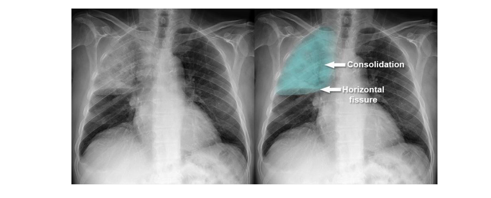

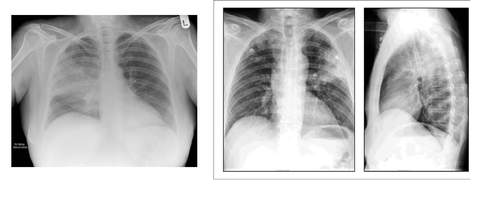

*[added] Slide 13: RUL consolidation with a sharp **inferior border along the horizontal fissure** = classic lobar pneumonia of the right upper lobe.*

### 2.7 Atypical CAP: "Walking Pneumonia" (Slides 15–18) ⭐
- **Organisms:**
    - ⭐ ***Mycoplasma pneumoniae* (most common)**
    - *Chlamydia pneumoniae*
    - ***C. psittaci***
    - ***Coxiella burnetii*** (Q fever)
    - ***Legionella***
    - **viruses**: influenza A/B, adenovirus, parainfluenza, RSV
- ⭐ **Quick hit (slide 15):** "atypical" = organisms **not visible on Gram stain** and **not culturable on standard blood agar**.
- **Symptoms:**
    - **insidious** onset: headache, sore throat, fatigue, myalgia
    - ⭐ **dry cough**
    - fever, but **chills uncommon**
- **Signs:**
    - ⭐ **pulse–temperature dissociation**: a normal pulse with high fever
    - wheeze, rhonchi, crackles
- **CXR:** ⭐ **diffuse reticulonodular infiltrates**; absent or minimal consolidation.

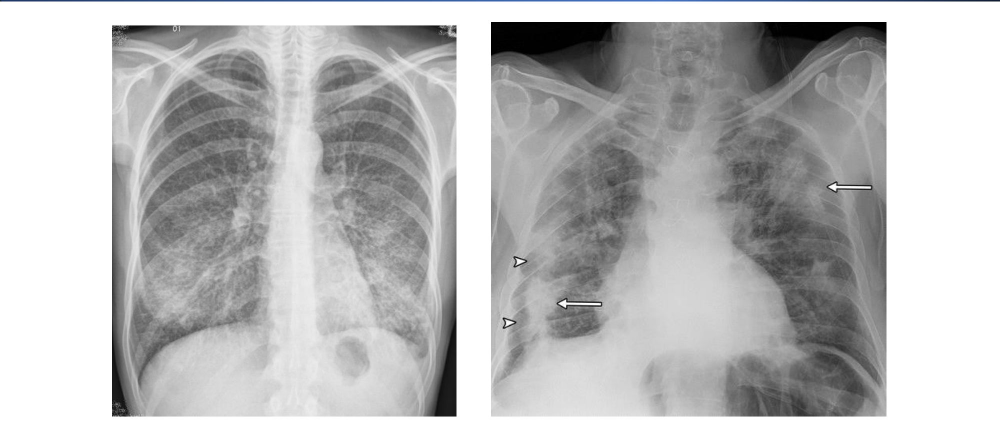

**Slide 18 (Osmosis):**
- **Mycoplasma:** **mildly ill, insidious onset**, headache, **non-productive cough**, low fever. **Bacteria without a cell wall.** Occurs where **many people are packed together** (military camps, prisons).
- ⭐ ***Legionella***: headaches, mild cough, **confusion**, **high fever**, **watery diarrhoea**. Source: **water systems**, **water-based cooling systems in hotels**.

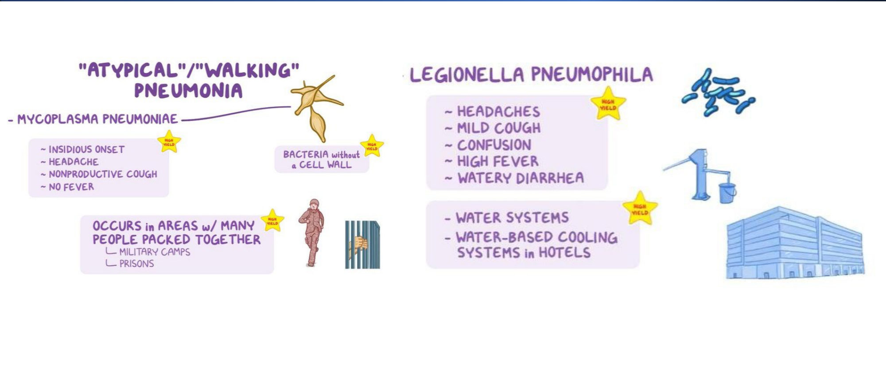

*[added] Organism clues:*

| Clue | Think |
|---|---|
| Young adult in a dormitory or barracks; **cold agglutinins**, bullous myringitis, erythema multiforme | *Mycoplasma* |
| **Hyponatraemia, diarrhoea, confusion, ↑ LFTs**; hotel, cruise, air-conditioning | *Legionella* (**urinary antigen**) |
| **Birds** | *C. psittaci* |
| **Farm animals** | *Coxiella* |
| Alcoholic; **currant-jelly sputum** | *Klebsiella* |
| **After influenza**; cavitation | *S. aureus* |
| COPD smoker | *H. influenzae*, *Moraxella* |
| Aspiration; foul sputum; right lower lobe | Anaerobes |

### 2.8 Diagnostics (Slides 19–21) ⭐
- **CXR (PA + lateral)**
- **CBC**; **↑ CRP, ↑ ESR**; ⭐ **↑ procalcitonin**
- **Chest CT** (without contrast)
- **Sputum Gram stain and culture**; **blood cultures**
- **Flu swab**; **influenza and COVID-19 testing**
- **↓ SpO₂**
- ⭐ **Urinary antigen for *Legionella*** (when suspected)

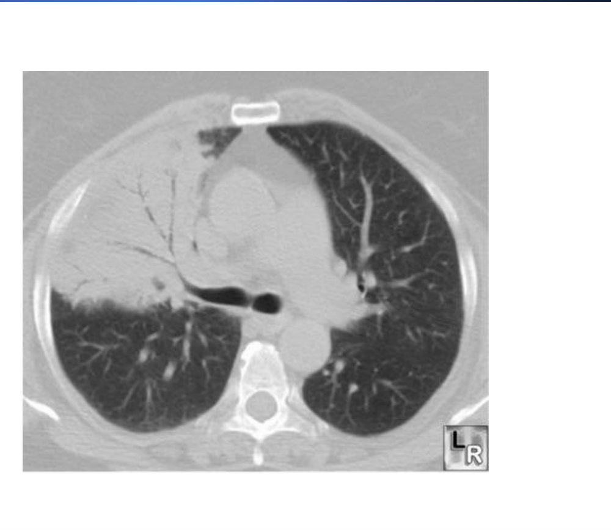 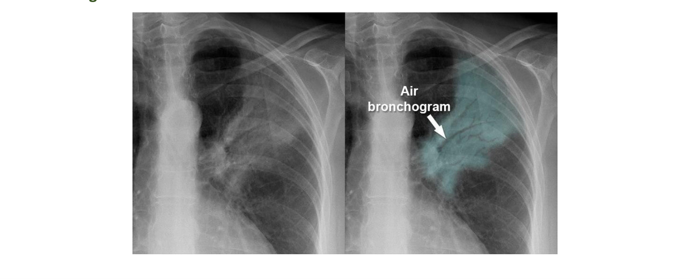

*[added] **Air bronchogram** = air-filled bronchi seen against fluid-filled alveoli. It is the hallmark of **alveolar consolidation**, not effusion or collapse.*

> 🔁 **Recap: Recognising pneumonia.**
> - **Definition:** alveolar and/or interstitial infection. Classify by acquisition (CAP/HAP/VAP; > 48 h), microbe and site.
> - **CAP organisms:** pneumococcus 60% > H. influenzae 15% > GNR > S. aureus. **HAP organisms:** Pseudomonas, MRSA, Acinetobacter, resistant Enterobacteriaceae.
> - **Typical:** acute, rigors, purulent sputum, consolidation signs, lobar CXR, Gram stain useful, penicillin-sensitive.
> - **Atypical:** Mycoplasma commonest; insidious, dry cough, pulse–temperature dissociation, reticulonodular CXR, Gram stain useless, penicillin-resistant. Legionella = confusion + diarrhoea + water systems.
> - **Tests:** CXR, inflammatory markers, procalcitonin, cultures, flu/COVID swab, Legionella urinary antigen.
> 🔗 **Link:** Once diagnosed, decide where to treat (CURB-65), then choose the drugs.
> ▶️ **Up next: Management.**

---

### 2.9 Where to Treat: CURB-65 (Slide 22) ⭐

| Symptom | Points |
|---|---|
| **C**onfusion | 1 |
| **U**rea: **BUN > 19 mg/dL (> 7 mmol/L)** | 1 |
| **R**espiratory rate **≥ 30/min** | 1 |
| **B**P: **systolic < 90 or diastolic ≤ 60 mmHg** | 1 |
| Age **≥ 65** | 1 |

| ⭐ Score | Mortality | Disposition |
|---|---|---|
| **0–1** | **1.5%** | **Outpatient care** |
| **2** | **9.2%** | **Hospitalisation is indicated** |
| **≥ 3** | **22%** | **Consider ICU admission** |

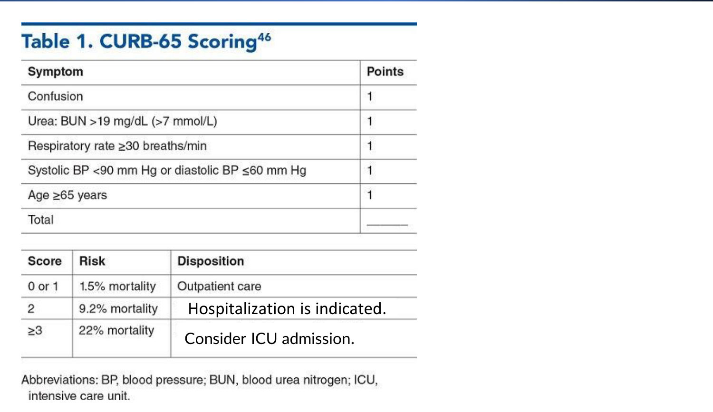

### 2.10 Empiric Management (Slide 23) ⭐
**General:**
- **Empiric antibiotics** by severity and risk factors (e.g., VAP vs CAP)
- **Antivirals** for influenza and COVID-19 as indicated
- **Identify and manage sepsis**; **fluid resuscitation** for septic shock
- **Respiratory support** if needed; **O₂** for hypoxia

| ⭐ Setting | Regimen (slide 23) |
|---|---|
| **Outpatient: previously healthy, no antibiotics in the past 3 months, mild symptoms** | **Macrolide** (azithromycin or clarithromycin) **OR doxycycline OR amoxicillin** |
| **Outpatient: comorbidities, or antibiotics in the past 3 months** | **Respiratory fluoroquinolone** (levofloxacin or moxifloxacin) **OR combination (amoxicillin + macrolide)** |
| **Inpatient** | **Respiratory FQ** (levofloxacin or moxifloxacin) **OR ceftriaxone + azithromycin** |

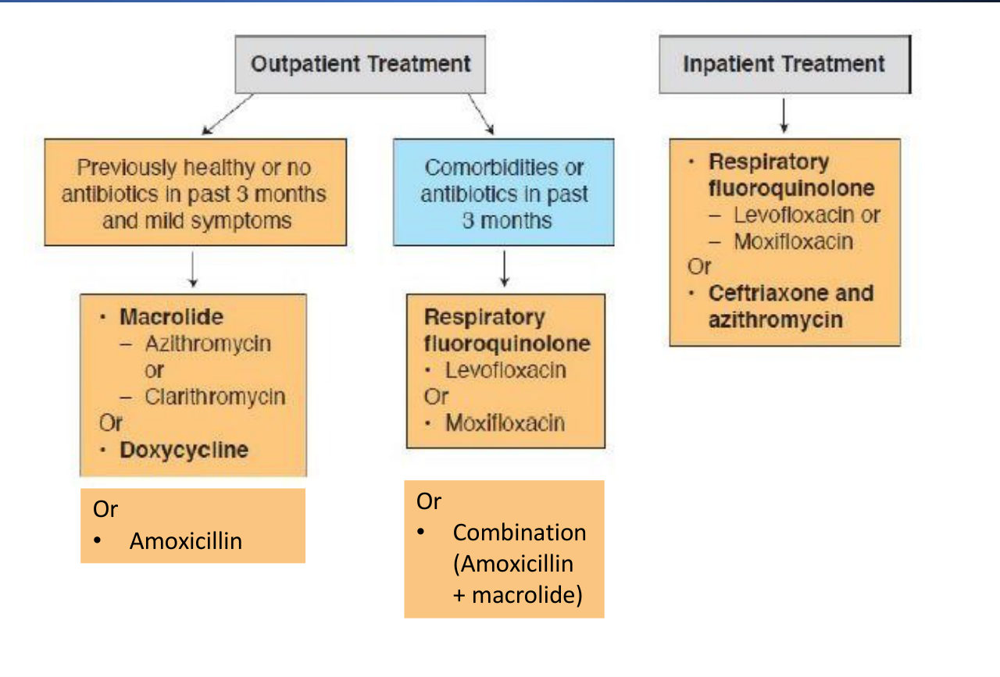

*[added] ICU/severe CAP (IDSA/ATS 2019): **β-lactam + macrolide** or **β-lactam + FQ**. Add MRSA or Pseudomonas cover only with risk factors. ICU criteria: 1 major (vasopressors, mechanical ventilation) or ≥ 3 minor (RR ≥ 30, P/F ≤ 250, multilobar, confusion, BUN ≥ 20, WBC < 4000, platelets < 100 000, T < 36 °C, hypotension needing aggressive fluids).*

### 2.11 Targeted CAP Treatment (Slide 24): Table 94.1

| Agent | **Preferred** | **Alternative** |
|---|---|---|
| ***S. pneumoniae*** | **Penicillin** | Cephalosporin, moxifloxacin, levofloxacin |
| ***H. influenzae*** | **Cefuroxime, ceftriaxone** | |
| ***Mycoplasma*** | **Macrolide** | Moxifloxacin, levofloxacin |
| ***Legionella*** | **Macrolide or quinolone** | |
| ***S. aureus*, methicillin-susceptible** | **Nafcillin** | Cephalosporin |
| ***S. aureus*, methicillin-resistant** | ⭐ **Vancomycin (IV)** | Doxycycline or TMP/SMX (oral) |
| ***Moraxella catarrhalis*** | **Amox-clav, cefuroxime, ceftriaxone, TMP/SMX** | |

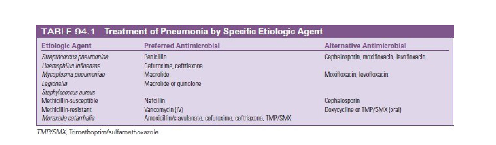

### 2.12 Prevention (Slide 25) ⭐
- ⭐ **Pneumococcal vaccine: give to ALL patients with CAP before discharge** unless already vaccinated.
- **Indications (US table):**
    - **all adults ≥ 65**
    - **adults 19–64** with:
        - **predisposing conditions**: alcohol use disorder; chronic heart, lung or liver disease; **DM**; **sickle cell / haemoglobinopathy**; **current smoking**
        - **↑ meningitis risk**: **CSF leak**, **cochlear implant**
        - **immunocompromise**: congenital or acquired immunodeficiency, generalised malignancy, **HIV**, iatrogenic immunosuppression, Hodgkin's, leukaemia, lymphoma, **myeloma**, **solid organ transplant**, **CKD / nephrotic syndrome**, ⭐ **functional or anatomic asplenia**
        - **history of invasive pneumococcal disease**
- **Influenza vaccine.**
- **Smoking cessation.**

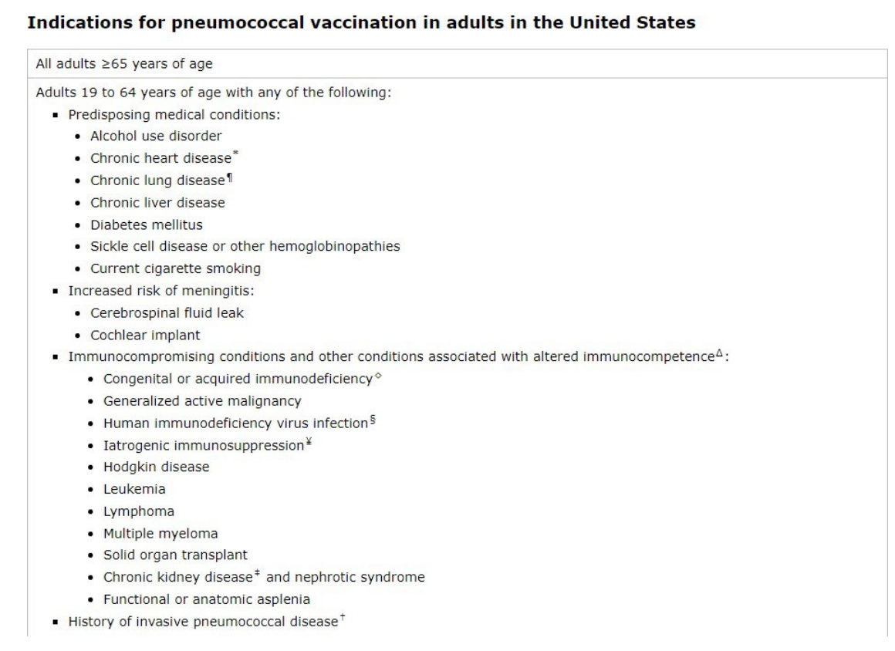

> 🔁 **Recap: CAP management.**
> - **CURB-65:** confusion, BUN > 19, RR ≥ 30, SBP < 90/DBP ≤ 60, age ≥ 65. 0–1 → home (1.5%); 2 → admit (9.2%); ≥ 3 → consider ICU (22%).
> - **Outpatient, healthy:** macrolide or doxycycline or amoxicillin. **Comorbid or recent antibiotics:** respiratory FQ or amoxicillin + macrolide. **Inpatient:** respiratory FQ or ceftriaxone + azithromycin.
> - **Targeted:** pneumococcus → penicillin; Mycoplasma → macrolide; Legionella → macrolide or FQ; MRSA → vancomycin.
> - **Prevention:** pneumococcal vaccine before discharge, flu vaccine, stop smoking.
> 🔗 **Link:** In hospital, the organisms change, and so does the empiric cover.
> ▶️ **Up next: Hospital-acquired pneumonia.**

---

### 2.13 Hospital-Acquired Pneumonia (Slides 26–27) ⭐
- **HAP:** onset **> 48 h after admission** with **no evidence of disease at admission**.
- **VAP:** **> 48 h after intubation** (slide 6).

**Step 1: assess risk factors for MDR pathogens (slide 26)**
- **IV antibiotics in the preceding 90 days**
- **Hospital stay ≥ 5 days**
- **Acute renal replacement therapy** (prior to VAP)
- **ARDS** (prior to VAP)
- **Septic shock at the time of VAP**

**Step 2: MDR risk → IV empiric DUAL therapy (slide 27)**
1. **Anti-pseudomonal β-lactam**: **piperacillin-tazobactam OR cefepime**
2. **+ Non-β-lactam**: **respiratory FQ (levofloxacin) OR aminoglycoside (gentamicin)**
3. **+ MRSA cover**: **vancomycin OR linezolid** (→ "triple")

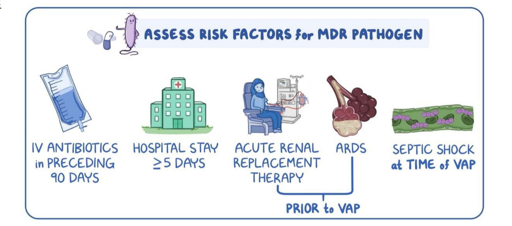 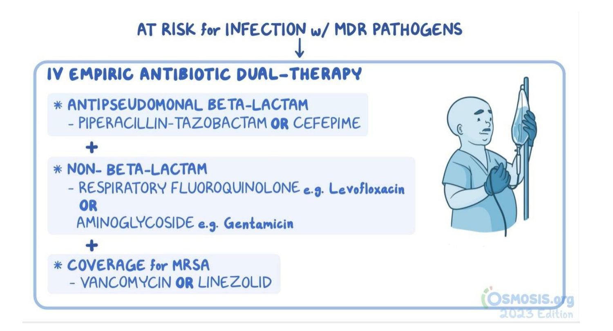

*[added] Without MDR risk (and with low mortality risk), a **single** anti-pseudomonal agent is enough (pip-tazo, cefepime, levofloxacin or a carbapenem). Never give two β-lactams together. De-escalate once cultures return.*

### 2.14 Aspiration Pneumonia *(listed as a subtopic; no dedicated slide)*
*[added]:*
- **Risk:** ↓ consciousness (stroke, seizure, alcohol, sedation), dysphagia, poor dentition.
- **Site:** **right lower lobe** when upright; posterior upper lobe / superior lower-lobe segment when supine.
- **Aspiration pneumonitis** (chemical, Mendelson) vs **aspiration pneumonia** (anaerobes and oral flora).
- **Treatment:** amp-sulbactam or clindamycin. Risk of **abscess and empyema**.

### 2.15 Complications (Slide 28)
- **Parapneumonic pleuritis**
- **Parapneumonic pleural effusion** → ⭐ **pleural empyema**
- **Lung abscess**
- **ARDS** → **respiratory failure**
- **Sepsis**

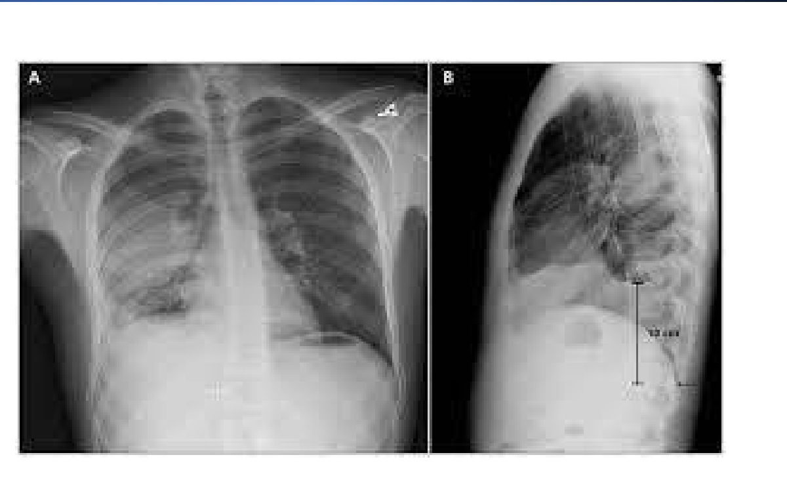

### 2.16 Lecturer's Summary (Slide 29)
- **Definition:** lung parenchymal inflammation from lower respiratory infection → **pus-filled alveoli and consolidation**.
- Causes **↓ perfusion (hypoxia)** and **restricted ventilation** from pain or effusion (**type 2 respiratory failure**).
- **Can lead to effusion, lung abscess and pericarditis.**
- **CAP:** develops outside hospital; most commonly **Strep, then viral**.
- **HAP:** > 48 h after admission. **VAP** after intubation. Guidelines are based on VAP causes, which are **completely different** from CAP.
- **Investigations:** CXR, SpO₂, ABG, sputum culture, FBC, CRP, LFT, U&E.
- **CAP diagnosis (all four):**
    1. **LRTI symptoms**: cough, sputum, pleuritic pain, dyspnoea
    2. **Systemic**: fever > 38 °C, chills, tachycardia
    3. **New chest signs**: ↓ expansion, dull percussion, crackles
    4. **No other likely cause**
- **HAP diagnosis:** LRTI symptoms **+ a new CXR opacity** without another explanation (oedema, fibrosis…).
- **Management:**
    - **O₂, fluids, analgesia**
    - IV antibiotics: **CAP → amoxicillin**; **HAP → by trust guidelines**, then adjust to cultures
    - manage complications (drain effusion or abscess)
- ⭐ **Symptoms may take 3–6 months to fully resolve.**

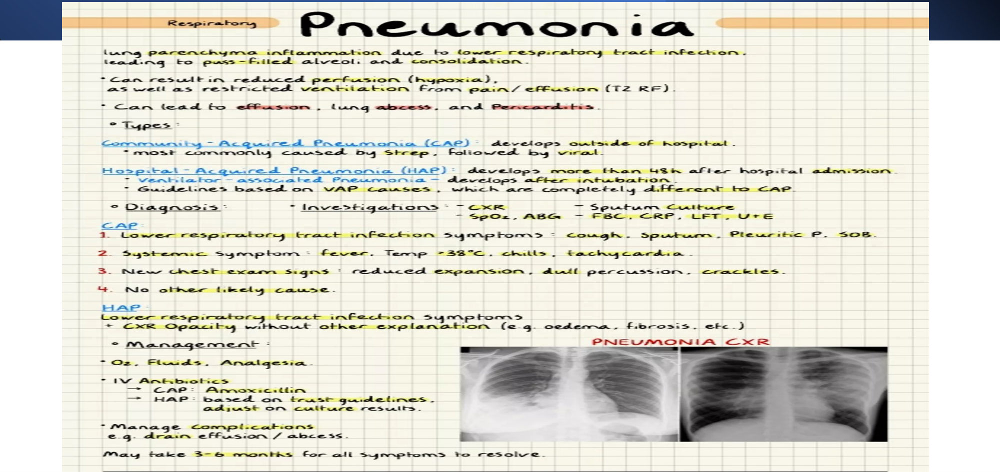

---

## 3. High-Yield Comparison Tables

### Table A: Typical vs Atypical CAP
| | **Typical** | **Atypical** |
|---|---|---|
| Organisms | **S. pneumoniae 60%**, H. influenzae 15%, GNR 6–10%, S. aureus 2–10% | **Mycoplasma (commonest)**, C. pneumoniae, C. psittaci, Coxiella, Legionella, viruses |
| Onset | **Sudden** | **Gradual / insidious** |
| Fever / chills | High fever + **shaking chills** | Fever, **chills uncommon** |
| Cough | **Productive, purulent** | **Dry** |
| Pulse | Tachycardia | **Pulse–temperature dissociation** |
| Exam | **Consolidation signs** | Wheeze, rhonchi, crackles |
| CXR | **Lobar** | **Patchy/interstitial, reticulonodular** ("dramatic changes") |
| Gram stain | **Useful** | **Useless (no cell wall / not on blood agar)** |
| Penicillin | **Sensitive** | **Resistant** |

### Table B: CAP vs HAP vs VAP
| | CAP | HAP | VAP |
|---|---|---|---|
| Timing | Community | **> 48 h after admission** | **> 48 h after intubation** |
| Organisms | Pneumococcus, H. influenzae, MSSA, atypicals, viruses, cMRSA | **Pseudomonas, MRSA, Acinetobacter**, resistant Enterobacteriaceae | Same as HAP |
| Empiric | By CURB-65 and comorbidity (table 2.10) | **MDR risk → pip-tazo/cefepime + FQ/aminoglycoside ± vanc/linezolid** | Same; MDR risk includes RRT/ARDS before VAP, septic shock at VAP |

### Table C: Empiric CAP Regimens (Slide 23)
| Patient | Drug |
|---|---|
| Healthy outpatient, no recent antibiotics | **Macrolide / doxycycline / amoxicillin** |
| Comorbid or antibiotics in past 3 months | **Resp. FQ** or **amoxicillin + macrolide** |
| Inpatient | **Resp. FQ** or **ceftriaxone + azithromycin** |

### Table D: Consolidation vs Effusion on Exam *[added]*
| Sign | Consolidation | Effusion |
|---|---|---|
| Percussion | **Dull** | **Stony dull** |
| Fremitus | **↑** | **↓** |
| Breath sounds | **Bronchial** | **↓ / absent** |
| Crackles | Present | Absent |

---

## 4. Rules, Exceptions, Patterns

| Rule | Exception / nuance |
|---|---|
| Pneumonia → bacteria | Viruses (influenza, COVID-19) are common: test and treat with antivirals |
| Fever → tachycardia | **Pulse–temperature dissociation** in atypicals; β-blockers also blunt the pulse |
| Penicillin for CAP | **Atypicals are resistant** (no cell wall): macrolide, doxycycline or FQ |
| Gram stain identifies the organism | **Useless in atypicals** |
| One lobe = typical | **Multilobar = very serious illness** |
| Vaccinate later | ⭐ **Pneumococcal vaccine before discharge** |
| HAP = any hospital pneumonia | Only if onset > 48 h after admission and absent at admission |
| Single agent for HAP | **MDR risk → dual anti-pseudomonal + MRSA cover** |
| Pneumonia resolves in days | **Symptoms may take 3–6 months** to resolve fully (slide 29) |

---

## 5. Clinical Correlations
- **Elderly diabetic with rigors, rusty sputum, RUL consolidation, CURB-65 2** → admit → **ceftriaxone + azithromycin** (or resp. FQ).
- **Student in a dormitory with dry cough, headache, sore throat, normal pulse, patchy infiltrates** → *Mycoplasma* → macrolide or doxycycline.
- **Hotel guest with high fever, confusion, watery diarrhoea, low Na** → *Legionella* → **urinary antigen**; macrolide or FQ.
- **Post-stroke patient with right lower lobe pneumonia and foul sputum** → aspiration → amp-sulbactam.
- **Day 6 in hospital after IV antibiotics, new fever and infiltrate** → **HAP with MDR risk** → **pip-tazo + levofloxacin + vancomycin**.
- **Fever persisting on antibiotics, enlarging effusion** → tap for **empyema** (pH < 7.2 → drain).
- **Asplenic or sickle cell patient** → pneumococcal vaccination indicated.

---

## 6. Rapid Revision (Last-Day)
1. Pneumonia = alveolar and/or interstitial inflammation, mostly from aspirated airborne pathogens.
2. Classify: **CAP / HAP (> 48 h) / VAP (> 48 h after intubation)**; bacterial/viral/fungal; **lobar / broncho / interstitial**; aspiration.
3. CAP: **S. pneumoniae 60%**, H. influenzae 15%, GNR 6–10%, S. aureus 2–10%. **HAP: Pseudomonas, MRSA, Acinetobacter**, resistant Enterobacteriaceae.
4. Risk factors (**SALAMI**): age/immobility, COPD/asthma/HF, bronchiectasis/CF, HIV/DM/immunosuppression, ↓ consciousness, crowding, contaminated water, surgery.
5. Typical: sudden, rigors, purulent sputum, pleuritic pain; **dull, ↑ fremitus, bronchial breathing, crackles**; **lobar** (multilobar = severe); Gram stain useful; penicillin-sensitive.
6. Atypical: **Mycoplasma** commonest; insidious, **dry cough**, chills uncommon, **pulse–temperature dissociation**, **reticulonodular**; Gram stain **useless**; penicillin-**resistant**. Legionella: confusion, high fever, **watery diarrhoea**, water systems.
7. Tests: CXR, CBC, CRP/ESR, **procalcitonin**, CT, sputum and blood cultures, flu/COVID swab, SpO₂, **Legionella urinary antigen**.
8. **CURB-65:** Confusion, **BUN > 19**, RR ≥ 30, SBP < 90 / DBP ≤ 60, age ≥ 65. **0–1 home (1.5%) · 2 admit (9.2%) · ≥ 3 consider ICU (22%)**.
9. **Outpatient healthy:** macrolide / doxycycline / amoxicillin. **Comorbid or antibiotics in past 3 months:** resp. FQ or amoxicillin + macrolide. **Inpatient:** resp. FQ or **ceftriaxone + azithromycin**.
10. Targeted: pneumococcus → **penicillin**; H. influenzae → cefuroxime/ceftriaxone; Mycoplasma → **macrolide**; Legionella → macrolide or FQ; MSSA → **nafcillin**; MRSA → **vancomycin**; Moraxella → amox-clav, cefuroxime, ceftriaxone, TMP/SMX.
11. Also: antivirals as indicated, sepsis care, fluids, O₂, respiratory support.
12. **Pneumococcal vaccine before discharge**; flu vaccine; stop smoking. Vaccinate all ≥ 65 and at-risk 19–64 (asplenia, CSF leak, cochlear implant, HIV, CKD, smokers…).
13. **HAP MDR risk:** IV antibiotics in 90 days, stay ≥ 5 days, RRT or ARDS before VAP, septic shock at VAP → **pip-tazo/cefepime + levofloxacin/gentamicin + vancomycin/linezolid**.
14. Complications: pleuritis, **parapneumonic effusion/empyema**, abscess, **ARDS**, respiratory failure, **sepsis** (and pericarditis, per the summary).
15. Recovery may take **3–6 months**.

---

## 7. Exam-Style Questions

**Q1 (lecture case 1, slide 30).** A 53-year-old commercial fisherman has had fever, chills, malaise and **yellow-green productive cough for 1 day**. T 38.5, HR 96, RR 26, BP 98/62. **↑ fremitus and bronchial breath sounds**; CXR shows **right upper lobe consolidation**. He takes metoprolol and warfarin. Most likely pathogen?
a. M. tuberculosis · b. Pseudomonas · c. Fusobacterium · d. Mycoplasma · e. Legionella · f. S. aureus · g. S. pyogenes · h. H. influenzae · i. Histoplasma · **j. S. pneumoniae**

> **Answer: j. S. pneumoniae.** *[reasoning added; key not on slides]*
> - **Acute (1 day)**, rigors, purulent sputum and **lobar consolidation** = typical CAP; pneumococcus causes 60%.
> - Metoprolol explains the modest pulse.
> - Distractors:
>     - **Legionella** would bring diarrhoea, confusion and a water exposure.
>     - **Mycoplasma** is insidious with a dry cough.
>     - **Histoplasma** and **TB** are subacute or chronic.
>     - **Pseudomonas** is a hospital/structural-lung organism.
>     - **Fusobacterium** follows aspiration.

**Q2 (lecture case 2, slide 31).** A 67-year-old woman (HTN, DM, ex-smoker) has 2 days of fever, chest pain and purulent cough. T 39, HR 110, **RR 33**, **BP 143/88**, SpO₂ 94%, crackles at the right upper zone, WBC 12 300, ESR 60, **BUN 15 mg/dL**, alert. Next step?
a. Outpatient moxifloxacin · b. Inpatient cefepime + azithromycin + gentamicin · c. ICU, ceftriaxone + azithromycin · d. Outpatient azithromycin + amox-clav · **e. Inpatient azithromycin + cefotaxime** · f. ICU, amp-sulbactam + levofloxacin · g. Outpatient azithromycin · h. Inpatient ceftriaxone alone · i. ICU, aztreonam + levofloxacin

> **Answer: e.** *[reasoning added]*
> - **CURB-65 = 2**: age ≥ 65 (1) + RR ≥ 30 (1). She is not confused, BUN 15 is not > 19, and BP is normal.
> - Score 2 → **hospitalisation** (slide 22), not ICU (that is ≥ 3).
> - Inpatient regimen (slide 23) = **3rd-generation cephalosporin + azithromycin** (cefotaxime ≈ ceftriaxone) or a respiratory FQ.
> - b is an MDR/HAP regimen. h misses atypical cover.

**Q3.** A patient has high fever, a pulse of 78, 10 days of dry cough, headache, and patchy interstitial infiltrates. Gram stain shows no organisms. Best empiric agent?
A. Amoxicillin · B. **Azithromycin** · C. Ceftriaxone · D. Vancomycin · E. Nafcillin

> **Answer: B.**
> - Atypical CAP (Mycoplasma): no cell wall, so **penicillin-resistant** and **Gram stain useless** (slide 10). Macrolide is preferred (slide 24).

**Q4.** Seven days into a hospital stay, after IV antibiotics for cellulitis, a patient develops fever, purulent sputum and a new infiltrate. Empiric therapy?
A. Amoxicillin · B. Ceftriaxone + azithromycin · C. **Piperacillin-tazobactam + levofloxacin + vancomycin** · D. Oral doxycycline · E. Clindamycin alone

> **Answer: C.**
> - **HAP with MDR risk** (IV antibiotics in 90 days, stay ≥ 5 days) → anti-pseudomonal β-lactam + non-β-lactam + MRSA cover (slides 26–27).

**Q5.** A 40-year-old healthy outpatient with CAP, CURB-65 0, who took amoxicillin 6 weeks ago. Best regimen?
A. Amoxicillin again · B. Azithromycin alone · C. **Levofloxacin (or amoxicillin + macrolide)** · D. Ceftriaxone IV · E. Vancomycin

> **Answer: C.**
> - **Antibiotics in the past 3 months** moves him to the comorbid branch: **respiratory FQ or amoxicillin + macrolide** (slide 23).

---

## 8. Exam Pitfalls & Traps
- **CURB-65 urea cut-off:** the slide uses **BUN > 19 mg/dL (> 7 mmol/L)**. In case 2, BUN 15 scores **0**.
- **Mortality figures** on slide 22: **1.5% / 9.2% / 22%**. Memorise them as written.
- **Recent antibiotics (≤ 3 months)** count like comorbidity: choose the FQ or amoxicillin + macrolide branch.
- **Inpatient ceftriaxone alone** misses atypicals. The slide pairs it with **azithromycin**.
- **Pneumococcus is the commonest cause of CAP overall.** Mycoplasma is only the commonest **atypical** cause.
- **Legionella:** confusion + diarrhoea + hyponatraemia → **urinary antigen**. Don't rely on the Gram stain.
- **HCAP is struck through** on slide 7: the category is obsolete *[added]*.
- **HAP MDR risks (slide 26):** IV antibiotics in 90 days, **≥ 5 days in hospital**, **RRT or ARDS before VAP**, **septic shock at VAP**.
- **Two different anti-pseudomonal classes** in dual therapy (β-lactam + FQ or aminoglycoside). Two β-lactams is wrong.
- **Slide 29 summary says CAP IV antibiotic = amoxicillin.** That is UK-style trust guidance and differs from slide 23 (ceftriaxone + azithromycin for inpatients). For MCQs follow **slide 23**.
- **Symptoms can persist for 3–6 months** after treatment. Don't over-investigate slow recovery.
