# Respiratory Failure & ARDS: An Approach to a Case of Cyanosis
**Dr. Essam Kotb, Internal Medicine** | Source: `14- RF & ARDS updated.pdf` (34 slides)

> **Legend:** ⭐ = high-yield · *[added]* = not on slides. Images marked "Slide N" come from the lecture; "Added diagram" = drawn for these notes. The two case answers are **reasoned by me; the key is not on the slides**.

> 🔗 **Bridge from earlier lectures:**
> - **COPD / asthma:** AECOPD and acute severe asthma are the classic **type 2** failures; the COPD **O₂ target is 88–92%**.
> - **Sleep apnoea / OHS:** OHS is **chronic type 2** failure, "often diagnosed in acute respiratory failure"; ↑ HCO₃⁻ shows chronicity.
> - **Pneumonia:** the commonest **direct** cause of ARDS and of type 1 failure.
> - **Pulmonary vascular:** PE = V/Q mismatch; Eisenmenger = intracardiac shunt.
> - **Restrictive lung disease:** IPF = diffusion defect; neuromuscular/chest-wall restriction = pump failure.
> - **Psychiatry (substances/psychotropics):** **opioid and benzodiazepine overdose → CNS depression → type 2 failure**; cocaine is a systemic cause of ARDS.
> - **Upcoming (Sepsis):** sepsis is the **most common cause of ARDS**.

---

## 1. Title / Objectives

| Domain | Objective | Likely tested as |
|---|---|---|
| Knowledge | ⭐ **Type 1 vs Type 2**; acute vs chronic | ABG classification |
| Knowledge | Mechanisms of type 1 and 2 failure; **diffuse alveolar damage** in ARDS | Shunt; hyaline membranes |
| Knowledge | **Direct and indirect** causes of ARDS | Pancreatitis, sepsis, TRALI |
| Knowledge | ⭐ Work-up; **Global Definition (2023) / Berlin criteria** | P/F thresholds |
| Knowledge | **Central vs peripheral cyanosis** | DDx |
| Skill | Analyse ABGs; **oxygenation ratios** (P/F, S/F) | Severity |
| Skill | Systematic work-up: bedside, labs, CXR, CT, **POCUS** | |
| Skill | O₂ delivery; **ABCDE** | |
| Skill | ⭐ **Lung-protective ventilation**: low tidal volume, low plateau pressure, PEEP | Lecture case 2 |
| Values | Early recognition and resuscitation; ARDSNet protocols; ethics in critical care | |

**Main subtopics:**
1. **Type 1 respiratory failure**
2. **Type 2 respiratory failure**
3. **ARDS**
4. **Cyanosis**: differential diagnosis and types

---

## 2. Main Content (Lecture Order)

### 2.1 Definitions and Classification (Slides 5–6) ⭐⭐
- **Respiratory failure:** inability of the respiratory system to maintain **adequate gas exchange** (normal O₂ and CO₂); acute or chronic.
  - ⭐ **Hypoxaemic:** **PaO₂ < 60 mmHg**
  - ⭐ **Hypercapnic:** **PaCO₂ > 45 mmHg** (normal 35–45)
- **Respiratory arrest:** complete cessation of breathing **with an intact pulse**.

| By duration | |
|---|---|
| **Acute** | Develops over **minutes to hours** (acute illness or insult) |
| **Chronic** | Long-standing, from chronic illness: **COPD, ILD, OHS** |

| By gas exchange | **Type 1 (hypoxaemic)** | **Type 2 (hypercapnic)** |
|---|---|---|
| Definition | Hypoxia + **normocapnia or hypocapnia** | **Hypercapnia** + normoxaemia or hypoxaemia |
| PaO₂ | ⭐ **↓ (< 60)** | Normal or ↓ (< 80) |
| PaCO₂ | ⭐ **Normal or ↓ (< 33)** | ⭐ **↑ (> 50)** |

⚠️ **Slide inconsistency:** slide 5 defines hypercapnic failure as **PaCO₂ > 45**, slide 6 as **> 50**. Most texts use **> 45 (or ≥ 50) mmHg with pH < 7.35** for acute type 2; know both numbers.

*[added]* **Acute vs chronic type 2:**

| | Acute | Chronic | Acute-on-chronic |
|---|---|---|---|
| pH | ↓ | Near-normal | ↓ |
| HCO₃⁻ | Normal | **↑** (renal compensation) | ↑, but pH still low |

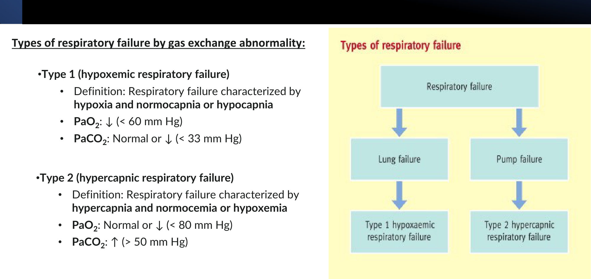

### 2.2 Pathophysiology: Lung vs Pump (Slides 7–8) ⭐
- **Type I:**
  1. pulmonary disease (asthma, pneumonia) → an under-ventilated area is still perfused → **hypoxic, CO₂-rich blood** enters the circulation
  2. ↑ ventilation of neighbouring normal lung → **↑ CO₂ excretion, correcting CO₂** to normal
  3. ⭐ but it **cannot correct O₂**, because Hb passing through normal areas is **already fully saturated** (*[added]* the sigmoid O₂–Hb curve vs the linear CO₂ curve)
- **Type II:** disease (acute severe asthma, **AECOPD**) → **severe V/Q mismatch** → not enough functioning lung to clear CO₂ → **↑ CO₂**.

| | **Lung (Type 1)** | **Respiratory pump (Type 2)** |
|---|---|---|
| Dysfunction | **Pulmonary failure** | **Ventilatory failure** |
| Blood gas | **Partial insufficiency**: PaO₂ ↓, PaCO₂ (↓) | **Global insufficiency**: PaO₂ ↓, PaCO₂ ↑ |
| Treatment | ⭐ **Oxygen therapy** | ⭐ **Mechanical ventilation** (*[added]* NIV first if appropriate) |

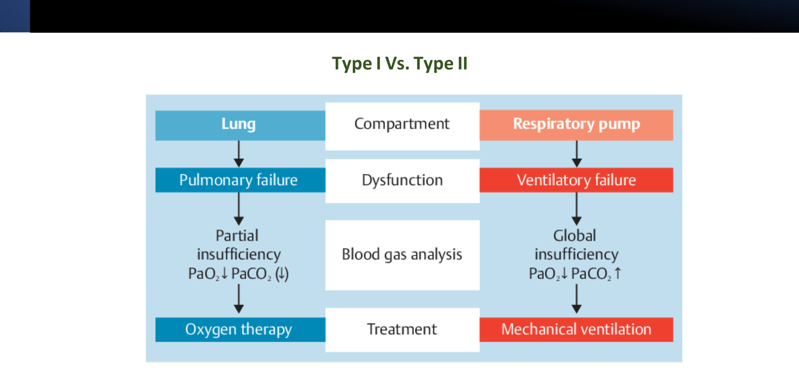

### 2.3 Aetiology (Slides 9–10) ⭐⭐
| **Causes of hypoxaemia (Type I)** | **Causes of hypercapnia (Type II)** |
|---|---|
| **Impaired alveolar diffusion**: oedema, pneumonia, **IPF** | **Airway obstruction / ↑ dead space**: **AECOPD, asthma**, drowning, OSA |
| ⭐ **Right-to-left shunt**: **pulmonary** (**ARDS**, tension pneumothorax) or **intracardiac** (**Eisenmenger**) | ⭐ **CNS depression**: **opioid** intoxication, **benzodiazepines** |
| ⭐ **V/Q mismatch**: pneumonia, **embolism** | **↓ Chest-wall compliance**: rib fracture (*[added]* flail chest), ankylosing spondylitis, (slide also lists sleep apnoea) |
| **↓ FiO₂** (asphyxia, *[added]* altitude) | ⭐ **Respiratory muscle weakness**: **myasthenia gravis, Guillain–Barré**, myopathies, **ALS**, **high cervical cord injury**, poliomyelitis |
| **Hypoventilation** | **Electrolyte disturbances** (*[added]* ↓ K, ↓ PO₄, ↓ Mg) |

*[added]* **Hypoventilation** causes hypoxaemia, but it is the hallmark of **type 2** (with a **normal A–a gradient**). See the added diagram.

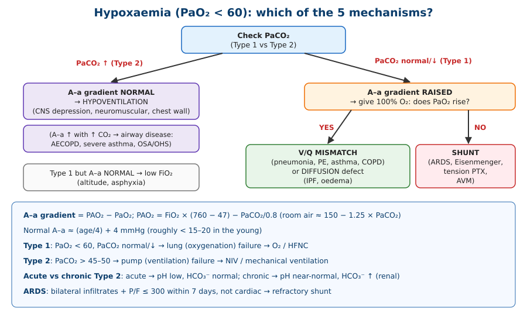

| Mechanism *[added]* | A–a gradient | Response to 100% O₂ | Example |
|---|---|---|---|
| ↓ FiO₂ | Normal | Corrects | Altitude |
| Hypoventilation | **Normal** | Corrects | Opioid overdose, neuromuscular disease |
| Diffusion defect | ↑ | Corrects | IPF |
| **V/Q mismatch** (commonest) | ↑ | **Corrects** | Pneumonia, PE, COPD |
| ⭐ **Shunt** | ↑ | ⭐ **Does NOT correct** | **ARDS**, Eisenmenger, AVM |

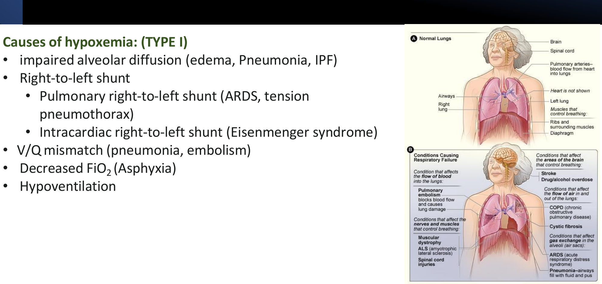 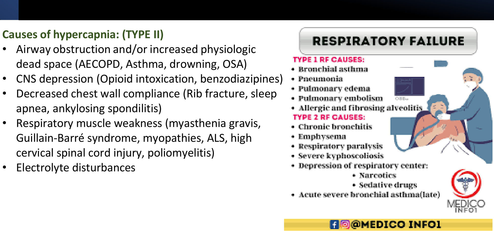

### 2.4 Clinical Features (Slides 11–13) ⭐
| **Hypoxaemia** | **Hypercapnia** |
|---|---|
| **Tachypnoea, dyspnoea** | **Hypopnoea** |
| ⭐ **Cyanosis** | ⭐ **Headache**, daytime sleepiness |
| Pleuritic chest pain | Anxiety |
| **Tachycardia, arrhythmia** | ⭐ **Warm extremities** (vasodilatation; *[added]* bounding pulse) |
| **Altered mental status**: confusion, somnolence, agitation | ⭐ **Papilloedema** |
| — | ⭐ **Asterixis (flapping tremor)** |
| — | ⭐ **Coma** (*[added]* CO₂ narcosis) |
| — | **Paralytic ileus** |

**Signs of respiratory distress (slide 13):**
- ⭐ **inability to speak in full sentences**
- ↑ work of breathing: **nasal flaring, grunting, pursed lips**
- **accessory muscle use**
- tachypnoea/hyperventilation, tachycardia, cyanosis
- ⭐ **impaired mental state** (fatigue, hypercapnia, or a CNS cause)

*[added]* A **falling respiratory rate or drowsiness in a tiring patient = impending arrest**, not improvement.

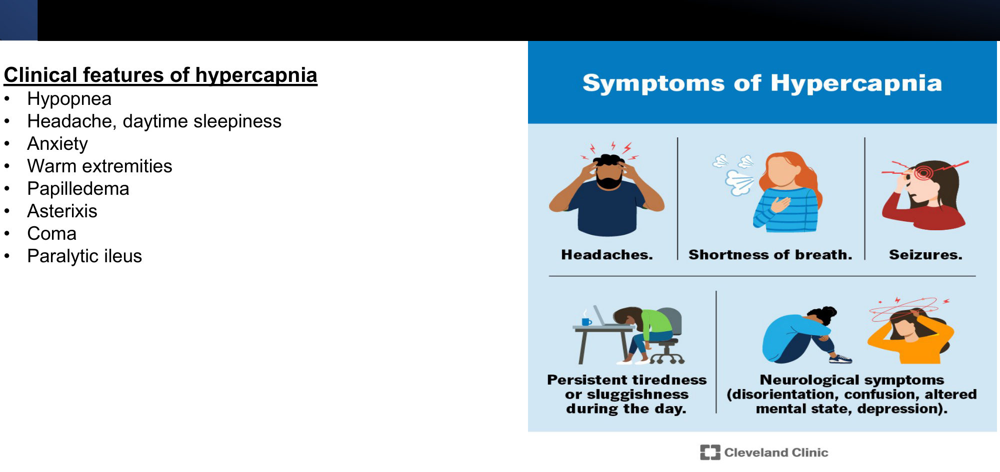

### 2.5 Diagnosis and Management (Slides 14–16) ⭐
**Diagnosis:** clinical; ABG, rapid labs and bedside imaging identify the type and guide treatment.
- ⭐ **ABG**
- **CXR or CT chest**
- **CBC and metabolic panel**
- **Cardiac enzymes** if cardiogenic oedema is suspected
- **Cause:** CXR, **POCUS**, CT, **CTA**

**Approach (slide 15):**
1. ⭐ **ABCDE**
2. **immediate respiratory support** according to cause and severity
3. ⭐ **identify and treat rapidly reversible causes**: **tension pneumothorax, pulmonary oedema, anaphylaxis, status asthmaticus, foreign-body aspiration**
4. focused evaluation; initial tests (ABG, labs, **ECG, CXR, POCUS**)
5. advanced tests as needed
6. **treat the cause**

**Mnemonic *[added]* for the rapidly reversible causes: "PEAS-F"**:
- **P**neumothorax (tension)
- **E**dema (pulmonary)
- **A**naphylaxis
- **S**tatus asthmaticus
- **F**oreign body

| Monitoring and disposition | Respiratory support |
|---|---|
| **ICU** admission for respiratory/haemodynamic support | **Secure the airway** |
| Monitor respiratory and haemodynamic parameters | **Rescue breaths** immediately in **respiratory arrest** |
| ⭐ **Serial ABGs** | **O₂ therapy**: slide threshold **SpO₂ < 95%** (see note); consider ⭐ **high-flow nasal cannula** for hypoxaemic failure |
| Repeat labs/imaging if the status changes | **Mechanical ventilation**: consider indications for **NIPPV** vs **invasive** |

⚠️ *[added]* O₂ targets: **94–98%** for most patients, **88–92%** in those at risk of hypercapnia (COPD, OHS, neuromuscular). Excess O₂ in type 2 failure worsens CO₂ retention.

*[added]* **NIV (BiPAP)** is best evidenced for **AECOPD with pH 7.25–7.35** and **cardiogenic pulmonary oedema**.
- **Intubate if:**
  - NIV fails or is contraindicated
  - GCS ≤ 8 / unable to protect the airway
  - haemodynamic instability
  - respiratory arrest
  - severe acidosis

> 🔁 **Recap: Respiratory failure.**
> - **Type 1:** PaO₂ < 60, CO₂ normal/↓. Lung failure: V/Q, shunt, diffusion, ↓ FiO₂ → **O₂/HFNC**.
> - **Type 2:** PaCO₂ > 45–50. Pump failure: COPD/asthma, opioids/benzodiazepines, chest wall, neuromuscular → **ventilation (NIV/IMV)**.
> - **Hypercapnia signs:** headache, warm peripheries, papilloedema, asterixis, coma.
> - **ABCDE**; treat reversible causes (tension PTX, oedema, anaphylaxis, asthma, foreign body); serial ABGs; ICU.
>
> ▶️ **Up next: ARDS.**

---

### 2.6 ARDS: Definition and Causes (Slides 17–19) ⭐⭐
**Definition:**
- **acute respiratory failure** with **hypoxaemia** and **bilateral pulmonary infiltrates**
- ⭐ **not fully explained by heart failure or fluid overload**
- **not a primary disease**: it arises from other conditions → a **widespread inflammatory process**

| **Systemic (indirect) causes** | **Direct lung injury** |
|---|---|
| ⭐ **Sepsis (most common cause)** | ⭐ **Pneumonia** |
| **Trauma** | ⭐ **Aspiration** |
| **Shock** | Inhaled toxins; inhalation injury (e.g. hyperbaric O₂) |
| ⭐ **Massive transfusion (TRALI)** | **Pulmonary contusion** |
| ⭐ **Acute pancreatitis** | **Drowning** |
| Haematopoietic stem-cell transplantation | ⭐ **Fat embolism** (*[added]* long-bone fractures) |
| Medications | **Amniotic fluid embolism** |
| **Recreational drugs (cocaine)** | Lung transplantation |

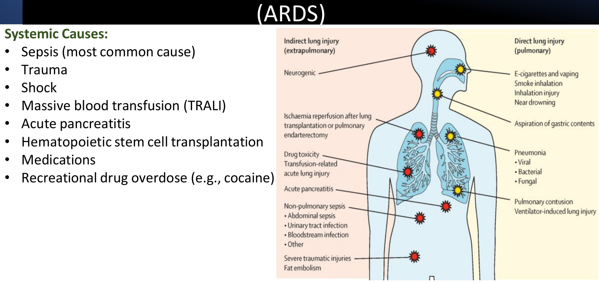

### 2.7 ARDS: Pathophysiology (Slides 20–21) ⭐⭐
**Trigger:** tissue damage (pulmonary or extrapulmonary) → **inflammatory mediators (TNF-α, IL-1)** → ⭐ **neutrophil sequestration in the alveoli** → reactive oxygen species and proteases → injury to alveolar capillaries and endothelium = ⭐ **diffuse alveolar damage (DAD)**.

| Phase | Events |
|---|---|
| ⭐ **Exudative** | Fluid floods the interstitium and alveoli → ⭐ **non-cardiogenic pulmonary oedema with NORMAL PCWP** → **↓ compliance**, respiratory distress |
| ⭐ **Hyaline membranes** | Neutrophils + **protein-rich** fluid → **hyaline membranes** → impaired gas exchange → hypoxaemia → hyperventilation → ⭐ **respiratory alkalosis** (early) |
| **Vascular** | Hypoxaemia → hypoxic pulmonary vasoconstriction → **pulmonary hypertension** |
| **Surfactant loss** | Damage to **type I and II pneumocytes** → ↓ surfactant → **alveolar collapse** → ⭐ **intrapulmonary shunting** (refractory hypoxaemia) |
| **Organising (late)** | **Type II pneumocyte proliferation** + **fibroblasts** → ⭐ **progressive interstitial fibrosis** |

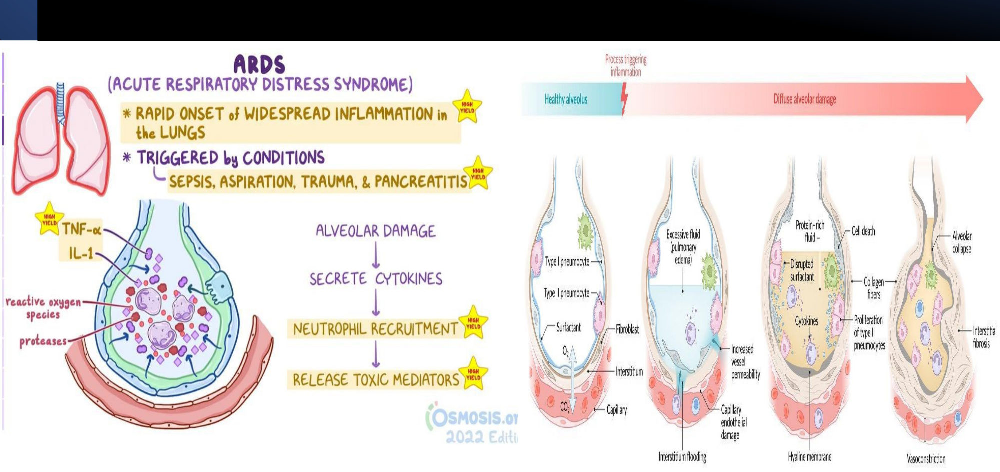

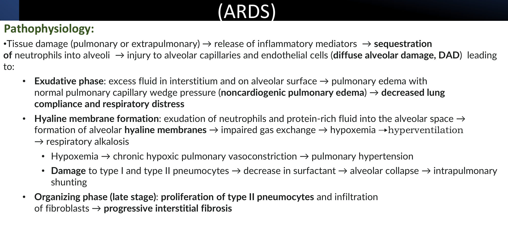

### 2.8 ARDS: Clinical Features and Multi-Organ Effects (Slides 22–23)
**Symptoms and signs:**
- **acute dyspnoea**; tachypnoea, tachycardia; **cyanosis**
- ⭐ **diffuse crackles**
- ± fever, cough, chest pain
- *[added]* onset typically **12–72 h** after the insult

| Organ dysfunction (slide 23) | Manifestations |
|---|---|
| Liver | ↓ synthetic function, ↑ transaminases, ↑ bilirubin, coagulation activation, acute-phase proteins, ↓ albumin, hypoglycaemia |
| GI | **Stress ulcers**, bleeding, **ileus** |
| Haematological | Thrombocytopenia, **consumptive coagulopathy (DIC)**, anaemia |
| Neurological | ↓ consciousness, confusion, psychosis, polyneuropathy |
| Cardiovascular | Refractory hypotension, arrhythmia, capillary leak, ↓ vascular tone, ↓ cardiac output, MI |
| Renal | ↓ perfusion, **AKI**, oliguria, electrolyte disturbance, ↓ EPO, ↓ vitamin D activation, abnormal renin |

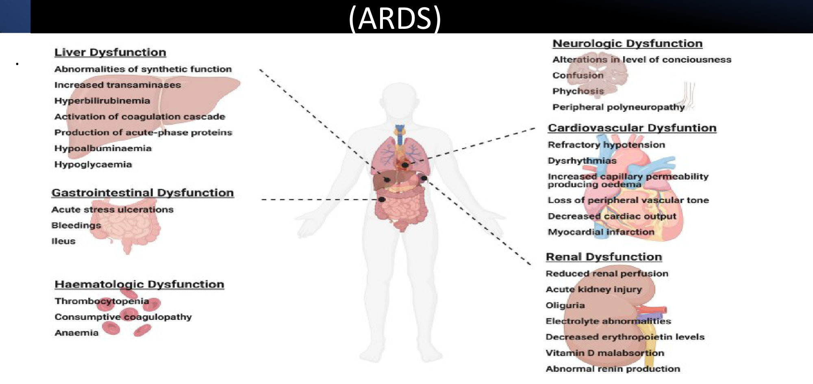

### 2.9 ARDS: Diagnostic Criteria (Slides 24–25) ⭐⭐
**New Global Definition (2023)** (the slide is headed "Berlin criteria"; *[added]* Berlin 2012 is the predecessor):

| Criterion | Requirement |
|---|---|
| ⭐ **Timing** | **Within 7 days** of a known risk factor |
| ⭐ **Oedema origin** | **Not explained by cardiogenic oedema or volume overload** |
| ⭐ **Imaging** | **Bilateral infiltrates on CXR or CT**, *or* on **lung ultrasound** (by a trained operator); not explained by nodules, effusion or atelectasis |
| ⭐ **Hypoxaemia (PaO₂/FiO₂)** | **Mild 201–300** (on NIV/CPAP PEEP ≥ 5, **or HFNO ≥ 30 L/min**) · **Moderate 101–200** (PEEP ≥ 5) · **Severe ≤ 100** (PEEP ≥ 5) |
| **SpO₂/FiO₂** (new) | **≤ 315 with SpO₂ ≤ 97%** (no ABG needed) |

*[added]* **What 2023 changed from Berlin:**
- **HFNO** patients are included (non-intubated ARDS)
- **SpO₂/FiO₂** allowed
- **ultrasound** allowed for imaging
- a modification for **resource-limited settings** (no PEEP or O₂-flow requirement)

**Diagnostics (slide 25):**
- **CXR:** ⭐ diffuse **bilateral** infiltrates (*[added]* "white-out", often sparing the costophrenic angles; no cardiomegaly)
- **ABG:** hypoxaemia (slide: "PaO₂ < 60")
- **Work-up of the cause:** septic screen, **pancreatic enzymes**
- **CT** if needed

⚠️ ARDS severity is defined by the **P/F ratio** (with PEEP), not by "PaO₂ < 60".

*[added]* **BNP / echo** help exclude a cardiogenic cause: normal BNP favours ARDS (lecture case 1).

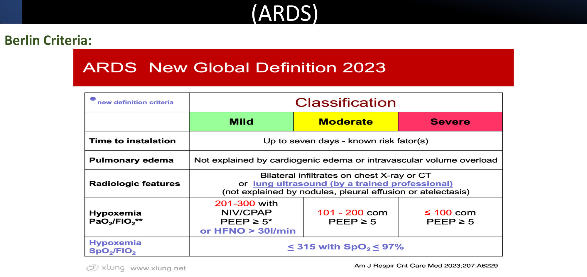
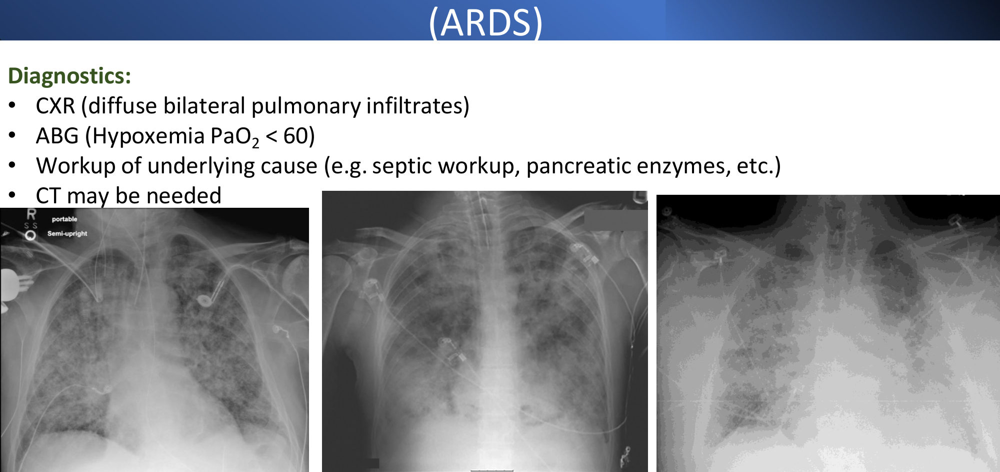

### 2.10 ARDS: Management (Slide 26) ⭐⭐
**General:**
- ⭐ **early ICU admission and treat the underlying cause**
- **oxygenation**
- **glucocorticoids in intubated patients** (*[added]* ATS 2024: conditional recommendation)
- ⭐ **conservative fluids (diuretics)** once shock resolves

⭐ **Lung-protective ventilation (ARDSNet):**

| Setting | Target *[added numbers]* |
|---|---|
| **Low tidal volume** | **6 mL/kg predicted body weight** (range 4–8) |
| **Low plateau pressure** | **≤ 30 cmH₂O** |
| **Higher PEEP** | To recruit alveoli and reduce shunt (PEEP/FiO₂ table) |
| *[added]* **Permissive hypercapnia** | pH ≥ 7.20–7.25 acceptable |
| *[added]* **Oxygen target** | PaO₂ 55–80 mmHg / SpO₂ 88–95% |

**By severity:**

| Severity | Add |
|---|---|
| **Moderate or severe** | ⭐ **Prone positioning** (*[added]* if P/F < 150, ≥ 12–16 h/day; PROSEVA) and **high-PEEP strategy** |
| **Early severe** | Consider **neuromuscular blockers** |
| **Severe, refractory** | ⭐ **ECMO** (VV-ECMO; *[added]* the slide image shows VA-ECMO) |

*[added]* **Predicted body weight:**
- **men** = 50 + 0.91 × (height cm − 152.4)
- **women** = 45.5 + 0.91 × (height cm − 152.4)

**Mnemonic *[added]* for ARDS ventilation, "6-30-PEEP-Prone":** **6** mL/kg PBW · plateau ≤ **30** · higher **PEEP** · **Prone** if P/F < 150.

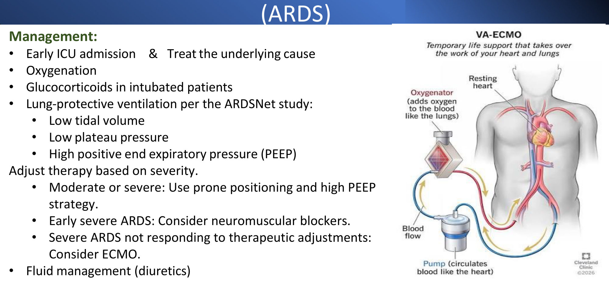

> 🔁 **Recap: ARDS.**
> - Hypoxaemia + bilateral infiltrates within 7 days, not cardiac.
> - Causes: sepsis (commonest), pneumonia, aspiration, pancreatitis, trauma, TRALI, fat embolism.
> - Neutrophil-mediated DAD → protein-rich oedema (normal PCWP) → hyaline membranes → surfactant loss → **shunt** → fibrosis.
> - 2023 definition: P/F 201–300 / 101–200 / ≤ 100; S/F ≤ 315; HFNO allowed.
> - **6 mL/kg PBW, plateau ≤ 30, high PEEP, prone, NMB, ECMO, conservative fluids, steroids.**
>
> ▶️ **Up next: Cyanosis.**

---

### 2.11 Approach to Cyanosis (Slides 27–28) ⭐
**History:**
- **onset** (age; acute vs chronic)
- **chest pain**, **dyspnoea**
- **smoking**
- lung disease or HF
- **allergies**
- **medications (β-blockers**: *[added]* peripheral cyanosis; and nitrates/dapsone/local anaesthetics → methaemoglobinaemia)

**Examination:** vital signs, **pulse oximetry**, heart, lungs, extremities (**clubbing, cyanosis, oedema**).

**Work-up:**
- **General:** **SpO₂, ABG, CBC, ECG, CXR**; **echo** if a cardiac cause is suspected.
- **Specific:** sputum and blood cultures; **V/Q scan and CTA**; **TTE**; **duplex Doppler**.

| **Central cyanosis** (tongue, lips) | **Peripheral cyanosis** (fingers, toes) |
|---|---|
| **↓ O₂ saturation:** severe respiratory disease, **pulmonary oedema, PE**, **congenital cyanotic heart disease** | ⭐ **All causes of central cyanosis** |
| ⭐ **Abnormal haemoglobin:** **methaemoglobinaemia, sulphaemoglobinaemia** | **Cold exposure** |
| — | **Raynaud's phenomenon** |
| — | **Arterial occlusion**; **venous occlusion** |
| — | **Acrocyanosis** |

*[added]*
- Cyanosis appears when **deoxygenated Hb > 5 g/dL** (capillary). It is **masked in anaemia** and **exaggerated in polycythaemia**.
- **Methaemoglobinaemia:**
  - **"saturation gap"**: SpO₂ ~85% fixed, but **normal PaO₂**
  - **chocolate-brown blood**
  - treat with **methylene blue** (not in **G6PD** deficiency)
- **Peripheral cyanosis with warm hands → think central; cold hands → peripheral.**

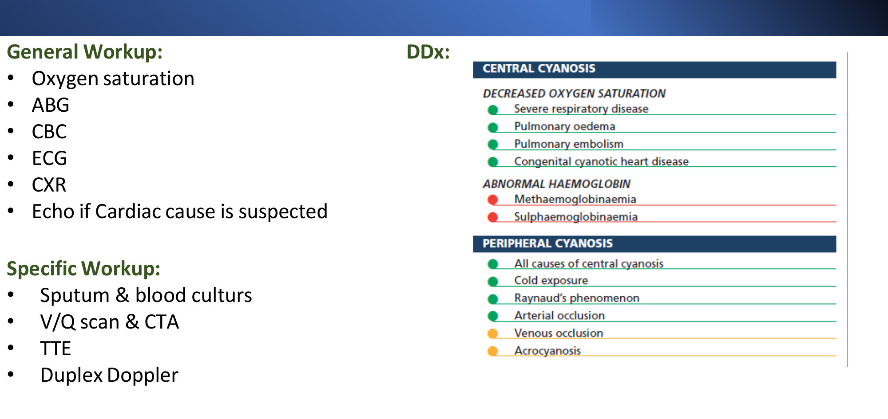

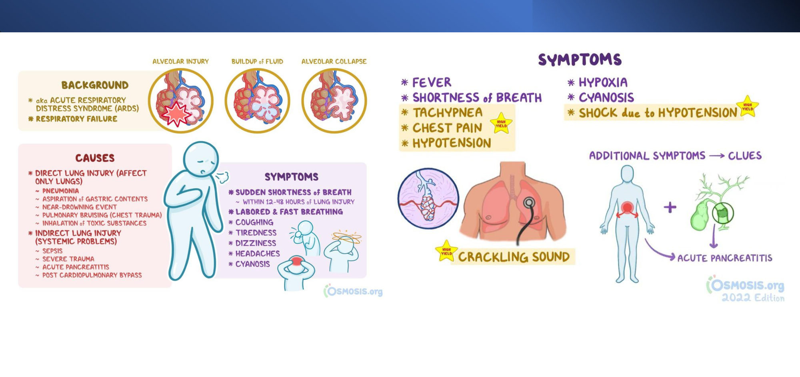

---

## 3. High-Yield Comparison Tables

### Table A: Type 1 vs Type 2 Respiratory Failure
| | **Type 1** | **Type 2** |
|---|---|---|
| Problem | **Oxygenation** (lung) | **Ventilation** (pump) |
| PaO₂ | **< 60** | Normal or ↓ |
| PaCO₂ | Normal/↓ (< 33) | **> 45–50** |
| A–a gradient | ↑ (except ↓ FiO₂) | Normal (pure hypoventilation) or ↑ (airway disease) |
| Causes | Pneumonia, **ARDS**, PE, oedema, IPF, shunt | **AECOPD**, asthma (late), **opioids/benzodiazepines**, **MG/GBS/ALS**, chest wall, OHS |
| Clues | Cyanosis, tachypnoea, confusion | **Headache, warm peripheries, papilloedema, asterixis**, drowsiness, coma |
| Treatment | **O₂ / HFNC** (CPAP) | **NIV / invasive ventilation**; controlled O₂ 88–92% |

### Table B: ARDS vs Cardiogenic Pulmonary Oedema *[added synthesis; slides 17, 21, 30]*
| | **ARDS** | **Cardiogenic oedema** |
|---|---|---|
| Mechanism | **↑ Permeability** (alveolocapillary leak) | **↑ Hydrostatic** (capillary pressure) |
| PCWP | **Normal (≤ 18)** | **↑ (> 18)** |
| BNP | Normal/mildly ↑ | **High** |
| Oedema fluid | **Protein-rich** exudate | Transudate |
| CXR | Bilateral, peripheral, no cardiomegaly, no effusions | **Cardiomegaly**, upper-lobe diversion, Kerley B lines, effusions |
| O₂ response | **Refractory** (shunt) | Responds; diuretics work |

### Table C: Global Definition 2023 ARDS Severity
| Severity | P/F (PEEP ≥ 5 or HFNO ≥ 30 L/min) | Extra therapy |
|---|---|---|
| Mild | 201–300 | Lung-protective ventilation |
| Moderate | 101–200 | + **high PEEP**, **prone** (if P/F < 150) |
| Severe | ≤ 100 | + **NMB** (early), **prone**, **ECMO** if refractory |

### Table D: Direct vs Indirect ARDS
| Direct (pulmonary) | Indirect (systemic) |
|---|---|
| Pneumonia, aspiration, contusion, drowning, inhalation, **fat embolism**, **amniotic fluid embolism**, lung transplant | **Sepsis**, trauma, shock, **TRALI**, **pancreatitis**, HSCT, drugs, **cocaine** |

### Table E: Central vs Peripheral Cyanosis
| | Central | Peripheral |
|---|---|---|
| Site | **Tongue, lips**, mucosa + extremities | Fingers, toes, nose only |
| SpO₂ | **↓** (except MetHb, which shows a gap) | Normal |
| Extremities | Warm | **Cold** |
| Causes | Lung disease, oedema, PE, cyanotic CHD, **MetHb/SulfHb** | Cold, **Raynaud's**, arterial/venous occlusion, acrocyanosis, ↓ cardiac output, β-blockers |

---

## 4. Rules, Exceptions, Patterns
- **Hypoxaemic failure: PaO₂ < 60; hypercapnic: PaCO₂ > 45** (slide 6 says > 50).
- **Type 1 compensates CO₂ but not O₂** (Hb already saturated in normal units).
- **Shunt doesn't correct with 100% O₂**; V/Q mismatch does.
- **Hypoventilation = normal A–a gradient** (opioids, neuromuscular).
- **Hypercapnia: warm peripheries, papilloedema, asterixis, coma.**
- **Reversible causes first:** tension PTX, oedema, anaphylaxis, status asthmaticus, foreign body.
- **Controlled O₂ (88–92%)** if at risk of CO₂ retention.
- **ARDS = not cardiogenic** (normal PCWP/BNP); **sepsis is the commonest cause**.
- **Early ARDS → respiratory alkalosis**; late → fibrosis.
- **ARDS severity = P/F with PEEP ≥ 5** (2023: HFNO ≥ 30 L/min also counts; S/F ≤ 315).
- **Lung-protective ventilation: 6 mL/kg PBW, plateau ≤ 30, PEEP; prone if P/F < 150; NMB early severe; ECMO refractory.**
- **Conservative fluids** in ARDS once shock resolves.
- **Cyanosis needs > 5 g/dL deoxyHb** → hidden by anaemia; **MetHb = saturation gap**.

---

## 5. Clinical Correlations
- **Opioid/benzodiazepine overdose** → type 2 failure → **naloxone** (opioids), airway support (Substance Use lecture).
- **Myasthenic crisis / GBS** → monitor **FVC** (< 15–20 mL/kg → intubate) *[added]*; ABG changes are late.
- **AECOPD** → NIV for pH 7.25–7.35; controlled O₂ 88–92%.
- **OHS** → acute-on-chronic type 2 failure; ↑ HCO₃⁻ (Sleep Apnoea lecture).
- **Acute pancreatitis** (alcohol) → ARDS (lecture case 1); periumbilical haematoma = **Cullen's sign**.
- **Massive transfusion** → **TRALI** within 6 h *[added]*.
- **Long-bone fracture** → **fat embolism**: hypoxaemia + petechiae + confusion *[added]*.
- **Sepsis** (upcoming lecture) → the commonest cause of ARDS.
- **Dapsone/nitrates/local anaesthetics** → **methaemoglobinaemia**: cyanosis with a normal PaO₂ *[added]*.
- **Eisenmenger** → intracardiac shunt; cyanosis not corrected by O₂.

---

## 6. Rapid Revision (Last-Day)
1. **Respiratory failure:** can't maintain O₂/CO₂. **Hypoxaemic PaO₂ < 60; hypercapnic PaCO₂ > 45** (slide 6: > 50). Respiratory arrest = no breathing with a pulse.
2. **Acute** (minutes–hours) vs **chronic** (COPD, ILD, OHS).
3. **Type 1:** PaO₂ < 60, PaCO₂ normal/↓ (< 33). **Type 2:** PaCO₂ ↑, PaO₂ normal/↓.
4. **Type 1 mechanism:** normal units blow off CO₂ but can't add O₂ (Hb saturated). **Type 2:** severe V/Q mismatch / pump failure.
5. **Lung failure → O₂; pump failure → mechanical ventilation.**
6. **Type 1 causes:**
   - diffusion (oedema, pneumonia, IPF)
   - **shunt** (ARDS, tension PTX, Eisenmenger)
   - **V/Q** (pneumonia, PE)
   - ↓ FiO₂
   - hypoventilation
7. **Type 2 causes:**
   - airway/dead space (AECOPD, asthma, drowning, OSA)
   - **CNS depression (opioids, benzodiazepines)**
   - chest wall (rib fracture, AS)
   - **muscle weakness (MG, GBS, ALS, high cord injury, polio)**
   - electrolytes
8. **Hypoxaemia features:** tachypnoea, dyspnoea, cyanosis, tachycardia/arrhythmia, confusion.
9. **Hypercapnia features:** hypopnoea, **headache**, sleepiness, anxiety, **warm extremities, papilloedema, asterixis, coma**, ileus.
10. **Distress:** can't finish sentences, nasal flaring, grunting, pursed lips, accessory muscles, ↓ mental state.
11. **Work-up:** ABG, CXR/CT, CBC/metabolic panel, troponin if cardiac; POCUS, CTA.
12. **Approach:** **ABCDE** → support → **reversible causes (tension PTX, oedema, anaphylaxis, status asthmaticus, foreign body)** → tests → treat the cause → ICU, serial ABGs.
13. **O₂:** slide threshold SpO₂ < 95%; **HFNC** for type 1; NIPPV vs invasive. *[added]* Targets 94–98% (88–92% if CO₂ retainer).
14. **ARDS:** hypoxaemia + bilateral infiltrates, not HF/fluid; a syndrome secondary to another condition.
15. **ARDS causes:**
    - **systemic:** **sepsis** (commonest), trauma, shock, **TRALI**, **pancreatitis**, HSCT, drugs, cocaine
    - **direct:** **pneumonia, aspiration**, toxins, contusion, drowning, **fat/amniotic embolism**, lung transplant
16. **ARDS pathology:** mediators → neutrophils → **DAD** → exudative (non-cardiogenic oedema, **normal PCWP**, ↓ compliance) → **hyaline membranes** → hypoxaemia → **respiratory alkalosis**; ↓ surfactant → collapse → **shunt**; PH; **organising → fibrosis**.
17. **ARDS signs:** acute dyspnoea, tachypnoea, tachycardia, cyanosis, **diffuse crackles**; multi-organ failure.
18. **Global Definition 2023:** within **7 days**; not cardiac; bilateral infiltrates on CXR, CT or **US**; P/F **201–300 / 101–200 / ≤ 100** (PEEP ≥ 5 or **HFNO ≥ 30**); **S/F ≤ 315** (SpO₂ ≤ 97%).
19. **ARDS Rx:**
    - ICU; treat the cause; O₂
    - **steroids** (intubated)
    - **low TV (6 mL/kg PBW), plateau ≤ 30, high PEEP**
    - moderate/severe → **prone + high PEEP**; early severe → **NMB**; refractory → **ECMO**
    - **diuretics** (conservative fluids)
20. **Cyanosis:**
    - **central** (↓ SaO₂: lung disease, oedema, PE, cyanotic CHD; **MetHb, SulfHb**)
    - **peripheral** (all central causes + cold, **Raynaud's**, arterial/venous occlusion, acrocyanosis)
    - work-up: SpO₂, ABG, CBC, ECG, CXR, echo; then cultures, V/Q/CTA, TTE, Doppler

---

## 7. Exam-Style Questions

**Q1 (lecture case 1, slide 30).** A 63-year-old woman with 20 years of alcohol use disorder has **2 days of severe epigastric pain and nausea**. **9 hours after admission** she becomes dyspnoeic and tachypnoeic; **SpO₂ 81% on O₂**. Diffuse crackles, epigastric tenderness, a **periumbilical haematoma**; **normal BNP**; CXR **bilateral lower-zone opacities**. Pathomechanism?
**a. Alveolocapillary membrane leakage** · b. Intrapulmonary left-to-right shunt · c. ↑ Surfactant · d. Pulmonary artery embolic obstruction · e. Bronchial mucosal inflammation · f. ↑ Pulmonary capillary pressure

> **Answer: a** *[reasoning added; key not on slides]*.
> - **Acute pancreatitis** (alcohol, epigastric pain, **Cullen's sign**) → systemic inflammation → **ARDS**.
> - Neutrophil-mediated **DAD** → **↑ alveolocapillary permeability** → protein-rich non-cardiogenic oedema.
> - Why not the others:
>   - **f:** **normal BNP** argues against ↑ capillary (hydrostatic) pressure, i.e. cardiogenic oedema.
>   - **b:** the ARDS shunt is **right-to-left**.
>   - **c:** surfactant is **reduced**.

**Q2 (lecture case 2, slide 31).** A 70-year-old (**180 cm**, 90 kg) with **wet gangrene** develops hypoxaemia on day 3 and is intubated. HR 112, **BP 95/60**, **lactate 4.0**, **creatinine 2.5**, Hb 11.5. Ventilator: **TV 540 mL**, RR 20, **PEEP 5**. ABG: PCO₂ 50, **PO₂ 55 on FiO₂ 1.0**. CXR: new bilateral infiltrates. Next step to improve tissue O₂ delivery?
a. Inhaled NO · b. Prone positioning · c. ↑ Tidal volume · **d. ↑ PEEP** · e. RBC transfusion

> **Answer: d** *[reasoning added; key not on slides]*.
> - **Septic shock → severe ARDS**: P/F = 55/1.0 = **55 (≤ 100)**.
> - Refractory hypoxaemia from **shunt** improves with **higher PEEP** (recruits collapsed alveoli); slide 26: "**high PEEP**" for moderate/severe ARDS.
> - Why not the others:
>   - **c:** wrong. His PBW ≈ 75 kg, so 540 mL ≈ **7.2 mL/kg**, already **above 6 mL/kg**; it should be **reduced to ~450 mL**.
>   - **e:** Hb 11.5 doesn't need transfusion.
>   - **a:** inhaled NO improves oxygenation transiently with **no mortality benefit**.
>   - **b:** **prone positioning** is the right next escalation if P/F stays < 150 after PEEP/ventilator optimisation (≥ 12–16 h/day), so some keys accept it. The immediate adjustment on a PEEP of only 5 is **↑ PEEP**.

**Q3.** A 22-year-old found unresponsive with pinpoint pupils has RR 6, ABG pH 7.21, PaCO₂ 70, PaO₂ 58, normal A–a gradient. Type and first step?
A. Type 1; high-flow O₂ · **B. Type 2 (hypoventilation); bag–mask ventilation + naloxone** · C. ARDS; prone · D. Type 1; CPAP

> **Answer: B** (slides 10, 16).
> - Opioid CNS depression → **pure hypoventilation** (normal A–a gradient).
> - Support ventilation (rescue breaths), **naloxone**; intubate if needed.

**Q4.** Which finding best distinguishes ARDS from cardiogenic pulmonary oedema?
A. Bilateral infiltrates · B. Hypoxaemia · **C. Normal pulmonary capillary wedge pressure** · D. Crackles · E. Tachypnoea

> **Answer: C** (slide 21). ARDS = **non-cardiogenic** oedema with **normal PCWP** (and normal BNP); the others occur in both.

**Q5.** A patient's SpO₂ stays at 85% despite 100% O₂; ABG PaO₂ is 95 mmHg; blood looks chocolate-brown. He recently received topical benzocaine. Diagnosis and treatment?
A. Shunt; PEEP · B. ARDS; prone · **C. Methaemoglobinaemia; methylene blue** · D. Peripheral cyanosis; warming

> **Answer: C** (slide 28 lists methaemoglobinaemia under central cyanosis; *[added]* details).
> - A **saturation gap** (normal PaO₂, low SpO₂) after an oxidising drug.
> - **Methylene blue** (avoid in G6PD deficiency).

---

## 8. Exam Pitfalls & Traps
| Trap | Correct thinking |
|---|---|
| Type 1 failure has high CO₂ | ❌ Type 1 = **normal/low CO₂** |
| Hypercapnia cut-off 45 vs 50 | ⚠️ Slide 5 says **> 45**, slide 6 **> 50**; define with pH |
| Give 15 L O₂ to every hypoxic COPD patient | ❌ Target **88–92%**; risk of worsening CO₂ |
| Shunt hypoxaemia corrects with more O₂ | ❌ **Refractory**; needs PEEP/recruitment |
| A drowsy hypercapnic patient breathing slower is "settling" | ❌ **Tiring**; prepare for ventilation |
| ARDS = any bilateral infiltrates with hypoxaemia | ❌ Must be **not cardiogenic**, **within 7 days** of a risk factor |
| High BNP + bilateral infiltrates = ARDS | ❌ Points to **cardiogenic** oedema |
| ARDS diagnosed by PaO₂ < 60 | ❌ Severity is by **P/F ratio** with PEEP ≥ 5 (or HFNO) |
| Large tidal volumes to improve oxygenation | ❌ **6 mL/kg PBW**, plateau ≤ 30 (actual body weight is wrong) |
| Liberal fluids in ARDS | ❌ **Conservative fluids / diuretics** once shock resolves |
| Increase FiO₂ alone in severe ARDS | ❌ **↑ PEEP**, prone, NMB, ECMO |
| Inhaled NO improves survival | ❌ Transient oxygenation only |
| ARDS shunt is left-to-right | ❌ **Right-to-left** (perfused, unventilated alveoli) |
| Surfactant ↑ in ARDS | ❌ **↓** (type II pneumocyte damage) |
| Cyanosis in severe anaemia | ⚠️ May be **absent** (needs > 5 g/dL deoxyHb) |
| Normal PaO₂ excludes cyanosis | ⚠️ **Methaemoglobinaemia**: saturation gap |
| Slide 24 "Berlin criteria" | ⚠️ It shows the **2023 Global Definition** (HFNO, S/F, ultrasound added) |
