# Sleep Apnoea: An Approach to a Case of Fatigue
**Dr. Essam Kotb, Internal Medicine** | Source: `13- sleep apnea updated.pdf` (30 slides)

> **Legend:** ⭐ = high-yield · *[added]* = not on slides. Images marked "Slide N" come from the lecture; "Added diagram" = drawn for these notes. The case answer is **reasoned by me; the key is not on the slides**. "Case Scenario 2" (slide 28) is only a cartoon, with no question.

> 🔗 **Bridge from earlier lectures:**
> - **Pulmonary vascular disease:** OSA/OHS = **WHO PH group 3** (hypoxia) → **cor pulmonale**.
> - **Hypertension:** OSA is a classic **secondary cause of resistant hypertension**.
> - **Arrhythmias:** OSA → **AF** and nocturnal brady-arrhythmias.
> - **Pituitary I / Thyroid:** **acromegaly** (macroglossia) and **hypothyroidism** are listed OSA risk factors.
> - **Restrictive lung disease:** obesity is an extraparenchymal restrictive cause; OHS is its ventilatory failure.
> - **Up next (Respiratory failure):** OHS = **type 2 (hypercapnic) failure**, often first diagnosed in acute decompensation.

---

## 1. Title / Objectives

| Domain | Objective | Likely tested as |
|---|---|---|
| Knowledge | Define **OSA, CSA, OHS (Pickwickian)**; normal sleep stages | Definitions |
| Knowledge | Mechanisms: airway collapse (OSA), respiratory-centre failure (CSA), hypoventilation (OHS) | |
| Knowledge | ⭐ Nocturnal hypoxia/hypercapnia → **pulmonary vasoconstriction → PH → cor pulmonale**; secondary HTN; renal compensation | Lecture case 1 |
| Knowledge | Risk factors and features: snoring, sleepiness, **morning headache**, witnessed apnoeas, **Cheyne–Stokes** | |
| Skill | ⭐ **STOP-Bang** screening | Score ≥ 5 = high risk |
| Skill | ⭐ **Polysomnography**: obstructive vs central events | Effort present vs absent |
| Skill | Choose therapy: lifestyle → **CPAP** → NIPPV/surgery | CPAP first line |
| Values | Professionalism; impact of fatigue and sleepiness on quality of life and **safety** (driving); multidisciplinary care | |

**Main subtopics:**
1. **Obstructive sleep apnoea**
2. **Central sleep apnoea**
3. **Obesity hypoventilation syndrome**

---

## 2. Main Content (Lecture Order)

### 2.1 Sleep and Its Stages (Slides 5–6)
**Sleep** is a natural state of rest in which the body and mind recover: tissue repair and regeneration, memory consolidation, hormonal balance, energy, mood, immunity.

| Stage | Features |
|---|---|
| **Stage 1** | Light, **transitional** sleep; drowsiness, sleep onset |
| **Stage 2** | More stable sleep; brain chemicals **block the senses** so waking is harder |
| ⭐ **Stage 3** | **Deep (slow-wave) sleep**; ⭐ **growth hormone released**; mostly in the **first third** of the night |
| ⭐ **REM** | Memory revitalisation; **high brain activity**; **intense dreaming** (*[added]* skeletal-muscle atonia, so OSA and OHS hypoventilation are **worst in REM**) |

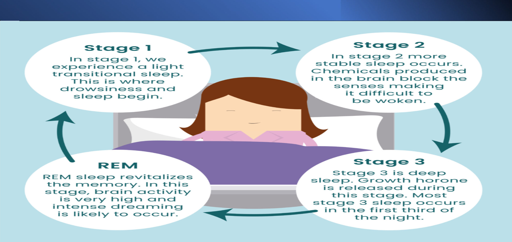

### 2.2 Sleep Disorders and Abnormal Breathing Events (Slides 7–9)
- **Types of sleep disorders:**
  - insomnia
  - ⭐ **sleep-related breathing disorders**
  - central disorders of hypersomnolence
  - circadian rhythm sleep–wake disorders
  - parasomnias
  - sleep-related movement disorders
- **Sleep-disordered breathing (slide 8):** snoring · **OSA** · **upper airway resistance syndrome** · **CSA**.

| Event | Definition |
|---|---|
| ⭐ **Apnoea** | **Complete or near-complete (≥ 90%) cessation** of inspiratory airflow for **≥ 10 s** |
| ⭐ **Hypopnoea** | Airflow **↓ ≥ 30%** from baseline for **≥ 10 s** **plus either ≥ 3% desaturation or an arousal** |
| **RERA** (respiratory effort-related arousal) | **Arousal** from ↑ respiratory effort or ↓ airflow for **≥ 10 s** **without** meeting apnoea/hypopnoea criteria |

- **Cycle of OSA (slide 9):** sleep onset (snoring) → airway collapses → breathing stops → sleep disrupted → back to sleep.
- *[added]* **AHI** (apnoea–hypopnoea index) = apnoeas + hypopnoeas per hour of sleep.
  - **Mild 5–14 · moderate 15–29 · severe ≥ 30.**
  - **OSA diagnosis:** AHI **≥ 15**, or **≥ 5 with symptoms or comorbidity** (sleepiness, HTN, AF, stroke, mood disorder).
  - The hypopnoea rule above is the AASM "3% or arousal" rule; some payers use **≥ 4% desaturation**.

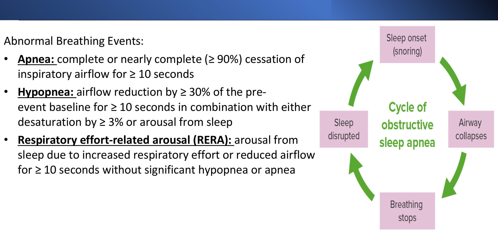

---

### 2.3 Obstructive Sleep Apnoea: Definition and Aetiology (Slides 10–11) ⭐
**Definition:**
- airflow **decreases or ceases** due to **upper airway obstruction**
- **intermittent**, typically at the **oropharynx**
- each apnoea usually **20–30 s** (may be longer)
- **hypoxia arouses the patient**; repeated **many (sometimes hundreds of) times** a night
- ⭐ **the most common sleep disorder**

**Aetiology:** ⭐ **collapse of the pharyngeal muscles during sleep**.

**Risk factors:**
- ⭐ **Obesity**
- **Structural abnormalities** (*[added]* tonsillar hypertrophy, retrognathia, macroglossia)
- **Alcohol** (and sedatives)
- **Smoking**
- ⭐ **Acromegaly**
- ⭐ **Hypothyroidism**

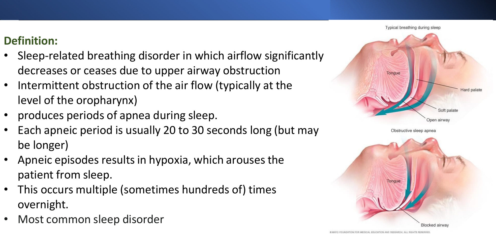 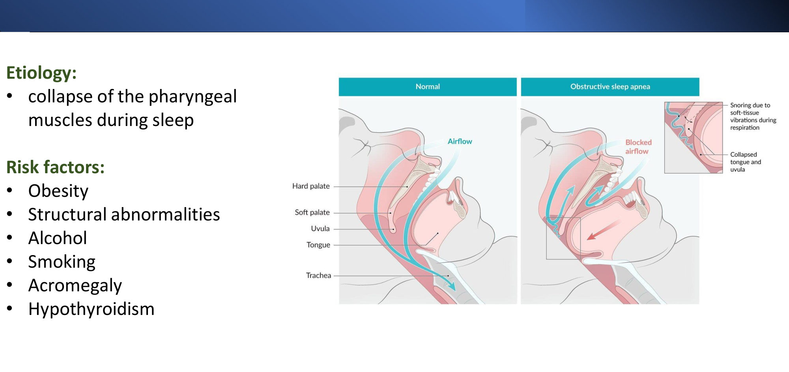

### 2.4 OSA: Pathophysiology (Slide 12) ⭐⭐
Upper airway obstruction → apnoea → **↓ PaO₂ and ↑ PaCO₂**, which lead to:
1. ⭐ **↑ Hypoxic pulmonary vasoconstriction → ↑ pulmonary hypertension → cor pulmonale**
2. ⭐ **↑ Sympathetic activity → secondary hypertension**
3. ⭐ **Respiratory acidosis → renal compensation → ↑ HCO₃⁻ retention**

**Venn of contributing factors:**
- **structural** (adenotonsillar hypertrophy, craniofacial abnormality, obesity)
- **neuromotor tone** (cerebral palsy, genetic diseases)
- **other** (genetic, hormonal, diet, inflammation)

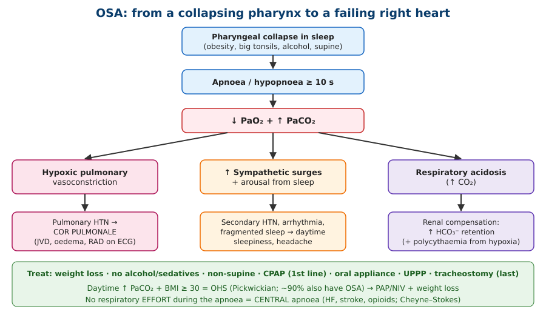

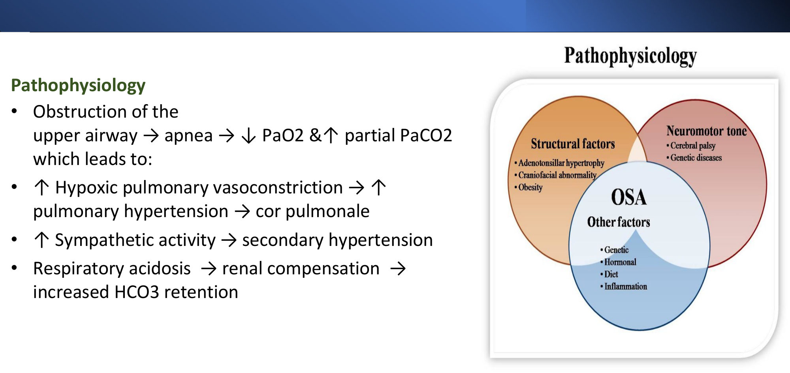

### 2.5 OSA: Clinical Features (Slide 13) ⭐
| Night-time | Daytime / systemic |
|---|---|
| ⭐ **Loud, persistent snoring** | ⭐ **Daytime sleepiness**; falling asleep during routine activities (*[added]* driving accidents) |
| ⭐ **Witnessed pauses in breathing** | ⭐ **Early-morning headaches** (CO₂) |
| **Choking/gasping** for air | **Personality changes**, **↓ intellectual function**, poor concentration, irritability |
| Restless sleep | **Pulmonary HTN**, **cardiac arrhythmias**, **hypertension** |
| **Nocturia** (frequent bathroom visits) | ⭐ **Polycythaemia** |
| — | **↓ Libido** |

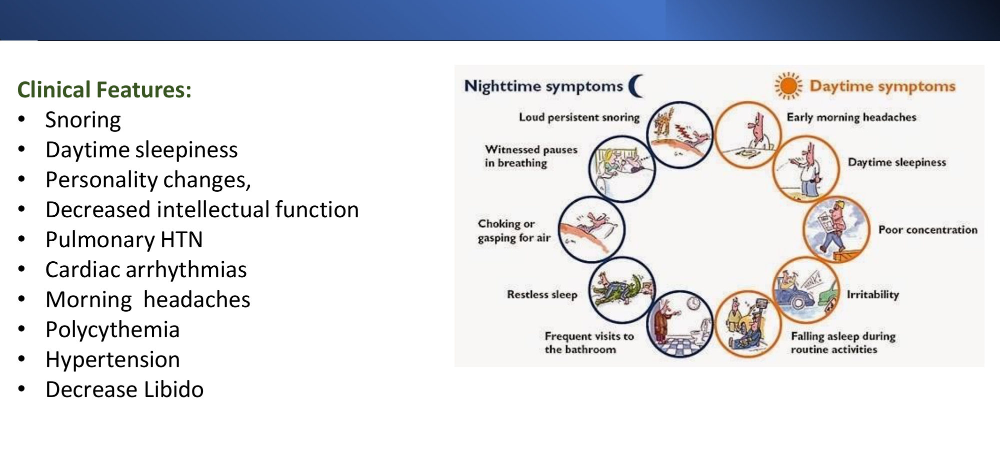

### 2.6 OSA: Diagnosis (Slides 14–15) ⭐
**Steps:**
1. **Sleep history, including third-party reports** (bed partner)
2. evaluate comorbidities
3. **screen with a standardised questionnaire**
4. ⭐ **polysomnography is required to confirm**

⭐ **STOP-Bang questionnaire** (1 point each):

| Letter | Question |
|---|---|
| **S** | **Snoring** loudly? |
| **T** | **Tired**/sleepy in the daytime? |
| **O** | **Observed** apnoea, choking or gasping? |
| **P** | High blood **Pressure** (or treated)? |
| **B** | **BMI > 35** kg/m²? |
| **A** | **Age > 50**? |
| **N** | **Neck circumference > 40 cm**? |
| **G** | **Gender** male? |

⭐ **Score: 0–2 = low risk · 3–4 = intermediate · ≥ 5 = high risk.**

**Polysomnography (sleep study) setup:**
- electrodes for **brain activity** (EEG), **eye** and **muscle movements**
- **belts** for respiratory effort
- **nasal cannula** for airflow
- **microphone** for snoring
- *[added]* **pulse oximetry**, ECG
- *[added]* **Home sleep apnoea testing** is acceptable for uncomplicated suspected moderate–severe OSA.
- *[added]* **Epworth Sleepiness Scale** (> 10) quantifies daytime sleepiness.

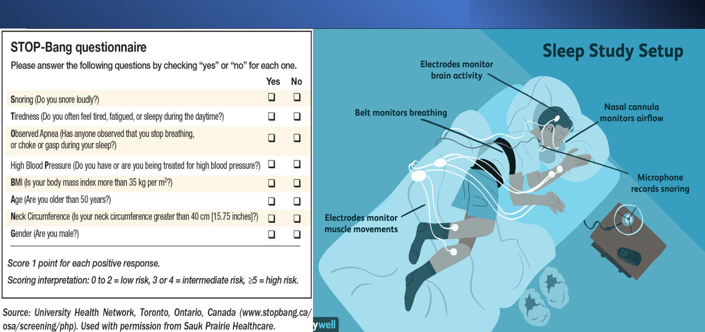

### 2.7 OSA: Management (Slide 16) ⭐⭐
| Level | Intervention |
|---|---|
| Lifestyle | ⭐ **Weight loss and exercise** · **stop smoking** · **avoid alcohol and sedatives** · **non-supine sleeping** |
| Device | **Oral appliance (mandibular advancement)**: keeps the jaw forward, prevents airway collapse |
| ⭐ **First line** | ⭐ **CPAP** (pneumatic splint) |
| Surgery | **Uvulopalatopharyngoplasty (UPPP)** in **selected** patients |
| Last resort | **Tracheostomy** (severe disease) |

*[added]*
- **Hypoglossal nerve stimulation** for CPAP-intolerant moderate–severe OSA.
- **GLP-1 agonist tirzepatide** is now approved for OSA with obesity.
- Advise about **driving** (notify the licensing authority if sleepy).

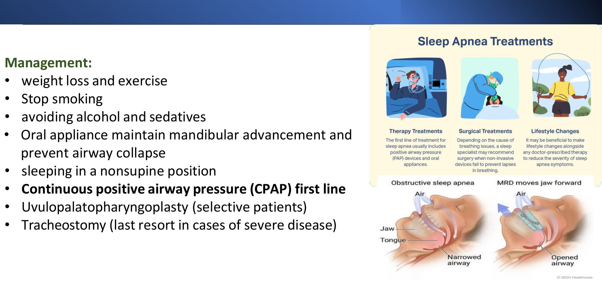

> 🔁 **Recap: OSA.**
> - Pharyngeal collapse at the oropharynx; apnoea ≥ 10 s (≥ 90% airflow loss); hypopnoea ≥ 30% + 3% desaturation or arousal.
> - Risks: obesity, structural, alcohol, smoking, **acromegaly, hypothyroidism**.
> - ↓O₂/↑CO₂ → pulmonary vasoconstriction (cor pulmonale), sympathetic surges (HTN, arrhythmia), acidosis (↑ HCO₃⁻), polycythaemia.
> - Snoring, witnessed apnoeas, sleepiness, morning headache.
> - **STOP-Bang ≥ 5 = high risk; PSG confirms.**
> - **CPAP first line**; weight loss, avoid alcohol, positional therapy, oral appliance; UPPP selected; tracheostomy last.
>
> ▶️ **Up next: Central sleep apnoea.**

---

### 2.8 Central Sleep Apnoea (Slides 17–21) ⭐
**Definition:** the **drive to breathe periodically decreases or ceases** due to **impaired respiratory-centre function**. In OSA, by contrast, the drive is intact but the airway is blocked.

| Mechanism | **Hypocapnic CSA** (hyperventilation) | **Hypercapnic CSA** (hypoventilation) |
|---|---|---|
| Category / prevalence | **Primary CSA** (prevalence low) · ⭐ **Cheyne–Stokes breathing** (prevalence **high**) | **Obesity · neuromuscular disease · ⭐ opiates · neurodegenerative** (stroke, multisystem atrophy, Parkinson's, Alzheimer's); prevalence unknown |
| Treatment | **CPAP, acetazolamide, O₂, CO₂, theophylline** | ⭐ **NIPPV with a backup rate** |

**Osmosis "3 C's" (slide 21):**
- **C**NS injury or toxicity
- ⭐ **C**ongestive heart failure
- ⭐ **C**heyne–Stokes respiration

**Signs and symptoms (slide 19):** **similar to OSA**, plus ⭐ **Cheyne–Stokes breathing**: a **crescendo–decrescendo** pattern alternating with apnoea.

**Polysomnography (slide 19):**
- ⭐ **no airflow AND no respiratory effort** (thoracic and abdominal belts flat)
- **desaturation** follows each apnoeic episode

⭐ **The key differentiator:**

| Apnoea type | Respiratory effort |
|---|---|
| **Obstructive** | **Present** (chest moves against a closed airway) |
| **Central** | **Absent** |

**Diagnosis (slide 20):**
- **history of underlying conditions (HF, stroke)**
- **polysomnography**, ideally with ⭐ **oesophageal pressure manometry (the gold standard** for measuring effort)

**Management (slide 21):**
- ⭐ **positive airway pressure therapy**
- **treat the underlying cause** (optimise HF; reduce opioids)

⚠️ *[added]* **Adaptive servo-ventilation (ASV) is contraindicated in HFrEF (EF ≤ 45%)** with central apnoea (SERVE-HF: ↑ mortality).

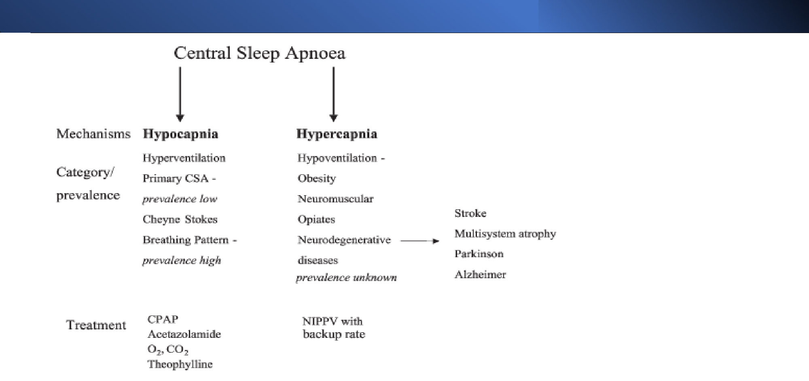 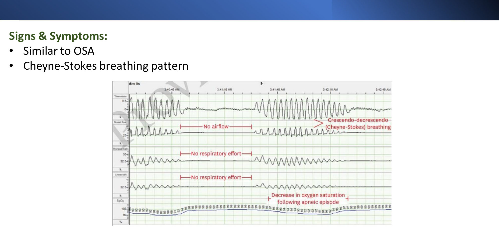

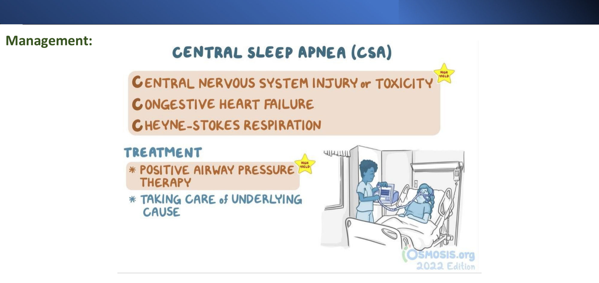

---

### 2.9 Obesity Hypoventilation Syndrome (Pickwickian) (Slides 22–25) ⭐⭐
**Definition:** a sleep-related hypoventilation disorder defined by:
1. ⭐ **BMI ≥ 30 kg/m²**
2. ⭐ **DIURNAL hypercapnia** (*[added]* awake **PaCO₂ > 45 mmHg**)
3. **disordered breathing during sleep**

*[added]* after **excluding other causes** of hypoventilation (COPD, neuromuscular disease, hypothyroidism, chest-wall disease).

| Component | Mechanism |
|---|---|
| **Structural** | **↓ Inspiratory muscle strength** + **restricted respiratory excursion** → alveolar hypoventilation (fat impairs lung expansion and restricts movement) |
| **Central** | **↑ Work of breathing → ↑ drive → can't be maintained in REM** → sleep hypoventilation → **blunting of the central respiratory centres** → **diurnal hypercapnia** |
| **Obstructive** | ⭐ **~90% of OHS patients also have OSA** |

**Clinical features:**
- **similar to OSA**: **headaches, severe sleepiness**
- **possibly daytime dyspnoea**
- ⭐ **often diagnosed in an acute state of respiratory failure** (*[added]* acute-on-chronic hypercapnic failure; ↑ HCO₃⁻ is a clue)

**Blood gases (slide 25):**
- ⭐ **↑ PaCO₂ while AWAKE and SLEEPING**
- **↓ PaO₂ while sleeping**

**Management:**
- ⭐ **weight loss**
- ⭐ **positive airway pressure during sleep**
- *[added]* **CPAP** if severe OSA coexists; **NIV/BiPAP** if no severe OSA or CPAP fails
- *[added]* avoid sedatives; **cautious O₂** (CO₂ retention); bariatric surgery in selected patients

| | **OSA** | **OHS** |
|---|---|---|
| Daytime PaCO₂ | Normal | ⭐ **↑ (> 45)** |
| BMI | Often obese | **≥ 30 required** |
| Serum HCO₃⁻ | Usually normal | **↑** (*[added]* > 27 mmol/L is a screening clue) |
| Treatment | CPAP | PAP (CPAP or **NIV**) + weight loss |

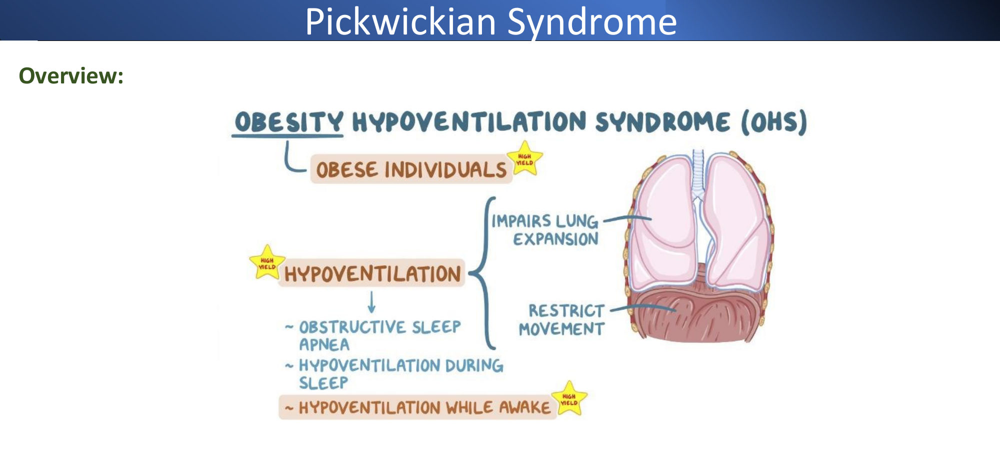 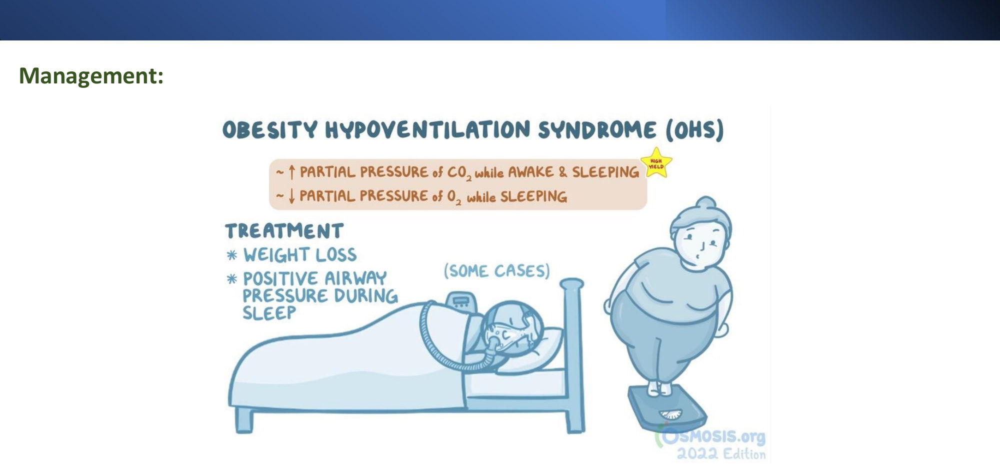

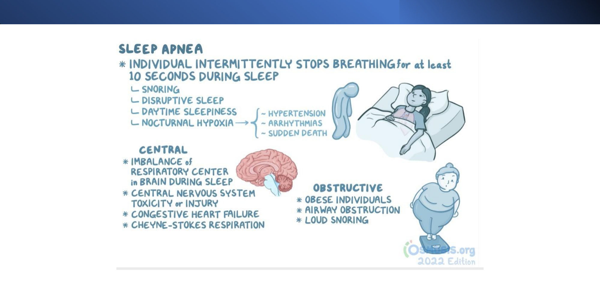

> 🔁 **Recap: CSA and OHS.**
> - **CSA:** no drive, no effort.
>   - Hypocapnic (Cheyne–Stokes in **HF**, primary) → CPAP/acetazolamide/O₂.
>   - Hypercapnic (opiates, neuromuscular, obesity, neurodegenerative) → **NIPPV with a backup rate**.
>   - Diagnose with PSG ± oesophageal manometry.
> - **OHS:** BMI ≥ 30 + **daytime hypercapnia** + sleep-disordered breathing; 90% have OSA; often presents in acute respiratory failure; weight loss + PAP.

---

## 3. High-Yield Comparison Tables

### Table A: OSA vs CSA vs OHS
| | **OSA** | **CSA** | **OHS** |
|---|---|---|---|
| Problem | Airway **collapse** | **No drive** | **Hypoventilation** (obesity) |
| Effort during apnoea | ⭐ **Present** | ⭐ **Absent** | Reduced |
| Pattern | Snoring, gasping | **Cheyne–Stokes** (HF, stroke) | Shallow breathing; worst in REM |
| Daytime PaCO₂ | Normal | Low (Cheyne–Stokes) or high (opiates, neuromuscular) | ⭐ **High** |
| Key risks | Obesity, tonsils, alcohol, acromegaly, hypothyroidism | **HF**, stroke, **opioids**, neurodegeneration | **BMI ≥ 30** |
| First-line treatment | ⭐ **CPAP** | **PAP + treat cause**; NIPPV with backup rate if hypercapnic | **Weight loss + PAP/NIV** |

### Table B: Breathing Events
| Event | Airflow | Duration | Additional criterion |
|---|---|---|---|
| Apnoea | **≥ 90% ↓** | ≥ 10 s | — |
| Hypopnoea | **≥ 30% ↓** | ≥ 10 s | **≥ 3% desaturation or arousal** |
| RERA | Limited | ≥ 10 s | **Arousal**, not meeting the above |

### Table C: OSA Consequences
| Consequence | Mechanism |
|---|---|
| Cor pulmonale | Hypoxic pulmonary vasoconstriction → PH |
| Secondary HTN | Sympathetic activation |
| ↑ HCO₃⁻ | Renal compensation of respiratory acidosis |
| Polycythaemia | Chronic hypoxia → EPO |
| Arrhythmia | Hypoxia + sympathetic surges |
| Morning headache | Nocturnal CO₂ retention |
| Sleepiness, cognition, mood | Sleep fragmentation |

---

## 4. Rules, Exceptions, Patterns
- **Apnoea ≥ 10 s, ≥ 90% airflow loss**; **hypopnoea ≥ 30% + 3% desaturation or arousal**.
- **OSA is the most common sleep disorder**; obesity is the main risk factor.
- **Acromegaly and hypothyroidism** are endocrine causes of OSA (macroglossia, myxoedema).
- **STOP-Bang: B = BMI > 35, A = age > 50, N = neck > 40 cm**; score ≥ 5 = high risk.
- **PSG confirms**; history is not enough.
- **CPAP is first line**; tracheostomy is the last resort.
- **Effort present = obstructive; effort absent = central.**
- **Cheyne–Stokes = HF/stroke** (hypocapnic CSA).
- **Opiates → hypercapnic CSA** → NIPPV with a backup rate.
- **OHS requires DAYTIME hypercapnia**; 90% also have OSA; often first seen in acute respiratory failure.
- *[added]* **ASV is contraindicated in HFrEF.**

---

## 5. Clinical Correlations
- **Resistant hypertension** → screen for OSA (with aldosteronism, renal artery stenosis; HTN lecture).
- **AF recurring after ablation/cardioversion** → think OSA.
- **Unexplained polycythaemia** or **↑ HCO₃⁻** in an obese patient → OSA/OHS.
- **Right heart failure with clear lungs and RAD** in a snorer → OSA → PH → **cor pulmonale** (lecture case 1).
- **Acromegaly / hypothyroidism** → OSA: check before anaesthesia.
- **Perioperative:** OSA patients are at risk with opioids and sedatives; bring their own CPAP *[added]*.
- **Driving / occupational safety:** daytime sleepiness → accidents.
- **HF clinic:** Cheyne–Stokes CSA marks severe HF; optimise HF therapy.
- **Opioid users:** central apnoea; review doses.

---

## 6. Rapid Revision (Last-Day)
1. **Sleep stages:**
   - N1 transitional
   - N2 stable
   - **N3 deep (GH; first third of the night)**
   - **REM** (dreams, high brain activity; *[added]* atonia, worst hypoventilation)
2. **Events:**
   - **apnoea ≥ 90% for ≥ 10 s**
   - **hypopnoea ≥ 30% for ≥ 10 s + ≥ 3% desaturation or arousal**
   - **RERA** = arousal without either
3. **OSA:** upper airway (oropharyngeal) obstruction; apnoeas of 20–30 s; hypoxia → arousal; hundreds a night; the **most common sleep disorder**.
4. **OSA risks:** **obesity**, structural, alcohol, smoking, **acromegaly, hypothyroidism**.
5. **Pathophysiology:** ↓O₂/↑CO₂ → (a) **pulmonary vasoconstriction → PH → cor pulmonale**; (b) **sympathetic → secondary HTN**; (c) **acidosis → ↑ HCO₃⁻**.
6. **Features:**
   - snoring, sleepiness, **morning headache**
   - personality change, ↓ intellect
   - PH, arrhythmia, HTN, **polycythaemia**, ↓ libido
   - witnessed apnoeas, nocturia
7. **Diagnosis:** history + partner, comorbidities, **STOP-Bang** (≥ 5 high), **polysomnography** (confirmatory).
8. **STOP-Bang:** Snoring, Tired, Observed, Pressure, **BMI > 35, Age > 50, Neck > 40 cm, Gender male**.
9. **OSA Rx:**
   - weight loss, exercise, stop smoking, no alcohol/sedatives, non-supine
   - oral appliance
   - **CPAP first line**
   - UPPP (selected); tracheostomy (last)
10. **CSA:** impaired respiratory-centre drive.
    - **Hypocapnic** (primary, **Cheyne–Stokes**) → CPAP, acetazolamide, O₂, CO₂, theophylline.
    - **Hypercapnic** (obesity, neuromuscular, **opiates**, neurodegeneration) → **NIPPV with a backup rate**.
11. **CSA PSG:** **no airflow + no effort**. Gold standard: PSG with **oesophageal manometry**. Treat with PAP + the underlying cause (HF, stroke).
12. **OHS:**
    - **BMI ≥ 30 + daytime hypercapnia** + sleep-disordered breathing
    - structural, central and obstructive components (**90% have OSA**)
    - headache, sleepiness, daytime dyspnoea; **often diagnosed in acute respiratory failure**
    - **↑ PaCO₂ awake and asleep; ↓ PaO₂ asleep**
    - **weight loss + PAP during sleep**

---

## 7. Exam-Style Questions

**Q1 (lecture case 1, slide 27).** A 56-year-old man has 5 months of progressive **bilateral ankle swelling** and exertional dyspnoea, with constant daytime tiredness. His wife reports **snoring and choking in sleep**. 25 pack-years; HTN on enalapril. BP 145/95, **JVD**, **lungs clear**, warm peripheries, 2+ oedema, ECG **right axis deviation**. Most likely cause?
a. LVH · b. Ischaemic heart disease · **c. Chronic hypoxia** · d. Chronic kidney damage · e. Pulmonary neoplasia · f. Alveolar destruction

> **Answer: c** *[reasoning added; key not on slides]*.
> - Snoring, choking and daytime sleepiness = **OSA**.
> - Recurrent nocturnal hypoxia → **hypoxic pulmonary vasoconstriction → pulmonary hypertension → cor pulmonale**: JVD, oedema, **RAD**, with **clear lungs** (so not left HF).
> - Why not the others:
>   - **f (emphysema)** would give hyperinflation and wheeze/↓ breath sounds; the lungs are clear and the sleep history points to OSA.
>   - **a/b** cause left-sided failure with crackles.

**Q2.** A 48-year-old man (BMI 37, neck 44 cm, treated HTN) snores loudly, falls asleep at traffic lights, and his wife has seen him stop breathing. STOP-Bang score and next step?
A. 4; reassure · B. 5; start CPAP empirically · **C. ≥ 6 (high risk); polysomnography** · D. 3; weight loss only

> **Answer: C** (slides 14–15).
> - STOP-Bang points: **S, T, O, P, B (> 35), N (> 40), G (male)** = 7 (age < 50 scores 0). **≥ 5 = high risk.**
> - **Polysomnography is required to confirm** before CPAP (first line once confirmed).

**Q3.** A 70-year-old with **HFrEF (EF 25%)** has periodic crescendo–decrescendo breathing with apnoeas during sleep. Polysomnography shows **absent thoracoabdominal effort** during apnoeas. Diagnosis?
A. OSA · **B. Central sleep apnoea with Cheyne–Stokes breathing** · C. OHS · D. Upper airway resistance syndrome

> **Answer: B** (slides 18–21).
> - **No effort = central.**
> - Cheyne–Stokes is the **hypocapnic** CSA of HF.
> - Treat HF + PAP. *[added]* **Avoid ASV in HFrEF.**

**Q4.** A 45-year-old woman with **BMI 48** is admitted drowsy. ABG on room air: pH 7.32, **PaCO₂ 68**, PaO₂ 52, **HCO₃⁻ 34**. Her CXR is clear and she has no lung disease. Diagnosis?
A. Acute asthma · B. Pure OSA · **C. Obesity hypoventilation syndrome (acute-on-chronic hypercapnic failure)** · D. Pulmonary embolism

> **Answer: C** (slide 24).
> - BMI ≥ 30 + hypercapnia; **↑ HCO₃⁻ shows chronicity** (renal compensation).
> - "**Often diagnosed in an acute state of respiratory failure**".
> - Treat with **NIV/PAP**, weight loss, cautious O₂.

**Q5.** Which is **not** a recognised risk factor for OSA in this lecture?
A. Acromegaly · B. Hypothyroidism · C. Alcohol · **D. Hyperthyroidism** · E. Obesity

> **Answer: D** (slide 11).
> - **Acromegaly** (macroglossia, soft-tissue growth) and **hypothyroidism** (myxoedematous tissue, ↓ drive) are the endocrine causes; hyperthyroidism is not.

---

## 8. Exam Pitfalls & Traps
| Trap | Correct thinking |
|---|---|
| Diagnosing OSA from STOP-Bang alone | ❌ A screen only; **polysomnography confirms** |
| Hypopnoea = any airflow drop | ❌ **≥ 30% for ≥ 10 s + ≥ 3% desaturation or arousal** |
| Apnoea = 5 s pause | ❌ **≥ 10 s, ≥ 90% loss** |
| Central apnoea = obstructive apnoea in the brain | ❌ Central = **no respiratory effort**; obstructive = effort against a closed airway |
| OHS = obese + OSA | ❌ Requires **daytime hypercapnia** (PaCO₂ > 45) |
| High-flow O₂ alone for OHS decompensation | ❌ Risk of worsening CO₂; **NIV** |
| CPAP is second line after surgery | ❌ **CPAP first line**; UPPP selected; tracheostomy last |
| Right heart failure + clear lungs → LV failure | ❌ Think **PH / cor pulmonale** (OSA, COPD, PE) |
| Cheyne–Stokes = OSA | ❌ **Central** (hypocapnic) apnoea of HF/stroke |
| ASV for central apnoea in HFrEF *[added]* | ❌ **Contraindicated** (SERVE-HF) |
| Opioid-related central apnoea → CPAP | ⚠️ Hypercapnic CSA → **NIPPV with a backup rate** |
| Sedatives for poor sleep in OSA | ❌ Worsen collapse; **avoid alcohol and sedatives** |
