# Tuberculosis: An Approach to a Case of Haemoptysis
**Dr. Essam Kotb, Internal Medicine** | Source: `12- Tuberculosis updated.pdf` (38 slides)

> **Legend:** ⭐ = high-yield · *[added]* = not on slides. Images marked "Slide N" come from the lecture; "Added diagram" = drawn for these notes. The two case answers are **reasoned by me; the key is not on the slides**.

> 🔗 **Bridge from earlier lectures:**
> - **Pneumonia (Kotb):** TB is the "pneumonia that doesn't respond". Suspect it with cough > 2–3 weeks, weight loss, night sweats, or an upper-lobe cavity.
> - **Lung abscess / bronchiectasis:** both are **cavitating / haemoptysis** differentials. Post-TB bronchiectasis is a classic upper-lobe cause.
> - **Lung cancer:** the other big cause of **haemoptysis + weight loss** in a smoker.
> - **Pleural diseases:** **TB effusion** = **lymphocytic exudate**, high **ADA**; pleural biopsy.
> - **Pericardial disease:** TB → effusion and **constrictive pericarditis**.
> - **Adrenal II:** **TB adrenalitis = 10–20% of primary Addison's**.
> - **Infective endocarditis / psychiatry:** isoniazid hepatitis, rifampicin enzyme induction and interactions *[added link]*.

---

## 1. Title / Objectives

| Domain | Objective | Likely tested as |
|---|---|---|
| Knowledge | Epidemiology, reservoirs, transmission of the **M. tuberculosis complex** | M. bovis → cow's milk |
| Knowledge | ⭐ **Primary TB, LTBI, reactivation**, tissue destruction | Ghon complex; upper-lobe reactivation |
| Knowledge | Pulmonary and **extrapulmonary** presentations | Pott, miliary, TB meningitis, GU TB |
| Knowledge | ⭐ Diagnostics and regimens: latent, active, drug-susceptible, drug-resistant | RIPE 2+4; 4-month HPZM; 3HP |
| Skill | Interpret history, exam, labs, imaging | TST/IGRA choice |
| Skill | Initiate the intensive and continuation phases; manage **interruptions**; adjuncts | ≥ 14-day gap → restart |
| Values | Professionalism; ⭐ **public health**: mandatory reporting, airborne precautions, contact tracing | Notification |

**Main subtopics:**
- aetiology
- classification
- pathogenesis
- clinical manifestations
- diagnostics
- treatment
- subtypes/variants
- complications

---

## 2. Main Content (Lecture Order)

### 2.1 Definition (Slide 5)
- **TB** = disease caused by ***Mycobacterium tuberculosis***, typically affecting the **lungs**.
- **Primary infection:** **airborne aerosol (droplet)** transmission; often **initially asymptomatic**.
- **Latent infection:** bacilli are **dormant** because innate and cellular immunity are intact.
- **Reactivation:** if immunity is compromised, latent infection reactivates → **active TB**.

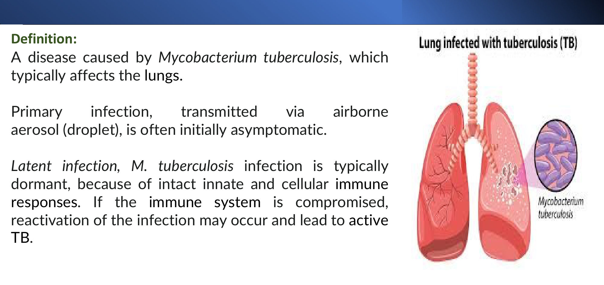

### 2.2 Aetiology: the M. tuberculosis Complex (Slide 6)

| Species | Transmission | Reservoir / note |
|---|---|---|
| ⭐ ***M. tuberculosis*** | **Aerosol droplet nuclei** | **Humans** |
| ⭐ ***M. bovis*** | ⭐ **Ingestion of contaminated cow's milk** (→ GI TB) | **Cattle** (*[added]* also the source of the **BCG** vaccine strain) |
| ***M. africanum*** | — | Common cause of TB in **West, Central, East Africa** |
| ***M. microti*** | — | (Rodents; rarely human) |

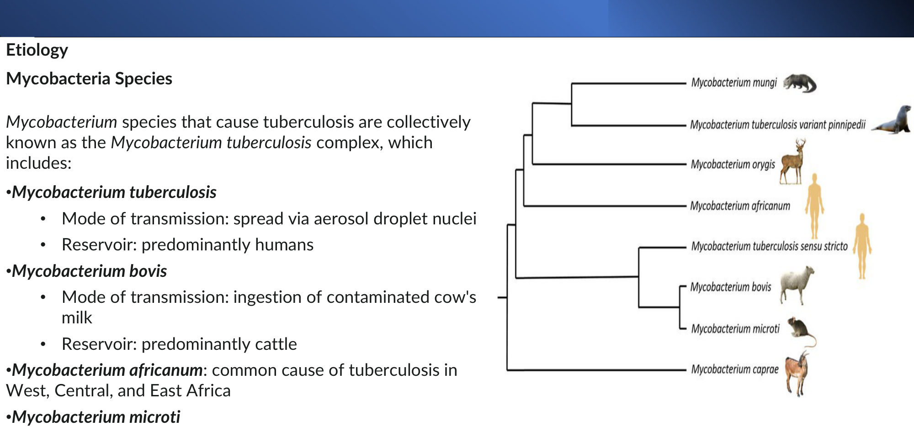

### 2.3 Risk Factors for Exposure (Slide 7)
- **Working in health care**
- **Migration from** or **frequent travel to** high-incidence countries
- ⭐ **Close contact** with active TB
- **Crowded living** (prisons); **homelessness**
- **Smoking**
- ⭐ **Associated disease: HIV, renal failure, DM**

**Epidemiology on the slide:** India is the highest-burden country, **> one-fifth (21%) of global incidence**; global incidence **9.4 million**, India 1.96 million.
- ⚠️ **These are 2009 WHO figures.**
- *[added]* WHO Global TB Report 2024 (2023 data): **~10.8 million** new cases; **India ~26%**; TB is again the **leading single infectious killer**.

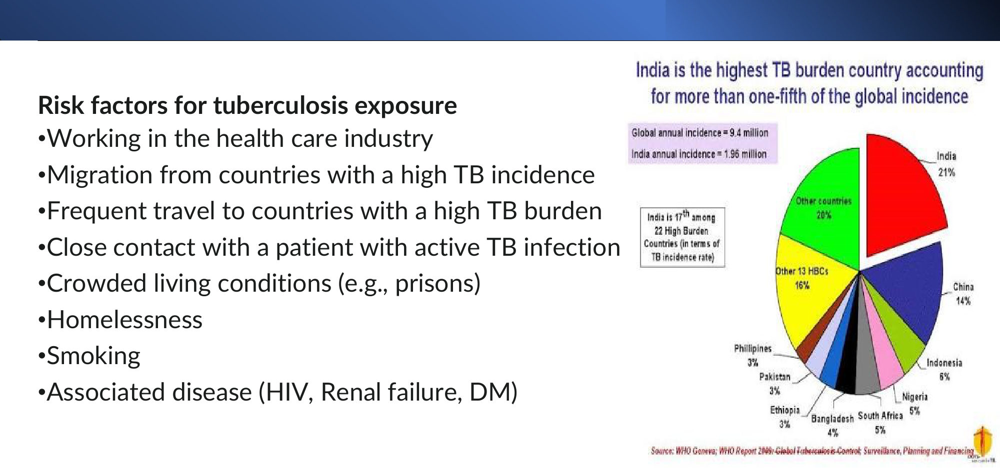

### 2.4 Pathophysiology (Slides 8–11) ⭐⭐

**Primary TB: innate response (slide 8)**
1. Inhaled droplet nuclei reach the **terminal alveoli**.
2. Taken up by **alveolar macrophages** (phagocytosis).
3. ⭐ ***M. tuberculosis* survives within macrophages** (*[added]* it blocks phagolysosome fusion).
4. **Macrophage lysis** releases bacilli, which infect new macrophages.
5. Some enter the **bloodstream → bacteraemia** → seeding of multiple organs.

**Granulomatous inflammation (slide 9)**
- Destruction of infected macrophages → ⭐ **central CASEOUS necrosis**.
- The **granuloma limits spread**.
- ⭐ **Ghon focus:** a granuloma, typically in the **middle/lower lobes**.
- ⭐ **Ghon complex:** **Ghon focus + regional (hilar) lymph node + the linking lymphatics**.
- *[added]* **Ranke complex** = a calcified Ghon complex.

| Immune response | Outcome |
|---|---|
| **Sufficient** | Most bacilli killed; some persist → ⭐ **latent TB**; Ghon complex **fibroses and calcifies** |
| **Deficient** (HIV, malnutrition) | Granulomas fail → ⭐ **progressive primary TB** → progressive lung disease, bacteraemia, **miliary TB** |

**Secondary (reactivation) TB (slide 10)**
- **Latent TB:** dynamic equilibrium between host immunity and bacilli.
- **Reactivation** when immunity weakens.
- ⭐ **Caseating granulomas with central necrosis and Langhans giant cells**.
- ⭐ **Upper lobes**, because of **higher oxygen tension** (*[added]* apical segments of the upper lobes, superior segment of the lower lobe).
- Prior sensitisation → **stronger inflammatory response** → ⭐ **extensive tissue destruction, cavitation, scarring**.

**Natural history (slide 11):**
1. Infection → **primary (Ghon) complex**.
2. Then one of:
   - **> 90%: infection controlled** → LTBI (or infection cleared). LTBI → **reactivation** (or **reinfection**) → localised caseating destructive lesions.
   - **< 10%: active primary TB** → progressive lung disease.
3. Either path can spread by **lymphogenic, bronchogenic or haematogenous** routes → **miliary TB**.

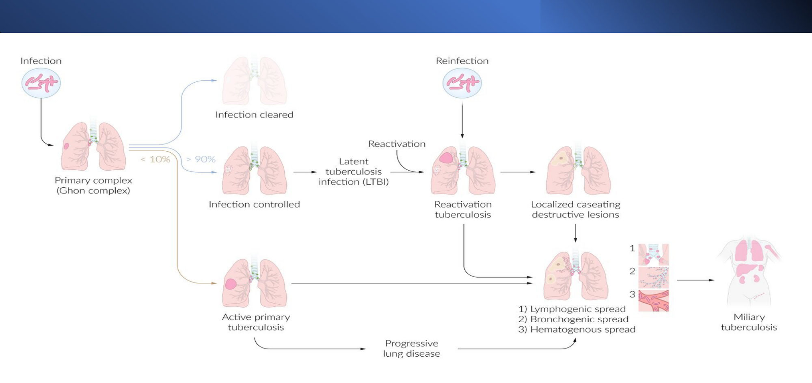

| | **Primary TB** | **Secondary (reactivation) TB** |
|---|---|---|
| Who | First exposure, *[added]* children | Previously infected; immunity falls |
| Site | **Mid/lower zones** + hilar nodes (Ghon complex) | ⭐ **Upper lobes** (high O₂) |
| Lesion | Ghon focus → fibrosis/calcification | **Cavitation**, caseation, scarring |
| Course | Usually asymptomatic; progressive if immunodeficient | Symptomatic; infectious (cavity) |

> 🔁 **Recap: Pathogenesis.**
> - Droplet → alveolar macrophage (bacilli survive inside) → caseating granuloma → Ghon complex.
> - > 90% controlled (latent); < 10% progress.
> - Reactivation targets the **upper lobes** (O₂), with cavitation, Langhans giant cells, caseation.
> - HIV/malnutrition → progressive primary or **miliary** TB.
>
> ▶️ **Up next: Clinical features.**

---

### 2.5 Pulmonary TB: Symptoms and Signs (Slides 12–13) ⭐

| Systemic | Pulmonary |
|---|---|
| ⭐ **Low-grade fever with night sweats** | **Non-productive cough** → **productive (purulent) cough** |
| ⭐ **Weight loss (often severe)**, anorexia | ⭐ **Haemoptysis** |
| Malaise, weakness | **Shortness of breath** |
| — | **Pleuritic chest pain** |

**Examination (nonspecific):**
- **General:** **pallor, clubbing, generalised wasting**.

| Chest finding | Signs |
|---|---|
| **Consolidation** | Dullness, crackles, ↓ breath sounds |
| ⭐ **Cavitation** | **Hyperresonance, bronchial breathing** (*[added]* "amphoric") |
| — | **Rhonchi** |
| **Pleural effusion/empyema** | Dullness, ↓ breath sounds |

- **Other:** ⭐ **erythema nodosum**, **conjunctivitis** (*[added]* phlyctenular).
- 🔎 **Slide 13 photos (unlabelled, my reading):** A = chest-wall/axillary swelling (likely lymphadenitis or a cold abscess); B = generalised wasting.

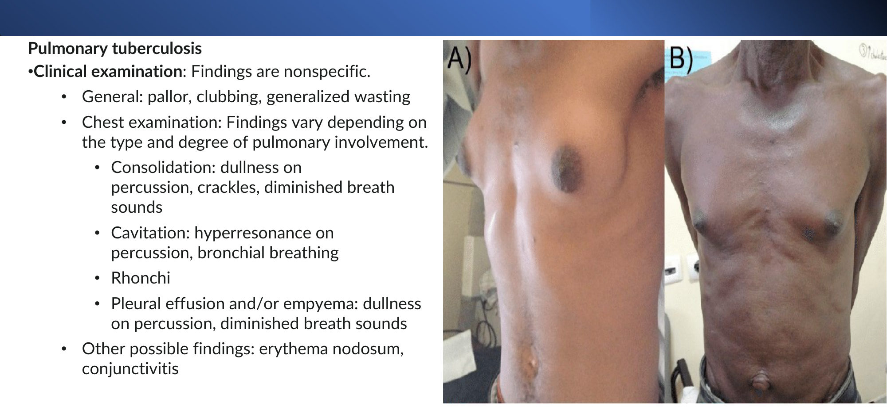

*[added]* **Classic triad to remember: cough > 2–3 weeks + night sweats + weight loss** → sputum for TB (and CXR).

### 2.6 Latent TB and Extrapulmonary TB (Slides 14–21) ⭐

**Latent TB:** an **asymptomatic** condition; bacilli **held in check by the immune system**.

**Extrapulmonary TB:** affects organs other than the lungs:
- **lymphadenitis**
- **pleural**
- **spinal**
- **peritonitis**
- **meningitis**
- **genitourinary**

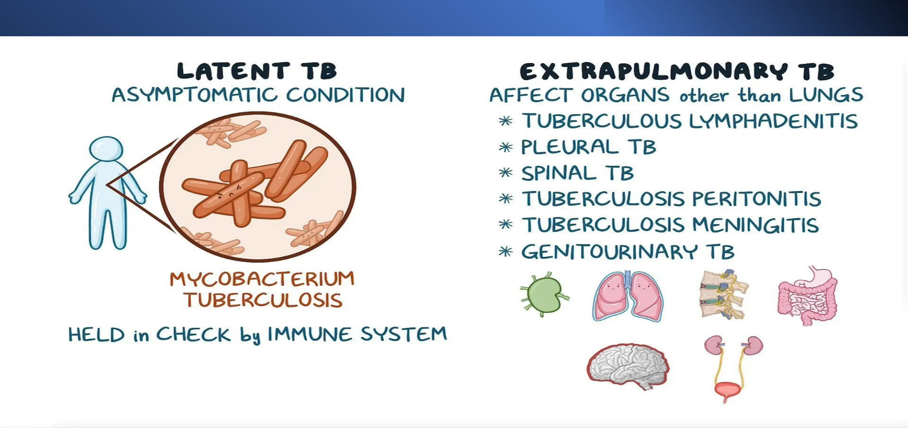

| Form | Pathophysiology | Features |
|---|---|---|
| ⭐ **TB lymphadenitis** (*[added]* "scrofula"; the **commonest** extrapulmonary form) | — | Sites: **cervical**, inguinal, axillary. **Lymphadenitis:** firm, mobile, discrete → **Periadenitis:** rubbery, **fixed** → ⭐ **Cold abscess:** soft, **fluctuant** (*[added]* → sinus) |
| **TB pleurisy** | Direct spread from lung; haematogenous; ⭐ **delayed hypersensitivity** to mycobacterial antigen in the pleural space | Constitutional symptoms, non-productive cough, **intense pleuritic pain**, dyspnoea |
| ⭐ **Miliary TB** | **Lymph or blood spread** from a pulmonary or extrapulmonary source → multi-organ granulomas | Sites: lungs, spleen, liver, nodes, **adrenals**, **meninges**, vertebrae, joints, bones, **choroid**. Cough, dyspnoea, constitutional symptoms, lymphadenopathy, **hepatosplenomegaly**, ⭐ **choroidal tubercles on fundoscopy**. *[added]* CXR: diffuse **millet-seed** 1–3 mm nodules |
| **Pericardial TB** | — | **Effusion** (rarely **tamponade**) or ⭐ **constrictive pericarditis**; chest pain, cough, dyspnoea |
| **Cutaneous TB** | — | Diagnosis: **skin biopsy** (histopathology, AFB stain, culture) |
| **GI TB** | ⭐ **Ingestion of infected milk (M. bovis) or swallowed sputum**; haematogenous/lymphatic | Peritoneum, oesophagus, stomach, jejunum, ⭐ **ileocaecum** (*[added]* mimics **Crohn's**), colorectal |
| **Urogenital TB** | Haematogenous spread to **kidneys** → ureters/bladder via urine | Flank pain, **haematuria**, storage symptoms (frequency, nocturia, urgency), **hypertension**, ⭐ **recurrent UTIs unresponsive to standard antibiotics** (*[added]* **sterile pyuria**) |
| ⭐ **Pott disease** (spinal TB) | Haematogenous spread to **vertebral bodies** → **intervertebral disc** destruction and collapse | Back pain, spinal tenderness, ⭐ **kyphosis (gibbus)**, deformity, **neurological deficit (paraplegia)**; **cold abscess** (*[added]* psoas); fever worse at night. Lower thoracic/lumbar; children and young adults |

⚠️ **Slide 18 error:** it is headed "**Tuberculous meningitis**" but its content is **pericardial TB**. TB meningitis has no clinical slide (only its treatment, slide 31).
- *[added]* **TB meningitis:** subacute headache, fever, **cranial nerve palsies (VI)**, ↓ consciousness, **basal meningitis** on MRI, hydrocephalus.
- *[added]* **CSF:** **lymphocytes, very high protein, very low glucose**, ADA ↑; "cobweb" clot.

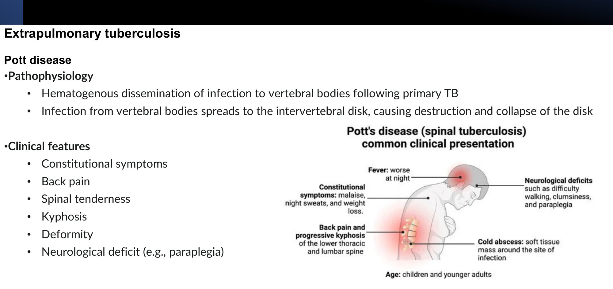

> 🔁 **Recap: Clinical.**
> - Pulmonary: fever, night sweats, weight loss, cough → haemoptysis; signs of consolidation or cavity; erythema nodosum.
> - Extrapulmonary:
>   - lymph nodes (commonest; cold abscess)
>   - pleura (hypersensitivity)
>   - miliary (choroidal tubercles)
>   - pericardium (constriction)
>   - GI (M. bovis, ileocaecal)
>   - GU (sterile pyuria, resistant UTIs)
>   - Pott (kyphosis, paraplegia)
>
> ▶️ **Up next: Diagnosis.**

---

### 2.7 Diagnosis (Slides 22–26) ⭐⭐

**Initial work-up (slide 22):**
- **History:** exposure; living in or visiting high-burden countries.
- **Microbiology:**
  - initial: ⭐ **AFB microscopy** + ⭐ **nucleic acid amplification test (NAAT)** (*[added]* e.g. **GeneXpert MTB/RIF**, which also detects **rifampicin resistance**)
  - confirmatory: ⭐ **mycobacterial culture** (the gold standard; *[added]* takes **2–8 weeks**)
  - **drug susceptibility testing** in certain circumstances
- **CT chest or CXR.**
- **Suspected extrapulmonary TB:** invasive sampling (**lymph node biopsy, thoracocentesis**).

**Imaging (slides 23–24):**
- **Slide 23 CXR:** right upper-zone **consolidation** + **hilar enlargement** (*[added]* the pattern of **primary TB**).
- 🔎 **Slide 24 (unlabelled, my reading):**
  - **A (CXR):** bilateral, predominantly upper-zone nodular/reticulonodular opacities with volume loss
  - **B (CT):** multiple nodules with a cavity and **tree-in-bud** pattern = active **endobronchial spread** (post-primary TB)

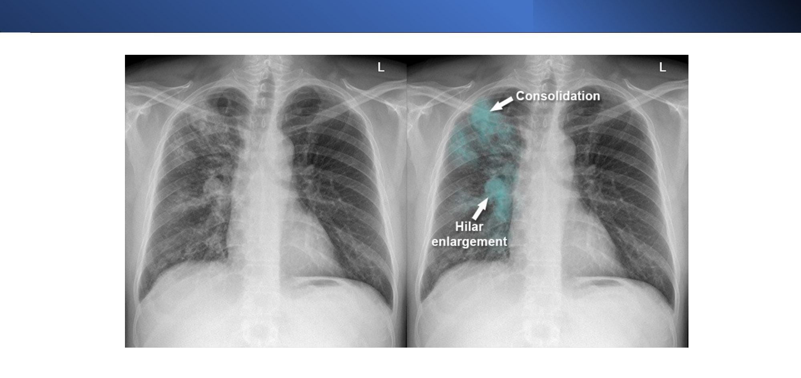 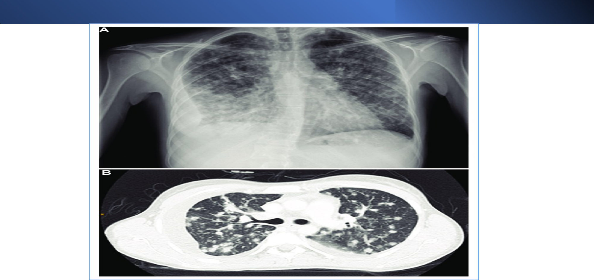

**Laboratory studies (slide 25):** unspecific, but useful early.
- **CBC:** mild **leukocytosis**, **anaemia**
- **Sodium:** mild **hyponatraemia** (*[added]* SIADH; or adrenal involvement)
- **Liver enzymes:** baseline before treatment
- **↑ ESR**; **pyuria** in renal disease
- ⭐ **IGRA (QuantiFERON)**
- **Microbiology:** bacilli confirmed by **direct visualisation, culture or genetic material**.
  - ⭐ **Sputum: ≥ 3 samples, 8–24 h apart, including ≥ 1 early-morning sample**
  - **induced sputum**; **gastric lavage** (*[added]* children); **bronchoalveolar lavage**
  - **Extrapulmonary:** fluid/tissue for cell count, chemistry, AFB smear and ⭐ **adenosine deaminase (ADA)**

**Diagnostic algorithm (slide 26) ⭐**
```
Consider TB → Symptoms?
 ├─ NO → LATENT → TST (harder to interpret after BCG)  or  IGRA (not if < 2 years old)
 │          └─ If TST or IGRA positive → EXCLUDE ACTIVE TB (CXR) and follow up
 └─ YES → ACTIVE → CXR + 3 × sputum → microscopy → culture ± molecular assay
                    → drug susceptibility testing → liaise with experts on treatment
```

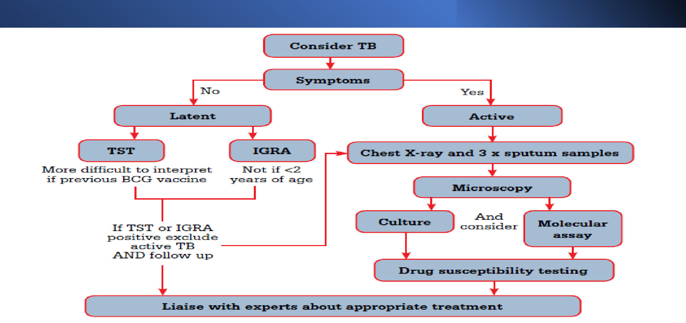

**TST vs IGRA *[added detail; principle on slide 26]***

| | **TST (Mantoux)** | **IGRA (QuantiFERON)** |
|---|---|---|
| Method | Intradermal PPD; read induration at **48–72 h** | Blood: IFN-γ release to TB-specific antigens (ESAT-6, CFP-10) |
| BCG cross-reaction | ⭐ **Yes**: false positives | ⭐ **No** (antigens absent from BCG) |
| Visits | 2 | 1 |
| Preferred in | **< 2 years** (IGRA less validated) | ⭐ **BCG-vaccinated, ≥ 2 years**, unlikely to return for reading |
| Limitation (both) | **Cannot distinguish latent from active**; false negatives in immunosuppression | Same |

**TST positivity cut-offs *[added; CDC]*:**

| Induration | Positive in |
|---|---|
| **≥ 5 mm** | **HIV**, recent contact, **fibrotic changes on CXR**, transplant/immunosuppressed (e.g. steroids ≥ 15 mg/day for ≥ 1 month) |
| **≥ 10 mm** | Recent immigrants (< 5 years) from high-burden countries, **IV drug users**, **residents/employees of high-risk congregate settings** (prisons, nursing homes, hospitals, shelters), mycobacteriology lab staff, **DM, CKD**, silicosis, children < 4 |
| **≥ 15 mm** | **No risk factors** |

> 🔁 **Recap: Diagnosis.**
> - Active TB: CXR + **3 sputum (≥ 1 early morning)** → AFB smear + **NAAT** → **culture (gold standard)** → DST.
> - Extrapulmonary: tissue/fluid with **ADA**.
> - Latent TB: **TST** (BCG confounds; < 2 years) or **IGRA** (BCG-vaccinated). A positive test → exclude active disease with CXR.
> - Labs: anaemia, mild leukocytosis, hyponatraemia, ↑ ESR; baseline LFTs.
>
> ▶️ **Up next: Treatment.**

---

### 2.8 Treatment: General Principles (Slide 27)
**Goals:**
1. ↓ disease severity and **transmission**
2. **eradicate all bacilli** → sustained cure without relapse
3. ⭐ **prevent drug resistance** (*[added]* hence multi-drug therapy)

⭐ **Infection control:**
- **Case notification:** **mandatory** reporting to the local health department.
- **Airborne precautions:** a **surgical mask for the patient**; **respirators (N95)** and PPE for staff and caregivers (*[added]* negative-pressure room).
- **Contact tracing.**

### 2.9 RIPE Regimen (Slide 28) ⭐⭐
| Phase | Duration | Drugs |
|---|---|---|
| ⭐ **Intensive** | **8 weeks (~2 months)** | **R**ifampicin + **I**soniazid + **P**yrazinamide + **E**thambutol |
| ⭐ **Continuation** | **18 weeks (~4 months)** | **Rifampicin + isoniazid** |
| **Adjunct** | Throughout | ⭐ **Pyridoxine (B6)** for everyone at risk of neuropathy. Isoniazid **promotes pyridoxine excretion** |

- **Self-administered and daily dosing preferred.**
- ⭐ **Directly observed therapy (DOT)** is the standard of practice.
- ⚠️ The slide lists "self-administered" and "DOT standard" together, which reads as contradictory. Current guidance: **daily dosing**, with DOT or video-observed therapy as the standard where available.
- ⭐ **Interruption ≥ 14 days during the intensive phase → restart full treatment.**


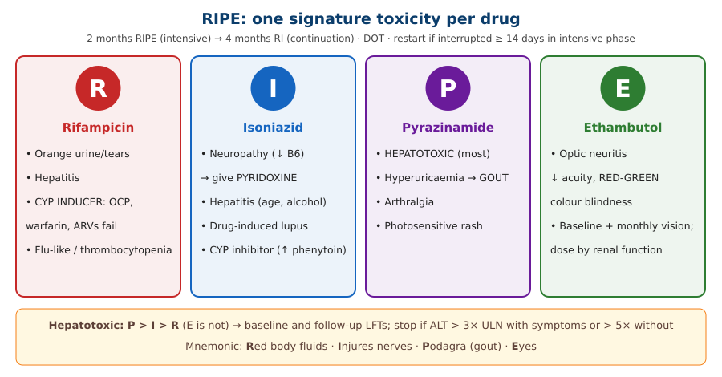

**RIPE toxicities *[added]*:**

| Drug | Mechanism | Key toxicities |
|---|---|---|
| **Rifampicin** | Inhibits DNA-dependent **RNA polymerase** | **Orange-red body fluids**, hepatitis, ⭐ **CYP450 induction** (OCP, warfarin, ARVs, steroids, methadone fail), flu-like syndrome, thrombocytopenia |
| **Isoniazid** | Inhibits **mycolic acid** synthesis | ⭐ **Peripheral neuropathy** (B6), **hepatitis** (↑ with age, alcohol; slow acetylators), drug-induced **lupus**, sideroblastic anaemia, CYP inhibitor |
| **Pyrazinamide** | — | ⭐ **Most hepatotoxic**; **hyperuricaemia → gout**; arthralgia |
| **Ethambutol** | Inhibits arabinosyl transferase | ⭐ **Optic neuritis: ↓ acuity, red–green colour blindness** (renal dosing; check vision) |

### 2.10 Four-Month Regimen (Slide 29)
**Eligibility:** drug-susceptible pulmonary TB, **age ≥ 12 years, ≥ 40 kg**, no contraindications (**drug interactions, prolonged QT, pregnancy**).

| Phase | Duration | Drugs |
|---|---|---|
| Intensive | **8 weeks** | **Rifapentine + isoniazid + pyrazinamide + moxifloxacin** |
| Continuation | **9 weeks** | **Rifapentine + isoniazid + moxifloxacin** |
| Adjunct | — | **Pyridoxine** |

*[added]* Moxifloxacin prolongs QT, hence the QT contraindication. This is the CDC 2022 "**HPZM**" regimen (**17 weeks total**).

### 2.11 Drug-Resistant TB (Slide 30)
- **Oral agents:**
  - **fluoroquinolone (levofloxacin/moxifloxacin)**
  - **linezolid**
  - **clofazimine**
  - **cycloserine**
- **IV agents:**
  - **amikacin**, streptomycin
  - **carbapenem with amoxicillin–clavulanate**
- ⭐ **≥ 5 drugs in the intensive phase; ≥ 4 in continuation.**
- **Surgery** can be beneficial.
- *[added]* **Definitions:**
  - **MDR-TB** = resistant to **isoniazid + rifampicin**
  - **pre-XDR** = MDR + a fluoroquinolone
  - **XDR** = pre-XDR + **bedaquiline or linezolid**
  - WHO now favours all-oral **BPaLM** (bedaquiline, pretomanid, linezolid ± moxifloxacin) for **6 months**

### 2.12 Extrapulmonary TB Treatment (Slide 31) ⭐
| Form | Regimen |
|---|---|
| Lymph node, pleural, miliary, pericardial, adrenal, GI, GU | **Standard therapy** (6 months) |
| ⭐ **TB meningitis** | **2 months 4-drug intensive + 7–10 months INH + rifampicin** (≈ **9–12 months**) + ⭐ **adjunctive dexamethasone or prednisolone for 6–8 weeks** |
| ⭐ **Pott disease / bone and joint** | **≥ 9 months**; surgery may be needed |

*[added]* Steroids are also used in **TB pericarditis** in some guidelines (reducing constriction); they are not routine in HIV.

### 2.13 Latent TB Treatment (Slide 32) ⭐
**Indication:** **positive IGRA or TST after active TB has been excluded.** ⭐ **Rifamycin-based short regimens are preferred.**

| Regimen | Details |
|---|---|
| ⭐ **3HP** | **Once-weekly isoniazid + rifapentine for 3 months** (12 doses) + pyridoxine |
| **3HR** | **Once-daily isoniazid + rifampicin for 3 months** + pyridoxine |
| *[added]* **4R** | Daily **rifampicin for 4 months** (preferred, no INH hepatotoxicity) |
| *[added]* **6–9H** | Daily isoniazid 6–9 months (alternative) |

⚠️ The slide pairs the **daily** 3HR regimen with "**once-weekly** pyridoxine". With daily isoniazid, pyridoxine is normally given **daily**; treat this as a slide error.

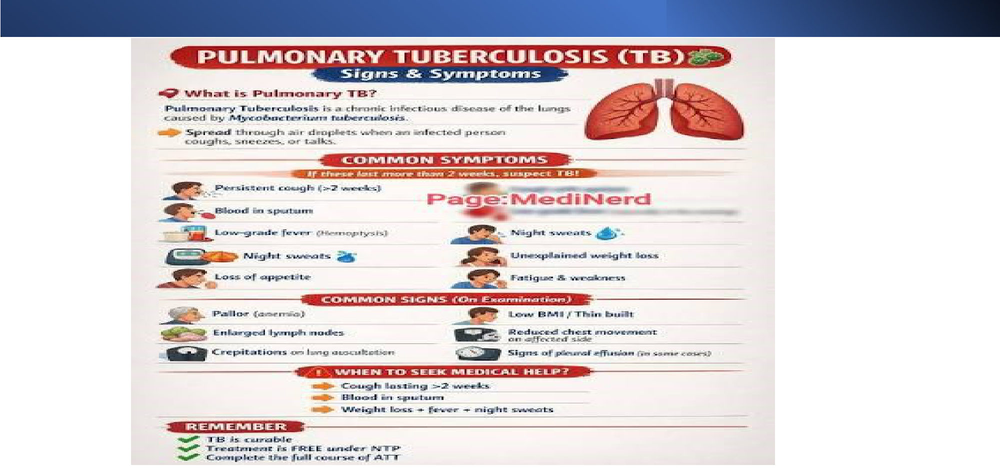

> 🔁 **Recap: Treatment.**
> - Notify, airborne isolation, contact tracing.
> - **RIPE 2 months → RI 4 months** + B6. DOT; restart if a gap ≥ 14 days in the intensive phase.
> - **4-month HPZM** if ≥ 12 years, ≥ 40 kg, not pregnant, no QT issue.
> - **MDR:** ≥ 5 drugs then ≥ 4 (FQ, linezolid, clofazimine, cycloserine, amikacin, carbapenem).
> - **TB meningitis:** 9–12 months + steroids. **Pott:** ≥ 9 months.
> - **Latent:** 3HP or 3HR (rifamycin-based preferred).

---

### 2.14 Approach to Haemoptysis *[added: the lecture title's theme, not covered on the slides]*
| Category | Causes |
|---|---|
| **Infection** | ⭐ **TB**, bronchiectasis, lung abscess, pneumonia, aspergilloma (in an old TB cavity) |
| **Neoplasm** | ⭐ **Lung cancer** (smoker > 40), carcinoid |
| **Vascular** | **PE**, mitral stenosis, AV malformation, LVF |
| **Vasculitis** | Granulomatosis with polyangiitis, Goodpasture's, SLE |
| **Other** | Anticoagulants, trauma, foreign body |

- **Massive haemoptysis** (> 200–600 mL/24 h): **lie on the bleeding side**, secure the airway, CT angiography → **bronchial artery embolisation**.

---

## 3. High-Yield Comparison Tables

### Table A: Primary vs Reactivation vs Miliary TB
| | Primary | Reactivation | Miliary |
|---|---|---|---|
| Lesion | **Ghon complex** (focus + hilar node) | **Upper-lobe cavity**, caseation | Diffuse 1–3 mm nodules |
| Zone | Mid/lower | **Upper** (O₂) | Diffuse |
| Host | First infection | Waning immunity | Immunodeficient (HIV, malnutrition), children |
| Clue | Hilar node | Haemoptysis, cavity | **Choroidal tubercles**, HSM |

### Table B: TB Treatment Durations
| Situation | Duration |
|---|---|
| Drug-susceptible pulmonary (RIPE) | **6 months** (2 + 4) |
| HPZM regimen | **4 months** (8 + 9 weeks) |
| TB meningitis | **9–12 months** + steroids |
| Bone/joint (Pott) | **≥ 9 months** |
| Latent (3HP / 3HR) | **3 months** |
| *[added]* Latent (4R) | 4 months |
| Interruption ≥ 14 days in the intensive phase | **Restart** |

### Table C: TB Specimens
| Site | Specimen |
|---|---|
| Lung | **≥ 3 sputum** (≥ 1 early morning), induced sputum, **BAL** |
| Child who can't expectorate | **Gastric lavage** (*[added]* early morning) |
| Pleura | Fluid (**lymphocytic exudate, ADA ↑**) ± biopsy |
| Lymph node | **Biopsy** (caseating granuloma) |
| Skin | Biopsy (histology, AFB, culture) |
| CSF/pericardium/peritoneum | Fluid: cells, chemistry, AFB, **ADA** |

### Table D: Extrapulmonary TB at a Glance
| Form | Hallmark |
|---|---|
| Lymphadenitis | **Cervical; cold abscess** (commonest extrapulmonary) |
| Pleural | **Hypersensitivity**; lymphocytic exudate |
| Miliary | **Choroidal tubercles**, HSM |
| Pericardial | **Constrictive pericarditis** |
| GI | **M. bovis; ileocaecal** |
| GU | **Sterile pyuria**, resistant UTIs, haematuria |
| Pott | **Kyphosis/gibbus, paraplegia**, cold abscess |
| Meningitis | Basal; CN VI; low glucose, high protein; **steroids** |
| *[added]* Adrenal | **Addison's** (10–20% of primary AI) |

---

## 4. Rules, Exceptions, Patterns
- **Primary TB → mid/lower zones + hilar nodes; reactivation → upper lobes** (O₂ tension).
- **> 90% of infections are controlled (latent); < 10% progress.**
- **M. bovis = milk = GI TB.**
- **Culture = gold standard; NAAT = rapid** (± rifampicin resistance).
- **3 sputum samples, ≥ 1 early morning.**
- **TST is confounded by BCG → use IGRA**, except in children **< 2 years** (TST).
- **Neither TST nor IGRA distinguishes latent from active** → a positive test requires a **CXR**.
- **RIPE 2 months → RI 4 months; B6 with isoniazid.**
- **Interruption ≥ 14 days in the intensive phase → restart.**
- **4-month regimen excluded in:** < 12 years, < 40 kg, pregnancy, QT prolongation, interactions.
- **MDR: ≥ 5 drugs intensive, ≥ 4 continuation.**
- **TB meningitis (and pericarditis) → steroids**; meningitis and bone TB need **longer** courses.
- **Latent TB: treat only after excluding active TB**; rifamycin-based short courses preferred.
- **TB is notifiable**; airborne precautions; contact tracing.

---

## 5. Clinical Correlations
- **Endocrine:**
  - **TB adrenalitis** → Addison's (Adrenal II)
  - **rifampicin induces cortisol metabolism** → double steroid doses in Addison's patients *[added]*
- **Cardiology:** TB **constrictive pericarditis** (Pericardial lecture): calcified pericardium, Kussmaul's sign.
- **Pleura:** **lymphocytic exudate, ADA > 40 U/L** *[added]*, low glucose; **pleural biopsy** has the best yield.
- **Nephrology:** **sterile pyuria**; CKD raises TB risk; **ethambutol dose by renal function**.
- **HIV:** the strongest risk factor for reactivation; atypical CXR; **rifampicin–ARV interactions** *[added]*.
- **Rheumatology:** screen for **latent TB before anti-TNF** biologics *[added]*.
- **Haemoptysis work-up in a smoker:** TB vs **lung cancer** vs bronchiectasis.
- **Gastroenterology:** **ileocaecal TB vs Crohn's**: biopsy, culture, IGRA before steroids or biologics.
- **Public health:** notification, contact tracing, DOT, airborne isolation.

---

## 6. Rapid Revision (Last-Day)
1. **M. tuberculosis complex:** M. tuberculosis (droplet, humans), **M. bovis (milk, cattle)**, M. africanum (Africa), M. microti.
2. **Risks:**
   - health-care work, migration/travel, **close contact**, prisons, homelessness, smoking
   - **HIV, CKD, DM**
   - India has the highest burden (slide: 21%, 2009 data)
3. **Primary:**
   - droplet → alveolar macrophage (survives) → bacteraemia
   - caseating granuloma → **Ghon focus (mid/lower) + node = Ghon complex** → fibrosis/calcification (latent)
4. **Deficient immunity** → progressive primary → **miliary**. > 90% controlled / < 10% progress.
5. **Reactivation:** **upper lobes** (O₂), caseating granulomas, **Langhans giant cells**, **cavitation**.
6. **Symptoms:** low-grade fever, **night sweats**, **weight loss**, cough → purulent → **haemoptysis**, dyspnoea, pleuritic pain.
7. **Signs:** pallor, clubbing, wasting; consolidation (dull, crackles); **cavity (hyperresonant, bronchial breathing)**; effusion; **erythema nodosum**, conjunctivitis.
8. **Extrapulmonary:**
   - **nodes** (firm → fixed → **cold abscess**)
   - **pleural** (hypersensitivity)
   - **miliary** (**choroidal tubercles**, HSM)
   - **pericardial** (effusion, **constriction**)
   - **GI** (milk/sputum; ileocaecal)
   - **GU** (haematuria, storage symptoms, HTN, **resistant UTIs**)
   - **Pott** (vertebral body → disc collapse; kyphosis; paraplegia)
9. **Diagnosis:**
   - **AFB smear + NAAT** → **culture (confirmatory)** → DST
   - CXR/CT
   - **3 sputum 8–24 h apart, ≥ 1 early morning**
   - induced sputum, gastric lavage, BAL
   - extrapulmonary: fluid/tissue + **ADA**
10. **Labs:** leukocytosis, anaemia, **hyponatraemia**, ↑ ESR, pyuria, baseline LFTs, **IGRA**.
11. **Algorithm:**
    - no symptoms → latent → TST (BCG confounds) / IGRA (not < 2 years) → positive → exclude active TB
    - symptoms → CXR + 3 sputum → microscopy → culture ± molecular → DST
12. **Principles:** cure, ↓ transmission, **prevent resistance**. **Notify; airborne precautions (mask the patient, respirators for staff); contact tracing.**
13. **RIPE:** **2 months RIPE + 4 months RI**; **pyridoxine**; daily; DOT; **restart if a gap ≥ 14 days** in the intensive phase.
14. **4-month regimen:** rifapentine + INH + PZA + **moxifloxacin** 8 weeks → rifapentine + INH + moxifloxacin 9 weeks. Requires ≥ 12 years, ≥ 40 kg; not pregnant; no QT prolongation.
15. **MDR:** FQ, linezolid, clofazimine, cycloserine; amikacin, streptomycin, carbapenem + co-amoxiclav; **≥ 5 then ≥ 4 drugs**; ± surgery.
16. **Meningitis:** 2 months + **7–10 months** + **dexamethasone/prednisolone 6–8 weeks**. **Bone/Pott:** **≥ 9 months** ± surgery.
17. **Latent:** after excluding active TB. **3HP weekly × 3 months** or **3HR daily × 3 months** + B6.

---

## 7. Exam-Style Questions

**Q1 (lecture case 1, slide 34).** A 48-year-old mechanic has a **pre-placement TB test** before **volunteering at a refugee clinic**. He has had a mild cough, sore throat and headaches for 1 week. Background: HTN, GERD; **never travelled**, **no TB contact**; smoker (27 pack-years). Vitals are normal and the lungs are clear; WBC 6200; COVID negative. **TST 13 mm at 50 h.** Next step?
**A. Chest X-ray** · B. No further management · C. IGRA · D. Repeat TST in 8–10 weeks · E. Isoniazid + rifapentine

> **Answer: A** *[reasoning added; key not on slides]*.
> - He is entering a **high-risk congregate health-care setting**, so the CDC cut-off is **≥ 10 mm** and **13 mm is positive**.
> - A positive TST can't distinguish latent from active TB, so **exclude active TB with a CXR** before any latent-TB treatment (slide 26: "if TST or IGRA positive, exclude active TB").
> - Why not the others:
>   - **E** is premature until the CXR is clear.
>   - **D** (two-step TST) is for an initially **negative** baseline test.
>   - **B** is wrong because 13 mm is positive here.
> - ⚠️ Nuance: CDC 2019 health-care-worker guidance allows a **confirmatory second test (IGRA)** for a positive result in a **low-risk asymptomatic** worker. If an answer key says **C**, that is the logic. The standard board answer for a positive TST is **CXR**.

**Q2 (lecture case 2, slide 35).** A 7-year-old **BCG-vaccinated** boy arrived from **Ukraine (high TB burden)** 2 months ago. He is asymptomatic (only allergic rhinitis-type symptoms) with a normal examination. Next step?
A. TST · B. No further evaluation · C. CXR · D. Sputum microscopy and culture · **E. IGRA**

> **Answer: E** *[reasoning added; key not on slides]*.
> - A recent immigrant from a high-burden country needs **screening for latent TB**.
> - He is **BCG-vaccinated and ≥ 2 years old** → **IGRA** avoids BCG false positives (slide 26: TST "more difficult to interpret if previous BCG"; IGRA "not if < 2 years").
> - CXR/sputum are for **symptomatic** patients or after a positive screen.

**Q3.** A 35-year-old with HIV has 6 weeks of fever, night sweats, 8 kg weight loss and cough with blood-streaked sputum. CXR shows a right upper-lobe cavity. Best initial microbiological approach?
A. Single sputum AFB smear · **B. Three sputum samples (≥ 1 early morning) for AFB smear and NAAT, with culture and susceptibility testing** · C. IGRA · D. TST · E. Bronchoscopy first

> **Answer: B** (slides 22, 25, 26).
> - Active TB needs ≥ 3 samples with **AFB + NAAT**, then **culture** (the gold standard) and **DST**.
> - IGRA/TST can't diagnose active disease.
> - Bronchoscopy/BAL is used if sputum is non-diagnostic.

**Q4.** A patient in the intensive phase of RIPE stops all medication for 3 weeks because of nausea, then returns. Management?
A. Continue where he left off · B. Extend the continuation phase by 3 weeks · **C. Restart the full treatment course** · D. Switch to the 4-month regimen

> **Answer: C** (slide 28): an interruption of **≥ 14 days during the intensive phase → restart full treatment**.

**Q5.** A patient on RIPE develops tingling feet. Two months later he reports blurred vision and difficulty distinguishing red from green. Most likely culprits?
**A. Isoniazid (neuropathy) and ethambutol (optic neuritis)** · B. Rifampicin and pyrazinamide · C. Pyrazinamide and ethambutol · D. Rifampicin and isoniazid

> **Answer: A** *[added pharmacology]*.
> - Isoniazid → B6-related neuropathy (prevented with **pyridoxine**, slide 28).
> - Ethambutol → optic neuritis, red–green colour blindness.

---

## 8. Exam Pitfalls & Traps
| Trap | Correct thinking |
|---|---|
| Ghon focus in the upper lobe | ❌ **Primary Ghon focus = mid/lower zones**; **reactivation = upper lobes** |
| Positive TST/IGRA = active TB | ❌ Neither distinguishes latent from active → **CXR** (± sputum) |
| Treat latent TB immediately after a positive test | ❌ **Exclude active TB first** (otherwise monotherapy breeds resistance) |
| TST in a BCG-vaccinated adult | ⚠️ False positives → prefer **IGRA** (≥ 2 years) |
| IGRA in a 1-year-old | ⚠️ Slide: IGRA "not if < 2 years" → TST |
| One sputum sample is enough | ❌ **≥ 3**, 8–24 h apart, ≥ 1 early morning |
| Smear negative = no TB | ❌ Smear is insensitive; **culture** (gold standard) / NAAT |
| Continue RIPE after a 3-week gap in the intensive phase | ❌ ≥ 14 days → **restart** |
| Forget pyridoxine | ❌ **B6 with isoniazid** (neuropathy) |
| 4-month HPZM in a pregnant or QT-prolonged patient | ❌ Contraindicated (moxifloxacin) |
| 6 months for TB meningitis | ❌ **9–12 months + steroids** |
| 6 months for Pott disease | ❌ **≥ 9 months** ± surgery |
| MDR-TB with 3 drugs | ❌ **≥ 5 intensive, ≥ 4 continuation** |
| TB isolation = surgical mask for staff | ❌ **Respirators (N95) for staff**; surgical mask for the **patient** |
| Not reporting TB | ❌ **Mandatory notification** + contact tracing |
| GI TB only from swallowed sputum | ⚠️ Also **M. bovis in unpasteurised milk** |
| Recurrent "UTI" with sterile cultures | ⚠️ Think **genitourinary TB** |
| Slide 18 = TB meningitis features | ⚠️ Slide error: the content is **pericardial TB** |
| Global burden 9.4 M / India 21% | ⚠️ 2009 data; now ~10.8 M, India ~26% (WHO 2024) |
