# Pituitary Disorders I: Hypothalamus–Pituitary, Tumours, Prolactinoma & Acromegaly
**Internal Medicine Department** | Source: `9- hypothalamus and pituitary – galactorrhea, acromegaly` (57 slides)

> **Legend:** ⭐ = high-yield · *[added]* = not on slides. Images marked "Slide N" come from the lecture; "Added diagram" = drawn for these notes.

> 🔗 **Bridge from earlier lectures:**
> - **Physiology (regulatory systems, hormones):** the hypothalamic–pituitary axis is the textbook **long and short negative-feedback loop**.
> - **Thyroid 2:** **primary hypothyroidism → ↑ TRH → ↑ prolactin** (this lecture's first case).
> - **Hyperparathyroidism:** **MEN 1** = **P**ituitary + **P**arathyroid + **P**ancreas.
> - **Hypertension:** acromegaly was a cause of secondary HTN.
> - **Lung cancer:** **bronchial carcinoid** can secrete **GHRH** (ectopic acromegaly).

---

## 1. Title / Objectives

| Domain | Objective | Likely tested as |
|---|---|---|
| Knowledge | Pathophysiology and etiology of pituitary disorders | Hormone ↔ cell type; feedback |
| Knowledge | ⭐ Epidemiology, manifestations, complications, management | Tumour types %, mass effects, prolactinoma/acromegaly features |
| Skill | ⭐ Interpret manifestations + investigations → diagnosis | IGF-1 → OGTT; prolactin < 200 = not prolactinoma |
| Skill | Evidence-based management | Dopamine agonist first for prolactinoma; surgery first for GH adenoma |
| Skill | Recognise emergencies | Apoplexy; visual loss |

**Lecture flow:** Pituitary anatomy (site, weight, blood supply) → Histology → Regulation → **Pituitary tumours** (incidence, endocrine and mass effects) → **Hyperprolactinaemia** (physiology, causes, prolactinoma: features, investigations, treatment) → Initial treatment of adenomas → **GH hypersecretion** (physiology, gigantism, DDx of tall stature, **acromegaly**: features, investigations, treatment) → Cases.

---

## 2. Main Content (Lecture Order)

### 2.1 Anatomy (Slides 4–8)

| Feature | Detail |
|---|---|
| **Site** | In the **sella turcica**. Dura lines the sella and forms a roof with a hole (**diaphragma sellae**) through which the **pituitary stalk** connects to the hypothalamus |
| **Weight** | **½–1 g** (6–13 mm in each dimension) |
| **Hypothalamus blood supply** | **Superior hypophyseal artery** (branch of the **ICA**) |
| ⭐ **Anterior pituitary** | **Hypophyseal portal circulation**: hypothalamus → **long portal veins** (the **main blood supply** of the anterior lobe) → capillary plexuses → **short portal veins** (main venous drainage) |
| **Posterior lobe** | **Inferior hypophyseal artery** |

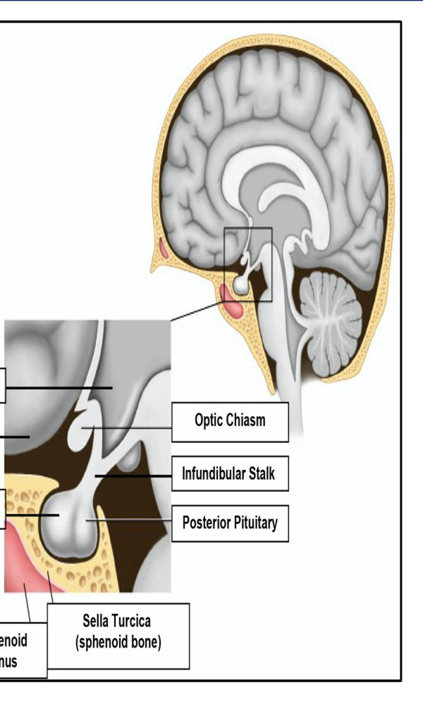 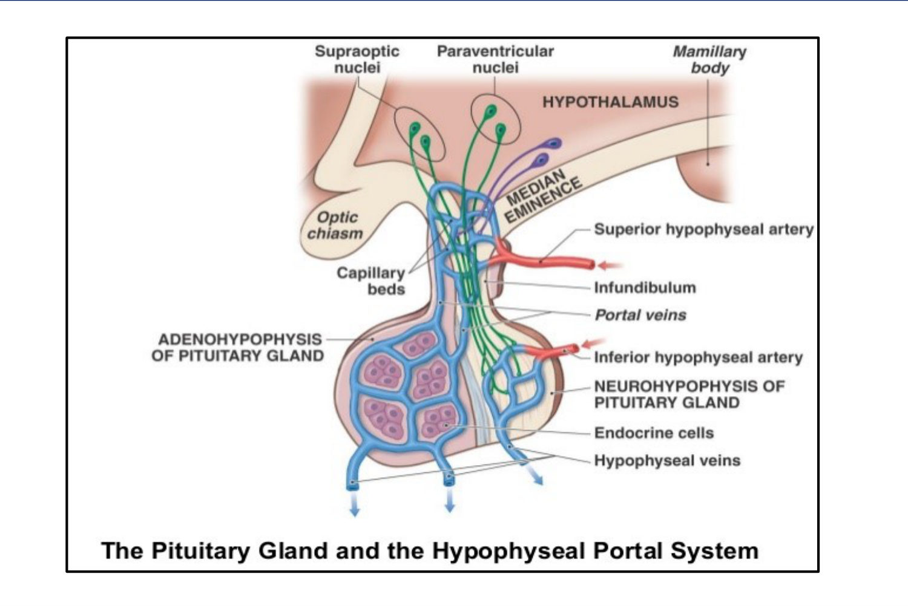

*[added] Because the anterior lobe depends on a low-pressure **portal (venous) supply**, it is vulnerable to infarction: **Sheehan syndrome** (next lecture).*

### 2.2 Histology (Slides 9–11) ⭐

| Cell type (stain) | Hormones |
|---|---|
| **A**cidophils | **Prolactin**, **GH** |
| **B**asophils | **TSH, ACTH, FSH** (→ follicle maturation and spermatogenesis), **LH** (→ ovulation, corpus luteum, ↑ testosterone) |
| **C**hromophobes | **No secretion** |

> **Mnemonic:** **"GPA"** → **G**H and **P**RL are **A**cidophils. **B-FLAT** → **B**asophils make **F**SH, **L**H, **A**CTH, **T**SH.

**Posterior pituitary hormones** are made in the hypothalamus, then transported down the axons to the posterior lobe:
- **ADH**: **supraoptic** nucleus
- **oxytocin**: **paraventricular** nucleus

*(The slide's "respectively" is in the wrong order. See §8.)*

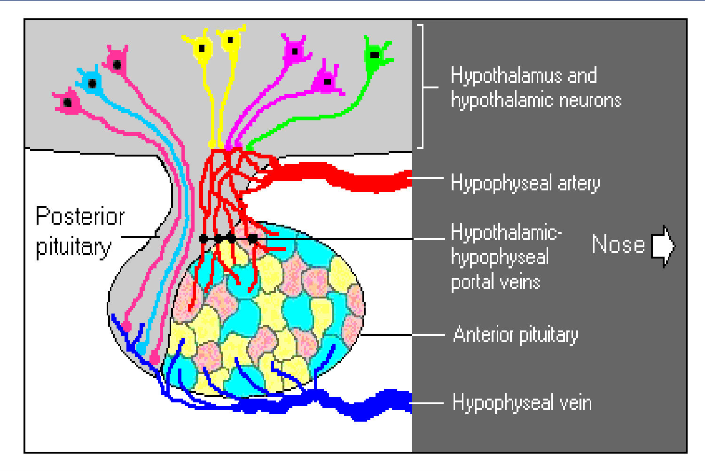

### 2.3 Regulation of Anterior Pituitary Secretion (Slides 12–13) ⭐

| Hypothalamic hormone | Effect |
|---|---|
| **TRH** | ↑ **TSH** and ↑ **PRL** |
| **GnRH (LHRH)** | ↑ **LH, FSH** (**LH > FSH**) |
| **GHRH** | ↑ **GH** |
| ⭐ **GHIH (somatostatin)** | ↓ **GH**. Also in pancreatic **D cells**: ↓ insulin, glucagon, gastrin, VIP |
| **CRH** | ↑ **ACTH** |
| ⭐ **Dopamine** | **Prolactin has no specific releasing factor**. **Dopamine is the PRL-inhibiting factor** (tonic inhibition) |

**Feedback:**
- **Long loop:** target-gland hormones act on the pituitary and hypothalamus (e.g., **thyroxine blunts the TSH response to TRH**).
- **Short loop:** the pituitary hormone acts on the hypothalamus.

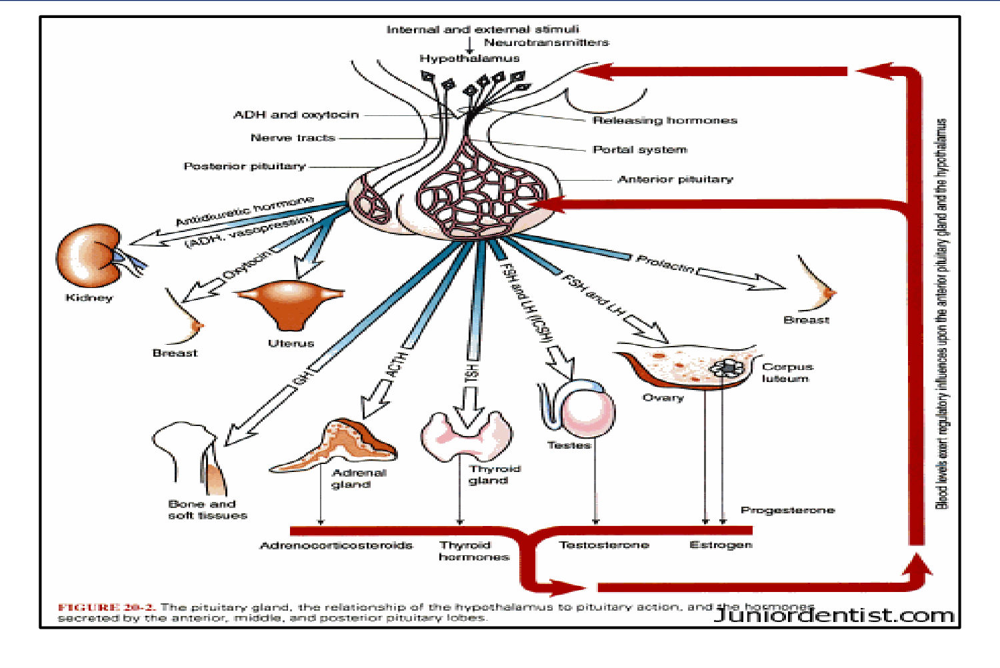

> 🔁 **Recap: Anatomy and physiology.**
> - **Gland:** in the sella, below the diaphragma sellae, ½–1 g. Anterior lobe fed by **portal veins**; posterior by the inferior hypophyseal artery.
> - **Cells:** acidophils = GH, PRL; basophils = TSH, ACTH, FSH, LH.
> - **Hypothalamic control:** TRH (TSH + PRL), GnRH, GHRH, somatostatin (↓GH), CRH. PRL is under **dopamine inhibition**. Long and short feedback loops.
> 🔗 **Link:** An adenoma in this small box causes problems in two ways: the hormone it makes, and what it squeezes.
> ▶️ **Up next: Pituitary tumours.**

---

### 2.4 Pituitary Tumours (Slides 14–19) ⭐
**Incidence:** about **15% of intracranial tumours**.

| Type | % |
|---|---|
| ⭐ **Prolactin-producing** | **35%** (commonest functioning) |
| **Non-functioning** | **30%** |
| **GH-secreting** | **20%** |
| **Mixed PRL + GH** | **10%** |
| **TSH, LH, FSH, ACTH** | **5%** |

**Clinical picture:**
- **Acute:** ⭐ **pituitary apoplexy**.
- **Chronic, endocrine:**
    - **hyperpituitarism** (by the hormone secreted)
    - **hypopituitarism**
    - association with **MEN 1** (pituitary, pancreas, parathyroid)
- **Chronic, mass effects:**

| Direction | Effect |
|---|---|
| **Headache** | ⭐ **Bitemporal**. It **improves** when the tumour erodes the clinoid process and escapes into the cranial cavity. Rare and late: **occipital headache + ↑ ICP** |
| ⭐ **Superior** | **Chiasmal syndrome**: ↓ visual acuity + ⭐ **bitemporal hemianopia**. **Hypothalamic syndrome**: **DI**, disturbed thirst, temperature, appetite and sleep; **SIADH** |
| **Lateral** (cavernous sinus) | **CN III, IV, VI and V1** → **diplopia + facial pain**; temporal lobe dysfunction |
| **Inferior** | **Nasopharyngeal mass**, ⭐ **CSF rhinorrhoea** |
| **Posterior** | **Bilateral pyramidal (Δ) signs** |

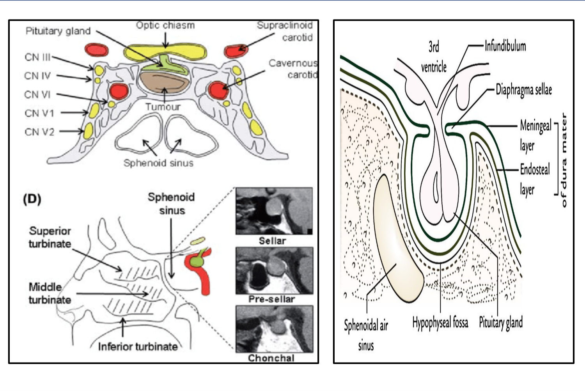 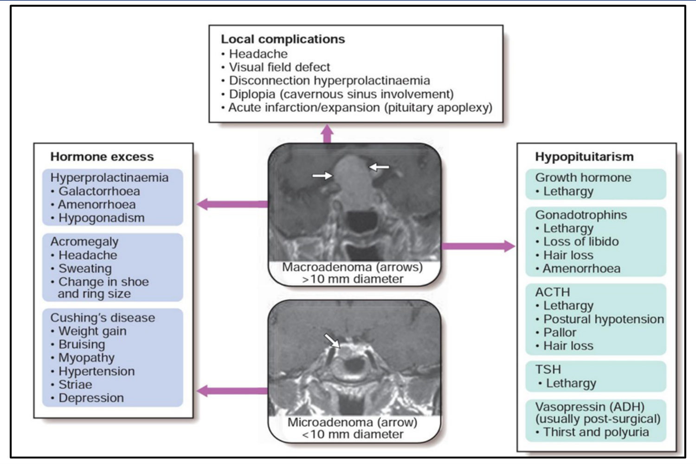

*Slide 19 summary:*
- **Local:** headache, visual field defect, **disconnection hyperprolactinaemia**, diplopia, apoplexy.
- **Excess:** PRL (galactorrhoea, amenorrhoea, hypogonadism); acromegaly (headache, sweating, change in shoe and ring size); Cushing's (weight gain, bruising, myopathy, HTN, striae, depression).
- **Hypopituitarism:**
    - GH: lethargy
    - gonadotrophins: lethargy, loss of libido, hair loss, amenorrhoea
    - ACTH: lethargy, postural hypotension, pallor, hair loss
    - TSH: lethargy
    - ADH: usually post-surgical; thirst and polyuria
- **Size:** **macroadenoma > 10 mm**; **microadenoma < 10 mm**.

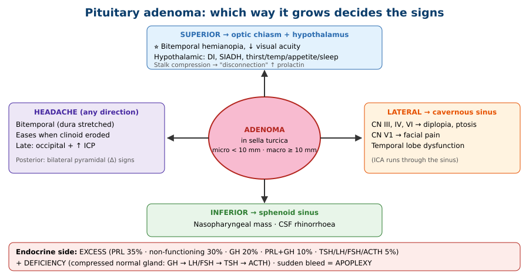

> 🔁 **Recap: Tumours.** 15% of intracranial tumours. PRL 35% > non-functioning 30% > GH 20% > mixed 10% > others 5%. Endocrine excess or deficiency; MEN 1. Mass effects: bitemporal headache; up → bitemporal hemianopia, DI/SIADH; lateral → CN III/IV/V1/VI; down → CSF rhinorrhoea; back → pyramidal signs. Acute bleed = apoplexy.
> 🔗 **Link:** The commonest functioning tumour secretes prolactin, but most high prolactin levels are **not** tumours.
> ▶️ **Up next: Hyperprolactinaemia.**

---

### 2.5 Hyperprolactinaemia (Slides 20–21) ⭐
**Physiology:**
- **Actions:** **breast milk production**; **suppression of menstruation**.
- **Control:** **nocturnal peak** (sleep-related).

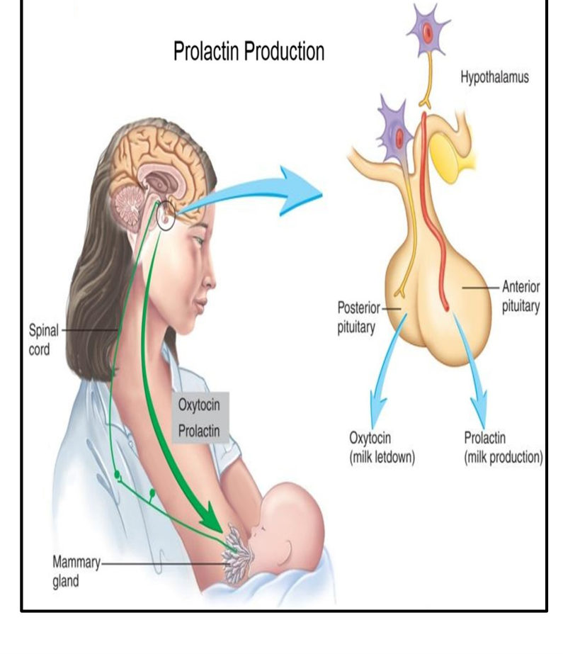

**Causes (slide 21):**

| Group | Causes |
|---|---|
| **A. Physiological** | ⭐ **Pregnancy** · **"3 S"**: **S**uckling, **S**tress, **S**timulation of the nipple |
| **B. Drugs** | **Dopamine-depleting** (methyldopa, reserpine) · ⭐ **dopamine-receptor antagonists** (**phenothiazines/chlorpromazine**, **antipsychotics**; *[added]* metoclopramide, domperidone, risperidone) · **oestrogens** · **opiates** |
| **C. Pathological: "3C, 3P"** | **C**RF (chronic renal failure) · **C**irrhosis · **C**hest wall trauma (*[added]* zoster, burns) · **P**ituitary (prolactinoma; **tumours compressing the stalk**) · **P**roduction by other tumours (paraneoplastic) · ⭐ **P**rimary **hypothyroidism** (↑ TRH) |

### 2.6 Prolactinoma (Slides 22–27) ⭐
**Size:** usually a **microadenoma in women** and a **macroadenoma in men** *[added: women present early with menstrual change; men present late with mass effects]*.

| Group | Manifestations (↑ PRL → ↓↓ GnRH) |
|---|---|
| **Sellar tumour** | Mass effects (above) |
| **Females** | ⭐ **Amenorrhoea and/or galactorrhoea** · **hypo-oestrogenic**: ↓ libido, ↓ vaginal secretion, dyspareunia, **osteoporosis** · **hyperandrogenic**: hirsutism, acne (↑ PRL → ↑ adrenal androgens) |
| **Males** | ⭐ **↓ libido and impotence** · oligospermia, infertility · **gynaecomastia (rare)** |
| **Both** | **Delayed puberty** |

**Investigations (slide 24):**
1. **Basal prolactin:** normal **♀ 0–25 ng/mL**, **♂ 0–20 ng/mL**.
    - ⭐ **Clinical pearl:** **PRL < 200 ng/mL suggests a cause other than prolactinoma** (drugs, primary hypothyroidism).
    - ⭐ Always **review the medication history**.
2. **X-ray, CT, MRI** to detect pituitary tumours.
    - ⭐ **Clinical pearl:** order **hormone assays BEFORE imaging** to avoid overdiagnosing pituitary **incidentalomas**.

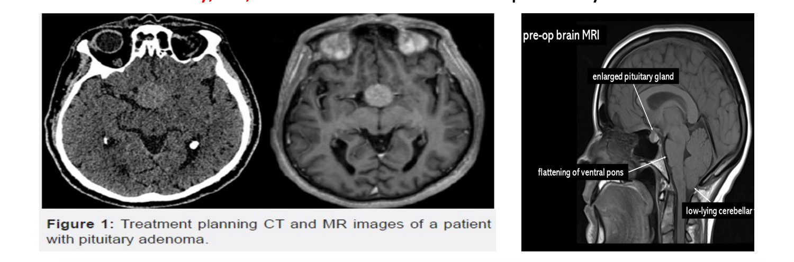

*[added] Also: **pregnancy test**, **TSH**, renal and liver function. Beware the **"hook effect"**: a huge macroprolactinoma can give a falsely modest PRL, so dilute the sample. **Macroprolactin** is biologically inactive.*

**Treatment (slides 25–27):**

| Option | Detail |
|---|---|
| **1. Surgery** | **Trans-sphenoidal** for **microadenoma (< 10 mm)**. Complications: **hypopituitarism, CSF rhinorrhoea, meningitis, optic nerve damage**. **Trans-frontal** for large tumours (> 10 mm) |
| **2. Radiotherapy** | **4500 rads** |
| ⭐ **3. Medical: dopamine agonist** | **Bromocriptine**. Aims: ↓ hyperprolactinaemia **from any cause**; **restores menses and fertility**, stops galactorrhoea; ⭐ **shrinks the tumour**. Dose **2.5 mg tds with meals** for 1–2 years. Side effects: **nausea, vomiting, postural hypotension**. ⭐ **Cabergoline** is more effective (but expensive) |

**Initial treatment of pituitary adenomas (slide 27):**

| Tumour | First line |
|---|---|
| ⭐ **Prolactinoma** (symptomatic or macroadenoma) | **Pharmacotherapy** (dopamine agonist) |
| **Secretory adenomas other than prolactinoma** (GH, ACTH, TSH) | ⭐ **Surgery** |
| **Symptomatic non-secretory adenoma** | **Surgery** |
| **Asymptomatic microprolactinoma** | **Observation** |
| **Asymptomatic non-secretory adenoma** | **Observation** |

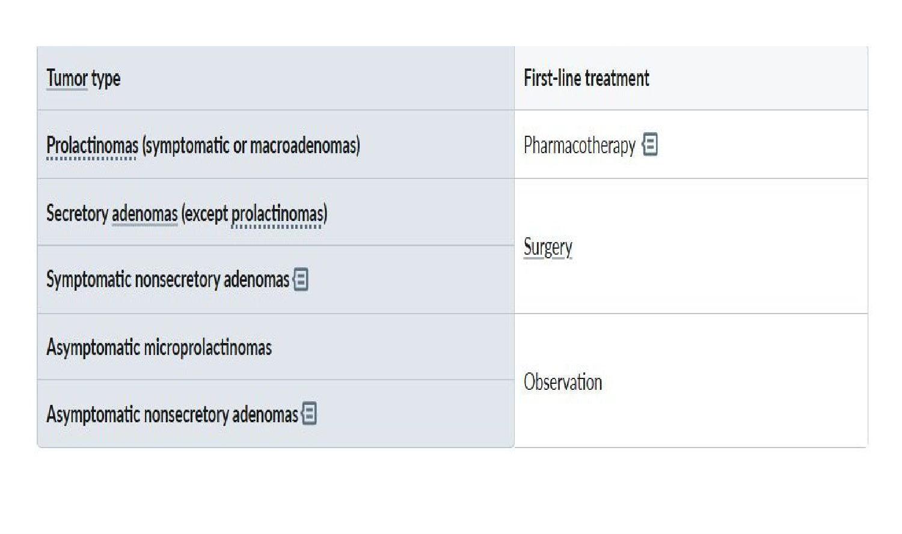

> 🔁 **Recap: Prolactin.** Dopamine inhibits PRL; TRH stimulates it.
> - **Causes:** pregnancy, the 3 S's; drugs (antipsychotics, methyldopa, oestrogen, opiates); 3C (CRF, cirrhosis, chest wall), 3P (pituitary/stalk, paraneoplastic, primary hypothyroidism).
> - **Prolactinoma:** ♀ micro (amenorrhoea, galactorrhoea, osteoporosis, hirsutism), ♂ macro (impotence, mass effects).
> - **Tests:** PRL < 200 → look for another cause; hormones before imaging.
> - **Treatment:** dopamine agonist first (cabergoline > bromocriptine; shrinks the tumour). Surgery or radiotherapy if that fails.
> 🔗 **Link:** The other acidophil hormone, GH, produces the most visible endocrine disease.
> ▶️ **Up next: GH excess (gigantism and acromegaly).**

---

### 2.7 GH Physiology (Slides 28–30)
- **Actions:** ↑ **blood glucose**, ↑ **protein synthesis**, ↑ **free fatty acids**.
- Acts via **somatomedins (IGF-1)**, made mainly in the **liver**.

| ↑ GH (via GHRH) | ↓ GH (via somatostatin) |
|---|---|
| **Hypoglycaemia** · stress, exercise · oestrogen, **clonidine, L-dopa** | ⭐ **Hyperglycaemia** · obesity |

**GH excess** comes from an **acidophil adenoma**:
- **Gigantism**: before **epiphyseal fusion**.
- **Acromegaly**: after epiphyseal fusion.

### 2.8 Gigantism & Tall Stature (Slides 31–35)
- **Massive skeletal growth** (up to **2.5 m**); soft tissues also enlarge.
- **Early:** strong. **Later ("decline stage"):** weakness, **hypogonadism, myopathy, peripheral neuropathy**.

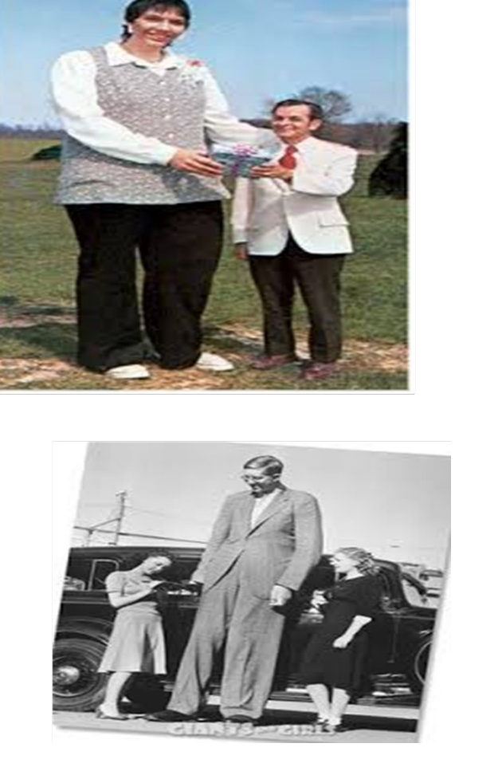 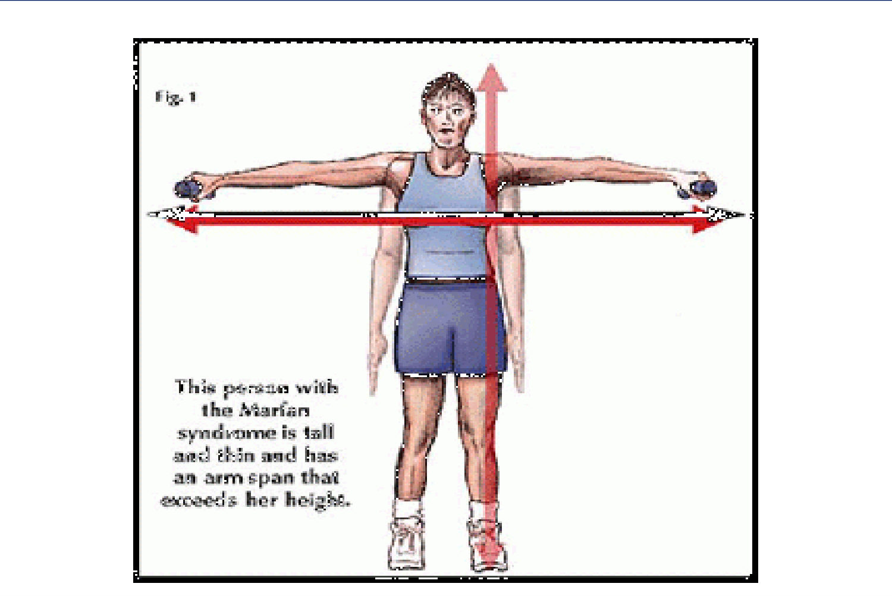

**DDx of tall stature (slide 34):**

| Cause | Clue |
|---|---|
| ⭐ **Constitutional / genetic (most common)** | **Proportionate**, **normal GH** |
| **Cerebral gigantism (Sotos)** | **Early puberty** |
| **Eunuchoidism** | **Disproportionate** (long limbs) + hypogonadism |
| **Hyperthyroidism** | |
| **Homocystinuria** | Marfan-like + **mental retardation** (*[added]* downward lens dislocation, thrombosis) |
| **Marfan** | Arm span > height, upward lens dislocation *[added]* |
| ⭐ **Klinefelter** | **Azoospermia, gynaecomastia, positive buccal smear** (Barr body; 47 XXY) |

### 2.9 Acromegaly: Clinical Picture (Slides 36–44) ⭐
- **Acral parts** (hands, nose, feet) enlarge.
- **Slowly progressive**, starting in the **2nd–4th decades**. **Manifestations appear 10–20 years later** (late diagnosis).

| # | System | Features |
|---|---|---|
| 1 | **Face** | Enlarged lips, nose and soft tissue; ⭐ **prognathism** with ↑ spacing of lower teeth; ⭐ **macroglossia**; **frontal bossing** (big frontal sinuses); **cavernous, husky voice** |
| 2 | **Soft tissue** | ⭐ **↑ ring, glove, shoe and hat size**; **spade-like hands** |
| 3 | **Neuro** | ⭐ **Carpal tunnel syndrome**; peripheral neuropathy; diabetic neuropathy; **proximal myopathy**; tumour mass effects |
| 4 | **Visceromegaly** | Liver, spleen, kidney… |
| 5 | **Joints** | **Osteoarthritis** (spine, hip, knee), late |
| 6 | **CVS** | ⭐ **Hypertension**, **cardiomegaly**, Raynaud's, conduction defects and arrhythmia, ⭐ **sleep apnoea** |
| 7 | **Skin** | **Hypertrichosis**, ↑ pigmentation, **acanthosis nigricans**, **warm, moist, thick, oily skin** (acne) |
| 8 | **Metabolic** | ↑ BMR → heat intolerance, **hyperhidrosis**; ⭐ **glucose intolerance 50%, frank DM 25%**; **hyperphosphataemia**; **hypercalcaemia 16%** (↑ 1,25(OH)₂D) |
| 9 | **Endocrine** | Co-secretion: **PRL** (hyperprolactinaemia), **ACTH** (Cushing's), **TSH** (secondary thyrotoxicosis); **MEN 1**; **DI** (suprasellar extension) |

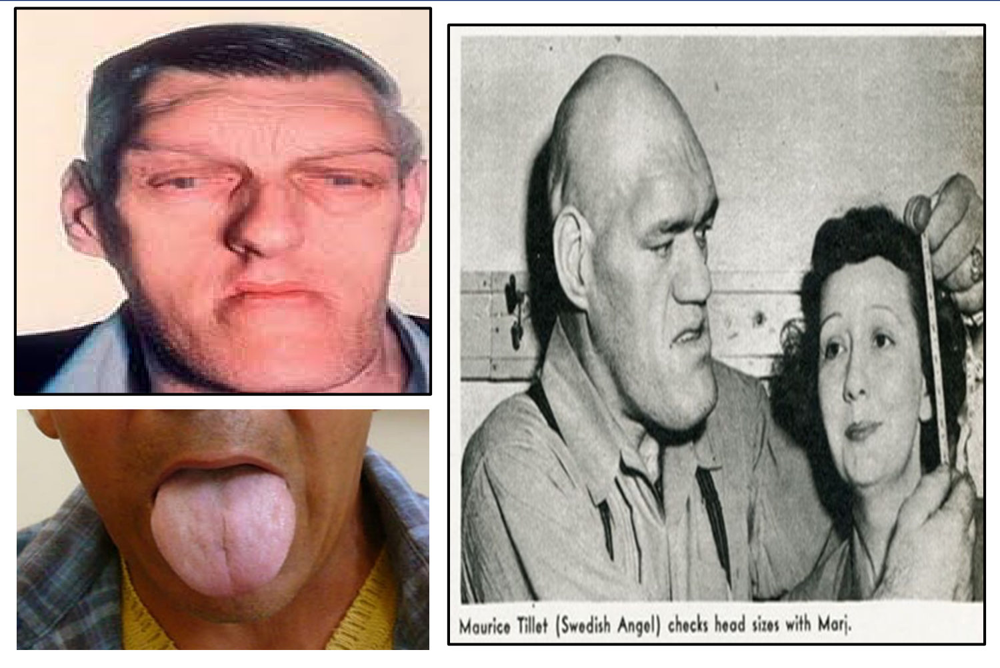 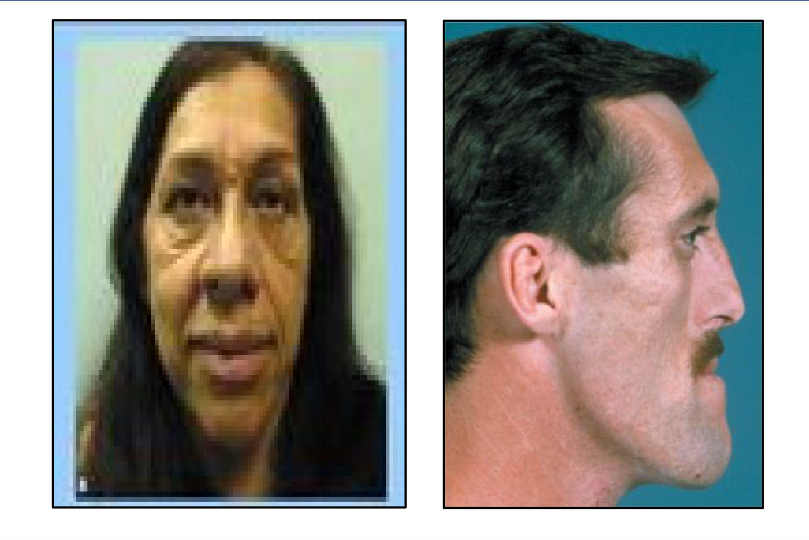

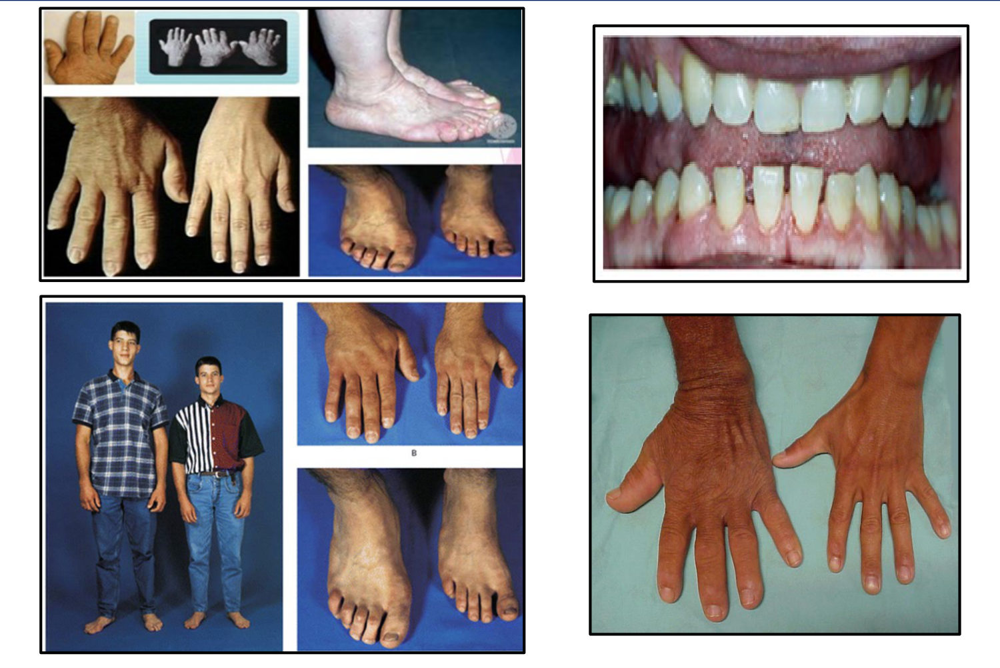

> **Mnemonic for acromegaly: "ABCDEF"** *[added]*:
> - **A**rthralgia / **A**rthritis
> - **B**P ↑
> - **C**arpal tunnel
> - **D**iabetes
> - **E**nlarged organs
> - **F**ield defect (bitemporal)

### 2.10 Acromegaly: Investigations (Slides 45–48) ⭐

**Radiology:**

| X-ray | Finding |
|---|---|
| **Skull** | Thick cortex; **pneumatised frontal sinus**; prominent occipital protuberance; **prognathism**, big mastoid; **sella: double floor (early) → ballooning + clinoid erosion** |
| **Hands** | ⭐ **Tufting of terminal phalanges** ("brush border"/**mushroom**, from periosteal thickening) → pseudoclubbing |
| **Heel** | ⭐ **Heel pad > 22 mm** |
| **Joints** | Osteoarthritis |
| **CT/MRI** | Pituitary tumour |
| **CXR** | Exclude **bronchial carcinoid** (ectopic GHRH) |

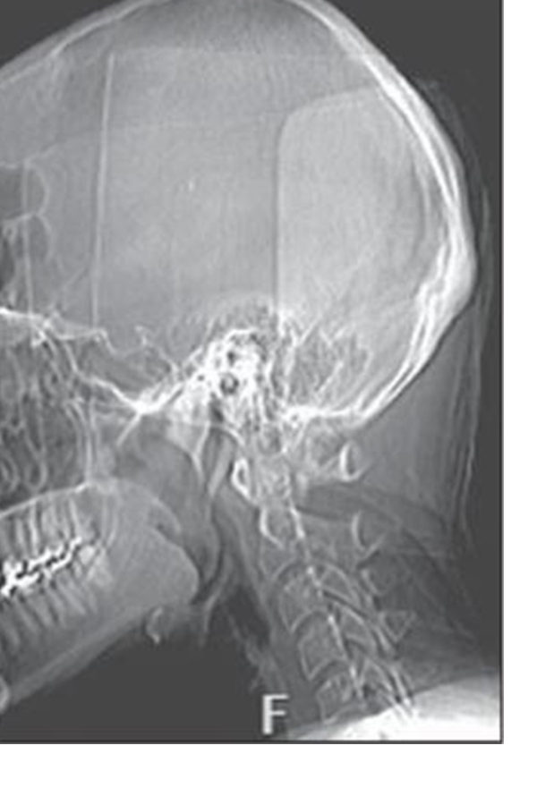 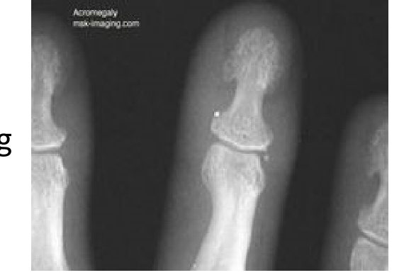

**Eyes:**
- Visual fields and ophthalmology: **bitemporal hemianopia**, papilloedema, optic atrophy, glaucoma.
- ⭐ **Caution:** visual defects can occur **even without visual symptoms** in patients with an adenoma, so test all of them.

**Endocrine:**

| Test | Role |
|---|---|
| **Basal GH** | ↑ (> 6 ng/mL). ⭐ **Hard to interpret: GH is pulsatile**. *Random GH is not recommended for diagnosis* |
| ⭐ **IGF-1** | ↑ → **BEST INITIAL test** |
| ⭐ **OGTT: GH fails to suppress (< 2 ng/mL)** | **MOST ACCURATE (confirmatory) test** |
| **GHRH** | ↑ in **ectopic secretion (bronchial carcinoid)** |

- **Metabolic tests:** ↑ BMR, hyperglycaemia, hypercalcaemia.
- ⭐ **Echocardiography + colonoscopy**: cardiomegaly and **colon polyps** (*[added]* ↑ colorectal cancer risk).

**Diagnostic algorithm (slide 48):**
1. Clinical features → **IGF-1**.
    - Normal → acromegaly **excluded**.
2. Elevated → **OGTT + GH**. Is GH suppressed at 2 h?
    - Yes → **excluded**.
    - No → **acromegaly confirmed**.
3. **Pituitary MRI.**
    - Visible mass → **GH-secreting adenoma**.
    - Normal → **screen for an extrapituitary cause**.

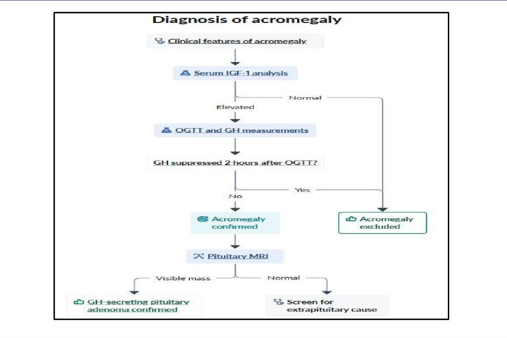

### 2.11 Acromegaly: Treatment (Slides 49–50)

| Line | Detail |
|---|---|
| ⭐ **1. Surgery** | **As for prolactinoma** (trans-sphenoidal), **first line** for GH adenoma |
| **2. Radiotherapy** | Proton beam, heavy particles, supervoltage. **Takes several years** for the full effect |
| **3a. Dopamine agonist (bromocriptine)** | When surgery is contraindicated or rapid relief is needed. **15–30 mg/day** (higher than for prolactinoma). GH ↓ in **only 10–40%**. Used as **adjunct** after surgery or radiotherapy |
| **3b. Somatostatin** | Not specific for GH; needs an **infusion** |
| ⭐ **3c. Octreotide** (somatostatin analogue) | **Longer acting, specific**, **SC every 12 h** (*[added]* monthly depot forms; lanreotide) |

⭐ **Clinical pearl (slide 50):** **somatostatin analogues and dopamine agonists can reduce GH secretion and tumour size**. *[added]* **Pegvisomant** (a GH-receptor antagonist) normalises IGF-1 but **does not shrink the tumour**.

> 🔁 **Recap: Acromegaly.**
> - **Physiology:** GH acts via IGF-1 (liver). Hypoglycaemia stimulates GH; hyperglycaemia suppresses it.
> - **Gigantism vs acromegaly:** gigantism before epiphyseal fusion, acromegaly after. DDx of tall stature: constitutional is commonest; Klinefelter, Marfan, homocystinuria, Sotos.
> - **Acromegaly features:** coarse face, prognathism, macroglossia, spade hands, ↑ ring/shoe size, carpal tunnel, OSA, HTN, cardiomegaly, DM 25%, hyperhidrosis, oily skin, colon polyps.
> - **Diagnosis:** IGF-1 first → OGTT (no GH suppression < 2) confirms → MRI. Heel pad > 22 mm; tufted phalanges.
> - **Treatment:** trans-sphenoidal surgery → octreotide / dopamine agonist / radiotherapy.

---

## 3. High-Yield Comparison Tables

### Table A: Prolactinoma vs Acromegaly
| | **Prolactinoma** | **Acromegaly** |
|---|---|---|
| Frequency | **35%** (commonest) | **20%** |
| Typical size | ♀ micro, ♂ macro | Usually macro *[added]* |
| Key features | Amenorrhoea, galactorrhoea, infertility, ↓ libido | Coarse features, spade hands, OSA, DM, HTN |
| Best initial test | **Prolactin** (+ TSH, β-hCG, drugs) | **IGF-1** |
| Confirmatory | MRI (if PRL raised and secondary causes excluded) | **OGTT: GH not suppressed < 2 ng/mL** |
| **First-line Rx** | ⭐ **Dopamine agonist** (cabergoline/bromocriptine 2.5 mg tds) | ⭐ **Trans-sphenoidal surgery** |
| Second line | Surgery, radiotherapy | Octreotide, DA (15–30 mg/day), radiotherapy |

### Table B: Hyperprolactinaemia: Clue → Cause
| Clue | Cause |
|---|---|
| Pregnant / breastfeeding | Physiological |
| On antipsychotic / metoclopramide / methyldopa | **Drug**: stop or switch |
| **↑ TSH** | **Primary hypothyroidism** (TRH) → levothyroxine |
| ↑ creatinine | CRF (↓ clearance) |
| PRL **> 200** + sellar mass | **Prolactinoma** |
| PRL modestly ↑ + **large non-functioning** mass | **Stalk compression** (disconnection) |
| Chest wall scar / zoster | Neural reflex |

### Table C: Mass Effects by Direction
| Direction | Structure | Sign |
|---|---|---|
| Up | Optic chiasm | **Bitemporal hemianopia** |
| Up | Hypothalamus | DI, SIADH, thirst/temp/appetite/sleep |
| Lateral | Cavernous sinus (III, IV, V1, VI) | Diplopia, ptosis, facial pain |
| Down | Sphenoid | **CSF rhinorrhoea**, nasopharyngeal mass |
| Back | Brainstem | Bilateral pyramidal signs |
| Any | Dura | **Bitemporal headache** |

### Table D: Tall Stature DDx
| Cause | Proportion | GH | Distinguishing clue |
|---|---|---|---|
| **Constitutional** | Proportionate | Normal | Tall parents |
| **Gigantism** | Proportionate | **↑** | Soft-tissue enlargement, decline stage |
| **Klinefelter** | Long legs | N | Small testes, gynaecomastia, **XXY** |
| **Marfan** | Arm span > height | N | Lens up, aortic root, MVP |
| **Homocystinuria** | Marfanoid | N | **Mental retardation**, lens down, thrombosis |
| **Eunuchoidism** | Disproportionate | N | Hypogonadism |
| **Sotos** | | N | **Early puberty**, macrocephaly |
| **Hyperthyroidism** | | N | Thyrotoxic features |

---

## 4. Rules, Exceptions, Patterns

| Rule | Exception / nuance |
|---|---|
| Hypothalamic hormones **stimulate** the pituitary | **Prolactin is under tonic INHIBITION by dopamine**; stalk damage ↑ PRL |
| TRH ↑ TSH | It also ↑ **PRL**, which is why **primary hypothyroidism causes hyperprolactinaemia** |
| High PRL = prolactinoma | **PRL < 200** → think drugs, hypothyroidism, stalk compression |
| Pituitary tumours → surgery | ⭐ **Prolactinoma → dopamine agonist FIRST** |
| Dopamine agonists for prolactin | Also used in **acromegaly** (higher dose; only 10–40% respond) |
| Random GH diagnoses acromegaly | **Pulsatile**: use **IGF-1** then **OGTT suppression** |
| Glucose suppresses GH | Failure to suppress = acromegaly |
| Headache from pituitary tumours worsens with growth | It may **improve** once the tumour erodes the clinoid and escapes the sella |
| Imaging first for a pituitary problem | **Hormones first**: incidentalomas are common |
| Galactorrhoea is the PRL sign | **Men** present with **impotence and mass effects**; galactorrhoea is rare |
| Tall = gigantism | **Constitutional tall stature is most common** |

---

## 5. Clinical Correlations
- **Woman with amenorrhoea + galactorrhoea, PRL 120, on risperidone/metoclopramide** → drug-induced; stop or switch the drug and recheck.
- **Woman with galactorrhoea, TSH 17, PRL 85** → **primary hypothyroidism**; give levothyroxine (case 1).
- **Man with impotence, headaches, bitemporal hemianopia, 2 cm sellar mass, PRL 3000** → **macroprolactinoma** → **cabergoline** (shrinks it; vision often recovers).
- **Man with ring no longer fitting, snoring, sweating, HTN, new DM** → **acromegaly** → IGF-1 → OGTT → MRI → surgery. Also **colonoscopy** and echo.
- **Acromegaly with a normal pituitary MRI** → look for **ectopic GHRH (bronchial carcinoid, pancreatic NET)**: CXR/CT.
- **Acromegaly + hypercalcaemia + peptic ulcers** → **MEN 1**.
- **After trans-sphenoidal surgery, clear nasal drip that is glucose/β2-transferrin positive** → **CSF leak** (meningitis risk).
- **Tall boy with small firm testes and gynaecomastia** → **Klinefelter** (karyotype).

---

## 6. Rapid Revision (Last-Day)
1. Pituitary in the **sella**, under the **diaphragma sellae**, **½–1 g**. Anterior lobe fed by **long portal veins**; posterior by the **inferior hypophyseal artery**.
2. **Acidophils: GH, PRL. Basophils: TSH, ACTH, FSH, LH. Chromophobes: none.**
3. ADH from the **supraoptic** nucleus, oxytocin from the **paraventricular**.
4. **TRH → TSH + PRL; GnRH → LH > FSH; GHRH → GH; somatostatin ↓ GH (and insulin, glucagon, gastrin, VIP); CRH → ACTH; dopamine ↓ PRL.**
5. Tumours = **15%** of intracranial. **PRL 35 · NF 30 · GH 20 · mixed 10 · others 5**.
6. Mass effects: **bitemporal headache**, **bitemporal hemianopia**, DI/SIADH, **CN III/IV/V1/VI**, **CSF rhinorrhoea**, pyramidal signs. Acute = **apoplexy**.
7. ↑ PRL causes: **pregnancy, 3 S**; **drugs** (antipsychotics, methyldopa, reserpine, oestrogen, opiates); **3C** (CRF, cirrhosis, chest wall), **3P** (pituitary/stalk, paraneoplastic, **primary hypothyroidism**).
8. Prolactinoma: ♀ micro (amenorrhoea, galactorrhoea, osteoporosis, hirsutism); ♂ macro (↓ libido, impotence, infertility).
9. Normal PRL **♀ < 25, ♂ < 20**; **< 200 → other cause**. **Hormones before imaging.**
10. Treatment: **dopamine agonist first** (bromocriptine 2.5 mg tds; **cabergoline better**; nausea, postural hypotension). Surgery: trans-sphenoidal (< 10 mm) or trans-frontal (> 10 mm). RT 4500 rads.
11. **Secretory non-PRL adenomas → surgery; asymptomatic micro / non-secretory → observe.**
12. GH: ↑ glucose, protein synthesis, FFA; via **IGF-1 (liver)**. **Hypoglycaemia, exercise, L-dopa, clonidine ↑ GH; hyperglycaemia ↓**.
13. **Gigantism before fusion; acromegaly after.** Tall stature: constitutional commonest; Klinefelter (XXY, azoospermia), Marfan, homocystinuria (MR), Sotos, eunuchoidism.
14. Acromegaly: coarse face, **prognathism**, **macroglossia**, spade hands, **↑ ring/shoe size**, **carpal tunnel**, OA, **HTN, cardiomegaly, OSA**, oily sweaty skin, **DM 25% (IGT 50%)**, hypercalcaemia 16%, co-secretion, MEN 1.
15. X-ray: double floor → ballooned sella; **tufted phalanges**; **heel pad > 22 mm**.
16. **IGF-1 = best initial; OGTT GH not < 2 ng/mL = most accurate**; MRI; CXR for carcinoid; **echo + colonoscopy**.
17. Treatment: **surgery** → octreotide (SC q12h) / DA 15–30 mg (10–40% respond) / RT (years).

---

## 7. Exam-Style Questions

**Q1 (lecture case, slides 51–52).** A 32-year-old woman has irregular menses, galactorrhoea, fatigue and weight gain. She started **clozapine** 5 months ago and has **stopped levothyroxine** for 6 months. Visual fields normal. **TSH 17**, **PRL 85**. What is the most likely explanation for the nipple discharge?
A. **Hypothyroidism** · B. Prolactinoma · C. Thyrotropic adenoma · D. Ectopic prolactin · E. Medication adverse effect

> **Answer: A. Hypothyroidism.** *[reasoning added; key not on slides]*
> - Untreated **primary hypothyroidism** (TSH 17, fatigue, weight gain) → ↑ TRH → ↑ prolactin.
> - PRL **85 < 200** argues against a prolactinoma, and visual fields are normal.
> - **Clozapine is the classic prolactin-SPARING antipsychotic** (weak D2 blockade), so E is the distractor.
> - A **TSH-oma** gives high T4 with inappropriately normal or high TSH, with hyperthyroid features.
> - Management: restart levothyroxine, then recheck PRL.

**Q2 (lecture case, slides 53–54).** A 40-year-old man has bitemporal headaches for 5 months, diplopia, impaired peripheral vision bilaterally and a pale look. MRI: **16 × 11 × 9 mm intrasellar mass**. Further evaluation is most likely to show:
A. Galactorrhoea · B. Coarse facial features · C. Diffuse goitre · D. **Erectile dysfunction** · E. Abdominal striae

> **Answer: D.** *[reasoning added]*
> - A **macroadenoma in a man**: either a macroprolactinoma (the commonest functioning type, presenting late in men) or a non-functioning adenoma.
> - Both cause **hypogonadotrophic hypogonadism → ↓ libido and erectile dysfunction**.
> - **Galactorrhoea is rare in men** (A).
> - He has no acromegalic (B), thyrotoxic (C) or Cushing's (E) features. His pallor fits hypopituitarism.

**Q3.** Which test is the most accurate (confirmatory) for acromegaly?
A. Random GH · B. IGF-1 · C. **GH after a 75 g oral glucose load** · D. Pituitary MRI · E. GHRH level

> **Answer: C.**
> - **IGF-1 is the best initial test**.
> - **Failure of GH to suppress (< 2 ng/mL) on OGTT confirms the diagnosis** (slide 47).
> - Random GH is unreliable because secretion is pulsatile.

**Q4.** A 28-year-old woman with amenorrhoea, galactorrhoea, PRL 260 ng/mL and a 7 mm pituitary adenoma wants to conceive. What is the first-line treatment?
A. Trans-sphenoidal surgery · B. Radiotherapy · C. **Cabergoline (or bromocriptine)** · D. Octreotide · E. Observation

> **Answer: C.**
> - Dopamine agonists are first line for **symptomatic** prolactinoma (slide 27). They restore ovulation and shrink the tumour.
> - *[added]* **Bromocriptine** has the longer safety record in pregnancy.

**Q5.** A patient with acromegaly has a **normal pituitary MRI** and a raised **GHRH**. What should be looked for next?
A. Craniopharyngioma · B. **Bronchial carcinoid (CXR/CT chest)** · C. Pheochromocytoma · D. Medullary thyroid cancer · E. Insulinoma

> **Answer: B.**
> - **Ectopic GHRH from a bronchial carcinoid** (slides 46–47).

---

## 8. Exam Pitfalls & Traps
- **Slide 10 order error:** it says oxytocin and ADH are made in the paraventricular and supraoptic nuclei "respectively". The lecture's own posterior-pituitary slide (Lecture 11, slide 4) says the reverse: **ADH = supraoptic, oxytocin = paraventricular**. Use that.
- **Slide 12 "LH > FSH" with GnRH:** true for the pulsatile response. Don't confuse it with the LH/FSH ratio in PCOS.
- **Prolactinoma first-line is MEDICAL.** Picking surgery is the commonest error. Every other functioning adenoma → surgery.
- **PRL < 200 ng/mL** → look for drugs, hypothyroidism, renal failure or stalk compression before calling it a prolactinoma.
- **Clozapine** (and aripiprazole) are **prolactin-sparing**; **risperidone** and haloperidol raise PRL most *[added]*.
- **Acromegaly diagnosis:** IGF-1 (best initial) → **OGTT** (most accurate). A random GH > 6 ng/mL (slide 47) is **not** diagnostic alone.
- **Bromocriptine doses differ:** **2.5 mg tds** for prolactinoma vs **15–30 mg/day** for acromegaly.
- **Somatostatin vs octreotide:** somatostatin is non-specific and needs an infusion; octreotide is longer acting, specific and given SC every 12 h.
- **Hypercalcaemia in acromegaly** (16%) comes from **↑ 1,25(OH)₂D**. Also think **MEN 1** (parathyroid adenoma).
- **Colonoscopy** is part of the acromegaly work-up (polyps, colon cancer).
- **Slide 45 typo:** "Frognathism" = **prognathism**.
- **Klinefelter:** "positive buccal smear" (Barr body), because XXY has an inactivated X.
