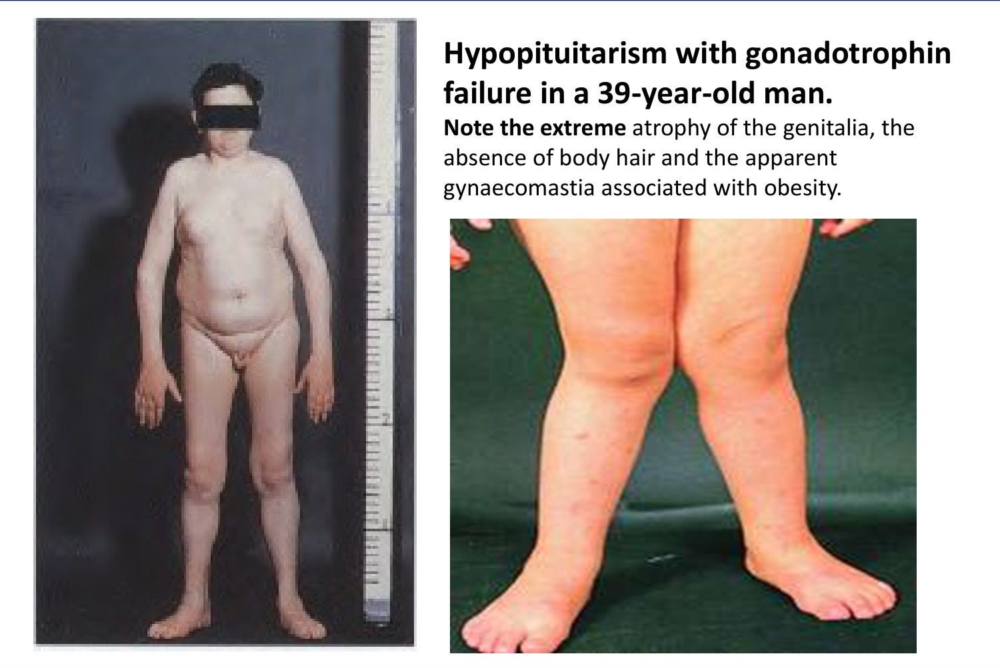
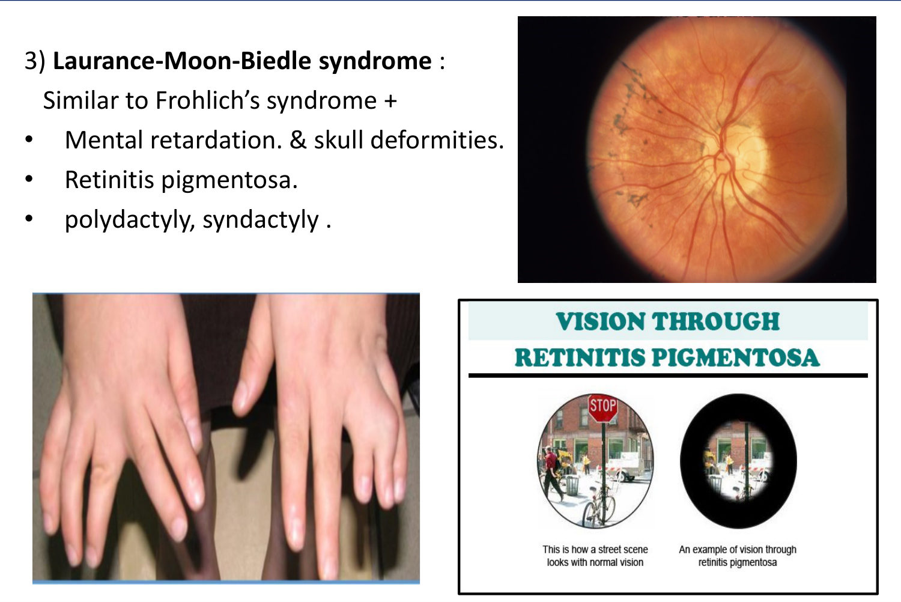
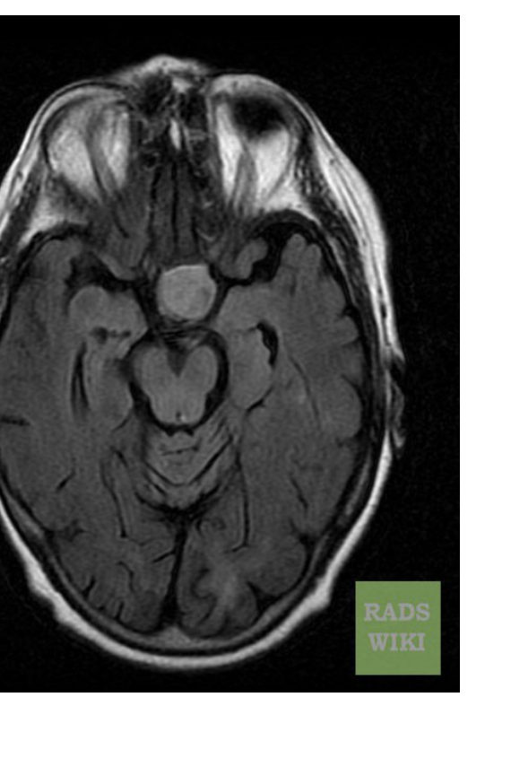

# Pituitary Disorders II: Approach to a Case of Hypopituitarism
**Internal Medicine Department** | Source: `10- approach to a case of hypopituitarism` (29 slides)

> **Legend:** ⭐ = high-yield · *[added]* = not on slides. Images marked "Slide N" come from the lecture; "Added diagram" = drawn for these notes.

> 🔗 **Bridge from Pituitary I:** that lecture covered **too much** hormone (prolactinoma, acromegaly) and **mass effects**. This one covers **too little**.
> - The same adenomas compress the normal gland and cause **hypopituitarism**.
> - Acute bleeding into them causes **pituitary apoplexy**.
> - The **portal (venous) blood supply** explains **Sheehan syndrome**.
> - **Thyroid 2** gave primary hypothyroidism (↑ TSH). Here we meet **secondary hypothyroidism** (↓ TSH).
> - **Hypoparathyroidism** gave **pseudohypoparathyroidism**, which reappears as a cause of **short stature**.

---

## 1. Title / Objectives

| Domain | Objective | Likely tested as |
|---|---|---|
| Knowledge | Pathophysiology and etiology | **Sheehan** = commonest cause; why the anterior pituitary infarcts |
| Knowledge | ⭐ Manifestations in children (dwarfism, Fröhlich) and adults (Simmonds) | 2ry vs 1ry hypothyroidism; Simmonds vs Addison |
| Skill | ⭐ Pituitary reserve tests | Insulin tolerance test; TRH; GnRH |
| Skill | ⭐ Replacement order | **Steroid before thyroxine** |
| Skill | ⭐ Emergency: **apoplexy** | Sudden headache + visual loss + shock → steroids |

**Lecture flow:** Causes → Clinical picture (childhood: pituitary dwarfism, Fröhlich, Laurence–Moon–Biedl; adults: Simmonds / isolated deficiency) → 2ry vs 1ry hypothyroidism → Simmonds vs Addison → Investigations (GH, ACTH, TSH, LH/FSH reserve) → Treatment → **Pituitary apoplexy** → **Short stature** (causes, diagnosis, investigations, treatment) → Case.

---

## 2. Main Content (Lecture Order)

### 2.1 Causes of Hypopituitarism (Slide 5) ⭐

| # | Group | Causes |
|---|---|---|
| 1 | **Infarction** | ⭐ **Postpartum necrosis (Sheehan syndrome): the MOST COMMON cause** (per the slide) after **postpartum haemorrhage**. Why the anterior pituitary is vulnerable: it **enlarges in pregnancy without more blood supply**, and its supply is **mainly venous (portal)**. Also **vascular disease**: vasculitis, DM |
| 2 | **Infection / granuloma** | TB, syphilis, meningitis, **sarcoidosis** |
| 3 | **Idiopathic (congenital)** | Deficiency of one or all anterior hormones |
| 4 | **Neoplastic** | ⭐ **Adenoma**, **craniopharyngioma**, leukaemia, lymphoma, metastasis |
| 5 | **Physical** | **Radiation, surgery, head trauma** |
| 6 | **Miscellaneous** | **Haemochromatosis** |

*[added] In modern series the **commonest cause is a pituitary adenoma** (or its treatment). Sheehan is the classic exam answer for postpartum hypopituitarism (**failure of lactation** + amenorrhoea after PPH). Mnemonic **"8 I's"**:*
- *Invasive (tumour)*
- *Infarction (Sheehan, apoplexy)*
- *Infiltrative (sarcoid, haemochromatosis)*
- *Injury (trauma)*
- *Immunologic (lymphocytic hypophysitis)*
- *Iatrogenic (surgery, RT)*
- *Infectious*
- *Idiopathic*

### 2.2 Clinical Picture: Childhood (Slides 6–8)

| Syndrome | Features |
|---|---|
| ⭐ **Pituitary dwarfism (Levi–Lorain)** | **Proportionate** dwarfism, **childish facies**; later **hypogonadism** (± **cryptorchidism**). ↓ GH, commonly **idiopathic**; rarely inactive GH |
| ⭐ **Fröhlich syndrome (dystrophia adiposogenitalis)** | **Dwarfism + hypogonadism** · **truncal and facial obesity sparing the extremities** ("sambousa-shaped") · **genu valgum** · **hypothalamic** disturbance: **DI, polyphagia, hypersomnia** |
| **Laurence–Moon–Biedl** | **Fröhlich features +** **mental retardation**, skull deformity, ⭐ **retinitis pigmentosa** (tunnel vision), **polydactyly / syndactyly** |

 

*Slide 7 caption:* extreme **genital atrophy**, **absence of body hair**, apparent **gynaecomastia** with obesity.

### 2.3 Clinical Picture: Adults (Slides 9–10) ⭐
- **Panhypopituitarism = Simmonds disease**, or **isolated hormone deficiency**.
- *[added]* Typical order of loss as the gland fails: **GH → LH/FSH → TSH → ACTH → PRL** ("**Go Look For The Adenoma Please**").

| Hormone ↓ | Result |
|---|---|
| **Prolactin** | ⭐ **Failure of lactation** (the Sheehan clue) |
| **GH** | **Silent**; rarely hypoglycaemia |
| **Gonadotrophins** (post-pubertal) | Skin: **fine wrinkled**, **loss of secondary sexual hair** ("progeria"). Men: ↓ libido, impotence, testicular atrophy, oligospermia. Women: vaginal dryness, dyspareunia, **secondary amenorrhoea**, infertility, **breast atrophy** |
| **TSH** | **Secondary hypothyroidism** |
| **ACTH** | Usually not marked. **Hypoglycaemia**, **inability to withstand physical and psychological stress**, ↓ resistance to infection |
| **Mass** | Pressure neurological features (tumour) |
| ⭐ **Coma** | **Hypothermia**, **hypoglycaemia**, or pressure on the brainstem/hypothalamus |

**Student pearl (slide 9):** **hypothalamic dopamine inhibits prolactin**, whereas **TRH stimulates** it. *[added]* Hypothalamic or stalk lesions can therefore cause **↑ PRL** together with other deficiencies.

### 2.4 Secondary vs Primary Hypothyroidism (Slide 11) ⭐

| Feature | **2ry (pituitary)** | **1ry (thyroid)** |
|---|---|---|
| Severity | **Less severe** | More severe |
| Skin | **Fine, wrinkled** | More **oedematous** (myxoedema) |
| Hair | Dry, less coarse | Dry, **brittle, coarse** |
| Tongue | Not enlarged | **Enlarged** |
| Visual field defects | **May be present** | Absent |
| Heart / BP | **Small heart, ↓ BP**, visceral atrophy (**splanchnomicria**) | **Enlarged heart**, **HTN** common |
| Menses | **Amenorrhoea** | **Menorrhagia** (mostly) |
| Blood glucose | **Usually low** | Usually normal |
| Cholesterol | Normal | **↑** |
| ⭐ **TSH** | **↓ (or inappropriately normal)** | **↑** |
| Other anterior hormones | **↓** | Normal |

### 2.5 Simmonds Disease vs Addison's Disease (Slide 12) ⭐

| Feature | **Addison's (1ry adrenal)** | **Simmonds (pituitary)** |
|---|---|---|
| **Pigmentation** | ⭐ **Present** (↑ ACTH/POMC) | ⭐ **Absent**: no lipotropin/MSH. Plus **pallor** (ACTH normally aids erythropoiesis) and **depigmented areolae** in women |
| **Hypotension** | **Marked** + hypovolaemia + **hyperkalaemia** | **Less marked**: **aldosterone continues** (renin–angiotensin control) → **no ↑ K⁺ or hypovolaemia** |
| Bowel | Diarrhoea | **Constipation** |
| **ACTH** | **↑** | **↓** (+ other pituitary hormones ↓) |

> **Mnemonic:** **"Pale and Potassium-normal = Pituitary."** Addison's is **dark and hyperkalaemic**.

> 🔁 **Recap: Causes and features.**
> - **Causes:** Sheehan (enlarged gland in pregnancy, venous supply, PPH); vascular; infection or granuloma; congenital; tumours (adenoma, craniopharyngioma); surgery, RT, trauma; haemochromatosis.
> - **Children:** proportionate dwarfism (Levi–Lorain); Fröhlich (dwarf, hypogonadal, truncal obesity, genu valgum, DI); LMB adds retinitis pigmentosa, polydactyly and MR.
> - **Adults:** no lactation, silent GH loss, hypogonadism with fine wrinkled skin, secondary hypothyroidism (milder; small heart; low glucose; normal cholesterol), ACTH deficiency (pale, no hyperkalaemia, unlike Addison's). Coma from hypothermia or hypoglycaemia.
> 🔗 **Link:** Low hormone levels must be confirmed as low pituitary **reserve** with stimulation tests.
> ▶️ **Up next: Investigations and treatment.**

---

### 2.6 Investigations: Pituitary Reserve Tests (Slides 13–14) ⭐
Alongside imaging of any tumour:

| Axis | Test | Normal response |
|---|---|---|
| **GH** | Screen: GH during **sleep** and after **exercise** (should rise **> 6 ng/mL**). If not: stimulation tests. ① **insulin-induced hypoglycaemia** (0.1 U/kg IV) ② **L-dopa** 250 mg PO ③ **clonidine** (50 µg per 10 years of age above 5, max 250 µg PO). Samples **fasting, 60 and 90 min** | **GH > 6 ng/mL excludes GH deficiency** |
| ⭐ **ACTH** | **Insulin-induced hypoglycaemia** (insulin tolerance test) | **Cortisol ↑ > 10 µg/dL above basal** = normal |
| **TSH** | **TRH test**: 500 µg IV TRH | **Doubling of basal TSH**. **Low response** in **2ry hypothyroidism** (and in **thyrotoxicosis**) |
| **LH/FSH** | A. **Normal cyclic menses or normal sperm count EXCLUDES hypothalamic–pituitary disease** · B. basal LH/FSH · C. **GnRH (LHRH) test** 100 µg IV · D. **clomiphene** test (oestrogen antagonist) | C and D: **LH doubles, FSH ↑ ~50%** |

*[added] **Insulin tolerance test is the gold standard** for GH and ACTH reserve. It is **contraindicated in IHD, epilepsy and the elderly**. Practical first steps: **9 am cortisol, free T4 with TSH (low T4 + low/normal TSH = central), LH/FSH with testosterone/oestradiol, IGF-1, prolactin, Na⁺, MRI**.*

### 2.7 Treatment (Slides 15–17) ⭐

| | Detail |
|---|---|
| **A. Surgery** | For a **space-occupying lesion** (trans-frontal or trans-sphenoidal) |
| **B. Radiotherapy** | **Incomplete surgical removal**; **non-surgical candidates** |
| **C. Hormone replacement** | |
| 1. ⭐ **Glucocorticoid** | e.g. **prednisone 5 mg morning + 2.5 mg noon** orally (*[added]* or hydrocortisone 15–25 mg/day; **double in illness ("sick-day rules")**) |
| 2. ⭐ **L-thyroxine** | **100–250 µg/day**. ⭐ **Give AFTER cortisol replacement** to avoid precipitating **adrenal crisis** |
| 3. **GH** | **3 injections/week before epiphyseal closure** |
| 4. **Gonadotrophins / sex steroids** | **Fertility not needed**: men → **long-acting IM testosterone**; women → **cyclic oestrogen + progesterone**. **Fertility needed**: **hMG** (FSH activity) + **hCG** (LH activity) for several months |
| 5. **ADH** | **Desmopressin** intranasally or pitressin tannate IM |

*[added] No mineralocorticoid is needed (aldosterone is preserved). In secondary hypothyroidism, **monitor free T4, not TSH**.*

**Clinical pearls (slide 17):**
- **Pituitary incidentalomas** → evaluate for **hypopituitarism and hormonal hypersecretion**.
- **Caution:** about **one-third** of pituitary adenomas have **associated hypopituitarism**, so screen all patients with a pituitary mass.
- **Caution:** adenomas can bleed (**apoplexy**), causing **severe headache, visual symptoms, CV collapse and/or secondary adrenal insufficiency**.

> 🔁 **Recap: Tests and treatment.**
> - **Reserve tests:** GH (sleep/exercise, then insulin/L-dopa/clonidine; > 6 normal); ACTH (insulin hypoglycaemia; cortisol ↑ > 10); TSH (TRH should double TSH); LH/FSH (normal menses or sperm excludes disease; GnRH/clomiphene double LH).
> - **Treatment:** surgery or RT for a mass. Replace **steroid FIRST, then thyroxine**, plus GH (children), sex steroids or hMG/hCG for fertility, desmopressin for DI.
> 🔗 **Link:** Sometimes the gland fails in minutes rather than years.
> ▶️ **Up next: Pituitary apoplexy.**

---

### 2.8 Pituitary Apoplexy (Slides 18–19) ⭐
**Causes:**
1. **Haemorrhage into a pituitary tumour** (*[added]* often an undiagnosed macroadenoma; triggers: anticoagulants, dopamine agonists, surgery, pregnancy)
2. **CVA** (particularly in **diabetics**)
3. **Sickle cell anaemia**

**Clinical picture:**
1. ⭐ **Sudden headache**, often with **rapidly worsening visual field defects or diplopia** (compression of surrounding nerves).
2. Then **acute hormone deficiency**, predominantly **adrenal insufficiency** (hypotension, shock). It rarely causes **auto-hypophysectomy**, which **cures** acromegaly or Cushing's.
3. **↑ ICP**.
4. **Meningeal irritation**.
5. **Confusion → coma** (with hyperpyrexia). **Fatal if not treated urgently.**

**Clinical pearl:** apoplexy, from acute hypocortisolism and hypothyroidism, can present with **severe headache, sudden hypotension and hypovolaemic shock**.

**Investigations:**
1. ⭐ **CT scan is diagnostic** (*[added]* MRI is more sensitive).
2. **CSF bloody** (*[added]* mimics SAH).

**Treatment:**
1. ⭐ **Glucocorticoids** (e.g., **dexamethasone**; *[added]* high-dose hydrocortisone 100 mg IV is standard)
2. **Surgical decompression** if needed (*[added]* for deteriorating vision or consciousness)

> 🔁 **Recap: Apoplexy.** Bleeding or infarction of an adenoma (or in DM or sickle cell). Thunderclap headache + visual loss or ophthalmoplegia + shock (acute ACTH loss) ± meningism, coma. CT/MRI shows it; CSF may be bloody. Give steroids immediately, then decompress if vision or consciousness worsens.
> 🔗 **Link:** In children, the chronic version of pituitary failure presents as growth failure, but most short children have other causes.
> ▶️ **Up next: Short stature.**

---

### 2.9 Short Stature (Slides 20–24) ⭐

**Causes:**

| **Primary**: intrinsic to the skeleton | **Secondary**: outside the skeleton |
|---|---|
| **Skeletal dysplasia** (chondrodystrophy, e.g. **achondroplasia**) | **IUGR** (infection, placental insufficiency, maternal illness) |
| **Chromosomal**: **Down** (trisomy 21), ⭐ **Turner** | ⭐ **Idiopathic constitutional growth delay: the MOST COMMON cause** |
| **Inborn errors**: glycogen storage disease, mucopolysaccharidosis | **Malnutrition** (kwashiorkor, marasmus) |
| **Genetic short stature** (e.g. pygmies) | **GIT**: **coeliac**, cystic fibrosis, chronic liver disease, IBD |
| | **Renal**: chronic parenchymal disease, **RTA** |
| | **Cardiorespiratory**: congenital heart disease, asthma |
| | **Endocrine**: **hypopituitarism / GH or GHRH ↓** (or GH resistance), **pseudohypoparathyroidism**, **precocious puberty** (sex-steroid excess fuses epiphyses), **Cushing's**, **cretinism / juvenile myxoedema** (4–12 years) |
| | **Psychological deprivation** |

**Diagnosis (slide 22):**
- **Height within 2 SD** of the mean may be normal. **< 3 SD → full evaluation.**
- **Body proportions:** **short limbs vs trunk** → long-standing **hypothyroidism** or **achondroplasia**.
- **Height-to-weight ratio** (*[added]* **underweight for height** suggests GI or nutritional disease; **overweight for height** suggests endocrine disease).
- **Specific findings:**

| Condition | Clue |
|---|---|
| **Achondroplasia** | **Macrocephaly**, short limbs |
| **Cretinism** | Dry skin, coarse hair, **depressed nasal bridge**, big lips, **large protruding tongue** |
| **Cushing's** | Central obesity, striae, HTN |
| ⭐ **Turner** | **Webbed neck, shield chest, coarctation**, delayed puberty |
| **GH ↓** | Proportionate, childish facies |
| **Pseudohypoparathyroidism** | **Moon face, obesity, short metacarpals**, mental retardation |

**Investigations (slide 23):**
1. **Hormones:** thyroxine, cortisol, GH (and GH response to exercise/clonidine).
2. **Renal:** urea, creatinine.
3. **Malabsorption** and CVS work-up.
4. ⭐ **Karyotype** (gonadal dysgenesis: **Turner**).
5. **Ca** (↓ in **pseudohypoparathyroidism**), **P** (↓ in **vit D-resistant rickets**), **HCO₃** (↓ in **RTA**).
6. **Skull X-ray** for CNS lesions (e.g., **craniopharyngioma**: suprasellar calcification *[added]*).
7. ⭐ **Bone age (hand X-ray): DELAYED in secondary defects, NOT retarded in primary defects.**

**Treatment (slide 24):**
1. **Treat the cause early** (Cushing's, hypothyroidism…).
2. **GH deficiency → recombinant GH 0.1 U/kg SC 3×/week.**

**NB:** in **primary** defects, bone-growth potential is **severely impaired**, unlike secondary defects.

> 🔁 **Recap: Short stature.**
> - **Primary (skeletal) causes:** achondroplasia, Turner, Down, inborn errors, genetic. Bone age is NOT delayed and growth potential is poor.
> - **Secondary causes:** constitutional delay (the commonest), IUGR, malnutrition, coeliac, IBD, CF, renal/RTA, CHD, endocrine (GH ↓, hypothyroid, Cushing's, PHP, precocious puberty), deprivation. Bone age is delayed and catch-up is possible.
> - **Evaluate** if < 3 SD: proportions, weight-for-height, stigmata; TFT, cortisol, GH stimulation, renal, coeliac, karyotype, Ca/P/HCO₃, skull X-ray, bone age.
> - **Treatment:** treat the cause; GH if deficient.

---

## 3. High-Yield Comparison Tables

### Table A: Primary vs Secondary Hypothyroidism *(slide 11)*
| | 2ry | 1ry |
|---|---|---|
| TSH | **↓ / N** | **↑** |
| Other pituitary hormones | ↓ | N |
| Cholesterol | **N** | ↑ |
| Glucose | **Low** | N |
| Heart / BP | **Small, ↓BP** | Big, HTN |
| Menses | **Amenorrhoea** | Menorrhagia |
| Tongue / skin | N / fine wrinkled | **Big** / oedematous |
| Visual fields | **May be ↓** | N |

### Table B: Simmonds vs Addison *(slide 12)*
| | Simmonds | Addison |
|---|---|---|
| Skin | **Pale**, depigmented areolae | **Pigmented** |
| ACTH | **↓** | **↑** |
| K⁺ / volume | **Normal** (aldosterone intact) | **↑ K⁺**, hypovolaemia |
| BP | Mildly ↓ | Markedly ↓ |
| Bowels | Constipation | Diarrhoea |
| Mineralocorticoid needed? | **No** *[added]* | **Yes** (fludrocortisone) *[added]* |

### Table C: Pituitary Reserve Tests
| Axis | Stimulus | Normal |
|---|---|---|
| GH | Sleep/exercise → **insulin, L-dopa, clonidine** | GH > **6 ng/mL** |
| ACTH | **Insulin hypoglycaemia** | Cortisol ↑ > **10 µg/dL** |
| TSH | **TRH 500 µg IV** | TSH **doubles** |
| LH/FSH | **GnRH 100 µg IV** / **clomiphene** | LH **doubles**, FSH ↑ 50% |

### Table D: Childhood Hypopituitary Syndromes
| | Levi–Lorain | Fröhlich | Laurence–Moon–Biedl |
|---|---|---|---|
| Dwarfism | **Proportionate** | ✅ | ✅ |
| Obesity | — | **Truncal**, spares limbs | ✅ |
| Hypogonadism | Later | ✅ | ✅ |
| Extra | Childish facies | **Genu valgum, DI, polyphagia, hypersomnia** | **Retinitis pigmentosa, polydactyly, MR**, skull deformity |

### Table E: Short Stature, Primary vs Secondary
| | Primary (skeletal) | Secondary (non-skeletal) |
|---|---|---|
| Examples | Achondroplasia, Turner, Down, IEM, genetic | **Constitutional delay**, malnutrition, chronic disease, endocrine |
| **Bone age** | **Not delayed** | **Delayed** |
| Growth potential | Severely impaired | Preserved (catch-up) |

---

## 4. Rules, Exceptions, Patterns

| Rule | Exception / nuance |
|---|---|
| Replace deficient hormones | ⭐ **Glucocorticoid BEFORE thyroxine**: thyroxine first can precipitate adrenal crisis |
| Adrenal insufficiency → ↑ K⁺ | **Secondary (pituitary) → no ↑ K⁺** (aldosterone preserved) and **no pigmentation** |
| Hypothyroidism → ↑ TSH | **Secondary → low/normal TSH**: measure **free T4** |
| Low TRH response = pituitary failure | **Also in thyrotoxicosis** (suppressed TSH) |
| GH deficiency in adults causes symptoms | It is **silent** (rare hypoglycaemia) |
| Lactation failure = breastfeeding problem | After PPH = **Sheehan** |
| Short = endocrine disease | **Constitutional delay is the commonest** |
| Treat short stature with GH | Only if **GH deficient**. Primary skeletal defects respond poorly |
| Apoplexy = tumour bleed | Also **DM (CVA)** and **sickle cell**. It can rarely **cure** acromegaly or Cushing's |
| Normal menses tell you little | Normal cyclic menses or sperm count **excludes** hypothalamic–pituitary disease (slide 14) |

---

## 5. Clinical Correlations
- **Woman with massive PPH who can't breastfeed, then amenorrhoea, cold intolerance, pallor, loss of axillary hair** → **Sheehan syndrome** → steroid then thyroxine; oestrogen/progesterone.
- **Known macroadenoma, sudden thunderclap headache, ophthalmoplegia, BP 85/50** → **apoplexy** → **IV hydrocortisone**, MRI, neurosurgery.
- **Pale, non-pigmented patient with hyponatraemia and normal K⁺** → **secondary adrenal insufficiency** (pituitary), not Addison's.
- **Patient started on levothyroxine for "hypothyroidism" with low TSH, who then collapses** → unmasked **ACTH deficiency**. Give steroid first.
- **Obese boy with small genitals, genu valgum and polyuria** → **Fröhlich** (hypothalamic lesion, e.g. craniopharyngioma).
- **Child with night blindness, polydactyly, obesity, hypogonadism** → **Laurence–Moon–Biedl (Bardet–Biedl)**.
- **Short girl with webbed neck, coarctation, primary amenorrhoea** → **Turner (45 XO)**: karyotype, GH, oestrogen.
- **Short child with chronic diarrhoea, iron deficiency, underweight for height** → **coeliac disease**.
- **Child with short stature and suprasellar calcification on skull X-ray, visual field defect** → **craniopharyngioma**.

---

## 6. Rapid Revision (Last-Day)
1. Causes: **Sheehan (commonest per slide)**; vascular (DM, vasculitis); TB, syphilis, meningitis, **sarcoid**; congenital; **adenoma, craniopharyngioma**, metastasis, leukaemia/lymphoma; **RT, surgery, trauma**; **haemochromatosis**.
2. **Sheehan:** the anterior pituitary **enlarges in pregnancy without more blood supply** and its supply is **venous** → infarction after PPH.
3. Childhood: **Levi–Lorain** (proportionate dwarfism, childish face, later hypogonadism ± cryptorchidism); **Fröhlich** (dwarfism, hypogonadism, **truncal obesity**, **genu valgum**, DI, polyphagia, hypersomnia); **LMB** (+ **retinitis pigmentosa**, **polydactyly**, MR).
4. Adults = **Simmonds**: **↓PRL → no lactation**; GH silent; gonadotrophins → fine wrinkled skin, loss of sexual hair, amenorrhoea, impotence, breast/testicular atrophy; **2ry hypothyroidism**; ACTH → hypoglycaemia, poor stress tolerance, infection; **coma** from hypothermia or hypoglycaemia.
5. **2ry vs 1ry hypothyroidism:** milder, fine skin, no big tongue, **small heart/low BP**, **amenorrhoea**, **low glucose**, **normal cholesterol**, **↓ TSH**.
6. **Simmonds vs Addison:** **pale** vs pigmented; **no hyperK/hypovolaemia** vs present; **constipation** vs diarrhoea; **ACTH ↓** vs ↑.
7. GH reserve: sleep/exercise GH **> 6**; else **insulin 0.1 U/kg, L-dopa 250 mg, clonidine** (0, 60, 90 min).
8. ACTH reserve: **insulin hypoglycaemia → cortisol ↑ > 10 µg/dL**.
9. TSH: **TRH 500 µg** doubles TSH; low in **2ry hypothyroidism and thyrotoxicosis**.
10. LH/FSH: **normal menses or sperm count excludes disease**; GnRH 100 µg / clomiphene → **LH doubles, FSH +50%**.
11. Treatment: surgery/RT for a mass; **prednisone 5 mg am + 2.5 mg noon FIRST**, **then L-T4 100–250 µg**; GH 3×/week (children); testosterone IM or cyclic E+P; **hMG + hCG for fertility**; **desmopressin** for DI.
12. ⅓ of adenomas have hypopituitarism; screen all.
13. **Apoplexy:** tumour bleed, CVA in DM, sickle cell. **Sudden headache + visual loss/diplopia + adrenal crisis**, ↑ ICP, meningism, coma. **CT diagnostic, bloody CSF**. **Glucocorticoids + decompression.**
14. Short stature: **constitutional delay most common**. Primary (achondroplasia, Turner, Down, IEM) vs secondary (IUGR, malnutrition, coeliac, CF, IBD, liver, renal/RTA, CHD, asthma, endocrine, deprivation).
15. Evaluate if **< 3 SD**. Short limbs → hypothyroidism or achondroplasia. **Bone age delayed in secondary, not in primary.**
16. GH deficiency → **rhGH 0.1 U/kg SC 3×/week**.

---

## 7. Exam-Style Questions

**Q1 (lecture case, slides 25–26).** A 39-year-old woman with a history of migraine has a **sudden severe throbbing headache and double vision for 1 hour**. She has had frequent headaches and **amenorrhoea for months**. BP **93/61**. Visual fields: **bilateral lateral-quadrant (bitemporal) defect**. Most likely diagnosis?
a) TIA · b) **Pituitary apoplexy** · c) Sheehan syndrome · d) Migraine with aura · e) SAH · f) Cluster headache

> **Answer: b. Pituitary apoplexy.** *[reasoning added; key not on slides]*
> - The **prodrome** (headaches + amenorrhoea) suggests an underlying **macroadenoma, likely a prolactinoma**.
> - Then: **sudden headache + diplopia** (cavernous sinus), **bitemporal field loss** (chiasm) and **hypotension** (acute ACTH loss).
> - **SAH** gives no field defect or hypotension from adrenal failure.
> - **Sheehan** needs a postpartum haemorrhage.
> - **Migraine with aura** doesn't cause hypotension or a fixed bitemporal defect.

**Q2.** Six months after a delivery complicated by massive haemorrhage, a woman reports **failure of lactation**, amenorrhoea, fatigue and cold intolerance. Labs: low free T4, **low TSH**, Na 129, K 4.2. Which treatment should be started FIRST?
A. Levothyroxine · B. **Hydrocortisone (glucocorticoid)** · C. Fludrocortisone · D. Oestrogen–progesterone · E. Cabergoline

> **Answer: B.**
> - This is **Sheehan syndrome**. ⭐ **Steroid before thyroxine** to avoid adrenal crisis (slide 15).
> - **Fludrocortisone is unnecessary**: aldosterone is intact and K⁺ is normal.

**Q3.** Which feature favours **pituitary (secondary)** over **primary** adrenal insufficiency?
A. Hyperpigmentation · B. Hyperkalaemia · C. **Pallor with depigmented areolae** · D. Marked hypovolaemia · E. Raised ACTH

> **Answer: C** (slide 12).

**Q4.** A 10-year-old's height is −3.5 SD with **delayed bone age**, proportionate body, normal weight for height, low IGF-1 and a **GH peak of 3 ng/mL after clonidine**. What is the treatment?
A. Observe; constitutional delay · B. **Recombinant GH 0.1 U/kg SC 3×/week** · C. Levothyroxine · D. Oestrogen · E. Nothing; primary skeletal defect

> **Answer: B.**
> - **GH deficiency** (stimulated peak < 6 ng/mL) → rhGH (slides 13, 24).
> - Delayed bone age means a secondary defect with growth potential.

**Q5.** The TRH test produces a **blunted TSH rise** in which conditions?
A. Primary hypothyroidism only · B. **Secondary hypothyroidism and thyrotoxicosis** · C. Euthyroid sick only · D. Iodine deficiency · E. Hashimoto

> **Answer: B** (slide 14).
> - In thyrotoxicosis, high T4 suppresses the thyrotrophs.
> - In primary hypothyroidism the response is **exaggerated**.

---

## 8. Exam Pitfalls & Traps
- **Thyroxine before steroid** → adrenal crisis. Always **steroid first**.
- **"Most common cause" conflict:** the slide says **Sheehan**. Modern data: **pituitary adenoma** *[added]*. Answer by the stem: postpartum → Sheehan; general adult → adenoma.
- **Secondary adrenal insufficiency:** **no** hyperkalaemia, **no** pigmentation, **no** fludrocortisone needed. Hyponatraemia can still occur (cortisol is needed to excrete free water) *[added]*.
- **Secondary hypothyroidism:** **TSH can be normal**. **Free T4 is the test and the treatment target.**
- **Normal menses or sperm count** rules out hypothalamic–pituitary disease (slide 14), a quick bedside reserve check.
- **GH test thresholds:** > 6 ng/mL = normal (lecture). *[added]* Many modern labs use lower cut-offs (e.g. > 5–10 µg/L depending on assay). Use the lecture number.
- **Insulin tolerance test** is contraindicated in **IHD and epilepsy** *[added]*.
- **Apoplexy imaging:** the slide says **CT is diagnostic**. MRI is more sensitive *[added]*. **Bloody CSF** can mislead you into diagnosing SAH.
- **Bone age:** **delayed in secondary** causes (endocrine, chronic disease, constitutional), **not delayed in primary skeletal** disorders.
- **Precocious puberty** gives an early tall child but a **short adult** (early epiphyseal fusion).
- **Slide 6** "samboxa-shaped obesity" = truncal obesity sparing the limbs (a local food analogy).
