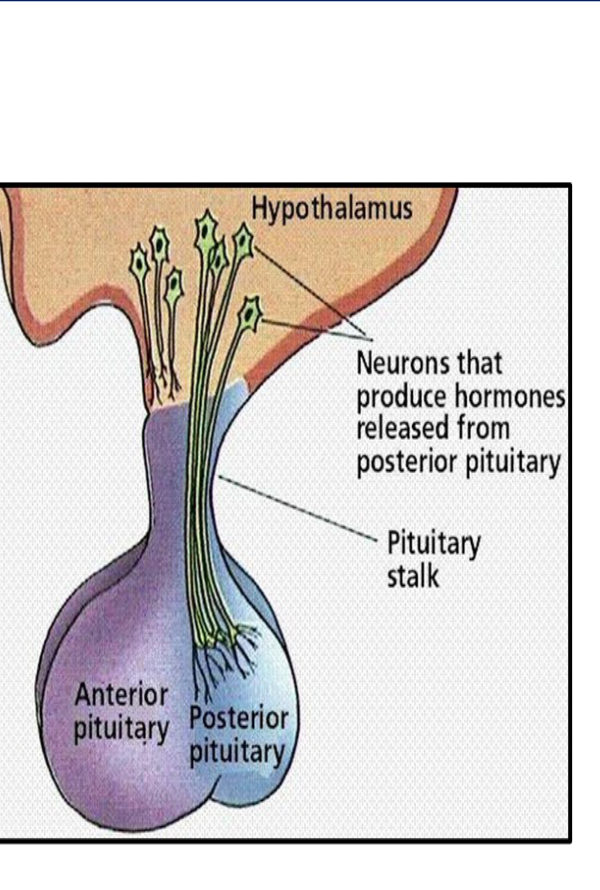
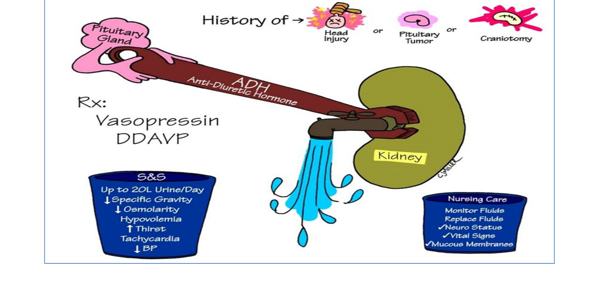
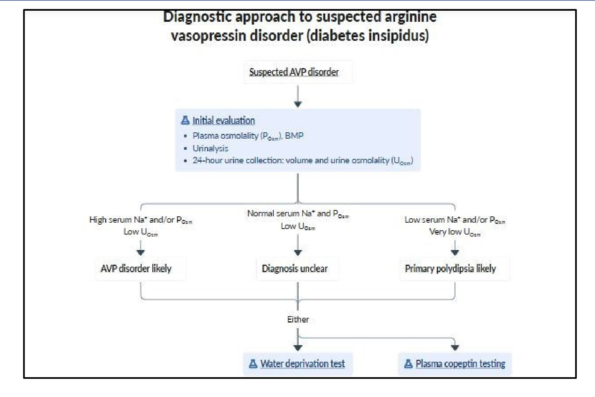
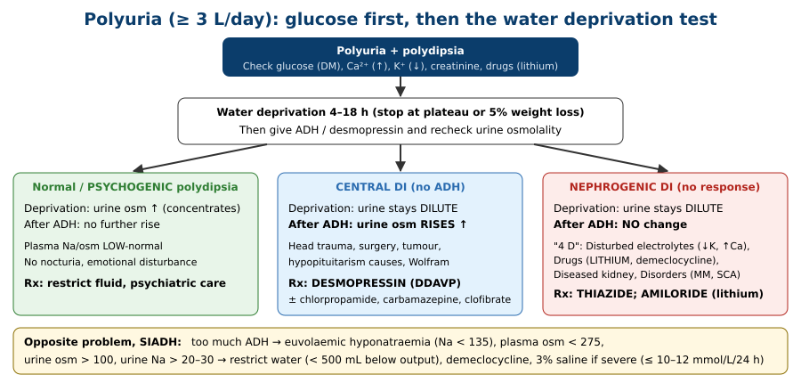
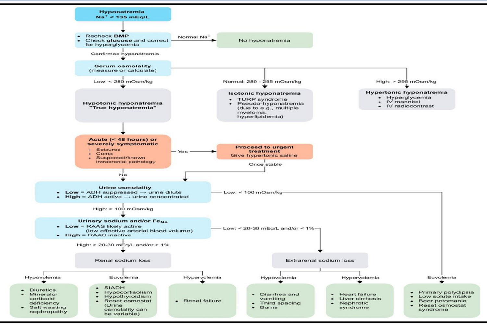

# Pituitary Disorders III: Posterior Pituitary: Diabetes Insipidus, SIADH & Hyponatraemia
**Internal Medicine Department** | Source: `11- posterior pituitary disorders` (27 slides)

> **Legend:** ⭐ = high-yield · *[added]* = not on slides. Images marked "Slide N" come from the lecture; "Added diagram" = drawn for these notes.

> 🔗 **Bridge from earlier lectures:**
> - **Pituitary I–II:** suprasellar tumour extension, surgery and hypopituitarism causes all damage the **hypothalamus/stalk → central DI**.
> - **Hyperparathyroidism:** **hypercalcaemia → "calcium diabetes" (nephrogenic DI)**. This lecture's case.
> - **Lung cancer:** **small (oat) cell carcinoma → SIADH**.
> - **Physiology (membrane transport, body fluids):** osmolality and water channels (**aquaporin-2**) explain the whole topic.
> - **Hypertension:** thiazides are reused here to treat nephrogenic DI.

---

## 1. Title / Objectives

| Domain | Objective | Likely tested as |
|---|---|---|
| Knowledge | Pathophysiology and etiology of posterior pituitary disorders | ADH physiology; causes of central vs nephrogenic DI; causes of SIADH |
| Knowledge | Manifestations, complications, management | Polyuria; hyponatraemia symptoms; DDAVP vs thiazide |
| Skill | ⭐ Interpret the **water deprivation test** | Central vs nephrogenic vs psychogenic |
| Skill | ⭐ Diagnostic approach to **hyponatraemia** | Osmolality → volume status → urine Na |
| Skill | Emergency plans | Severe hyponatraemia → hypertonic saline, slow correction |

**Lecture flow:** Posterior pituitary physiology → Control of ADH → **Diabetes insipidus** (definition, causes, clinical picture, investigations, water deprivation test, treatment) → DDx of polyuria → **SIADH** (causes, clinical picture, labs, criteria, treatment) → **Hyponatraemia algorithm** → Case.

---

## 2. Main Content (Lecture Order)

### 2.1 Posterior Pituitary Physiology (Slides 4–5) ⭐
- **ADH (vasopressin, AVP)** is made in the **supraoptic** nucleus; **oxytocin** in the **paraventricular** nucleus.
- Both travel **down the axons** to the posterior pituitary for storage and release.

| Hormone | Action |
|---|---|
| **Oxytocin** | Contracts **myoepithelial cells** of the breast → **milk ejection (let-down)** (*[added]* and uterine contraction) |
| ⭐ **ADH / AVP** | ↑ **water reabsorption in the collecting tubules** (*[added]* V2 receptor → aquaporin-2). Also **constricts arteriolar smooth muscle** (V1) |

**Control of ADH secretion (slide 5):**
1. ⭐ **Osmolar stimulation** of hypothalamic osmoreceptors: **↑ plasma osmolality → ↑ ADH** (and vice versa).
2. **↓ Plasma volume** → fewer inhibitory impulses from **left atrial** stretch receptors → ↑ ADH.
3. **Hypotension** → carotid sinus and aortic arch **baroreceptors** → ↑↑ ADH.
4. **Higher centres**: psychological factors, stress (*[added]* also pain, nausea).
5. **Drugs:**

| ↑ ADH secretion | ↓ ADH secretion |
|---|---|
| **Acetylcholine**, β-agonists, ⭐ **chlorpropamide, carbamazepine, cyclophosphamide**, **nicotine, morphine** | ⭐ **Phenytoin** (diphenylhydantoin), **naloxone** (narcotic antagonists) (*[added]* alcohol) |

> **Mnemonic for ADH-boosting drugs: "the 3 C's + N/M"** *[added]* = **C**hlorpropamide, **C**arbamazepine, **C**yclophosphamide, **N**icotine, **M**orphine. They cause SIADH, and the first two are reused to treat partial central DI.

> 🔁 **Recap: Physiology.** ADH (supraoptic) concentrates urine in the collecting duct; oxytocin (paraventricular) ejects milk. ADH rises with ↑ osmolality, ↓ volume and ↓ BP, stress, and drugs (chlorpropamide, carbamazepine, cyclophosphamide, nicotine, morphine). It falls with phenytoin and naloxone (and alcohol).
> 🔗 **Link:** Remove ADH, or the kidney's response to it, and the patient cannot concentrate urine.
> ▶️ **Up next: Diabetes insipidus.**

---

### 2.2 Diabetes Insipidus (Slides 6–9) ⭐
**Definition:** **impaired renal conservation of water** from either:
- **low or absent ADH** in response to normal stimuli (**central DI**), or
- **renal unresponsiveness to ADH** (**nephrogenic DI**).

"Insipidus" means **tasteless** (dilute) urine, unlike the sweet urine of diabetes mellitus.

**Causes (slide 8):**

| **Central DI** | **Nephrogenic DI** |
|---|---|
| **Familial (rare)**: **autosomal dominant**, or recessive ⭐ **DIDMOAD (Wolfram syndrome)** = **DI, DM, Optic Atrophy, Deafness** (nerve) | **Familial** (*[added]* X-linked V2-receptor or AQP2 mutation) |
| **Acquired**: ⭐ **same causes as hypopituitarism** (tumour, craniopharyngioma, surgery, **head trauma**, granuloma, infection, infiltration) | **Acquired: "4 D"** |
| | **D**isturbed electrolytes: ⭐ **hypokalaemia** (1ry aldosteronism), ⭐ **hypercalcaemia** (hyperparathyroidism) |
| | **D**rugs: ⭐ **lithium**, **demeclocycline** |
| | **D**iseases of the kidney: CRF, ATN, post-transplant |
| | **D**isorders (systemic): **multiple myeloma, amyloidosis, sickle cell anaemia** |

**Clinical picture (slide 9):**
1. ⭐ **Polyuria**: **2.5–6 L/24 h, up to 20 L/day** → **polydipsia** (*[added]* craving ice-cold water); **nocturnal enuresis** in children.
2. **Dehydration** if water intake fails (unconscious, infants, no thirst) → weakness, prostration, low-grade fever, psychological disturbance, **death** (*[added]* **hypernatraemia**).

### 2.3 DI: Investigations (Slides 10–12) ⭐

| # | Test | Finding |
|---|---|---|
| 1 | **Urine** | ↑ volume, **SG 1.001–1.004**, **fails to rise > 1.010 after fluid deprivation** |
| 2 | **X-ray sella / CT / MRI** | Exclude tumour (*[added]* MRI: loss of the **posterior pituitary "bright spot"** in central DI) |
| 3 | **Vasopressin test** (to **differentiate**) | IV vasopressin or **DDAVP** for 2–3 days. **Normal and central DI → oliguria**; **nephrogenic → no response** |
| 4 | **Hypertonic saline test** (to **confirm** DI) | 2.5% NaCl 2.5 mL/kg IV stimulates osmoreceptors → **oliguria if ADH system intact** |
| 5 | ⭐ **Water deprivation (dehydration) test** (to **differentiate**) | See below |

**Water deprivation test (slide 11):**
- **Deprive water for 4–18 h**, measuring urine osmolality hourly.
- **End point:** **successive urine samples of the same osmolality (plateau)**, or **5% body-weight loss**.
- Then give **5 U aqueous ADH SC** (or desmopressin) and measure urine osmolality **1 h later**.

| Group | Urine osm at end of deprivation | After ADH |
|---|---|---|
| **Normal / psychogenic polydipsia** | **↑ (concentrates)** | **No further ↑** |
| ⭐ **Central DI** | **Low** | ⭐ **↑ (responds)** |
| ⭐ **Nephrogenic DI** | **Low** | ⭐ **Low (no response)** |

*[added] Typical numbers: a normal person reaches urine osm **> 800**. In central DI it rises **> 50%** after DDAVP; in nephrogenic DI it rises **< 10%**. **Partial** forms fall in between. Stop the test if plasma Na > 145–150 or weight loss > 3–5%.*

**Diagnostic approach to suspected AVP disorder (slide 12):**
- **Initial:** plasma osmolality, BMP, urinalysis, **24-h urine volume and osmolality**.
- Then:
    - **High Na/P_osm + low U_osm** → AVP disorder likely.
    - **Normal Na + low U_osm** → unclear.
    - **Low Na/P_osm + very low U_osm** → **primary polydipsia** likely.
- Then **water deprivation test** or ⭐ **plasma copeptin** (*[added]* copeptin is a stable AVP surrogate; hypertonic-saline-stimulated copeptin is now preferred).

### 2.4 DI: Treatment (Slide 13) ⭐

| **Central DI** | **Nephrogenic DI** |
|---|---|
| **Hormone replacement:** **aqueous vasopressin (Pitressin) SC**; ⭐ **desmopressin (DDAVP)** oral (Minirin), sublingual or intranasal. **No pallor, angina, colic, bronchospasm or uterine contraction** (selective V2 action). **Vasopressin tannate in oil** IM | ⭐ **Thiazides** (HCTZ, chlorthalidone): mild volume contraction → ↑ proximal Na/water reabsorption → less delivered to the loop → ↓ water excretion (paradoxical antidiuresis) |
| **Non-hormonal (↑ ADH release/effect)** for **partial** central DI: **chlorpropamide, clofibrate, carbamazepine** | ⭐ **Amiloride: drug of choice in lithium-induced DI** (blocks lithium entry via ENaC) |

**Other measures:**
- Treat the **cause**.
- Diet: **liberal fluids**; **avoid a high-purine diet** (exaggerates polyuria; *[added]* a **low-solute** diet — low salt, low protein — is the modern advice).

*[added] Also stop lithium if possible; correct K⁺/Ca²⁺; NSAIDs (indomethacin) help in nephrogenic DI. Watch for **hyponatraemia** with desmopressin overdose.*

### 2.5 DDx of Polyuria (≥ 3 L/day) (Slides 14–15)

| Group | Causes |
|---|---|
| **Renal** | **CRF** (chronic pyelonephritis, chronic GN) · **diuretic phase of ATN** · **excess diuretics** · **nephrogenic DI** · **RTA** and **De Toni–Fanconi** |
| **Endocrine** | ⭐ **Diabetes mellitus** (**high SG**, glycosuria, high glucose) · **DI** · **adrenal**: Cushing's, Conn's, Addison's · ⭐ **hyperparathyroidism ("calcium diabetes")** and other hypercalcaemia · **thyrotoxicosis** |
| **Functional** | **Excess fluid** (coffee, tea, cola, beer) · ⭐ **psychogenic (hysterical) polydipsia**: polyuria + polydipsia, **NO nocturia**, emotional disturbance (e.g. anorexia nervosa), **low urine osm with a NORMAL response to dehydration** · **winter** |
| **Miscellaneous** | **Multiple myeloma**, **vit D intoxication** · **transient** polyuria after migraine, epilepsy, paroxysmal tachycardia, asthma, intermittent hydronephrosis |

> **Key split:** **water diuresis** (urine osm < 300: DI, psychogenic) vs **solute diuresis** (osm > 300: glucose, urea, mannitol, saline) *[added]*.

> 🔁 **Recap: DI.**
> - **Types:** central (no ADH: hypopituitary causes, head trauma, surgery, Wolfram) vs nephrogenic (no response: ↓K, ↑Ca, lithium, demeclocycline, CRF/ATN, myeloma, amyloid, sickle cell).
> - **Features:** 2.5–20 L/day of dilute urine (SG < 1.005), thirst, dehydration/hypernatraemia if fluids are restricted.
> - **Water deprivation then ADH:** normal/psychogenic concentrate; central rises only after ADH; nephrogenic never rises. Copeptin is the modern test.
> - **Treatment:** central → desmopressin (or chlorpropamide/carbamazepine/clofibrate if partial); nephrogenic → thiazide, amiloride for lithium.
> - **Polyuria DDx:** DM (high SG), hypercalcaemia, hypokalaemia, renal, psychogenic (no nocturia).
> 🔗 **Link:** The mirror image: ADH secreted when it shouldn't be, so water is retained.
> ▶️ **Up next: SIADH.**

---

### 2.6 SIADH (Slides 16–20) ⭐
**Mechanism:** ↑ ADH secretion **not in response to normal physiological stimuli** → **↓ ability to excrete water** → **dilutional (euvolaemic) hyponatraemia**.

**Causes (slide 17):**

| Group | Examples |
|---|---|
| ⭐ **Malignancy** | **Oat (small) cell carcinoma of the lung** (ectopic ADH) |
| **Non-malignant lung disease** | **Pneumonia, TB** |
| **CNS** | **Cerebrovascular accidents** (*[added]* trauma, meningitis, SAH) |
| **Drugs** | ⭐ **Chlorpropamide, cyclophosphamide, vincristine** (*[added]* **SSRIs, carbamazepine**, TCAs, MDMA) |
| **Miscellaneous** | **Hypothyroidism**, acute psychosis (*[added]* pain, nausea, post-op) |

**Clinical picture (water intoxication; slide 18):**
- **Chronic** hyponatraemia may be **asymptomatic**; CNS symptoms are less common.
- **Mild:** anorexia, nausea, vomiting, headache, cramps.
- **Moderate:** weakness, lethargy, confusion.
- ⭐ **Severe:** **seizures, altered consciousness**.
- ⭐ **Normotension, NO oedema** (euvolaemic) + features of the cause.
- **Pearl:** SIADH patients are **euvolaemic, normotensive and have no oedema**. A hyponatraemic patient **with oedema** suggests another condition (e.g. **CHF**).

**Laboratory (slide 19):**
- **Serum Na < 130 mEq/L** (dilutional, euvolaemic)
- **↓ Plasma osmolality < 270 mOsm/kg**
- **↑ Urine osmolality > 100 mOsm/kg** (inappropriately concentrated)

**Diagnostic criteria (slide 19 table):**

| Criterion | Value |
|---|---|
| **Hyponatraemia** | Serum Na **< 135 mEq/L** |
| **Hypo-osmolality** | Serum osm **< 275 mOsm/kg** |
| **Euvolaemia** | No signs of hypo- or hypervolaemia |
| **Concentrated urine** | Urine osm **> 100 mOsm/kg** |
| **Elevated urinary Na** | Urine Na **> 20–30 mEq/L** |

*[added] Also required: **normal thyroid, adrenal and renal function**, and no diuretics. Typical extras: **low urea and uric acid**.*

**Treatment (slide 20):**
- **Treat the cause.**
- ⭐ **Restrict water.** Pearl: daily intake should be **500 mL less than daily urine output**.
- **Drugs:**
    - **demeclocycline** (induces nephrogenic DI)
    - **phenytoin**
    - **naloxone**
    - *[added]* **tolvaptan** (V2 antagonist), **urea**, oral salt + loop diuretic
- ⭐ **Hypertonic saline (5%; *[added]* usually 3%) in emergencies** (seizures, coma).
- ⭐ **Correction limit:** in chronic hyponatraemia the maximum (not the goal) is **10–12 mEq/L per 24 h**; **8 mEq/L per 24 h** if at high risk of **osmotic demyelination**.
- ⭐ **Caution:** over-correction of chronic hyponatraemia → **osmotic demyelination syndrome** (central pontine myelinolysis).

> **Mnemonic:** **"From low to high, the pons will die; from high to low, the brain will blow."** *[added]* Correcting hyponatraemia too fast causes ODS; correcting hypernatraemia too fast causes cerebral oedema.

### 2.7 Diagnostic Approach to Hyponatraemia (Slide 21) ⭐
1. **Na < 135** → repeat; check **glucose** and correct for **hyperglycaemia**.
2. **Serum osmolality:**
    - **High > 295 → hypertonic hyponatraemia**: **hyperglycaemia**, IV mannitol, IV radiocontrast.
    - **Normal 280–295 → isotonic**: **TURP syndrome**, **pseudohyponatraemia** (**multiple myeloma, hyperlipidaemia**).
    - **Low < 280 → hypotonic ("true") hyponatraemia.**
3. **Acute (< 48 h) or severely symptomatic?** (seizure, coma, known intracranial pathology) → **urgent hypertonic saline**, then continue the work-up once stable.
4. **Urine osmolality:**
    - **< 100 → ADH suppressed (dilute urine)** → **euvolaemic**: **primary polydipsia**, **low solute intake**, **beer potomania**, reset osmostat.
    - **> 100 → ADH active** → check **urine Na / FeNa**.
5. **Urine Na:**
    - **Low < 20–30 mEq/L (FeNa < 1%)** → **extrarenal Na loss**:
        - **hypovolaemic**: diarrhoea, vomiting, third spacing, burns
        - **hypervolaemic**: **heart failure, cirrhosis, nephrotic**
    - **High > 20–30 (FeNa > 1%)** → **renal Na loss**:
        - **hypovolaemic**: *[read from figure]* diuretics, mineralocorticoid deficiency, salt-wasting nephropathy
        - **euvolaemic**: ⭐ **SIADH**, **hypocortisolism**, **hypothyroidism**, reset osmostat
        - **hypervolaemic**: **renal failure**

> 🔁 **Recap: SIADH and hyponatraemia.**
> - **SIADH:** ADH without a stimulus. Causes: oat cell cancer, pneumonia/TB, CNS events, drugs (chlorpropamide, cyclophosphamide, vincristine, SSRIs, carbamazepine), hypothyroidism. Euvolaemic, normotensive, no oedema. Na < 135, Posm < 275, Uosm > 100, UNa > 20–30.
> - **Treatment:** restrict fluid (500 mL below output); demeclocycline/tolvaptan; hypertonic saline if severe, correcting ≤ 10–12 mmol/L/24 h (ODS risk).
> - **Algorithm:** serum osm (hyper → glucose; iso → pseudo/TURP; hypo →) → acute or severe? → urine osm (< 100 = polydipsia/potomania) → urine Na and volume.

---

## 3. High-Yield Comparison Tables

### Table A: DI vs SIADH
| | **DI** | **SIADH** |
|---|---|---|
| ADH effect | **↓** (central) or ignored (nephrogenic) | **↑ inappropriately** |
| Urine volume | **↑↑** (2.5–20 L) | ↓ / normal |
| Urine osm / SG | **Low** (SG < 1.005) | **High** (> 100; inappropriately concentrated) |
| Serum Na | **N or ↑** (hypernatraemia if no water) | **↓** (< 135) |
| Plasma osm | N / ↑ | **↓** (< 275) |
| Volume | N / dehydrated | **Euvolaemic**, no oedema |
| Treatment | Desmopressin (central); thiazide/amiloride (nephrogenic) | **Fluid restriction**, demeclocycline/tolvaptan, hypertonic saline |

### Table B: Central vs Nephrogenic DI vs Psychogenic Polydipsia
| | Central | Nephrogenic | Psychogenic |
|---|---|---|---|
| Plasma Na/osm | High-normal | High-normal | **Low-normal** |
| Deprivation urine osm | **Low** | **Low** | **↑** |
| After ADH | **↑ (> 50%)** | **No change** | No further ↑ |
| Nocturia | Yes | Yes | **No** |
| Causes | Hypopituitary causes, trauma, surgery, Wolfram | **↓K, ↑Ca, lithium, demeclocycline**, CRF, myeloma, amyloid, SCA | Psychiatric |
| Treatment | **Desmopressin** | **Thiazide**; **amiloride (lithium)** | Fluid restriction |

### Table C: Drugs on Both Sides
| Drug | Effect | Use / harm |
|---|---|---|
| **Chlorpropamide, carbamazepine** | ↑ ADH release/action | Treat **partial central DI**; **cause SIADH** |
| **Cyclophosphamide, vincristine** | ↑ ADH | Cause SIADH |
| **Lithium, demeclocycline** | Block ADH action | **Cause nephrogenic DI**; demeclocycline **treats SIADH** |
| **Phenytoin, naloxone** | ↓ ADH release | Listed for SIADH treatment |
| **Thiazides** | Volume contraction | **Treat nephrogenic DI**; *[added]* cause hyponatraemia |

### Table D: Hyponatraemia by Volume Status *(slide 21)*
| Volume | Urine Na low (< 20–30) | Urine Na high (> 20–30) |
|---|---|---|
| **Hypovolaemic** | GI loss, third spacing, burns | **Diuretics**, mineralocorticoid deficiency, salt wasting |
| **Euvolaemic** | (U osm < 100: **polydipsia, beer potomania, low solute**) | **SIADH**, **hypothyroidism**, **hypocortisolism** |
| **Hypervolaemic** | **HF, cirrhosis, nephrotic** | **Renal failure** |

---

## 4. Rules, Exceptions, Patterns

| Rule | Exception / nuance |
|---|---|
| ADH ↑ with osmolality | Also ↑ with **volume loss / hypotension** (overrides osmolality), stress, nausea, drugs |
| Polyuria + polydipsia = DI | **DM first** (high SG + glucose); then hypercalcaemia, hypokalaemia, psychogenic |
| Water deprivation diagnoses DI | Normal **and psychogenic** both concentrate. Only DI stays dilute |
| Desmopressin treats DI | **Only central**. Nephrogenic → **thiazide** (paradoxical) or **amiloride** for lithium |
| Thiazides are diuretics | In nephrogenic DI they **reduce** urine output |
| Hyponatraemia → give saline | **SIADH → restrict water**. Normal saline can **worsen** it (Na excreted, water kept) *[added]* |
| Correct Na quickly | **Chronic → ≤ 10–12 (≤ 8 high risk) mmol/L/24 h**, or ODS |
| SIADH = euvolaemic | **Oedema → think HF, cirrhosis, nephrotic**; **dehydration → think hypovolaemia** |
| Low Na = low osmolality | **Hyperglycaemia** (hypertonic) and **myeloma/lipids** (pseudo, isotonic) |
| Urine osm in polydipsia | **< 100** (maximally dilute). SIADH **> 100** |
| Demeclocycline is an antibiotic | Used here **to cause nephrogenic DI** deliberately (SIADH treatment) |

---

## 5. Clinical Correlations
- **Polyuria after pituitary surgery or head trauma** → **central DI** (*[added]* can be triphasic: DI → SIADH → DI).
- **Bipolar patient on lithium with polyuria** → **nephrogenic DI** → **amiloride**; consider stopping lithium.
- **Polyuria + bone aches + Ca 13 + high PTH** → **primary HPT → hypercalcaemia → nephrogenic DI** (lecture case).
- **Heavy smoker with Na 118, euvolaemic, concentrated urine** → **SIADH from small cell lung cancer**.
- **Elderly woman started on an SSRI, now confused, Na 121** → drug-induced **SIADH** → stop the drug, restrict fluid.
- **Beer drinker with little food intake, Na 115, urine osm 60** → **beer potomania** (low solute).
- **Patient with schizophrenia drinking 10 L/day, urine osm 80, concentrates on deprivation** → **psychogenic polydipsia**.
- **Hyponatraemia with oedema and ascites** → cirrhosis/HF (hypervolaemic), not SIADH.
- **Rapid correction of Na from 110 to 130 in a day**, then quadriparesis, dysarthria and "locked-in" state 3 days later → **osmotic demyelination**.
- **Na 128 with glucose 900** → **pseudo/hypertonic hyponatraemia**: correct for glucose (*[added]* +1.6–2.4 mmol/L per 100 mg/dL above 100).

---

## 6. Rapid Revision (Last-Day)
1. **ADH = supraoptic; oxytocin = paraventricular** → stored in the posterior pituitary.
2. ADH ↑ water reabsorption in the collecting duct (and vasoconstriction). Oxytocin = milk ejection.
3. ADH stimuli: **↑ osmolality**, **↓ volume** (LA receptors), **hypotension** (baroreceptors), stress, drugs (**chlorpropamide, carbamazepine, cyclophosphamide, nicotine, morphine**, ACh, β-agonists). Inhibited by **phenytoin, naloxone**.
4. **DI** = impaired renal water conservation: **central** (↓ ADH) or **nephrogenic** (renal resistance).
5. Central: familial (AD; **Wolfram DIDMOAD**) or acquired (**hypopituitarism causes**).
6. Nephrogenic "4 D": **↓K, ↑Ca**; **lithium, demeclocycline**; **CRF, ATN, transplant**; **myeloma, amyloid, SCA**.
7. Polyuria **2.5–6 L (up to 20 L)**, polydipsia, enuresis; dehydration can kill.
8. Urine **SG 1.001–1.004**, won't exceed **1.010** after deprivation.
9. **Water deprivation 4–18 h** to plateau or 5% weight loss → **5 U ADH**: normal/psychogenic concentrate; **central ↑ only after ADH**; **nephrogenic never**.
10. Hypertonic saline test **confirms** DI; vasopressin test **differentiates**; copeptin is the modern alternative.
11. Treatment: central → **DDAVP** (oral, sublingual or intranasal; no pallor, angina, colic, bronchospasm or uterine contraction), Pitressin; partial → **chlorpropamide, clofibrate, carbamazepine**. Nephrogenic → **thiazide**; **amiloride for lithium**. Liberal fluids; avoid purines.
12. Polyuria DDx: renal (CRF, ATN recovery, diuretics, RTA, Fanconi), endocrine (**DM**, DI, Cushing's, Conn's, Addison's, **hyperPTH**, thyrotoxicosis), functional (**psychogenic: no nocturia, normal response to deprivation**), myeloma, vit D.
13. **SIADH causes:** **oat cell carcinoma**, pneumonia, TB, CVA, **chlorpropamide, cyclophosphamide, vincristine**, hypothyroidism, psychosis.
14. SIADH = **euvolaemic, normotensive, no oedema**. Mild: GI symptoms, headache, cramps. Moderate: lethargy, confusion. Severe: **seizures, coma**.
15. Labs: **Na < 135 (< 130 on slide 19), Posm < 275 (< 270), Uosm > 100, UNa > 20–30**.
16. Treatment: cause; **fluid restriction (500 mL below urine output)**; demeclocycline, phenytoin, naloxone; **hypertonic saline in emergency**; max **10–12 mmol/L/24 h (8 if high risk)** → avoid **ODS**.
17. Algorithm: **Sosm** high → **hyperglycaemia/mannitol**; normal → **pseudo (myeloma, lipids)/TURP**; low → acute/severe? → **Uosm < 100** (polydipsia, potomania) → **UNa** + volume.

---

## 7. Exam-Style Questions

**Q1 (lecture case, slides 22–24).** A 63-year-old woman (T2DM, depression, HTN; on lisinopril, escitalopram, metformin) has 4 weeks of urinary frequency, nocturia, **bone aches**, nausea, fatigue, and thirst (5–6 L/day). Dry mucosa. Labs: Na 151, **Ca 13 mg/dL**, glucose 101, **PTH 130 pg/mL**, serum osm 306, **urine osm 255**. After water deprivation: Posm 309, Uosm 256. **One hour after desmopressin: Uosm 259 (no change).** Cause of the urinary frequency?
a) **Nephrogenic DI** · b) HHS · c) Beer potomania · d) Psychogenic polydipsia · e) Central DI · f) SIADH

> **Answer: a. Nephrogenic diabetes insipidus**, secondary to **hypercalcaemia from primary hyperparathyroidism** (high Ca + high PTH, bone aches). *[reasoning added; key not on slides]*
> - Urine stays dilute after deprivation and **does not respond to desmopressin**.
> - **HHS** is excluded: glucose is 101.
> - **Psychogenic polydipsia** gives low Na and urine that concentrates.
> - **Central DI** would respond to desmopressin.
> - **Beer potomania** and **SIADH** cause **hypo**natraemia.
> - Escitalopram (an SSRI) is a SIADH distractor.

**Q2.** A man on long-term lithium has 8 L/day of dilute urine. Water deprivation: urine stays dilute; no rise after DDAVP. What is the best drug?
A. Desmopressin · B. Chlorpropamide · C. **Amiloride** · D. Demeclocycline · E. Carbamazepine

> **Answer: C.**
> - **Amiloride is the drug of choice in lithium-induced nephrogenic DI** (slide 13).
> - Desmopressin, chlorpropamide and carbamazepine act on the ADH axis, which isn't the problem.
> - Demeclocycline *causes* nephrogenic DI.

**Q3.** A smoker with a central lung mass: Na 121, serum osm 255, urine osm 480, urine Na 45, no oedema, BP normal, normal TSH and cortisol. Diagnosis and first-line management?
A. Hypovolaemic hyponatraemia; normal saline · B. **SIADH; fluid restriction** · C. Psychogenic polydipsia; psychiatric review · D. Cirrhosis; diuretics · E. Adrenal insufficiency; hydrocortisone

> **Answer: B.**
> - **SIADH** (oat cell carcinoma): **euvolaemic**, Posm < 275, Uosm > 100, UNa > 20–30 (slide 19).
> - Restrict fluid to **500 mL below urine output**.

**Q4.** A patient with Na 112 had a seizure. Hypertonic saline is started. What is the maximum safe correction over the first 24 h in chronic hyponatraemia?
A. 25 mmol/L · B. 20 mmol/L · C. **10–12 mmol/L (8 if high risk)** · D. 2 mmol/L · E. No limit after a seizure

> **Answer: C** (slide 20 pearl).
> - Faster correction risks **osmotic demyelination**.

**Q5.** Which finding distinguishes **psychogenic polydipsia** from DI on the water deprivation test?
A. Low urine osmolality at baseline · B. **Urine concentrates with deprivation; no further rise after ADH** · C. Urine rises only after ADH · D. No response at all · E. High plasma Na

> **Answer: B** (slide 11).
> - C = central DI; D = nephrogenic DI.

---

## 8. Exam Pitfalls & Traps
- **Nucleus mix-up:** this lecture (slide 4) is right: **ADH = supraoptic, oxytocin = paraventricular**. The Pituitary I histology slide reverses them.
- **SIADH cut-offs differ on the same slide** (slide 19): text says **Na < 130, Posm < 270**; the criteria table says **Na < 135, Posm < 275**. Use the **table (135/275)** for diagnostic criteria.
- **Hypertonic saline:** the slide says **5%**. *[added]* Most current protocols use **3%** (100–150 mL boluses). Quote the slide if asked about the lecture.
- **Water deprivation interpretation:** psychogenic polydipsia **concentrates** (like normal people). Don't call it DI because baseline urine is dilute.
- **Thiazide in DI** reduces urine output. It is counter-intuitive, which is why it is tested.
- **Lithium DI → amiloride** (not just "thiazide").
- **Chlorpropamide and carbamazepine** appear on both lists: they **treat partial central DI** and **cause SIADH**. Same mechanism (↑ ADH).
- **Demeclocycline** treats SIADH by **inducing nephrogenic DI**.
- **"4 D" for nephrogenic DI** includes **hypokalaemia AND hypercalcaemia**. Classic MCQ links: Conn's → polyuria; hyperparathyroidism → polyuria.
- **Normal saline in SIADH** can **lower** Na further (urine osm > saline osm) *[added]*.
- **Pseudohyponatraemia** (myeloma, hyperlipidaemia) and **hyperglycaemia** must be excluded first by measuring serum osmolality.
- **Slide 10 numbering is out of order** (1, 2, 4, 3). Content is unaffected.
- **"Avoid purine-rich diet"** (slide 13) is the lecturer's point. *[added]* Modern advice is a **low-solute** (low salt, low protein) diet.
