# Anxiety, OCD & Stress-Related Disorders
**Psychiatry, Clinical Lecture** | Dr. Hussain M. Khrad (Consultant Psychiatrist, KFSHRC-Jeddah) | Source: `Anxiety_disorders.pdf` (71 slides)

> **Legend:** ⭐ = high-yield · *[added]* = not on slides. Images marked "Slide N" come from the lecture. All MCQ answers and the case model answer come from the lecture's own answer slides.

> 🔗 **Bridge from earlier lectures:**
> - **History Taking:** the bilingual screening scripts (GAD, panic, agoraphobia, social anxiety, phobia, OCD) and the rule **"the feared CONSEQUENCE, not the situation, separates the disorders"** are developed fully here. Also: **caffeine** in the substance history.
> - **MSE / Personality Disorders:**
>   - **obsession** (ego-dystonic, resisted, insight kept) vs **delusion**
>   - **OCD vs OCPD** (ego-dystonic vs ego-syntonic)
>   - **avoidant PD ≈ social anxiety disorder**
> - **Mood Disorders:** **adjustment disorder** (within 3 months, resolves within 6 months); GAD symptoms must occur **outside** MDD.
> - **Endocrine/Cardiology:** **hyperthyroidism, phaeochromocytoma, hypoglycaemia, arrhythmia, MI, PE** mimic anxiety. Panic patients present to **cardiology** first (the lecture's case).

---

## 1. Title / Objectives

| Domain | Objective | Likely tested as |
|---|---|---|
| Knowledge | Define anxiety; when it becomes a disorder | Fear (imminent) vs anxiety (future); Yerkes–Dodson |
| Knowledge | ⭐ The **three DSM-5 chapters** (anxiety · OC-related · trauma/stressor) | The split itself is examinable |
| Knowledge | ⭐ Criteria and **duration thresholds** | GAD 6 months; ASD 3 days–1 month; PTSD > 1 month; OCD > 1 h/day |
| Knowledge | Obsession vs compulsion; course; first-line management | Checking = compulsion; ERP |
| Skill | Screen (Arabic/English); ⭐ **ask WHY a situation is feared** | Agoraphobia vs specific phobia |
| Skill | ⭐ **ASD vs PTSD by the clock** | 10 days post-crash = ASD |
| Skill | Exclude substance, medication, medical causes | Caffeine, thyroid, cardiac |
| Skill | Explain exposure therapy / ERP | Fear ladder; OCD cycle |
| Values | Anxiety is a disabling illness; shame hides taboo obsessions and hair-pulling; ⭐ **ask about suicide in OCD and BDD**; avoid long-term benzodiazepines; **aim for function, not zero anxiety** | — |

⭐ **DSM-5 split the old "anxiety disorders" chapter into three:** (1) **anxiety disorders**, (2) **obsessive-compulsive and related**, (3) **trauma- and stressor-related**.

---

## 2. Main Content (Lecture Order)

### 2.1 Foundations (Slides 4–7)
| **Fear** | **Anxiety** |
|---|---|
| Response to a real/perceived **IMMINENT** threat | Anticipation of a **FUTURE** threat |
| Autonomic arousal, **fight-or-flight** | **Muscle tension and vigilance** |
| Thoughts of immediate danger | Disorders share excessive fear/worry + **avoidance**; they differ in **WHAT is feared** |

⭐ **Two universal rules for every diagnosis here:**
1. not due to a **substance, medication or medical condition**
2. causes **clinically significant distress or impairment**

**Yerkes–Dodson curve (slide 5):** a little arousal improves performance; too much impairs it (the right-hand slope = anxiety disorder). ⭐ **Zero anxiety is not the goal**: move the patient back toward the peak. "Just relax" is bad advice.

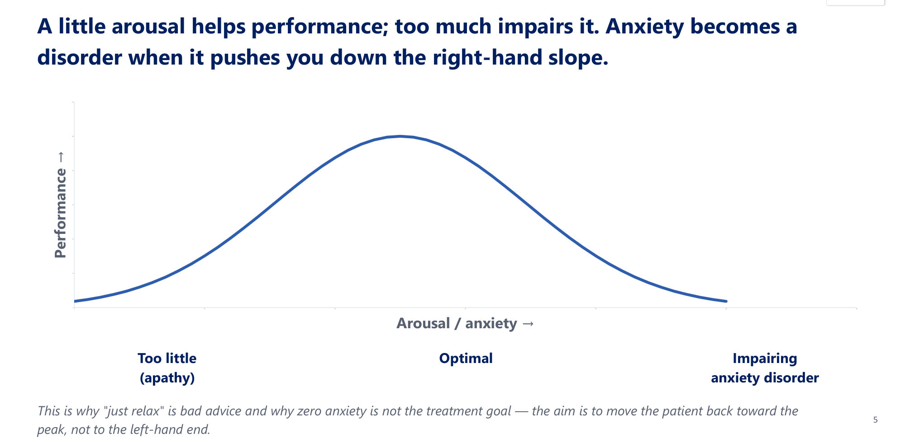

**Symptoms by system (slide 6):**

| System | Manifestations |
|---|---|
| Constitutional | Fatigue, **diaphoresis**, shivering |
| Cardiac | **Chest pain, palpitations, tachycardia, hypertension** |
| Pulmonary | **Shortness of breath, hyperventilation** |
| Neuro/MSK | Vertigo, light-headedness, **paraesthesias**, tremor, insomnia, muscle tension |
| GI | Abdominal discomfort, anorexia, nausea, vomiting, diarrhoea, constipation |

Patients often reach **cardiology, the ED or GI clinics** long before psychiatry.

**Organic and drug causes: always exclude first (slide 7) ⭐**

| Medications & substances | Medical conditions |
|---|---|
| ⭐ **Caffeine**; stimulants (cocaine, amphetamines) | ⭐ **Hyperthyroidism, phaeochromocytoma, hypoglycaemia** |
| **Sympathomimetics** (decongestants) | Cardiac/pulmonary: **arrhythmia, MI, PE, asthma, COPD** |
| **Bronchodilators (theophylline, salbutamol), thyroxine, steroids** | Neurological: **seizure, vestibular disease** |
| ⭐ **WITHDRAWAL:** alcohol, benzodiazepines, opioids, nicotine | — |

**New-onset anxiety in an older patient with no history → screen thyroid, cardiac and caffeine first.**

### 2.2 The Anxiety Disorders Map and Screening (Slides 8–10)
| Childhood-onset | Common adult | The rest |
|---|---|---|
| **Separation anxiety disorder** | **Social anxiety disorder** | **GAD** |
| **Selective mutism** | **Panic disorder** | Substance/medication-induced |
| **Specific phobia** | **Agoraphobia** | Due to another medical condition |

⭐ **DSM-5 change:** **agoraphobia and panic disorder are now SEPARATE, independent diagnoses.** "Panic attacks" can be a **specifier** on any disorder.

**Screening (slide 9):**
- **Core screen:** "Do you worry a lot? Sudden rushes of fear? Avoid places? Repetitive thoughts or rituals?"
- **Panic screen:** "A sudden surge of fear peaking within minutes, with palpitations, chest tightness, choking and fear of dying?" (Arabic version on the slide)
- **Then localise:**
  - ⭐ **WHAT is feared and WHY** (the feared consequence)
  - duration and impairment
  - rule out substance/medical causes and depression

**Management overview (slide 10):**

| Psychotherapy | Pharmacotherapy | General |
|---|---|---|
| ⭐ **CBT first-line** across most disorders | ⭐ **SSRIs and SNRIs first-line** | Psychoeducation; **reduce caffeine** |
| **Exposure-based** therapy for phobias, panic, agoraphobia | ⭐ **Benzodiazepines short-term only, then tapered** | Treat comorbid depression and substance use |
| **ERP** for OCD | (Detail in the Psychopharmacology lecture) | **Continue treatment** to prevent relapse |

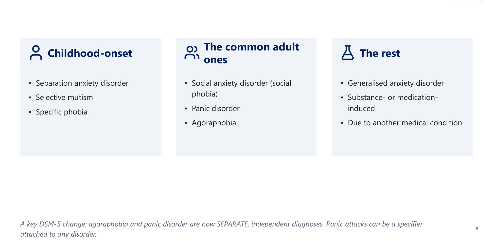

---

### 2.3 Generalised Anxiety Disorder (Slides 12–17) ⭐
**Case (slides 12–13):** a 34-year-old woman with uncontrollable worry about work, children and health, plus restlessness, poor sleep and muscle tension. Minimum duration → ⭐ **D: ≥ 6 months, more days than not.**

**Criteria: "WATCHERS" (slide 15):**
- excessive anxiety and worry, **more days than not for ≥ 6 months**, about **several** events/activities
- the worry is **difficult to control**
- ⭐ **≥ 3 of 6 symptoms in adults (only 1 in children)**

| Letter | Feature |
|---|---|
| **W** | **Worry**: excessive, hard to control |
| **A** | **Anxiety** about several events/activities |
| **T** | **Tension** (muscle) |
| **C** | **Concentration** difficulty; mind going blank |
| **H** | **Hyperarousal**: **irritability** |
| **E** | **Energy loss**: easily fatigued |
| **R** | **Restlessness**: on edge |
| **S** | **Sleep** disturbance |

⭐ **The 6 countable symptoms:** **restlessness, fatigue, poor concentration, irritability, muscle tension, sleep disturbance**.

| Epidemiology | Boundaries | Course |
|---|---|---|
| Lifetime **~6%** adults; **3%** children; **11%** adolescents | Not due to substance/medical cause (**hyperthyroidism**) | Onset hard to specify; **presents in the 20s** |
| Mean onset **~33**; often presents in the 20s | Not better explained by panic, social anxiety, OCD, separation anxiety | Only **~⅓ seek psychiatric treatment** |
| ⭐ **F:M ≈ 2:1** | ⭐ **GAD vs MDD:** up to **80% of depressed patients report anxiety**; GAD symptoms must occur **IN THE ABSENCE of MDD** | **Chronic, possibly lifelong; fluctuates; worse with stress** |
| ⭐ **Pure GAD is the exception**: the anxiety disorder **most often comorbid** | Anxiety only during depression = a symptom of depression | — |

**Treatment (slide 63):** **SSRI/SNRI + CBT**; **buspirone** adjunct; benzodiazepine **short-term only**.

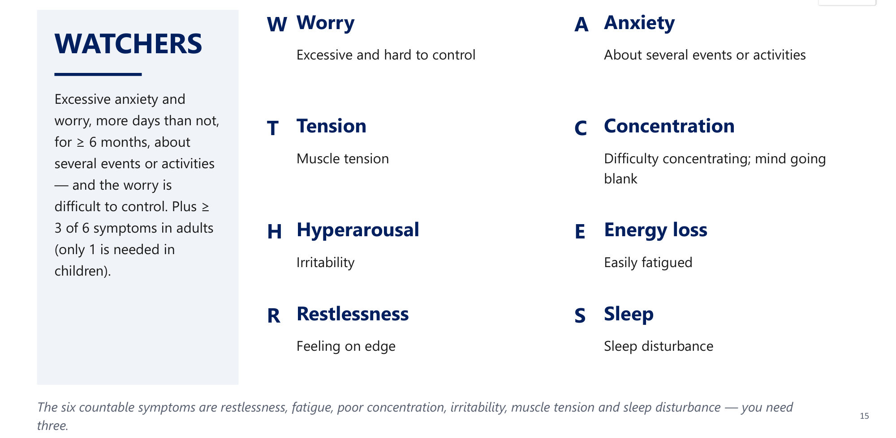

### 2.4 Panic Attack and Panic Disorder (Slides 18–21) ⭐⭐
**Panic attack:**
- an **abrupt surge** of intense fear **peaking within minutes**, from a calm or anxious state
- ⭐ **≥ 4 of 13 symptoms**
- **a building block, not a diagnosis**

| Cardiorespiratory | Autonomic & neuro | Cognitive |
|---|---|---|
| Palpitations | Sweating | **Fear of dying** |
| Shortness of breath | Dizziness | Fear of **"going crazy"/losing control** |
| Chest pain | Trembling | **Derealisation/depersonalisation** |
| Choking | Paraesthesias | — |
| — | Chills/heat; nausea/abdominal distress | — |

**Mnemonic *[added]*: STUDENTS + Fear of dying + 4 C's** (8 + 1 + 4 = 13):
- **STUDENTS:**
  - **S**weating
  - **T**rembling
  - **U**nsteadiness/dizziness
  - **D**erealisation
  - **E**levated heart rate
  - **N**ausea
  - **T**ingling
  - **S**hortness of breath
- **Fear of dying**
- **4 C's:**
  - **C**razy (fear of losing control)
  - **C**hest pain
  - **C**hills/heat
  - **C**hoking

**Panic disorder criteria (slide 19):**
- ⭐ **recurrent, UNEXPECTED** panic attacks
- **≥ 1 attack** followed by **≥ 1 month** of:
  - **anticipatory anxiety** (worry about more attacks), and/or
  - a **maladaptive behaviour change** (avoidance)
- not due to a substance or medical condition (cardiac, hyperthyroid); not better explained by social anxiety, phobia, OCD, PTSD, separation anxiety
- ⭐ The **"out-of-the-blue"** quality distinguishes it from the **cued** attacks of phobias.

**Panic cycle (slide 20):**
1. **bodily sensation** (palpitation, dizziness)
2. **catastrophic thought** ("I'm having a heart attack")
3. **fear surges** (autonomic arousal)
4. **more sensations** confirm the fear → **PANIC**

⭐ **CBT breaks the loop at step 2**, re-labelling the sensation as harmless.

| Course | Prognosis | Management |
|---|---|---|
| Onset **late adolescence/early adulthood**; chronic | **30–40%** symptom-free long-term | ⭐ **SSRI/SNRI + CBT** |
| ⭐ **91% have another psychiatric disorder** | **~50%** mild residual symptoms | **Benzodiazepine short-term only (4–12 weeks)**, tapered slowly |
| ⭐ **Two-thirds occur during or after MDD** | **10–20%** significant ongoing symptoms | ⭐ **β-BLOCKERS ARE NOT USEFUL** |

*[added]* Panic is provoked by **sodium lactate infusion, CO₂ inhalation, caffeine** (slide 62).

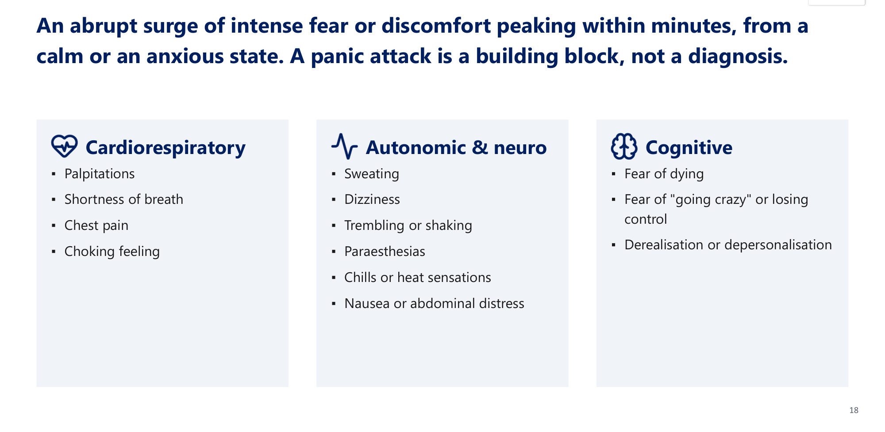 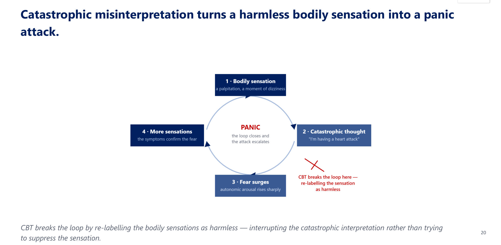

### 2.5 Agoraphobia (Slides 22–23) ⭐
**The five situations:**
1. **public transport**
2. **open spaces**
3. **enclosed places**
4. **standing in line/crowd**
5. **outside the home alone**

**Rules:**
- ⭐ **marked fear of ≥ 2 of the 5**
- the situations almost always provoke fear
- **actively avoided, needs a companion, or endured with intense anxiety**
- **≥ 6 months**; distress/dysfunction

**The feared consequence:** that **escape might be difficult or help unavailable** if panic-like, incapacitating or embarrassing symptoms occur (e.g. **fear of falling in the elderly, incontinence**).

| Course and management |
|---|
| Onset **~20** (later onset not uncommon) |
| ⭐ **Chronic and unremitting without treatment** |
| ⭐ **Agoraphobia WITHOUT panic is the most persistent form** |
| Treat as panic disorder: **SSRI/SNRI + exposure-based CBT** |

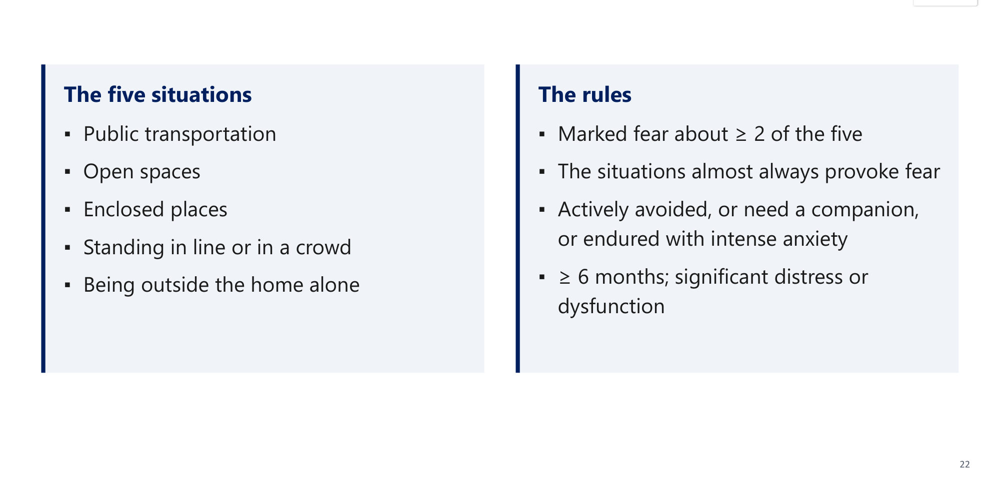

### 2.6 Social Anxiety Disorder (Slides 24–25) ⭐
**Criteria:**
- marked fear of **≥ 1 social situation with possible scrutiny** (speaking, meeting people, **eating in public**)
- ⭐ fear of being **negatively evaluated or humiliated**
- avoided or endured with intense fear; out of proportion
- **≥ 6 months**
- **If a medical condition is present** (Parkinson's, obesity, disfigurement), the fear is **unrelated to it or clearly excessive**.
- **Specifier:** ⭐ **PERFORMANCE-ONLY type**.

| Epidemiology | Prognosis | ⭐ The pearl |
|---|---|---|
| Lifetime **3–13%** | **Half to two-thirds** respond in trials | **Generalised type → SSRI/SNRI + CBT** |
| Onset in the **teens** (range 5–35) | ~Half of responders **fully remit** | ⭐ **PERFORMANCE-ONLY → propranolol or benzodiazepine PRN before the event** |
| — | Continue **6–12 months**; CBT benefits persist **up to 5 years** | Contrast: **β-blockers NOT useful in panic disorder** (commonly examined) |

### 2.7 Specific Phobia (Slides 26–28)
**Criteria:**
- marked fear of a **specific object/situation** that **almost always provokes immediate fear**
- avoided or endured with intense anxiety; **out of proportion**
- **≥ 6 months**

**Epidemiology:**
- lifetime **10–13%**; **F > M**
- onset **5–12 years**
- **animal and blood-injection-injury** types start earlier than situational/natural-environment types

⭐ **Blood-injection-injury phobia is unique:** it can cause a **VASOVAGAL FAINT** (**bradycardia and hypotension**) rather than tachycardia. It is managed with ⭐ **applied tension**.

**Exposure hierarchy / fear ladder (slide 27):**
1. look at a photo (SUDS 20)
2. stand in the same room (40)
3. approach within a metre (60)
4. brief contact (80)
5. full feared situation (100)

**Rules:**
- **stay** at each step until anxiety falls (**habituation**)
- **then climb**
- ⭐ **never escape at the peak**: that is what maintains the phobia

Exposure is **graded and agreed**, not confrontational. Specific phobia treatment = **exposure therapy**; medication has a limited role.

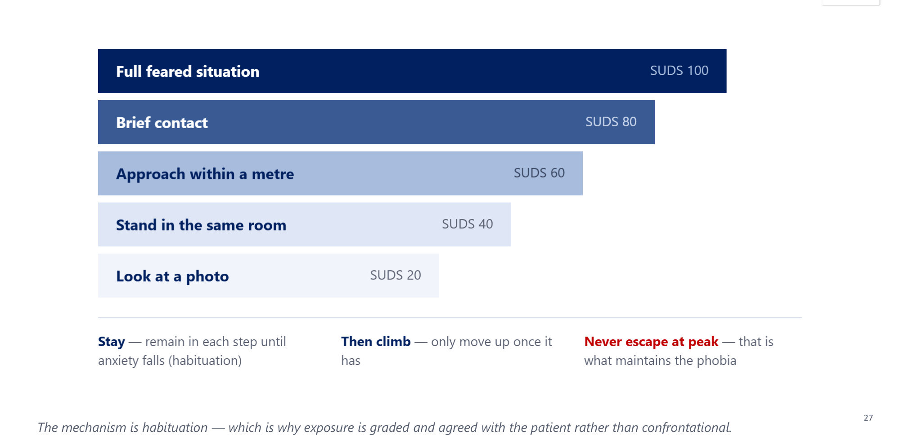

**Specific phobia vs agoraphobia (slide 28) ⭐**

| Presentation | Diagnosis |
|---|---|
| Fear of **airplanes and trains only** | **Specific phobia** |
| Fear of flying **because the plane will crash** | **Specific phobia** |
| Fear of **airplanes, elevators AND crowds** | **Agoraphobia** |

- **Agoraphobia:** ≥ 2 situations, avoided because of **panic-like/embarrassing symptoms**.
- **Specific phobia:** **one** situation; fear **not related to panic-like symptoms**.
- ⭐ **Ask WHY**: the feared consequence assigns the diagnosis.

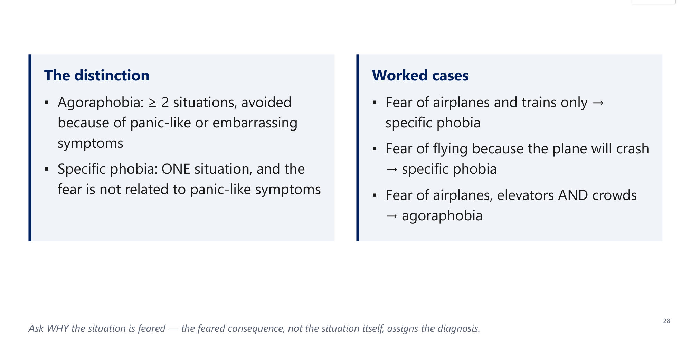

### 2.8 Separation Anxiety Disorder (Slides 29–30)
**Criteria:**
- excessive fear of separation from an attachment figure; **≥ 3 features**:
  - distress on separation
  - worry about losing them or harm befalling them
  - worry an untoward event (getting lost, kidnapped) will cause separation
  - refusal to go out
  - fear of being alone or sleeping away from home
- ⭐ **duration > 4 weeks in children, > 6 months in adults**
- not better explained by autism, psychosis, agoraphobia, GAD

**Across the lifespan:**
- grouped with childhood disorders from DSM-III to DSM-IV-TR; ⭐ **DSM-5 recognises it in ADULTS**
- lifetime **4.1% in childhood, 6.6% in adults**
- ⭐ **most adults had first onset IN ADULTHOOD** (only ~⅓ childhood-onset)
- attachment figure: **parents** (children) → **spouse/friend** (adults)

> 🔁 **Recap: Anxiety disorders.**
> - Exclude caffeine, stimulants, withdrawal, thyroid, phaeochromocytoma, hypoglycaemia, cardiac/pulmonary causes.
> - **GAD:** ≥ 6 months + ≥ 3 of 6 (WATCHERS), outside MDD; F 2:1; most comorbid.
> - **Panic disorder:** unexpected attacks (≥ 4/13) + ≥ 1 month of worry/avoidance; **no β-blockers**.
> - **Agoraphobia:** ≥ 2 of 5, fear of no escape, ≥ 6 months; now separate from panic.
> - **Social anxiety:** scrutiny; **performance-only → propranolol PRN**.
> - **Specific phobia:** one object; BII → vasovagal, **applied tension**; exposure ladder.
> - **Separation anxiety:** > 4 weeks children / > 6 months adults; mostly adult-onset in adults.
>
> ▶️ **Up next: OCD and related disorders.**

---

### 2.9 OC-Related Disorders Map (Slide 32)
**Unifying theme: repetitive thoughts and behaviours.**

| Disorder | Core |
|---|---|
| **OCD** | Obsessions, compulsions, or both |
| **Body dysmorphic disorder** | Preoccupation with a **perceived** appearance flaw |
| **Hoarding disorder** | Difficulty discarding, with clutter |
| **Trichotillomania** | Recurrent **hair-pulling** → hair loss |
| **Excoriation** | Recurrent **skin-picking** → lesions |
| Secondary | Substance-induced or due to a medical condition |

### 2.10 OCD (Slides 33–41) ⭐⭐
**Case (slides 33–34):** intrusive images of leaving the stove on; checks it **exactly 7 times**. The checking is → ⭐ **B: a compulsion**.
- The intrusive image = **obsession** (thought); the neutralising check = **compulsion** (behaviour or mental act).
- ⭐ **Obsessions raise anxiety; compulsions temporarily relieve it.**

| **Obsessions** | **Compulsions** |
|---|---|
| Recurrent, persistent **thoughts, urges or images** | Repetitive **behaviours or MENTAL ACTS** the person feels **driven** to perform |
| **Intrusive and UNWANTED** | In response to an obsession or **rigid rules** |
| Attempts to **ignore, suppress or neutralise** them | Aimed at **preventing/reducing distress** |
| — | **Not realistically connected**, or clearly **excessive** |

**The compulsion is a RESPONSE to the obsession**: that link is the core of OCD.

**The OCD vicious cycle (slide 36):**
1. obsession
2. anxiety rises
3. compulsion
4. temporary relief → **negative reinforcement** → the ritual returns

⭐ **ERP** = **E**xposure (face the obsession) + **R**esponse **P**revention (resist the compulsion) → anxiety falls by **habituation**.

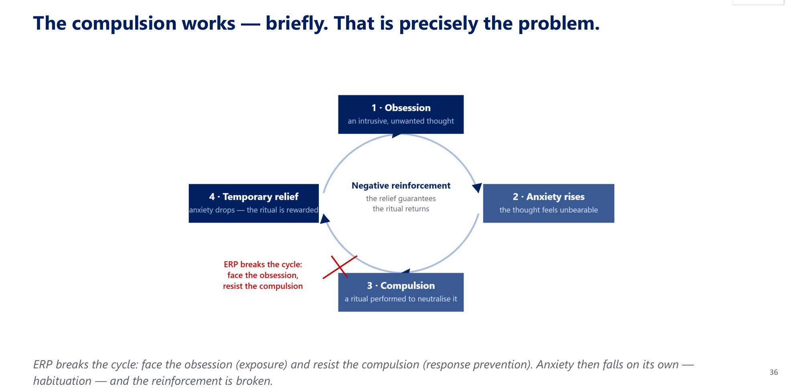

**Common obsession → compulsion pairs (slide 37):**

| Obsession | Compulsion | Clinical clue |
|---|---|---|
| ⭐ **Contamination** | **Washing, cleaning** | **Chapped hands**; avoids handshakes and **doctors** |
| **Doubt** (harm, safety) | **Checking** locks, stove, gas | Late leaving home |
| **Symmetry / "just right"** | **Ordering, arranging, counting** | Tasks never feel finished |
| ⭐ **Forbidden/taboo thoughts** | **Mental rituals, reassurance-seeking** | **Hidden; high shame; HIGH SUICIDE RISK** |
| Fear of losing things | Saving | Now a separate **hoarding** diagnosis |

Compulsions can be **purely MENTAL** (counting, praying, reviewing). Ask about both or you'll miss **"pure-O"**.

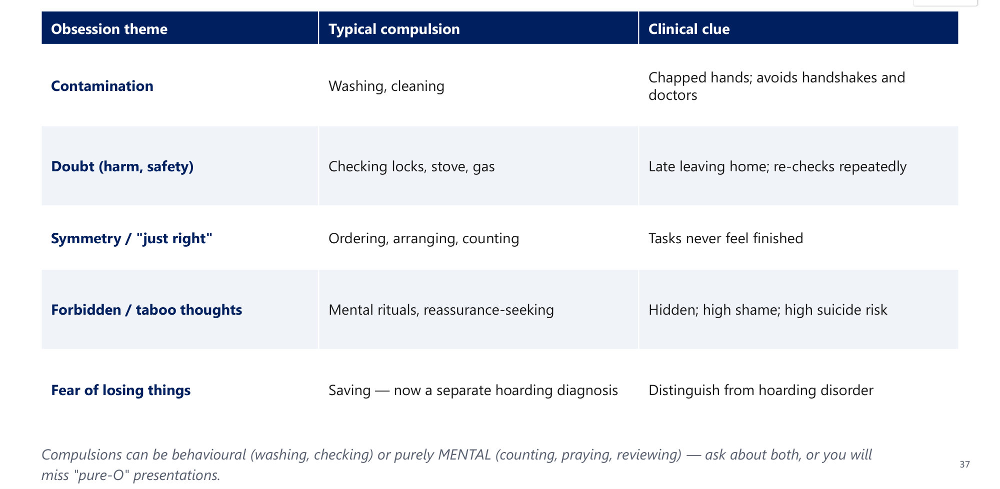

**Threshold and insight (slide 38):**
- ⭐ **Time-consuming: > 1 hour/day**, OR marked distress/dysfunction
- not due to a substance, medical or other psychiatric disorder

| Insight specifier | Belief | Significance |
|---|---|---|
| **Good/fair** | Obsessional beliefs **probably NOT true** | The usual presentation; **best prognosis** |
| **Poor** | Beliefs **probably true** | Worse treatment response |
| ⭐ **Absent/delusional** | **Completely convinced** | Worst prognosis; ⭐ **easily MISTAKEN FOR PSYCHOSIS**, but **treated as OCD**, not schizophrenia |

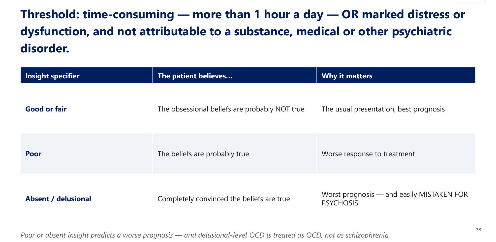

| Course (slide 39) | Good prognostic factors |
|---|---|
| ⭐ **Mean onset ~19.5 years**; usually gradual | **Non-severe** symptoms |
| Untreated: **chronic, waxing and waning** | **No comorbid OCPD** |
| ⭐ **Suicidal ideation ~50%; attempts ~25%** | Depressed/anxious mood rather than **schizotypal** |
| — | **Treatment compliance; family support** |

**Quality of life (slide 40):**
- harm obsessions make relationships feel hazardous → withdrawal
- symmetry obsessions → projects never finish → school/job loss
- **contamination fears → avoid physicians; washing → dermatological damage**
- ⭐ symptoms **obstruct the cure**: medications may be seen as "**contaminated**" and refused

**Treatment (slide 41) ⭐**

| First-line | If inadequate |
|---|---|
| ⭐ **CBT with ERP**, medication, or both | Switch to another SSRI, ⭐ **clomipramine**, or venlafaxine |
| ⭐ **SSRI at MAXIMUM dose for ≥ 6 weeks** | ⭐ **Augment with an antipsychotic**: e.g. **risperidone 0.5–3 mg/day** |
| ⭐ OCD often needs **HIGHER doses than depression** | SSRIs and clomipramine improve **40–60%** |

⭐ **ERP is the single most effective intervention for OCD**; medication is an alternative or adjunct.

**Neurobiology (slide 62):**
- **cortico-striatal-thalamic loop** (caudate, basal ganglia); serotonin + glutamate
- ⭐ **PANDAS:** paediatric OCD and tics after **group-A strep** (autoimmune)
- OCD is associated with **Tourette's** and **Sydenham chorea** (*[added]* link to Rheumatic Fever)

### 2.11 Body Dysmorphic Disorder (Slides 42–44) ⭐
**Criteria:**
- preoccupation with **≥ 1 perceived defect**, **not observable or only slight** to others
- **repetitive behaviours** (**mirror-checking**, grooming, **skin-picking**, reassurance-seeking) or **mental acts** (comparing)
- marked distress/dysfunction
- ⭐ **not better explained by an eating disorder** (weight/fat concerns)
- ⭐ **Muscle dysmorphia** specifier: body "too small/not muscular enough"; often **missed in men**

**Case (slide 43):**
- **Ms. R, 28**, attractive, believes she is "ugly" and that others laugh at her
- began at **13** (nose "too fat", eyes "too far apart")
- withdrew, grades fell; picks blemishes, checks mirrors all day

| Course | Management |
|---|---|
| Lifetime **~2%**, slightly more females | **Educate**; focus on **SUFFERING and impaired function** |
| Onset in **adolescence**; long undulating course; few symptom-free intervals | ⭐ **Do NOT comment on their looks**: reassurance entrenches the preoccupation |
| ⭐ **Suicide attempts 6–23× the general population** | **Mild–moderate: SSRI or CBT**; non-responders: **clomipramine** |
| — | ⭐ **Maintain 3–4 years** |

⭐ Patients seek **cosmetic/dermatological procedures**, which **rarely help and may worsen** the preoccupation.

### 2.12 Hoarding Disorder (Slides 45–46)
**Criteria:**
- persistent difficulty **discarding possessions, REGARDLESS OF VALUE**
- a perceived need to save; distress on discarding
- clutter congests living areas (uncluttered only via third parties)
- not due to a medical condition (**brain injury, CVA, Prader–Willi**)
- **Specify:** **excessive acquisition** (most cases) and **insight level**

| Item | Detail |
|---|---|
| Prevalence | **~1.5%** (England); **M = F** |
| Trajectory | Emerges **age 11–15** → interferes by **mid-20s** → significant impairment by **mid-30s** |
| Course | Chronic, waxing and waning |
| ⭐ **FIRST priority** | **SAFETY RISKS (fire, falls)**: **forcible action if children or elderly people are at risk** |
| Treatment | **CBT** (limited availability) or **SSRI** (esp. with comorbid mood/anxiety) |

Hoarding is the one disorder here where **safety may force action before any therapeutic alliance exists**.

### 2.13 Trichotillomania and Excoriation (Slides 47–49)
**Trichotillomania criteria:**
- recurrent hair-pulling → hair loss
- **repeated attempts to stop**
- distress/dysfunction
- not dermatological or another mental disorder (e.g. BDD)

**Case:**
- **Ms. C, 27**: started at **11** at the nape → whole scalp, bald patches hidden by scarves
- high-functioning (master's)
- daily, often **automatic**; stopping causes **rising tension**

| Two patterns | Complication | Treatment |
|---|---|---|
| **Early–mid adolescence:** ⭐ **F:M 10:1**, serious, chronic | ⭐ **5–40% chew/swallow hair** | **No consensus** |
| **Childhood onset:** F = M, less serious, more common | ⭐ **~⅓ of those develop BEZOARS** (hairballs), sometimes **surgical** | **SSRI, or CBT with habit reversal**; augment with an antipsychotic |

⭐ **Ask every hair-pulling patient whether they swallow the hair.**

**Excoriation (skin-picking):**
- **criteria:** recurrent picking → lesions; attempts to stop; distress; **not due to a substance (e.g. cocaine)** or another disorder
- **clinical:** face, arms, hands; **onset at puberty**; **female predominance**; comorbid with OCD, BDD, trichotillomania
- **treatment:** **CBT with habit reversal ± SSRI**

⭐ **Trichotillomania and excoriation = BODY-FOCUSED REPETITIVE BEHAVIOURS.** The pull/pick is often **soothing**, not distress-driven like a classic compulsion.

> 🔁 **Recap: OC-related disorders.**
> - **OCD:** obsession (thought, raises anxiety) → compulsion (act/mental act, relieves it); > 1 h/day; insight specifier (absent ≠ psychosis); onset ~19.5; **SI 50%, attempts 25%**. **ERP** + high-dose SSRI ≥ 6 weeks → clomipramine → risperidone augmentation. PANDAS.
> - **BDD:** perceived flaw; don't comment on looks; SSRI/CBT, clomipramine; 3–4 years; suicide 6–23×.
> - **Hoarding:** regardless of value; safety first.
> - **BFRBs** (trichotillomania, excoriation): habit reversal; bezoars.
>
> ▶️ **Up next: Trauma- and stressor-related disorders.**

---

### 2.14 Acute Stress Disorder vs PTSD (Slides 52–55) ⭐⭐
**Case (slides 52–53):** **10 days** after a car crash, a man has nightmares, flashbacks, hypervigilance and numbing, starting the day after → ⭐ **B: acute stress disorder**.

| Time since trauma | Diagnosis |
|---|---|
| **< 3 days** | ⭐ **No diagnosis**: acute distress is normal |
| **3 days – 1 month** | ⭐ **Acute stress disorder** (remits within the month) |
| **> 1 month** | ⭐ **PTSD** (same symptoms, persisting) |

Both require **exposure to a traumatic event** and **significant impairment**. **Only the clock differs.**

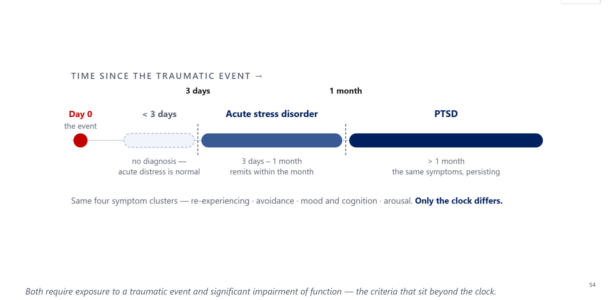

**The 4 symptom clusters (slide 55):**

| 1. Re-experiencing | 2. Avoidance | 3. Mood & cognition | 4. Arousal |
|---|---|---|---|
| **Flashbacks, nightmares** | **External**: places, people, conversations | **Amnesia** for part of the event | **Hypervigilance, exaggerated startle** |
| Intrusive memories | **Internal**: emotions, memories | Negative beliefs; **self/other-blame** | **Irritability, anger** |
| Cues cause distress | — | Persistent negative emotions; **detachment, anhedonia** | **Poor sleep and concentration** |

**Mnemonic *[added]*: "TRAUMA"**:
- **T**rauma exposure
- **R**e-experiencing
- **A**voidance
- **U**nable to function
- **M**onth (> 1 for PTSD)
- **A**rousal (+ negative mood/cognition)

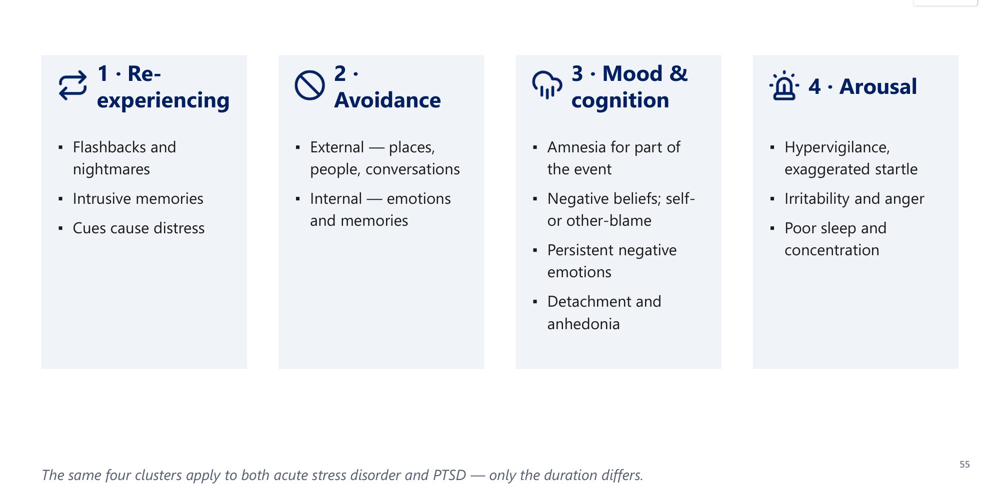

| Epidemiology & risk (slide 56) | Comorbidity & prognosis (slide 57) |
|---|---|
| ⭐ **~8% lifetime** (general population); **up to 75%** in high-risk trauma-exposed groups; **5–15% subclinical** | **Two-thirds have ≥ 2 other disorders**: depression, substance use, anxiety, bipolar |
| ⭐ **MOST IMPORTANT risk factor: severity, duration and proximity of the trauma** ("the **dose** of trauma") | Untreated: **~30% recover completely; 40% mild; 20% moderate; 10% unchanged/worse** |
| Also: single/divorced/widowed; socially withdrawn; low SES | **~50% recover by 1 year** |
| — | ⭐ **Good prognosis:** **rapid onset, short duration (< 6 months), good premorbid function, strong support, no other disorders** |

**Neurobiology (slide 62):**
- **amygdala over-active** in anxiety and PTSD
- ⭐ **PTSD: small hippocampus, LOW cortisol, HIGH CRF** (*[added]* contrast with depression's high cortisol)

**Management (slide 58) ⭐**

| Psychotherapy: first-line | Pharmacotherapy |
|---|---|
| ⭐ **TRAUMA-FOCUSED CBT** (exposure, cognitive processing therapy) | First-line: ⭐ **SSRIs (sertraline, paroxetine) or SNRI (venlafaxine)** |
| ⭐ **EMDR** | ⭐ **PRAZOSIN (α1-antagonist) for nightmares and hypervigilance** |
| Supportive, psychodynamic; couples/family therapy | Augment with an **SGA** in severe/resistant cases |

⭐ **BENZODIAZEPINES ARE GENERALLY AVOIDED in PTSD**: they don't treat the core symptoms, carry dependence risk, and can worsen symptoms.

### 2.15 Adjustment Disorder (Slides 59–60)
| Definition | Subtypes (predominant symptom) |
|---|---|
| Emotional/behavioural response to an **identifiable stressor** (financial, illness, relationship) | With **depressed mood** |
| ⭐ **Onset WITHIN 3 MONTHS** of the stressor | With **anxiety** |
| ⭐ **Remits within 6 months** of the stressor's removal | **Mixed** anxiety and depressed mood |
| Out of proportion or significant impairment; **not normal bereavement** | With **disturbance of conduct** |
| — | Mixed emotions and conduct · unspecified |

**Management:**
- **supportive psychotherapy, CBT, group** (the mainstay)
- ⭐ **problem-solving on the STRESSOR itself**: often the **most useful and most often skipped**
- medication **only for target symptoms**, time-limited

⭐ **Adjustment disorder is a DIAGNOSIS OF EXCLUSION**: used when the reaction doesn't meet criteria for MDD, PTSD, etc.

> 🔁 **Recap: Trauma.**
> - < 3 days normal · 3 days–1 month **ASD** · > 1 month **PTSD**.
> - 4 clusters: re-experiencing, avoidance, mood/cognition, arousal.
> - PTSD ~8% (up to 75% if exposed); the **dose of trauma** matters most.
> - Small hippocampus, **low cortisol**, high CRF.
> - **TF-CBT/EMDR + SSRI/SNRI**; **prazosin** for nightmares; **avoid benzodiazepines**.
> - Adjustment: within 3 months, remits within 6 months; problem-solving; diagnosis of exclusion.

---

### 2.16 Neurobiology Pearls (Slide 62)
| Circuits & chemistry | Tested triggers & links |
|---|---|
| ⭐ **Amygdala**: the fear centre, over-active in anxiety/PTSD | ⭐ **Panic provoked by sodium lactate, CO₂ inhalation, caffeine** |
| **OCD:** cortico-striatal-thalamic loop (**caudate**, basal ganglia); serotonin + glutamate | ⭐ **PANDAS**: paediatric OCD + tics after **group-A strep** |
| ⭐ **↓ GABA, ↓ serotonin, ↑ noradrenaline (locus coeruleus)** | OCD associated with **Tourette's** and **Sydenham chorea** |
| — | ⭐ **PTSD:** small hippocampus, **low cortisol, high CRF** |

### 2.17 Management at a Glance (Slide 63) ⭐⭐
| Disorder | First-line | Pearls |
|---|---|---|
| **GAD** | SSRI/SNRI + CBT | **Buspirone** adjunct; benzodiazepine short-term only |
| **Panic / agoraphobia** | SSRI/SNRI + CBT (exposure) | ⭐ **β-blockers NOT useful**; benzodiazepine bridge then taper |
| **Social anxiety** | SSRI/SNRI + CBT | ⭐ **Performance-only → propranolol PRN** |
| **Specific phobia** | ⭐ **Exposure therapy** | Medication has a limited role |
| **OCD / BDD** | ⭐ **ERP + high-dose SSRI** | **Clomipramine**; augment with an antipsychotic |
| **PTSD** | ⭐ **Trauma-focused CBT; SSRI/SNRI** | ⭐ **Prazosin** for nightmares; **AVOID benzodiazepines** |
| **Adjustment** | **Supportive psychotherapy** | Medication only for target symptoms |

The backbone everywhere is **SSRI/SNRI + a behavioural therapy**; what changes is **which therapy** and the **exceptions**.

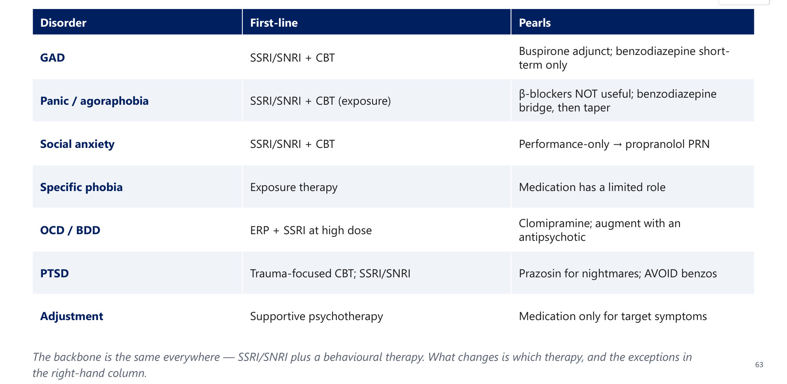

### 2.18 Master Comparison and Duration Cheat-Sheet (Slides 64–65) ⭐⭐
| Disorder | Key feature | Duration | Onset | Prevalence | Sex |
|---|---|---|---|---|---|
| **GAD** | Uncontrollable worry + ≥ 3 physical symptoms | **≥ 6 months** | ~33 | ~6% | **F 2:1** |
| **Panic disorder** | Recurrent unexpected attacks | **≥ 1 month of worry** | Late teens–20s | ~2–3% | F > M |
| **Agoraphobia** | ≥ 2 situations; fear of no escape | **≥ 6 months** | ~20 | ~1–2% | F > M |
| **Social anxiety** | Fear of scrutiny | **≥ 6 months** | Teens | 3–13% | F > M |
| **Specific phobia** | One object/situation | **≥ 6 months** | 5–12 | 10–13% | F > M |
| **Separation anxiety** | Fear of losing an attachment figure | **> 4 weeks (child) / > 6 months (adult)** | Child and adult | 4–7% | F > M |
| **OCD** | Obsessions + compulsions | ⭐ **> 1 h/day** | ~19.5 | ~2–3% | ⭐ **M = F** |
| **PTSD** | Trauma + 4 clusters | **> 1 month** | Any | ~8% | F > M |

⭐ **The two outliers:** **OCD** is the only one with **equal sex distribution**, and it is graded by **TIME SPENT**, not months.

| Window | Disorders |
|---|---|
| **3 days – 1 month** | **Acute stress disorder** (< 3 days = normal distress) |
| **≥ 1 month** | **PTSD** · **panic disorder** (≥ 1 month of worry/avoidance) · **separation anxiety in children** (> 4 weeks) |
| **≥ 6 months (the default)** | **GAD · social anxiety · specific phobia · agoraphobia · separation anxiety in adults** |
| **Off the axis** | **OCD: > 1 h/day** · **Adjustment: onset within 3 months, remits within 6 months of the stressor ending** |

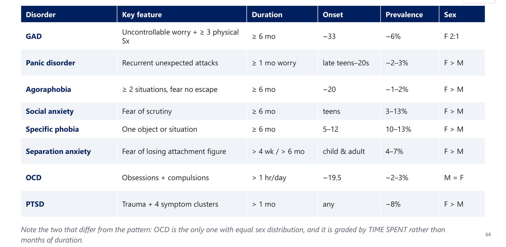
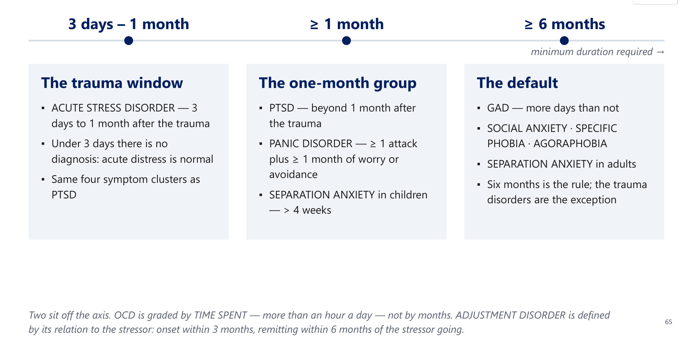

### 2.19 Integrative Case: Mrs. A, 29 (Slides 66–67) ⭐
**Presentation:**
- teacher, **referred by cardiology** after 3 normal ECGs, troponins and an echo
- **1 year** of sudden pounding heart, chest tightness, breathlessness, dizziness, **tingling hands**; each **peaks in ~5 minutes**, passes in 30 minutes
- the **first came out of the blue** watching TV
- now **worries daily** about the next one
- **stopped driving on the ring road, using lifts, going to the mall alone**; goes only **with her sister**
- **5 cups of Arabic coffee/day**; poor sleep; weight loss; **TSH normal**; no low mood or trauma

| Question | Model answer (lecture) |
|---|---|
| 1. Diagnosis(es)? | ⭐ **Panic disorder** (recurrent unexpected attacks + ≥ 1 month anticipatory anxiety/avoidance) **WITH agoraphobia as a separate diagnosis** (≥ 2 of 5 situations, needs a companion, ≥ 6 months) |
| 2. Criteria? | Attacks peak within minutes with **≥ 4 of 13** symptoms; avoidance driven by fear that **escape would be difficult or help unavailable** |
| 3. Organic causes? | **Hyperthyroidism** (TSH normal), **arrhythmia/MI** (cardiac work-up negative), ⭐ **caffeine** (5 cups/day is a genuine contributor) |
| 4. Management? | **SSRI/SNRI + CBT with exposure**; benzodiazepine only as a **short bridge**, tapered; ⭐ **β-blockers NOT useful**; **cut caffeine**; treat sleep |

**Twist:** if the attacks happened **only in lifts** → **specific phobia**, not panic disorder.

---

## 3. High-Yield Comparison Tables

### Table A: Same Avoidance, Different Diagnosis (Ask WHY)
| Avoids the mall because… | Diagnosis |
|---|---|
| Might have a panic attack and **can't escape/get help** | **Agoraphobia** |
| Might be **judged or humiliated** | **Social anxiety** |
| Afraid of **one specific thing** there (e.g. lifts, for their own sake) | **Specific phobia** |
| Fear of **contamination** from crowds | **OCD** |
| It **reminds them of a trauma** there | **PTSD** |
| Fear of being **separated** from a spouse | **Separation anxiety** |

### Table B: β-Blockers and Benzodiazepines Across the Chapter
| Disorder | β-blocker | Benzodiazepine |
|---|---|---|
| Performance-only social anxiety | ✅ **Propranolol PRN** | ✅ PRN alternative |
| Panic disorder | ❌ **Not useful** | Short bridge (4–12 weeks), taper |
| GAD | — | Short-term only |
| PTSD | — | ❌ **Avoid** |
| *[added]* Akathisia (Psychosis lecture) | ✅ Propranolol | — |

### Table C: Obsession vs Compulsion vs Delusion vs BFRB
| | Obsession | Compulsion | Delusion | BFRB (trich/excoriation) |
|---|---|---|---|---|
| Nature | Thought/urge/image | Behaviour or mental act | Fixed false belief | Pulling/picking |
| Ego | **Dystonic** | Driven, often resisted | Syntonic (held as true) | Often **soothing**, automatic |
| Effect on anxiety | **Raises** | **Relieves** briefly | — | Relieves tension |
| Insight | Usually kept | — | **Absent** | Variable |
| Rx | ERP + SSRI | ERP | Antipsychotic | **Habit reversal** ± SSRI |

### Table D: Trauma Timeline
| Time | Diagnosis |
|---|---|
| < 3 days | Normal acute distress |
| 3 days – 1 month | Acute stress disorder |
| > 1 month | PTSD |
| Stressor (non-traumatic), onset ≤ 3 months, resolves ≤ 6 months after it ends | Adjustment disorder |

### Table E: Cortisol Across Disorders *[added synthesis]*
| Disorder | Cortisol / HPA |
|---|---|
| Depression | **↑ Cortisol**, dexamethasone non-suppression |
| PTSD | **↓ Cortisol**, ↑ CRF, small hippocampus |
| Cushing's (Adrenal I) | ↑ Cortisol (organic) → depression/psychosis |

---

## 4. Rules, Exceptions, Patterns
- **Every diagnosis:** not due to substance/medical cause, plus significant distress/impairment.
- **The feared consequence assigns the diagnosis.**
- **≥ 6 months is the default**; exceptions: panic (1 month of worry), ASD (3 days–1 month), PTSD (> 1 month), separation anxiety in children (> 4 weeks), **OCD (> 1 h/day)**, adjustment (3/6-month rule).
- **GAD needs ≥ 3 of 6 in adults, 1 in children**, and must occur outside MDD.
- **Agoraphobia and panic are separate diagnoses** since DSM-5.
- **β-blockers:** yes for performance anxiety; **no** for panic.
- **Benzodiazepines:** short-term bridge only; **avoid in PTSD**.
- **Blood-injection-injury phobia → vasovagal** (bradycardia) → **applied tension**.
- **OCD = M = F**; all the others F > M (hoarding M = F too).
- **OCD needs higher SSRI doses** and ≥ 6 weeks; **clomipramine**; risperidone augmentation.
- **Absent-insight OCD is still OCD**, not psychosis.
- **OCD/BDD suicide risk is high**: OCD SI 50%/attempts 25%; BDD attempts 6–23×.
- **Don't reassure about looks in BDD**; avoid cosmetic surgery.
- **Hoarding: safety before alliance.**
- **Trichotillomania: ask about swallowing hair (bezoar).**
- **PTSD: low cortisol; prazosin for nightmares.**
- **Adjustment = diagnosis of exclusion**; treat the stressor.
- **Aim for function, not zero anxiety** (Yerkes–Dodson).

---

## 5. Clinical Correlations
- **Cardiology:** chest pain, palpitations, normal troponin/echo → panic disorder. But exclude **arrhythmia, MI, PE** first.
- **Endocrine:**
  - **hyperthyroidism, phaeochromocytoma, hypoglycaemia** mimic anxiety
  - **thyroxine over-replacement** causes anxiety
- **Respiratory:** **salbutamol/theophylline** cause anxiety; asthma/COPD dyspnoea overlaps with panic.
- **Dermatology:** contamination OCD → **chapped hands**; BDD → seeks dermatology/cosmetic care; excoriation lesions; **trichotillomania** (vs alopecia areata).
- **Surgery/GI:** **trichobezoar** in hair swallowers.
- **Paediatrics/Rheumatology:** **PANDAS** (OCD/tics after group-A strep); **Sydenham chorea** (Rheumatic Fever lecture) is associated with OCD.
- **Phlebotomy/vaccination:** BII phobia → vasovagal syncope; use **applied tension**, lying down.
- **Addiction:** alcohol/benzodiazepine **withdrawal** presents as anxiety.
- **Saudi context:** **Arabic coffee** = caffeine; taboo/religious obsessions (scrupulosity) hidden by shame.

---

## 6. Rapid Revision (Last-Day)
1. **Fear** = imminent threat; **anxiety** = future threat. Yerkes–Dodson: aim for function.
2. **Three DSM-5 chapters:** anxiety · OC-related · trauma/stressor.
3. **Exclude:**
   - caffeine, stimulants, sympathomimetics, bronchodilators, thyroxine, steroids
   - **withdrawal** (alcohol, benzodiazepines, opioids, nicotine)
   - hyperthyroidism, **phaeochromocytoma**, hypoglycaemia, arrhythmia, MI, PE, asthma/COPD, seizure, vestibular disease
4. **GAD:**
   - ≥ 6 months, more days than not, hard to control
   - **≥ 3 of 6** (restlessness, fatigue, concentration, irritability, tension, sleep); **1 in children**
   - ~6%, F 2:1, mean onset 33, most comorbid
   - outside MDD
   - SSRI/SNRI + CBT; buspirone
5. **Panic attack:** peaks within minutes; ≥ 4 of 13.
6. **Panic disorder:**
   - recurrent **unexpected** attacks + **≥ 1 month** worry/avoidance
   - **91% comorbid**; ⅔ with/after MDD
   - 30–40% symptom-free; 50% mild; 10–20% significant
   - SSRI/SNRI + CBT; benzodiazepine 4–12 weeks; **no β-blockers**
7. **Agoraphobia:**
   - **≥ 2 of 5** (transport, open, enclosed, crowds/lines, alone outside)
   - fear of no escape/help; ≥ 6 months
   - without panic = most persistent
8. **Social anxiety:** scrutiny/humiliation; 3–13%; teens; **performance-only → propranolol PRN**.
9. **Specific phobia:** one object; 10–13%; onset 5–12; **BII → vasovagal → applied tension**; **exposure ladder** (stay, climb, never escape at the peak).
10. **Separation anxiety:** ≥ 3 features; **> 4 weeks children, > 6 months adults**; adults mostly adult-onset.
11. **OCD:**
    - obsession raises anxiety; compulsion relieves it
    - **> 1 h/day**; insight good/poor/absent (absent ≠ psychosis)
    - onset 19.5; **M = F**; **SI 50%, attempts 25%**
    - **ERP**; SSRI max dose ≥ 6 weeks; clomipramine; risperidone augmentation
    - PANDAS; caudate
12. **BDD:** perceived flaw; mirror-checking; muscle dysmorphia; ~2%; **suicide attempts 6–23×**; don't comment on looks; SSRI/CBT → clomipramine; **3–4 years**.
13. **Hoarding:** regardless of value; ~1.5%, M = F; 11–15 → mid-30s; **safety first**; CBT/SSRI.
14. **Trichotillomania:** adolescent F:M 10:1; 5–40% swallow → ⅓ **bezoars**; habit reversal/SSRI.
15. **Excoriation:** puberty, female; habit reversal ± SSRI. **BFRBs are soothing.**
16. **ASD 3 days–1 month; PTSD > 1 month**; < 3 days = normal.
17. **PTSD 4 clusters:** re-experiencing, avoidance, negative mood/cognition, arousal.
18. **PTSD:**
    - ~8% (up to 75% exposed); **dose of trauma** matters most
    - ⅔ have ≥ 2 comorbidities; 50% recover by 1 year
    - 30/40/20/10 outcome split
19. **PTSD Rx:** **TF-CBT, EMDR**; sertraline/paroxetine/venlafaxine; **prazosin** for nightmares; SGA augmentation; **avoid benzodiazepines**.
20. **PTSD biology:** amygdala ↑, small hippocampus, **low cortisol, high CRF**.
21. **Adjustment:** onset ≤ 3 months, remits ≤ 6 months; subtypes; problem-solving; diagnosis of exclusion.
22. **Panic provocation:** lactate, CO₂, caffeine. **↓ GABA, ↓ 5-HT, ↑ NA (locus coeruleus).**

---

## 7. Exam-Style Questions

**Q1 (lecture, slides 12–13).** A 34-year-old woman has uncontrollable worry about work, children and health, with restlessness, poor sleep and muscle tension. Minimum duration for GAD?
A. 2 weeks · B. 1 month · C. 3 months · **D. 6 months, more days than not**

> **Answer: D** (lecture key). GAD needs ≥ 6 months of excessive, hard-to-control worry + ≥ 3 of 6 physical symptoms.

**Q2 (lecture, slides 33–34).** A patient tormented by intrusive images of having left the stove on checks it exactly 7 times before leaving. The checking is a…
A. Obsession · **B. Compulsion** · C. Delusion · D. Tic

> **Answer: B** (lecture key).
> - The image is the obsession; the neutralising check is the compulsion.
> - Obsessions raise anxiety; compulsions temporarily relieve it.

**Q3 (lecture, slides 52–53).** Ten days after a car crash, a man has nightmares, flashbacks, hypervigilance and emotional numbing that began the day after. Diagnosis now?
A. PTSD · **B. Acute stress disorder** · C. Adjustment disorder · D. GAD

> **Answer: B** (lecture key).
> - 3 days–1 month = ASD.
> - Beyond 1 month = PTSD. Same clusters, different clock.

**Q4.** A 22-year-old student is terrified of giving her thesis presentation next week; she is otherwise comfortable socially. Best pharmacological option?
A. Daily SSRI for 12 months · **B. Propranolol PRN before the presentation** · C. Clomipramine · D. Prazosin

> **Answer: B** (slides 25, 63, 68).
> - Performance-only social anxiety → **propranolol PRN** (or a benzodiazepine PRN).
> - β-blockers are **not** useful in panic disorder.

**Q5.** A 27-year-old with long-standing hair-pulling presents with epigastric pain, early satiety and a palpable mass. What must you ask?
A. Family history of alopecia · **B. Whether she chews or swallows the hair** · C. Thyroid symptoms · D. Recent stressors

> **Answer: B** (slide 48).
> - 5–40% swallow hair; ~⅓ of those develop **trichobezoars**, sometimes needing surgery.

**Lecture board one-liners (slide 68):**

| # | Question | Answer |
|---|---|---|
| 1 | Panic-like symptoms 3 weeks post-trauma: ASD or PTSD? | **ASD** (< 1 month); PTSD > 1 month |
| 2 | Most effective therapy for OCD? | **ERP**; SSRIs often at higher doses |
| 3 | Drug for performance-only social anxiety? | **Propranolol PRN**; not useful in panic |
| 4 | Agoraphobia: how many situations, and why avoided? | **≥ 2 of 5**; escape/help hard if panic-like symptoms occur |
| 5 | PTSD drug for nightmares? | **Prazosin** (α1-antagonist) |
| 6 | Paediatric OCD and tics after strep? | **PANDAS** |

---

## 8. Exam Pitfalls & Traps
| Trap | Correct thinking |
|---|---|
| Labelling the situation (mall, plane) as the diagnosis | ❌ Ask **WHY**: the feared consequence decides |
| Fear of planes + trains only = agoraphobia | ❌ Specific phobia (agoraphobia needs ≥ 2 situations **feared because of no escape**) |
| Panic disorder includes agoraphobia | ❌ **Separate diagnoses** since DSM-5 |
| β-blockers for panic disorder | ❌ **Not useful**; only for performance-only social anxiety |
| Benzodiazepines long-term for anxiety | ❌ Short-term bridge, tapered; **avoid in PTSD** |
| GAD diagnosed during an MDE | ❌ GAD symptoms must occur outside MDD |
| GAD needs 3 symptoms in children | ❌ **Only 1** in children |
| PTSD at 10 days | ❌ **ASD** (3 days–1 month) |
| PTSD at day 2 | ❌ < 3 days = **normal acute distress** |
| OCD duration ≥ 6 months | ❌ OCD is graded by **time > 1 h/day** (or distress) |
| OCD with absent insight = schizophrenia | ❌ Still **OCD**: treat as OCD |
| Checking = obsession | ❌ Checking is the **compulsion** (thought = obsession) |
| Compulsions are always visible | ❌ **Mental** compulsions ("pure-O") exist |
| OCD at a standard antidepressant dose for 2 weeks = failure | ❌ **Max dose ≥ 6 weeks** before calling it a failure |
| Low suicide risk in OCD | ❌ **SI ~50%, attempts ~25%** |
| Reassure the BDD patient they look fine | ❌ Reassurance entrenches it; focus on suffering/function |
| BDD → refer for cosmetic surgery | ❌ Rarely helps; may worsen |
| Hoarding = collecting valuables | ❌ Difficulty discarding **regardless of value** |
| Engage before acting in hoarding | ⚠️ **Safety first** (fire, falls); force if children/elderly at risk |
| BII phobia → tachycardia | ❌ **Vasovagal** (bradycardia, hypotension) → applied tension |
| PTSD has high cortisol like depression | ❌ PTSD: **low cortisol, high CRF** |
| Adjustment disorder when full MDD criteria are met | ❌ Diagnose **MDD**; adjustment is a diagnosis of exclusion |
| Goal = no anxiety | ❌ Goal = **function** (Yerkes–Dodson) |
