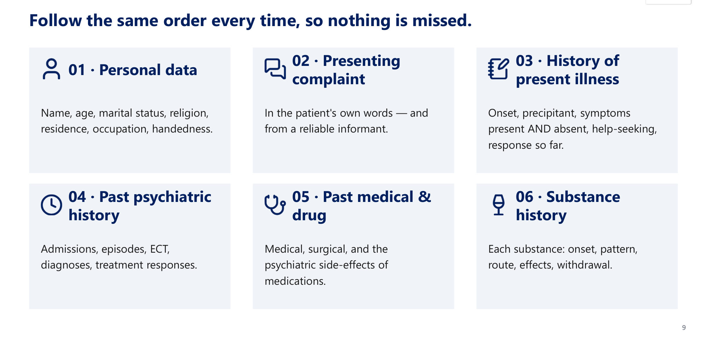
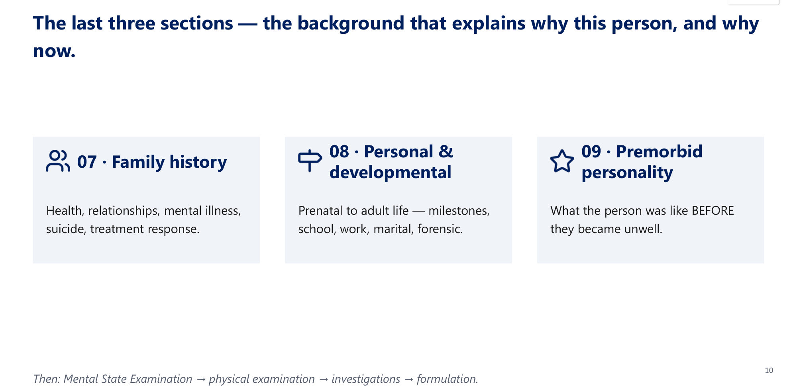
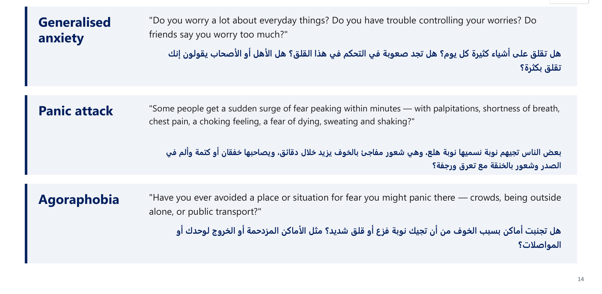
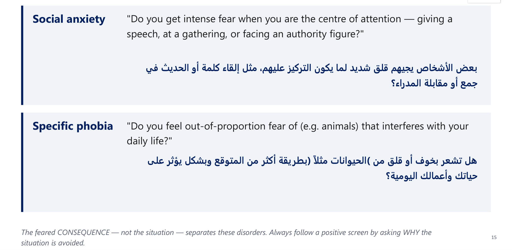
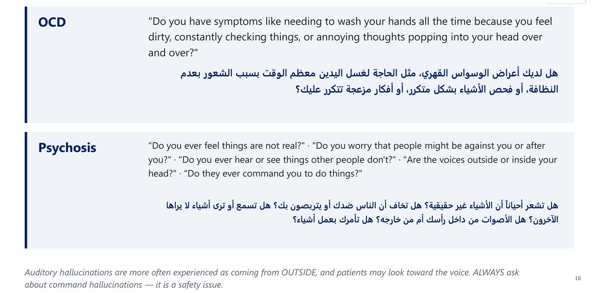
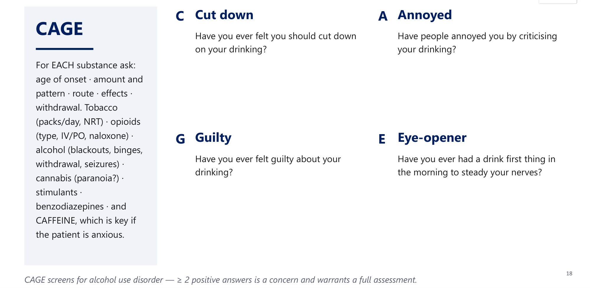
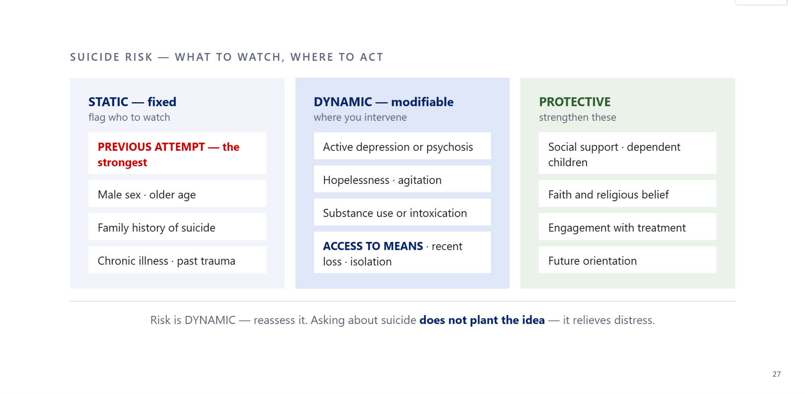
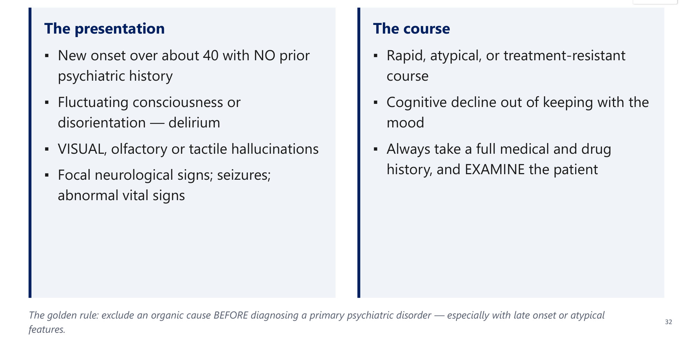
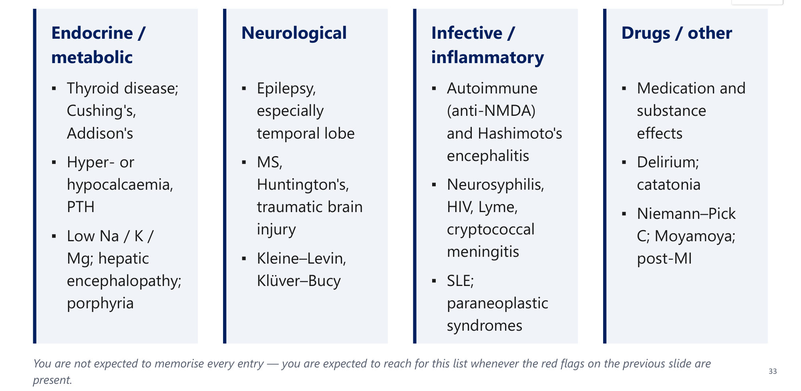
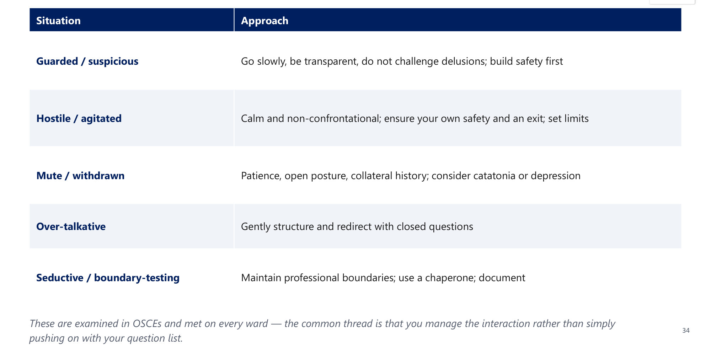

# History Taking in Psychiatry
**Psychiatry, Clinical Skills** | Dr. Hussain M. Khrad (Consultant Psychiatrist, KFSHRC-Jeddah) | Source: `History-Taking.pdf` (43 slides)

> **Legend:** ⭐ = high-yield · *[added]* = not on slides. Images marked "Slide N" come from the lecture. The 2 MCQ answers and the case model answer come from the lecture's own answer slides.

> 🔗 **Bridge:**
> - This is the **first psychiatry skills lecture**. The **Mental State Examination** is the next step after the history (slide 10).
> - **Personality Disorders:** "premorbid personality" separates a lifelong PD from a **new illness** (a change). The "new onset after 40 = organic" rule recurs here.
> - **Medicine overlap (medical mimics):** thyroid disease, **Cushing's/Addison's**, **hyper/hypocalcaemia (PTH)**, low Na/K/Mg (all covered in your endocrine notes) can present as psychiatric illness.

---

## 1. Title / Objectives

| Domain | Objective | Likely tested as |
|---|---|---|
| Knowledge | Define a **mental disorder** and how diagnosis is made | Bereavement and social deviance are NOT disorders |
| Knowledge | ⭐ List the **9 sections** of a complete history | Order of sections; premorbid personality |
| Knowledge | ⭐ Recognise **organic red flags** and medical mimics | 58-year-old + visual hallucinations + fluctuation = delirium |
| Skill | Set up an interview that builds rapport | L-shaped seating; open → closed questions |
| Skill | Screen the major disorders **bilingually** (English/Arabic) | GAD, panic, agoraphobia, social anxiety, phobia, OCD, psychosis |
| Skill | ⭐ Structured **suicide and homicide** risk assessment | Previous attempt = strongest predictor |
| Skill | Manage the **difficult interview** | Guarded, hostile, mute, over-talkative, seductive |
| Values | Interview = **therapeutic act**; privacy and confidentiality; asking about suicide is a **duty, not a risk** | "Asking plants the idea" = myth |

---

## 2. Main Content (Lecture Order)

### 2.1 Introduction: Psychiatry and Mental Disorder (Slides 3–5)

| Topic | Key points |
|---|---|
| **Psychiatry** | Medical specialty for the study, diagnosis, treatment and prevention of mental disorders: **affective, behavioural, cognitive, perceptual** abnormalities |
| **Origin** | Coined by **Johann Christian Reil, 1808**. Greek **psykhē (soul) + iatreia (healing)** = "medical treatment of the soul" |
| ⭐ **Mental disorder** | A **syndrome** of clinically significant disturbance in **cognition, emotion regulation or behaviour**, reflecting a **dysfunction** in psychological, biological or developmental processes. Usually **significant DISTRESS or DISABILITY** in social/occupational/other functioning |
| ⭐ **NOT a disorder** | (1) An **expectable or culturally approved response** to a stressor or loss, e.g. **bereavement**. (2) **Socially deviant behaviour** or individual–society conflict, **UNLESS** it results from a dysfunction in the individual |
| **Diagnosis** | **Syndrome-based**: signs and symptoms that **co-occur**, with a characteristic **course and treatment response** |
| **Classification** | **DSM-5-TR** (APA, 2022) · **ICD-11** (WHO), in effect since **2022**, superseding ICD-10 |

⭐ **No blood test or scan diagnoses most psychiatric disorders: THE HISTORY AND MENTAL STATE EXAM ARE THE INVESTIGATION.** The exclusions stop psychiatry being used to pathologise difference or dissent.

---

### 2.2 The Interview (Slides 7–10)

**Goals (slide 7):**

| Clinical | Relational |
|---|---|
| Get the information needed for a **diagnosis** | Form a **therapeutic relationship** (rapport) |
| Understand the **PERSON** and their circumstances, not just the illness | Give information about the illness, plan and prognosis |

The interview is **both a diagnostic tool and a therapeutic act**.

**Setting up (slide 8):**

| Set the scene | Conduct |
|---|---|
| Professional dress; introduce yourself; greet the patient **by name** | Start with **OPEN-ENDED** questions, then focus |
| Reassure about **privacy and confidentiality** | Observe **non-verbal** behaviour; avoid excessive note-taking |
| Private, comfortable setting. ⭐ **L-SHAPED SEATING** at a suitable distance; **not face-to-face** (feels like an interrogation) | Decide who to start with (patient or relative) and **ask why the relative came** |
| Explain who you are, the purpose, the time needed | — |

#### ⭐ The 9 Sections of a Complete Psychiatric History (Slides 9–10)
Same order every time, so nothing is missed.

| # | Section | Content |
|---|---|---|
| 1 | **Personal data** | Name, age, marital status, religion, residence, occupation, **handedness** |
| 2 | **Presenting complaint** | In the **patient's own words** + from a **reliable informant** |
| 3 | **History of present illness** | Onset, precipitant, symptoms **present AND absent**, help-seeking, response so far |
| 4 | **Past psychiatric history** | Admissions, episodes, **ECT**, diagnoses, treatment responses |
| 5 | **Past medical & drug** | Medical, surgical, and **psychiatric side-effects of medications** |
| 6 | **Substance history** | For each substance: onset, pattern, route, effects, withdrawal |
| 7 | **Family history** | Health, relationships, mental illness, **suicide**, treatment response |
| 8 | **Personal & developmental** | Prenatal → adult life: milestones, school, work, marital, **forensic** |
| 9 | **Premorbid personality** | What the person was like **BEFORE** they became unwell |

**Then:** Mental State Examination → physical examination → investigations → **formulation**.

**Mnemonic *[added]*: "People Present Histories, Past Medical Substances, Family Personal Premorbid"** (P-P-H-P-M-S-F-P-P).

 

> 🔁 **Recap: The interview.** Rapport + diagnosis. Private room, L-shaped seating, open → focused questions, watch non-verbal cues. 9 sections in fixed order, then MSE, examination, investigations, formulation.
> ▶️ **Up next: Each section in detail, with screening scripts.**

---

### 2.3 Personal Data, Complaint and Informant (Slide 12)
- Record the complaint **in the patient's own words**, and also **from a reliable informant**.
- ⭐ **Reliable informant:**
  1. **close to, and living with**, the patient
  2. **no conflict of interest**
  3. **no psychiatric disorder** themselves
- ⭐ **Collateral history is essential**, especially where **insight is limited**: **mania, psychosis, dementia**.

### 2.4 History of Present Illness (Slide 13)
| Build the story | Then ask about |
|---|---|
| **Onset**, any stressor/precipitant | **How the patient sought help** |
| Symptoms **PRESENT**, with full analysis | **Response to treatment** so far |
| ⭐ Symptoms **ABSENT**, to exclude the differentials | — |

⭐ **Deliberately asking about ABSENT symptoms turns a history into a differential diagnosis.**

### 2.5 Screening Scripts (Bilingual) (Slides 14–16) ⭐
The slides give each script in **English and Gulf Arabic**. The Arabic is in the slide images below; the extracted Arabic text is unusable.

| Disorder | English screening question |
|---|---|
| **Generalised anxiety** | "Do you **worry a lot about everyday things**? Do you have **trouble controlling** your worries? Do friends say you worry too much?" |
| **Panic attack** | "A **sudden surge of fear peaking within minutes**, with palpitations, shortness of breath, chest pain, choking, **fear of dying**, sweating, shaking?" |
| **Agoraphobia** | "Have you ever **avoided a place or situation for fear you might panic** there: crowds, being outside alone, public transport?" |
| **Social anxiety** | "Intense fear when you are the **centre of attention**: giving a speech, at a gathering, facing an authority figure?" |
| **Specific phobia** | "**Out-of-proportion** fear of (e.g. animals) that interferes with daily life?" |
| **OCD** | "Needing to **wash your hands** all the time because you feel dirty, constantly **checking**, or **annoying thoughts popping into your head** over and over?" |
| **Psychosis** | "Do things feel **not real**?" · "People **against you / after you**?" · "**Hear or see things** others don't?" · "Voices **outside or inside** your head?" · "Do they ever **command** you?" |

- ⭐ **The feared CONSEQUENCE, not the situation, separates the anxiety disorders.** After a positive screen, always ask **WHY** the situation is avoided.
  - *[added]* For example, avoiding a mall: fear of panicking with no escape = **agoraphobia**; fear of being judged = **social anxiety**.
- ⭐ True **auditory hallucinations** are more often experienced as coming from **OUTSIDE** the head; patients may **look toward the voice**.
- ⭐ **ALWAYS ask about command hallucinations: it is a safety issue.**

 

### 2.6 Past Psychiatric, Medical & Drug History (Slide 17)
| Past psychiatric | Medical, surgical & drug |
|---|---|
| **Number** of lifetime admissions and total episodes | Medical and surgical history |
| Ever had **ECT** or neurostimulation? Who is the treating provider? | ⭐ **Psychiatric side-effects of drugs: steroids, interferon, some antihypertensives** |
| Diagnoses, treatments, **response to each** | — |

Capture a long past history by **counting admissions and episodes** and noting treatment responses, not as a blow-by-blow narrative.

### 2.7 Substance History & CAGE (Slide 18) ⭐
**For EACH substance:** age of onset · amount and pattern · route · effects · withdrawal.

| Substance | Specific asks |
|---|---|
| Tobacco | Packs/day; nicotine replacement (NRT) |
| Opioids | Type; IV/PO; **naloxone** |
| Alcohol | **Blackouts, binges, withdrawal, seizures** |
| Cannabis | **Paranoia?** |
| Others | Stimulants · benzodiazepines · ⭐ **CAFFEINE** (key if the patient is anxious) |

| **CAGE** | Question |
|---|---|
| **C**ut down | Ever felt you should cut down on your drinking? |
| **A**nnoyed | Have people annoyed you by criticising your drinking? |
| **G**uilty | Ever felt guilty about your drinking? |
| **E**ye-opener | Ever had a drink first thing in the morning to steady your nerves? |

⭐ **CAGE ≥ 2 positive = concern** → full assessment for alcohol use disorder.

### 2.8 Family History (Slide 19)
- **The family:** father, mother, siblings (health and relationships); home atmosphere; **monthly income; crowding**.
- **Family psychiatric history:** mental illness, substance use, personality disorder, ⭐ **COMPLETED SUICIDE**, ⭐ **response to specific treatments (guides drug choice)**.
- A strong family history **raises the pre-test probability** of mood and psychotic disorders.

### 2.9 Personal & Developmental History (Slide 20)
| Early life | Growing up | Adult life |
|---|---|---|
| Prenatal, natal, postnatal; **milestones**; childhood "**neurotic traits**" | **Scholastic progress**; work record | Sexual and marital history; military/national service; **forensic history** |

A **poor school and work record from early on** points to something **lifelong** rather than a new illness.

### 2.10 Premorbid Personality (Slide 21)
**What was the person like BEFORE becoming unwell?** This is the baseline against which the illness is measured.

**8 domains:**
1. sociability and relationships
2. impulse control
3. emotional stability
4. prevailing mood
5. character of thinking
6. religiosity
7. habits and hobbies
8. interests

⭐ **A marked CHANGE from premorbid personality is itself a red flag.** It also separates a **PD (lifelong)** from a **new illness (a change)**.

> 🔁 **Recap: The history.**
> - Reliable informant: lives with the patient, no conflict, no psychiatric disorder.
> - HPI must include **absent** symptoms.
> - Screen anxiety (ask WHY they avoid), OCD and psychosis (voices outside; **command** hallucinations).
> - Drug side-effects: steroids, interferon, antihypertensives.
> - Substances: each one in detail, plus caffeine. **CAGE ≥ 2**.
> - Family history: completed suicide, treatment response.
> - Premorbid personality = the baseline.
>
> ▶️ **Up next: Risk assessment.**

---

### 2.11 Risk Assessment (Slides 23–28) ⭐⭐

**Strongest predictor (slides 23–24):** ⭐ **A previous suicide attempt.** Other points from the answer slide:
- **marriage is protective**
- **completed suicide is higher in males**, despite **more attempts in females**

#### How to Ask (Slide 25)
- **Normalise, then ask directly:**
  - "Some people think of suicide when their mood is low; has this ever crossed your mind?"
  - "You're going through a painful loss; have thoughts of your own death ever crossed your mind?"
- ⭐ **Myth dispelled:** asking about suicide **does NOT plant the idea or increase risk**. It **RELIEVES distress** and opens the conversation; most patients are relieved to be asked.
- ⭐ **Screening for suicidal AND homicidal ideation is MANDATORY in every assessment.**

#### Current Safety & Past Attempts (Slide 26)
| Current ("how serious") | Past ("the index attempt") |
|---|---|
| Is there a **PLAN**? | When, how, why? |
| **Access to MEANS** (firearms, medications, poisons)? | Was it with **expressed INTENT TO DIE**, vs an accidental overdose? |
| **Intent to act immediately**? | Any self-harm that could cause an "**inadvertent suicide**"? |
| Chronic, acute and imminent risk factors? | — |

#### Risk & Protective Factors (Slide 27) ⭐
| **STATIC: fixed** (flags who to watch) | **DYNAMIC: modifiable** (where you intervene) | **PROTECTIVE** (strengthen these) |
|---|---|---|
| ⭐ **PREVIOUS ATTEMPT: the strongest** | Active **depression or psychosis** | **Social support**; **dependent children** |
| **Male sex**; **older age** | **Hopelessness**; **agitation** | **Faith and religious belief** |
| **Family history of suicide** | **Substance use or intoxication** | **Engagement with treatment** |
| **Chronic illness**; **past trauma** | ⭐ **ACCESS TO MEANS**; recent loss; isolation | **Future orientation** |

**Risk is DYNAMIC: reassess it.**

*[added]* Classic exam mnemonic **SAD PERSONS**:
- **S**ex (male)
- **A**ge (<19 or >45)
- **D**epression
- **P**revious attempt
- **E**thanol
- **R**ational thinking loss (psychosis)
- **S**ocial support lacking
- **O**rganised plan
- **N**o spouse
- **S**ickness

#### Homicide & Risk to Others (Slide 28)
- **Ask directly:**
  - threats driven by psychosis (**command hallucinations, persecutory delusions**)?
  - threats to **SPECIFIC, NAMED** individuals?
  - "**If you left now, would you want to hurt anyone?**"
- **Consider:**
  - access to **weapons**
  - **history of violence**
  - ⭐ **duty to warn or protect** an identifiable target, under the local legal framework
- Homicide risk is screened in **every** assessment, not only when prompted.

> 🔁 **Recap: Risk.**
> - Previous attempt = the strongest predictor. Males complete suicide more; females attempt more; marriage protects.
> - Ask directly after normalising; it doesn't plant the idea.
> - Assess plan, means, intent, and the index attempt's intent.
> - Static vs dynamic vs protective factors.
> - Homicide: named targets, weapons, duty to warn.
>
> ▶️ **Up next: Organic red flags and medical mimics.**

---

### 2.12 Organic Red Flags (Slides 30–32) ⭐⭐
**Case (slides 30–31):** a 58-year-old with no psychiatric history develops, over **2 weeks**:
- **visual hallucinations**
- **fluctuating confusion, worse at night**
- disorientation
- **mild fever**

→ ⭐ **Investigate for an organic cause (delirium)**, not an antipsychotic or "late-onset schizophrenia".

| The presentation | The course |
|---|---|
| ⭐ **New onset over ~40** with **NO** prior psychiatric history | **Rapid, atypical, or treatment-resistant** course |
| **Fluctuating consciousness** or disorientation (delirium) | **Cognitive decline** out of keeping with the mood |
| ⭐ **VISUAL, olfactory or tactile** hallucinations | Always take a full medical and drug history and **EXAMINE** |
| **Focal neurological signs**; seizures; **abnormal vital signs** | — |

⭐ **Golden rule: exclude an organic cause BEFORE diagnosing a primary psychiatric disorder**, especially with late onset or atypical features.

### 2.13 Medical Mimics (Slide 33)
| Endocrine / metabolic | Neurological | Infective / inflammatory | Drugs / other |
|---|---|---|---|
| **Thyroid** disease; **Cushing's, Addison's** | **Epilepsy, esp. temporal lobe** | **Autoimmune (anti-NMDA)** and **Hashimoto's encephalitis** | **Medication and substance** effects |
| **Hyper/hypocalcaemia, PTH** | **MS, Huntington's, TBI** | **Neurosyphilis, HIV, Lyme, cryptococcal meningitis** | **Delirium; catatonia** |
| **Low Na / K / Mg**; **hepatic encephalopathy**; **porphyria** | **Kleine–Levin, Klüver–Bucy** | **SLE**; **paraneoplastic** syndromes | **Niemann–Pick C; Moyamoya; post-MI** |

You need not memorise every entry, but **reach for this list whenever red flags are present**.

### 2.14 The Difficult Interview (Slide 34) (OSCE)
| Situation | Approach |
|---|---|
| **Guarded / suspicious** | Go slowly, be transparent, ⭐ **do not challenge delusions**; build safety first |
| **Hostile / agitated** | Calm, non-confrontational; ⭐ **ensure your own safety and an exit**; set limits |
| **Mute / withdrawn** | Patience, open posture, **collateral history**; ⭐ **consider catatonia or depression** |
| **Over-talkative** | Gently structure and redirect with **closed questions** |
| **Seductive / boundary-testing** | Maintain professional boundaries; **use a chaperone**; **document** |

Common thread: **manage the interaction**, don't just push through your question list.

### 2.15 Physical Examination and Closing (Slides 36–37)
- **Examination:**
  - general, including **vital signs**
  - **neurological** (motor, sensory, reflexes, ⭐ **FUNDUS**)
  - cardiac and chest
- **Why it matters:**
  - screens for organic causes
  - provides a ⭐ **BASELINE before medication: weight, BP, ECG**
- **Closing:**
  - "Did we cover the main concerns you hoped to discuss today?"
  - "Any thoughts on how we might help?"
  - **summarise and agree the plan**
  - **thank** the patient for sharing a "snippet" of their life
  - a collaborative close reinforces **rapport and adherence**

### 2.16 Integrative Case: Mr. S, 62 (Slides 38–39) ⭐
**Presentation:**
- retired teacher, brought by his **son**, says nothing is wrong
- over **3 weeks**: suspicious that neighbours enter the house; twice **saw children in the living room** who weren't there
- **more confused in the evenings**, poor sleep, some mornings almost himself
- no psychiatric history
- **prednisolone 6 weeks ago**; **tramadol** for back pain
- drinking less, weight loss
- **mildly febrile**, unsure of the date, asks **twice** why he is there

| Question | Model answer (lecture) |
|---|---|
| 1. Whose account? | **The son.** Collateral is essential when insight is lost. He lives with the patient, has no conflict of interest and no psychiatric disorder |
| 2. Organic red flags? | **New onset at 62**, no history · **visual hallucinations** · **fluctuating consciousness, worse at night** · disorientation · **fever** |
| 3. Working diagnosis? | ⭐ **DELIRIUM: organic until proven otherwise.** Don't diagnose late-onset psychosis. Exclude **infection, drugs (prednisolone, tramadol), dehydration, electrolyte disturbance** |
| 4. Priorities now? | Full medical and drug history, substance history, then **examination** (vitals, neurological including **fundus**, chest) + investigations |
| 5. Risk before he leaves? | **Suicide AND homicide.** His persecutory beliefs about the neighbours make **risk to others** a live question; ask directly |

**Twist:** if the same picture had developed over **3 years** rather than 3 weeks → **dementia**, with a different work-up.

---

## 3. High-Yield Comparison Tables

### Table A: Primary Psychiatric vs Organic Presentation
| Feature | Primary psychiatric (e.g. schizophrenia) | Organic (delirium, etc.) |
|---|---|---|
| Age of onset | Usually young (teens–30s) | **> 40, no prior history** |
| Hallucinations | **Auditory** (voices, from outside) | **Visual, olfactory, tactile** |
| Consciousness | Clear | **Fluctuating**, disoriented, worse at night |
| Onset/course | Insidious | **Rapid**, atypical, treatment-resistant |
| Vitals/neuro | Normal | Fever, abnormal vitals, focal signs, seizures |
| Cognition | Matches the illness | Decline out of keeping with mood |

### Table B: Delirium vs Dementia (from the case twist) *[mostly added]*
| | Delirium | Dementia |
|---|---|---|
| Onset | **Days–weeks** (lecture: 3 weeks) | **Months–years** (lecture: 3 years) |
| Consciousness | **Fluctuating** | Clear until late |
| Attention | Markedly impaired | Relatively preserved early |
| Hallucinations | Visual, common | Less common early (except Lewy body) |
| Reversibility | Usually reversible; find the cause | Usually progressive |

### Table C: Suicide Risk Assessment Summary
| Layer | Content |
|---|---|
| Ask | Normalise → direct question; **always**, including homicide |
| Current | Plan · means · immediate intent |
| Past | Index attempt: when, how, why, **intent to die** |
| Static | **Previous attempt**, male, older, FHx suicide, chronic illness, trauma |
| Dynamic | Depression/psychosis, hopelessness, agitation, substances, **means**, loss, isolation |
| Protective | Support, dependent children, **faith**, treatment engagement, future orientation |

---

## 4. Rules, Exceptions, Patterns
- **History + MSE = the investigation.** There is no diagnostic test for most disorders.
- **Bereavement and culturally approved responses are not disorders**, nor is social deviance **unless** it stems from individual dysfunction.
- **Ask about absent symptoms** to build the differential.
- **Insight lost** (mania, psychosis, dementia) → collateral is mandatory.
- **Feared consequence**, not the situation, distinguishes the anxiety disorders.
- **Voices from outside** + patient looking toward them = typical true hallucination. **Command hallucinations = safety issue.**
- **Previous attempt** is the strongest suicide predictor. **Males complete, females attempt**; marriage protects.
- **Asking about suicide is safe** and mandatory; so is asking about homicide.
- **Late onset (>40), visual/olfactory/tactile hallucinations, fluctuation, fever, focal signs** → organic first.
- **Steroids, interferon, some antihypertensives** cause psychiatric side-effects.
- **Examination gives a baseline** (weight, BP, ECG) before psychotropics.
- **Change from premorbid personality** = new illness; lifelong pattern = personality/neurodevelopmental.

---

## 5. Clinical Correlations
- **Elderly patient with new "psychosis" on steroids or opioids** → delirium. Check infection, drugs, hydration, electrolytes.
- **Anxious patient** → ask about **caffeine** (and thyroid; *[added]* phaeochromocytoma and hypoglycaemia are rarer mimics).
- **Psychotic patient with persecutory delusions about named neighbours** → homicide risk; duty to protect.
- **Mute patient** → consider **catatonia** (and depression); get collateral.
- **Patient with a strong family history** of good response to a specific antidepressant → it guides drug choice.
- **Endocrine overlap:** hypercalcaemia (stones, bones, groans, **psychic moans**), Cushing's (depression, psychosis), Addison's (apathy, depression), thyrotoxicosis (anxiety).

---

## 6. Rapid Revision (Last-Day)
1. **Psychiatry:** Reil, 1808; psykhē + iatreia.
2. **Mental disorder** = syndrome + dysfunction + distress/disability. **Not** bereavement or social deviance (unless dysfunction).
3. **DSM-5-TR (2022) and ICD-11 (2022)**. Diagnosis is syndrome-based; the **history and MSE are the investigation**.
4. **Setting:** private, **L-shaped seating**, open → focused questions, minimal notes.
5. **9 sections:**
   1. personal data
   2. presenting complaint
   3. HPI
   4. past psychiatric history
   5. past medical/drug history
   6. substances
   7. family history
   8. personal/developmental history
   9. **premorbid personality**

   Then MSE → exam → investigations → formulation.
6. **Reliable informant:** lives with the patient, no conflict of interest, no psychiatric disorder.
7. **HPI:** symptoms present **and absent**.
8. **Screen:** GAD, panic, agoraphobia, social anxiety, phobia, OCD, psychosis. Ask **why** they avoid; ask about **command** voices.
9. **CAGE ≥ 2** = alcohol concern. Ask about **caffeine** in anxiety.
10. **Family history:** **completed suicide** + **treatment response**.
11. **Strongest suicide predictor = previous attempt.**
12. Asking about suicide **doesn't plant the idea**. Suicide + homicide screening is **mandatory**.
13. **Current risk:** plan, means, intent. **Index attempt:** intent to die?
14. **Static / dynamic / protective** factors (faith, children, support, engagement, future orientation).
15. **Organic red flags:** onset >40, fluctuating consciousness, non-auditory hallucinations, focal signs, abnormal vitals, atypical course.
16. **Difficult interview:** don't challenge delusions; keep an exit; consider catatonia; use closed questions; use a chaperone.
17. **Examination** (including fundus) = organic screen + **baseline** (weight, BP, ECG).

---

## 7. Exam-Style Questions

**Q1 (lecture, slides 23–24).** Which most strongly predicts suicide?
A. Stress at work · **B. Previous suicide attempt** · C. Being married · D. Female sex

> **Answer: B** (lecture key).
> - Previous attempt is the single strongest predictor.
> - Marriage is **protective**.
> - Males **complete** suicide more often, though females attempt more.

**Q2 (lecture, slides 30–31).** A 58-year-old with no psychiatric history develops, over 2 weeks, visual hallucinations, fluctuating confusion worse at night, disorientation and mild fever. First priority?
A. Start an antipsychotic · **B. Investigate for an organic/medical cause** · C. Psychotherapy · D. Diagnose late-onset schizophrenia

> **Answer: B** (lecture key).
> - Late onset, no history, **visual** hallucinations, **fluctuating** consciousness and fever = **delirium**.
> - Find and treat the cause.

**Q3.** A medical student argues that asking a depressed patient about suicide may "put the idea in her head." Best response?
A. Agree; ask only if she raises it · B. Ask only if there is a previous attempt · **C. Asking directly does not increase risk and relieves distress; it must always be asked** · D. Ask the family instead

> **Answer: C** (slide 25).
> - It's a myth that asking plants the idea.
> - Screening for suicidal **and homicidal** ideation is mandatory in every assessment.

**Q4.** A man brings his wife, who has new grandiose ideas and has not slept for a week. She insists she is fine. Which informant feature does **NOT** make him reliable?
A. Lives with her · B. Has no conflict of interest · C. Has no psychiatric disorder · **D. He is the person who brought her to clinic**

> **Answer: D** *[reasoning added; framed from slide 12]*.
> - The three reliability criteria: **close to and living with** the patient, **no conflict of interest**, **no psychiatric disorder**.
> - Simply bringing her in is not a criterion.
> - Collateral is essential here because insight is limited (mania).

**Q5.** A patient's CAGE answers: he has thought he should cut down and he drinks in the morning to steady his nerves. Interpretation?
A. Normal · B. Diagnostic of alcohol dependence · **C. ≥ 2 positives: a concern needing full assessment** · D. Only significant if ≥ 3

> **Answer: C** (slide 18).
> - CAGE is a **screen**, not a diagnosis.
> - ≥ 2 positives warrants full assessment for alcohol use disorder.

**Lecture board one-liners (slide 40):**

| # | Question | Answer |
|---|---|---|
| 1 | Strongest predictor of completed suicide? | **Previous suicide attempt** |
| 2 | Does asking about suicide increase risk? | **No**; always ask |
| 3 | CAGE screens for? | **Alcohol use disorder (≥ 2 = concern)** |
| 4 | New visual hallucinations + fluctuating consciousness at 60? | **Delirium / organic cause**; investigate first |
| 5 | Reliable informant? | Close to and living with the patient, no conflict of interest, no psychiatric disorder |

---

## 8. Exam Pitfalls & Traps
| Trap | Correct thinking |
|---|---|
| "Asking about suicide may trigger it" | ❌ Myth; it relieves distress. Mandatory every time |
| Strongest suicide predictor = depression / hopelessness | ❌ **Previous attempt** |
| Females complete suicide more (they attempt more) | ❌ **Males complete** more; females attempt more |
| Skipping homicide risk when the patient "seems calm" | ❌ Screen in **every** assessment; named targets → duty to protect |
| New hallucinations at 58 → antipsychotic / late schizophrenia | ❌ **Delirium until proven otherwise**; investigate |
| Visual hallucinations → schizophrenia | ❌ Visual/olfactory/tactile → **organic** red flag |
| Face-to-face seating | ❌ **L-shaped**; face-to-face feels like an interrogation |
| Grief = depressive disorder | ❌ An expectable response to loss is **not** a disorder by definition |
| Only asking about symptoms present | ❌ Ask about **absent** symptoms to exclude the differentials |
| Relying on the patient alone in mania/psychosis/dementia | ❌ **Collateral** from a reliable informant is essential |
| Challenging a guarded patient's delusions | ❌ Don't challenge; go slowly, build safety |
| Skipping the physical exam in psychiatry | ❌ Organic screen + **baseline** (weight, BP, ECG) before drugs |
| CAGE positive = diagnosis | ❌ Screen only; ≥ 2 = **concern** → full assessment |
| ICD-10 is current | ❌ **ICD-11** in effect since 2022 |
