# Mental Status Examination (MSE)
**Psychiatry, Clinical Skills** | Dr. Hussain M. Khrad (Consultant Psychiatrist, KFSHRC-Jeddah) | Source: `Mental-Status-Examination.pdf` (41 slides)

> **Legend:** ⭐ = high-yield · *[added]* = not on slides. Images marked "Slide N" come from the lecture; "Added diagram" = drawn for these notes. The 3 MCQ answers and the case model answer come from the lecture's own answer slides.

> 🔗 **Bridge from History Taking:**
> - The MSE comes **after the 9-section history**, then examination → investigations → formulation.
> - The history covered *what has happened*; the MSE is a **snapshot of now**.
> - The **organic red flags** (visual/olfactory/tactile hallucinations, fluctuating consciousness, disorientation) reappear here as MSE findings.
> - **Suicide/homicide screening** is mandatory again.
> - **Personality Disorders:** schizotypal **ideas of reference** vs delusions of reference; OCPD vs OCD (ego-syntonic vs ego-dystonic) mirrors **obsession vs delusion** here.

---

## 1. Title / Objectives

| Domain | Objective | Likely tested as |
|---|---|---|
| Knowledge | What the MSE **is and is not** | Snapshot; not an IQ or detailed memory test |
| Knowledge | ⭐ Components **in order** | ABS-M-T-P-C-IJ |
| Knowledge | ⭐ **Mood vs affect · form vs content · illusion vs hallucination vs pseudohallucination** | Definitions and pairs |
| Skill | Describe each component in correct terminology | Write-up of a manic patient |
| Skill | ⭐ Map **thought-process disturbances** to conditions | Clang/flight → mania; loosening/neologism → schizophrenia |
| Skill | ⭐ Classify **delusions** and **hallucination modalities** | De Clérambault, Othello, Cotard; olfactory → TLE |
| Skill | Assess **judgement and insight**; document a complete MSE | Insight spectrum |
| Values | Describe what you **OBSERVE, not infer**; precise, non-pejorative language; MSE as a repeatable measurement | — |

---

## 2. Main Content (Lecture Order)

### 2.1 What the MSE Is and Isn't (Slide 3)
| What it is | What it is NOT |
|---|---|
| The sum of the examiner's **observations and impressions** | **Not an intelligence test** |
| An estimate of overall **cognitive and emotional** functioning | **Not a detailed memory test** |
| A **BASELINE** for future comparison and tracking progress | Not a fully precise measure of cognition, affect and behaviour |

⭐ **A SNAPSHOT IN TIME:** a cross-section of the mental state during *this* interview, which is why it is **repeated** to follow change.

### 2.2 Components and Method (Slide 4) ⭐

| # | Component | Content | How obtained |
|---|---|---|---|
| 1 | **Appearance, behaviour & attitude** | Self-care, activity, eye contact, manner toward you | Observed **from minute one** |
| 2 | **Speech** | Quantity, rate, quality: **the HOW, not the what** | Observed while talking |
| 3 | **Mood & affect** | Mood is **told** (climate); affect is **seen** (weather) | Ask + observe |
| 4 | **Thought: form and content** | The wiring vs the message; delusions, **suicidal and homicidal ideas** | ⭐ **Risk screen mandatory** |
| 5 | **Perception** | Illusions, hallucinations by modality, pseudohallucinations | Ask directly |
| 6 | **Cognition** | Consciousness, orientation, attention, memory, abstraction | **Formal testing** |
| 7 | **Insight & judgement** | Awareness of illness; judge from **recent real-life behaviour** | History + interview |

⭐ **Only cognition and insight need direct testing**; the rest is gathered by observation while taking the history. A **fixed order** makes omissions obvious.

**Mnemonic *[added]*: "All Smart Medical Students Think Properly, Carefully, Insightfully"**: **A**ppearance · **S**peech · **M**ood/affect · **T**hought · **P**erception · **C**ognition · **I**nsight/judgement.

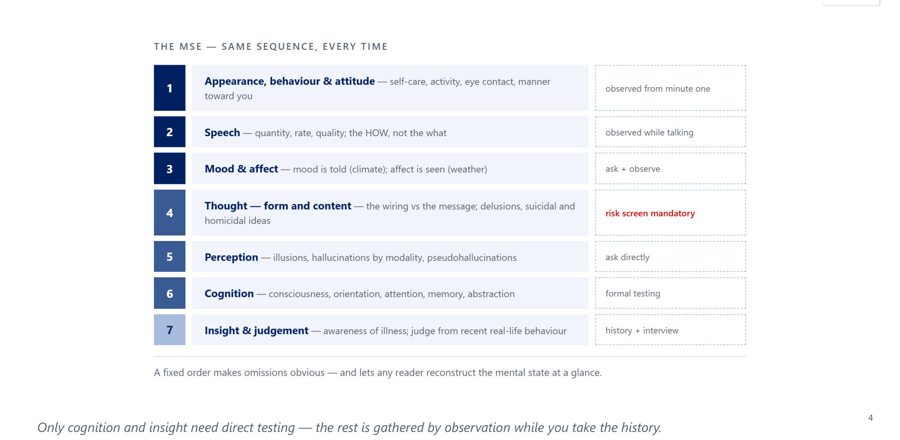

---

### 2.3 Appearance, Behaviour & Attitude (Slide 6)
| Appearance | Behaviour | Attitude |
|---|---|---|
| Body build, **self-care**, clothing, grooming, hair, nails; facial expression; unusual features (e.g. **weight loss**) | Level of activity, posture, **eye contact**; abnormal movements: **tics, grimacing, tremor, disinhibition, hallucinatory gestures** | Manner toward the examiner (verbal, non-verbal): **cooperative, guarded, sarcastic, hostile, seductive, evasive** |

Much of the MSE is complete **before you ask a single formal question**.

### 2.4 Speech: the How, Not the What (Slide 7)
| Describe by | Impairments |
|---|---|
| **QUANTITY**: talkative, spontaneous, minimal, **poverty of speech** | **Stuttering**; **dysarthria** (an **articulation** problem) |
| **RATE**: fast/**pressured** vs slow | ⭐ **Pressured speech → mania** |
| **QUALITY**: volume, flow, tone, coherence, spontaneity, continuity | **Paucity of speech / increased latency → depression, psychosis** |

⭐ Speech = the **FORM** of talking (rate, volume, flow). The **CONTENT** belongs under **Thought**.

### 2.5 Mood vs Affect (Slides 8–9) ⭐⭐

| | **Mood** | **Affect** |
|---|---|---|
| Definition | The **sustained, pervasive** feeling state: the **"climate"** | The observed, **moment-to-moment** expression: the **"weather"** |
| Duration | **Days to weeks** | **Seconds to hours** |
| How assessed | ⭐ **SUBJECTIVE**: ask the patient (a **symptom**) | ⭐ **OBJECTIVE**: observed by you (a **sign**) |
| Changes with stimuli? | Relatively fixed | Shifts with internal/external cues |

**Mood is what the patient TELLS you; affect is what you SEE.** Record mood **in the patient's own words**.

**The four descriptors of affect (slide 9):**

| Descriptor | Options |
|---|---|
| **Quality** | Euthymic, depressed, anxious, elated, irritable |
| **Range** | **Full → restricted → blunted → flat** |
| **Stability** | Stable vs **labile** (rapid shifts) |
| **Congruence** | Appropriate vs **inappropriate** to thought and mood |

- ⭐ **FLAT** → schizophrenia.
- **LABILE** → **mania, intoxication, organic/frontal** cause.
- **INCONGRUENT** (laughing while describing a tragedy) → **psychotic sign**.

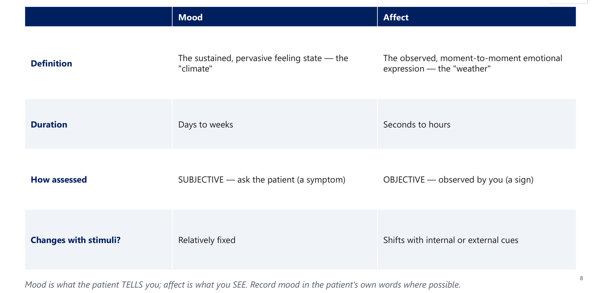 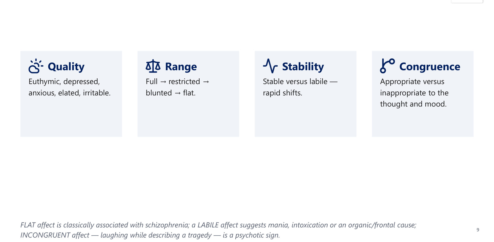

> 🔁 **Recap: Observation.** Appearance, behaviour and attitude from minute one. Speech = form (quantity, rate, quality); pressured = mania. Mood = subjective climate (days–weeks); affect = observed weather. Affect has quality, range (full → flat), stability (labile) and congruence.
> ▶️ **Up next: Thought and perception, the core of psychopathology.**

---

### 2.6 Thought: Form vs Content (Slide 11)
| **Form / process: HOW they think** (the wiring) | **Content: WHAT they think** (the message) |
|---|---|
| Flight of ideas | **Delusions** |
| Loosening of associations | **Obsessions** |
| Perseveration | **Overvalued ideas** |
| Circumstantiality, tangentiality, thought blocking | **Suicidal and homicidal ideas** |

### 2.7 Thought-Process Disturbances (Slides 12–15) ⭐⭐

| Term | Meaning | Points toward |
|---|---|---|
| **Circumstantiality** | Over-detailed and indirect, **but eventually reaches the point** | **OCD, epilepsy**, or normal in the verbose |
| **Tangentiality** | Veers off-topic and **NEVER returns** | Schizophrenia, mania, organic states |
| **Flight of ideas** | Rapid topic shifts, **connection still traceable** | ⭐ **Mania** |
| **Loosening / derailment** | Jumps between ideas with **little or no logical link** | ⭐ **Schizophrenia** (formal thought disorder) |
| **Word salad / incoherence** | Completely disorganised, jumbled words | Schizophrenia |
| **Neologisms** | Made-up words, meaningful only to the patient | Schizophrenia |
| **Clang associations** | Linked by **rhyme and sound**, not meaning | ⭐ **Mania** |
| **Thought blocking** | Sudden interruption of thought and speech mid-stream | Schizophrenia |
| **Perseveration** | *[added definition]* Repeating the same response despite a new question | ⭐ **Organic / frontal lobe, dementia** |
| **Poverty of thought/speech** | — | **Depression; schizophrenia (negative symptoms)** |

- ⭐ **Circumstantiality gets there eventually; tangentiality never does.**
- **Rule:**
  - **RHYME AND SPEED = mania**
  - **DISCONNECTION AND INVENTED WORDS = schizophrenia**
  - **STUCK AND REPETITIVE = organic**

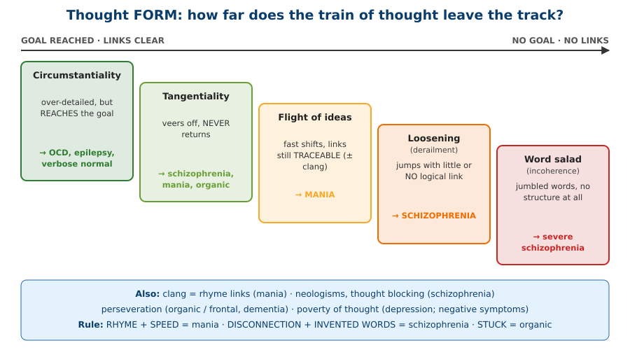

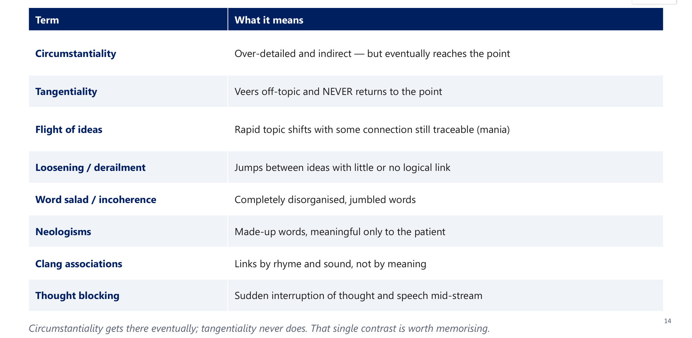 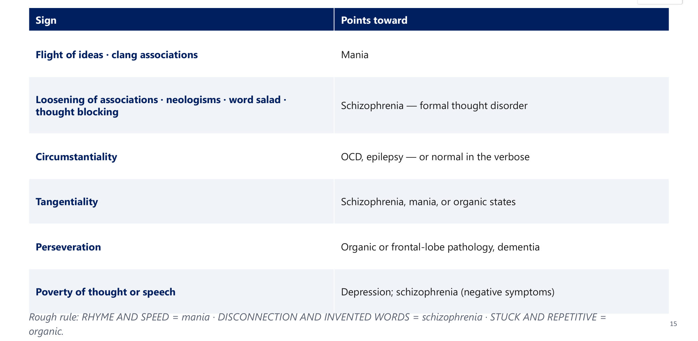

### 2.8 Thought Content (Slide 16)
| Abnormal beliefs | Preoccupations | ⭐ Always ask: risk |
|---|---|---|
| **DELUSIONS**: **fixed, false, unshakeable** | **Obsessions and compulsions** | **SUICIDAL ideation**: intent, plan, means |
| **Overvalued ideas** | **Phobias** | **HOMICIDAL** ideation / harm to others |
| **Ideas of reference or influence** | **Poverty of thought content** | — |

⭐ Suicidal and homicidal ideation screening is a **MANDATORY part of every MSE**.

### 2.9 Delusion Subtypes (Slides 17–19) ⭐⭐

| Subtype | Belief | Eponym / note |
|---|---|---|
| ⭐ **Persecutory** | Being harmed, followed, conspired against | **The most common** |
| **Grandiose** | Inflated worth, power, identity | Mania, schizophrenia |
| ⭐ **Erotomanic** | Another, often **high-status**, person is in love with them | **de Clérambault** syndrome |
| ⭐ **Jealous** | The partner is unfaithful | **Othello** syndrome |
| ⭐ **Nihilistic** | Self, body or world **doesn't exist**, or is dead/rotting | **Cotard** (*[added]* severe psychotic depression, elderly) |
| **Somatic** | False belief about the body or health | — |
| **Reference** | Neutral events refer specifically to them | — |
| ⭐ **Control / passivity** | **Thought insertion, withdrawal, broadcasting**; being controlled | **FIRST-RANK** for schizophrenia |

The eponyms (**de Clérambault, Othello, Cotard**) are examined **by name**.

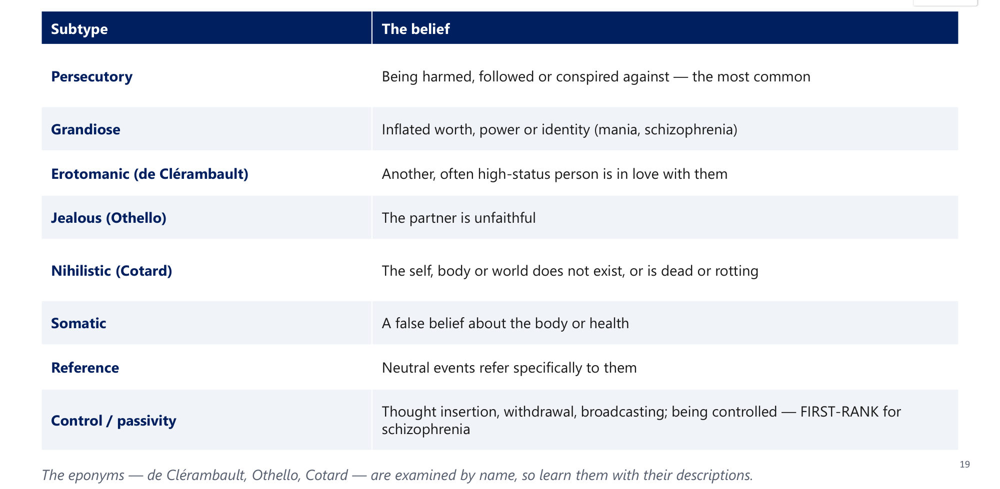

### 2.10 Perception: Illusion vs Hallucination vs Pseudohallucination (Slide 20) ⭐⭐

| Term | External stimulus? | Where perceived / insight |
|---|---|---|
| **Illusion** | ⭐ **YES**: a real stimulus **misperceived** | External; occurs in the **healthy** (fear, dim light) |
| **Hallucination** | ⭐ **NO** external stimulus | Experienced as real, in **EXTERNAL space**; **no insight** |
| **Pseudohallucination** | **NO** external stimulus | Perceived in **INNER space**; **insight often retained** |

**Describe each hallucination by:**
1. **modality**
2. **content**
3. **2nd- vs 3rd-person** (auditory)
4. the **patient's reaction**

**Also assess:**
- **depersonalisation** and **derealisation**
- ⭐ **formication**: the sensation of **bugs crawling on the skin**

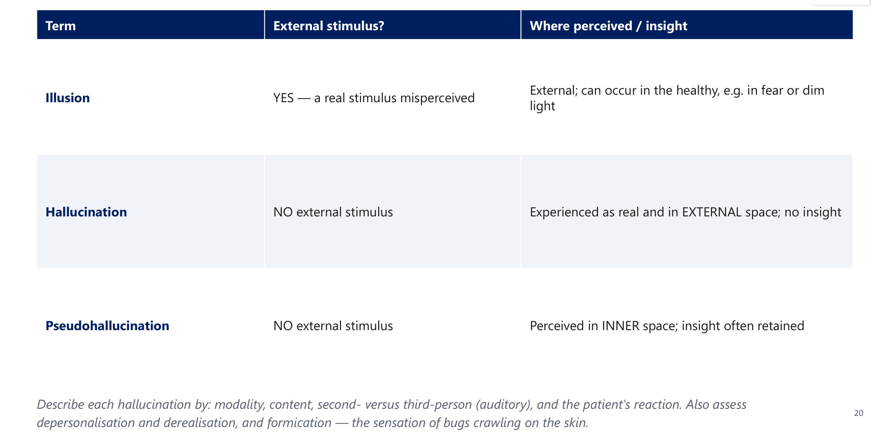

### 2.11 Hallucination Modality → Cause (Slides 21–23) ⭐⭐

| Modality | Points toward |
|---|---|
| ⭐ **Auditory**, especially **3rd-person running commentary** | **Schizophrenia** / primary psychiatric illness |
| ⭐ **Visual** | **Delirium, organic disease, substance** |
| ⭐ **Olfactory / gustatory** | **Temporal-lobe epilepsy (aura)**, organic |
| ⭐ **Tactile / formication** | **Cocaine ("cocaine bugs")** or **alcohol withdrawal** |
| **Hypnagogic** (falling asleep) / **hypnopompic** (waking) | **Normal**; also **narcolepsy** |

⭐ **NON-AUDITORY hallucinations (visual, olfactory, tactile) → organic or substance cause until proven otherwise.**

**Lecture case (slides 21–22):** a 30-year-old smells **burning rubber**, with intense **déjà vu** and a **rising epigastric sensation**, each episode lasting < 1 minute → ⭐ **temporal-lobe epilepsy** aura.

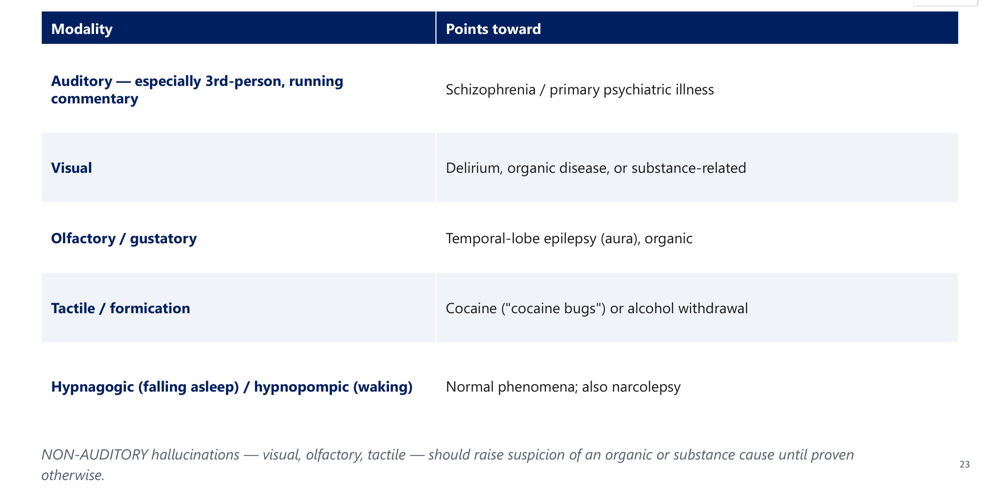

> 🔁 **Recap: Thought and perception.**
> - **Form** = how they think: clang/flight → mania; loosening, neologisms, word salad, blocking → schizophrenia; perseveration → organic.
> - Circumstantial reaches the point; tangential never does.
> - **Content** = what they think: delusions (persecutory is commonest; de Clérambault, Othello, Cotard; passivity = first-rank), obsessions, overvalued ideas, and **suicide/homicide** screening.
> - **Perception:** an illusion has a stimulus; a hallucination has none and is external; a pseudohallucination is internal with insight. Non-auditory → organic.
>
> ▶️ **Up next: Cognition, judgement and insight.**

---

### 2.12 Consciousness & Orientation (Slide 25) ⭐
- **Level of consciousness (assess FIRST):** **Alert → Lethargic → Obtunded → Stupor → Coma**.
- ⭐ A **clouded or FLUCTUATING** level suggests **delirium**, an organic cause. Interpret the rest of the exam with caution.
- ⭐ **Orientation is lost in order:** **1. TIME** (first) → **2. PLACE** → **3. PERSON** (last).
- **Disorientation points to an organic or cognitive disorder, not a primary psychotic illness.**

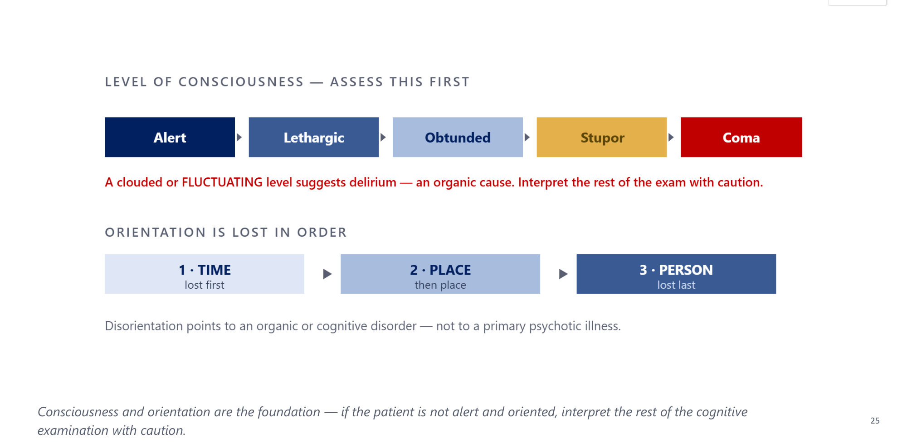

### 2.13 Attention & Memory (Slide 26) ⭐

| Domain | Tests |
|---|---|
| **Attention / concentration** | ⭐ **Serial 7s · spelling "WORLD" backward · digit span** |
| **Registration / immediate memory** | **Repeat 3 named objects at once** |
| **Recent memory** | **Recall the 3 objects after a few minutes**; recent events |
| **Remote memory** | Personal and historical long-term memory |

⚠️ **Common pitfall:** "WORLD backward" and serial 7s test **ATTENTION, not registration**. Registration = immediate repetition; recent memory = recall after a delay.

### 2.14 Language, Aphasia & Visuospatial Function (Slide 27)
Test language **if brain pathology is suspected**.

| Aphasia | Fluency | Comprehension | Repetition | Lesion |
|---|---|---|---|---|
| ⭐ **Broca's (expressive)** | **Non-fluent** | **INTACT** | Impaired | **Frontal** |
| ⭐ **Wernicke's (receptive)** | **Fluent but nonsensical** | **Poor** | *[added]* Impaired | **Temporal** |
| **Conduction** | Fluent | Good | ⭐ **Impaired** (the defining feature) | *[added]* Arcuate fasciculus |
| **Nominal (anomic)** | Fluent | Good | Good | Naming difficulty (pen, watch) |

**Visuospatial:** copy **interlocking pentagons** or a **clock**. Impairment → **parietal** or organic pathology.

### 2.15 MMSE vs MoCA (Slides 28–29) ⭐

| | **MMSE** | **MoCA** |
|---|---|---|
| Score | /30 | /30 |
| Domains | Orientation, registration, attention, recall, language, construction (a **verbal** core) | ⭐ **Adds executive and visuospatial** items (trails, cube, clock) |
| Cut-off | ⭐ **≤ ~23–24** suggests impairment | ⭐ **≤ 25** suggests impairment (**≥ 26 normal**) |
| Sensitivity | **WEAK** at mild impairment | ⭐ **MORE SENSITIVE for mild cognitive impairment** |
| Access | Now **copyright-restricted** (PAR) | Requires brief **certification** |
| Origin | Folstein, 1975 | Nasreddine, 2005 |

Both are **SCREENING tools, not diagnoses**. A low score prompts a search for **delirium, dementia or depression**.

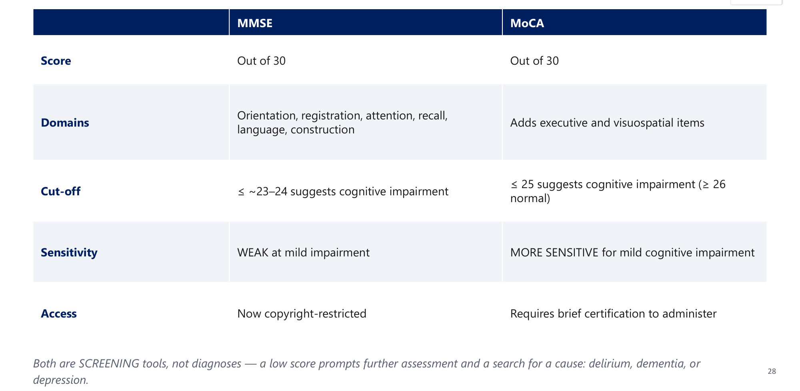
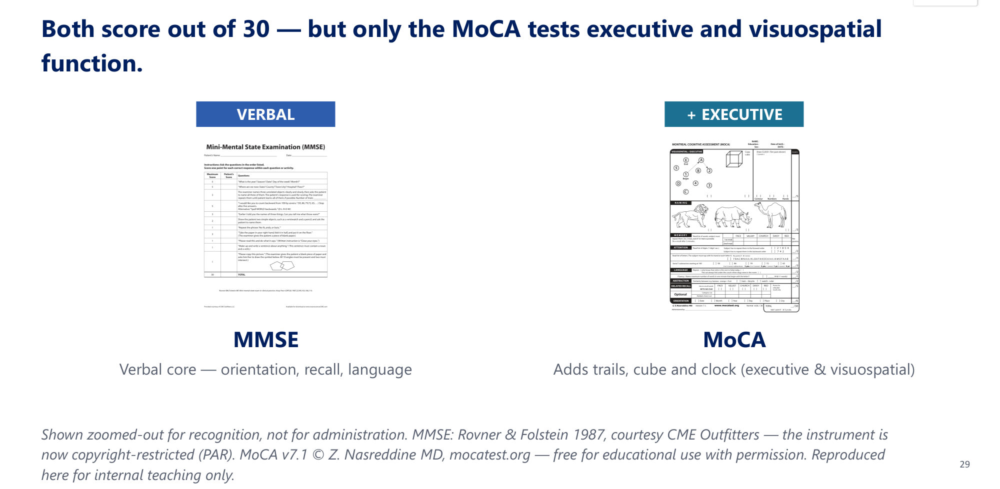

### 2.16 Abstract Thinking (Slide 30)
- **Abstraction:** the ability to handle concepts and draw appropriate inferences.
- **Tests:**
  - **Similarities/differences** ("how are a car and a train alike?")
  - **Proverbs** ("people in glass houses should not throw stones")
- A **concrete, literal** answer ("the stones will break the glass") → impaired abstraction.
  - Seen in **schizophrenia, dementia, low IQ**.
  - **Normal in children.**
- ⚠️ **Cultural/language caution:** an **unfamiliar proverb produces a concrete answer in a healthy person.**

### 2.17 Judgement (Slide 31)
- Judgement is the capacity to make sound decisions and act appropriately.
- ⭐ It is **best judged from RECENT REAL-LIFE BEHAVIOUR**. **Hypothetical scenarios** ("what would you do if you found a stamped envelope?") are **less reliable**.
- Impaired **judgement**, not just insight, **drives much of the risk** in mania, psychosis and intoxication.

### 2.18 Insight: a Spectrum (Slide 32) ⭐

| **Full** | **Partial** | **Impaired** |
|---|---|---|
| Recognises the symptoms **as illness** | Acknowledges problems but **not as illness** | **Denies** illness or problems |
| Able to modify behaviour | Knows others see them as ill | No understanding of others' concerns |
| Cooperates fully with treatment | Variable behaviour change | **Poor treatment adherence** |
| → **best adherence and prognosis** | — | → ⭐ **predicts non-adherence and relapse** |

**Describe where the patient sits**; don't just tick present/absent. "Insight absent" tells the next clinician nothing about how likely the patient is to stop medication.

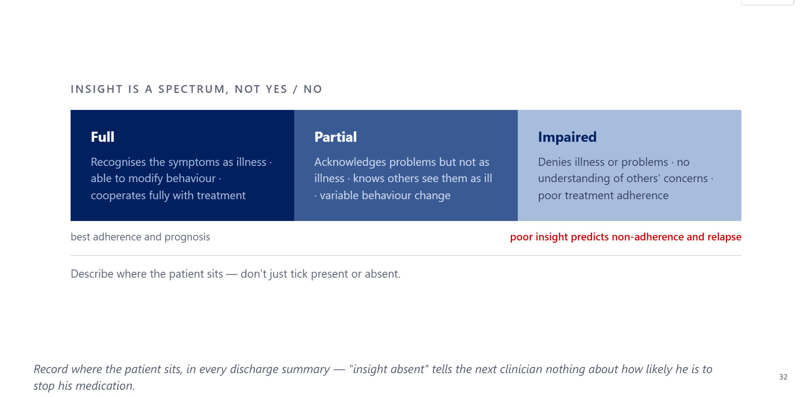

> 🔁 **Recap: Cognition, judgement and insight.**
> - Consciousness first (alert → coma; fluctuating = delirium).
> - Orientation is lost in the order time → place → person.
> - Serial 7s and WORLD backward test **attention**; 3 objects test registration then recall.
> - Aphasias: Broca (non-fluent, comprehension intact), Wernicke (fluent nonsense, poor comprehension), conduction (repetition), nominal.
> - **MoCA ≤ 25** is better for MCI; **MMSE ≤ 23–24**.
> - A concrete proverb answer → schizophrenia, dementia, low IQ (or unfamiliarity).
> - Judgement: from real-life behaviour. Insight: a spectrum; poor insight predicts relapse.
>
> ▶️ **Up next: Integration.**

---

### 2.19 Concept Distinctions to Know Cold (Slide 34) ⭐⭐
| Pair | Key difference |
|---|---|
| **Illusion vs hallucination** | Illusion = **real stimulus misperceived**; hallucination = **no stimulus** |
| **Hallucination vs pseudohallucination** | **External space, no insight** vs **inner space, insight retained** |
| **Obsession vs delusion** | Obsession is **EGO-DYSTONIC, resisted, insight kept**; a delusion is **held as true, no insight** |
| **Overvalued idea vs delusion** | Overvalued = strongly held but **understandable**, **not fixed or bizarre** |
| **Mood vs affect** | **Sustained, subjective (symptom)** vs **momentary, observed (sign)** |

These **5 pairs** account for a large share of MSE exam questions.

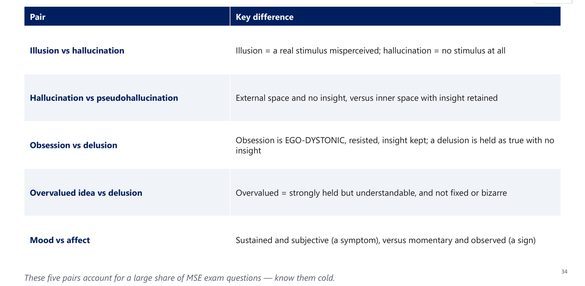

### 2.20 Documenting an MSE: Worked Example (Slide 35)
> *"A **dishevelled** young man, poor eye contact, **restless**. Speech **rapid and pressured**. Mood **'on top of the world'**; affect **elated and labile**. Thought form shows **flight of ideas**; content includes **grandiose delusions** ('I've invented a cure'); **no suicidal or homicidal ideation elicited**. **No hallucinations**. **Alert and oriented ×3**; attention reduced on serial 7s. **Insight impaired; judgement poor**."*

→ reads as an **acute manic episode**. Always use the **same fixed order**.

### 2.21 Integrative Case: Mr. Y, 24 (Slides 36–37) ⭐
**Presentation:**
- brought to the ED by his father
- **appearance:** bright orange shirt, mismatched shoes, **sunglasses indoors**, unshaven, body odour
- **behaviour:** paces, interrupts, **over-familiar** (uses your first name)
- **speech:** loud, rapid, hard to interrupt
- **thought:** hospital → football → business plan → father's driving; **each link understandable**, but the topic never returns
- **mood/affect:** says "**excellent, the best of my life**"; laughs, briefly tearful, then laughs again
- **content:** "**chosen to reform the national education system**", **already emailed the ministry**
- denies voices; **sleeps 2 h/night for a week**; fully oriented
- says the only problem is his father; doesn't need treatment

| Question | Model answer (lecture) |
|---|---|
| 1. Appearance, behaviour, attitude | Brightly and bizarrely dressed, sunglasses indoors, **poor self-care**; **psychomotor agitation**; **over-familiar, disinhibited, intrusive** |
| 2. Speech; mood vs affect | Speech ↑ rate and volume, **pressured**, hard to interrupt. **MOOD** (subjective, sustained) = **elated**. **AFFECT** (objective) = **labile and expansive** |
| 3. Thought form | ⭐ **FLIGHT OF IDEAS**: rapid shifts with **comprehensible connections**. In loosening the links **cannot be followed** → schizophrenia |
| 4. Thought content | ⭐ **GRANDIOSE DELUSION**: fixed, false, unshakeable, out of keeping with background, and **ACTED UPON** |
| 5. Judgement / insight | **Judgement impaired; insight ABSENT**: denies illness and **externalises** onto his father |

**Twist:** the single feature that would push the diagnosis toward schizophrenia → **links that cannot be followed** (loosening), rather than merely rapid ones.

---

## 3. High-Yield Comparison Tables

### Table A: Mania vs Schizophrenia on the MSE *[synthesised from slides 9, 15, 19, 23, 35–37]*
| MSE domain | Mania | Schizophrenia |
|---|---|---|
| Appearance | Bright, bizarre, flamboyant | Neglected, odd |
| Speech | **Pressured**, loud | Poverty, latency, neologisms |
| Affect | **Elated, labile, expansive** | **Flat/blunted, incongruent** |
| Thought form | **Flight of ideas, clang** | **Loosening, word salad, blocking, neologisms** |
| Content | **Grandiose** | **Persecutory**, **passivity (first-rank)** |
| Perception | Mood-congruent if present | **3rd-person auditory, running commentary** |
| Orientation | Intact | Intact |

### Table B: Organic Clues on the MSE
| Domain | Organic clue |
|---|---|
| Consciousness | **Clouded/fluctuating** |
| Orientation | **Disoriented** (time first) |
| Perception | **Visual, olfactory, gustatory, tactile** |
| Thought form | **Perseveration** |
| Affect | **Labile** (frontal) |
| Cognition | Visuospatial (parietal) or aphasia |

### Table C: Classic Hallucination Pairs
| Clue | Answer |
|---|---|
| Burning rubber + déjà vu + epigastric rising | **Temporal-lobe epilepsy** |
| Bugs crawling under the skin | **Cocaine** or **alcohol withdrawal** |
| Voices discussing the patient in the 3rd person | **Schizophrenia** |
| Elderly, fluctuating, seeing children/animals | **Delirium** (or Lewy body dementia *[added]*) |
| Seeing figures while falling asleep, otherwise well | **Hypnagogic**: normal (or narcolepsy) |

### Table D: Memory and Attention Tests
| Test | Domain |
|---|---|
| Serial 7s, WORLD backward, digit span | **Attention** |
| Repeat 3 objects now | **Registration** |
| Recall 3 objects after minutes | **Recent memory** |
| Personal history, historical events | **Remote memory** |
| Pentagons, clock | **Visuospatial** (parietal) |
| Proverbs, similarities | **Abstraction** |

---

## 4. Rules, Exceptions, Patterns
- **Only cognition and insight are formally tested**; everything else is observed.
- **Speech = form; thought content = what is said.**
- **Mood = subjective (in the patient's words); affect = objective.**
- **Flat → schizophrenia · labile → mania/intoxication/frontal · incongruent → psychosis.**
- **Rhyme + speed = mania · disconnection + neologism = schizophrenia · stuck = organic.**
- **Circumstantial reaches the goal; tangential never does.**
- **Persecutory is the most common delusion. Passivity phenomena are first-rank.**
- **Illusions occur in healthy people**; hypnagogic/hypnopompic hallucinations are **normal**.
- **Non-auditory hallucinations → organic/substance.** Auditory 3rd-person → schizophrenia.
- **Disorientation → organic, not primary psychosis.** Lost in the order time → place → person.
- **WORLD backward = attention, not registration.**
- **MoCA (≤ 25) > MMSE (≤ 23–24) for mild impairment.** Both are screens only.
- **Concrete proverbs:** schizophrenia, dementia, low IQ, children, **or an unfamiliar proverb**.
- **Judgement from real behaviour > hypotheticals.**
- **Insight is a spectrum; poor insight → non-adherence and relapse.**
- **Suicide/homicide screening in EVERY MSE.**

---

## 5. Clinical Correlations
- **ED patient with flight of ideas and grandiosity** → mania. Impaired judgement drives risk (spending, driving).
- **Patient with formication after stopping heavy drinking** → alcohol withdrawal (*[added]* risk of delirium tremens). In a cocaine user → "cocaine bugs".
- **Episodic olfactory hallucination with déjà vu** → EEG/neurology, not antipsychotics.
- **Elderly inpatient disoriented to time, with visual hallucinations** → delirium. Consciousness and orientation first.
- **Discharge summary:** describe insight on the spectrum (partial vs impaired) to flag relapse risk.
- **Proverb testing in Saudi practice:** use culturally familiar proverbs, or similarities, to avoid false "concrete" answers.

---

## 6. Rapid Revision (Last-Day)
1. **MSE = a snapshot**; a baseline; repeated. Not an IQ or memory test.
2. **Order:**
   1. appearance/behaviour/attitude
   2. speech
   3. mood & affect
   4. thought (form + content; **risk**)
   5. perception
   6. cognition
   7. insight & judgement
3. Only **cognition and insight** are directly tested.
4. **Speech:** quantity, rate, quality. **Pressured = mania**; latency = depression/psychosis; dysarthria = articulation.
5. **Mood:** subjective, days–weeks (climate). **Affect:** objective, seconds–hours (weather).
6. **Affect:** quality, range (full → restricted → blunted → flat), stability (labile), congruence.
7. **Flight/clang → mania** · **loosening/neologism/word salad/blocking → schizophrenia** · **perseveration → organic** · **circumstantiality → OCD/epilepsy** · **poverty → depression/negative symptoms**.
8. **Delusions:**
   - persecutory (commonest)
   - grandiose
   - erotomanic (**de Clérambault**)
   - jealous (**Othello**)
   - nihilistic (**Cotard**)
   - somatic
   - reference
   - **passivity = first-rank**
9. **Illusion** = real stimulus; **hallucination** = none, external, no insight; **pseudohallucination** = inner, insight.
10. **Modalities:**
    - auditory 3rd-person → schizophrenia
    - visual → delirium/organic
    - olfactory → TLE
    - tactile → cocaine/alcohol withdrawal
    - hypnagogic → normal/narcolepsy
11. **Consciousness:** alert → lethargic → obtunded → stupor → coma. **Orientation lost:** time → place → person.
12. **Attention:** serial 7s, WORLD backward, digit span. **Registration:** immediate 3 objects. **Recent:** delayed recall.
13. **Broca** non-fluent/comprehension intact (frontal) · **Wernicke** fluent/poor comprehension (temporal) · **conduction** repetition · **nominal** naming.
14. **MMSE ≤ 23–24 · MoCA ≤ 25** (MoCA adds executive/visuospatial; better for MCI).
15. **Concrete proverbs:** schizophrenia, dementia, low IQ, children.
16. **Judgement:** from recent real-life behaviour. **Insight:** full / partial / impaired.
17. **Five pairs:** illusion/hallucination · hallucination/pseudo · obsession/delusion · overvalued/delusion · mood/affect.

---

## 7. Exam-Style Questions

**Q1 (lecture, slides 12–13).** An elated, over-talkative patient answers in rapid rhyming phrases: "I feel real, the deal is real, the bell will tell." What is this?
A. Neologism · **B. Clang association** · C. Circumstantiality · D. Thought blocking

> **Answer: B** (lecture key).
> - Linked by **sound and rhyme**, not meaning.
> - With elation and pressured speech → **mania**.

**Q2 (lecture, slides 17–18).** A 28-year-old woman is unshakeably convinced that a famous singer she has never met is secretly in love with her and sends coded messages through his songs. The delusion is?
A. Grandiose · **B. Erotomanic (de Clérambault)** · C. Delusion of reference · D. Nihilistic

> **Answer: B** (lecture key).
> - The belief that a higher-status person loves her = **de Clérambault**.
> - The "coded messages" are an **added delusion of reference**.

**Q3 (lecture, slides 21–22).** A 30-year-old has brief episodes of smelling burning rubber, with intense déjà vu and a rising epigastric sensation, each lasting < 1 minute. Most likely cause?
A. Schizophrenia · **B. Temporal-lobe epilepsy** · C. Alcohol withdrawal · D. Cocaine intoxication

> **Answer: B** (lecture key). Olfactory hallucination + déjà vu + epigastric aura = classic **TLE** aura. This is organic.

**Q4.** A patient asked to spell "WORLD" backward answers "D-L-O-R-W" correctly. Which domain has been tested?
A. Registration · B. Recent memory · **C. Attention/concentration** · D. Remote memory

> **Answer: C** (slides 26, 38).
> - WORLD backward, serial 7s and digit span test **attention**.
> - Registration = immediate repetition of 3 objects.

**Q5.** A man washes his hands 50 times a day, knows the fear of contamination is "silly," and tries hard to resist. A second man insists, without evidence, that his wife is unfaithful and cannot be persuaded otherwise. Which statement is correct?
A. Both are delusions · **B. The first is an obsession (ego-dystonic, insight kept); the second is a delusion of jealousy (Othello)** · C. Both are overvalued ideas · D. The first is a delusion; the second is an obsession

> **Answer: B** (slides 19, 34, 38).
> - **Obsession:** resisted, insight retained.
> - **Delusion:** held as true, no insight.
> - Delusional jealousy = **Othello syndrome**.

**Lecture board one-liners (slide 38):**

| # | Question | Answer |
|---|---|---|
| 1 | Fluent but nonsensical speech, poor comprehension? | **Wernicke's (receptive), temporal** |
| 2 | Believing a spouse is unfaithful on no evidence? | **Othello syndrome** |
| 3 | "Spell WORLD backward" tests? | **Attention/concentration**, NOT registration |
| 4 | Tactile "bugs crawling": two causes? | **Cocaine** and **alcohol withdrawal** |
| 5 | Obsession vs delusion? | Obsession: ego-dystonic, resisted, insight kept; delusion: held as true, no insight |

---

## 8. Exam Pitfalls & Traps
| Trap | Correct thinking |
|---|---|
| Mood = what you observe | ❌ **Mood is subjective** (patient's words); **affect is observed** |
| Recording speech content under "Speech" | ❌ Speech = **form**; content goes under **Thought** |
| Flight of ideas = loosening | ❌ Flight: links **traceable** (mania); loosening: links **not followable** (schizophrenia) |
| Circumstantiality = tangentiality | ❌ Circumstantial **reaches** the point; tangential **never** does |
| WORLD backward = memory | ❌ **Attention** |
| Every hallucination = psychosis | ❌ **Illusions** and **hypnagogic/hypnopompic** experiences are normal; non-auditory → **organic** |
| Visual hallucinations → schizophrenia | ❌ **Delirium/organic/substance** |
| Disorientation in "psychosis" | ❌ Points to **organic/cognitive** disorder; primary psychosis keeps orientation |
| Obsession = delusion | ❌ Obsession is **ego-dystonic with insight**; delusion has **no insight** |
| Overvalued idea = delusion | ❌ Overvalued = understandable, **not fixed or bizarre** |
| MMSE is the best screen for MCI | ❌ **MoCA** (≤ 25) is more sensitive; MMSE is weak in mild impairment |
| A low MMSE/MoCA = dementia | ❌ A **screen**; search for delirium, dementia, depression |
| Concrete proverb = schizophrenia | ⚠️ Also dementia, low IQ, children, and **unfamiliar proverbs** (culture/language) |
| Judging judgement from hypotheticals | ❌ **Recent real-life behaviour** is more reliable |
| "Insight absent" is enough | ❌ Describe the **spectrum** (full/partial/impaired); poor insight predicts relapse |
| Skipping suicide/homicide in a "routine" MSE | ❌ **Mandatory** in every MSE |
| Wernicke's = non-fluent | ❌ Wernicke's is **fluent**, with poor comprehension; **Broca's** is non-fluent, comprehension intact |
