# Mood Disorders: Depressive and Bipolar Spectrums
**Psychiatry, Clinical Lecture** | Dr. Hussain M. Khrad (Consultant Psychiatrist, KFSHRC-Jeddah) | Source: Drive file `6870348` (70 slides)

> **Legend:** ⭐ = high-yield · *[added]* = not on slides. Images marked "Slide N" come from the lecture. All MCQ answers and the case model answer come from the lecture's own answer slides.

> 🔗 **Bridge from earlier lectures:**
> - **History Taking / MSE:**
>   - mood (subjective, the climate) vs affect (objective, the weather)
>   - suicide assessment (previous attempt = strongest predictor)
>   - collateral is essential because **hypomania is rarely volunteered**
> - **Personality Disorders:** **BPD vs bipolar** (hours + interpersonal trigger vs days–weeks + ↓ need for sleep).
> - **Psychotic Disorders:**
>   - **schizoaffective 2-week rule**
>   - **catatonia is commonest in mood disorders**
>   - nihilistic delusions (**Cotard**) in psychotic depression
> - **Endocrine:**
>   - **hypothyroidism** (Thyroid I) and **Cushing's/Addison's** (Adrenal I/II) mimic depression
>   - **hyperthyroidism/Cushing's** precipitate mania
>   - **HPA-axis overactivity** and dexamethasone non-suppression (Adrenal I) appear again

---

## 1. Title / Objectives

| Domain | Objective | Likely tested as |
|---|---|---|
| Knowledge | Sadness vs depressive disorder | ≥ 2 weeks, out of proportion, impairing |
| Knowledge | ⭐ Depressive and bipolar disorders + DSM-5-TR criteria | SIG-E-CAPS; DIG FAST; mania vs hypomania |
| Knowledge | Monoamine, HPA-axis, neuroplastic models | Why a 4–6-week delay |
| Knowledge | ⭐ **Specifiers that change management** | Atypical → MAOIs; psychotic → antipsychotic/ECT; peripartum |
| Skill | ⭐ **Screen every depressed patient for past mania** | Bipolar II case |
| Skill | Structured suicide risk assessment | Previous attempt |
| Skill | ⭐ Exclude organic mimics | Hypothyroidism case; alcohol case |
| Skill | Separate **grief, adjustment disorder, MDD** | Worthlessness/guilt = MDD |
| Skill | Match treatment intensity to severity | Stepped care |
| Values | Depression is a **systemic, potentially lethal** illness; ask about suicide directly; cultural frame; family as an ally; honest prognosis | — |

**Why it matters (slide 3):** mood disorders are the **commonest psychiatric presentation in every specialty**, and suicide risk is assessed by **whoever is in front of the patient**.

---

## 2. Main Content (Lecture Order)

### 2.1 Sadness vs Depression; the Mood Disorder Landscape (Slides 4–6)
| Sadness | Depression (disorder) |
|---|---|
| Normal, universal emotion | **Pervasive low mood and/or anhedonia** |
| **Proportionate** to a trigger; transient | **Persistent (≥ 2 weeks)** and **out of proportion** |
| **Self-esteem and function preserved** | **Impairs** social and occupational function |
| Resolves without treatment | Often needs treatment |

**Mood** = a sustained, pervasive emotional **climate** (vs brief, reactive affect). Mood disorders are primary disturbances of that climate.

| Depressive spectrum (one pole) | Bipolar spectrum (both poles) |
|---|---|
| **MDD** | **Bipolar I** |
| **Persistent depressive disorder (dysthymia)** | **Bipolar II** |
| **PMDD** | **Cyclothymic disorder** |
| **DMDD** (disruptive mood dysregulation) | Substance/medication- and medical-condition-induced |
| Substance/medication- and medical-condition-induced | — |

⭐ **Placing the patient in the right family changes treatment completely: antidepressant monotherapy can destabilise a bipolar patient.**

**Saudi context (slide 6):**
- depression and anxiety are among the commonest national disorders; the **Saudi National Mental Health Survey** shows substantial lifetime prevalence, **mostly untreated**
- young population → large disability burden
- **stigma and somatic presentation** ("aches all over", fatigue) delay help-seeking
- primary-care integration under **Vision 2030**
- family context is central

### 2.2 Epidemiology of Depression (Slide 8) ⭐
| Figure | Value |
|---|---|
| People affected worldwide (WHO) | **~280 million** |
| Global disability ranking | ⭐ **1st leading cause of disability** |
| Risk in first-degree relatives | **2–3×** |
| Lifetime prevalence: **males** | **5–12%** |
| Lifetime prevalence: **females** | **10–25%** |
| **F:M** | ⭐ **≈ 2:1** |

**Higher-risk groups:**
- women
- **pregnant/postpartum**
- **divorced/widowed**
- low income

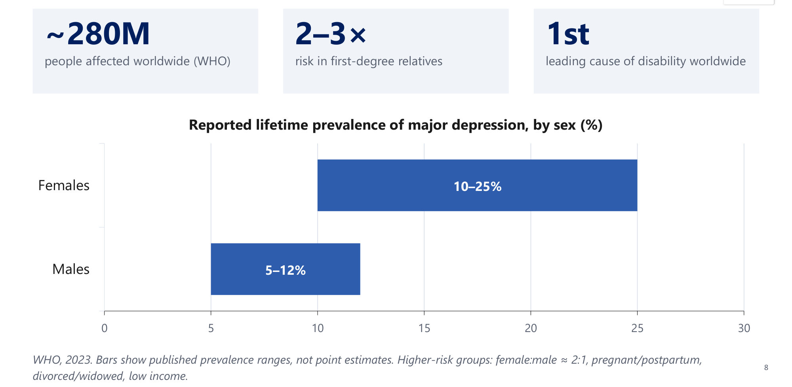

### 2.3 Aetiology and Neurobiology (Slides 9–10)
| Model | Content |
|---|---|
| **Neurotransmitter** | **Monoamine** dysregulation: serotonin, noradrenaline, dopamine |
| **Genetic** | Heritable; first-degree relatives; twin concordance. ⭐ **Heritability ~40% (MZ > DZ)** |
| **Stress–diathesis** | Latent vulnerability unmasked by life stress |
| **Neuroendocrine** | ⭐ **HPA-axis overactivity, raised cortisol**; thyroid axis |
| **Neuroanatomic/neurotrophic** | Limbic–prefrontal dysfunction; ⭐ **↓ BDNF and hippocampal volume** |
| **Sleep & psychological** | ⭐ **Shortened REM latency**; **negative cognitive triad**; **learned helplessness** |

**HPA mechanism (slide 10):**
1. chronic stress → persistently high **CRH and cortisol**
2. **feedback fails**: many patients **don't suppress on dexamethasone**
3. sustained cortisol is **toxic to the hippocampus** (volume falls)
4. **BDNF and neurogenesis drop**

⭐ **Why the delay?** Monoamines rise in **hours**, but mood lifts in **4–6 weeks**: recovery needs **receptor and neuroplastic adaptation**.

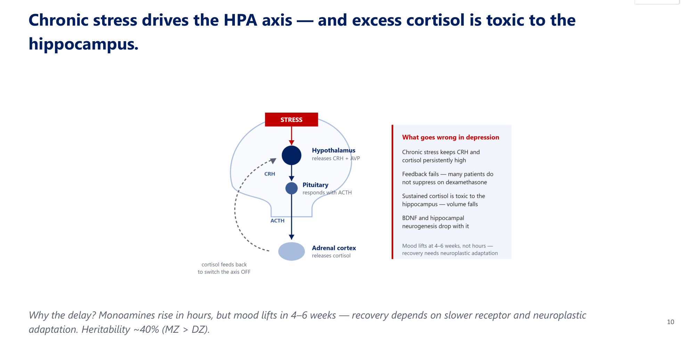

### 2.4 Why Treat Depression? (Slide 11)
- **Systemic harm:**
  - ⭐ **independent risk factor for MI and stroke**
  - worsens **diabetes** and chronic disease
  - drives ED visits and admissions
- **Mortality:**
  - ⭐ **40–60% of completed suicides involve a depressed patient**
  - leading global cause of disability

### 2.5 Differential Diagnosis of Sadness (Slide 12)
| Normal / reactive | Primary mood disorders | Secondary / organic |
|---|---|---|
| **Grief and bereavement** | MDD | Mood disorder due to a **medical illness** |
| Difficulty coping | Persistent depressive disorder | **Delirium** |
| **Demoralisation** | **Bipolar I and II** | **Stroke (CVA)** |
| **Adjustment disorder** | **Schizoaffective** | **Substance/medication-induced** |

### 2.6 Major Depressive Episode: SIG-E-CAPS (Slides 13–14) ⭐⭐
**Criteria:**
- ⭐ **≥ 2 weeks** of **depressed mood and/or anhedonia**
- most of the day, nearly every day
- **plus ≥ 4 more (≥ 5 total)**
- causing distress/impairment
- not due to a substance or medical condition

| Letter | Symptom |
|---|---|
| **S** | **Sleep**: insomnia or hypersomnia |
| **I** | **Interest**: anhedonia |
| **G** | **Guilt**/worthlessness |
| **E** | **Energy**: fatigue |
| **C** | **Concentration**: poor; indecisive |
| **A** | **Appetite**/weight change |
| **P** | **Psychomotor** agitation or retardation |
| **S** | **Suicidality**: thoughts of death, ideation, plan, attempt |

**Plus the core symptom: depressed mood.** *[added]* "SIG: E CAPS" reads like a prescription for "energy capsules". Mood + these 8 items = the 9 DSM criteria.

- Sub-threshold (< 5 symptoms or < 2 weeks) → think **adjustment or persistent depressive disorder**.

**MDD (slide 14):**
- **unipolar**; single or recurrent episodes; marked distress/impairment
- ⭐ **The bipolar gate:** **no history of mania or hypomania**. Any such history makes it **bipolar**.
- Psychosis or anxiety may occur (**specifiers**).
- ⭐ Ask directly about **past elevated mood, reduced sleep need, overactivity**. A missed hypomania → misclassified as unipolar → **antidepressant-induced switching**.

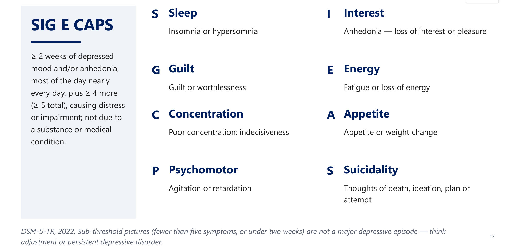

### 2.7 Across the Lifespan (Slides 15–16)
| Children/adolescents | Elderly |
|---|---|
| ⭐ **Irritability may replace sadness** | **Not a normal part of ageing** |
| Somatic complaints; declining school performance | Patients **minimise sadness**; present with **agitation** |
| Withdrawal, boredom, **school refusal** | ⭐ Cognitive slowing mimics dementia (**"pseudodementia"**) |
| ⭐ **DMDD:** chronic severe irritability + frequent temper outbursts, angry mood between; **onset < 10**; diagnosed **6–18** | ⭐ **Highest completed-suicide rates; more lethal methods** |
| DMDD was created to **reduce over-diagnosis of paediatric bipolar** (chronic irritability ≠ episodic mania) | Under-recognised behind somatic complaints; **screen even when mood is denied** |

### 2.8 Screening and Rating Scales (Slides 17–18)
- **PHQ-2 → PHQ-9.**
  - PHQ-2: 2 items (mood, anhedonia); if positive → PHQ-9.
  - PHQ-9: 9 items mapping onto DSM criteria; grades severity and tracks response; free.
- **Adolescent screening performance:**
  - sensitivity **~74%**, specificity **~75%**
  - **PPV ~38%, NPV ~93%** → ⭐ **good at ruling OUT, weak at ruling in**
- **Limits:**
  - a screen, not a diagnosis
  - self-report (stigma → under-reporting)
  - **somatic items inflate scores in the medically ill**
  - ⭐ **does NOT screen for past mania**
  - **item 9** flags suicidal thoughts but is **not a risk assessment**
- Use a version **validated for the population/language**.

| Scale | Type | Best use |
|---|---|---|
| **PHQ-9** | Self-report (9) | Screening, severity, monitoring: the everyday tool |
| **HAM-D** | Clinician | Classic research severity |
| **MADRS** | Clinician | ⭐ **Most sensitive to change** (antidepressant trials) |
| **BDI** | Self-report | Severity |
| ⭐ **EPDS (Edinburgh)** | Self-report | **Peripartum** screening |
| ⭐ **YMRS (Young)** | Clinician | **Mania** severity |

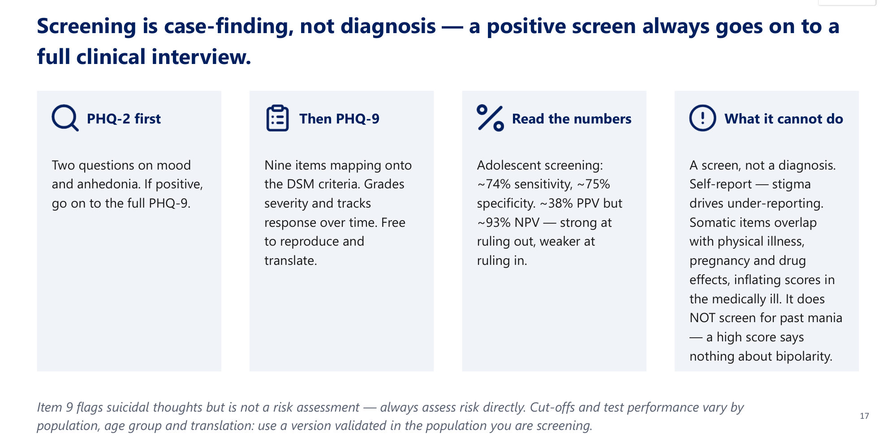

### 2.9 Course and Prognosis of Depression (Slides 19–21) ⭐
| Figure | Value |
|---|---|
| Episode length | ⭐ **6–13 months untreated; ≈ 3 months treated** |
| Recovery | **~80% within 1 year** |
| Later bipolar | ⭐ **5–10%** eventually develop bipolar disorder |
| Recurrence after **1** episode | ⭐ **~50%** |
| After **2** episodes | ⭐ **~70%** |
| After **3** episodes | ⭐ **~90%** |

**Systemic illness (slide 20):**
- **independent CVD risk factor**; ↑ **T2DM** risk
- raised rates of COPD, asthma, migraine, stroke, epilepsy, MS, thyroid disease, cancer, chronic back pain
- **bidirectional**: treat both

| Lower recovery rates | Higher recurrence risk |
|---|---|
| Long current episode | **Multiple prior episodes** |
| Greater severity | Previous **severe** episode |
| **Psychotic features** | ⭐ **Residual symptoms during remission** (a red flag to keep treating) |
| Prominent **anxiety** | **Younger age of onset** |
| Comorbid **personality disorder** | — |

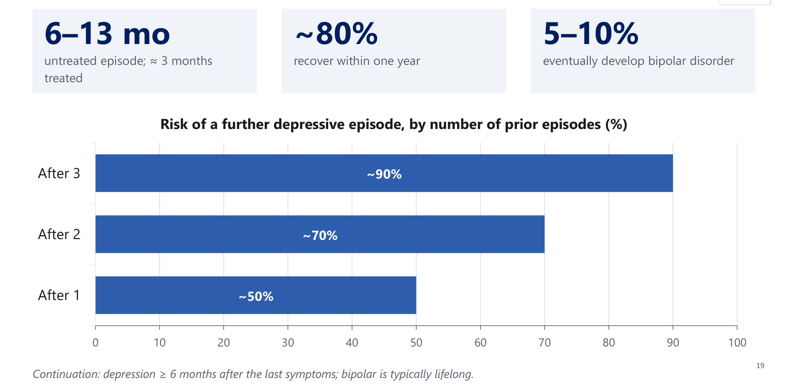

### 2.10 Suicide in Depression (Slides 22–24) ⭐
- **Best predictor of a future attempt:** ⭐ **a previous suicide attempt** (lecture MCQ answer B). It outweighs demographics.
- **About two-thirds** of depressed patients contemplate suicide.
- Depression is involved in **40–60%** of completed suicides.
- ⭐ **Low CSF 5-HIAA** (serotonin metabolite) is associated with, and **predicts**, suicidal behaviour.
- **Action:** assess ideation, intent, plan, means, protective factors; **restrict means**; **document a safety plan**. Asking doesn't plant the idea.

### 2.11 How Well Does Treatment Work? (Slide 25)
- ⭐ Antidepressants roughly **double the placebo response: 50–65% vs 25–30%** over ~3 months.
- **SSRIs block the reuptake pump.** Monoamines rise in hours; ⭐ **onset of effect 4–6 weeks**.
- ⭐ **Continue 6–9 months after remission** (**≥ 2 years if recurrent/high-risk**, slide 43).
- Set expectations: **the drug is working before the patient feels it.**

> 🔁 **Recap: Depression, Part 1.**
> - MDD = ≥ 2 weeks, ≥ 5 SIG-E-CAPS (mood or anhedonia required), **no past (hypo)mania**.
> - F:M 2:1. Heritability ~40%. HPA overactivity, ↓ BDNF, short REM latency.
> - Recurrence 50 → 70 → 90%; 5–10% become bipolar.
> - Previous attempt is the strongest suicide predictor; low CSF 5-HIAA.
> - Response 50–65% vs placebo 25–30%; 4–6 weeks to work; continue 6–9 months.
>
> ▶️ **Up next: Secondary causes and the depressive spectrum.**

---

### 2.12 Secondary Depression: Medical and Medication Causes (Slides 26–28) ⭐
**Case (slides 26–27):**
- 48-year-old woman, 3 months of low mood, fatigue, **weight gain**, poor concentration, **constipation**
- **cold intolerance, dry skin, hoarse voice**

→ ⭐ **B: check TSH** (hypothyroidism). Treating the thyroid can resolve mood **without an antidepressant**.

| Medical conditions | Medications |
|---|---|
| ⭐ **Hypothyroidism, Cushing's, Addison's** | ⭐ **Corticosteroids, anabolic steroids** |
| ⭐ **Pancreatic** and other cancers | ⭐ **Interferon** |
| **Post-stroke, post-MI** | ⭐ **Isotretinoin** |
| **SLE, MS, HIV/AIDS** | Some **antihypertensives** and hormonal agents |

**Screen thyroid function and review the medication list in every new presentation.**

### 2.13 Substance-Induced Mood Disorder (Slides 29–31)
**Case (slides 29–30):**
- 52-year-old man, 1 month of low mood, poor sleep, anhedonia, irritability
- **drinks heavily most evenings**; **worst in the mornings**; no psychiatric history

→ ⭐ **B: substance-induced mood disorder.**

| Common culprits | Approach |
|---|---|
| **Alcohol and sedative-hypnotics** (use or withdrawal) | **Temporal link** to use/withdrawal |
| **Stimulant "crash"** (cocaine, amphetamine) | ⭐ **Reassess after abstinence** |
| Cannabis, opioids | **Urine drug screen** supports |

Don't commit to primary MDD during active use or acute withdrawal.

### 2.14 PMDD and Persistent Depressive Disorder (Slides 32–33)
| **PMDD** | **Persistent depressive disorder (dysthymia)** |
|---|---|
| ⭐ **≥ 5 symptoms in the final week before menses**; improve within days of onset; minimal post-menses | ⭐ Depressed mood most days for **≥ 2 years (≥ 1 year in children/adolescents)** |
| **≥ 1 affective** symptom: lability, **irritability/anger**, depressed mood/hopelessness, anxiety | **Plus ≥ 2 of 6:** appetite change, sleep disturbance, low energy, **low self-esteem**, poor concentration, **hopelessness** |
| Others: ↓ interest, poor concentration, fatigue, appetite change, sleep change, overwhelmed, **breast tenderness, bloating** | ⭐ **Never symptom-free for > 2 months** in the 2 years |
| ⭐ **Confirmed prospectively over ≥ 2 cycles** | A superimposed MDE = ⭐ **"double depression"** |
| A formal depressive disorder, not "bad PMS"; key = **late luteal timing** | — |

**Mnemonic *[added]* for dysthymia: "HE'S 2 SAD"**:
- **H**opelessness
- **E**nergy low
- **S**leep
- **2** years
- **S**elf-esteem low
- **A**ppetite
- **D**ecision/concentration difficulty

### 2.15 Specifiers (Slides 34–36) ⭐⭐
**Each specifier changes management or prognosis.**

| Specifier | Features | Management point |
|---|---|---|
| **Anxious distress** | Keyed-up, tense, restless; worry impairs focus; fear of losing control | ⭐ **Higher suicide risk** |
| ⭐ **Atypical** | **Mood reactivity (required)**, **hypersomnia**, **↑ appetite/weight**, **leaden paralysis**, **rejection sensitivity** | Historically responds to **MAOIs** |
| ⭐ **Melancholic** | **Non-reactive mood**, anhedonia, **early-morning waking**, **diurnal variation** (*[added]* worse in mornings), marked guilt, psychomotor change | Responds well to **medication and ECT** |
| **Catatonic** | Slide: "≥ 2 of" immobility, catalepsy, waxy flexibility, stupor, mutism, negativism, or excessive purposeless activity | ⚠️ **Slide inconsistency:** DSM-5-TR catatonia requires **≥ 3 of 12** features. Lorazepam/ECT (Psychosis lecture) |
| ⭐ **With psychotic features** | **10–15%** of episodes; mood-congruent or incongruent | **Worse prognosis**; ↑ **suicide and homicide** risk. **Antidepressant + antipsychotic; consider ECT early** |
| ⭐ **Peripartum onset** | Onset in **pregnancy or ≤ 4 weeks postpartum**. **3–6%** meet the DSM specifier; **~10–15%** within the first year | Distinguish **baby blues**. **Infant-focused delusions or command hallucinations = emergency** |
| **Seasonal pattern (SAD)** | Predictable seasonal onset and remission, not explained by seasonal stressors | ⭐ **Light therapy (10,000 lux, morning)** or antidepressants |

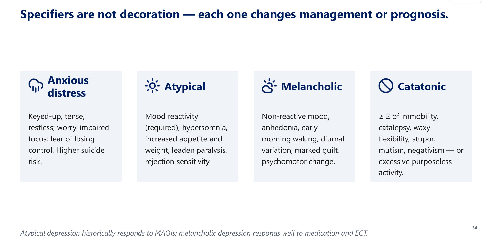 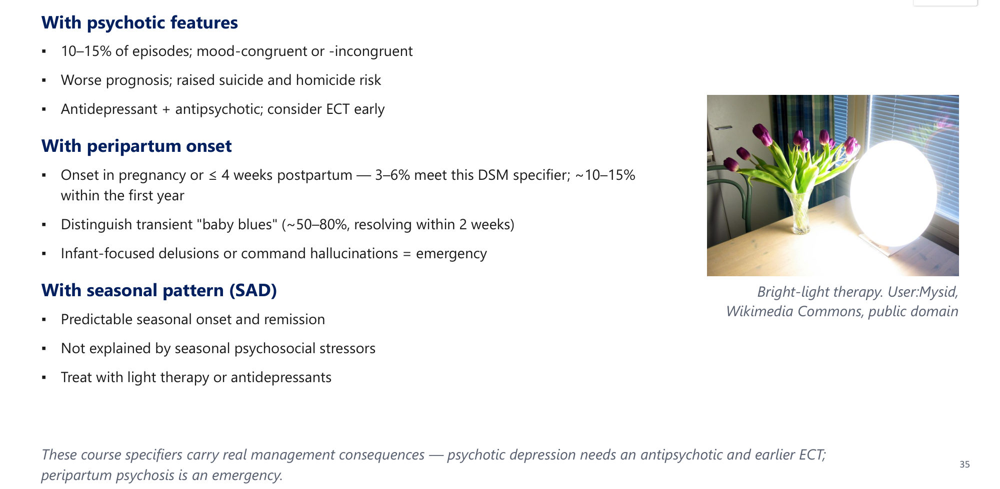

#### The Postpartum Spectrum (Slide 36) ⭐⭐
| Feature | **Baby blues** | **Postpartum depression** | **Postpartum psychosis** |
|---|---|---|---|
| Prevalence | ⭐ **~50–80%** | ⭐ **~10–15%** | ⭐ **~1–2 per 1000** |
| Onset | **Days 3–10** | Within weeks (**up to 12 months**) | **Rapid: days to 2 weeks** |
| Features | Mild tearfulness, lability, anxiety | Full depressive episode ± anxiety | **Delusions, hallucinations, confusion**, mood instability |
| Course | ⭐ **Self-limiting (≤ 2 weeks)** | Persists; needs treatment | **Fluctuating; deteriorates fast** |
| Action | Reassurance, support | Psychotherapy ± antidepressant; **EPDS** | ⭐ **EMERGENCY ADMISSION**; never manage at home |

*[added]* Postpartum psychosis is strongly linked to **bipolar disorder**.

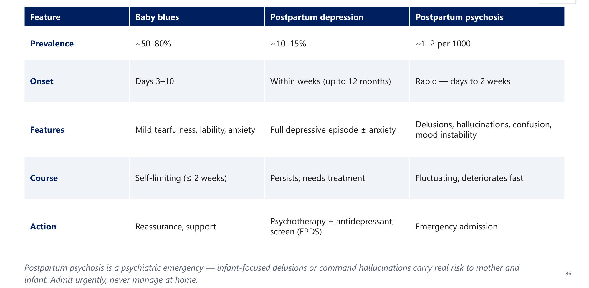

### 2.16 Grief vs MDD (Slides 37–39) ⭐
**Case (slides 37–38):**
- 60-year-old, **3 weeks** after his wife's death
- sadness in **waves**; enjoys his grandchildren
- wishes he "could be with her", but **no wish to end his life**

**Which feature would point to MDD?** → ⭐ **C: pervasive worthlessness and guilt.**

| Feature | **Normal grief** | **MDD** |
|---|---|---|
| Affect | Emptiness and loss **in waves**; may include humour, positive emotion | **Persistent** low mood, pervasive anhedonia |
| Self-esteem | ⭐ **Preserved** | ⭐ **Worthlessness, global guilt** |
| Suicidal thought | Thoughts of **"joining" the deceased** | **Ending life** from worthlessness or pain |
| Course/function | Eases over days–weeks; transient impairment | Sustained; needs treatment |

- ⭐ **DSM-5 removed the bereavement exclusion:** MDD **can** be diagnosed during grief if full criteria are met.
- ⭐ **New in DSM-5-TR: Prolonged Grief Disorder (≥ 12 months).**

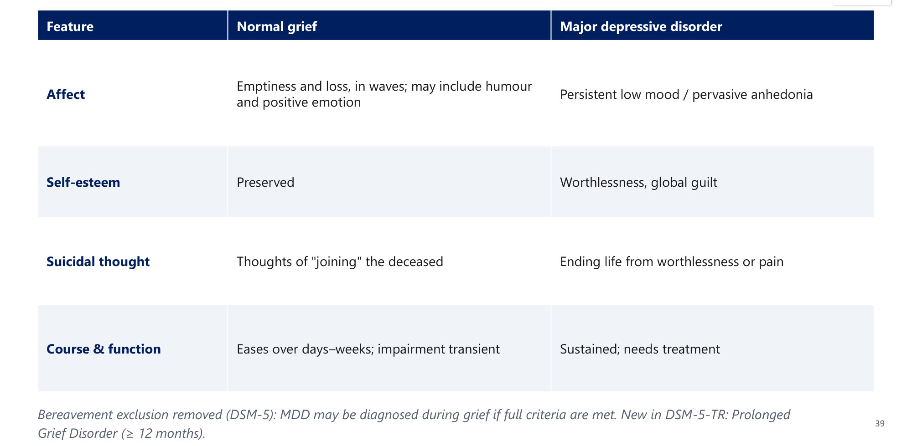

### 2.17 Adjustment Disorder vs MDD (Slide 40)
| | **Adjustment disorder** | **MDD** |
|---|---|---|
| Trigger | ⭐ **Identifiable stressor within 3 months** | May or may not follow a stressor |
| Criteria | Distress out of proportion, but **doesn't meet full MDD criteria** | **Meets ≥ 5 symptoms for 2 weeks** |
| Duration | ⭐ **Resolves within 6 months** of the stressor ending | Persists; recurrent |
| Management | Supportive, psychotherapy, problem-solving | Antidepressant ± psychotherapy |

⭐ **If full MDD criteria are met, diagnose MDD**, even with a clear stressor.

### 2.18 Schizoaffective Disorder (Slide 41)
**Criteria:**
- **A.** uninterrupted illness with a major mood episode concurrent with schizophrenia Criterion A
- **B.** ⭐ **delusions/hallucinations ≥ 2 weeks without a major mood episode** (lifetime)
- **C.** mood symptoms for the **majority** of the illness
- **D.** not substance/medical

**Discriminator:**
- **mood disorder with psychosis:** psychosis **only during** mood episodes
- **schizoaffective:** ≥ 2 weeks of psychosis without mood
- **schizophrenia:** mood symptoms brief

### 2.19 Investigations and Comorbidities (Slide 42)
| Routine | Per case | Comorbidities |
|---|---|---|
| **CBC, TSH, LFTs, electrolytes** | ⭐ **ECG, especially before TCAs** | Substance use, anxiety, eating disorders |
| **B12, folate** | CXR | **Borderline PD**; ADHD, learning and conduct disorders |
| **Urinalysis + urine drug screen** | Neurology consult/imaging | ⭐ **Men → substance use; women → anxiety/eating** |

**Comorbidity is the rule.**

### 2.20 Management of Depression (Slides 43–45) ⭐⭐
**Stepped care (slide 43):**

| Step | Severity | Treatment |
|---|---|---|
| **1** | **Mild / subthreshold** | Psychoeducation, **active monitoring**, guided self-help, behavioural activation, exercise. ⭐ **NOT routine antidepressants** |
| **2** | **Mild–moderate** | **Low-intensity** psychological interventions; CBT-based self-help |
| **3** | **Moderate–severe** | **High-intensity CBT or IPT and/or an antidepressant**; ⭐ **combine in severe illness** |
| **4** | **Severe / complex** | **Specialist care**; ⭐ **add an antipsychotic if psychotic; consider ECT** |

**Continue 6–9 months after remission; ≥ 2 years if recurrent or high-risk.**

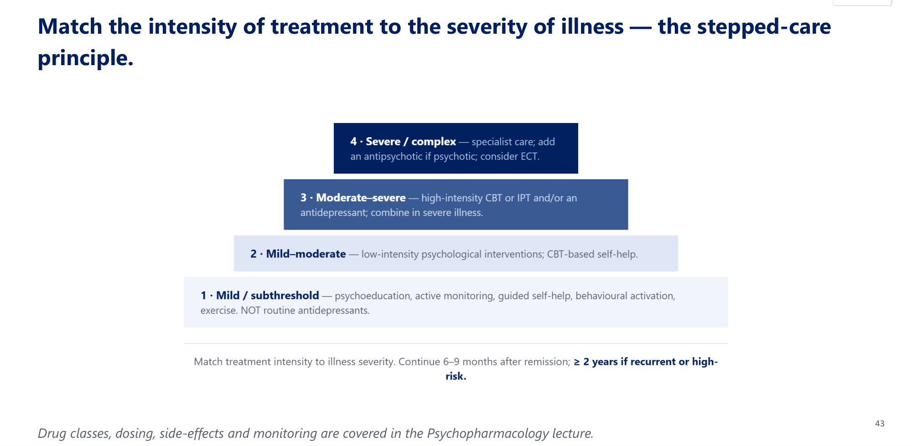

**Psychotherapies (slide 44):** first-line for mild–moderate; **combined with medication, superior to either alone** in severe illness.

| Therapy | Content |
|---|---|
| ⭐ **CBT** | Restructures negative automatic thoughts and the **cognitive triad**; behavioural experiments. **Strongest evidence; prevents relapse** |
| ⭐ **IPT** | Time-limited; current relationships: **grief, role transitions, role disputes, interpersonal deficits** |
| **Behavioural activation** | Re-engages rewarding activity to break the withdrawal–low-mood cycle |
| **MBCT** | Mindfulness + cognitive skills; ⭐ **reduces relapse in recurrent depression** |
| **Family-focused therapy** (bipolar) | Psychoeducation + communication; **lowers expressed emotion** and relapse |
| ⭐ **IPSRT** (bipolar) | **Stabilises sleep–wake and social rhythms** |

#### Neurostimulation (Slide 45)
| Modality | Use |
|---|---|
| ⭐ **ECT** | **Most effective acute treatment for severe depression.** Remission **80–90%**; relapse **50–80% within 6 months without continuation therapy** |
| **rTMS** | Non-invasive, outpatient, **no anaesthesia**; for **treatment resistance** |
| **Light** | **10,000 lux morning** for the seasonal pattern |
| **VNS, DBS** | Severe refractory illness, specialist settings |

- **ECT** is a brief, controlled **generalised seizure under general anaesthesia**.
- ⭐ **First-line when waiting is unsafe:**
  1. **intense suicidality**
  2. **catatonia**
  3. **psychosis**
  4. **food/fluid refusal**
  5. **pregnancy**
- **Side-effects:** transient **memory disturbance** (**bilateral more effective, more cognitive load** than unilateral), headache, myalgia.

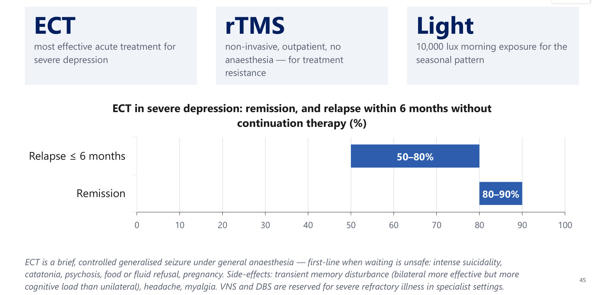

> 🔁 **Recap: Depression, Part 2.**
> - Exclude hypothyroidism, Cushing/Addison, cancer (pancreas), steroids, interferon, isotretinoin, alcohol.
> - PMDD (luteal, ≥ 2 cycles). Dysthymia (≥ 2 years, never > 2 months well; double depression).
> - Specifiers: atypical (MAOIs), melancholic (meds/ECT), psychotic (+ antipsychotic, ECT), peripartum, seasonal (light).
> - Blues / PPD / psychosis = 50–80% / 10–15% / 1–2 per 1000.
> - Grief preserves self-esteem; prolonged grief ≥ 12 months. Adjustment: < 3 months after a stressor, resolves within 6 months.
> - Stepped care 1–4; ECT for unsafe-to-wait cases.
>
> ▶️ **Up next: The other pole: mania and bipolar disorder.**

---

### 2.21 Bipolar: Opening Case Mrs. R, 31 (Slide 48)
**Presentation:**
- presents with **depression** (low mood, poor appetite, concentration, worthlessness)
- **2 years ago, 4 days before her sister's wedding:**
  - slept **2 h/night**, "wasn't tired"
  - "**brilliant ideas**" racing
  - worked all night making pastries/gifts; **kept working productively** at her job
  - inappropriate with men at the wedding
- no substances

→ ⭐ **Bipolar II**: a discrete **≥ 4-day hypomanic episode** (no marked impairment, no hospitalisation, no psychosis) + current major depression.

### 2.22 Mania vs Hypomania (Slides 49–51) ⭐⭐
**DIG FAST:**
- **D**istractibility
- **I**mpulsivity/Indiscretion
- **G**randiosity
- **F**light of ideas
- ↑ **A**ctivity
- ↓ **S**leep need
- **T**alkativeness (pressured speech)

| | **Manic episode** | **Hypomanic episode** |
|---|---|---|
| Duration | ⭐ **≥ 1 week**, or **any duration if hospitalised** | ⭐ **≥ 4 consecutive days** |
| Symptoms | ⭐ **≥ 3**, or **≥ 4 if mood only irritable** | Same threshold |
| Function | ⭐ **Marked impairment, hospitalisation, or psychotic features** | Noticeable change, but **none of those three** |

- ⭐ **The energy gate:** DSM-5 requires **increased energy/activity IN ADDITION to the mood change**; elevated mood alone is not sufficient.
- **Case (slides 49–50):** 26-year-old, **5 days** elevated mood, ↓ sleep need, rapid speech, ↑ activity, **functioning well at work**, no psychosis, no admission → ⭐ **B: hypomanic episode**. Add any one of impairment, hospitalisation or psychosis and it becomes mania.

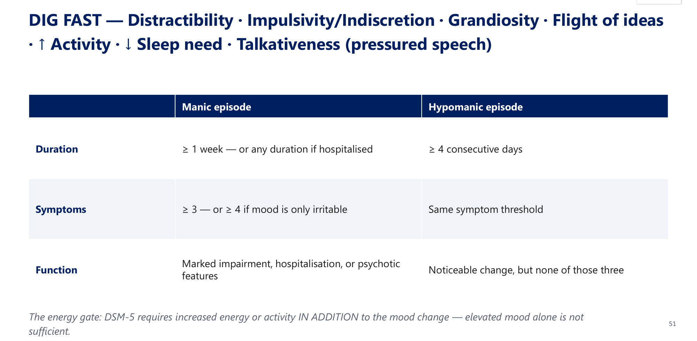

### 2.23 Bipolar I vs II vs Cyclothymia (Slide 52) ⭐
| Disorder | Requirement |
|---|---|
| ⭐ **Bipolar I** | **≥ 1 manic episode**; depression usual but **not required** |
| ⭐ **Bipolar II** | **Hypomania + major depression; never mania** |
| ⭐ **Cyclothymia** | **≥ 2 years** of **sub-threshold** swings, **never episode-level**; never symptom-free > 2 months |

⭐ **Screen every depressed patient for past hypomania/mania before starting an antidepressant. Bipolar treatment is lifelong.**

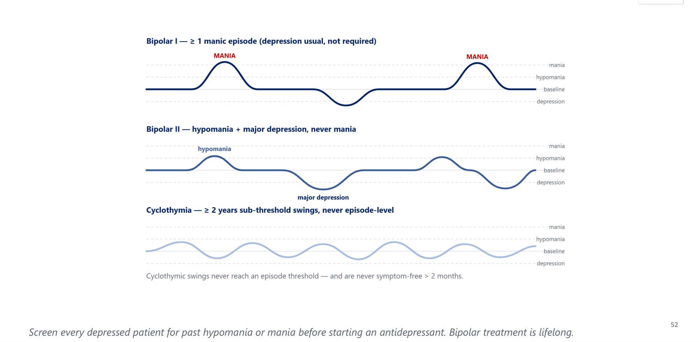

### 2.24 Specifiers: Rapid Cycling and Mixed Features (Slides 53–54) ⭐
**Bipolar specifiers:** rapid cycling · psychotic · melancholic · atypical · catatonic · peripartum · seasonal.

| **Rapid cycling** | **Mixed features** |
|---|---|
| ⭐ **≥ 4 mood episodes in 12 months**, separated by ≥ 2 months' remission or a switch to the opposite pole | A mood episode with ⭐ **≥ 3 symptoms of the opposite pole at the same time** |
| Commoner in **bipolar II** and **women** | Depressed but **agitated, racing thoughts, irritable**; or manic but **tearful, hopeless, guilty** |
| Earlier onset, longer illness | Mistaken for agitated depression or anxiety |
| ⭐ **More suicide attempts** and morbidity | ⭐ **HIGHEST suicide risk of any mood presentation** |
| A **course specifier**, not a separate disorder | ⭐ **Antidepressant monotherapy can worsen it**: use a **mood stabiliser/atypical** |

### 2.25 Burden, Prognosis and Suicide in Bipolar (Slides 55–56)
| Figure | Value |
|---|---|
| **Lifetime bipolar I** | ⭐ **~1%** (**2–4%** bipolar spectrum) |
| **Typical onset** | **Mid-20s** |
| **Life expectancy** | ⭐ **−12–14 years** |
| **Completed suicide** | ⭐ **≈ 6–7%** (older inpatient estimates **15–20%**); ⭐ **10–30× the general population** |
| **Sex** | Bipolar I ≈ **M = F**; bipolar II **commoner in women** |
| **Genetics** | ⭐ **Highest heritability of the mood disorders** |
| **Social** | Divorce/separation ~**2×**; marked occupational disruption |

- **Poor prognosis:**
  - psychotic features; mixed episodes
  - **rapid cycling**
  - comorbid substance use
  - poor adherence
  - early onset; frequent episodes
- ⭐ **Suicide risk:** **bipolar II particularly at risk**; highest in **depressive and mixed** states.

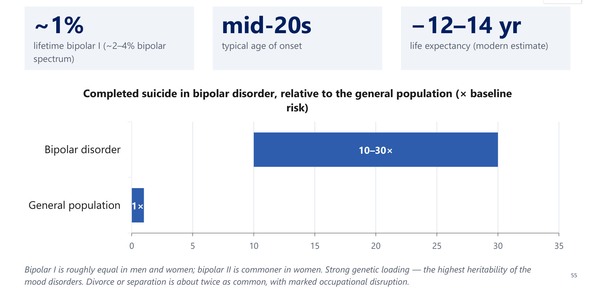

### 2.26 Differential Diagnosis of Bipolar (Slides 57–59)
- **Consider:**
  - unipolar MDD
  - **cocaine/amphetamine**
  - **borderline/narcissistic PD**
  - organic/secondary
  - schizoaffective
- **Unifying test:** ⭐ **episodicity with a clear return to baseline**, corroborated by **collateral**.

| Contrast | Points to the mimic | Points to bipolar |
|---|---|---|
| **Substance use** | Symptoms tied to intoxication/withdrawal; ⭐ **6–12 months' abstinence to judge** | Bipolar usually **precedes** substance use (and is a risk factor for it) |
| **ADHD** | ⭐ **Onset < 12, continuous**, responds to stimulants; FHx of disruptive disorders | **Later onset, episodic**, FHx of mood disorder, responds to mood stabilisers |
| **Borderline PD** | Dysfunction **persists between episodes**; mood often sub-threshold; history of deprivation/abuse | **Biphasic episodes meeting threshold**; reasonable function when euthymic; FHx of bipolar |

**Secondary mania (slide 59):**

| Medical | Drugs/substances |
|---|---|
| ⭐ **Hyperthyroidism, Cushing's** | ⭐ **Corticosteroids** |
| **MS, stroke** | ⭐ **Antidepressants (switch)** |
| **Temporal/frontal lobe pathology** | **Stimulants, cocaine, amphetamine** |
| **Neurosyphilis, HIV** | **L-dopa**, sympathomimetics |

**A first manic episode at an atypical age or with focal neurological signs → organic work-up first.**

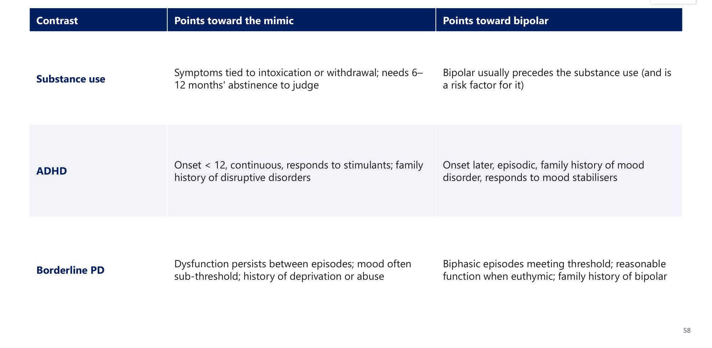

### 2.27 Management of Bipolar (Slides 60–63) ⭐⭐
**Case (slides 60–61):** a known bipolar I patient in a depressive episode; a colleague suggests SSRI monotherapy. Main risk → ⭐ **B: switch into mania or rapid cycling.**

| Phase | Approach | Key rule |
|---|---|---|
| ⭐ **Acute mania** | **Mood stabiliser (lithium or valproate) and/or antipsychotic**; short-term **benzodiazepine** for agitation/sleep | ⭐ **STOP antidepressants** |
| ⭐ **Bipolar depression** | **Quetiapine, lurasidone, cariprazine; lamotrigine; or lithium** | ⭐ **Avoid antidepressant monotherapy**; if used at all, **on top of a mood stabiliser** |
| ⭐ **Maintenance (lifelong)** | ⭐ **Lithium first-line: gold standard and ANTI-SUICIDE.** Alternatives: valproate, lamotrigine, atypicals | Treat to full remission; **relapse is the rule if stopped** |
| **Severe/refractory/mixed/pregnancy** | ⭐ **ECT** | Most effective for **severe and mixed** states |

**Psychosocial care (slide 63):**
- **psychoeducation** with a **written relapse-prevention plan** (early-warning signs)
- **family-focused therapy** (↓ expressed emotion)
- ⭐ **IPSRT** (regular sleep–wake routines; **rhythm disruption precipitates episodes**)
- lifestyle and adherence: sleep hygiene, avoid substances, monitoring

*[added]* Valproate is avoided in women of childbearing potential (teratogenic); lithium needs level, renal and thyroid monitoring (covered in the Psychotropics lecture).

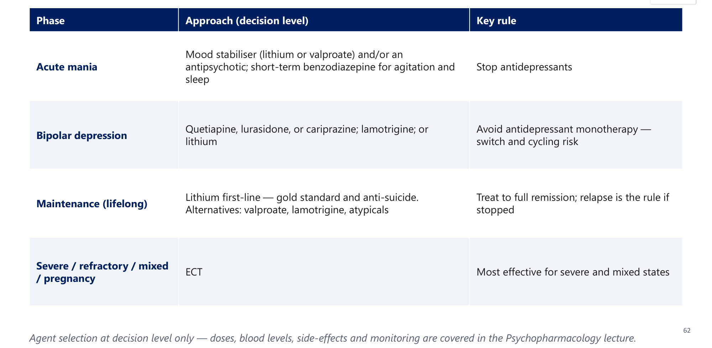

> 🔁 **Recap: Bipolar.**
> - DIG FAST + the **energy gate**.
> - Mania ≥ 1 week (or hospitalised) with impairment, hospitalisation or psychosis. Hypomania ≥ 4 days, none of these.
> - Bipolar I = mania. Bipolar II = hypomania + MDE. Cyclothymia = ≥ 2 years sub-threshold.
> - Rapid cycling ≥ 4 episodes/year. Mixed features = highest suicide risk.
> - ~1%, mid-20s, −12–14 years, suicide 6–7% (10–30×).
> - Mania: lithium/valproate ± antipsychotic, stop antidepressants. Depression: quetiapine, lurasidone, cariprazine, lamotrigine, lithium. Maintenance: **lithium** (anti-suicide). ECT for severe/mixed/pregnancy.

---

### 2.28 Integrative Case: Ms. F, 26 (Slides 65–66) ⭐
**Presentation:**
- teacher, **3rd depressive episode since age 19**
- for 2 months: hypersomnia, ↑ appetite/weight gain, **leaden limbs**, withdrawn after "the smallest criticism"
- GP started **fluoxetine 4 weeks ago**
- last **6 days**: sleeps 3 h and not tired, rapid talk, reorganising the flat at 3 a.m., spent most of her salary, "**better than well**"
- no hospitalisation, no psychosis, **still teaching** (head teacher comments)
- **maternal uncle on lithium** for "manic depression"

| Question | Model answer (lecture) |
|---|---|
| 1. Depressive specifier? | ⭐ **Atypical features**: hypersomnia, hyperphagia/weight gain, leaden paralysis, rejection sensitivity |
| 2. Mania or hypomania? | ⭐ **Hypomania**: ≥ 4 days, **no** marked impairment, psychosis or hospitalisation |
| 3. Diagnosis? | ⭐ **Bipolar II**. The earlier "depressive" episodes were the **depressive pole** |
| 4. What went wrong? | **Antidepressant monotherapy in undiagnosed bipolar.** Missed clue: **family history + recurrent early-onset depression** |
| 5. Management? | **Stop/taper the antidepressant; start a mood stabiliser**; then maintenance, psychoeducation, **rhythm stabilisation**, suicide-risk monitoring |

⭐ **Hypomania is rarely volunteered because it feels good**: ask directly, with a collateral informant.

*[added]* "Bipolar red flags" in a depressed patient:
- **early onset**
- **recurrent** episodes
- **atypical features**
- **psychotic or postpartum** depression
- **family history of bipolar**
- **antidepressant-induced activation**

---

## 3. High-Yield Comparison Tables

### Table A: Depressive Disorders
| Disorder | Duration | Core |
|---|---|---|
| MDD | ≥ 2 weeks | ≥ 5 SIG-E-CAPS incl. mood/anhedonia; no (hypo)mania ever |
| Persistent depressive | ≥ 2 years (≥ 1 year in children) | Low mood + ≥ 2 of 6; never well > 2 months |
| PMDD | Late luteal phase; ≥ 2 cycles prospectively | ≥ 5 symptoms, ≥ 1 affective |
| DMDD | Onset < 10; diagnosed 6–18 | Chronic irritability + outbursts |
| Adjustment | Within 3 months of a stressor; resolves by 6 months | Sub-threshold |
| Prolonged grief | ≥ 12 months | DSM-5-TR addition |

### Table B: Mood Episodes
| | Mania | Hypomania | MDE |
|---|---|---|---|
| Duration | ≥ 7 days (any if admitted) | ≥ 4 days | ≥ 2 weeks |
| Symptoms | ≥ 3 DIG FAST (≥ 4 if irritable) | Same | ≥ 5 SIG-E-CAPS |
| Impairment/psychosis/admission | **Yes (any one)** | **None** | Distress/impairment |

### Table C: Bipolar I vs II vs Cyclothymia vs MDD
| | Bipolar I | Bipolar II | Cyclothymia | MDD |
|---|---|---|---|---|
| Mania | ✅ | ❌ | ❌ | ❌ |
| Hypomania | ± | ✅ | Sub-threshold | ❌ |
| MDE | Usual, not required | ✅ Required | Sub-threshold | ✅ |
| Sex | M = F | F > M | — | F 2:1 |

### Table D: Specifier → Management
| Specifier | Management consequence |
|---|---|
| Atypical | MAOIs historically |
| Melancholic | Medication, ECT |
| Psychotic | Antidepressant + antipsychotic; early ECT |
| Anxious distress | ↑ suicide risk |
| Catatonic | Lorazepam, ECT |
| Peripartum psychosis | Emergency admission |
| Seasonal | Light therapy 10,000 lux |
| Mixed features | Avoid antidepressant monotherapy; mood stabiliser/atypical; highest suicide risk |
| Rapid cycling | Harder to treat; commoner in BP-II/women |

### Table E: Bipolar vs Its Mimics
| Mimic | Key discriminator |
|---|---|
| BPD | Hours-long, interpersonally triggered; dysfunction persists between |
| ADHD | Onset < 12, continuous, stimulant-responsive |
| Substance | Linked to use/withdrawal; reassess after 6–12 months abstinent |
| Unipolar MDD | No (hypo)mania ever; ask directly + collateral |
| Secondary mania | Atypical age, neuro signs, thyroid/steroids |

### Table F: Key Numbers
| Item | Number |
|---|---|
| Depression worldwide | ~280 M; #1 cause of disability |
| Lifetime MDD | M 5–12%, F 10–25% |
| Heritability (MDD) | ~40% |
| Depressed patients in completed suicides | 40–60% |
| Antidepressant vs placebo | 50–65% vs 25–30% |
| Recurrence | 50% / 70% / 90% after 1/2/3 episodes |
| MDD → bipolar | 5–10% |
| Psychotic features | 10–15% of episodes |
| Baby blues / PPD / PP psychosis | 50–80% / 10–15% / 1–2 per 1000 |
| Bipolar I | ~1% (spectrum 2–4%); onset mid-20s |
| Bipolar suicide | 6–7% (older 15–20%); 10–30× |
| Bipolar life expectancy | −12–14 years |
| ECT | Remission 80–90%; relapse 50–80% by 6 months without continuation |

---

## 4. Rules, Exceptions, Patterns
- **No past (hypo)mania** is part of the MDD definition. **Always screen**, with collateral.
- **Energy/activity must rise** along with mood for (hypo)mania.
- **Any hospitalisation or psychosis = mania**, regardless of duration.
- **Bipolar I needs mania only**; depression is not required.
- **Antidepressant monotherapy is avoided in bipolar** (switch, rapid cycling, mixed states).
- **Lithium** = gold-standard maintenance + **anti-suicidal**.
- **Mixed features** = highest suicide risk.
- **Bereavement exclusion removed**: MDD can coexist with grief. Prolonged grief ≥ 12 months.
- **Full MDD criteria override adjustment disorder.**
- **Children: irritability** can replace sadness; DMDD ≠ paediatric bipolar.
- **Elderly:** pseudodementia; highest completed suicide.
- **PHQ-9:** rules out better than it rules in; doesn't detect mania; item 9 ≠ risk assessment.
- **Residual symptoms → keep treating.**
- **Check TSH and the drug list** in every new depression.
- **Atypical (reactive mood) vs melancholic (non-reactive, early waking, worse in the morning).**
- **ECT first-line** when waiting is unsafe: suicidality, catatonia, psychosis, refusal to eat/drink, pregnancy.

---

## 5. Clinical Correlations
- **Endocrine:**
  - **hypothyroidism** (weight gain, cold intolerance, constipation, hoarse voice) mimics depression
  - **Cushing's** causes depression (or mania)
  - **Addison's** causes apathy/depression
  - **hyperthyroidism** can precipitate mania
  - **dexamethasone non-suppression** in depression echoes the Cushing work-up (Adrenal I)
- **Cardiology:** depression is an independent CVD risk factor; **post-MI depression** worsens outcomes; **ECG before TCAs**.
- **Oncology:** **pancreatic cancer** classically presents with depression.
- **Dermatology:** **isotretinoin** → depression/suicidality.
- **Hepatology/ID:** **interferon** → depression.
- **Obstetrics:** **EPDS** screening; postpartum psychosis = emergency admission.
- **Steroids:** can cause depression **or** mania.
- **Primary care:** PHQ-2 → PHQ-9; stepped care; don't give routine antidepressants for mild depression.

---

## 6. Rapid Revision (Last-Day)
1. **Sadness vs depression:** proportionate/transient vs ≥ 2 weeks, out of proportion, impairing.
2. **Depressive spectrum:** MDD, PDD, PMDD, DMDD, secondary. **Bipolar spectrum:** I, II, cyclothymia, secondary.
3. **Epidemiology:** ~280 M; #1 disability; F:M 2:1; first-degree relatives 2–3×; heritability ~40%.
4. **Neurobiology:**
   - monoamines
   - **HPA ↑ cortisol**, dexamethasone non-suppression
   - ↓ BDNF/hippocampus
   - **short REM latency**
   - cognitive triad, learned helplessness
5. **MDD:** ≥ 2 weeks, ≥ 5 **SIG-E-CAPS** (mood or anhedonia), **never (hypo)mania**.
6. **Children:** irritability; **DMDD** (onset < 10, diagnosed 6–18). **Elderly:** pseudodementia, highest suicide.
7. **PHQ-9:** NPV 93%, PPV 38%; no mania detection. EPDS = peripartum. YMRS = mania. MADRS = sensitive to change.
8. **Course:** 6–13 months untreated (3 months treated); 80% recover in 1 year; recurrence 50/70/90%; 5–10% → bipolar.
9. **Suicide:** previous attempt is the best predictor; 2/3 contemplate; 40–60% of suicides; **low CSF 5-HIAA**.
10. **Treatment effect:** 50–65% vs 25–30%; 4–6 weeks; continue 6–9 months (≥ 2 years if recurrent).
11. **Mimics:**
    - **hypothyroidism**, Cushing, Addison
    - **pancreatic cancer**, post-stroke/MI
    - SLE, MS, HIV
    - **steroids, interferon, isotretinoin**, antihypertensives
    - **alcohol** (reassess after abstinence)
12. **PMDD:** ≥ 5 in the luteal week, ≥ 2 cycles. **PDD:** ≥ 2 years + ≥ 2 of 6; never well > 2 months; double depression.
13. **Specifiers:**
    - anxious (↑ suicide)
    - **atypical** (reactive mood, hypersomnia, hyperphagia, leaden paralysis, rejection sensitivity → MAOI)
    - **melancholic** (non-reactive, early waking, worse in the morning → medication/ECT)
    - catatonic
    - **psychotic** (10–15%; + antipsychotic, ECT)
    - **peripartum** (≤ 4 weeks)
    - **seasonal** (light)
14. **Postpartum:** blues 50–80%, days 3–10, ≤ 2 weeks · PPD 10–15%, up to 12 months · **psychosis 1–2/1000, days–2 weeks → admit**.
15. **Grief vs MDD:** self-esteem preserved vs **worthlessness/guilt**. Bereavement exclusion removed. **Prolonged grief ≥ 12 months.**
16. **Adjustment:** within 3 months of a stressor, resolves by 6 months; full criteria → MDD.
17. **Stepped care:** 1 mild (no routine antidepressants) → 2 low-intensity → 3 CBT/IPT ± antidepressant → 4 specialist, antipsychotic, ECT.
18. **Therapies:** CBT (best evidence), IPT (grief, roles), BA, **MBCT (relapse)**, FFT and **IPSRT** (bipolar).
19. **ECT:** most effective acute treatment; suicidality, catatonia, psychosis, food refusal, pregnancy; transient memory loss (bilateral > unilateral).
20. **DIG FAST + energy gate.** Mania ≥ 1 week or hospitalised; impairment, psychosis or admission. Hypomania ≥ 4 days, none.
21. **BP-I** = mania · **BP-II** = hypomania + MDE · **cyclothymia** = ≥ 2 years sub-threshold.
22. **Rapid cycling** ≥ 4/year (BP-II, women). **Mixed** ≥ 3 opposite-pole symptoms → **highest suicide risk**.
23. **Bipolar:** ~1%, mid-20s, −12–14 years, suicide 6–7% (10–30×), highest heritability; BP-II commoner in women.
24. **Mimics:** BPD, ADHD (< 12, continuous), substances (6–12 months abstinent), secondary mania (thyroid, steroids, L-dopa, antidepressants).
25. **Bipolar Rx:**
    - mania: Li/valproate ± antipsychotic, **stop antidepressants**
    - depression: quetiapine/lurasidone/cariprazine/lamotrigine/Li
    - maintenance: **Li** (anti-suicide)
    - ECT
    - IPSRT, FFT
26. **TCAs** = most dangerous in overdose (QRS widening, arrhythmia).

---

## 7. Exam-Style Questions

**Q1 (lecture, slides 26–27).** A 48-year-old woman has 3 months of low mood, fatigue, weight gain, poor concentration and constipation, plus cold intolerance, dry skin and a hoarse voice. Most important next step?
A. Start an SSRI · **B. Check thyroid function (TSH)** · C. Refer for CBT · D. Reassure, review in 6 weeks

> **Answer: B** (lecture key). Classic hypothyroidism mimicking depression. Exclude medical and medication causes before diagnosing primary MDD.

**Q2 (lecture, slides 37–38).** Three weeks after his wife's death, a 60-year-old has sadness in waves, enjoys his grandchildren, wishes he "could be with her" but has no wish to end his life; sleep is poor. Which feature would point to MDD rather than grief?
A. Sadness in waves · B. Preserved self-esteem · **C. Pervasive worthlessness and guilt** · D. Wishing to be with the deceased

> **Answer: C** (lecture key).
> - Normal grief preserves self-esteem, comes in waves and allows pleasure.
> - Global worthlessness/guilt and pervasive anhedonia point to MDD, which since DSM-5 **can** be diagnosed during bereavement.

**Q3 (lecture, slides 49–50).** A 26-year-old has 5 days of elevated, expansive mood, reduced need for sleep, rapid speech and increased activity; he is more productive and functioning well at work. No psychosis, no admission. Which episode?
A. Manic · **B. Hypomanic** · C. Normal happiness · D. Cyclothymia

> **Answer: B** (lecture key).
> - ≥ 4 days with mood + energy change, but **no** marked impairment, hospitalisation or psychosis.
> - Any one of those → mania.

**Q4 (lecture, slides 60–61).** A patient with known bipolar I disorder presents with a major depressive episode. A colleague suggests SSRI monotherapy. Main risk?
A. It's correct first-line · **B. Switch into mania or rapid cycling** · C. Serotonin syndrome · D. No particular risk

> **Answer: B** (lecture key).
> - Treat bipolar depression with **quetiapine, lurasidone, cariprazine, lamotrigine or lithium**.
> - If an antidepressant is used at all, it goes on top of a mood stabiliser.

**Q5 (lecture, slides 29–30).** A 52-year-old man has 1 month of low mood, poor sleep, anhedonia and irritability; he drinks heavily most evenings; symptoms worst in the mornings; no psychiatric history. Most likely?
A. MDD · **B. Substance-induced mood disorder** · C. Adjustment disorder · D. Bipolar depression

> **Answer: B** (lecture key).
> - Alcohol commonly produces depressive states that lift with abstinence.
> - Reassess after a substance-free interval, with a UDS.

**Lecture board one-liners (slide 67):**

| # | Question | Answer |
|---|---|---|
| 1 | 31-year-old, current depression; 2 years ago 4 days ↓ sleep, ↑ energy, racing ideas, overspending; no admission or psychosis | **Bipolar II** |
| 2 | Most dangerous antidepressant class in overdose | **TCAs**: cardiotoxic, QRS widening, arrhythmia |
| 3 | Single best feature separating mania from hypomania | **Marked impairment / hospitalisation / psychosis** (≥ 1 week) |
| 4 | Mood stabiliser with the best anti-suicide evidence | **Lithium** (monitor levels, renal, thyroid) |
| 5 | 22-year-old, 4 months low mood after her father's death; fluctuating and improving | **Normal grief**: fluctuating, improving, function preserved |

---

## 8. Exam Pitfalls & Traps
| Trap | Correct thinking |
|---|---|
| Starting an SSRI without asking about past highs | ❌ **Screen for (hypo)mania with collateral** in every depressed patient |
| Elevated mood alone = hypomania | ❌ Needs **↑ energy/activity** too (energy gate) |
| 3 days of mania with admission ≠ mania (too short) | ❌ **Any duration if hospitalised** = mania |
| Hypomania with psychosis | ❌ Psychosis makes it **mania** by definition |
| Bipolar I requires a depressive episode | ❌ **One manic episode is enough** |
| SSRI monotherapy for bipolar depression | ❌ Risk of switching/rapid cycling; use quetiapine, lurasidone, cariprazine, lamotrigine, Li |
| Agitated depression = treat with an antidepressant alone | ❌ Consider **mixed features**: highest suicide risk; mood stabiliser/atypical |
| Grief excludes MDD | ❌ Bereavement exclusion **removed** in DSM-5 |
| Wish to "join" the deceased = suicidal MDD | ❌ Normal grief phenomenon; worthlessness/guilt points to MDD |
| A stressor present → adjustment disorder | ❌ If full MDD criteria are met → **MDD** |
| Irritable 12-year-old with outbursts → paediatric bipolar | ❌ Chronic, non-episodic → **DMDD** |
| Forgetful elderly patient → dementia | ⚠️ Consider **pseudodementia** (depression) |
| PHQ-9 high → diagnosis | ❌ Screen only; doesn't assess mania; item 9 ≠ risk assessment |
| Mild depression → antidepressant | ❌ Step 1: psychoeducation, monitoring, self-help, BA, exercise |
| Antidepressant "not working" at 2 weeks | ❌ Effect takes **4–6 weeks** |
| Stop the antidepressant at remission | ❌ Continue **6–9 months** (≥ 2 years if recurrent) |
| Baby blues → antidepressant | ❌ Self-limiting ≤ 2 weeks; reassure. Psychosis → **admit** |
| Diagnose MDD in an active heavy drinker | ❌ Reassess after abstinence |
| TCA for a suicidal outpatient | ❌ **Most lethal in overdose** |
| Atypical = "not typical presentation" | ❌ A specific specifier: **reactive mood**, hypersomnia, hyperphagia, leaden paralysis, rejection sensitivity |
| Catatonic specifier needs ≥ 2 features (slide 34) | ⚠️ DSM-5-TR requires **≥ 3 of 12**. Slide inconsistency |
| Bipolar suicide 15–20% | ⚠️ Older inpatient figure; current **6–7%** (10–30× baseline). Know both |
