# Personality Disorders
**Psychiatry, Clinical Lecture** | Dr. Hussain M. Khrad (Consultant Psychiatrist, KFSHRC-Jeddah) | Source: `Personality-Disorders_BMC-Lecture_FINAL.pdf` (59 slides)

> **Legend:** ⭐ = high-yield · *[added]* = not on slides. Images marked "Slide N" come from the lecture; "Added diagram" = drawn for these notes. The 4 MCQ answers come from the lecture's own answer slides.

> 🔗 **Bridge to other lectures:**
> - **No earlier psychiatry notes exist in this set.** The lecture assumes you already know **psychiatric history-taking and the MSE**. Both are still on the missing list.
> - **Mood disorders (pending):** the **BPD vs bipolar** distinction (§2.9) is the overlap.
> - **Anxiety/OCD (pending):** OCPD vs OCD and avoidant PD vs social anxiety (§2.13).
> - **Psychosis (pending):** Cluster A vs schizophrenia/delusional disorder; the culture test "ask the family" comes from that lecture.
> - **Substance use (pending):** intoxication mimics PDs; ASPD and Cluster B carry heavy substance comorbidity.
> - **Medicine overlap:** "new personality after 40 = organic until proven otherwise" (frontal tumour, dementia, head injury). *[added]* This includes endocrine causes covered earlier: Cushing's and thyrotoxicosis can change mood and behaviour.

---

## 1. Title / Objectives

| Domain | Objective | Likely tested as |
|---|---|---|
| Knowledge | Distinguish **personality, trait and disorder** | "Strong traits + grief = no disorder" |
| Knowledge | ⭐ **DSM-5-TR general criteria A–F** | Criterion D = onset by adolescence/early adulthood |
| Knowledge | ⭐ **3 clusters, 10 disorders** | A weird, B wild, C worried |
| Knowledge | Aetiology: temperament, genes, early adversity | Heritability 40–60%; abuse → BPD |
| Knowledge | Course/prognosis; which treatments have evidence | BPD ~85% remission at 10 y; DBT first-line |
| Skill | Separate a trait from a disorder; a pattern from a **state** (mood, substance, psychosis) | BPD vs bipolar |
| Skill | ⭐ Recognise **BPD** and assess its risk | Suicide 8–10%; self-harm RAISES risk |
| Skill | Know when **NOT** to diagnose | In crisis, under 18, intoxicated |
| Skill | Safe plan for repeated self-harm | Brief contact > reflexive admission |
| Values | Disorder = suffering, not bad character; judge against the **patient's OWN culture**; notice your reaction, don't act on it | "Attention-seeking" note is WRONG |
| Values | Consistent, kind, clearly explained limits; involve family **with consent**; realistic hope | — |

**Why it matters (slide 3):** whatever specialty you enter, the patient who most tests your professionalism will often have one of these disorders, and your reaction shapes their care.

---

## 2. Main Content (Lecture Order)

### 2.1 Opening Case: Noura (Slides 5–6) ⭐

| Feature | Detail |
|---|---|
| Patient | **24F**, brought by her sister. **4th ED visit this year** for cutting her forearm |
| Trigger | Every visit followed a **quarrel**. This time a friend didn't reply → convinced she was being **abandoned** |
| Relationships | Intense and short: a friend is **"perfect" one week, "a traitor" the next** |
| Identity | Changed course of study **3 times**; feels **"empty"** |
| Mood | Swings **within a single afternoon** |
| Self-harm | Not intoxicated, fully oriented. Not meant to end her life: **"it makes the feeling stop"** = emotion regulation |
| Chart note | ❌ **"Attention-seeking, no psychiatric illness"**. This is **WRONG** |

**Why the note is dangerous:**
1. It is an **illness, not a character flaw**: an enduring, pervasive, impairing pattern since adolescence.
2. ⭐ **BPD carries an 8–10% lifetime suicide risk**, and **chronic self-harm RAISES that risk; it does not lower it.**
3. "Attention-seeking" **delays the one thing that helps**: structured psychotherapy with one consistent team.

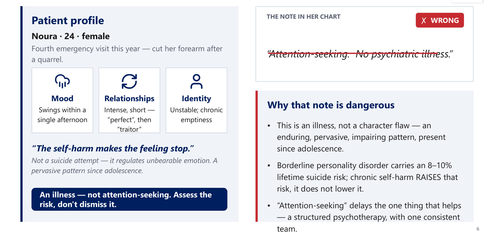

### 2.2 Personality vs Trait vs Disorder (Slide 7)

| | **Personality** | **Personality trait** | **Personality disorder** |
|---|---|---|---|
| Definition | Enduring pattern of how a person thinks, feels, relates, behaves | A strong, consistent feature (cautious, meticulous, reserved) | Traits become **INFLEXIBLE and PERVASIVE** across most situations |
| Origin / course | **Temperament (inborn) + character (learned)**; broadly stable through adult life | Can be **useful** in the right role (a meticulous surgeon) | Stable, long-standing, **back to adolescence** |
| Flexibility | **Normal personality is FLEXIBLE**; it adapts | — | Rigid |
| Harm | — | **No significant distress or impairment**. Strong traits ≠ disorder | **Causes distress or impairs function** |
| Culture | — | — | **Deviates markedly from the person's OWN culture** |

⭐ **The diagnosis turns on 3 words: PERVASIVE, INFLEXIBLE, IMPAIRING.** It is defined by how harmful the pattern is, **not by how odd** it is. A trait seen in only one setting, or one the person can switch off, is not a disorder.

### 2.3 DSM-5-TR General Criteria A–F (Slide 8) ⭐
A pattern must meet **all six first**; only then ask which of the 10 types fits.

| | Criterion | Content |
|---|---|---|
| **A** | **Enduring pattern** | Inner experience and behaviour deviating markedly from the person's **CULTURE**, in **≥ 2 of 4**: **cognition, affectivity, interpersonal functioning, impulse control** |
| **B** | **Inflexible & pervasive** | Across many personal and social situations, not one relationship or setting |
| **C** | **Distress or impairment** | Clinically significant; social, occupational or other areas |
| **D** | ⭐ **Stable & long-standing** | **Onset at least by adolescence or early adulthood**; not a recent change |
| **E** | **Not another mental disorder** | e.g. not simply a mood or psychotic illness |
| **F** | **Not substance / medical** | e.g. head injury |

**Mnemonic *[added]*: "A-B-C-D-E-F":** **A**ffects ≥2 domains · **B**road (pervasive) · **C**osts (impairment) · **D**ates back to adolescence · **E**xclude other mental disorders · **F**ind no substance/medical cause.

⚠️ Students skip **D, E and F**, yet these are what separate a PD from a **mood episode, intoxication or a frontal-lobe lesion** (Source: DSM-5-TR, 2022).

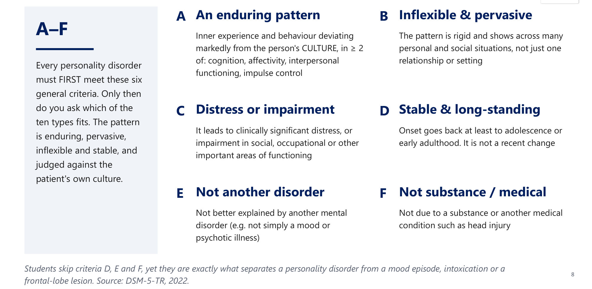

### 2.4 When It Is NOT a Personality Disorder: the Imitators (Slide 9)

| Imitator | Why it misleads | Rule |
|---|---|---|
| **A state, not a trait** | Depression makes anyone dependent and pessimistic; **mania makes anyone grandiose and reckless** | Wait for a normal **euthymic baseline** |
| **Substance use** | Intoxication and withdrawal mimic almost every cluster (antisocial, borderline, paranoid) | Diagnose only when **abstinent** |
| ⭐ **Organic cause** | Frontal-lobe tumour, dementia, head injury → a genuine **acquired personality CHANGE** | ⭐ **New onset after 40 = organic until proven otherwise** |
| **Developmental stage** | Personality still forming **before 18** | Note traits; keep the diagnosis for adulthood (*exception: ASPD → conduct disorder, §2.7*) |
| **Cultural judgement** | Reticence, deference, intense religious practice may be the **norm** | Criterion A: deviation from the **person's OWN** culture |
| **Normal reaction** | Grief, trauma, an abusive relationship → understandable changes tied to the situation | Reaction ≠ pervasive lifelong pattern |

⚠️ **Slide inconsistency:** the slide header says **"the FIVE great imitators"**, but it lists **6**. Learn all 6.

**Most useful tool:** a **long-term history with collateral**. Is this who the person has **ALWAYS** been, across settings, or a change tied to a time, a substance or a relationship?

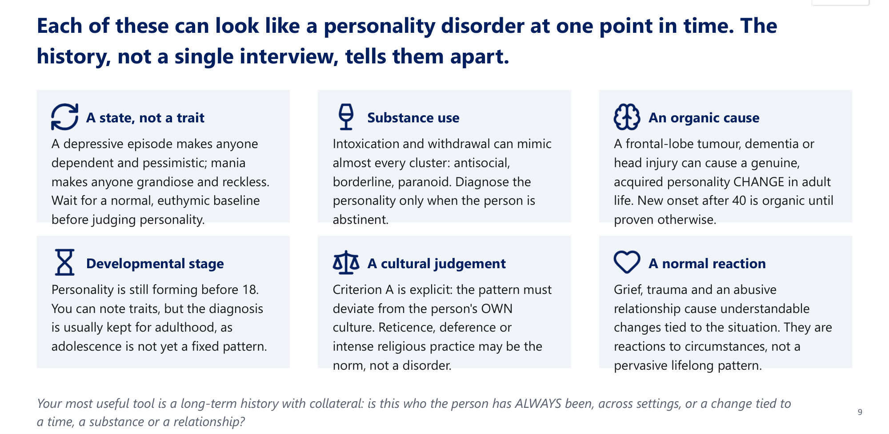

### 2.5 The Three Clusters + Epidemiology (Slides 10–11) ⭐

| Cluster | Description | Disorders (one-line hook) |
|---|---|---|
| **A** | Odd / eccentric: **"WEIRD"** | **Paranoid** (pervasive distrust) · **Schizoid** (detached, no desire for contact) · **Schizotypal** (eccentric, odd beliefs) |
| **B** | Dramatic / erratic: **"WILD"** | **Antisocial** (disregards others' rights) · **Borderline** (unstable mood, identity, relationships) · **Histrionic** (emotional, attention-seeking) · **Narcissistic** (grandiose, needs admiration) |
| **C** | Anxious / fearful: **"WORRIED"** | **Avoidant** (socially inhibited, fears rejection) · **Dependent** (excessive need to be cared for) · **Obsessive–compulsive** (orderly, controlling, rigid) |

Clusters group by **descriptive resemblance**: "a scaffold, not watertight compartments."

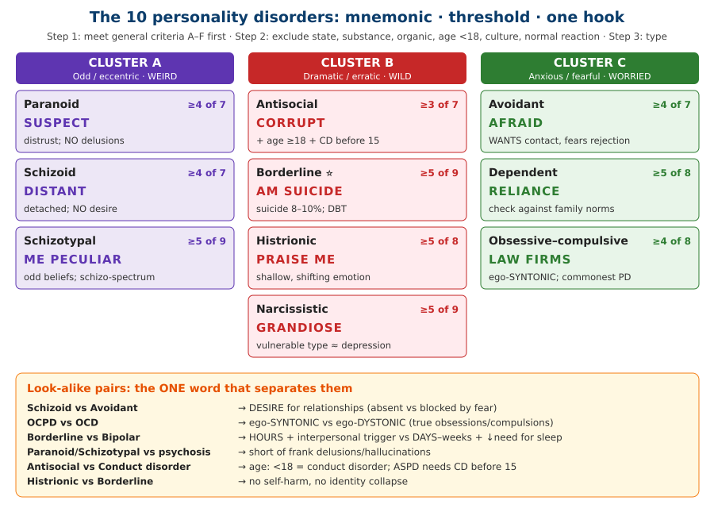

| Measure | Figure | Comment |
|---|---|---|
| **Any PD (community)** | ⭐ **≈ 10%** | ~1 adult in 10; **up to half of psychiatric outpatients** and most frequent attenders |
| **Most prevalent type** | ⭐ **OCPD** | **~2–8%** of the population; often never reaches services |
| **Borderline PD** | **≈ 1.5–2%** | **Up to 10–20% of psychiatric inpatients**; mostly **women in CLINICAL samples** |
| **Antisocial PD** | **≈ 1–3%** | **M:F ≈ 3:1**; forensic and addiction settings |
| **Age and course** | Onset in youth | By definition begins by adolescence; **Cluster B impulsivity eases after the 30s** |
| **Mortality: BPD** | ⭐ **Suicide ≈ 8–10%** | Far above the general population; **self-harm in the majority** at some point |

Headline: **one adult in ten, and borderline is lethal.** Community figures vary widely by method; clinical populations are enriched.

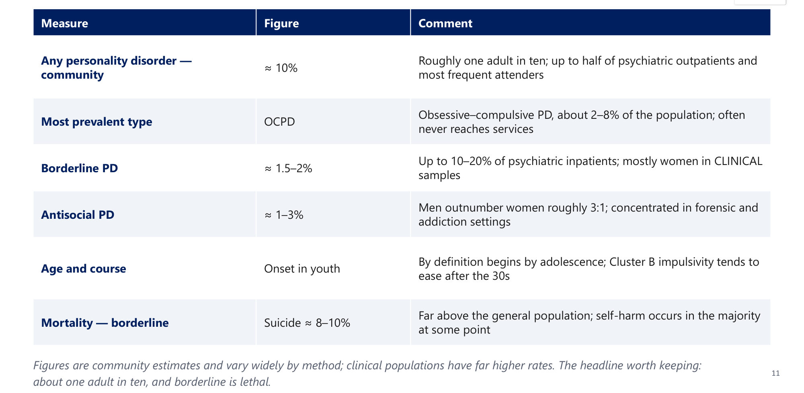

> 🔁 **Recap: Part 1.**
> - A PD is **pervasive, inflexible and impairing**, starting by adolescence, deviating from the person's own culture.
> - Meet **A–F** first, then exclude the imitators: state, substance, organic (>40), age <18, culture, normal reaction.
> - Clusters: **A weird, B wild, C worried**.
> - **≈10%** have a PD; **OCPD** is the most common; **BPD** has **8–10% suicide**.
>
> 🔗 **Link:** Q1 (accountant after his father's death) applies criteria C, D and E.
>
> ▶️ **Up next: Cluster A.**

---

### 2.6 Cluster A: Odd and Eccentric (Slides 15–19)

#### Paranoid PD: **SUSPECT** (≥ 4 of 7) (Slide 15)
**Core:** pervasive distrust; others' motives are read as malevolent.

| Letter | Criterion |
|---|---|
| **S** | **Suspects exploitation** without basis |
| **U** | **Unforgiving**: persistently bears grudges |
| **S** | **Spouse's/partner's fidelity** doubted |
| **P** | **Preoccupied with friends' loyalty** |
| **E** | **Enemy readings**: threats seen in benign remarks |
| **C** | **Confiding feared**: reluctant to disclose |
| **T** | **Threats to character perceived**; reacts angrily |

⭐ **NOT psychosis: there are no delusions and no hallucinations.**
**DDx:**
- **paranoid schizophrenia** (delusions + hallucinations)
- **delusional disorder**
- a **realistic response to real persecution**

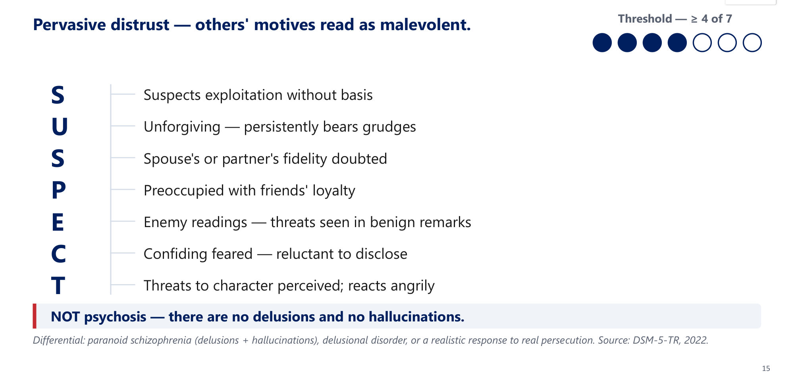

#### Schizoid PD: **DISTANT** (≥ 4 of 7) (Slides 16–17)
**Core:** pervasive detachment from relationships with a narrow range of emotion. The person **does NOT WANT** relationships.

| Letter | Criterion |
|---|---|
| **D** | **Detached / no desire**: neither desires nor enjoys close relationships, including being part of a family |
| **I** | **Indifferent to praise** or criticism |
| **S** | **Solitary by choice**: almost always chooses solitary activities |
| **T** | **Taking little pleasure** in few, if any, activities (anhedonia-like, but **lifelong**) |
| **A** | **Absent close friends** other than first-degree relatives |
| **N** | **No interest in sex** with another person |
| **T** | **Temperature flat**: emotional coldness, detachment, flattened affect |

⭐ **Key contrast:** the schizoid patient **does not want** company; the **AVOIDANT** patient (Cluster C) **longs for it** but fears rejection. **DESIRE is the discriminator.**

**Remember it by: Gollum** (*The Lord of the Rings*):
- withdrawn into his own world, isolated, emotionally detached, solitary by preference
- a memory hook, not a textbook case: he also shows paranoid and odd traits

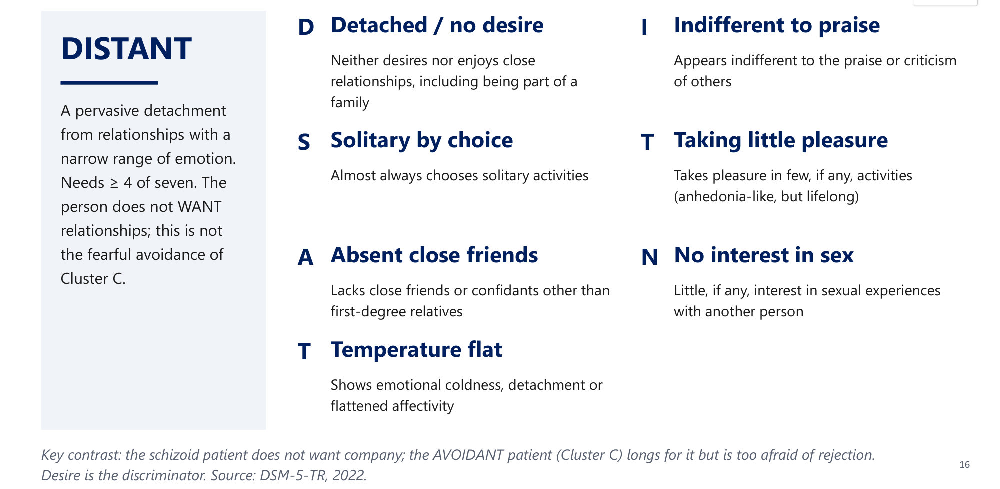 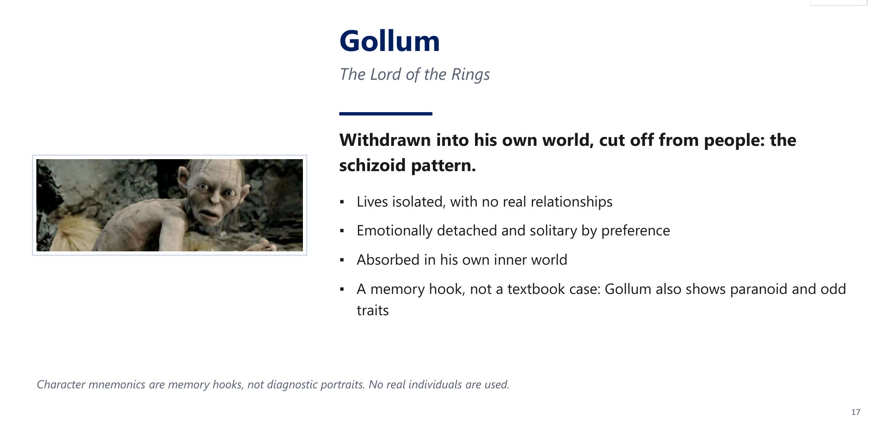

#### Schizotypal PD: **ME PECULIAR** (≥ 5 of 9) (Slide 18)
**Core:** social deficits with sharp discomfort in relationships, plus odd thinking or perceptions and eccentric behaviour. ⭐ **Genetically on the schizophrenia spectrum.**

| Letter | Criterion |
|---|---|
| **M** | **Magical thinking** / odd beliefs that affect behaviour, out of step with cultural norms |
| **E** | **Experiences, unusual**: perceptual, including bodily illusions |
| **P** | **Paranoid ideation** / suspiciousness |
| **E** | *(no separate criterion on the slide; the mnemonic's second E is a filler)* |
| **C** | **Constricted** or inappropriate **affect** |
| **U** | **Unusual thinking/speech**: vague, over-elaborate, metaphorical, stereotyped |
| **L** | **Lacks friends** other than first-degree relatives |
| **I** | **Ideas of reference** (**not** frank delusions of reference) |
| **A** | **Appearance eccentric**: odd behaviour or appearance |
| **R** | **Rising social anxiety**: does **not** ease with familiarity; tied to paranoid fears |

- This PD **most resembles psychosis**, but the experiences fall **SHORT of frank delusions and hallucinations**.
- ⭐ **Low-dose antipsychotics** can help the cognitive–perceptual symptoms.

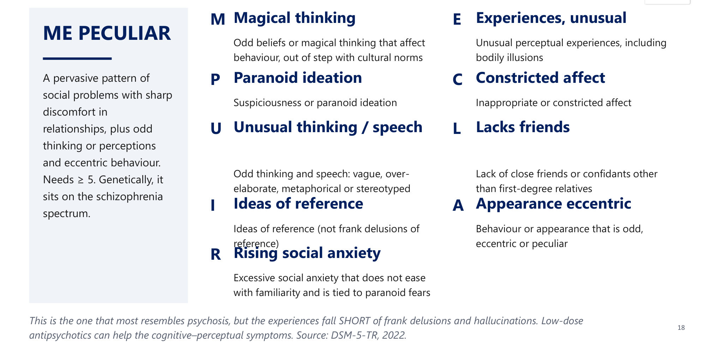

#### The Culture Clause (Slide 19) ⭐
Criterion A requires deviation from the person's **OWN** culture. In this (Saudi) setting this judgement often decides whether Cluster A is diagnosed at all.

| ✅ Not a disorder here | ⚠️ Points toward Cluster A |
|---|---|
| Belief in the **evil eye, jinn, benefit of ruqyah** where the community shares it | Beliefs the person's **OWN family and community** find strange |
| Consulting a **religious healer** before or alongside a doctor | Odd speech, eccentric appearance, **ideas of reference beyond the cultural norm** |
| Being **reserved with strangers** where expected | **Lifelong detachment** with no desire for the close family ties the culture expects |
| Intense, orthodox **religious practice** within the person's tradition | Distrust so pervasive it **isolates the person from their own community** |
| **Realistic wariness** in someone who HAS been persecuted or betrayed | Present **since adolescence, across every setting, causing real harm** |

⭐ **Practical test:** ask the family, **"Is this normal for him, or for people you know?"** The community sets the baseline, not the clinician.

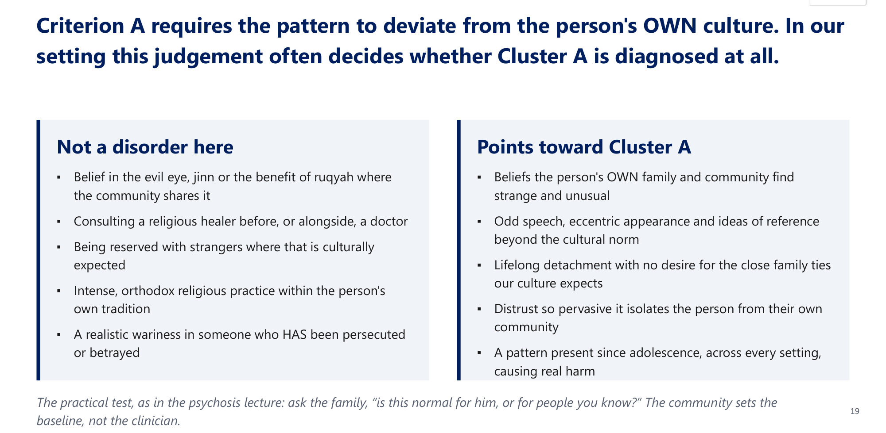

> 🔁 **Recap: Cluster A.**
> - **Paranoid = SUSPECT (≥4/7)**: no delusions.
> - **Schizoid = DISTANT (≥4/7)**: no **desire**.
> - **Schizotypal = ME PECULIAR (≥5/9)**: odd beliefs short of psychosis; schizophrenia spectrum; low-dose antipsychotics.
> - Judge beliefs against the patient's **own** community (jinn, evil eye, ruqyah ≠ schizotypal).
>
> 🔗 **Link:** Q2 (30-year-old loner) turns on **desire**: schizoid, not avoidant.
>
> ▶️ **Up next: Cluster B, the cluster you will meet most.**

---

### 2.7 Antisocial PD: **CORRUPT** (≥ 3 of 7) (Slides 23–24) ⭐
**Core:** pervasive disregard for and violation of others' rights **since age 15**.

⭐ **The two gatekeepers:**
1. **Age ≥ 18**
2. **Evidence of CONDUCT DISORDER before age 15**

**Before 18 the diagnosis is conduct disorder.** "Psychopathy" adds callous, predatory traits.

| Letter | Criterion |
|---|---|
| **C** | **Conformity to law lacking**: repeated acts that are grounds for arrest |
| **O** | **Obligations ignored**: consistent irresponsibility (work, money) |
| **R** | **Remorselessness**: shrugs off or excuses hurting others |
| **R** | **Recklessness**: disregard for the safety of self or others |
| **U** | **Underhandedness**: lying, aliases, conning for profit |
| **P** | **Planning deficit**: impulsivity, failure to plan ahead |
| **T** | **Temper**: irritable, aggressive, repeated fights or assaults |

**Remember it by: Hannibal Lecter** (*The Silence of the Lambs*):
- charming and brilliant, but **without any remorse**
- deceitful and manipulative; cold and predatory
- the "psychopathy" end of the spectrum

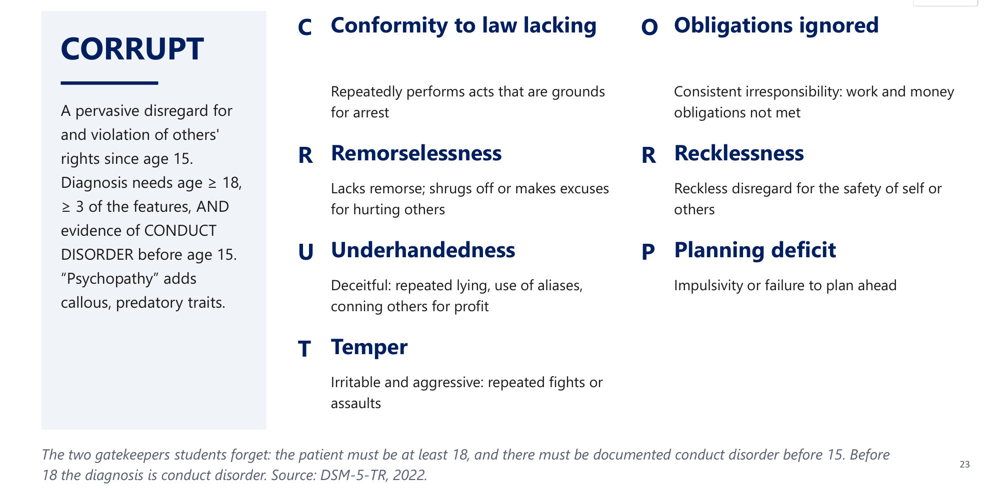 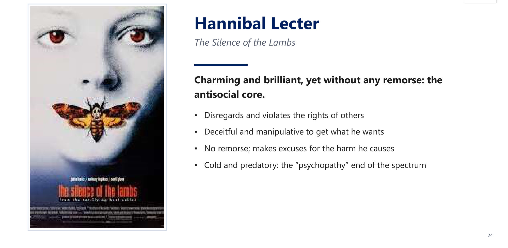

### 2.8 Borderline PD: **AM SUICIDE** (≥ 5 of 9) (Slides 25–27) ⭐⭐
**Core:** pervasive instability of **relationships, self-image and affect**, with marked **impulsivity**, from early adulthood. "**The highest-yield diagnosis in this lecture, and the most lethal.**"

| Letter | Criterion |
|---|---|
| **A** | **Abandonment fear**: frantic efforts to avoid real or imagined abandonment |
| **M** | **Mood instability**: intense moods that shift over **HOURS, not weeks** |
| **S** | **Suicidal / self-harm**: recurrent suicidal behaviour, gestures, threats, self-mutilation |
| **U** | **Unstable relationships**: alternating **idealisation and devaluation** |
| **I** | **Impulsivity** in **≥ 2 self-damaging areas**: spending, sex, substances, driving, bingeing |
| **C** | **Control of anger poor**: inappropriate, intense anger |
| **I** | **Identity disturbance**: markedly unstable self-image |
| **D** | **Dissociation / paranoia**: **transient, stress-related** |
| **E** | **Emptiness**: chronic |

- **Noura meets at least 7.**
- Self-harm here most often **relieves unbearable emotion** rather than aiming at death, **but the suicide risk is real and high.**

**Remember it by: Tiffany** (*Silver Linings Playbook*):
- idealises then devalues people
- volatile hour to hour
- terrified of abandonment
- acts on the feeling before the thought

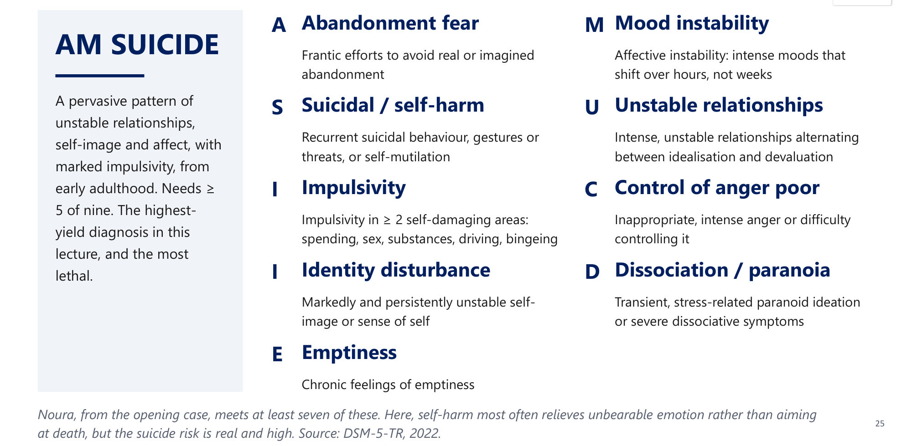 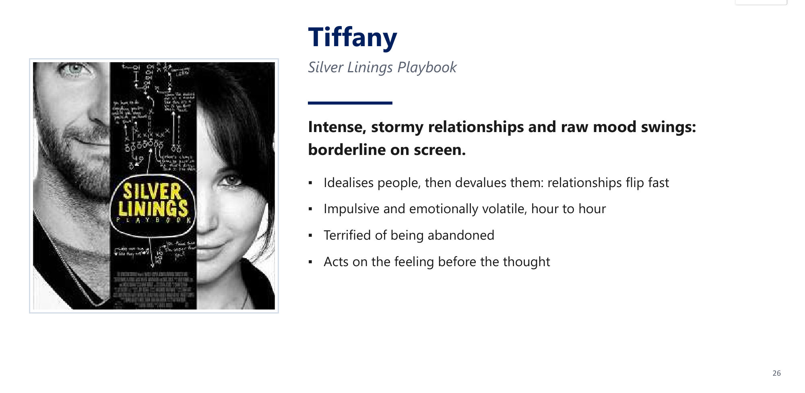

#### Clinical Reality: What the Criteria Don't Show (Slide 27)

| Splitting and the team | Why BPD is so often mishandled |
|---|---|
| **SPLITTING:** people are all-good or all-bad, and the view flips fast | Written off as **"attention-seeking"** → delays treatment |
| The split appears **in the TEAM**: one nurse idealised, another blamed | **Over-medicated in crisis**, piling up drugs that were never going to help |
| ⭐ **Staff arguing with each other about the patient is itself a clue** | **Admitted repeatedly**, though admission can **REINFORCE crisis behaviour** |
| Self-harm and threats **rise around separations and discharge** | **Confused with bipolar disorder** |
| The feeling the patient stirs in **YOU is data**: notice it, don't act on it | **Comorbidity is the rule**: depression, PTSD, eating and substance use disorders |

**Therapeutic stance:**
- consistent, kind, clearly bounded
- name the pattern without blame
- keep limits predictable
- plan for crises rather than being surprised by them

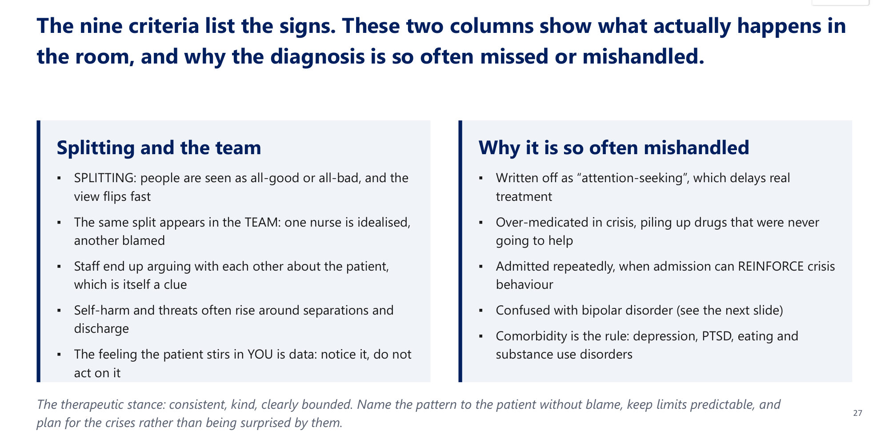

### 2.9 BPD vs Bipolar Disorder: "The Classic Error" (Slide 28) ⭐⭐
**Two discriminators decide it: the TIME-COURSE and the TRIGGER.**

| | **Borderline PD** | **Bipolar disorder** |
|---|---|---|
| ⭐ **Mood timeframe** | **Hours**, highly reactive | **Days to weeks** |
| ⭐ **Trigger** | **Interpersonal**: rejection, conflict | **Autonomous / biological** |
| Baseline self | **Chronic emptiness, unstable identity** | **Stable self between episodes** |
| Sleep & energy | Disturbed **by distress** | **Reduced NEED for sleep; raised energy** |
| Self-harm | **A core, chronic feature** | Mainly **during mood episodes** |
| First-line treatment | **PSYCHOTHERAPY (DBT, MBT)** | **Mood stabilisers / antipsychotics** |

They **can co-occur**.

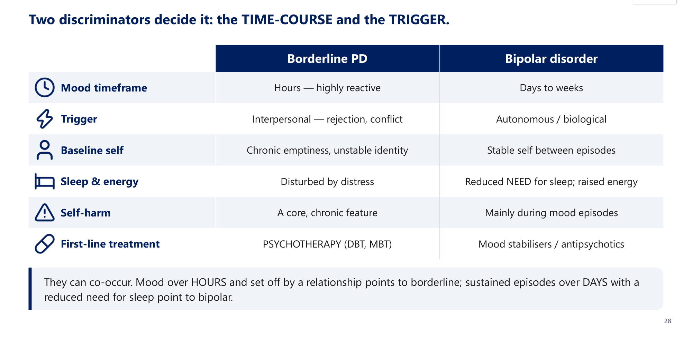

### 2.10 Histrionic PD: **PRAISE ME** (≥ 5 of 8) (Slide 29)
**Core:** excessive emotion and attention-seeking from early adulthood. The emotion is **genuine but shallow** and changes fast; discomfort is worst when **not the centre of attention**.

| Letter | Criterion |
|---|---|
| **P** | **Provocative**: inappropriately seductive in appearance or behaviour |
| **R** | **Relationships overestimated**: considered more intimate than they are |
| **A** | **Attention, centre of**: uncomfortable otherwise |
| **I** | **Influenced easily**: suggestible |
| **S** | **Speech impressionistic**, lacking detail |
| **E** | **Emotions shifting** rapidly and shallowly |
| **M** | **Make-up / appearance** used to draw attention |
| **E** | **Exaggerated emotion**: self-dramatisation, theatricality |

**Overlaps:**
- with BPD (dramatic affect)
- with narcissistic PD (need to be noticed)

**Lacks:**
- the **self-harm and identity collapse** of BPD
- the **grandiosity** of narcissism

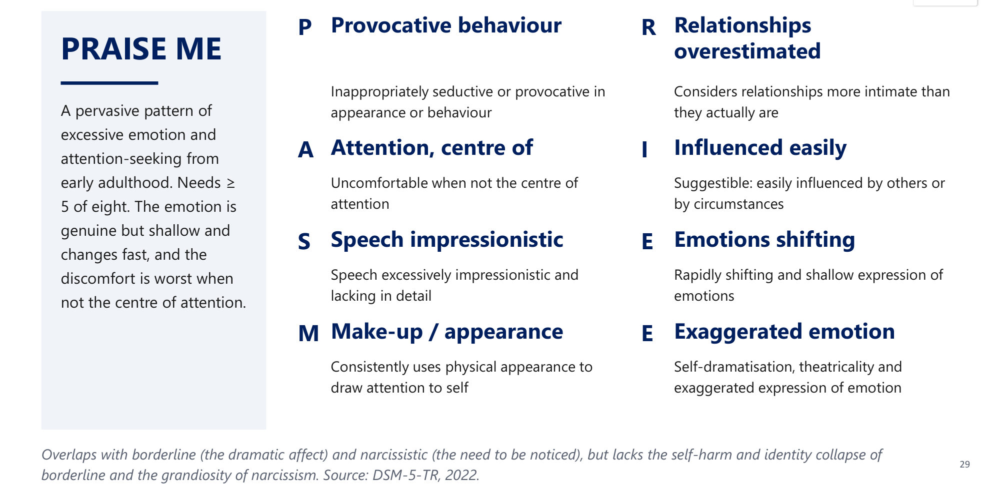

### 2.11 Narcissistic PD: **GRANDIOSE** (≥ 5 of 9) (Slides 30–31)
**Core:** grandiosity, need for admiration, lack of empathy from early adulthood. The grandiosity often **hides a fragile self-esteem that collapses under criticism**.

| Letter | Criterion |
|---|---|
| **G** | **Grandiose self-importance**: exaggerates achievements |
| **R** | **Requires** excessive **admiration** |
| **A** | **Arrogant**, haughty |
| **N** | **Need to be special**: believes self unique |
| **D** | **Dreams of success** and power |
| **I** | **Exploitative** (*the I is the one forced letter*) |
| **O** | **Others envied**, or believes others envy them |
| **S** | **Sense of entitlement** |
| **E** | **Empathy lacking** |

⭐ **Clinical trap: the "vulnerable" subtype.** It has the same entitlement and fragility, but shows as **hypersensitivity and shame** rather than open arrogance, and is **often mistaken for depression**.

**Remember it by: Miranda Priestly** (*The Devil Wears Prada*):
- grandiose and demanding
- exploits those around her
- strikingly lacking in empathy

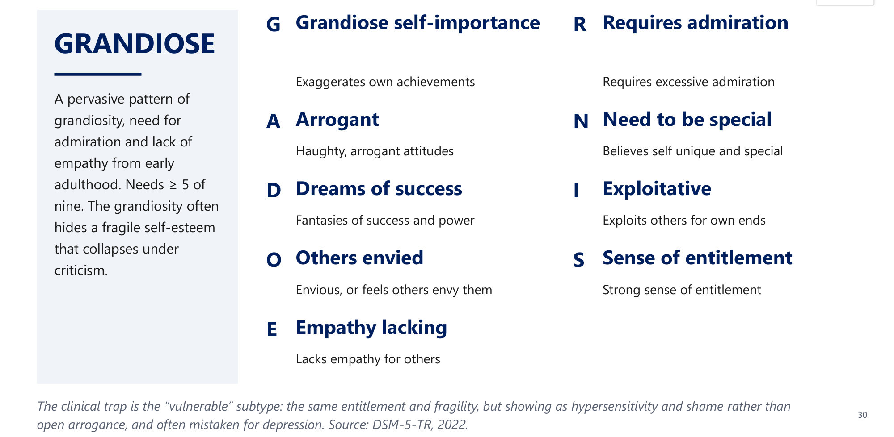 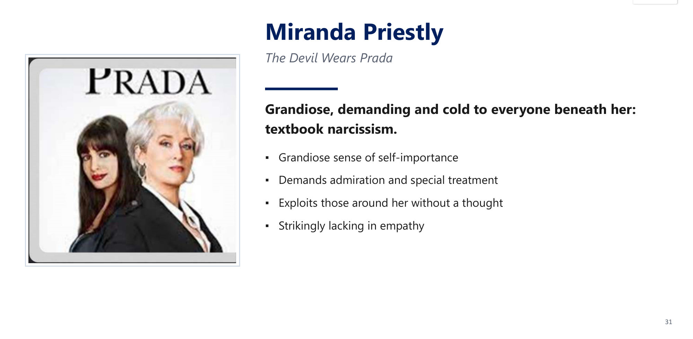

> 🔁 **Recap: Cluster B.**
> - **ASPD = CORRUPT (≥3/7)**, plus **age ≥18 and conduct disorder before 15**.
> - **BPD = AM SUICIDE (≥5/9)**:
>   - mood over **hours**, triggered by relationships
>   - emptiness; self-harm to stop feelings
>   - splitting, including within the team
> - **BPD ≠ bipolar** (time-course + trigger).
> - **Histrionic = PRAISE ME (≥5/8)**: shallow, shifting emotion.
> - **Narcissistic = GRANDIOSE (≥5/9)**: the vulnerable subtype mimics depression.
>
> 🔗 **Link:** Q3 (valproate for "rapid-cycling bipolar") is the classic BPD mislabel.
>
> ▶️ **Up next: Cluster C, the cluster that suffers quietly.**

---

### 2.12 Cluster C: Anxious and Fearful (Slides 36–38)

#### Avoidant PD: **AFRAID** (≥ 4 of 7) (Slide 36)
**Core:** social inhibition, feeling inadequate, very sensitive to criticism, from early adulthood. The person **LONGS for closeness** but is too afraid of rejection to risk it.

| Letter | Criterion |
|---|---|
| **A** | **Avoids occupational contact**: avoids work with much interpersonal contact (fear of criticism/rejection) |
| **F** | **Fear of shame restrains intimacy** |
| **R** | **Rejection preoccupation** in social situations |
| **A** | **Avoids new relationships** unless certain of being liked |
| **I** | **Inhibited, feels inadequate** in new social situations |
| **D** | **Defective self-view** (socially inept, inferior) **& risk-averse** (avoids personal risk for fear of embarrassment) |

- ⚠️ **6 letters but 7 criteria:** "D" packs two DSM criteria (inferior self-view + reluctance to take risks).
- Avoidant PD and **generalised social anxiety disorder** overlap so much that many see them as **one condition at different severities**.

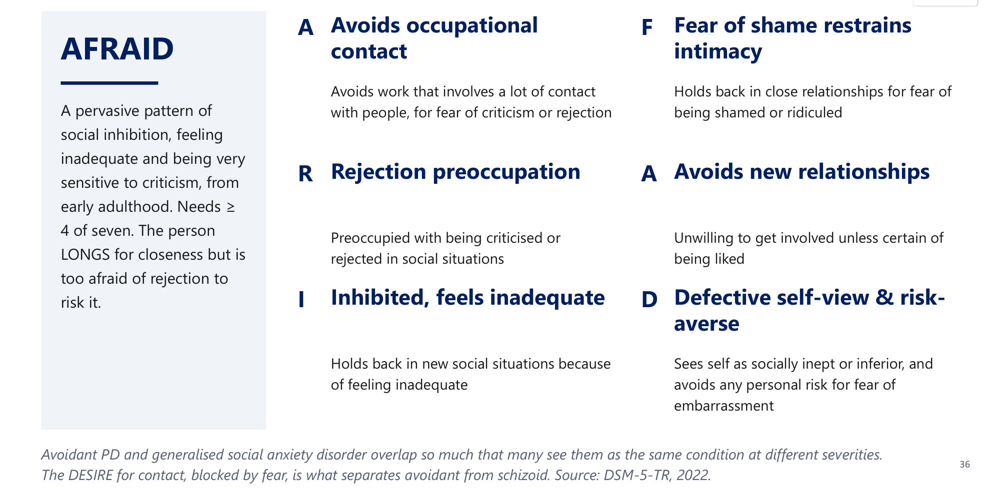

#### Dependent PD: **RELIANCE** (≥ 5 of 8) (Slide 37)
**Core:** excessive need to be taken care of → submissive, clinging behaviour and fear of separation, from early adulthood.

| Letter (slide) | Criterion |
|---|---|
| **R** | **Reassurance to decide**: needs advice for everyday decisions |
| **E** | Dis**agreement is hard**: fears losing support |
| **L** | **Lets others take charge** of major responsibilities |
| **I** | **Initiating** is a struggle: lacks confidence to start alone |
| **A** | **Alone = helpless** |
| **N** | **Nurturance/support at any cost**: goes to great lengths |
| **C** | **Companion replaced urgently** when a relationship ends |
| **E** | **Excessive fear of being left** |

- ⚠️ **Slide mnemonic mismatch:** the slide's labels for E, I, N and C ("Disagreement is hard", "Struggles to initiate", "Support at any cost", "Replaces lost support") don't start with their letters. The wording above is re-keyed so each line fits RELIANCE; the content is unchanged.
- ⭐ **Cultural caution:** **interdependence within the family is the norm here.** Diagnose only when dependence is **EXCESSIVE for the person's own culture** and clearly impairing.

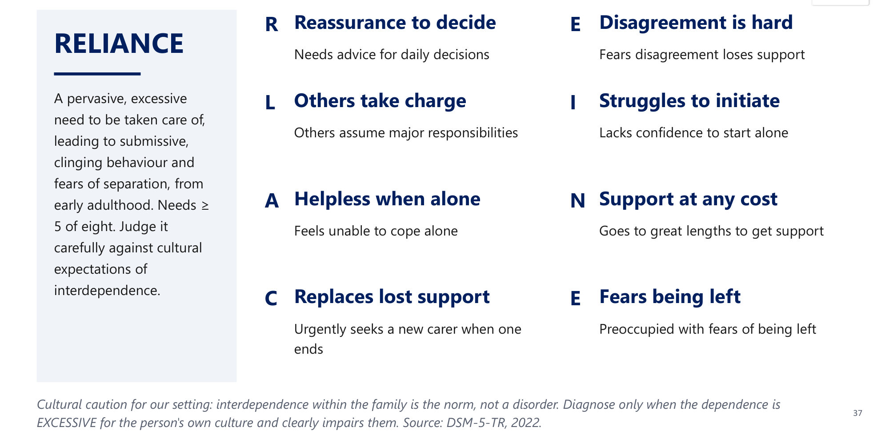

#### Obsessive–Compulsive PD (OCPD): **LAW FIRMS** (≥ 4 of 8) (Slide 38)
**Core:** preoccupation with **order, perfectionism and control**, at the cost of flexibility, openness and efficiency, from early adulthood.

| Letter | Criterion |
|---|---|
| **L** | **Loses the point**: details, rules, lists, order until the main activity is lost |
| **A** | **Ability to complete lost**: perfectionism interferes with finishing |
| **W** | **Workaholism**: crowds out leisure and friendships |
| **F** | **Fixed morally**: over-conscientious, inflexible on ethics |
| **I** | **Inability to delegate** unless others do it their exact way |
| **R** | **Reluctant to discard** worn-out or worthless objects |
| **M** | **Miserly**: hoards money for future disasters |
| **S** | **Stubborn / rigid** |

⭐ **OCPD is ego-SYNTONIC** (the patient sees nothing wrong; others complain). **OCD is ego-DYSTONIC** (the patient is tormented by their symptoms).

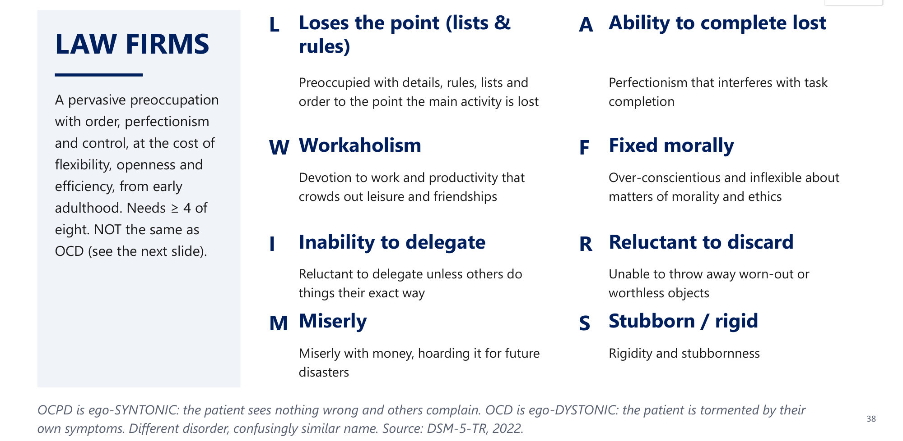

### 2.13 Two Distinctions You Must Get Right (Slide 39) ⭐

| **OCPD vs OCD** | **Avoidant vs schizoid / social anxiety** |
|---|---|
| OCPD: a pervasive **PERSONALITY style** of order and control | Avoidant **WANTS** relationships but fears rejection; schizoid **does NOT want** them |
| OCD: an **anxiety disorder** with intrusive **OBSESSIONS and COMPULSIONS** | **Wanting closeness** is the single thing separating avoidant from schizoid |
| OCPD is **EGO-SYNTONIC**: approves of their own standards | Avoidant PD and generalised social anxiety largely **overlap** |
| OCD is **EGO-DYSTONIC**: resists, distressed | Think of them as **one difficulty on a severity spectrum** |
| Both can coexist, but **most with OCPD have no true obsessions** | ⭐ **SSRIs and CBT** help the social-anxiety component in both |

**If one line survives:** ego-syntonic (OCPD) vs ego-dystonic (OCD), and **DESIRE** (avoidant) vs its absence (schizoid). These answer most Cluster C exam questions.

> 🔁 **Recap: Cluster C.**
> - **Avoidant = AFRAID (≥4/7)**: wants contact, fears rejection; ≈ social anxiety.
> - **Dependent = RELIANCE (≥5/8)**: judge against family norms.
> - **OCPD = LAW FIRMS (≥4/8)**: ego-syntonic; the commonest PD.
>
> 🔗 **Link:** Q4 (38-year-old manager) is OCPD, not OCD.
>
> ▶️ **Up next: why PDs happen and how to assess them.**

---

### 2.14 Aetiology: Gene–Environment Model (Slide 43)
**No PD has a single cause.** An inborn temperament meets an early environment; the disorder grows out of their interaction.

| **Vulnerability (nature)** | **Environment (nurture)** |
|---|---|
| ⭐ **Heritability of traits ≈ 40–60%** | ⭐ **Childhood ABUSE and neglect**: strongly linked to **BPD** |
| **Cluster A** shares genetic loading with the **SCHIZOPHRENIA spectrum** | Insecure or disrupted **ATTACHMENT** in early life |
| **Cluster B** (BPD, ASPD) runs with **impulsivity and mood instability** in families | Inconsistent, harsh or chaotic parenting; **early loss** |
| Inborn **TEMPERAMENT**: reactivity, emotionality, novelty-seeking | Trauma; growing up amid violence or instability |
| Neurobiology: **amygdala–prefrontal dysregulation in BPD**; **low arousal in ASPD** | Culture and social environment shape how traits are expressed and judged |

Use the model to answer the family's **"what did we do wrong?"**: the vulnerability was already there, hardship shaped it, and no single cause or blame explains it.

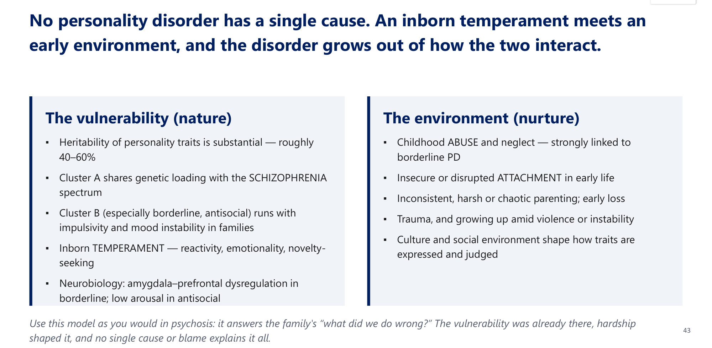

### 2.15 Assessment (Slide 44) ⭐
**Diagnose over time, from several sources, never from one distressing encounter.**

| Principle | Detail |
|---|---|
| **Think longitudinally** | Whole adult life, different settings. Key question: ⭐ **"Has this always been how you are?"** |
| **Get collateral** | Family and old friends see the pattern the patient cannot; here the family is usually present and willing, so use them **with consent** |
| ⭐ **Not in crisis** | **Do NOT diagnose during an acute crisis, a mood episode, intoxication or withdrawal**; re-assess at a calm baseline |
| **Structured tools** | **SCID-5-PD, IPDE** support judgement; they don't replace it |
| **Judge against culture** | Criterion A: unusual for the **PATIENT'S own** culture? |
| **Assess risk early** | Suicide, self-harm, harm to others, exploitation at first contact and **every crisis**, especially Cluster B |

### 2.16 Culture, Family and Gender in Our Setting (Slide 45)
**Personality is the most culture-bound diagnosis, because Criterion A is a cultural judgement.**

| Where culture changes the reading | Where our setting adds risk |
|---|---|
| Family **interdependence is the NORM**; don't read it as dependent PD | **Stigma is severe**: a "PD" label can affect **marriage and standing** |
| **Deference to elders**, defined gender roles = cultural | **Self-harm and suicide may be hidden from shame**: ask **directly and privately** |
| Belief in **jinn, evil eye, ruqyah** is shared; not schizotypal | **Record sensitively**: notes carry real social consequences |
| **Modesty and reticence** with strangers may be expected; not avoidant | Family involvement is a strength, but **confidentiality and consent still apply** |
| The baseline is the patient's own community, judged with the family's help | ⭐ **Women with BPD may present with SOMATIC complaints** rather than emotion |

Keep identifying details on-device and anonymise before any external search.

### 2.17 Comorbidity and Risk (Slide 46) ⭐

| Comorbidity is the rule | Risk you must assess |
|---|---|
| **MOOD and ANXIETY** disorders: the commonest reason for presenting | **SUICIDE**: BPD ≈ **8–10% lifetime** |
| **SUBSTANCE** use, especially Cluster B | **SELF-HARM**: present in the **majority** with BPD at some point |
| **EATING disorders and PTSD**, especially BPD | **HARM TO OTHERS**: ASPD; **jealous/paranoid** presentations |
| **Other PDs**: the clusters overlap heavily | **EXPLOITATION / victimisation**: **dependent and histrionic** |
| Treating only the comorbidity and ignoring the PD **often fails** | Risk fluctuates with crises: **reassess every time** |

⭐ **Repeated self-harm does NOT mean low suicide risk. A history of self-harm is one of the strongest predictors of later suicide.**

> 🔁 **Recap: Part 5.**
> - Aetiology is gene × environment: heritability 40–60%; abuse/neglect → BPD; amygdala–PFC in BPD; low arousal in ASPD.
> - Assess longitudinally with collateral, **never in crisis or intoxication**, using structured tools, against culture, with early risk assessment.
> - Stigma hides self-harm, so ask privately.
> - Comorbidity is the rule; **self-harm history predicts suicide**.
>
> ▶️ **Up next: Management and prognosis.**

---

### 2.18 General Principles of Management (Slide 48)
**What helps most is not a named therapy but a consistent, clearly bounded relationship.**

| The stance | The structure |
|---|---|
| **Consistent, reliable, clearly BOUNDED**: the same limits every time | **One coordinating clinician/team**: avoid fragmented, split care |
| **Validate the distress** without endorsing harmful behaviour | An agreed, **written crisis plan** the patient keeps and helps make |
| **Name the diagnosis honestly**, without blame; psychoeducate | A self-harm plan that **avoids reflexive, repeated admission** |
| **Treat comorbid** mood, anxiety and substance disorders actively | Involve the **family with consent** |
| **Long time-frame**: change is measured in **years, not weeks** | **Look after the team**: supervise and share |

⭐ These principles alone (consistency, boundaries, honesty, continuity) = **Good Psychiatric Management (GPM)**, which **works as well as specialist therapies for many BPD patients**.

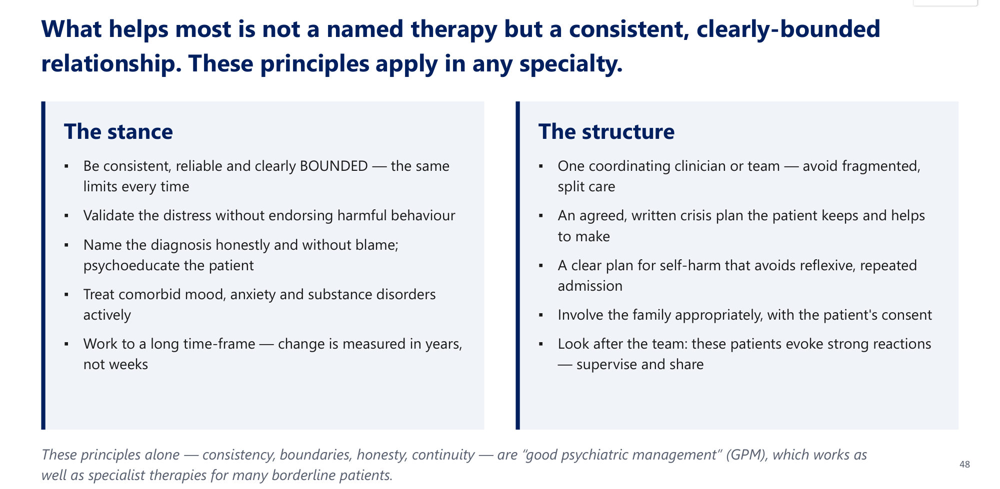

### 2.19 Evidence-Based Psychotherapies (Slide 49) ⭐
**Psychotherapy is first-line, BPD especially.** You need to recognise these, not deliver them.

| Therapy | Key point |
|---|---|
| ⭐ **DBT** (Dialectical Behaviour Therapy, **Linehan**) | **Strongest evidence in BPD**; teaches **distress tolerance and emotion regulation** |
| **MBT** (Mentalisation-Based, Bateman & Fonagy) | Builds the capacity to **read one's own and others' mental states**, which collapses under arousal |
| **TFP** (Transference-Focused) | Uses the patient–therapist relationship to **integrate split all-good/all-bad views** |
| **Schema therapy** | Reworks lifelong maladaptive **childhood "schemas"**; evidence across **several PDs**, not only BPD |
| **STEPPS** | **Group skills** programme run **ALONGSIDE usual care**; practical where specialist therapy is scarce |
| **GPM** | Structured **generalist** care that matches intensive therapies for many; the realistic option in most services |

**Common thread:** structured, consistent, time-limited, relationship-based. GPM done well is **a real evidence-based treatment, not a stopgap**.

**Mnemonic *[added]*: "Do My Therapy Sessions Seriously, Gang":** DBT, MBT, TFP, Schema, STEPPS, GPM.

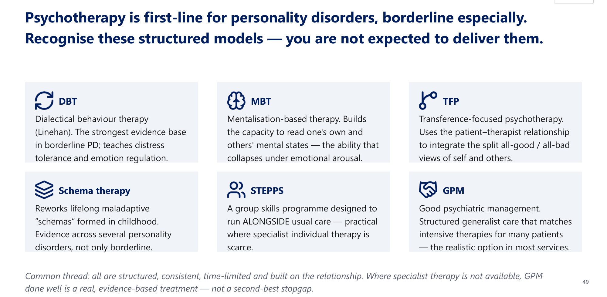

### 2.20 The Limited Role of Medication (Slide 50) ⭐
⭐ **No medication treats a PD itself** (NICE: no drug is licensed for BPD). Drugs are add-ons for specific symptoms or comorbid disorders.

| ✅ Reasonable, targeted use | ❌ How medication is misused |
|---|---|
| Treat comorbid **depression, anxiety, psychosis** on their own merits | Prescribing **as if a drug could treat BPD** itself |
| **SSRIs**: comorbid depression/anxiety; some **impulsive aggression** | **Polypharmacy** accumulated across crises, never reviewed |
| **Second-generation antipsychotics**: **short-term** for severe agitation or transient psychotic-like symptoms | ⭐ **BENZODIAZEPINES: avoid** (disinhibition, dependence, overdose risk) |
| **Mood stabilisers**: limited, **mixed** evidence for affective instability and impulsivity | Large or **lethal-in-overdose supplies (e.g. TCAs)** to a self-harming patient |
| **Low-dose antipsychotics**: cognitive–perceptual symptoms in **schizotypal** PD | Starting drugs in crisis and never stopping: **review and deprescribe** |

Rule: target a **named** comorbidity or symptom, at the **lowest dose for the shortest time**, and review.

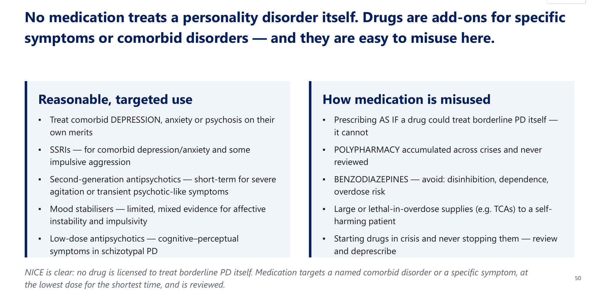

### 2.21 Managing the Borderline Crisis: Back to Noura (Slide 51)

| In the crisis | Between crises |
|---|---|
| ⭐ Assess **THIS episode's risk on its own**; never assume it is like the last | Engage in **structured psychotherapy** (DBT or equivalent) |
| Stay calm, **validate the distress AND keep the boundary**, both at once | **One consistent team** + agreed written crisis plan |
| Treat injuries, address immediate safety; involve the crisis team | Treat comorbidity; **review and rationalise medication** |
| **Prefer brief, structured contact over reflexive admission** | **Psychoeducation** for the patient and, with consent, the family |
| Use the patient's own crisis plan, or make one | **Hold realistic hope**, and say so: most improve substantially |

**Admission has a place:** acute, high, **changed** suicide risk. But **long or repeated admission reinforces crisis behaviour and erodes function**: keep it **brief and purposeful**.

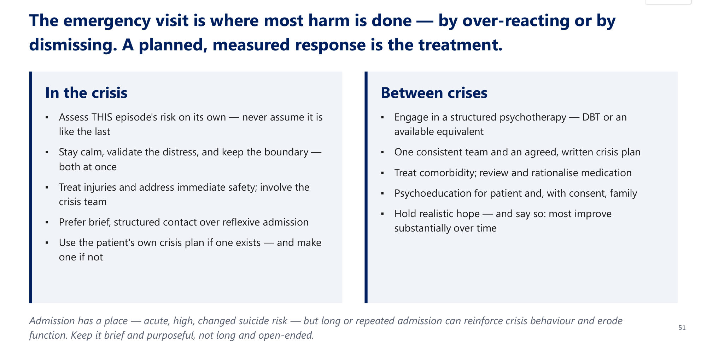

### 2.22 Prognosis and Course (Slide 52) ⭐

| Disorder | Course | Outlook |
|---|---|---|
| **Borderline PD** | Impulsivity and self-harm **fade a lot through the 30s and 40s** | ⭐ **GOOD: ~85% remission over 10 years**; hopeful (Zanarini, CLPS/MSAD) |
| **Antisocial PD** | Offending and aggression often lessen (**"burn out" after the 40s**) | **Guarded**: limited treatment response; manage comorbidity |
| **Cluster A** | Usually stable and long-lasting; **schizotypal may move toward schizophrenia** | **Guarded**; rarely seeks treatment |
| **Cluster C** | **Most stable over time, but most treatable** with therapy | **Fair to good**: CBT, psychodynamic work |
| **General rule** | Most PDs become **LESS severe with age**; relationships may stabilise | **Therapeutic pessimism is usually unjustified** |

These are not life sentences. BPD has **one of the better long-term trajectories in psychiatry**, and realistic hope is itself therapeutic.

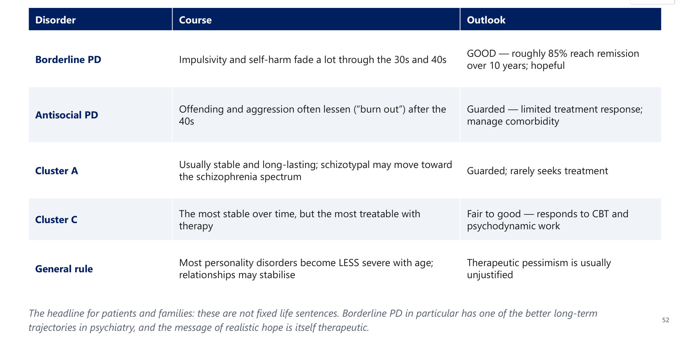

### 2.23 The Non-Specialist's Survival Guide (Slide 53) ⭐
"If a student keeps one slide, make it this one."

| Rule | Meaning |
|---|---|
| 1. **Don't diagnose in anger** | If a patient makes you reach for "PD", pause; diagnose from a pattern, not irritation |
| 2. **Hold the boundary, keep the warmth** | Consistency is kindness: predictable limits, neither coldness nor endless flexibility |
| 3. **Take every crisis seriously** | Chronic self-harm ≠ safe; a self-harm history **RAISES** suicide risk |
| 4. **Resist the prescription reflex** | Don't medicate distress itself; avoid benzodiazepines and polypharmacy |
| 5. **Coordinate, don't split** | One plan, one team; when staff disagree about a patient, **suspect splitting** |
| 6. **Refer, and hold hope** | Structured psychotherapy; say honestly that most people improve |

**Mnemonic *[added]*: "ABC-PCR":** Anger (don't diagnose in) · Boundary + warmth · Crisis seriously · Prescription reflex resisted · Coordinate · Refer with hope.

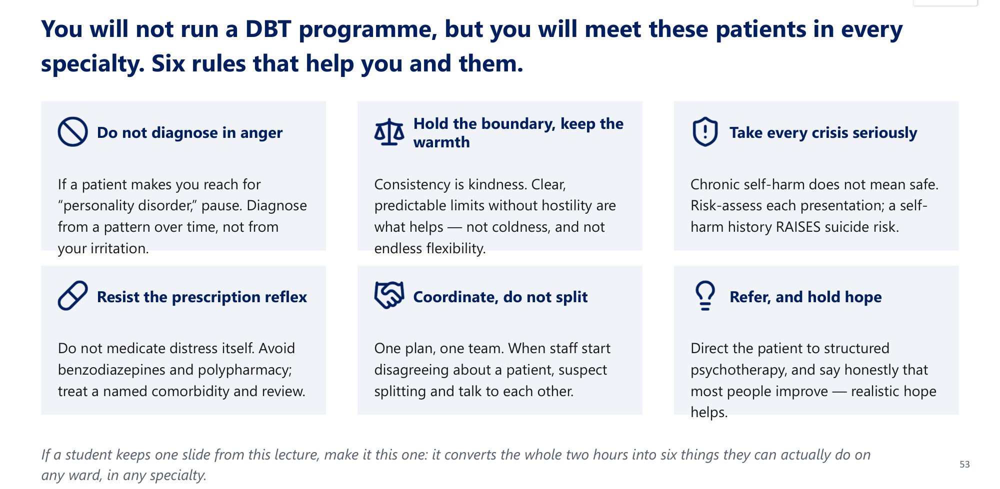

> 🔁 **Recap: Management.**
> - GPM principles: bounded, consistent, honest, one team, written crisis plan, years-long.
> - **Psychotherapy first-line** (DBT has the strongest BPD evidence; also MBT, TFP, schema, STEPPS, GPM).
> - Drugs only for comorbidity or targeted symptoms. **No benzodiazepines, no TCAs** in self-harm. Deprescribe.
> - Crisis: assess **this** episode, validate + boundary, brief contact over admission.
> - Prognosis: **BPD ~85% remit by 10 years**; ASPD burns out after 40s; Cluster C most treatable.

---

## 3. High-Yield Comparison Tables

### Table A: All 10 PDs at a Glance

| Cluster | Disorder | Mnemonic | Threshold | Defining hook | Look-alike |
|---|---|---|---|---|---|
| A | Paranoid | **SUSPECT** | ≥4/7 | Pervasive distrust, grudges, jealousy | Delusional disorder, paranoid schizophrenia (have delusions) |
| A | Schizoid | **DISTANT** | ≥4/7 | No **desire** for relationships; flat | Avoidant (desire present) |
| A | Schizotypal | **ME PECULIAR** | ≥5/9 | Magical thinking, ideas of reference, odd | Schizophrenia (frank psychosis) |
| B | Antisocial | **CORRUPT** | ≥3/7 | Disregard of rights; **≥18 + CD <15** | Conduct disorder (<18) |
| B | Borderline | **AM SUICIDE** | ≥5/9 | Abandonment, hours-long mood, self-harm, emptiness | Bipolar (days, autonomous) |
| B | Histrionic | **PRAISE ME** | ≥5/8 | Shallow, dramatic, attention | BPD (no self-harm/identity collapse) |
| B | Narcissistic | **GRANDIOSE** | ≥5/9 | Grandiose, entitled, no empathy | Depression (vulnerable subtype) |
| C | Avoidant | **AFRAID** | ≥4/7 | **Wants** contact, fears rejection | Schizoid; social anxiety disorder |
| C | Dependent | **RELIANCE** | ≥5/8 | Needs to be cared for; clinging | Normal family interdependence |
| C | OCPD | **LAW FIRMS** | ≥4/8 | Perfectionism, control; **ego-syntonic** | OCD (ego-dystonic) |

### Table B: Look-Alike Discriminators

| Pair | Single deciding feature |
|---|---|
| Schizoid vs Avoidant | **Desire** for relationships |
| OCPD vs OCD | **Ego-syntonic** vs **ego-dystonic**; true obsessions/compulsions |
| BPD vs Bipolar | **Hours + interpersonal trigger** vs **days–weeks + ↓ need for sleep** |
| BPD vs Cyclothymia | Cyclothymia needs **sustained** hypomanic/depressive periods **over 2 years**, not hour-to-hour swings |
| Paranoid PD vs Delusional disorder | **No delusions** in PD |
| Schizotypal vs Schizophrenia | Experiences **fall short** of frank delusions/hallucinations |
| ASPD vs Conduct disorder | **Age**: <18 → conduct disorder |
| Histrionic vs BPD | Histrionic lacks **self-harm and identity collapse** |
| Narcissistic (vulnerable) vs Depression | Underlying **entitlement/fragility**, shame, hypersensitivity |
| Avoidant PD vs Social anxiety disorder | Largely the **same difficulty**, different severity |
| PD vs new personality change > 40 | **Organic** until proven otherwise |

### Table C: Thresholds by Number *[added grouping]*

| Threshold | Disorders |
|---|---|
| **≥ 3** | Antisocial (of 7, **plus** age ≥18 and CD before 15) |
| **≥ 4** | Paranoid (7), Schizoid (7), Avoidant (7), OCPD (8) |
| **≥ 5** | Schizotypal (9), Borderline (9), Histrionic (8), Narcissistic (9), Dependent (8) |

Pattern: **all of Cluster A except schizotypal, plus Avoidant and OCPD = 4**; **ASPD = 3**; the rest = 5.

### Table D: Prognosis by Group

| Group | Course | Best treatment response |
|---|---|---|
| BPD | ~85% remission at 10 y | DBT / MBT / GPM |
| ASPD | Burns out after the 40s | Poor; manage comorbidity |
| Cluster A | Stable; schizotypal → schizophrenia risk | Rarely seek treatment; low-dose antipsychotic (schizotypal) |
| Cluster C | Most stable but most treatable | CBT, psychodynamic; SSRIs for the social-anxiety component |

---

## 4. Rules, Exceptions, Patterns

| Rule | Exception / Nuance |
|---|---|
| Must meet **general criteria A–F** before typing | — |
| Onset **by adolescence/early adulthood** (Criterion D) | New personality **after 40 = organic** until proven otherwise |
| **Don't diagnose under 18** | Traits can be noted; **ASPD explicitly requires conduct disorder before 15** |
| Don't diagnose **in crisis, mood episode, intoxication, withdrawal** | Re-assess at a calm baseline |
| Judge against the **patient's OWN culture** | Jinn, evil eye, ruqyah, family interdependence, reticence are **normal** in this setting |
| Self-harm in BPD often **regulates emotion** | Suicide risk is still **8–10%**; self-harm history **raises** it |
| Psychotherapy is first-line | Drugs only for comorbidity/targeted symptoms; **low-dose antipsychotics** do help schizotypal |
| Admission is for acute, high, **changed** risk | Long/repeated admission **reinforces** crises |
| Cluster B impulsivity eases with age (30s–40s) | Cluster A stays stable |
| OCPD is the **most prevalent** PD | Often never reaches services (ego-syntonic) |
| BPD mostly **women in clinical samples** | ASPD **men 3:1** |

**Pattern:** Cluster A ↔ schizophrenia spectrum (genetics, antipsychotics) · Cluster B ↔ impulsivity/mood (suicide, substances) · Cluster C ↔ anxiety disorders (SSRIs, CBT).

---

## 5. Clinical Correlations

- **The ED "frequent attender" who self-harms** (Noura): think BPD.
  - Assess **this** episode's risk.
  - Treat the wound.
  - Validate + boundary.
  - Make a crisis plan.
  - Refer to DBT.
  - Don't write "attention-seeking".
- **"Rapid-cycling bipolar" on valproate** with hour-long, trigger-driven swings: likely BPD mislabelled. The drug treats a diagnosis she doesn't have.
- **Team conflict about one patient** (one nurse loved, another hated) = **splitting**. Hold a team meeting and agree one plan.
- **Woman with recurrent unexplained somatic complaints** (in this setting) may be presenting BPD.
- **Middle-aged man with a new personality change**: image the head (frontal tumour, dementia, head injury) before any PD label.
- **Grieving or newly depressed patient who looks "dependent"**: a state, not a trait. Re-assess when euthymic.
- **Prescribing to a self-harming patient**: avoid benzodiazepines and TCAs; give small supplies; review and deprescribe.
- **Family asks "what did we do wrong?"**: gene–environment model; no single cause or blame.
- **Documentation**: a PD label can affect marriage prospects here. Record sensitively and keep it confidential.

---

## 6. Rapid Revision (Last-Day)

1. **PD = pervasive + inflexible + impairing**, onset **by adolescence**, deviates from the **own culture**.
2. **General criteria A–F.**
   - A: ≥2 of cognition, affectivity, interpersonal, impulse control
   - B: pervasive
   - C: impairment
   - **D: onset by adolescence/early adulthood**
   - E: not another mental disorder
   - F: not substance/medical
3. **Imitators:** state (mood) · substance · **organic (>40)** · age <18 · culture · normal reaction (grief).
4. **Clusters:** A weird (Paranoid, Schizoid, Schizotypal) · B wild (Antisocial, Borderline, Histrionic, Narcissistic) · C worried (Avoidant, Dependent, OCPD).
5. **Epidemiology:**
   - any PD ≈ **10%**
   - **OCPD most common (2–8%)**
   - BPD 1.5–2% (10–20% of inpatients)
   - ASPD 1–3% (M:F 3:1)
6. **Mnemonics:** SUSPECT 4/7 · DISTANT 4/7 · ME PECULIAR 5/9 · CORRUPT 3/7 · AM SUICIDE 5/9 · PRAISE ME 5/8 · GRANDIOSE 5/9 · AFRAID 4/7 · RELIANCE 5/8 · LAW FIRMS 4/8.
7. **ASPD:** age ≥ 18 **AND** conduct disorder before 15.
8. **BPD:**
   - mood over **hours**, interpersonal trigger
   - emptiness, abandonment fear
   - self-harm "makes the feeling stop"
   - **suicide 8–10%**
9. **BPD vs bipolar:** time-course + trigger. Bipolar = days–weeks, ↓need for sleep, stable self between episodes.
10. **Schizoid vs avoidant = DESIRE.** **OCPD vs OCD = ego-syntonic vs dystonic.**
11. **Paranoid/schizotypal: no frank psychosis.** Schizotypal is on the schizophrenia spectrum; low-dose antipsychotics.
12. **Narcissistic "vulnerable" subtype** mimics depression.
13. **Aetiology:** heritability **40–60%**; abuse/neglect → BPD; amygdala–PFC dysregulation (BPD); low arousal (ASPD).
14. **Assess:** longitudinal ("always been like this?"), collateral with consent, **not in crisis/intoxication**, SCID-5-PD/IPDE, against culture, early risk.
15. **Self-harm history = one of the strongest predictors of suicide.**
16. **Rx:**
    - **psychotherapy first-line**; **DBT** (Linehan) has the strongest BPD evidence; also MBT, TFP, schema, STEPPS, **GPM**
    - **no drug treats a PD**: SSRIs/SGAs/mood stabilisers only for targeted use; **avoid benzodiazepines and TCAs**
17. **Crisis:** this episode's risk · validate + boundary · brief contact > admission · written crisis plan.
18. **Prognosis:** **BPD ~85% remission/10 y** · ASPD burns out after 40s · Cluster A stable/guarded · Cluster C most treatable.

---

## 7. Exam-Style Questions

**Q1 (lecture, slides 12–13).** A 46-year-old accountant is meticulous, punctual and devoted to work. Colleagues find him rigid, but he is respected, happily married, with decades-long friendships. Since his father died **3 weeks ago** he has been tearful, indecisive and clinging to his wife for reassurance, unlike himself. The GP wonders about dependent PD or OCPD. Correct assessment?
A. OCPD · B. Dependent PD · **C. Strong traits plus a normal grief reaction, so no disorder** · D. Two comorbid PDs

> **Answer: C** (lecture key).
> - The meticulousness is a lifelong **trait without impairment** → fails **Criterion C**.
> - The dependence is **3 weeks old** and triggered by bereavement → fails **Criterion D** and is better explained by grief (**E**).
> - The answer would change with a lifelong, pervasive, impairing pattern that predates the death.

**Q2 (lecture, slides 20–21).** A 30-year-old man lives alone, works nights in a warehouse, has no friends and says he simply doesn't enjoy company and never has. He feels no loneliness, is indifferent to others' opinions, has no suspiciousness, odd beliefs or unusual perceptions, and his speech is ordinary. Affect is flat. His sister confirms he has been like this since his teens. Diagnosis?
A. Schizotypal · **B. Schizoid** · C. Avoidant · D. Paranoid

> **Answer: B** (lecture key).
> - Lifelong detachment with **no DESIRE** and no odd beliefs = schizoid.
> - Wrong options:
>   - Schizotypal: no odd beliefs, perceptions or speech.
>   - Avoidant: that patient **wants** relationships.
>   - Paranoid: no suspiciousness.

**Q3 (lecture, slides 32–33).** A 23-year-old woman has "mood swings" several times a day, always set off by a friend or family member (a delayed reply, a perceived slight), settling within hours. Between them she feels empty and unsure who she is. She has cut herself since age 16 "to feel something" or stop a feeling. Sleep is poor only when upset; energy has never been elevated. A previous doctor started **valproate for "rapid-cycling bipolar."** Diagnosis?
A. Bipolar II · B. Rapid-cycling bipolar · **C. Borderline PD** · D. Cyclothymia

> **Answer: C** (lecture key).
> - **Hours-long, relationship-triggered** shifts + emptiness + identity disturbance + emotion-relieving self-harm since adolescence.
> - Bipolar (any type) needs **sustained episodes of days–weeks** and, for (hypo)mania, **↓ need for sleep with high energy**.
> - Cyclothymia needs sustained periods over **2 years**.
> - The valproate treats a diagnosis she doesn't have.

**Q4 (lecture, slides 40–41).** A 38-year-old manager is referred because colleagues can't work with him. He insists every report follows his exact format, refuses to delegate, stays late re-checking others' work, hasn't taken leave in years, and keeps decades of receipts "in case." He sees no problem: everyone else is careless. He has no intrusive thoughts, performs no anxiety-relieving rituals, and is distressed only by other people's standards. Diagnosis?
A. OCD · **B. OCPD** · C. GAD · D. Autism spectrum disorder

> **Answer: B** (lecture key).
> - Rules, perfectionism, workaholism, can't delegate, hoarding, rigidity, and he is **ego-syntonic**.
> - OCD needs **ego-dystonic** obsessions/compulsions.
> - GAD = pervasive worry.
> - ASD = lifelong social-communication difference from early childhood.

**Q5 (lecture, slides 54–55).** Noura (BPD, 7/9 criteria, repeated self-harm) is seen in a calm outpatient clinic. She has received three unreviewed medications across her crises and has never been offered a psychological therapy. Most appropriate **first-line** treatment?
A. Add a mood stabiliser · B. A benzodiazepine for crises · **C. Structured psychotherapy such as DBT** · D. Long-term inpatient admission

> **Answer: C** (lecture key).
> - DBT/MBT/GPM are first-line, with the best evidence for **cutting self-harm** and improving function.
> - Mood stabilisers have mixed evidence, and no drug treats BPD.
> - Benzodiazepines → disinhibition, dependence, overdose.
> - Long admission reinforces crises.
> - The plan also means **reviewing and cutting back** her medications.

**Lecture board one-liners (slide 56):**

| # | Question | Answer |
|---|---|---|
| 1 | Criterion requiring onset by adolescence/early adulthood? | **Criterion D** |
| 2 | Schizoid vs avoidant, single feature? | **DESIRE** for relationships |
| 3 | Hours-long, rejection-triggered mood shifts + teenage self-harm? | **BPD**, not bipolar |
| 4 | OCPD or OCD if untroubled by own perfectionism? | **OCPD** (ego-syntonic) |
| 5 | Two extra ASPD requirements? | **Age ≥ 18 + conduct disorder before 15** |
| 6 | First-line Rx for BPD? | **Structured psychotherapy (DBT)**; medication adjunctive only |

---

## 8. Exam Pitfalls & Traps

| Trap | Correct thinking |
|---|---|
| "Chronic self-harmer = attention-seeking = low risk" | ❌ BPD suicide **8–10%**; self-harm history is one of the **strongest predictors** of suicide. Assess every episode |
| Mood swings → bipolar → valproate | ❌ **Hours + interpersonal trigger + emptiness = BPD**. Bipolar needs days–weeks and ↓ need for sleep |
| Diagnosing a PD in the ED during crisis/intoxication | ❌ Never in crisis, mood episode, intoxication or withdrawal |
| Labelling a 16-year-old with ASPD | ❌ <18 = **conduct disorder**; ASPD needs age ≥ 18 + CD before 15 |
| Forgetting criteria D, E, F | They separate a PD from a mood episode, intoxication and frontal lesions |
| New "personality disorder" at 50 | ❌ **Organic until proven otherwise** |
| Grief/depression-induced dependence = dependent PD | ❌ State, not trait (fails D, E) |
| Schizoid vs avoidant by "both are alone" | ✅ Ask about **desire**: avoidant wants contact |
| OCPD = OCD | ❌ OCPD is **ego-syntonic**, usually without true obsessions/compulsions |
| Paranoid/schizotypal PD = psychosis | ❌ **No frank delusions or hallucinations** |
| Belief in jinn/evil eye = schizotypal | ❌ Judge against the **patient's own culture**; ask the family |
| Family interdependence = dependent PD | ❌ Normal in this setting unless excessive for the person's own culture |
| Most prevalent PD = BPD | ❌ **OCPD** (2–8%); BPD is the most **clinically** prominent |
| Drugs treat BPD | ❌ **No drug treats a PD**; psychotherapy first-line; avoid benzodiazepines and TCAs |
| Admit every BPD crisis, for long | ❌ Brief, purposeful admission only for acute, **changed** high risk; long stays reinforce crises |
| Therapeutic pessimism | ❌ **BPD ~85% remission at 10 years**; most PDs lessen with age |
| Narcissism always looks arrogant | ❌ The **vulnerable** subtype shows shame and hypersensitivity, mimicking depression |
| Mnemonic letters = DSM wording | ⚠️ RELIANCE (slide 37) letters don't match the slide labels for E/I/N/C; AFRAID has 6 letters for **7** criteria; ME PECULIAR has a filler second E. Learn the **criteria**, not just the letters |
| "Five great imitators" (slide 9 title) | ⚠️ The slide lists **six**: state, substance, organic, developmental, cultural, normal reaction |
