# Psychotic Disorders & Schizophrenia
**Psychiatry, Clinical Lecture** | Dr. Hussain M. Khrad (Consultant Psychiatrist, KFSHRC-Jeddah) | Source: `Psychotic-Disorders.pdf` (78 slides)

> **Legend:** ⭐ = high-yield · *[added]* = not on slides. Images marked "Slide N" come from the lecture. All 4 MCQ answers come from the lecture's own answer slides.

> 🔗 **Bridge from earlier lectures:**
> - **MSE:** delusion types, hallucination modalities, the thought-form ladder, catatonia and negative symptoms are the **vocabulary** of this lecture. "Non-auditory = organic" returns as a red flag.
> - **History Taking:** organic red flags, medical mimics, the delirium case (Mr. S), and "ask the family: is this normal for him?"
> - **Personality Disorders:** Cluster A (paranoid, schizotypal) sits **short of** psychosis; schizotypal is on the **schizophrenia spectrum**.
> - **Pituitary I (prolactin):** dopamine tonically **inhibits prolactin**, so D2 blockade → hyperprolactinaemia (tuberoinfundibular pathway).
> - **ECG/Arrhythmia:** antipsychotic **QT prolongation → torsades** (haloperidol IV, ziprasidone, pimozide).

---

## 1. Title / Objectives

| Domain | Objective | Likely tested as |
|---|---|---|
| Knowledge | Define **psychosis**; signs and symptoms | Symptom vs diagnosis; 6 domains |
| Knowledge | Classify **delusions and hallucinations** | Bizarre vs non-bizarre; first-rank; modality → cause |
| Knowledge | ⭐ Psychotic disorders and **the duration that separates them** | < 1 month / 1–6 months / > 6 months; 2-week schizoaffective rule |
| Knowledge | ⭐ **DSM-5-TR criteria** for schizophrenia | Criterion A: ≥ 2, ≥ 1 from the first 3 |
| Knowledge | Aetiological hypotheses | Dopamine pathways; NMDA; neurodevelopmental |
| Knowledge | Course, prognosis, treatment | 15/30/55; relapse 60–70% at 1 y off meds |
| Skill | ⭐ **Psychosis vs delirium** at the bedside | Post-op 72-year-old |
| Skill | Medical and drug causes to exclude | Anti-NMDA, steroids, anticholinergics |
| Skill | ⭐ **Extrapyramidal and metabolic harms** | Dystonia → akathisia → parkinsonism → TD; NMS; clozapine |
| Values | Medical illness, not a moral/spiritual failing; **culture vs delusion**; involve the family; physical health; non-stigmatising language | Evil eye / ruqyah case |

**Why it matters (slide 3):** whatever your specialty, you will **prescribe drugs that cause psychosis** and be asked to see confused patients on your own ward.

---

## 2. Main Content (Lecture Order)

### 2.1 Opening Case: Fahad, 21 (Slide 5)
**Presentation:**
- engineering student, brought by his father
- **8 months of withdrawal**: stopped meeting friends, grades collapsed, stays in his room
- **2 months:** convinced a **neighbour placed a monitoring device** in the flat; taped over the vent
- hears **two male voices commenting** on what he does, sometimes **ordering him to stay silent**
- **not confused**, oriented
- **no substances, no medication, no medical history**
- **uncle "had the same illness" in his twenties**

⭐ **What is NOT here:** no clouding of consciousness, no fluctuation, no substance, no medical illness, and **8 months of declining function**. *[added]* This is the picture of schizophrenia:
- persecutory delusion
- 3rd-person commentary and command hallucinations
- negative prodrome
- duration > 6 months
- family history

### 2.2 Psychosis vs Psychotic Disorder (Slide 6) ⭐
| **Psychosis: the SYMPTOM** | **Psychotic disorders: the DIAGNOSES** |
|---|---|
| A gross impairment in **REALITY TESTING** | A group of disorders in which psychosis **DOMINATES** |
| Inability to distinguish real from unreal | Brief psychotic · schizophreniform · schizophrenia |
| ⭐ **A symptom, not a disease**, like fever or breathlessness | Schizoaffective · delusional disorder |
| Caused by **anything that disturbs brain function** | Psychosis also appears in **mood disorders, delirium, dementia, substance use** |

⭐ **"Psychotic" on a referral tells you nothing about the diagnosis.** It is the starting point of the work-up.

### 2.3 When Psychosis-Like Experience Is Normal (Slide 7)
| Situation | Features |
|---|---|
| **Hypnagogic / hypnopompic** | Vivid perceptions on **falling asleep / waking**. Common, brief, confined to the sleep–wake transition. Also in **narcolepsy** |
| **Bereavement** | Hearing or briefly seeing the deceased in the weeks after a death: a **culturally normal grief phenomenon**. The person knows it isn't real; function preserved |
| **Severe sleep deprivation** | Misperceptions → frank hallucinations in healthy people. **Fully reverses with sleep** (residents on long shifts) |

⭐ **Discriminators:**
1. **insight preserved**
2. **brief and situation-bound**
3. **no functional decline**

### 2.4 The Six Domains of Psychosis (Slide 8) ⭐
| # | Domain | Definition |
|---|---|---|
| 1 | **Delusions** | Fixed, false beliefs, not shakeable by evidence, **not shared by culture/religion** |
| 2 | **Hallucinations** | Perceptions **without an external stimulus**; **auditory** is by far the commonest in schizophrenia |
| 3 | **Disorganised speech** | Reflects disorganised **thought**: derailment, tangentiality, incoherence |
| 4 | **Disorganised behaviour** | Childlike, bizarre, unpredictable, aggressive; loss of goal-direction, including **self-care** |
| 5 | **Catatonic behaviour** | **Catalepsy, mutism, echolalia, echopraxia** |
| 6 | **Negative symptoms** | Absence of what should be there: flat affect, poverty of speech, motivation, pleasure, social contact |

- ⭐ **Domains 1–3 = POSITIVE**; they **respond best** to medication.
- **Domain 6** determines **long-term disability** and responds **least**.
- These 6 reappear as **Criterion A** (catatonic and disorganised behaviour combined into one item).

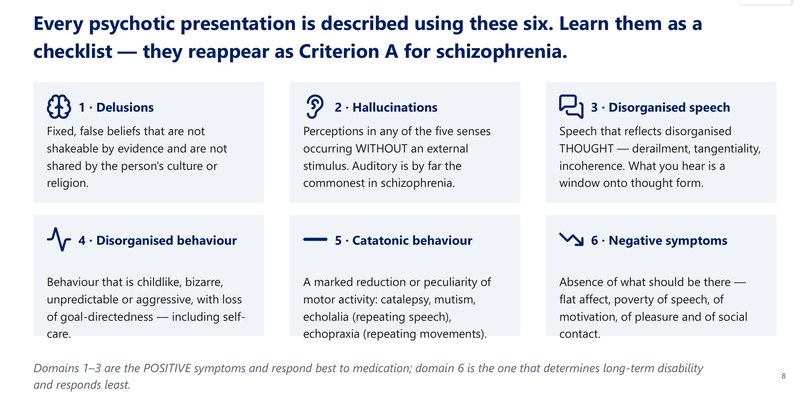

### 2.5 Delusions (Slides 9–14) ⭐⭐

**Definition (slide 9):**
- a **FIXED, FALSE** belief, held with **absolute conviction** despite contradictory evidence
- **NOT accepted by the person's culture, religion or subculture**
- not amenable to reasoning
- often (not always) **acted upon**

| Bizarre vs non-bizarre | Not a delusion |
|---|---|
| **BIZARRE:** clearly implausible ("a **chip implanted** in my brain") | **OVERVALUED IDEA**: unreasonable but held **with some doubt** |
| **NON-BIZARRE:** possible but false ("my **wife is having an affair**") | **OBSESSION**: **resisted** and recognised as **one's own** |
| ⭐ **Non-bizarre delusions = the hallmark of DELUSIONAL DISORDER** | — |

**Types by theme (slides 10–11):**

| Type | Belief | Classically seen in / note |
|---|---|---|
| ⭐ **Persecutory (paranoid)** | Followed, watched, plotted against, harmed | **The commonest**; schizophrenia, delusional disorder |
| **Grandiose** | Special, chosen, immensely wealthy, special powers | **Mania**; schizophrenia |
| **Nihilistic** | Dead or dying; world/organs no longer exist | ⭐ **Psychotic depression, esp. elderly (Cotard)** |
| **Somatic** | A body part/function missing or diseased with no evidence ("my kidney was removed") | Psychotic depression; schizophrenia; delusional disorder (somatic) |
| **Religious** | Special relationship with God, usually with grandiosity | Schizophrenia; mania. **Judge against the patient's own community** |
| **Erotomanic** | A higher-status person/public figure loves the patient | **De Clérambault**; may lead to **stalking** |
| **Jealous** | Partner unfaithful, on no evidence | **Othello**; ⭐ associated with **alcohol misuse and violence risk** |
| **Of reference** | External cues aimed at the patient ("the presenter is talking to me") | **Very common; often the earliest symptom** families notice |
| **Thought broadcasting** | Thoughts can be heard by others | **Passivity**; Schneiderian first-rank |
| **Thought insertion/withdrawal** | Thoughts put into/removed from the mind by an outside force | **Passivity**: the boundary of the self is breached |
| **Delusion of control** | Actions, feelings, impulses directed by an external agent | "**Made acts / made feelings**" |

- A scar-free abdomen and normal ultrasound **don't shift** a somatic delusion. That **unshakeability** separates it from **health anxiety**.
- ⭐ **Passivity phenomena:** the patient experiences their own mental life as coming from **outside**. **Ask explicitly**; patients rarely volunteer them.

#### Belief, Culture and Religion (Slides 12–14) ⭐
| ✅ Not a delusion | ⚠️ Points toward a delusion |
|---|---|
| Belief in **evil eye, jinn, sihr (magic), ruqyah** where the community shares it | A belief the patient's **OWN family and imam** say is not normal for them |
| Seeking a **religious healer before a doctor**: a normal help-seeking pathway here | Content that is **idiosyncratic and personal** rather than shared |
| Intense religious practice within the person's tradition | A **special personal role** ("I have been chosen to judge people") |
| Attributing illness to a spiritual cause **while accepting treatment** | Accompanied by **hallucinations, disorganisation, functional decline** |
| — | Held with a conviction that **isolates** the patient from their community |

⭐ **Practical test: ask the family, "Is this normal for him, or for people you know?"** The community, not the doctor, defines the baseline.

**Case (slides 13–14):**
- 34-year-old man believes the family is affected by the **evil eye**; requests ruqyah
- works normally, prays with family, sleeps well
- **whole extended family shares the belief**; no hallucinations, no decline
- referral: "delusional beliefs, assess for antipsychotics"

→ ⭐ **B: a culturally shared belief, not a delusion.** Treating him would expose him to metabolic/EPS risk for no benefit and lose the family's trust. **The answer would change with:** an idiosyncratic version the family find strange, added hallucinations, or functional decline.

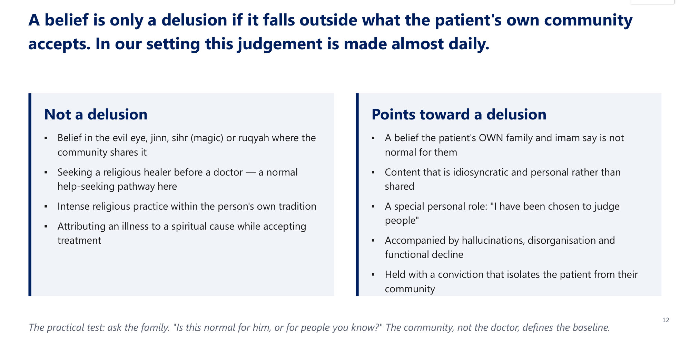

### 2.6 Perception (Slides 15–16) ⭐
| Hallucination | Illusion | Pseudohallucination |
|---|---|---|
| **NO** external stimulus | **MISPERCEPTION of a real** stimulus | Perceived in **INNER** space, "inside my head" |
| Real, located in **external space** | A dressing-gown on a door seen as a person | **Insight usually retained** |
| Any of the 5 modalities | Common in **delirium, poor light, high anxiety** | Seen in **dissociation, personality disorder, grief** |
| **Insight typically absent** | — | **Not by itself evidence of psychotic disorder** |

**Key question:** ⭐ **"Where does the voice come from?"** This separates a hallucination from a pseudohallucination.

| Modality | Patient describes | Think |
|---|---|---|
| ⭐ **Auditory** | Voices, commonly **2+ talking about** the patient, or **commanding** | **Commonest in schizophrenia.** Command → ask about **compliance** |
| **Visual** | People, animals, figures | ⭐ **DELIRIUM, dementia (Lewy body), substances, epilepsy** |
| **Olfactory** | Unpleasant smell (often **burning**) preceding other symptoms | ⭐ **Temporal lobe epilepsy aura**: investigate |
| **Tactile** | Insects crawling on/under the skin (**formication**) | **Stimulant intoxication (cocaine, amphetamine); alcohol withdrawal** |
| **Gustatory** | Persistent strange/**metallic** taste | Rare: epilepsy, drug effects |

⭐ **The rule that saves lives: a NON-AUDITORY hallucination in a first presentation is ORGANIC until proven otherwise.**

### 2.7 Thought Form: the Ladder of Severity (Slide 17)
**Circumstantial** (reaches the point via detours; near-normal) → **Tangential** (never arrives) → **Derailment/loosening** (ideas slip between clauses) → **Incoherence** (the sentence stops making sense) → **Word salad** (unconnected words; severe illness).

Ask: ⭐ **"Can I still follow how they got from one idea to the next?"** That is the whole assessment of thought form.

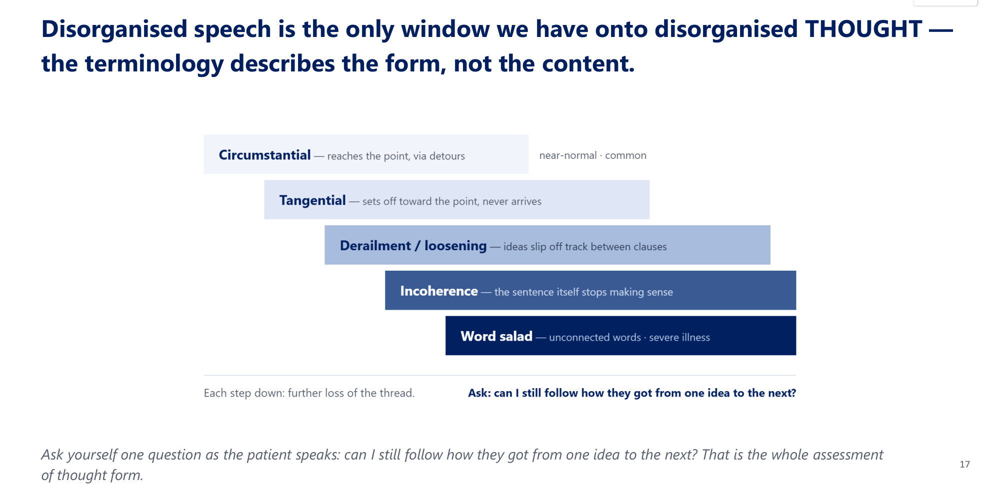

### 2.8 Disorganised Behaviour and Catatonia (Slide 18) ⭐
| Disorganised behaviour | ⭐ Catatonia |
|---|---|
| Childlike silliness; bizarre or compulsive acts | **CATALEPSY / waxy flexibility**: limbs held in imposed postures |
| Unpredictable or aggressive | **MUTISM; negativism; posturing; purposeless excitement** |
| Loss of goal-directed behaviour, including self-care | **ECHOLALIA** (repeats your words); **ECHOPRAXIA** (copies your movements) |
| Inappropriate dress; collapse of routine | ⭐ **A MEDICAL EMERGENCY**, and **commonest in MOOD disorders, not schizophrenia** |
| Judge against what is normal for **that person** | **No longer a subtype of schizophrenia**; it crosses diagnoses |

**Catatonia:**
- responds to a ⭐ **lorazepam challenge** and to **ECT**
- **malignant catatonia** (fever + autonomic instability) is clinically **indistinguishable from NMS**

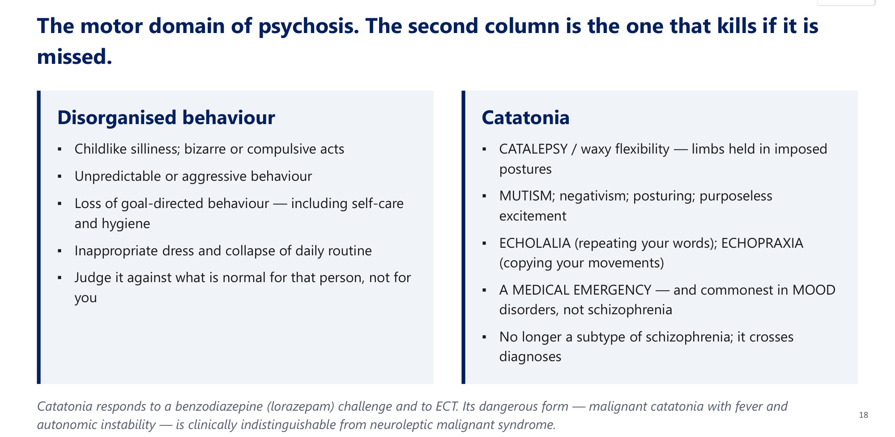

### 2.9 Negative Symptoms: the Five A's (Slide 19) ⭐
| A | Meaning |
|---|---|
| **Affective flattening** | Blunted (reduced range) or flat (virtually absent); face stops carrying emotion; voice loses its melody |
| **Alogia** | Poverty of speech (brief, empty replies) or poverty of **content** of speech |
| **Avolition / abulia** | Poverty of movement and motivation; work, study, self-care stop; **mistaken for laziness** |
| **Anhedonia** | Loss of pleasure; **shared with depression** |
| **Asociality** | Withdrawal from social contact through **loss of interest** (not anxious avoidance) |

- ⭐ Negative symptoms **respond LEAST to antipsychotics**, cause **most of the functional impairment**, and are the **strongest predictor of poor long-term outcome**.
- **Differential (secondary negative symptoms):** **depression, antipsychotic EPS (parkinsonism), institutionalisation**. Exclude these first; they are **treatable**.

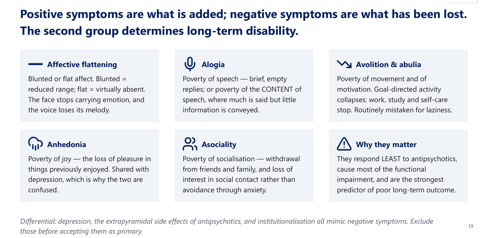

### 2.10 Schneider's First-Rank Symptoms (Slide 20) ⭐
| First-rank symptoms | Where they stand now |
|---|---|
| Thought **INSERTION** | Present in **~3 of 4** patients with schizophrenia |
| Thought **WITHDRAWAL** | **Also** in mania, psychotic depression, organic psychoses |
| Thought **BROADCASTING** | ⭐ **DSM-5 REMOVED their special weight**: they no longer count double |
| **3rd-person auditory hallucinations** (voices discussing the patient) | Still a useful structured checklist |
| **Running commentary**; **made acts, feelings, impulses** | Their presence should **never end the search for an organic cause** |

**Mnemonic *[added]*: "ABCD"** for first-rank symptoms:
- **A**uditory hallucinations (3rd person, commentary, *[added]* thought echo)
- **B**roadcasting / insertion / withdrawal of thought
- **C**ontrol (made acts, feelings, impulses; passivity)
- **D**elusional perception *[added; classic FRS not on the slide]*

⚠️ DSM-IV allowed a **single bizarre delusion or a running commentary** to satisfy Criterion A alone. ⭐ **DSM-5-TR abolished this: two symptoms are always required.**

> 🔁 **Recap: Part 1.**
> - Psychosis = a symptom (impaired reality testing).
> - Normal mimics: hypnagogic, bereavement, sleep deprivation.
> - 6 domains (positive 1–3 respond best; negative determine disability).
> - Delusion = fixed, false, **outside culture**. Non-bizarre → delusional disorder. Passivity = first-rank.
> - Hallucination is external with no stimulus; non-auditory → organic.
> - Catatonia is an emergency, commonest in mood disorders; lorazepam/ECT.
> - Negative symptoms = 5 A's.
> - FRS lost special weight in DSM-5.
>
> 🔗 **Link:** Fahad has persecutory + reference delusions, 3rd-person commentary, command voices and an 8-month negative prodrome.
>
> ▶️ **Up next: Exclude everything else before calling it schizophrenia.**

---

### 2.11 Delirium vs Primary Psychosis (Slides 22–24) ⭐⭐
**Case (slides 22–23):**
- 72-year-old, **day 3 after hemiarthroplasty**
- pulling at his cannula, sees **children in the room**, disoriented
- fully oriented this morning; briefly drowsy last night
- on **tramadol + oxybutynin**; **T 37.9 °C**
- "refer to psychiatry for acute psychosis"

→ ⭐ **B: Delirium, find the cause.** Five features make the diagnosis:
1. **ACUTE onset over hours**
2. **FLUCTUATION** across the day
3. **IMPAIRED consciousness and attention**
4. **DISORIENTATION**
5. **VISUAL hallucinations**

**Also present:**
- **two anticholinergic-burden drugs**
- **fever**

**What to do:**
- examine
- screen for **infection and hypoxia**
- check **glucose, electrolytes, calcium, renal function**
- **review every drug**
- treat the cause

⭐ **Delirium in an elderly surgical patient carries a mortality comparable to MI.**

**Slide 24 rules:**
- ⭐ **If consciousness is clouded, it is not schizophrenia.**
- ⭐ **Any new psychosis after 40 = organic until proven otherwise.**
- ⭐ **Any fluctuating presentation = delirium until proven otherwise.**
- Hallucinations: **visual in delirium**, **auditory in schizophrenia**. Delirium is worse at night (**sundowning**).

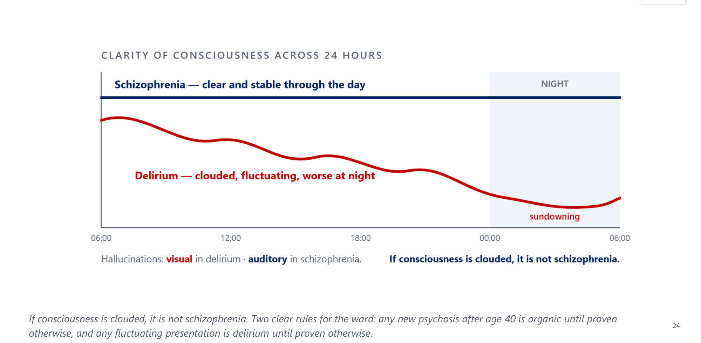

### 2.12 The Differential Funnel (Slide 25) ⭐
Work down the funnel **every time**:
1. **FIRST (not primarily psychiatric):** **delirium · medical condition · substance or medication · dementia**. Reversible and dangerous; excluded before anything else.
2. **THEN (mood disorders):** **bipolar (manic/mixed) · major depression with psychotic features**.
3. **LAST (primary psychotic disorders):** brief psychotic · schizophreniform · schizophrenia · schizoaffective · delusional.

⭐ **A first psychotic episode is a diagnosis of exclusion.**

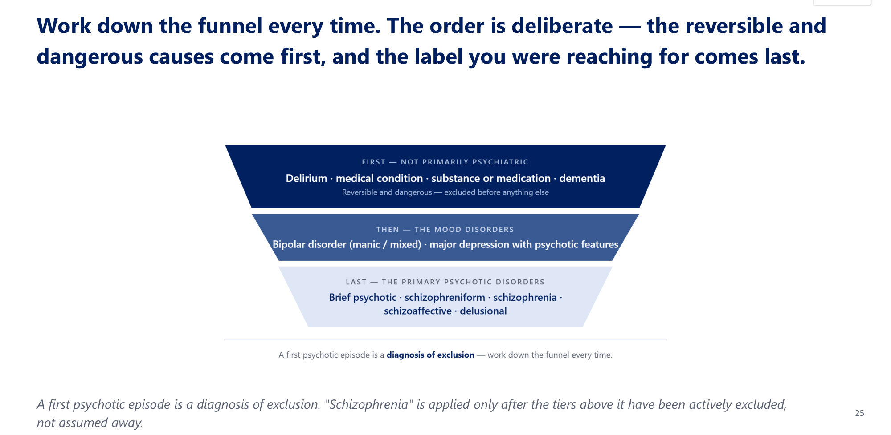

### 2.13 Psychosis Due to a Medical Condition (Slide 26)
| Group | Examples |
|---|---|
| **CNS** | Cerebrovascular disease · MS · tumour · Alzheimer, Parkinson · Huntington · **epilepsy (esp. temporal lobe)** · encephalitis · **neurosyphilis** · prion disease · neurosarcoidosis · **HIV/AIDS** |
| **Endocrine** | **Hyper/hypothyroidism · Cushing, Addison · hyper/hypocalcaemia · hypopituitarism** |
| **Nutritional** | **B12, folate, niacin (pellagra), thiamine** deficiency |
| **Autoimmune** | **SLE** · temporal arteritis · ⭐ **ANTI-NMDA RECEPTOR ENCEPHALITIS** |
| **Metabolic / other** | **Porphyria** · hepatic and uraemic encephalopathy · hypoglycaemia · hypoxia · **Wilson disease** |

⭐ **Anti-NMDA receptor encephalitis:** in a **young patient**, psychosis plus **seizures, dyskinesias or autonomic instability**. It often presents first to psychiatry and is **treatable** (immunotherapy).

### 2.14 Substance- and Drug-Induced Psychosis (Slide 27) ⭐
| Substances of misuse | ⭐ Prescribed medication (the group students forget) |
|---|---|
| **Amphetamine-type stimulants (incl. Captagon)** and **cocaine** during intoxication | ⭐ **CORTICOSTEROIDS**: dose-related; common on medical wards |
| **Cannabis**: dose-dependent; a risk factor for **later schizophrenia** | **Dopaminergic anti-parkinsonian** drugs (levodopa, dopamine agonists) |
| Hallucinogens (**LSD, MDMA**) and **PCP** | ⭐ **ANTICHOLINERGICS and antihistamines**, esp. in the elderly |
| **Alcohol, benzodiazepine, barbiturate WITHDRAWAL** | Anticonvulsants; antimicrobials (**isoniazid, fluoroquinolones, mefloquine**) |
| Inhalants; toxins (**CO, organophosphates**) | **Methylphenidate, interferon, chemotherapy, digoxin** |

- Substance-induced psychosis typically **resolves within days–weeks of abstinence**.
- If it **persists** beyond intoxication/withdrawal, reconsider: stimulants can **unmask a primary psychotic illness**.

### 2.15 Red Flags: "This Is Not Schizophrenia" (Slide 28) ⭐⭐
| Red flag | Why |
|---|---|
| **Onset > 40** (esp. > 60) | Organic until proven otherwise; schizophrenia declares itself in the **teens–30s** |
| **Non-auditory hallucinations** | Delirium, epilepsy, lesion, substance |
| **Clouded/fluctuating consciousness** | Drowsy, disoriented, inattentive, worse at night = **delirium** |
| **Abnormal neurological signs** | Focal deficits, seizures, abnormal movements, incontinence, new headache → **imaging** first |
| **Fever or autonomic instability** | **Encephalitis, sepsis, malignant catatonia, NMS**: emergencies |
| **Very rapid onset (hours)** | Drug, toxin, acute medical event |

None of these excludes psychiatric illness, but each one **obliges you to look for something else first**.

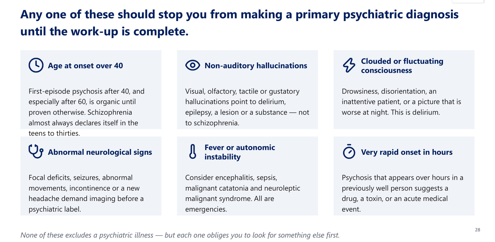

### 2.16 First-Episode Work-Up (Slide 29) ⭐
| Investigation | Looking for |
|---|---|
| ⭐ **History, collateral, full physical examination** | **The single highest-yield step.** Never diagnose a first episode without collateral |
| **CBC, renal, liver, electrolytes, calcium, glucose** | Infection, uraemia, hepatic encephalopathy, Ca²⁺ disorders, hypoglycaemia |
| **TSH, B12, folate** | Common, cheap, reversible |
| ⭐ **Urine drug screen** | Amphetamines, cannabis, cocaine, opioids: **required in every first episode** |
| **HIV, syphilis serology; ESR/CRP, ANA** if indicated | Infective/autoimmune (neurosyphilis, SLE) |
| **CT/MRI brain; EEG** if indicated | Tumour, stroke, demyelination; EEG for TLE or encephalitis |
| ⭐ **Baseline before antipsychotics: weight, BMI, waist, BP, lipids, HbA1c, ECG** | You can't detect metabolic or QT harm later **without a baseline** |

The **last row is the one most often skipped**: record it **before the first dose**.

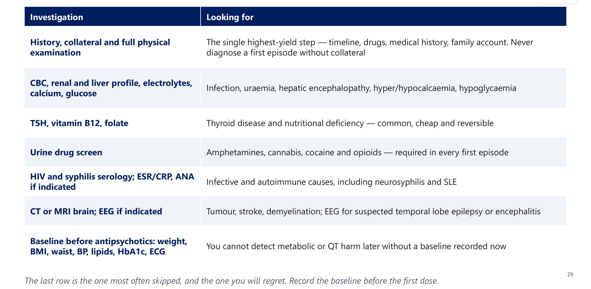

> 🔁 **Recap: Part 2.**
> - Clouded or fluctuating consciousness = delirium, not schizophrenia.
> - Funnel: organic → mood → primary psychotic.
> - Mimics: endocrine (thyroid, Cushing/Addison, Ca²⁺), B12/thiamine, **anti-NMDA**, Wilson, porphyria.
> - Drugs: **steroids, anticholinergics**, levodopa, isoniazid, mefloquine; stimulants and cannabis.
> - Red flags: > 40, non-auditory, clouding, neuro signs, fever, hours.
> - Work-up includes **UDS** and a **metabolic + ECG baseline**.
>
> ▶️ **Up next: The psychotic disorders and the clock.**

---

### 2.17 The Psychotic Disorders: the Clock (Slides 31–34) ⭐⭐

| Disorder | Duration | Symptoms | Function |
|---|---|---|---|
| ⭐ **Brief psychotic disorder** | **1 day to < 1 month** | **≥ 1** of delusions, hallucinations, disorganised speech, disorganised/catatonic behaviour | **FULL return** to premorbid level |
| ⭐ **Schizophreniform** | **1 to < 6 months** | **≥ 2** Criterion A | Dysfunction **NOT required**; full return if it resolves |
| ⭐ **Schizophrenia** | **≥ 6 months** (≥ 1 month active) | **≥ 2** Criterion A | **No return** to premorbid level |
| ⭐ **Delusional disorder** (off the clock) | **≥ 1 month** of delusions | Delusions **only**; no prominent hallucinations | **Preserved** outside the belief |
| ⭐ **Schizoaffective** (off the clock) | **≥ 2 weeks** of psychosis **without** a mood episode | Mood episode concurrent with Criterion A; mood symptoms for **most of the illness** | — |

**Treatment does not wait for the label:** all are treated as a **first psychotic episode from day one**.

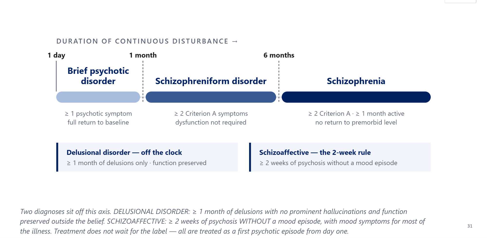

**Brief psychotic disorder (slide 32):**
- often follows a **marked stressor**
- a **postpartum-onset specifier** exists
- recurrence and later reclassification are real, so **follow up**

**Schizophreniform (slide 32):**
- identical to schizophrenia except **duration < 6 months** and **no dysfunction required**
- lifetime prevalence **~0.2%**; **M = F**
- if symptoms pass 6 months → **schizophrenia**

#### Schizoaffective Disorder: the Commonest Diagnostic Error (Slide 33) ⭐
| Requires | How to tell it apart |
|---|---|
| A **major mood episode** (depressive or manic) **CONCURRENT** with Criterion A | **Mood disorder with psychotic features:** psychosis **ONLY during** the mood episode |
| ⭐ **Delusions/hallucinations ≥ 2 WEEKS in the ABSENCE of a prominent mood episode** | **Schizophrenia:** mood symptoms **brief or absent** relative to psychosis |
| Mood symptoms for the **MAJORITY** of the illness | **Schizoaffective:** psychosis **persists ≥ 2 weeks after** the mood episode settles |
| Not due to substance/medical condition | The distinction rests on a **longitudinal timeline**, drawn **with the family** |
| Lifetime prevalence **~0.3%** (DSM-5-TR); **more common in women** | Older texts: 0.5–0.8% (different case definitions) |

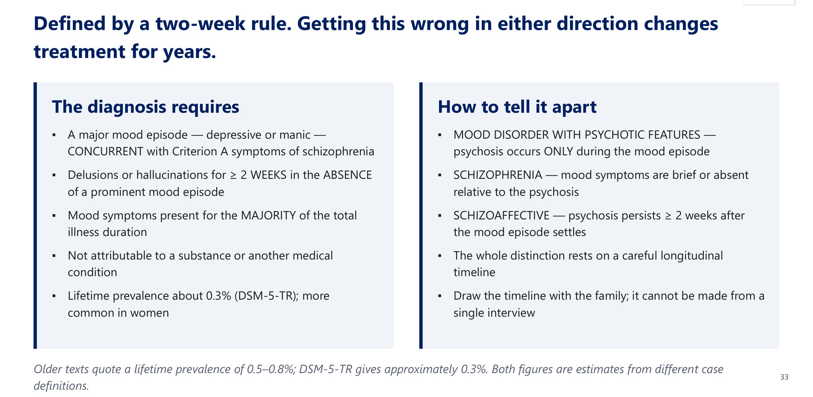

#### Delusional Disorder (Slide 34)
| Features | Subtypes and pitfalls |
|---|---|
| **≥ 1 delusion for ≥ 1 month** | **Persecutory · jealous · erotomanic · somatic · grandiose · mixed** |
| Typically **NON-BIZARRE** | Patients rarely present themselves; **family or police** bring them |
| **No prominent hallucinations**; Criterion A not met | **Insight absent** → engagement is the hardest part |
| ⭐ **ENCAPSULATED**: rest of mental life intact | ⭐ **Jealous subtype: documented risk of violence to the partner** |
| Behaviour not obviously odd; function preserved outside the delusion | ⭐ **Somatic subtype** reaches **dermatology or surgery** long before psychiatry |

These patients function normally, which is why the diagnosis is missed for years, and why **confrontation destroys the therapeutic relationship**.

> 🔁 **Recap: The clock.** < 1 month = brief (≥ 1 symptom, full recovery). 1–6 months = schizophreniform (≥ 2, dysfunction not required). ≥ 6 months = schizophrenia. Delusional disorder: ≥ 1 month, non-bizarre, encapsulated. Schizoaffective: psychosis ≥ 2 weeks without mood + mood for most of the illness.
> 🔗 **Link:** Q2 (29-year-old woman, voices continuing 6 weeks after depression settled) = schizoaffective.
> ▶️ **Up next: Schizophrenia itself.**

---

### 2.18 Epidemiology of Schizophrenia (Slide 39) ⭐
| Measure | Figure | Comment |
|---|---|---|
| **Lifetime prevalence** | ⭐ **≈ 1%** (classical) | DSM-5-TR: **~0.3–0.7%** |
| **Onset: men** | ⭐ **≈ 21 years** | Late teens–mid-20s; onset before puberty or after 45 is rare |
| **Onset: women** | ⭐ **≈ 27 years** | **Second, smaller peak around menopause** |
| **Sex ratio** | **M ≥ F** | Slight male excess |
| **Male course** | **More severe** | Earlier onset, more **negative** symptoms, poorer response and prognosis |
| **Female course** | **Less severe** | Later onset, more **positive** symptoms, better response and prognosis |
| **Life expectancy** | ⭐ **15–20 years shorter** | Mainly **cardiovascular/metabolic disease and smoking**, not suicide alone |

### 2.19 Stress–Diathesis Model (Slide 40)
| **Diathesis: the vulnerability** | **Stress: the trigger** |
|---|---|
| **Genetic loading** (the largest single contribution) | **Substance use**, esp. **cannabis and stimulants in adolescence** |
| Dopaminergic, serotonergic, glutamatergic dysfunction | **Bereavement**, loss of a significant relationship |
| **Neurodevelopmental insult:** obstetric complications, maternal infection, **winter birth** | **Migration, urban upbringing**, social adversity |
| Structural/functional brain changes **before onset** | Major role change: leaving home, **starting university** |
| Present long before any symptom | ⭐ **High expressed emotion at home**: a potent trigger for **RELAPSE** |

Neither column alone is sufficient. Explain it to families this way: **the vulnerability was there; the stressor was the last push, not the cause.**

### 2.20 Genetics (Slide 41) ⭐
- ⭐ **50–70%** of the risk is genetic.
- **Identical twin concordance 40–50%**, so **environment must matter**.
- **General population ≈ 1%.**

| Relationship to an affected person | Lifetime risk |
|---|---|
| **Both parents** | ⭐ **~46%** |
| **Identical twin** | ⭐ **40–50%** |
| **Fraternal twin** | **17%** |
| **One parent** | ⭐ **13%** |
| **Sibling** | **8–10%** |

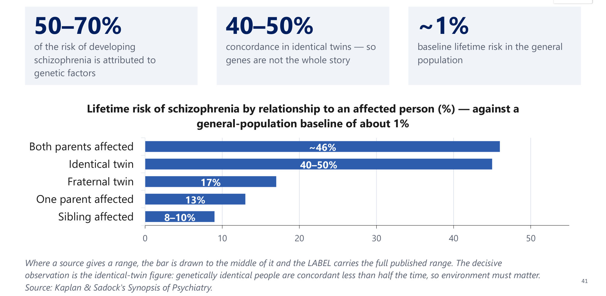

### 2.21 The Dopamine Hypothesis: Four Pathways (Slides 42, 45–46) ⭐⭐
| Pathway | State in schizophrenia | Effect of D2 blockade |
|---|---|---|
| ⭐ **Mesolimbic** | **Hyperdopaminergic → POSITIVE symptoms** | **The therapeutic effect** |
| **Mesocortical** | **Under-active → negative and cognitive symptoms** | Blocking further can **WORSEN** these |
| **Nigrostriatal** (motor) | — | ⭐ **EPS and tardive dyskinesia** |
| **Tuberoinfundibular** (endocrine) | — | ⭐ **↑ Prolactin**: galactorrhoea, amenorrhoea, sexual dysfunction (± ↓ bone density) |

**Pharmacological proof:**
- **cocaine and amphetamine** raise dopamine and **exacerbate** psychosis
- antipsychotics **block D2** and reduce it

**Mnemonic *[added]*:** meso**LIMBIC** = **L**oud (positive) · meso**CORTICAL** = **C**old (negative/cognitive) · nigro**STRIATAL** = **S**tiff (EPS) · **TUBERO**infundibular = **T**eat (prolactin).

**Case (slides 45–46):** 24-year-old woman, 3 weeks on **haloperidol**: voices almost gone, now **amenorrhoea + bilateral galactorrhoea**, pregnancy test negative, prolactin markedly raised.
- → ⭐ **D: tuberoinfundibular.** Hypothalamic dopamine **tonically INHIBITS prolactin**.
- The improvement in voices = the **mesolimbic** effect of the same drug.
- **Manage:**
  - reduce the dose, or switch to a **prolactin-sparing agent (aripiprazole)**
  - don't just stop treatment, but don't ignore it: it is a common, **unspoken reason patients stop medication**

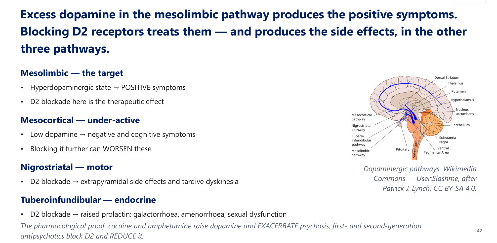

### 2.22 Beyond Dopamine (Slides 43–44)
| Serotonin & glutamate | Neurodevelopmental | Brain changes | Autoimmune |
|---|---|---|---|
| **5-HT2A antagonism** underlies SGAs | **Obstetric complications, maternal influenza, famine** | ⭐ **Enlarged lateral ventricles**; ↓ total brain volume | Raised inflammatory markers in a **subgroup** |
| ⭐ **NMDA receptor HYPOFUNCTION**: the leading alternative model | Excess **winter/early-spring births** | Accelerated grey-matter loss in adolescence | **Anti-NMDA encephalitis** = proof of principle (antibody psychosis responding to immunotherapy) |
| **Ketamine and PCP** block NMDA → reproduce **positive, negative AND cognitive** symptoms | Premorbid cognitive/motor abnormalities in childhood | ↓ hippocampal, amygdala, temporal volume | Suspect with seizures, dyskinesias, autonomic instability |
| Best pharmacological model of **negative** symptoms | Lesion laid down early; symptoms emerge in adolescence (**explains the timing**) | ⭐ **HYPOFRONTALITY**; present **before** antipsychotic exposure | Not a routine screen, but not to miss |

⭐ **None of these is diagnostic. Imaging in schizophrenia is done to EXCLUDE other causes, not to confirm.**

> 🔁 **Recap: Aetiology.**
> - Stress–diathesis; genes 50–70% (MZ 40–50%, one parent 13%, both 46%, sibling 8–10%).
> - Dopamine: mesolimbic (positive, the target), mesocortical (negative), nigrostriatal (EPS), tuberoinfundibular (prolactin).
> - NMDA hypofunction (ketamine/PCP); neurodevelopmental (winter birth, obstetric); ventricles enlarged, hypofrontality.
> - High expressed emotion → relapse.
>
> ▶️ **Up next: DSM-5-TR criteria.**

---

### 2.23 DSM-5-TR Criteria for Schizophrenia (Slides 48–49) ⭐⭐
| | Criterion | Content |
|---|---|---|
| **A** | **Characteristic symptoms** | **≥ 2** of: **delusions · hallucinations · disorganised speech** · grossly disorganised/catatonic behaviour · negative symptoms, for a significant part of **1 month**. ⭐ **AT LEAST ONE from the first three** |
| **B** | **Functional decline** | Work, relationships or self-care **markedly below** the pre-onset level (childhood onset: expected level not reached) |
| **C** | **Duration** | ⭐ **Continuous ≥ 6 MONTHS**, including **≥ 1 month of Criterion A**; the rest may be prodromal/residual |
| **D** | **Mood-disorder exclusion** | Schizoaffective and mood disorder with psychosis excluded |
| **E** | **Substance/medical exclusion** | Part 2 of this lecture, written into the criteria |
| **F** | **Relationship to autism** | With autism/childhood communication disorder history, diagnose only if prominent **delusions or hallucinations ≥ 1 month** |

**The rule inside the rule (slide 49):**
- ⭐ **Negative symptoms alone can never make the diagnosis.**
- **Catatonia (4) + negative symptoms (5) together do NOT satisfy Criterion A.**
- **Delusions + negative symptoms DO** satisfy it.
- < 1 month of symptoms **treated successfully** still counts.
- The DSM-IV **single-bizarre-delusion shortcut was ABOLISHED**.

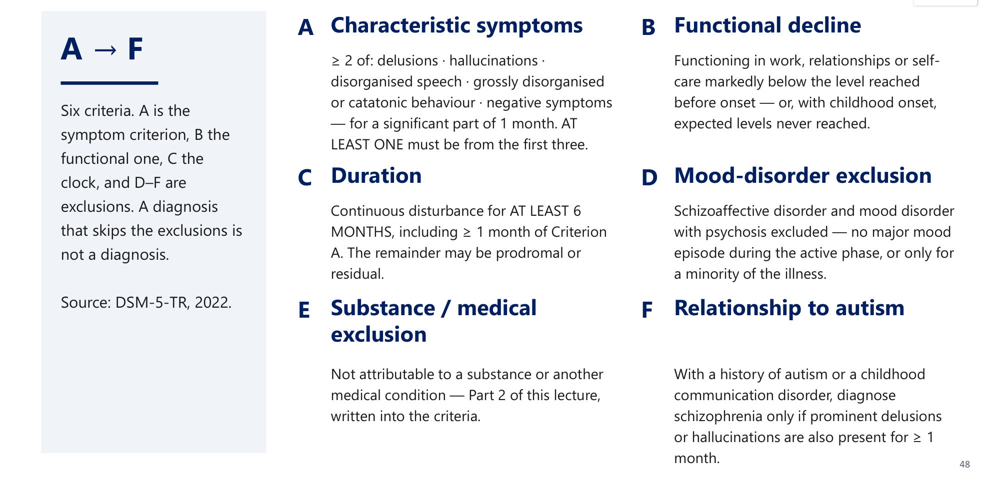

### 2.24 Positive, Negative and Cognitive Symptoms (Slides 50–52)
| Group | Content | Response |
|---|---|---|
| **Positive** (added) | Delusions (persecutory commonest); **auditory** hallucinations (3rd person, commentary; ask about **command**); disorganised speech; disorganised behaviour; catatonia | ⭐ **Best**; improve within **2–4 weeks** |
| **Negative** (lost) | **Five A's**; often **precede the first positive symptom by years** | Poor. Exclude **secondary** causes (depression, drug-induced parkinsonism, understimulation) |
| **Cognitive** | **Attention**; **working memory/multitasking**; ⭐ **executive function: "SOAP"** (**S**equencing, **O**rganisation, **A**bstracting, **P**lanning); concrete proverbs | Present **premorbidly**, persist between episodes. **No drug reliably helps**; **cognitive remediation and supported employment** have evidence |

⭐ **Cognitive impairment predicts functional outcome (employment, independent living) better than positive symptoms do.** This is why a patient whose voices have resolved may still be unable to return to university.

### 2.25 Historical Subtypes (Slide 53): Removed in DSM-5, Still Examined
| Subtype | Defining feature |
|---|---|
| **Catatonic** | ≥ 1 catatonic symptom, regardless of anything else |
| **Disorganised (hebephrenic)** | Disorganised speech and behaviour, flat/inappropriate affect, **no catatonia** |
| **Paranoid** | **Delusions and hallucinations dominate**; no catatonia or disorganisation; ⭐ **best preserved function** |
| **Undifferentiated** | Criterion A met; fits none of the above |
| **Residual** | No prominent positive symptoms; attenuated negative symptoms and odd beliefs persist |

**Why abolished:** they were **unstable over time**, overlapped heavily, and **didn't predict treatment response or outcome**. They were replaced by **dimensional severity ratings**.

> 🔁 **Recap: Diagnosis.**
> - A: ≥ 2 for 1 month, ≥ 1 from delusions/hallucinations/disorganised speech.
> - B: decline. C: ≥ 6 months. D–F: exclusions (mood, substance/medical, autism).
> - Positive respond; negative and cognitive determine function.
> - Subtypes are gone (paranoid had the best function).
>
> ▶️ **Up next: Course and prognosis.**

---

### 2.26 Course: Four Phases (Slides 55–56)
| Phase | Features |
|---|---|
| **1. Premorbid** | Subtle **cognitive and motor deficits** |
| **2. Prodromal** | **Attenuated symptoms, withdrawal**; days to years. ⭐ **Shortening the duration of untreated psychosis (DUP)** is one of the few things that **measurably improves outcome** |
| **3. Acute (active)** | ≥ 2 Criterion A symptoms; often follows a stressor or substance use; severe impairment; usually **hospitalisation**; when patients first present |
| **4. Residual** | Attenuated positive/negative symptoms; **depression and cognitive impairment common**; function below premorbid; **relapse is the main risk** |

⭐ A chronic illness of relapses and remissions: **each relapse risks a lower functional baseline.**

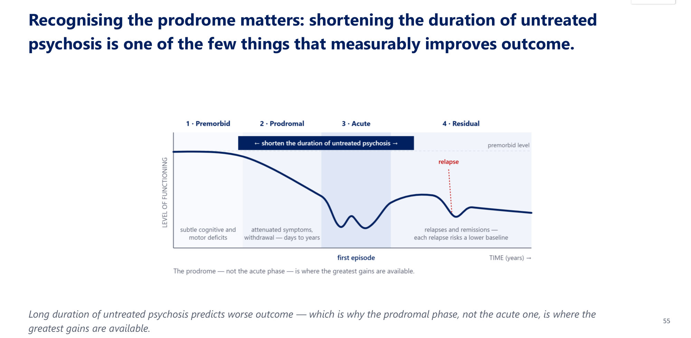

### 2.27 Physical Health and the Mortality Gap (Slide 57) ⭐
| Domain | Detail |
|---|---|
| **Smoking** | ~**3× more likely** to smoke, and more heavily; ⭐ **largest single contributor to premature death** |
| **Metabolic** | Obesity, **T2DM**, dyslipidaemia, CVD (illness + lifestyle + medication) |
| **Infection** | HIV and blood-borne infection (risk behaviour, poor preventive care) |
| **Substance use** | Alcohol and drugs: worse adherence, relapse, physical health |
| **Suicide** | ⭐ **~5%** (Palmer 2005: ≈ 4.9%; older texts **10–13%**). Highest **early in illness, young men, those with insight and depression** |
| ⭐ **Diagnostic overshadowing** | New physical symptoms **attributed to the psychiatric illness** and not investigated |

### 2.28 Prognosis (Slides 58–59) ⭐
**Outcome split:**
- ⭐ **15% good** (substantial recovery)
- **30% intermediate** (partial recovery, some independence)
- **55% poor** (persistent symptoms and disability)

→ **45% achieve good/intermediate**; outcome is **modifiable** by early treatment and adherence.

| Factor | **Good prognosis** | **Poor prognosis** |
|---|---|---|
| Sex | **Female** | Male |
| Age at onset | **Older** | Young |
| Onset | **Sudden**, clearly demarcated | Gradual, insidious |
| Precipitant | **Identifiable stressor** | None |
| Symptoms | **Positive**; **mood symptoms present** | **Negative**; no mood symptoms |
| Family history | None | Positive |
| Substance use | None | Comorbid misuse |
| Brain imaging | No structural change | Structural changes |
| Premorbid function | **Good** social/occupational adjustment | Poor adjustment; **long DUP** |

⭐ **Three modifiable factors:** substance misuse, adherence, duration of untreated psychosis.

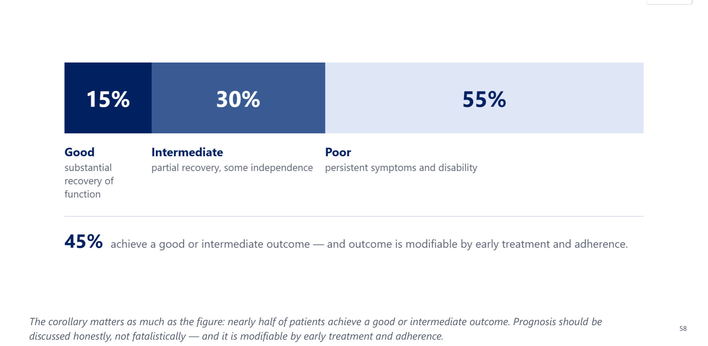 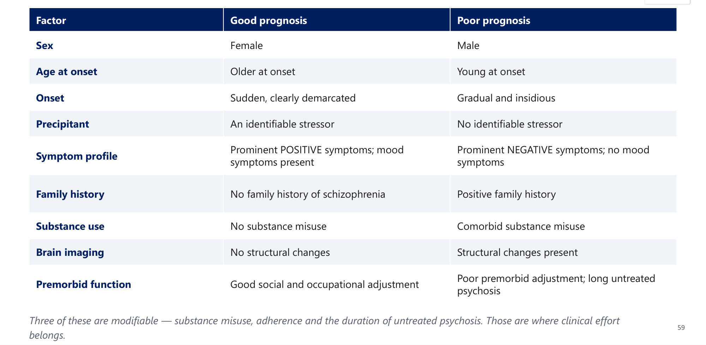

> 🔁 **Recap: Course.**
> - Premorbid → prodrome (shorten the DUP) → acute → residual.
> - Life expectancy −15–20 years (smoking is the biggest driver); suicide ~5% (older texts 10–13%).
> - 15/30/55.
> - Good prognosis: female, late and sudden onset, a stressor, positive and mood symptoms, good premorbid function.
>
> ▶️ **Up next: Treatment.**

---

### 2.29 Management Framework (Slide 61)
- **Four strands, delivered together:**
  1. **pharmacological** (antipsychotics)
  2. **psychological** (CBT for psychosis, supportive therapy)
  3. **family** (psychoeducation, expressed emotion)
  4. **social** (housing, income, occupational rehabilitation)
- **Psychoeducation** for patient and family covers:
  - a **brain illness, not a weakness**
  - medication effects, onset, side-effects
  - ⭐ **written, patient-specific EARLY SIGNS OF RELAPSE**
  - ⭐ **HIGH EXPRESSED EMOTION** (criticism, hostility, over-involvement) **drives relapse**, and family intervention can change it
  - where to get urgent help

### 2.30 Acute Phase (Slide 62)
| Assess and protect | Treat and engage |
|---|---|
| Diagnosis: history, MSE, examination, investigations | Plan treatment **with** the patient |
| ⭐ **PREVENT HARM**: risk to self/others; admit if needed | Reduce symptom severity as quickly as is safe |
| Control disturbed behaviour, **de-escalation before medication** | Aim for rapid return toward optimal functioning |
| ⭐ **COLLATERAL**: essential, not optional | Alliance with patient **and** family |
| Address precipitants: substances, non-adherence | **Psychoeducation early**, not at discharge |

**Involuntary admission:** governed by the **Saudi Mental Health Law**; a last resort; **document the reasoning**.

### 2.31 First- vs Second-Generation Antipsychotics (Slide 63) ⭐⭐
| | **First generation (typical)** | **Second generation (atypical)** |
|---|---|---|
| Mechanism | **D2 blockade** | **D2 + 5-HT2A antagonism** |
| Examples | **Haloperidol, chlorpromazine, fluphenazine, trifluoperazine** | **Risperidone, olanzapine, quetiapine, aripiprazole, paliperidone, clozapine** |
| Positive symptoms | Effective | Effective; ⭐ **no clear superiority except clozapine** |
| Negative & cognitive | Little effect; may worsen | Modest benefit at best |
| **EPS** | ⭐ **HIGH** (dystonia, akathisia, parkinsonism, TD) | Lower, but dose-dependent, **not absent** |
| **Metabolic** | Lower (**chlorpromazine** is an exception) | ⭐ **HIGH**: weight, diabetes, lipids; **worst with olanzapine and clozapine** |
| **Prolactin** | Raised | Raised with **risperidone, paliperidone**; ⭐ **aripiprazole spares it** |

⭐ Apart from clozapine, the generations are **similarly effective** (CATIE, CUtLASS). **Choose on side-effect profile, patient preference, previous response and cost.**

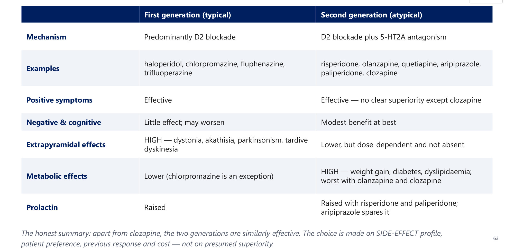

### 2.32 Prescribing Principles (Slide 64)
| Rules | Timing and choice |
|---|---|
| Medication is **essential but not the whole** of treatment | Agitation settles in **days**; psychosis over ⭐ **2–6 weeks** |
| Individualise | ⭐ **Adequate trial = 4–6 weeks at a therapeutic dose** before switching |
| ⭐ **Start low, go slow**; lowest effective dose | Choose on **previous response, a family member's response**, side-effects |
| ⭐ **AVOID POLYPHARMACY**: one antipsychotic at a time | Interactions, cost, availability, **patient preference** |
| Simple regimens succeed | **Involve the patient**: the strongest adherence intervention |

**Commonest errors:**
- switching too early
- **adding a second antipsychotic** instead of optimising the first
- never asking what the patient can tolerate

### 2.33 Harms You Must Recognise (Slides 65–67) ⭐⭐
| Harm | Key points |
|---|---|
| **EPS** | Dystonia (hours–days) · akathisia (days–weeks) · parkinsonism (weeks–months) · TD (months–years, often irreversible) |
| ⭐ **NMS** | **FEVER, lead-pipe RIGIDITY, autonomic instability, altered consciousness, ↑ CK**. **Stop the drug**; emergency |
| **Metabolic syndrome** | Weight, T2DM, lipids; worst **olanzapine/clozapine**. Monitor weight, BP, HbA1c, lipids **from baseline** |
| ⭐ **QT prolongation** | Torsades; highest with **haloperidol (esp. IV), ziprasidone, pimozide**. ECG; correct **K⁺ and Mg²⁺** |
| **Hyperprolactinaemia** | Amenorrhoea, galactorrhoea, sexual dysfunction, ↓ bone density. Common with **risperidone**; **aripiprazole spares** |
| ⭐ **Clozapine-specific** | **Agranulocytosis** (mandatory ANC monitoring) · **myocarditis in weeks 4–8** · seizures · **severe constipation/ileus** |

⭐ **Any patient on an antipsychotic with FEVER needs an urgent FBC and an NMS assessment.** These are two different emergencies with the same first symptom.

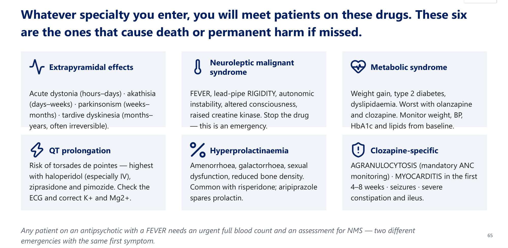

#### EPS by the Clock (Slides 66–67) ⭐
| Syndrome | Onset | Features | Management |
|---|---|---|---|
| ⭐ **Acute dystonia** | **Hours–days** | Muscle spasm, **oculogyric crisis**, torticollis | ⭐ **IM anticholinergic** (*[added]* procyclidine/benztropine) |
| ⭐ **Akathisia** | **Days–weeks** | **Inner restlessness**, pacing, can't sit | **Reduce dose or add propranolol**. ⭐ **Do NOT increase** the antipsychotic |
| **Parkinsonism** | **Weeks–months** | Bradykinesia, rigidity, coarse resting tremor, masked face, shuffling gait. ⭐ **Mimics negative symptoms/depression**; **reversible** | Reduce dose / lower-EPS agent; anticholinergics (cognitive and constipation burden). Commoner in the **elderly** and with **FGAs** |
| ⭐ **Tardive dyskinesia** | **Months–years** | Involuntary **choreoathetoid orofacial/tongue**, trunk, limb movements. ⭐ **Often IRREVERSIBLE** | Prevention > treatment. Stop/reduce the agent; **VMAT2 inhibitors (valbenazine, deutetrabenazine)**. Risk ↑ with duration, **age, female sex, FGAs** |

- ⭐ **Akathisia is the most consequential misreading in psychiatry:** a restless patient is given more antipsychotic, which makes it worse. Ask whether the restlessness is **felt inside**.
- Reduce the dose **before** concluding a flat, slowed patient has primary negative symptoms: parkinsonism is reversible; negative symptoms are not.

**Mnemonic *[added]* for EPS timing: "4 hours, 4 days, 4 weeks, 4 months":** dystonia, akathisia, parkinsonism, tardive dyskinesia (approximate).

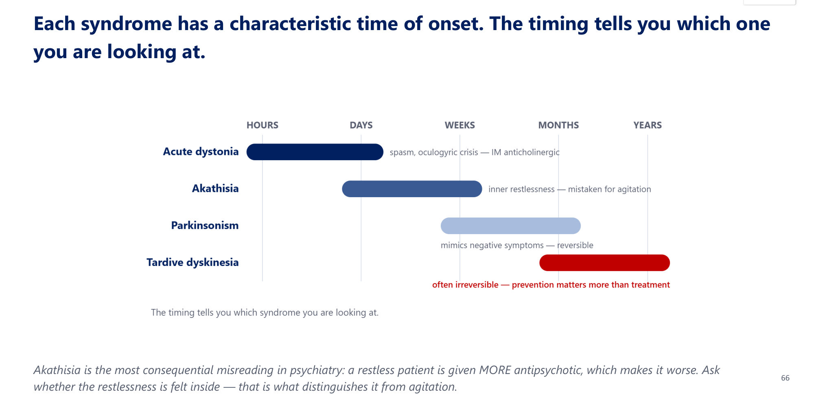 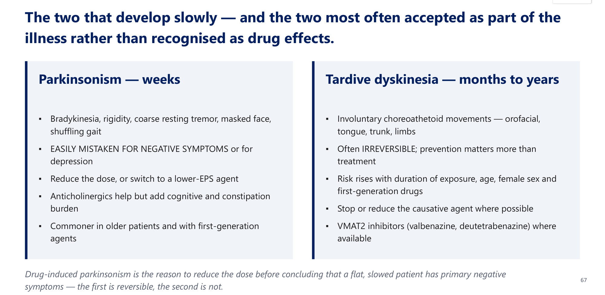

### 2.34 Clozapine and Treatment Resistance (Slides 68–70) ⭐⭐
| When indicated | What it demands |
|---|---|
| ⭐ **Treatment-resistant schizophrenia: failure of ≥ 2 adequate trials** | ⭐ **Mandatory neutrophil monitoring** (agranulocytosis is the reason for the register) |
| **Adequate trial = therapeutic dose for 4–6 weeks with confirmed adherence** | ⭐ **MYOCARDITIS in weeks 4–8**: fever, chest pain, dyspnoea, ↑ troponin |
| ⭐ **Persistent suicidality** in schizophrenia | **Seizures**: dose-related; **myoclonus** may precede them |
| **Severe tardive dyskinesia** | ⭐ **Constipation → ILEUS**: a recognised cause of death |
| Underused; often started years late | Sedation, **hypersalivation**, marked weight gain |

- The **only antipsychotic with proven superior efficacy**.
- ⭐ **Never restart clozapine after > 48 h interruption without re-titrating from a low dose.** Sudden resumption can cause **collapse**; a common error on non-psychiatric wards.

**Case (slides 69–70):**
- 31-year-old, **5 weeks on clozapine**
- **2 days of fever 38.6 °C**, malaise, mild chest discomfort, **HR 118**, chest clear
- triage: "viral illness, reassure and discharge"

→ ⭐ **B: FBC, ECG, troponin, CRP; call psychiatry.** Three clozapine emergencies present with fever:
1. **agranulocytosis**: urgent FBC/neutrophils
2. **myocarditis**: weeks 2–8, fever, tachycardia, chest discomfort, ↑ troponin, CRP, **eosinophils** (this man has both)
3. **NMS**: rigidity, autonomic instability, altered consciousness, ↑ CK

Discharging him as "viral" = **diagnostic overshadowing**.

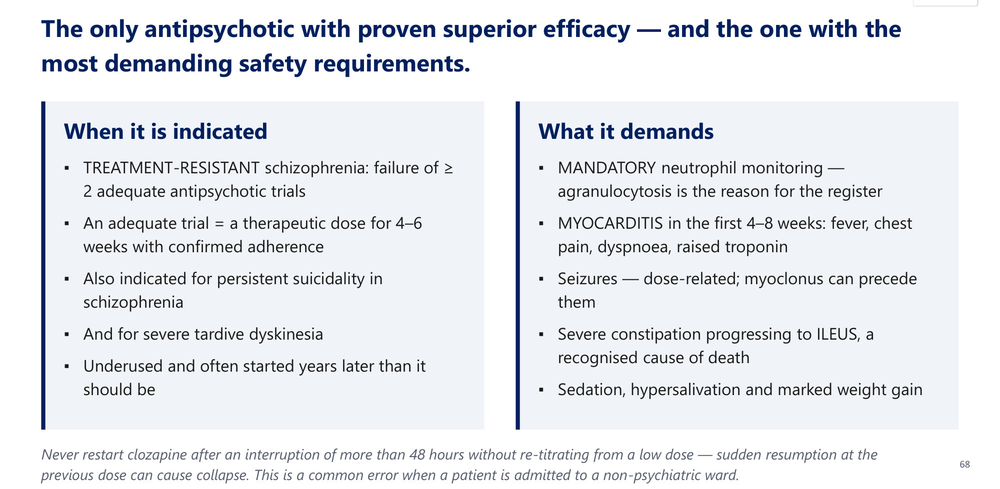

### 2.35 Stabilisation, Maintenance and Psychosocial Treatment (Slides 71–72)
| Stabilisation | Maintenance |
|---|---|
| Consolidate response, prevent early relapse | Improve function and quality of life |
| Adapt to community life; **reduce stress** | Sustain remission; **PREVENT RELAPSE** |
| ⭐ **Monitor side-effects actively**: this is when patients quietly stop treatment | Monitor physical health: **weight, HbA1c, lipids, ECG** |
| Begin psychosocial intervention | Reduce modifiable stress (finances, housing, work); address substances and family conflict |

| Psychosocial intervention | Target |
|---|---|
| **CBT for psychosis** | The **distress and conviction** attached to residual voices/delusions (not arguing them away); for **persistent** symptoms |
| **Supportive therapy** | Long-term engagement |
| ⭐ **Family intervention** | Psychoeducation + **expressed emotion**; among the **best-evidenced relapse prevention** |
| **Group therapy / social skills** | Asociality and withdrawal |
| ⭐ **Occupational rehabilitation (supported employment)** | Work is protective; inactivity deepens negative symptoms |
| **Social and community support** | Housing, income, case management |

⭐ **Family intervention and supported employment** have the **strongest functional evidence**, and both are under-provided.

### 2.36 Relapse and Adherence (Slides 73–74) ⭐
| Situation | Relapse rate |
|---|---|
| ⭐ **Off medication, 1 year** | **60–70%** |
| ⭐ **Off medication, 2 years** | **85–90%** |
| **On medication with good adherence, 2 years** | **~20%** |

- **Adherence decays:** ~**30% stop within 1 month**, **45% by 8 months**.
- **The three levers:**
  1. ⭐ **ADHERENCE**: the single most important factor
  2. strong **psychosocial support**
  3. **ABSTINENCE** (cannabis, stimulants)

  Plus a **written relapse plan** with the patient's own early warning signs, and **continuity** of team.
- **Why patients stop:**
  - **side-effects** (weight, sedation, sexual dysfunction)
  - lack of insight / feeling well
  - lack of efficacy / complex regimen
  - **cost, distance**
  - poor rapport; substance misuse
- ⭐ **Consider a LONG-ACTING INJECTABLE (LAI) early**, especially after a relapse due to non-adherence, not as a last resort.

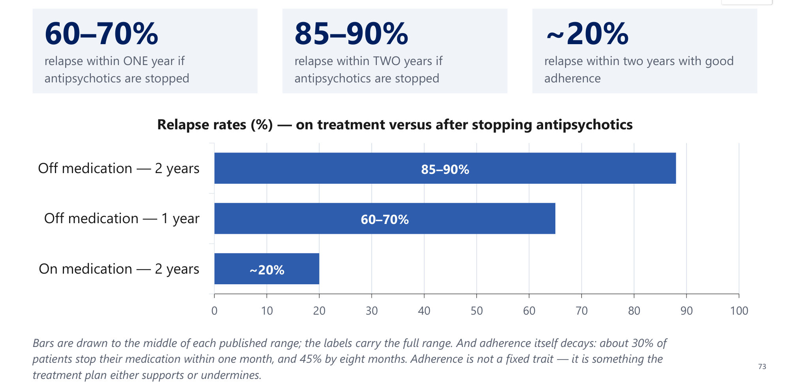

---

## 3. High-Yield Comparison Tables

### Table A: The Psychotic Disorders
| Disorder | Duration | Min. symptoms | Key feature |
|---|---|---|---|
| Brief psychotic | 1 day – < 1 month | ≥ 1 | Full return; stressor; postpartum specifier |
| Schizophreniform | 1 – < 6 months | ≥ 2 Criterion A | Dysfunction not required |
| Schizophrenia | ≥ 6 months (≥ 1 month active) | ≥ 2 (≥ 1 core) | Functional decline |
| Schizoaffective | Psychosis ≥ 2 weeks without mood | Criterion A + major mood episode | Mood for most of the illness; women |
| Delusional disorder | ≥ 1 month | Delusion(s) only | Non-bizarre, encapsulated, function preserved |
| Mood disorder with psychotic features | Psychosis only **within** mood episodes | — | Mood-congruent usually |

### Table B: Delirium vs Schizophrenia
| | Delirium | Schizophrenia |
|---|---|---|
| Onset | **Hours–days** | Insidious (prodrome months–years) |
| Consciousness | **Clouded, fluctuating, worse at night** | **Clear** |
| Orientation | **Impaired** | Intact |
| Attention | **Impaired** | Relatively intact |
| Hallucinations | **Visual** | **Auditory** |
| Age | Often elderly; any | Teens–30s |
| Cause | Medical/drug: find it | Primary |

### Table C: Antipsychotic Emergencies with Fever
| | NMS | Agranulocytosis (clozapine) | Myocarditis (clozapine) | Malignant catatonia |
|---|---|---|---|---|
| Key | **Rigidity, ↑ CK**, autonomic instability, confusion | **↓ Neutrophils**, infection | **Weeks 4–8**, chest pain, tachycardia, **↑ troponin, eosinophils** | Catatonic signs + fever + autonomics |
| Test | CK, FBC | **FBC/ANC** | **ECG, troponin, CRP** | Clinical; lorazepam challenge |
| Action | **Stop antipsychotic**, supportive (*[added]* dantrolene/bromocriptine) | Stop clozapine; treat infection | Stop clozapine; cardiology | **Lorazepam, ECT** |

### Table D: Antipsychotic Side-Effect Champions
| Side-effect | Worst | Spares |
|---|---|---|
| EPS / TD | **Haloperidol** (FGAs) | Clozapine, quetiapine *[added]* |
| Metabolic | **Olanzapine, clozapine** (FGA exception: chlorpromazine) | Aripiprazole *[added]* |
| Prolactin | **Risperidone, paliperidone**, FGAs | **Aripiprazole** |
| QT | **Haloperidol IV, ziprasidone, pimozide** | — |
| Agranulocytosis, myocarditis, ileus, seizures | **Clozapine** | — |

### Table E: Positive vs Negative vs Cognitive
| | Positive | Negative | Cognitive |
|---|---|---|---|
| Content | Delusions, hallucinations, disorganisation, catatonia | 5 A's | Attention, working memory, SOAP |
| Pathway | **Mesolimbic ↑ DA** | **Mesocortical ↓ DA** | Mesocortical; NMDA |
| Drug response | **Good (2–4 weeks)** | Poor | Poor (remediation helps) |
| Predicts | Presentation | **Long-term disability** | **Employment, independence** |

---

## 4. Rules, Exceptions, Patterns
- **Psychosis is a symptom**; the differential starts with reversible causes.
- **Clouded consciousness → not schizophrenia.** **Fluctuation → delirium.** **Onset > 40 → organic.** **Non-auditory → organic.**
- **Normal hallucination-like experiences:** hypnagogic/hypnopompic, bereavement, sleep deprivation (insight, brief, no decline).
- **Delusion must be outside the patient's culture**: evil eye, jinn, sihr and ruqyah are not delusions when shared.
- **Non-bizarre delusion → delusional disorder.** Jealous subtype → violence risk; somatic subtype → dermatology/surgery.
- **Catatonia is commonest in mood disorders**, is an emergency, and responds to **lorazepam/ECT**. Malignant catatonia ≈ NMS.
- **Criterion A needs ≥ 1 of delusions, hallucinations, disorganised speech**; catatonia + negative is not enough. No single-symptom shortcut since DSM-5.
- **FRS lost special weight in DSM-5** but remain a checklist.
- **The clock:** < 1 month / 1–6 months / ≥ 6 months. **Schizoaffective = 2-week rule.**
- **Schizophrenia:** men ~21, women ~27 (+ menopausal peak); men worse.
- **Genetics:** MZ 40–50% (so environment matters); one parent 13%; both 46%.
- **Mesolimbic = therapeutic; the other three pathways = side-effects** (mesocortical worsens negative symptoms; nigrostriatal EPS; TIDA prolactin).
- **FGA ≈ SGA in efficacy, except clozapine.** Choose by side-effects.
- **Adequate trial = 4–6 weeks at a therapeutic dose; one drug; start low, go slow.**
- **Akathisia → don't increase the dose**; propranolol/reduce.
- **Fever on an antipsychotic → FBC + NMS assessment**; on clozapine also **troponin/ECG**.
- **Clozapine interruption > 48 h → re-titrate.**
- **Off medication: 60–70% relapse at 1 year, 85–90% at 2 years.** Consider an **LAI early**.
- **Physical health:** life expectancy −15–20 years; smoking is the biggest driver; **diagnostic overshadowing**.

---

## 5. Clinical Correlations
- **Surgical/medical wards:** post-op confusion with visual hallucinations = **delirium**. Review **opioids, anticholinergics (oxybutynin), steroids**.
- **Young patient with psychosis + seizures/dyskinesia/autonomic instability** → **anti-NMDA receptor encephalitis**: CSF, EEG, MRI, ovarian teratoma screen *[added]*.
- **Endocrine link:** Cushing's/steroids, thyroid, Addison's, hypercalcaemia, hypopituitarism can all present with psychosis.
- **Prolactin link (Pituitary I):** antipsychotic-induced hyperprolactinaemia is a cause of amenorrhoea/galactorrhoea. Check the drug history before imaging the pituitary *[added]*.
- **ECG link:** check **QTc** before haloperidol IV; correct K⁺/Mg²⁺.
- **ED:** fever on clozapine is never "viral" until FBC, troponin and ECG are back.
- **Cardiology:** clozapine myocarditis in weeks 4–8 (↑ troponin, eosinophilia).
- **GI:** clozapine constipation → ileus. Ask about bowels at every visit.
- **Family meetings:** stress–diathesis; high expressed emotion; written early warning signs.

---

## 6. Rapid Revision (Last-Day)
1. **Psychosis = impaired reality testing**; a symptom, not a diagnosis.
2. **Normal look-alikes:** hypnagogic/hypnopompic, bereavement, sleep deprivation.
3. **6 domains:** delusions, hallucinations, disorganised speech, disorganised behaviour, catatonia, negative.
4. **Delusion:** fixed, false, **outside culture**. Bizarre (chip) vs non-bizarre (affair → delusional disorder).
5. **Types:** persecutory (commonest) · grandiose (mania) · nihilistic (**Cotard**, elderly psychotic depression) · somatic · religious · erotomanic (**de Clérambault**, stalking) · jealous (**Othello**, alcohol, violence) · reference (earliest) · **passivity** (broadcast, insertion/withdrawal, control).
6. **Culture:** evil eye, jinn, sihr, ruqyah, healer first = **not** delusions. Ask the family.
7. **Hallucination modality:** auditory → schizophrenia; visual → delirium/Lewy/substances; olfactory → **TLE**; tactile → **cocaine/amphetamine/alcohol withdrawal**.
8. **Catatonia:** waxy flexibility, mutism, echolalia/echopraxia. Commonest in **mood disorders**; **lorazepam, ECT**; malignant ≈ NMS.
9. **Negative 5 A's:** affect, alogia, avolition, anhedonia, asociality. **Respond least**; exclude depression/EPS.
10. **FRS:** insertion, withdrawal, broadcasting, 3rd-person/commentary, made acts. ~75% of schizophrenia; **no longer special in DSM-5**.
11. **Delirium:** acute, fluctuating, clouded, disoriented, **visual**. Mortality ≈ MI.
12. **Funnel:** organic → mood → primary psychotic.
13. **Mimics:** **anti-NMDA**, thyroid, Cushing/Addison, Ca²⁺, B12/thiamine/niacin, SLE, Wilson, porphyria, HIV, syphilis.
14. **Drugs:** stimulants (Captagon), cannabis, LSD/PCP, withdrawal; **steroids, anticholinergics, levodopa, isoniazid, fluoroquinolones, mefloquine, interferon, digoxin**.
15. **Red flags:** > 40, non-auditory, clouding, neuro signs, fever/autonomic, onset in hours.
16. **Work-up:** collateral + exam · CBC, U&E, LFT, Ca, glucose · TSH, B12, folate · **UDS** · HIV/syphilis · CT/MRI, EEG · **baseline weight, BMI, waist, BP, lipids, HbA1c, ECG**.
17. **Clock:** brief < 1 month (≥ 1 symptom) · schizophreniform 1–6 months · schizophrenia ≥ 6 months · delusional ≥ 1 month · schizoaffective **2-week rule**.
18. **Epidemiology:** ~1% (DSM 0.3–0.7%); men 21, women 27; life −15–20 years.
19. **Genes:** 50–70% heritability; MZ 40–50%; DZ 17%; one parent 13%; both 46%; sibling 8–10%.
20. **Dopamine:** mesolimbic ↑ (positive) · mesocortical ↓ (negative) · nigrostriatal (EPS) · TIDA (prolactin).
21. **NMDA hypofunction** (ketamine/PCP); neurodevelopmental (winter birth); **enlarged ventricles, hypofrontality**.
22. **DSM-5-TR A–F:** ≥ 2 for 1 month (≥ 1 core) · decline · ≥ 6 months · exclude mood, substance/medical, autism.
23. **Cognitive SOAP**; cognition predicts function.
24. **Prognosis:** 15 / 30 / 55. Good = female, late and sudden onset, stressor, positive/mood symptoms, good premorbid function.
25. **Suicide ~5%** (older texts 10–13%); smoking is the biggest mortality driver.
26. **FGA vs SGA:** same efficacy except **clozapine**. FGA → EPS; SGA → metabolic (olanzapine/clozapine). **Aripiprazole spares prolactin.**
27. **Trial 4–6 weeks; one drug; start low.**
28. **EPS:** dystonia hours (IM anticholinergic) → akathisia days (propranolol, ↓ dose) → parkinsonism weeks → **TD months–years** (VMAT2).
29. **NMS:** fever, rigidity, autonomic instability, confusion, ↑ CK → stop the drug.
30. **Clozapine:** ≥ 2 failed trials, suicidality, TD. **ANC**, myocarditis (weeks 4–8), seizures, **ileus**, hypersalivation. **> 48 h gap → re-titrate.**
31. **Relapse off meds:** 60–70% (1 y), 85–90% (2 y); on meds ~20%. **LAI early.** High expressed emotion → relapse.

---

## 7. Exam-Style Questions

**Q1 (lecture, slides 13–14).** A 34-year-old man says his family is affected by the evil eye and requests ruqyah. He works, prays with the family and sleeps well; the whole extended family shares the belief. No hallucinations or decline. Referral: "delusional, assess for antipsychotics." Correct assessment?
A. Delusion: start an antipsychotic · **B. Culturally shared belief, not a delusion** · C. Overvalued idea: CBT · D. Somatic delusion

> **Answer: B** (lecture key).
> - A delusion must be fixed, false **and** outside the cultural/religious frame.
> - Here the belief is shared, with no hallucinations, disorganisation or decline.
> - Treating him adds metabolic/EPS risk and loses the family's trust.

**Q2 (lecture, slides 22–23).** A 72-year-old is 3 days post hemiarthroplasty, pulling at his cannula, seeing children in the room, disoriented. He was oriented this morning and drowsy last night; on tramadol and oxybutynin; T 37.9 °C. Most likely?
A. Late-onset schizophrenia · **B. Delirium: find the cause** · C. Brief psychotic disorder · D. Delusional disorder

> **Answer: B** (lecture key).
> - Acute, fluctuating, impaired consciousness/attention, disoriented, visual hallucinations.
> - Plus anticholinergic burden and fever.
> - Examine, screen infection/hypoxia, glucose, electrolytes, Ca, renal function, review drugs.

**Q3 (lecture, slides 35–36).** A 29-year-old woman has had persecutory delusions and voices for 5 months; for the first 3 she was profoundly depressed. Depression has settled; for 6 weeks her mood is reasonable but the voices and persecutory belief continue. Diagnosis?
A. Depression with psychotic features · B. Schizophrenia · **C. Schizoaffective disorder, depressive type** · D. Brief psychotic disorder

> **Answer: C** (lecture key).
> - Psychosis has persisted **> 2 weeks without a mood episode**, and mood symptoms were present for most of the illness.
> - A fails: psychosis must occur **only** within the mood episode.
> - B fails: a full depressive episode for most of the illness is atypical.
> - D fails on duration.

**Q4 (lecture, slides 45–46).** A 24-year-old woman on haloperidol for 3 weeks: voices almost gone, now amenorrhoea and bilateral galactorrhoea; pregnancy test negative; prolactin very high. Pathway?
A. Mesolimbic · B. Mesocortical · C. Nigrostriatal · **D. Tuberoinfundibular**

> **Answer: D** (lecture key).
> - Dopamine tonically inhibits prolactin; D2 blockade raises it.
> - Reduce the dose or switch to **aripiprazole**.

**Q5 (lecture, slides 69–70).** A 31-year-old, 5 weeks on clozapine, has 2 days of fever 38.6 °C, malaise, mild chest discomfort, HR 118, clear chest. Triage: "viral; discharge." Before he leaves?
A. Reassure and discharge · **B. FBC, ECG, troponin, CRP; call psychiatry** · C. Increase clozapine · D. Oral antibiotics, review in a week

> **Answer: B** (lecture key).
> - Three clozapine emergencies present with fever: **agranulocytosis** (FBC), **myocarditis** (weeks 2–8; troponin, CRP, eosinophils), **NMS** (CK, rigidity).
> - Discharging him = diagnostic overshadowing.

**Lecture board one-liners (slide 75):**

| # | Question | Answer |
|---|---|---|
| 1 | Psychotic symptoms 3 weeks, full return to baseline? | **Brief psychotic disorder** (1 day – < 1 month) |
| 2 | Criterion A symptoms that can't satisfy it alone? | **Catatonic behaviour and negative symptoms** |
| 3 | First episode with olfactory hallucinations: next step? | **Investigate organic cause** (TLE) |
| 4 | Pathway mediating EPS? | **Nigrostriatal** |
| 5 | Restless, pacing 2 weeks after risperidone? | **Akathisia**: reduce dose / propranolol; **don't increase** |
| 6 | When is clozapine indicated? | **≥ 2 failed adequate trials**; persistent suicidality; severe TD |

---

## 8. Exam Pitfalls & Traps
| Trap | Correct thinking |
|---|---|
| "Psychotic" = schizophrenia | ❌ Psychosis is a **symptom**; work down the funnel |
| Post-op confused patient seeing things → psychiatry for "psychosis" | ❌ **Delirium**: find the medical cause |
| Visual/olfactory hallucinations → schizophrenia | ❌ **Organic until proven otherwise** (delirium, TLE, substances) |
| New psychosis at 55 → late-onset schizophrenia | ❌ > 40 = organic first |
| Shared belief in evil eye/jinn = delusion | ❌ Not if the patient's community shares it |
| One bizarre delusion satisfies Criterion A | ❌ DSM-IV only. DSM-5-TR always needs **≥ 2** |
| Catatonia + negative symptoms = Criterion A | ❌ Need ≥ 1 of delusions/hallucinations/disorganised speech |
| FRS are diagnostic of schizophrenia | ❌ Also in mania, psychotic depression, organic psychosis; no special DSM-5 weight |
| Catatonia = schizophrenia subtype | ❌ Commonest in **mood disorders**; no longer a subtype; emergency; lorazepam/ECT |
| Psychosis persisting after depression resolves = psychotic depression | ❌ ≥ 2 weeks without a mood episode → **schizoaffective** |
| Schizophreniform requires functional decline | ❌ Dysfunction **not required** |
| SGAs are more effective than FGAs | ❌ Similar, **except clozapine**; choose by side-effects |
| Restless patient on antipsychotic → increase the dose | ❌ **Akathisia**: reduce the dose / propranolol |
| Flat, slow patient on haloperidol = negative symptoms | ❌ Exclude **drug-induced parkinsonism** first (reversible) |
| Fever on clozapine = viral | ❌ FBC (agranulocytosis), troponin/ECG (myocarditis), CK (NMS) |
| Restart clozapine at the usual dose after 3 days missed | ❌ > 48 h gap → **re-titrate** from a low dose |
| Imaging confirms schizophrenia | ❌ Imaging **excludes** other causes; findings are not diagnostic |
| Suicide is the main cause of the mortality gap | ❌ **Cardiovascular/metabolic disease and smoking** |
| Suicide risk is 10–13% | ⚠️ Older figure; current estimate **~5%** (Palmer 2005). Know both |
| Negative symptoms improve on antipsychotics | ❌ They respond **least**; psychosocial and functional interventions matter |
| LAI only as a last resort | ❌ Consider **early**, especially after a non-adherence relapse |
| Historical subtypes guide treatment | ❌ **Abolished** in DSM-5; know them for exams only |
