# Psychotropic Medication
**Psychiatry, Clinical Lecture** | Dr. Hussain M. Khrad (Consultant Psychiatrist, KFSHRC-Jeddah) | Source: `Psychotropic_medication_2.pdf` (73 slides)

> **Legend:** ⭐ = high-yield · *[added]* = not on slides. Images marked "Slide N" come from the lecture. All MCQ answers and both case model answers come from the lecture's own answer slides.

> 🔗 **Bridge from the disorder lectures (this is the drug lecture they all point to):**
> - **Mood:** SSRIs first-line; **4–6 weeks**; continue 6–9 months; **lithium = anti-suicide**; avoid antidepressant monotherapy in bipolar; **TCAs lethal in overdose**.
> - **Anxiety/OCD:** SSRI/SNRI first-line; **high-dose SSRI for OCD**; clomipramine; **buspirone** adjunct; **benzodiazepines short-term**; propranolol for performance anxiety; **prazosin** for PTSD nightmares.
> - **Psychosis:** the **four dopamine pathways**, FGA vs SGA, the **EPS clock**, **NMS**, **clozapine** (ANC, myocarditis, ileus, 48-hour rule), prolactin, QT.
> - **Substance Use:** benzodiazepine withdrawal **kills**; **flumazenil → seizures**; bupropion and varenicline for smoking.
> - **Medicine:**
>   - **ECG** (QT/QRS; TCA overdose → tall R in aVR)
>   - **Pituitary I** (prolactin)
>   - **Thyroid/Parathyroid** (lithium → hypothyroidism, ↑ Ca/PTH)
>   - **Posterior Pituitary** (lithium → **nephrogenic DI**; SSRIs → **SIADH**)

---

## 1. Title / Objectives

| Domain | Objective | Likely tested as |
|---|---|---|
| Knowledge | ⭐ **Four workhorse classes** and how they act | Antidepressants · anxiolytics/sedatives · antipsychotics · mood stabilisers |
| Knowledge | Common and serious side-effects by class | SIADH, QT, sexual dysfunction, prolactin, metabolic |
| Knowledge | ⭐ **Serotonin syndrome, NMS, lithium toxicity** | Tramadol + SSRI; haloperidol + rigidity; NSAID + lithium |
| Knowledge | EPS timeline; lithium range, monitoring and interactions; **black-box warnings** | — |
| Skill | Choose an antidepressant by **side-effect profile and overdose safety** | No TCAs for the suicidal |
| Skill | ⭐ **Serotonin syndrome vs NMS** at the bedside | Clonus + fast vs rigidity + slow |
| Skill | ⭐ **Reconcile psychotropics on admission; never stop abruptly** | Diazepam omitted → seizure |
| Skill | Spot everyday interactions; baseline + monitoring; ⭐ **fever/sore throat on clozapine → ANC the same day** | — |
| Values | Every prescription is an efficacy–harm trade-off; ask about **sexual and metabolic** effects; consent = what it does **and costs**; never give a lethal drug to a patient at risk; involve the patient | — |

---

## 2. Main Content (Lecture Order)

## PART 1: ANTIDEPRESSANTS

### 2.1 Classes and Principles (Slides 5–6)
**Classes:**
- **SSRIs**
- **SNRIs**
- **heterocyclics** (TCAs, tetracyclics)
- **MAOIs**
- **miscellaneous** (bupropion, mirtazapine, trazodone, newer agents)

**Principles:**
- ⭐ **similar efficacy across classes**: they differ in **safety and side-effects**
- ⭐ **~60–70% respond**; full benefit at **4–6 weeks** on a given dose
- **start low, titrate slowly** in the side-effect-prone

| Choosing (slide 6) | Factors |
|---|---|
| **Patient & illness** | Target symptoms (insomnia, low appetite); ⭐ **prior response in the patient or a family member**; comorbidities |
| **Drug** | Side-effect profile; interactions; ⭐ **overdose risk (TCAs are lethal)** |
| **Practical** | Cost; adherence and dosing convenience |

⭐ **A suicidal patient should not be given a drug that is lethal in overdose.**

### 2.2 SSRIs (Slides 7–8) ⭐⭐
**First-line because they work and are safe in overdose.**

| Agent | Signature |
|---|---|
| ⭐ **Fluoxetine** | **Long half-life: no taper needed** (*[added]* also the longest MAOI washout, 5 weeks) |
| ⭐ **Sertraline** | **Fewest interactions; safe in cardiac disease** |
| ⭐ **Citalopram / escitalopram** | **Most QT-prolonging** |
| ⭐ **Paroxetine** | **Short half-life: worst discontinuation** |
| ⭐ **Fluvoxamine** | **CYP1A2 inhibitor → raises clozapine** |

**Common side-effects:**
- anxiety, agitation, insomnia
- nausea, diarrhoea, anorexia
- ⭐ **sexual dysfunction** (↓ libido, delayed ejaculation, anorgasmia)

Early jitteriness and GI upset settle within days; **sexual dysfunction persists and is the commonest reason people stop**. Ask directly.

| Serious effects | Cardiac (QT) |
|---|---|
| ⭐ **Bleeding**: impaired platelet 5-HT; ↑ with **NSAIDs, anticoagulants** | ⭐ **Citalopram/escitalopram prolong QT the most** |
| ⭐ **Hyponatraemia (SIADH)**: elderly; monitor Na⁺; **stop if < 125 mmol/L** | ⭐ **Citalopram max 40 mg/day; 20 mg if > 60 y**, hepatic impairment, or on CYP2C19 inhibitors |
| **Serotonin syndrome** | ⭐ **Sertraline, fluoxetine, mirtazapine: safest**, no meaningful QT effect |
| **Discontinuation syndrome** | **Avoid TCAs in cardiac disease** |

**Check sodium in older patients; ask about NSAIDs/anticoagulants.**

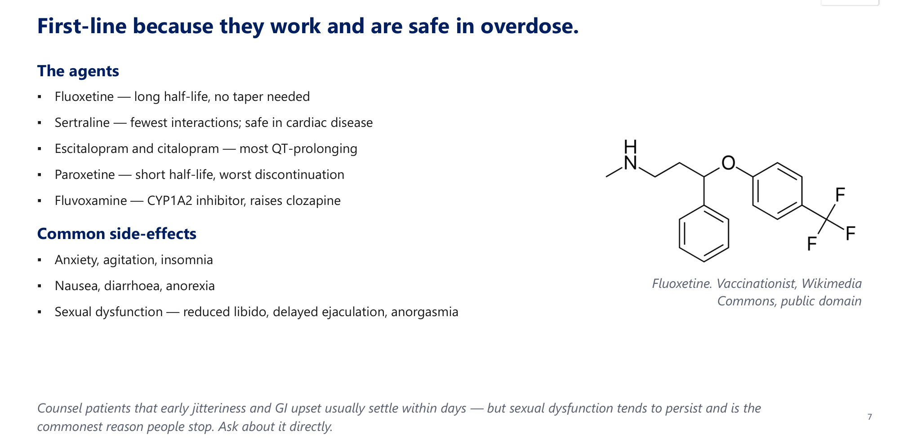 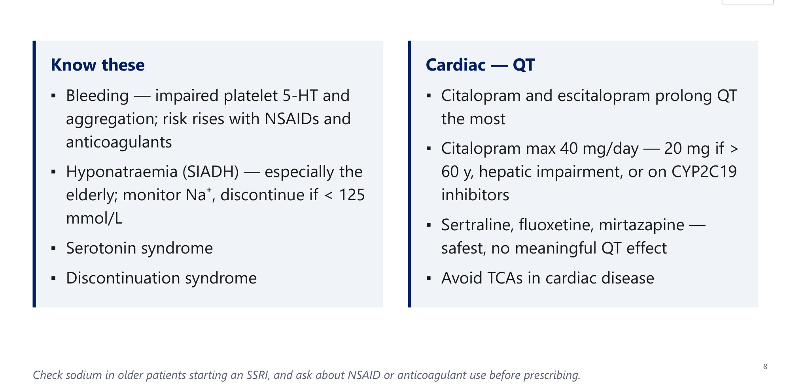

### 2.3 SNRIs (Slide 9)
| Agent | Flags |
|---|---|
| **Venlafaxine / desvenlafaxine** | ⭐ **Dose-dependent hypertension**: check BP. ⭐ **One of the worst discontinuation syndromes** (short half-life) |
| **Duloxetine** | Also for **neuropathic pain and fibromyalgia**; **avoid in severe liver disease** |

**Dual 5-HT/NA action without the TCA receptor baggage.**

### 2.4 Tricyclic Antidepressants (Slides 10–12) ⭐⭐
| Receptor blocked | Effects | Notes |
|---|---|---|
| **Antihistaminic (H1)** | Sedation, weight gain | Often why patients stop |
| **Anticholinergic (M)** | Dry mouth, constipation, **urinary retention, blurred vision** | Worse in the elderly; **avoid in prostatism and glaucoma** |
| **Anti-adrenergic (α1)** | **Orthostatic hypotension** | **Falls** risk |
| ⭐ **Cardiac (Na⁺ channel)** | ⭐ **QRS widening, QT prolongation, arrhythmia** | ⭐ **LETHAL IN OVERDOSE**: never prescribe freely to a suicidal patient |

| Tertiary amines (more side-effects) | Secondary amines (milder) |
|---|---|
| **Imipramine, amitriptyline, doxepin, clomipramine** | **Desipramine, nortriptyline** (metabolites of the tertiaries) |

**Mnemonic *[added]* for TCA toxicity, "3 C's":** **C**onvulsions, **C**oma, **C**ardiotoxicity (+ anticholinergic toxidrome).

**Case (slides 11–12):**
- 22-year-old, **2 h after a bottle of amitriptyline**
- drowsy, **BP 88/54, HR 128**
- ⭐ **QRS 130 ms, tall R in aVR**

→ ⭐ **B: IV sodium bicarbonate.**
- TCA toxicity = **Na⁺-channel blockade**; **QRS > 100 ms and a tall R in aVR predict seizures and arrhythmia**.
- **Bicarbonate overcomes it.**
- Charcoal alone doesn't treat the cardiotoxicity; ⭐ **flumazenil is wrong and dangerous** (*[added]* it unmasks seizures).

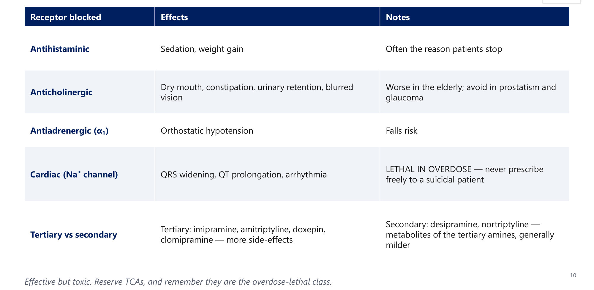

### 2.5 MAOIs (Slide 13)
- **Background:**
  - **iproniazid** (an isoniazid derivative) lifted mood in the 1950s
  - agents: **isocarboxazid, tranylcypromine, phenelzine**; ⭐ **moclobemide is reversible (RIMA)**
  - very effective, but reserved for **atypical or treatment-resistant** depression
- **The two big dangers:**
  1. ⭐ **Hypertensive crisis with tyramine** (aged cheese, cured meats; the **"cheese reaction"**) or sympathomimetics
  2. ⭐ **Serotonin syndrome** with serotonergic drugs
- ⭐ **Washout: 2 weeks, or 5 weeks after fluoxetine.**
- **Also:** orthostatic hypotension, weight gain, sexual dysfunction, insomnia.

### 2.6 Bupropion, Mirtazapine, Trazodone (Slide 14) ⭐
| Drug | Class | Signature |
|---|---|---|
| ⭐ **Bupropion** | **NDRI** | **Activating**; ⭐ **no sexual dysfunction, no weight gain**; **smoking cessation**. ⭐ **LOWERS THE SEIZURE THRESHOLD**: avoid in **eating disorders and head injury**. **Doesn't treat anxiety** |
| ⭐ **Mirtazapine** | **NaSSA** | **Sedating, ↑ appetite**: useful when **insomnia and poor intake** dominate. Weight gain. **No QT effect** |
| ⭐ **Trazodone** | **SARI** | Used as a **hypnotic**; daytime sedation. ⭐ **PRIAPISM**: warn men to seek help immediately |

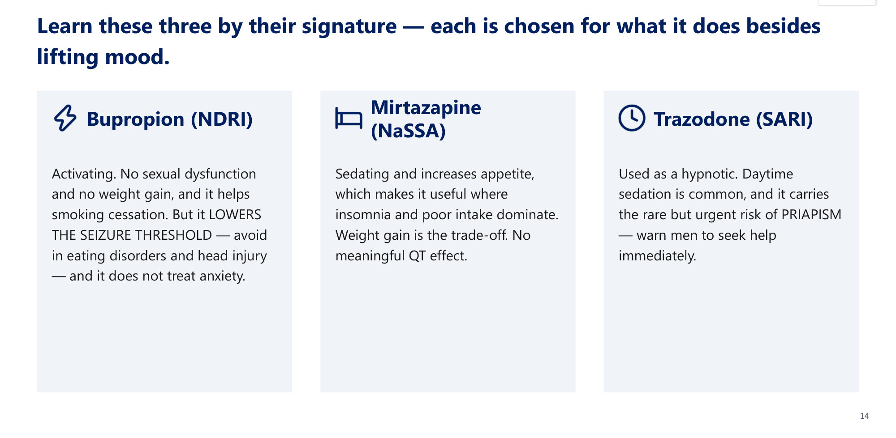

### 2.7 Newer Antidepressants (Slide 15)
| Serotonin-modulating | Rapid-acting / novel |
|---|---|
| **Vortioxetine**: multimodal, **pro-cognitive** | ⭐ **Esketamine (intranasal)**: **NMDA antagonist**; treatment-resistant depression and **acute suicidality**; now also **monotherapy (2025)** |
| **Vilazodone**: SPARI | **Dextromethorphan–bupropion (Auvelity, 2022)**: rapid oral |
| **Agomelatine**: **MT1/MT2 agonist + 5-HT2C antagonist** | ⭐ **Zuranolone (2023)**: oral, **postpartum depression** |

The rapid-acting group works **far faster than 4–6 weeks**.

### 2.8 Serotonin Syndrome (Slides 16–19) ⭐⭐
**Case (slides 16–17):**
- 30-year-old on **sertraline** given **tramadol**
- within **hours**: agitated, confused, sweating, **39 °C**, tachycardia, **brisk reflexes and clonus worse in the legs**

→ ⭐ **B: serotonin syndrome.**

**Triad:**

| Mental status | Neuromuscular | Autonomic |
|---|---|---|
| Agitation, confusion | ⭐ **Hyperreflexia, clonus (esp. lower limbs)**, myoclonus, **ocular clonus**, shivering, tremor | Tachycardia, **hyperthermia**, ↑ **GI motility** (*[added]* diarrhoea, mydriasis) |

- **Culprits:**
  - SSRIs/SNRIs **with tramadol, meperidine (pethidine), fentanyl**
  - **triptans**
  - ⭐ **linezolid**
  - **MAOIs**
  - **ondansetron, metoclopramide**
  - **dextromethorphan**
  - **St John's wort**
- **Management:**
  1. **stop the offending agents**
  2. supportive care, **cooling**
  3. **benzodiazepines**
  4. ⭐ **cyproheptadine (5-HT2A antagonist)** if severe
- ⭐ **Hidden serotonergic drugs:** **tramadol, dextromethorphan, linezolid, triptans, St John's wort**.

#### Serotonin Syndrome vs NMS (Slide 19) ⭐⭐
| Feature | **Serotonin syndrome** | **NMS** |
|---|---|---|
| Cause | **Serotonergic** drugs | **Dopamine antagonists** (or **dopaminergic withdrawal**, e.g. stopping L-dopa) |
| Onset | ⭐ **Fast: within 24 h** | ⭐ **Slow: days to weeks** |
| Neuromuscular | ⭐ **Hyperreflexia, clonus, myoclonus** | ⭐ **"Lead-pipe" rigidity, bradyreflexia** |
| Shared | **Hyperthermia · autonomic instability · altered mental state · ↑ CK** | Same |
| Treatment | **Benzodiazepines + cyproheptadine** | **Stop drug + dantrolene/bromocriptine + benzodiazepines** |

⭐ **Reflexes UP + FAST = serotonin syndrome; RIGIDITY + SLOW = NMS.** From the case slide: **dilated pupils + hyperactive bowel** (SS) vs **quiet bowel** (NMS).

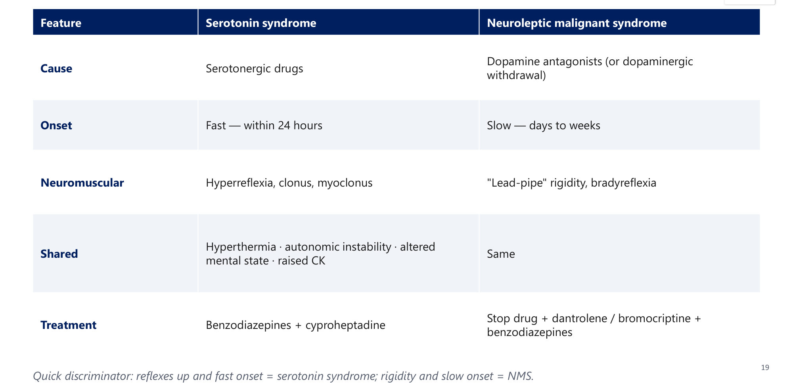

### 2.9 Discontinuation Syndrome (Slides 20–22) ⭐
Not relapse, not addiction: a **self-limiting withdrawal**.
- **worst with short half-life agents (paroxetine, venlafaxine)**
- **onset within days; resolves in < 2 weeks**
- **taper** to prevent it

**FINISH:**
- **F**lu-like (aches, lethargy, sweating)
- **I**nsomnia (vivid dreams)
- **N**ausea/GI upset
- **I**mbalance (dizziness)
- **S**ensory (paraesthesiae, ⭐ **"brain zaps"**)
- **H**yperarousal (anxiety, irritability)

**Case (slides 21–22):**
- well for 8 months; **stopped paroxetine abruptly**
- **3 days later:** dizziness, nausea, **electric shocks in the head**, vivid dreams, irritability
- **mood unchanged**

→ ⭐ **B: discontinuation syndrome.** **Restart, then taper properly.**

| | Discontinuation | Relapse |
|---|---|---|
| Onset | **Days** after stopping | **Weeks** |
| Leads with | **Physical** symptoms | **Low mood, anhedonia** |
| Course | Settles in **< 2 weeks** | Doesn't resolve on its own |

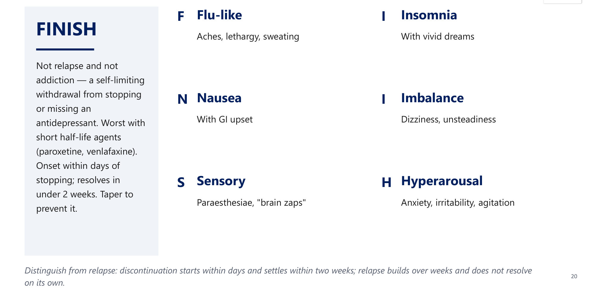

### 2.10 Duration and Pregnancy (Slides 23–24) ⭐
| Phase | Duration | Note |
|---|---|---|
| **Acute** | To remission: **6–12 weeks** | Judge the dose at **4–6 weeks** |
| ⭐ **Continuation** | **6–9 months AFTER remission** | ⭐ **Most relapses happen here**, when the patient already feels well |
| **Maintenance** | ⭐ **≥ 2 years** if recurrent/high-risk | **≥ 3 episodes**, severe illness, high risk, family history |

- ⭐ **Stopping at recovery rather than months after it is the commonest cause of relapse.**
- **Taper over ≥ 4 weeks**; longer for paroxetine and venlafaxine.
- **Other clocks:**
  - ⭐ **benzodiazepines 2–4 weeks**, not months
  - **antipsychotics 1–2 years** after a first psychotic episode
  - **lithium long-term, never stopped abruptly** (rebound mania)

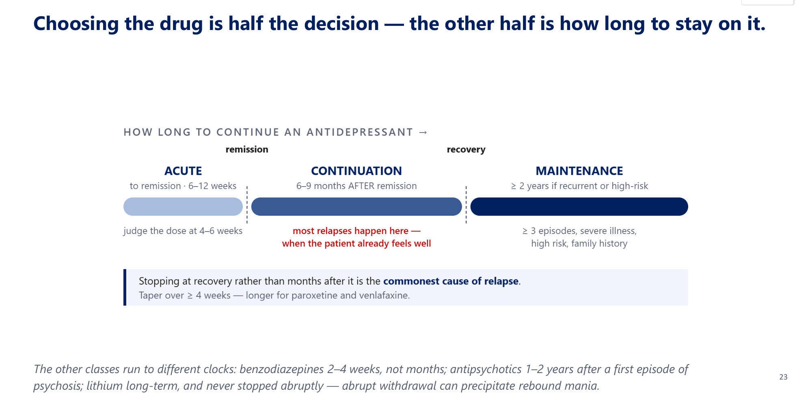

| Pregnancy | Lactation |
|---|---|
| **SSRIs are not major teratogens**; no robust cardiac link after adjustment | Overall infant risk **low** |
| **Paroxetine:** historic weak cardiac signal; generally **avoided in the first trimester** | ⭐ **Lowest infant levels: sertraline, paroxetine** |
| Late use → transient **neonatal adaptation** syndrome | Higher: **citalopram, fluoxetine, venlafaxine** |
| ⭐ **Untreated severe depression is itself a risk**: blanket stopping is often wrong | — |

> 🔁 **Recap: Antidepressants.**
> - Similar efficacy; 60–70% respond; 4–6 weeks.
> - **SSRIs:** fluoxetine (long t½), sertraline (cardiac-safe), citalopram (QT, max 40/20 mg), paroxetine (worst discontinuation), fluvoxamine (↑ clozapine). Risks: sexual dysfunction, bleeding, SIADH.
> - **SNRIs:** venlafaxine (BP, discontinuation); duloxetine (pain).
> - **TCAs:** H1, M, α1, Na⁺; lethal → **bicarbonate**.
> - **MAOIs:** tyramine; 2/5-week washout.
> - **Bupropion** (seizures; no sexual dysfunction); **mirtazapine** (sleep, appetite); **trazodone** (priapism).
> - **Serotonin syndrome** (fast, clonus) vs **NMS** (slow, rigid).
> - **FINISH** discontinuation.
> - Continue 6–9 months; ≥ 2 years if recurrent.
>
> ▶️ **Up next: Anxiolytics and sedatives.**

---

## PART 2: ANXIOLYTICS & SEDATIVES

### 2.11 Benzodiazepines (Slides 26–30) ⭐⭐
**Mechanism:**
- bind **GABA-A**; ⭐ **increase the FREQUENCY** of chloride-channel opening
- ⭐ **barbiturates increase the DURATION**, which is **why they are lethal alone**
- **"Benzos = Frequency; Barbiturates = Duration"**

**Uses:**
- anxiety; **short-term insomnia**
- muscle relaxation
- ⭐ **status epilepticus**
- **rapid tranquillisation**
- ⭐ **alcohol and sedative withdrawal**

| Group | Agents | Why it matters |
|---|---|---|
| **Short-acting** | Alprazolam, lorazepam, oxazepam, temazepam | More **rebound and withdrawal** between doses |
| **Long-acting** | **Diazepam, chlordiazepoxide, clonazepam** | Smoother, but **accumulate**: caution in the elderly |
| ⭐ **"LOT": liver-safe** | **Lorazepam · Oxazepam · Temazepam** | **Phase-II glucuronidation only**: preferred in **liver disease and the elderly** |
| **Reversal** | **Flumazenil** | ⭐ **Can precipitate SEIZURES** in dependence or mixed overdose: rarely used; supportive airway care is the mainstay |

| Side-effects & misuse | ⭐ Withdrawal can be dangerous |
|---|---|
| Sedation, cognitive/psychomotor impairment, **falls in the elderly** | ↑ anxiety, sweats, tremor, hypersensitivity, aches, headache |
| ⭐ **Anterograde amnesia**; **paradoxical disinhibition** | ⭐ **SEIZURES, COMA, DEATH**, like alcohol withdrawal |
| **Tolerance within ~2 weeks** | ⭐ **Never stop abruptly** in a dependent patient: **taper** |

**Pregnancy:**
- avoid if possible
- **cleft palate** signal
- ⭐ **floppy-infant syndrome** and neonatal withdrawal near term
- present in breast milk

**Case (slides 29–30):**
- 58-year-old, elective hernia repair
- **diazepam 20 mg daily for years, not written up**
- **day 3:** tremulous, sweating, **BP 175/100**, then a **GTC seizure**; no alcohol

→ ⭐ **B: benzodiazepine withdrawal → reinstate, then taper.** **Reconcile psychotropics on every admission.**

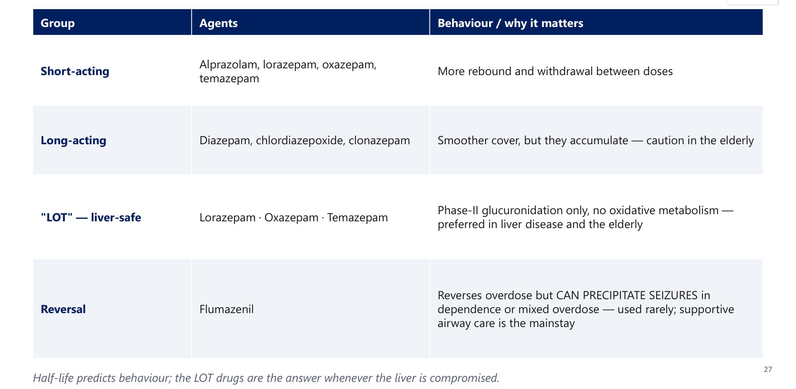

### 2.12 Z-Drugs and Buspirone (Slide 31)
| **Z-drugs (hypnotics)** | **Buspirone (anxiolytic)** |
|---|---|
| **Zolpidem, zopiclone, zaleplon** | ⭐ **5-HT1A partial agonist** |
| GABA-A benzodiazepine site, more selectively | ⭐ **No dependence, no sedation, no withdrawal** |
| Short-term insomnia, but still **dependence, complex sleep behaviours, falls** | ⭐ **Delayed onset 1–2 weeks: useless for acute anxiety**; an adjunct in **GAD** |

> 🔁 **Recap: Anxiolytics.** Benzodiazepines = frequency; barbiturates = duration. LOT for liver disease/elderly. Tolerance in ~2 weeks; never stop abruptly (seizures); flumazenil → seizures; 2–4 weeks max. Z-drugs still cause dependence. Buspirone: 5-HT1A, no dependence, slow.
> ▶️ **Up next: Antipsychotics.**

---

## PART 3: ANTIPSYCHOTICS

### 2.13 NMS (Slides 34–35, 44) ⭐⭐
**Case:**
- 24-year-old, **haloperidol 5 days ago**
- **high fever, "lead-pipe" rigidity, fluctuating consciousness, labile BP, tachycardia, markedly ↑ CK**

→ ⭐ **B: NMS.**

| Presentation | Risk & management |
|---|---|
| **Fever, lead-pipe rigidity, autonomic instability, fluctuating consciousness** | **Risk:** **high-potency FGAs, rapid dose increase, dehydration, agitation, young males** |
| ⭐ **↑ CK, leukocytosis, altered LFTs** | ⭐ **Stop the antipsychotic**; monitor, **rehydrate, cool** |
| ⭐ **Myoglobinuria → renal failure** | **Benzodiazepines; dantrolene + bromocriptine** (± amantadine or L-dopa) |
| — | ⭐ **Hold antipsychotics ≥ 5 days**; reintroduce cautiously |

**Mnemonic *[added]*: "FEVER"**:
- **F**ever
- **E**ncephalopathy
- **V**itals unstable
- **E**levated CK/WCC
- **R**igidity

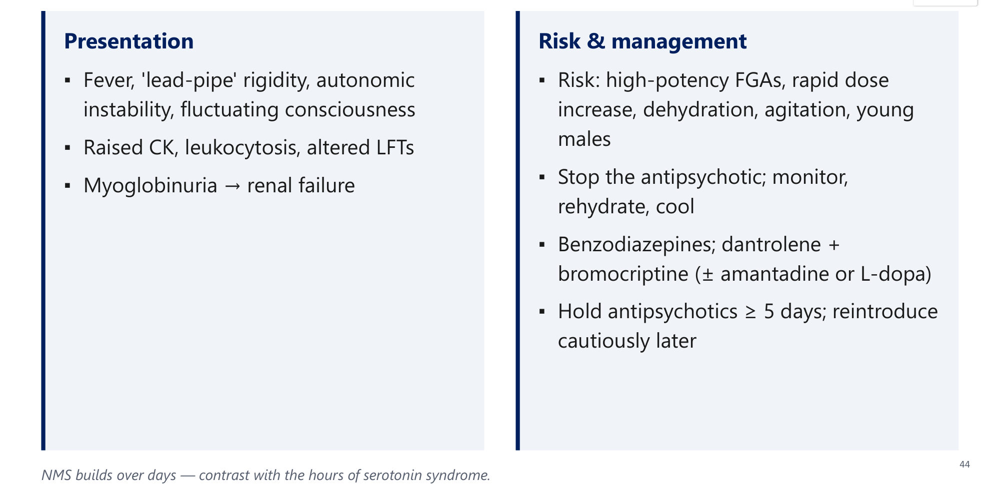

### 2.14 Mechanism, FGA vs SGA (Slides 36–38)
| Pathway | D2 blockade effect |
|---|---|
| **Mesolimbic** | ⭐ **Therapeutic**: ↓ positive symptoms |
| **Mesocortical** | May **WORSEN** negative/cognitive symptoms |
| **Nigrostriatal** | ⭐ **EPS** |
| **Tuberoinfundibular** | ⭐ **Hyperprolactinaemia** |

| **Typical (FGA)** | **Atypical (SGA)** | **D2 partial agonists ("third generation")** |
|---|---|---|
| **Chlorpromazine, fluphenazine, haloperidol, perphenazine** | **Risperidone, paliperidone, olanzapine, quetiapine, ziprasidone, lurasidone, asenapine, clozapine** | ⭐ **Aripiprazole, brexpiprazole, cariprazine** |
| Mainly **D2 antagonists**; positive symptoms; little effect on negative | **5-HT2A + D2 antagonism** → fewer EPS, some negative-symptom effect, **more metabolic** | A different mechanism; EPS mainly **akathisia** |
| ⭐ **High-potency (haloperidol, fluphenazine) → more EPS and prolactin** | ⭐ **No clear efficacy advantage except clozapine** | ⭐ **Lurasidone and cariprazine** also licensed for **bipolar depression** |
| ⭐ **Low-potency (chlorpromazine) → more anticholinergic, sedation, hypotension** | Judge efficacy only after **≥ 4 weeks** at an adequate dose | — |

- **Class risks:** EPS, tardive dyskinesia, NMS.
- **5-HT2A antagonism lifts the striatal brake**: fewer movement disorders, at the cost of weight and metabolic risk.

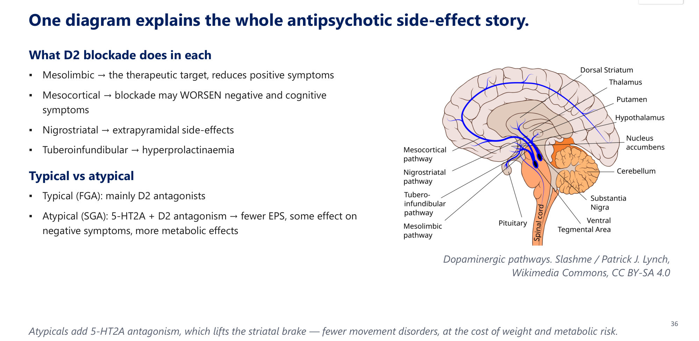

### 2.15 The Side-Effect Map (Slide 39) ⭐⭐
**Across a ROW = choosing a drug; down a COLUMN = explaining a symptom.** (— none, ● mild, ●● moderate, ●●● marked; a teaching ranking.)

| Drug | Sedation | Weight | EPS | Anti-Ch | ↓ BP | Prolactin | QTc |
|---|---|---|---|---|---|---|---|
| **Haloperidol** | ● | ● | **●●●** | — | ● | **●●●** | ●● |
| **Chlorpromazine** | **●●●** | ●● | ●● | ●● | **●●●** | **●●●** | ● |
| **Clozapine** | **●●●** | **●●●** | — | **●●●** | **●●●** | — | ● |
| **Olanzapine** | ●● | **●●●** | ● | ● | ● | ● | — |
| **Quetiapine** | **●●●** | ●● | — | ● | ●● | — | ● |
| **Risperidone** | ● | ●● | ●● | — | ●● | **●●●** | ● |
| **Ziprasidone** | ● | — | ● | — | ● | ● | **●●●** |
| **Lurasidone** | ● | — | ●● | — | — | ● | — |
| **Aripiprazole** | — | ● | ●● | — | — | — | — |
| **Brexpiprazole** | ● | ●● | ● | — | ● | — | — |
| **Cariprazine** | — | — | ●● | — | — | — | — |

**Champions:**
- **EPS:** haloperidol
- **Sedation/weight/anticholinergic/↓ BP:** clozapine (and chlorpromazine)
- **Weight:** olanzapine, clozapine
- **Prolactin:** haloperidol, chlorpromazine, risperidone
- **QTc:** ziprasidone

Partial-agonist EPS is mainly **akathisia** (most with **cariprazine**, least with **brexpiprazole**).

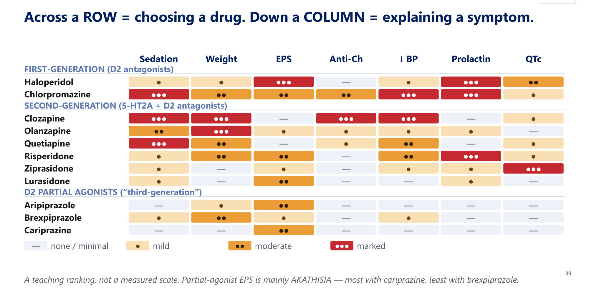

### 2.16 EPS: Timeline and Acute Dystonia (Slides 40–43) ⭐⭐
**Case (slides 40–41):**
- 19-year-old given **haloperidol** in the ED
- **hours later:** **neck twists to one side**, **eyes roll up and lock**; frightened but **fully conscious**

→ ⭐ **B: acute dystonia → anticholinergic (benztropine or diphenhydramine).** Young men are at highest risk.

| Syndrome | Onset | Features | Treatment |
|---|---|---|---|
| ⭐ **Acute dystonia** | **Hours–days** | **Torticollis, oculogyric crisis**, truncal spasm | ⭐ **IM/IV anticholinergic (benztropine)**: reverses in minutes |
| ⭐ **Akathisia** | **Days–weeks** | Inner restlessness | ⭐ **Propranolol, ↓ dose** |
| **Parkinsonism** | **Weeks–months** | Mimics negative symptoms | **↓ Dose or switch**; reversible |
| ⭐ **Tardive dyskinesia** | **Months–years** | Choreoathetoid, orofacial | ⭐ **Often irreversible → VMAT2 inhibitors**; prevention beats treatment |

- ⭐ **THE TRAP:** anticholinergics **help dystonia and parkinsonism**, **do little for akathisia**, and ⭐ **WORSEN tardive dyskinesia**.
- **Highest TD risk** with **long-term high-potency FGAs**.
- **Preserved consciousness** separates acute dystonia from a **seizure**.

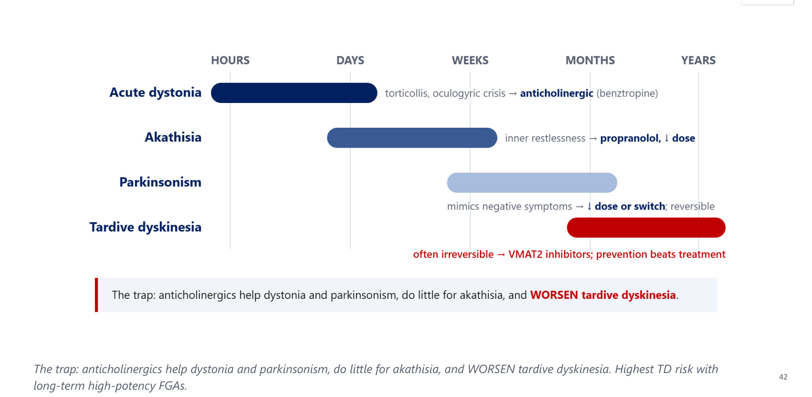
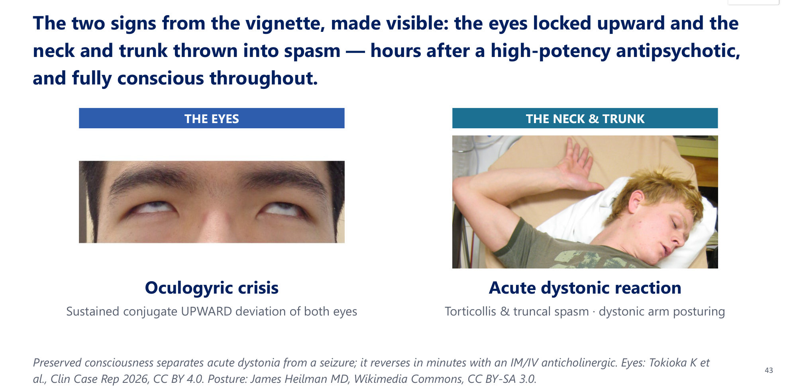

### 2.17 Metabolic, Prolactin, QT and Other Effects (Slides 45–47)
**Metabolic:** driven by **H1, 5-HT2C, D2 antagonism** + leptin changes.

| Risk | Agents | Action |
|---|---|---|
| ⭐ **High** | **Clozapine, olanzapine** | Expect significant gain; monitor from baseline |
| **Moderate** | Quetiapine, risperidone, brexpiprazole | Monitor; consider switching |
| ⭐ **Low/neutral** | **Aripiprazole, cariprazine, ziprasidone, lurasidone** | Preferred where metabolic risk exists |

⭐ **Monitoring (all antipsychotics):**
1. baseline
2. **weight weekly × 6 weeks**
3. weight, waist, **glucose/HbA1c, lipids, BP at 12 weeks**
4. then **1 year and annually**

**Management:** switch to a weight-neutral agent; ⭐ **consider metformin**; lifestyle; cardiometabolic referral.

| **Hyperprolactinaemia** | **QT and other** |
|---|---|
| **Galactorrhoea, amenorrhoea, gynaecomastia, sexual dysfunction**; long-term ⭐ **osteoporosis** | Antipsychotics block cardiac **K⁺ channels**; ⭐ **> 500 ms → torsades risk climbs** |
| ⭐ **Worst: risperidone, paliperidone, amisulpride, haloperidol** | ECG + electrolytes in at-risk patients |
| ⭐ **Sparing: aripiprazole, brexpiprazole, cariprazine, quetiapine, clozapine** (olanzapine low) | ⭐ **Higher risk: haloperidol (esp. IV), ziprasidone, pimozide** |
| ⭐ **Avoid prolactin-raisers under 25** (peak bone mass), in osteoporosis, and in **hormone-dependent breast cancer** | Anticholinergic effects; **seizures (chlorpromazine, clozapine)**; orthostatic hypotension; **SIADH** |
| Manage: switch, reduce, or **add aripiprazole** | — |

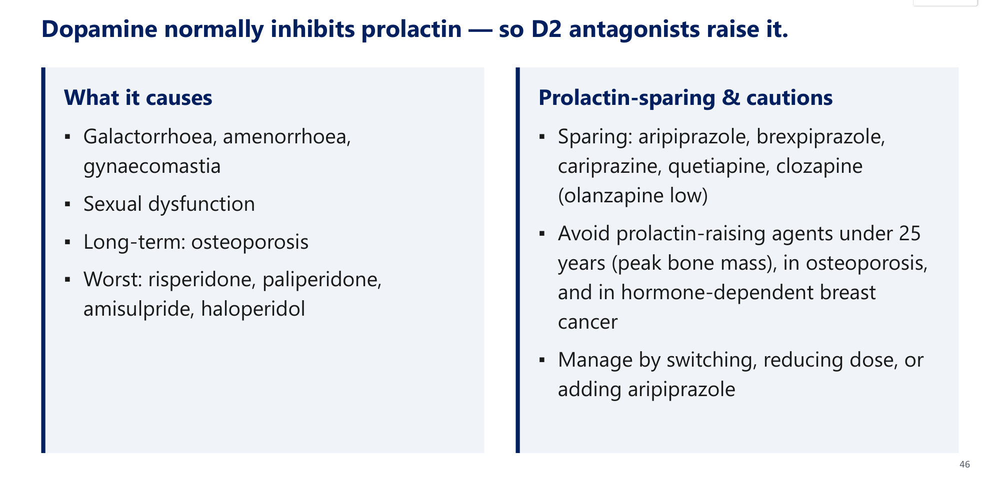

### 2.18 Clozapine (Slides 48–50) ⭐⭐
| Why it's special | The serious risks |
|---|---|
| ⭐ **Most effective**: treatment-resistant schizophrenia after **≥ 2 failed trials** | ⭐ **Agranulocytosis (~1%)** → mandatory ANC: **weekly × 6 months, 2-weekly × 6 months, then monthly** |
| ⭐ **The ONLY antipsychotic that reduces suicidality** | ⭐ **ANC < 1.5 × 10⁹/L → withhold and repeat; < 0.5 → agranulocytosis, stop permanently** |
| **Very low EPS and prolactin** | **Myocarditis** (early weeks) |
| — | **Seizures** (dose-related) |
| — | ⭐ **Constipation → ileus (can be fatal)**; **sialorrhoea**; sedation; weight gain |

⭐ **Clozapine-induced ileus kills more patients than agranulocytosis.**

**Case (slides 49–50):**
- **4 months** on clozapine
- **T 38.6 °C + sore throat** since yesterday; looks well; chest clear

→ ⭐ **B: urgent FBC and ANC TODAY.** Withhold clozapine until the result is back. "Reassure, wait a week" can be fatal.

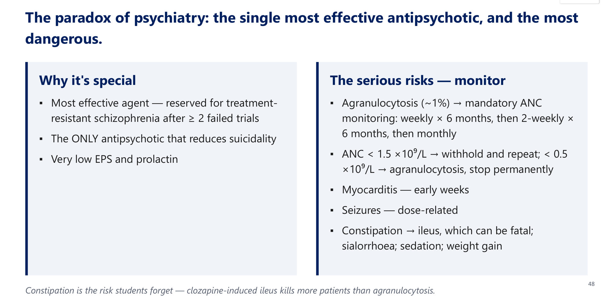

### 2.19 LAIs and Special Populations (Slide 51)
| Long-acting injectables | ⭐ Dementia: black box | Renal & liver |
|---|---|---|
| FGA: **haloperidol, fluphenazine decanoate** | ⭐ **Increased mortality in elderly patients with dementia** (CV events, falls) | **Renal:** avoid **sulpiride/amisulpride** and strong anticholinergics; consider haloperidol or low-dose olanzapine |
| SGA: **risperidone, paliperidone, aripiprazole, olanzapine** | Slide figures "≈ 2.6% vs ≈ 4.5%" over 10-week trials (*[added]* = **placebo 2.6% vs drug 4.5%**; the slide's order is ambiguous) | **Liver:** monitor LFTs; transaminitis in the first **1–6 weeks** |
| ⭐ **Transform adherence** in relapsing illness | Use only if essential, lowest dose | — |

> 🔁 **Recap: Antipsychotics.**
> - **NMS:** days; rigidity, fever, ↑ CK → stop, dantrolene/bromocriptine; hold ≥ 5 days.
> - **FGA potency:** high = EPS/prolactin; low = anticholinergic/sedation/↓ BP.
> - **SGA:** 5-HT2A + D2, metabolic. **Partial agonists:** aripiprazole, brexpiprazole, cariprazine (akathisia).
> - **Map champions:** haloperidol EPS; clozapine/olanzapine weight; risperidone prolactin; ziprasidone QT.
> - **EPS clock:** dystonia (anticholinergic) → akathisia (propranolol) → parkinsonism → TD (VMAT2; anticholinergics worsen it).
> - **Metabolic monitoring:** baseline, weekly × 6, 12 weeks, annually; metformin.
> - **Clozapine:** ANC (< 1.5 hold, < 0.5 stop); fever/sore throat → ANC today; ileus; only anti-suicide antipsychotic.
> - **Dementia black box.**
>
> ▶️ **Up next: Mood stabilisers.**

---

## PART 4: MOOD STABILISERS

### 2.20 Lithium (Slides 53–56) ⭐⭐
**Case (slides 53–54):**
- 45-year-old on long-term lithium starts **ibuprofen** during a **hot week**
- **coarse tremor, unsteady gait, vomiting, slurred speech, confusion**

→ ⭐ **A: lithium toxicity.** NSAIDs, dehydration, thiazides and ACE inhibitors ↓ lithium clearance. **Hold lithium, hydrate, check the level; dialyse if severe.**

| Dosing & levels | Side-effects |
|---|---|
| ~**900–1800 mg/day**, divided | **Thyroid** abnormalities (*[added]* hypothyroidism, goitre); **benign leukocytosis** |
| ⭐ **Therapeutic 0.6–1.2 mEq/L; maintenance 0.6–0.8** | ⭐ **Polyuria/polydipsia: nephrogenic diabetes insipidus** |
| ⭐ **1.2–1.5 = ABOVE RANGE** (recheck, review dose); ⭐ **toxic > 1.5** | Weight gain; ⭐ **FINE tremor** (therapeutic) vs **COARSE** tremor (toxic); cognitive slowing |
| ⭐ **Monitor:** level, **renal function, TSH, Ca/PTH, ECG** | **Acne, hair loss** |
| **Gold standard; the only mood stabiliser that clearly reduces suicide** | ⭐ **Teratogenic: Ebstein's anomaly** (small risk) |

**Lithium toxicity by stage (slide 56):**

| Stage | Features |
|---|---|
| **Early** | Lethargy, ⭐ **COARSE tremor**, vomiting, diarrhoea |
| **Moderate** | **Confusion, dysarthria, nystagmus**, ECG changes |
| **Late** | **Seizures, hyperreflexia, renal failure, coma** → ⭐ **dialyse if severe** |

⭐ **What tips a stable patient over:**
- **dehydration**
- **NSAIDs**
- **thiazides**
- **ACE inhibitors**
- **renal impairment**

**Never stop abruptly** (rebound mania).

**Mnemonic *[added]* for lithium side-effects, "LITHIUM":**
- **L**eukocytosis
- **I**nsipidus (nephrogenic DI)
- **T**remor/**T**eratogen (Ebstein)
- **H**ypothyroidism/**H**yperparathyroidism
- **I**ncreased weight
- **U**rine (polyuria)
- **M**outh (metallic taste)

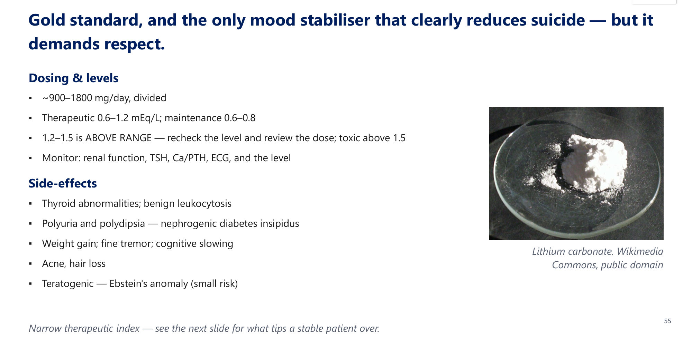 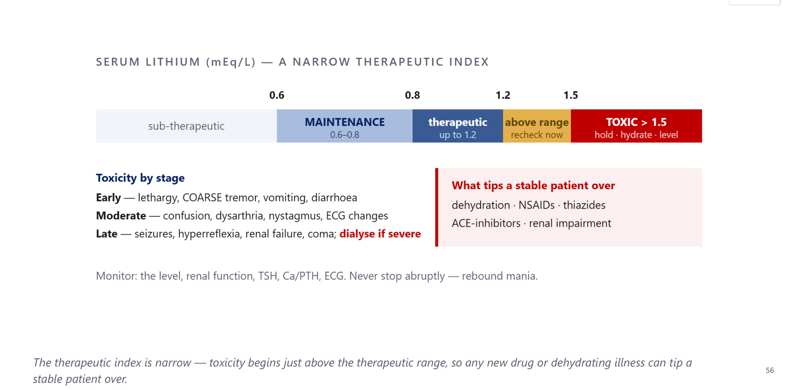

### 2.21 Valproate, Carbamazepine, Lamotrigine (Slides 57–60) ⭐
| | **Valproate** | **Carbamazepine** | **Lamotrigine** |
|---|---|---|---|
| Best for | ⭐ **Acute mania; mixed and rapid-cycling states** | Mania (*[added]*), epilepsy, trigeminal neuralgia | ⭐ **Bipolar DEPRESSION and maintenance**; weak for acute mania |
| Key side-effects | **Thrombocytopenia**, platelet dysfunction; nausea, **weight gain**; ⭐ **hepatotoxicity**; sedation, tremor, **hair loss**; ⭐ **pancreatitis; hyperammonaemia** | ⭐ **Rash (most common)**; GI upset, transaminitis; sedation, dizziness, ataxia, **diplopia**; **AV conduction delay**; ⭐ **hyponatraemia (SIADH-like)**; ⭐ **aplastic anaemia/agranulocytosis** (rare) | Generally well tolerated; **no routine levels**; ⭐ **rash → SJS/TEN** |
| Pregnancy | ⭐ **Most teratogenic:** **neural-tube defects 1–2%** vs 0.14–0.2% background (folate-related); **↓ childhood IQ**. **Avoid in women of childbearing potential** | *[added]* Also teratogenic (NTD) | — |
| ⭐ Pearl | — | ⭐ **HLA-B\*1502 → SJS/TEN** in **Han Chinese and South-East Asian** patients: **GENOTYPE BEFORE STARTING**. ⭐ **Auto-induces CYP3A4** (its own level falls over weeks); **strong enzyme inducer** | ⭐ **VALPROATE DOUBLES LAMOTRIGINE LEVELS** (inhibits glucuronidation) → **slower titration, lower dose**. ⭐ **Any rash: stop and assess**; don't watch and wait |

**Lamotrigine rash severities (slide 60):**

| Rash | Features |
|---|---|
| **Morbilliform** (common, benign) | Skin only; no mucosa, blisters or systemic illness |
| ⭐ **SJS** (rare, emergency) | **Mucosal involvement**; detachment **< 10%** BSA |
| ⭐ **TEN** (life-threatening) | Sheet-like loss **> 30%** BSA; **mortality ~25–35%** |

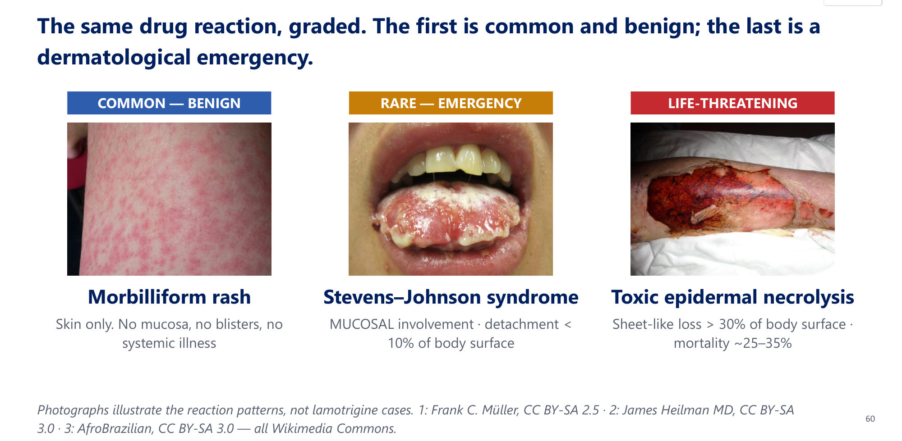

> 🔁 **Recap: Mood stabilisers.**
> - **Lithium:** 0.6–1.2 (maintenance 0.6–0.8); > 1.5 toxic. Coarse tremor → ataxia → confusion → seizures/coma (dialyse). NSAIDs, thiazides, ACEi, dehydration. Monitor renal, TSH, Ca/PTH, ECG. Nephrogenic DI; Ebstein; anti-suicide.
> - **Valproate:** mania/mixed/rapid cycling; liver, pancreas, platelets, NH₃; **NTDs, ↓ IQ**.
> - **Carbamazepine:** **HLA-B\*1502**; auto-induction; SIADH; aplastic anaemia.
> - **Lamotrigine:** bipolar depression; SJS; slow titration; **valproate doubles the level**.

---

## PART 5: INTEGRATION

### 2.22 Cytochrome P450 Interactions (Slide 62) ⭐
| Inhibitors: raise other drugs | Inducers: lower other drugs |
|---|---|
| ⭐ **Fluoxetine, paroxetine → CYP2D6:** raise TCAs, some antipsychotics; ⭐ **codeine becomes ineffective** | ⭐ **Carbamazepine:** potent inducer; lowers the **OCP**, **lamotrigine**, many drugs; auto-induces |
| ⭐ **Fluvoxamine → CYP1A2:** raises **clozapine** and **theophylline** | ⭐ **Smoking induces CYP1A2** → lowers **clozapine and olanzapine** |
| Serotonergic combinations → serotonin syndrome | ⭐ **If the patient QUITS smoking, those levels RISE** (a classic trap) |

⭐ **Fewest CYP interactions: sertraline, escitalopram, mirtazapine.** Use them in polypharmacy.

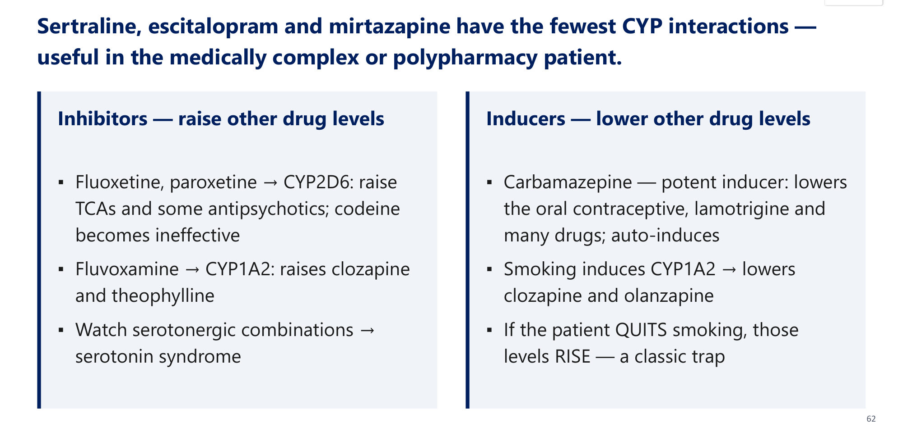

### 2.23 Psychotropics on a Non-Psychiatric Ward (Slide 63) ⭐⭐
**"If you remember one slide as a future surgeon or physician, remember this one."**

| Rule | Detail |
|---|---|
| ⭐ **Reconcile on admission** | Psychotropics are among the **most commonly omitted** and **most dangerous to omit**. Check what the patient actually takes |
| ⭐ **Never stop abruptly** | **Benzodiazepines → withdrawal seizures**; **antidepressants → discontinuation**; ⭐ **clozapine > ~48 h off → re-titrate from a low dose** |
| ⭐ **NBM and dehydrated** | The classic **lithium-toxicity** setting: surgery, vomiting, diarrhoea, hot weather, a new **NSAID/thiazide/ACEi**. **Hold lithium, rehydrate, check the level** |
| ⭐ **Fever on clozapine** | **FBC + ANC the same day**. And take **constipation** seriously: ileus kills more than agranulocytosis |

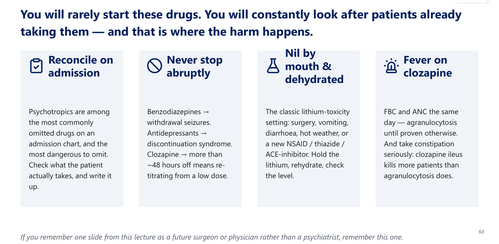

### 2.24 The Interactions You Will Cause (Slide 64) ⭐⭐
| You prescribe | Hits | What happens | Do |
|---|---|---|---|
| ⭐ **Tramadol** | SSRI/SNRI | **Serotonin syndrome** (the commonest trigger in practice) | Choose a **non-serotonergic analgesic** |
| ⭐ **Codeine** | **Fluoxetine, paroxetine** | CYP2D6 inhibition → **no conversion to morphine → NO analgesia** | Use another analgesic |
| ⭐ **NSAIDs** | **Lithium / SSRI** | **Lithium toxicity**; with SSRIs, **GI bleeding** | Avoid; if unavoidable, check the level and add gastric protection |
| **Clarithromycin, linezolid** | Clozapine / serotonergics | Enzyme inhibition **↑ clozapine**; ⭐ **linezolid is an MAOI → serotonin syndrome** | Check interactions before antibiotics |
| **Any QT-prolonging drug** | Antipsychotics | **Additive QT → torsades** | ECG and electrolytes before and after |

**Also:** **metoclopramide and ondansetron are serotonergic**; ⭐ **metoclopramide is a dopamine antagonist → EPS and can contribute to NMS**.

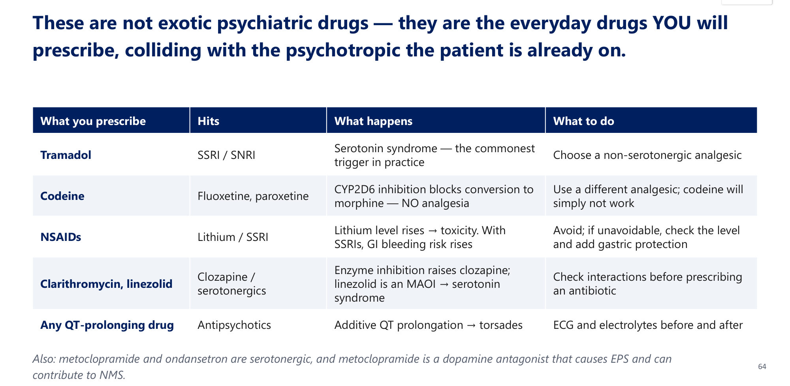

### 2.25 Black-Box Warnings (Slide 65) ⭐
| Drug/class | Black box |
|---|---|
| ⭐ **All antidepressants** | **↑ Suicidal ideation/behaviour in patients < 25, early in treatment** |
| ⭐ **All antipsychotics** | **↑ Mortality in elderly patients with dementia-related psychosis** |
| ⭐ **Clozapine** | **Agranulocytosis · myocarditis · seizures · orthostatic hypotension/syncope** |
| ⭐ **Valproate** | **Hepatotoxicity · pancreatitis · teratogenicity (NTD)** |
| ⭐ **Carbamazepine** | **Aplastic anaemia/agranulocytosis · SJS/TEN (HLA-B\*1502)** |

These shape **prescribing and consent**: they are what you must tell the patient.

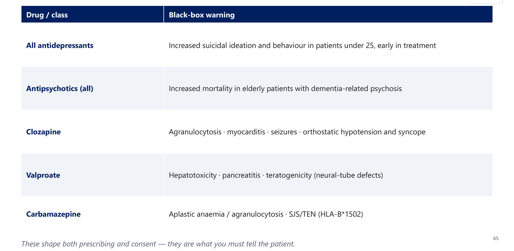

### 2.26 Integrative Case 1: Mr. H, 34 (Slides 66–67) ⭐
**Presentation:**
- **paroxetine 8 months** + **tramadol 2 days ago** + OTC **dextromethorphan** cough syrup
- **hours:** agitated, drenched, **HR 124, BP 158/92, 38.4 °C**
- **dilated pupils, hyperactive bowel sounds**, tremor, **ankle clonus (legs > arms)**, brisk reflexes
- **no rigidity**, no antipsychotic

| Question | Model answer (lecture) |
|---|---|
| 1. Diagnosis, culprits? | ⭐ **Serotonin syndrome**: paroxetine + **tramadol + dextromethorphan** (the last two most often overlooked) |
| 2. vs NMS? | **Hours vs days**; **clonus/hyperreflexia (legs)** vs lead-pipe rigidity; **dilated pupils**; **hyperactive vs reduced bowel sounds**; serotonergic vs antipsychotic |
| 3. Immediate management? | **Stop every serotonergic drug**; IV fluids, **active cooling**, cardiac monitoring, **benzodiazepines** |
| 4. Antidotes? | ⭐ **Cyproheptadine** for SS; **dantrolene and bromocriptine** for NMS: **don't swap them** |
| 5. Discharge? | Document as a drug interaction; warn that **tramadol and dextromethorphan are serotonergic**; plan the **washout** before any new serotonergic agent |

### 2.27 Integrative Case 2: Ms. K, 27 (Slides 68–69) ⭐
**Presentation:**
- **clozapine 400 mg for 2 years** (two antipsychotics failed before)
- **no bowel opening for 6 days**; distended, vomiting for 2 days
- **procyclidine started 3 weeks ago** for tremor
- **tympanic abdomen, almost no bowel sounds**; T 37.4 °C, HR 104
- ANC normal; not rigid; oriented
- the surgical registrar asks to "simply stop clozapine"

| Question | Model answer (lecture) |
|---|---|
| 1. Diagnosis? | ⭐ **Clozapine-induced GI hypomotility → ileus**, aggravated by **anticholinergic procyclidine** |
| 2. Why dangerous? | ⭐ **Commoner than agranulocytosis and higher mortality**, but **no mandatory monitoring**, so it is missed |
| 3. Management? | **Surgical assessment + imaging**, **stop the anticholinergic**, aggressive laxatives, **NBM if obstructed**; treat as a **surgical emergency** |
| 4. Stop clozapine? | **Not casually.** Stopping > 48 h → **re-titrate from a low dose**; she has failed two others. **Decide jointly with psychiatry** |
| 5. Prevention? | **Ask about bowels at every clozapine review**; **prophylactic laxatives**, not an added anticholinergic |

⭐ **Transferable lesson:** "the risk that is counted gets watched; the risk that is not counted gets missed."

---

## 3. High-Yield Comparison Tables

### Table A: Antidepressant Selection Cheat-Sheet
| Clinical need | Choose | Avoid |
|---|---|---|
| Suicidal / overdose risk | SSRI (sertraline, fluoxetine) | **TCAs** (lethal) |
| Cardiac disease / QT | **Sertraline**, fluoxetine, mirtazapine | Citalopram/escitalopram (QT), TCAs |
| Insomnia + poor appetite | **Mirtazapine** | Bupropion (activating) |
| Sexual dysfunction concern | **Bupropion**, mirtazapine | SSRIs/SNRIs |
| Smoking cessation | **Bupropion** | — |
| Eating disorder / head injury / epilepsy | SSRI | **Bupropion** (seizures) |
| Neuropathic pain | **Duloxetine** (or TCA, e.g. amitriptyline *[added]*) | — |
| Polypharmacy | **Sertraline, escitalopram, mirtazapine** | Fluoxetine/paroxetine (2D6), fluvoxamine (1A2) |
| Elderly | Sertraline/mirtazapine; check Na⁺ | TCAs (anticholinergic, falls), paroxetine |
| Breastfeeding | **Sertraline**, paroxetine | — |
| Pregnancy, first trimester | Sertraline/fluoxetine (risk–benefit) | Paroxetine (historic signal) |
| Atypical / resistant depression | MAOI (with tyramine diet) | — |
| Postpartum depression | **Zuranolone** | — |
| TRD / acute suicidality | **Esketamine** | — |
| Hypnotic | **Trazodone** (warn: priapism) | — |

### Table B: The Toxic Syndromes
| | Serotonin syndrome | NMS | Lithium toxicity | TCA overdose | Anticholinergic *[added]* |
|---|---|---|---|---|---|
| Onset | **Hours** | **Days–weeks** | Days (precipitant) | Hours | Hours |
| Neuro | **Clonus, hyperreflexia** | **Lead-pipe rigidity**, bradyreflexia | **Coarse tremor, ataxia**, dysarthria → seizures | Coma, seizures | Delirium |
| Pupils | **Dilated** | Normal | — | Dilated | Dilated |
| Bowel | **Hyperactive** | Reduced | Diarrhoea | Reduced | **Absent** |
| Skin | Sweaty | Sweaty | — | Dry | **Dry, hot** |
| Key lab | — | **↑ CK** | **Li > 1.5** | **QRS > 100 ms, R in aVR** | — |
| Rx | **Stop, benzodiazepines, cyproheptadine** | **Stop, dantrolene/bromocriptine** | **Hold, fluids, dialysis** | **IV bicarbonate** | Supportive (physostigmine) |

### Table C: Benzodiazepine Facts
| Item | Detail |
|---|---|
| Mechanism | GABA-A, **↑ frequency** (barbiturates: ↑ duration) |
| Liver-safe | **LOT**: lorazepam, oxazepam, temazepam |
| Long-acting | Diazepam, chlordiazepoxide, clonazepam |
| Tolerance | ~2 weeks |
| Max duration | 2–4 weeks |
| Withdrawal | Seizures, coma, death → **taper** |
| Reversal | Flumazenil (seizure risk; rarely used) |
| Pregnancy | Cleft palate signal; floppy infant; neonatal withdrawal |
| Non-dependence alternative | **Buspirone** (5-HT1A; 1–2-week onset) |

### Table D: Mood Stabilisers
| | Lithium | Valproate | Carbamazepine | Lamotrigine |
|---|---|---|---|---|
| Best for | Maintenance, **anti-suicide** | **Acute mania, mixed, rapid cycling** | Mania, epilepsy | **Bipolar depression**, maintenance |
| Level | **0.6–1.2** (toxic > 1.5) | — | — | Not routine |
| Signature risk | Nephrogenic DI, hypothyroid, ↑ Ca, **toxicity** | Liver, pancreas, platelets, NH₃ | **HLA-B\*1502 SJS**, SIADH, aplastic anaemia | **SJS/TEN** |
| Pregnancy | **Ebstein's** | **NTD 1–2%, ↓ IQ** (worst) | NTD *[added]* | Relatively safer *[added]* |
| Interaction | NSAIDs, thiazides, ACEi ↑ level | **Doubles lamotrigine** | **Inducer** (OCP fails), auto-induction | ↑ by valproate |

### Table E: Antipsychotic Choice by Patient
| Patient factor | Prefer | Avoid |
|---|---|---|
| Metabolic risk/obesity/diabetes | **Aripiprazole, cariprazine, ziprasidone, lurasidone** | Olanzapine, clozapine |
| Prolactin/young woman/< 25/osteoporosis | **Aripiprazole**, quetiapine | Risperidone, paliperidone, amisulpride, haloperidol |
| Long QT/cardiac disease | Aripiprazole, lurasidone | **Haloperidol IV, ziprasidone, pimozide** |
| EPS-prone/Parkinson's *[added]* | **Quetiapine, clozapine** | Haloperidol |
| Bipolar depression | **Lurasidone, cariprazine** (quetiapine) | — |
| Treatment-resistant / suicidal | **Clozapine** | — |
| Non-adherent | **LAI** | — |
| Renal impairment | Haloperidol, low-dose olanzapine | Sulpiride, amisulpride |
| Elderly with dementia | Avoid if possible (black box) | — |

---

## 4. Rules, Exceptions, Patterns
- **Antidepressants: equal efficacy**; choose on **side-effects + overdose safety**. No TCAs for the suicidal.
- **SSRI risks:** sexual dysfunction (ask), bleeding (NSAIDs), **SIADH (elderly; stop if Na < 125)**, citalopram QT (40 / 20 mg).
- **Short half-life (paroxetine, venlafaxine) → worst discontinuation**; fluoxetine needs no taper.
- **TCA overdose → IV bicarbonate** (QRS > 100 ms, R in aVR). Never flumazenil.
- **MAOI washout 2 weeks (5 after fluoxetine)**; tyramine crisis.
- **Bupropion lowers the seizure threshold** (eating disorders, head injury); **trazodone → priapism**.
- **Serotonin syndrome = fast + clonus; NMS = slow + rigidity.** Cyproheptadine vs dantrolene/bromocriptine; don't swap.
- **Hidden serotonergics:** tramadol, dextromethorphan, linezolid, triptans, ondansetron, metoclopramide, St John's wort.
- **Discontinuation (days, physical) vs relapse (weeks, mood).**
- **Continue 6–9 months after remission**: most relapses happen in continuation.
- **Benzodiazepines:** frequency; LOT; 2–4 weeks; taper; flumazenil → seizures; **reconcile on admission**.
- **Buspirone:** no dependence; slow.
- **FGA high-potency → EPS/prolactin; low-potency → anticholinergic/sedation/↓ BP.**
- **Anticholinergics: help dystonia/parkinsonism, not akathisia, WORSEN TD.**
- **Metabolic monitoring** schedule; metformin.
- **Clozapine:** ANC thresholds; fever → ANC today; **ileus > agranulocytosis**; **> 48 h gap → re-titrate**; smoking cessation ↑ level.
- **Lithium 0.6–1.2; > 1.5 toxic**; NSAIDs, thiazides, ACEi, dehydration; **fine tremor = therapeutic, coarse = toxic**.
- **Valproate: most teratogenic**; doubles lamotrigine.
- **Carbamazepine: HLA-B\*1502**; inducer (OCP failure); auto-induction.
- **Lamotrigine: any rash → stop**; slow titration.
- **Black boxes:** antidepressants < 25; antipsychotics + dementia; clozapine; valproate; carbamazepine.

---

## 5. Clinical Correlations
- **Surgery:**
  - reconcile psychotropics (benzodiazepine omission → seizures)
  - NBM/dehydration → **lithium toxicity**
  - clozapine gaps > 48 h → re-titrate
  - ileus on clozapine
- **Pain management:**
  - **tramadol + SSRI → serotonin syndrome**
  - **codeine useless with fluoxetine/paroxetine**
  - **NSAIDs + lithium → toxicity**
  - NSAIDs + SSRI → GI bleed
- **Infectious disease:**
  - **linezolid is an MAOI**
  - **clarithromycin raises clozapine**
  - fever on clozapine → ANC
- **Cardiology/ECG:**
  - citalopram, haloperidol IV, ziprasidone, pimozide → **QT**
  - TCA → **QRS widening, tall R in aVR** → bicarbonate
  - **clozapine myocarditis**
  - lithium ECG changes
- **Endocrinology:**
  - **SSRIs/carbamazepine → SIADH**
  - **lithium → nephrogenic DI, hypothyroidism, hyperparathyroidism/↑ Ca**
  - **antipsychotics → hyperprolactinaemia** (galactorrhoea, amenorrhoea, osteoporosis)
  - **SGAs → diabetes, dyslipidaemia** (metformin)
- **Gastroenterology:** **metoclopramide → EPS/NMS**; ondansetron is serotonergic; valproate → hepatotoxicity, pancreatitis.
- **Obstetrics:**
  - **valproate (NTD, ↓ IQ)** and **lithium (Ebstein's)**
  - benzodiazepines (floppy infant)
  - paroxetine in the first trimester
  - **zuranolone** for PPD
  - **sertraline** in breastfeeding
- **Dermatology:** **lamotrigine and carbamazepine SJS/TEN**; HLA-B\*1502 screening.
- **Haematology:** clozapine agranulocytosis; carbamazepine aplastic anaemia; valproate thrombocytopenia; lithium leukocytosis.
- **Smoking cessation:** **bupropion, varenicline**. Quitting smoking **raises clozapine/olanzapine levels**.

---

## 6. Rapid Revision (Last-Day)
1. **Antidepressants:** equal efficacy; **60–70% respond at 4–6 weeks**; choose by side-effects and overdose safety.
2. **SSRIs:**
   - **fluoxetine** (long t½), **sertraline** (cardiac-safe, few interactions)
   - **citalopram/escitalopram** (QT; citalopram max 40 mg, 20 mg if > 60)
   - **paroxetine** (worst discontinuation), **fluvoxamine** (CYP1A2 ↑ clozapine)
3. **SSRI harms:** sexual dysfunction, GI, anxiety; **bleeding** (+ NSAIDs), **SIADH** (stop if Na < 125), serotonin syndrome, discontinuation.
4. **SNRIs:** venlafaxine (↑ BP, discontinuation); duloxetine (pain; avoid in severe liver disease).
5. **TCAs:** H1 (sedation, weight), M (anticholinergic), α1 (orthostasis), **Na⁺ (QRS, arrhythmia)**. Tertiary (amitriptyline, imipramine, clomipramine, doxepin) vs secondary (nortriptyline, desipramine). **Overdose → IV bicarbonate.**
6. **MAOIs:** tyramine crisis; serotonin syndrome; **washout 2 weeks / 5 weeks after fluoxetine**; moclobemide reversible.
7. **Bupropion** (NDRI: no sexual dysfunction/weight gain, smoking; **seizures**) · **mirtazapine** (NaSSA: sleep, appetite, no QT) · **trazodone** (SARI: hypnotic, **priapism**).
8. **New agents:** vortioxetine, vilazodone, agomelatine; **esketamine** (NMDA; TRD, suicidality; monotherapy 2025); **Auvelity** (2022); **zuranolone** (PPD, 2023).
9. **Serotonin syndrome:** hours; mental-status change, **clonus/hyperreflexia (legs)**, autonomic; tramadol, DXM, linezolid, triptans; **stop, cool, benzodiazepines, cyproheptadine**.
10. **NMS:** days; **lead-pipe rigidity**, fever, ↑ CK, myoglobinuria; high-potency FGAs, young men, dehydration; **stop, cool, dantrolene + bromocriptine**; hold ≥ 5 days.
11. **Discontinuation (FINISH):** days; brain zaps; < 2 weeks; restart and taper.
12. **Duration:** acute 6–12 weeks; **continuation 6–9 months after remission**; maintenance ≥ 2 years. Benzodiazepines 2–4 weeks; antipsychotics 1–2 years after a first episode; lithium long-term.
13. **Pregnancy/lactation:** SSRIs not major teratogens; avoid paroxetine in the first trimester; **sertraline/paroxetine lowest in milk**.
14. **Benzodiazepines:**
    - GABA-A **frequency** (barbiturates: duration)
    - **LOT** for liver disease/elderly
    - tolerance in 2 weeks; withdrawal **seizures/death** → taper
    - **flumazenil → seizures**
    - floppy infant
15. **Z-drugs** still cause dependence; **buspirone** = 5-HT1A, no dependence, 1–2-week onset.
16. **Pathways:** mesolimbic (therapeutic), mesocortical (worsens negative), nigrostriatal (EPS), TIDA (prolactin).
17. **FGA potency:** high (haloperidol, fluphenazine) = EPS/prolactin; low (chlorpromazine) = anticholinergic/sedation/↓ BP.
18. **SGA = 5-HT2A + D2**; **partial agonists:** aripiprazole, brexpiprazole, cariprazine. **Lurasidone/cariprazine** for bipolar depression. Efficacy is equal except **clozapine**; judge at ≥ 4 weeks.
19. **Map:** haloperidol EPS; clozapine/olanzapine weight; risperidone prolactin; ziprasidone QT; aripiprazole/cariprazine clean (akathisia).
20. **EPS:**
    - **dystonia** (hours, benztropine)
    - **akathisia** (days, propranolol/↓ dose)
    - **parkinsonism** (weeks, ↓ dose)
    - **TD** (months–years, VMAT2)
    - **anticholinergics worsen TD**
21. **Metabolic monitoring:** baseline, weekly × 6, 12 weeks, 1 year, annually; metformin.
22. **Prolactin:** worst risperidone/paliperidone/amisulpride/haloperidol; sparing aripiprazole etc.; avoid < 25.
23. **QT > 500 ms → torsades;** haloperidol IV, ziprasidone, pimozide.
24. **Clozapine:**
    - ≥ 2 failed trials; **only anti-suicide antipsychotic**
    - agranulocytosis ~1%; ANC weekly × 6 months → 2-weekly × 6 months → monthly; **< 1.5 hold; < 0.5 stop**
    - myocarditis; seizures; **ileus** (kills more); sialorrhoea
    - **fever/sore throat → ANC today**
25. **LAIs** for adherence; **dementia black box**.
26. **Lithium:**
    - **0.6–1.2 (maintenance 0.6–0.8)**; 1.2–1.5 above range; **> 1.5 toxic**
    - **coarse tremor → ataxia, dysarthria → seizures, coma → dialysis**
    - NSAIDs, thiazides, ACEi, dehydration
    - monitor level, renal, TSH, Ca/PTH, ECG
    - **nephrogenic DI**, hypothyroidism, leukocytosis, **Ebstein's**
27. **Valproate:** mania/mixed/rapid cycling; liver, pancreas, platelets, NH₃; **NTD 1–2%, ↓ IQ**.
28. **Carbamazepine:** rash, **SIADH**, AV block, aplastic anaemia; **HLA-B\*1502**; **CYP3A4 auto-induction**; inducer.
29. **Lamotrigine:** bipolar depression; **SJS/TEN**; slow titration; **valproate doubles the level**.
30. **CYP:** fluoxetine/paroxetine 2D6 (↑ TCAs, codeine fails); fluvoxamine 1A2 (↑ clozapine); carbamazepine induces (OCP); **smoking induces 1A2; quitting ↑ clozapine**.
31. **Ward rules:** reconcile · never stop abruptly · NBM + lithium · fever on clozapine.
32. **Interactions you cause:** tramadol + SSRI · codeine + fluoxetine/paroxetine · NSAID + lithium/SSRI · linezolid (MAOI) · clarithromycin + clozapine · QT drugs · metoclopramide (EPS/NMS).
33. **Black boxes:** antidepressants (< 25 suicidality) · antipsychotics (dementia mortality) · clozapine · valproate · carbamazepine.

---

## 7. Exam-Style Questions

**Q1 (lecture, slides 11–12).** A 22-year-old took a bottle of amitriptyline 2 h ago: drowsy, BP 88/54, HR 128; QRS 130 ms, tall R in aVR. Most important immediate treatment?
A. Activated charcoal alone · **B. IV sodium bicarbonate** · C. IV flumazenil · D. IV naloxone

> **Answer: B** (lecture key).
> - Na⁺-channel blockade; QRS > 100 ms + R in aVR predict seizures/arrhythmia.
> - Bicarbonate overcomes it. Flumazenil is wrong and dangerous.

**Q2 (lecture, slides 16–17).** A 30-year-old on sertraline is given tramadol; within hours he is agitated, confused, sweating, 39 °C, tachycardic, with brisk reflexes and clonus worse in the legs. Diagnosis?
A. NMS · **B. Serotonin syndrome** · C. Anticholinergic toxicity · D. Malignant hyperthermia

> **Answer: B** (lecture key). Fast onset + mental-status change + autonomic instability + neuromuscular hyperactivity. Stop the drugs, cool, benzodiazepines, cyproheptadine if severe.

**Q3 (lecture, slides 29–30).** A 58-year-old on diazepam 20 mg/day for years (omitted from his admission chart) is tremulous, sweating, BP 175/100 on day 3 after hernia repair, then seizes. He doesn't drink. Diagnosis and need?
A. Alcohol withdrawal → thiamine · **B. Benzodiazepine withdrawal → reinstate a benzodiazepine** · C. Post-op delirium → antipsychotic · D. Serotonin syndrome → cyproheptadine

> **Answer: B** (lecture key). Reinstate, then taper deliberately. Reconcile psychotropics on every admission.

**Q4 (lecture, slides 49–50).** A 29-year-old 4 months into clozapine has a fever of 38.6 °C and a sore throat since yesterday; looks well; chest clear. First action?
A. Reassure: probably viral · **B. Urgent FBC and ANC today** · C. Antibiotics, review in a week · D. Stop clozapine and discharge

> **Answer: B** (lecture key).
> - Agranulocytosis until proven otherwise; withhold clozapine until the result is back.
> - ANC < 1.5 → withhold and repeat; < 0.5 → stop permanently.

**Q5 (lecture, slides 53–54).** A 45-year-old on long-term lithium starts ibuprofen during a hot week; she develops coarse tremor, unsteady gait, vomiting, slurred speech and confusion. What is happening?
**A. Lithium toxicity** · B. Serotonin syndrome · C. Hypoglycaemia · D. Cerebellar stroke

> **Answer: A** (lecture key).
> - NSAIDs + dehydration ↓ clearance.
> - Hold lithium, hydrate, check the level, dialyse if severe.

**Additional lecture MCQs:**
- **Slides 21–22:** stopped paroxetine 3 days ago; dizziness, nausea, brain zaps, vivid dreams, mood unchanged → **discontinuation syndrome**. Restart and taper.
- **Slides 34–35:** haloperidol 5 days ago; fever, lead-pipe rigidity, fluctuating consciousness, labile BP, ↑ CK → **NMS**.
- **Slides 40–41:** haloperidol hours ago; torticollis and oculogyric crisis, fully conscious → **acute dystonia → benztropine**.

**Lecture board one-liners (slide 70):**

| # | Question | Answer |
|---|---|---|
| 1 | Fast onset, clonus, hyperreflexia after tramadol + SSRI? | **Serotonin syndrome** → benzodiazepines + cyproheptadine |
| 2 | Lead-pipe rigidity, fever, ↑ CK days after haloperidol? | **NMS** → stop, dantrolene/bromocriptine |
| 3 | Antidepressant to avoid in an eating disorder? | **Bupropion** (seizure threshold) |
| 4 | Benzodiazepines safe in liver disease? | **LOT**: lorazepam, oxazepam, temazepam |
| 5 | Genotype before carbamazepine in Han Chinese/SE Asian patients? | **HLA-B\*1502** (SJS/TEN) |

---

## 8. Exam Pitfalls & Traps
| Trap | Correct thinking |
|---|---|
| Choosing a TCA for a suicidal patient | ❌ **Lethal in overdose** |
| Flumazenil for an unknown overdose with wide QRS | ❌ Dangerous (seizures); TCA → **bicarbonate** |
| Citalopram 60 mg in a 70-year-old | ❌ Max **20 mg if > 60** (QT) |
| Ignoring sodium in an elderly patient on an SSRI | ❌ **SIADH**; stop if Na < 125 |
| SSRI + NSAID without gastric protection | ❌ ↑ GI bleeding |
| Tramadol for back pain in a patient on an SSRI | ❌ **Serotonin syndrome**; choose a non-serotonergic analgesic |
| Codeine for a patient on fluoxetine/paroxetine | ❌ CYP2D6 inhibition → **no analgesia** |
| Linezolid with an SSRI | ❌ Linezolid is an **MAOI** |
| Starting an SSRI the day after stopping an MAOI | ❌ **2-week washout** (5 weeks after fluoxetine) |
| Bupropion for anxious depression / bulimia | ❌ Doesn't treat anxiety; **seizure risk** in eating disorders |
| Brain zaps 3 days after stopping paroxetine = relapse | ❌ **Discontinuation**: restart and taper |
| Stopping an antidepressant at recovery | ❌ Continue **6–9 months after remission** |
| Swapping cyproheptadine and dantrolene | ❌ Cyproheptadine = SS; dantrolene/bromocriptine = NMS |
| Rigidity + fever + clonus | ⚠️ Clonus/hyperreflexia → SS; lead-pipe/bradyreflexia → NMS |
| Benzodiazepines for months | ❌ **2–4 weeks**; tolerance by ~2 weeks |
| Omitting long-term diazepam on admission | ❌ Withdrawal **seizures**: reconcile |
| Diazepam in liver failure | ❌ Use **LOT** |
| Buspirone PRN for a panic attack | ❌ 1–2-week onset; useless acutely |
| Restless patient on an antipsychotic → more antipsychotic or benztropine | ❌ **Akathisia** → propranolol / ↓ dose (anticholinergics do little) |
| Benztropine for tardive dyskinesia | ❌ Anticholinergics **worsen TD**; use VMAT2 inhibitors |
| Torticollis + upward gaze = seizure | ❌ Conscious → **acute dystonia** → IM anticholinergic |
| Risperidone for a 20-year-old woman with amenorrhoea | ❌ Prolactin-raising; prefer **aripiprazole**; avoid < 25 |
| Olanzapine for an obese diabetic | ❌ Choose aripiprazole/lurasidone/ziprasidone/cariprazine |
| Fever on clozapine = viral | ❌ **ANC today** |
| Constipation on clozapine is trivial | ❌ **Ileus kills more than agranulocytosis**; prophylactic laxatives |
| Restarting clozapine at the full dose after 3 days off | ❌ **> 48 h → re-titrate** |
| Patient on clozapine quits smoking, no change needed | ❌ CYP1A2 de-induction → **levels rise** |
| Fine tremor on lithium = toxicity | ⚠️ Fine = therapeutic side-effect; **coarse** = toxicity |
| Lithium + NSAID/thiazide/ACEi without level checks | ❌ ↑ Lithium → toxicity |
| Valproate first-line in a young woman | ❌ **Most teratogenic** (NTD, ↓ IQ) |
| Carbamazepine in a Han Chinese patient without testing | ❌ **HLA-B\*1502** first |
| Carbamazepine + combined OCP | ❌ Enzyme induction → **contraceptive failure** |
| Lamotrigine at the usual titration with valproate | ❌ Valproate **doubles** the level: slower, lower |
| A rash on lamotrigine: watch and wait | ❌ **Stop and assess** (SJS/TEN) |
| Metoclopramide is "just an antiemetic" | ❌ D2 antagonist (EPS, NMS) and serotonergic |
| Antipsychotic for agitation in dementia, freely | ❌ **Black box: ↑ mortality** |
