# Substance Use Disorders
**Psychiatry, Clinical Lecture** | Dr. Hussain M. Khrad (Consultant Psychiatrist, KFSHRC-Jeddah; ABAM, addiction medicine) | Source: `Substance-Use-Disorders.pdf` (77 slides)

> **Legend:** ⭐ = high-yield · *[added]* = not on slides. Images marked "Slide N" come from the lecture. All MCQ answers and the case model answer come from the lecture's own answer slides.

> 🔗 **Bridge from earlier lectures:**
> - **History Taking:** **one substance at a time** (onset, pattern, route, effects, withdrawal); **CAGE ≥ 2**; caffeine in anxious patients.
> - **MSE / Psychosis:** **formication** (cocaine, alcohol withdrawal); **visual hallucinations** = delirium/substances; **stimulants (Captagon) and cannabis** cause psychosis; **urine drug screen** in every first episode; **mesolimbic dopamine**.
> - **Mood / Anxiety:**
>   - substance-induced depression (alcohol: reassess after abstinence)
>   - stimulant "crash" → suicidality
>   - alcohol/benzodiazepine **withdrawal** mimics anxiety
>   - **avoid long-term benzodiazepines**
> - **Infective Endocarditis:** **IV drug use** → right-sided (tricuspid) IE, *S. aureus*.
> - **Medicine:** Wernicke's (thiamine before glucose); cocaine → MI, aortic dissection; alcohol → cirrhosis, pancreatitis, cardiomyopathy.

---

## 1. Title / Objectives

| Domain | Objective | Likely tested as |
|---|---|---|
| Knowledge | Addiction neurobiologically and biopsychosocially | Mesolimbic dopamine; down-regulation |
| Knowledge | ⭐ **Tolerance vs physical dependence vs addiction** | Cancer patient on opioids is NOT addicted |
| Knowledge | ⭐ **DSM-5 criteria + severity** | ≥ 2 of 11 in 12 months; 2–3 / 4–5 / ≥ 6 |
| Knowledge | ⭐ Intoxication and withdrawal of each class; **which withdrawals kill** | Only alcohol and sedatives |
| Knowledge | Medication-assisted and psychosocial treatment | Naltrexone/acamprosate; methadone/buprenorphine; varenicline |
| Skill | One-substance-at-a-time history; CAGE/AUDIT + brief intervention; interpret a UDS (and what it misses) | Fentanyl missed; false positives |
| Skill | ⭐ **Recognise DTs, opioid overdose, Wernicke's, and act** | Benzodiazepines; naloxone; thiamine before glucose |
| Skill | Match the approach to the **stage of change**; treat comorbidity **concurrently** | Prochaska & DiClemente |
| Values | Chronic relapsing illness, not a moral failing; **relapse ≠ failure**; non-judgemental; faith/family/community as protective; ⭐ **don't withhold analgesia** from a dependent patient; address stigma | — |

---

## 2. Main Content (Lecture Order)

### 2.1 Definitions (Slide 5)
| **Substance use disorder (SUD)** | **Addiction** |
|---|---|
| **Recurrent use** of alcohol/drugs causing clinically significant impairment | The **most severe, chronic** stage |
| Health problems, disability, failure of major responsibilities (work, school, home) | **Substantial loss of self-control**; compulsive use despite a desire to stop |
| Graded **mild/moderate/severe** by criteria count | ⭐ In DSM-5, **"addiction" = severe SUD** |

⭐ **Severity: 2–3 = mild · 4–5 = moderate · ≥ 6 = severe.**

### 2.2 Neurobiology: Addiction Is a Brain Disease (Slides 6–7) ⭐
- ⭐ **All addictive drugs converge on one final common pathway: the mesolimbic dopamine reward circuit.**
- **Anatomy:** **VTA** (dopamine cell bodies) → **nucleus accumbens** (reward and salience hub) → **prefrontal cortex** (judgement and control). This is the same circuit antipsychotics act on in psychosis.
- **What every addictive drug does:**
  - a dopamine surge **far larger than any natural reward**
  - the brain "learns" the drug is supremely important
  - conditioning becomes **stronger than food, relationships or safety**

| Neuroadaptation (slide 7) | Consequence |
|---|---|
| **Down-regulation** | Repeated surges → **less dopamine, fewer receptors** |
| **Anhedonia & tolerance** | Natural pleasures feel flat; **larger doses** needed |
| ⭐ **Cue reactivity** | Receptors fire to **cues**, not just the drug → **craving**. Use shifts from **getting "high" to feeling "normal"** |

This explains **why willpower alone fails**: the reward system itself has been re-set.

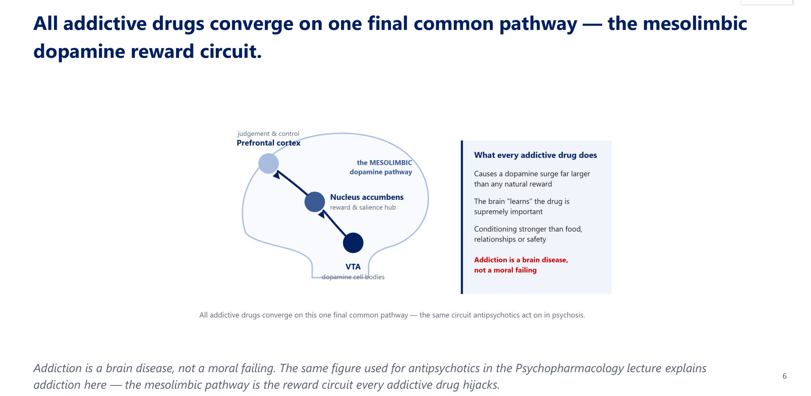

### 2.3 Tolerance vs Dependence vs Addiction (Slide 8) ⭐⭐
| Term | Meaning | A disease? |
|---|---|---|
| **Tolerance** | Needing more for the same effect | **No**: a normal physiological adaptation |
| **Physical dependence** | **Withdrawal on stopping** | **No**: normal with many drugs (**chronic opioids, β-blockers**) |
| **Psychological dependence** | **Craving** and compulsion | Part of the syndrome |
| ⭐ **Addiction (severe SUD)** | **Compulsive use despite harm + loss of control** | ⭐ **YES: the disease itself** |

⭐ **A cancer patient on long-term opioids has tolerance and physical dependence but is NOT addicted.** Addiction is the **behavioural syndrome**, not the physiology.

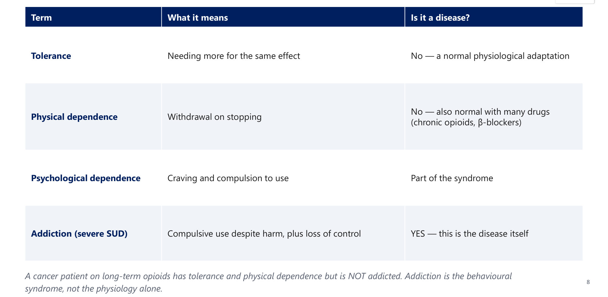

### 2.4 A Chronic Relapsing Illness (Slide 9)
- ⭐ **Heritability 40–60%.**
- ⭐ **Relapse after treatment 40–60%**, comparable to **type 2 diabetes (45–76%)**.
- ⭐ **Relapse ≠ failure:** it signals a need to **adjust treatment**.

### 2.5 DSM-5 Criteria (Slides 10–11) ⭐⭐
⭐ **≥ 2 of 11 criteria within 12 months**, in four groups:

| Group | Criteria |
|---|---|
| **Impaired control** (4) | Larger/longer than intended · unsuccessful attempts to cut down · much time getting, using, recovering · **craving** |
| **Social impairment** (3) | **Role failure** (work, school, home) · interpersonal problems · activities given up |
| **Risky use** (2) | Use in **hazardous situations** · use **despite physical/psychological harm** |
| **Pharmacological** (2) | **Tolerance** · **withdrawal** |

*[added]* Tolerance/withdrawal **don't count** when they occur under appropriate medical supervision (e.g. prescribed opioids).

**Bedside shorthand: the 4 C's (slide 11):**
1. **Compulsion** to use
2. **Craving** (persistent desire)
3. Loss of **Control** over amount/frequency
4. Continued use despite **Consequences**

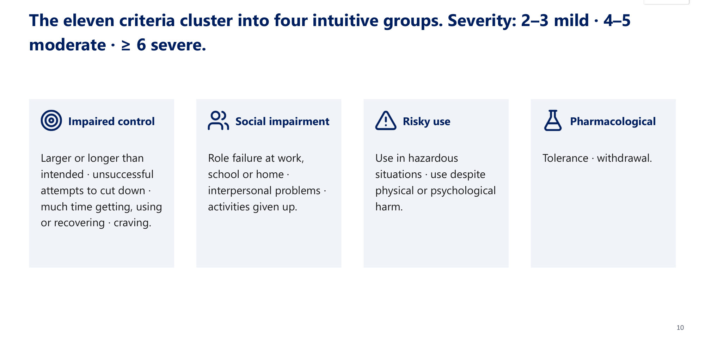

### 2.6 Risk Factors and Consequences (Slides 12–15)
| Risk factors | Consequences |
|---|---|
| **Genetic/biological:** heritability, family history, family modelling | **Health:** organ damage; overdose, coma, death; **suicide** |
| ⭐ **Early exposure:** **adolescence** = the most vulnerable brain | **Psychosocial:** accidents, relationship breakdown, **child neglect/abuse**, unemployment, homelessness, legal problems |
| **Environment:** poor support, easy access, normative attitudes | **Spiritual:** disconnection from faith (God and Islam). ⭐ **Faith and community are also a powerful PROTECTIVE factor**: mobilise them |
| **Mental illness:** mood, anxiety, PTSD, ADHD | — |

| Substance | Signature harm (slide 14) |
|---|---|
| **Alcohol** | Liver (fatty → hepatitis → **cirrhosis**), cognitive impairment, ataxia |
| **Tobacco** | **Lung**, head and neck cancers; COPD; CVD |
| **Cannabis** | Memory deficits; ⭐ **psychosis/schizophrenia**, especially adolescents |
| **Cocaine** | ⭐ **Arrhythmia, MI, stroke** |
| **Opioids** | ⭐ **Respiratory depression**; rising overdose deaths |

**Global scale (slide 15):**

| Annual deaths | Users worldwide, 2024 (UNODC) |
|---|---|
| ⭐ **Tobacco ~8 M** | ⭐ **Cannabis 256 M** (by far the most used) |
| ⭐ **Alcohol 2.6 M** | Opioids 63 M |
| **All illicit drugs ~0.6 M** | Amphetamines 32 M · cocaine 25 M · ecstasy 21 M |

⭐ **The LEGAL drugs kill far more than all illicit drugs combined.** Weigh harm by **burden**, not legal status.

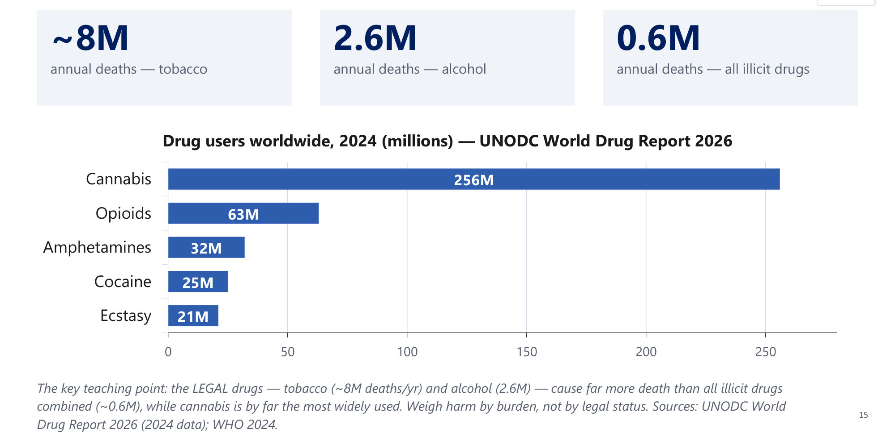

### 2.7 The Classes (Slide 16)
| **Depressants: switch it off** | **Stimulants: switch it on** | **Hallucinogens · cannabis · NPS** |
|---|---|---|
| Alcohol | Cocaine | LSD, psilocybin |
| Sedatives/hypnotics (**benzodiazepines**) | Amphetamine/methamphetamine | Cannabis |
| **Opioids** | ⭐ **Captagon, khat** | **Novel psychoactive substances** |
| **Inhalants** | Caffeine, nicotine | — |

The grouping **predicts the clinical syndromes**.

### 2.8 Screening, Brief Intervention and Stages of Change (Slide 17)
⭐ **Stages of change (Prochaska & DiClemente):**
1. **Pre-contemplation** ("I don't have a problem")
2. **Contemplation** (weighing change)
3. **Preparation** (planning)
4. **Action** (making the change)
5. **Maintenance** (sustaining it)

**Relapse** re-enters the cycle: **expected, not failure**. **Match your approach to the stage.**

⭐ **Motivational interviewing:** collaborative and non-confrontational:
- **roll with resistance**
- **develop discrepancy**
- support the patient's own reasons and **autonomy**

*[added]* **AUDIT** (10-item WHO tool; ≥ 8 = hazardous) and **CAGE** (≥ 2) are the screens named in the objectives. Brief intervention = **FRAMES**: Feedback, Responsibility, Advice, Menu, Empathy, Self-efficacy.

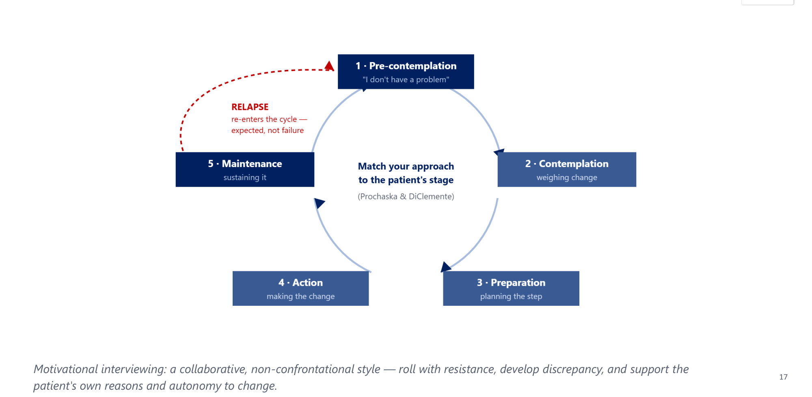

### 2.9 Urine Drug Screen (Slide 18) ⭐
| Detection window | Traps |
|---|---|
| Alcohol **~12 h** (EtG longer) | ⭐ **False positives:** **pseudoephedrine/bupropion → amphetamine**; **dextromethorphan/ketamine → PCP**; **poppy seeds → opiates** |
| **Amphetamines, cocaine, opioids: 1–3 days** | ⭐ **Standard screens MISS:** **fentanyl** and synthetic opioids, **methadone/oxycodone**, many benzodiazepines (**clonazepam, lorazepam**), **synthetic cannabinoids and cathinones** |
| Benzodiazepines: days–weeks (agent-dependent) | — |
| ⭐ **Cannabis: up to ~30 days** in chronic users | — |

A screen is **presumptive**: confirm with **GC-MS/LC-MS**. ⭐ **"A negative opiate screen does not exclude fentanyl."**

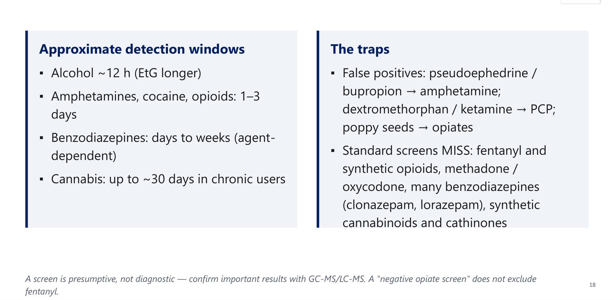

### 2.10 Psychosocial Treatment, Dual Diagnosis, Special Topics (Slides 19–21)
**Psychosocial treatment is the backbone; medication supports it.**
- **Individual:** motivational enhancement · **CBT/relapse prevention** (triggers, high-risk situations, coping) · ⭐ **contingency management** (rewards verified abstinence)
- **Group/mutual help:** 12-step facilitation · **AA/NA** (fellowship, sponsorship) · therapeutic communities
- **Family/couples:** reduce **enabling**, rebuild support; education underpins all of it

| Dual diagnosis | Why it matters |
|---|---|
| SUD + psychiatric disorder: **very common** (mood, anxiety, PTSD, ADHD, psychosis, PD) | Worse prognosis; ↑ suicide, non-adherence, relapse |
| **Bidirectional:** substances cause/mimic/worsen symptoms; illness drives "**self-medication**" | ⭐ **Treat both concurrently (integrated care)** |
| — | ⭐ **Do NOT wait for abstinence** before treating the mental illness. Re-assess after abstinence |

| **Gambling disorder** | **Substances in pregnancy** |
|---|---|
| ⭐ **The only behavioural addiction in DSM-5** | ⭐ **Alcohol → fetal alcohol syndrome** (a leading preventable cause of intellectual disability) |
| Same reward circuitry | **Opioids → neonatal abstinence syndrome** |
| Tolerance-like (bigger bets), withdrawal-like (restless), **chasing losses** | **Tobacco → low birth weight, prematurity** |
| — | ⭐ **Cocaine → placental abruption** |

> 🔁 **Recap: Foundations.**
> - SUD = ≥ 2 of 11 in 12 months (control, social, risky, pharmacological); 2–3/4–5/≥ 6. Addiction = severe SUD. 4 C's.
> - Mesolimbic dopamine (VTA → NAc → PFC); down-regulation, cue-craving.
> - Tolerance and physical dependence ≠ addiction.
> - Heritability and relapse 40–60% (like T2DM).
> - Legal drugs kill most; cannabis is most used.
> - Stages of change + MI.
> - UDS misses fentanyl, methadone and synthetic drugs; false positives.
> - Treat dual diagnosis concurrently.
>
> ▶️ **Up next: The depressants.**

---

### 2.11 Alcohol: Intoxication and Blood Levels (Slides 23–26)
**DSM-5 intoxication:**
- **A.** recent ingestion
- **B.** problematic change (inappropriate sexual/aggressive behaviour, lability, impaired judgement)
- **C.** ⭐ **≥ 1 sign:** **slurred speech, incoordination, unsteady gait, nystagmus**, impaired attention/memory, **stupor/coma**
- **D.** not another condition

⭐ At high levels it kills by **respiratory depression**, especially with other depressants.

| Blood alcohol (mg%) | Effect |
|---|---|
| **20–50** | Relaxation, mild euphoria, disinhibition |
| ⭐ **~80 (0.08%)** | Impaired coordination and judgement: **the common legal driving limit** |
| **100–200** | Slurred speech, **ataxia**, incoordination, lability |
| **200–300** | Nausea/vomiting, marked confusion, **stupor** |
| ⭐ **> 400** | **Coma, respiratory depression, death** |

⭐ **Tolerance shifts the curve:** a chronic drinker can look sober at a level that would make a naïve drinker comatose.

| Screening (slide 25) | Labs of heavy drinking |
|---|---|
| **CAGE ≥ 2** = concern (Cut down, Annoyed, Guilty, Eye-opener) | ⭐ **↑ GGT (> 35 IU/L)** |
| — | ⭐ **↑ MCV** (macrocytosis) |
| — | ⭐ **AST:ALT > 2:1** |
| — | Blood alcohol level |

None of these diagnoses a disorder alone: they **raise suspicion and open the conversation**.

**Risk factors for AUD (slide 26):**
- **personality:** impulsive, gregarious, less conforming; or isolated and avoidant
- **occupation:** high stress, easy access, irregular hours
- **psychosocial stress:** isolation, financial or marital stress
- **emotional:** anxiety, chronic insomnia, depression

⭐ **WHO: alcohol kills more people worldwide than AIDS, TB or violence.**

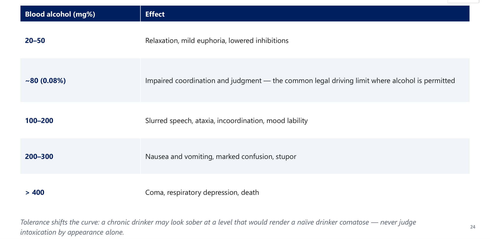

### 2.12 Alcohol Withdrawal: Learn the Clock (Slides 27–28) ⭐⭐
⭐ **Unlike opioid or stimulant withdrawal, ALCOHOL WITHDRAWAL CAN BE FATAL.**

| Hours since last drink | Syndrome |
|---|---|
| ⭐ **6–12 h** | **Tremor and anxiety**: autonomic hyperactivity |
| ⭐ **12–24 h** | **Alcoholic hallucinosis**: transient **visual/tactile** hallucinations (*[added]* clear consciousness) |
| ⭐ **12–48 h** | **Seizures**: generalised tonic-clonic |
| ⭐ **48–72 h, peaks day 3–4** | **Delirium tremens** |

*[added]* The slide is titled "DSM-5 criteria" but shows only the timeline. **DSM-5 alcohol withdrawal:** cessation after heavy, prolonged use + **≥ 2 of 8**:
1. autonomic hyperactivity
2. ↑ hand tremor
3. insomnia
4. nausea/vomiting
5. transient hallucinations/illusions
6. psychomotor agitation
7. anxiety
8. seizures

| **Delirium tremens** (slide 28) | Management |
|---|---|
| Onset **48–72 h**, peaks **day 3–4**, lasts **3–5 days** | ⭐ **Medical emergency**: ICU or medical ward |
| **Delirium + gross tremor + autonomic storm** | ⭐ **Benzodiazepines; thiamine; fluids and electrolytes** |
| Dehydration, electrolyte disturbance; insomnia | Guard against seizures; adjust surroundings |
| ⭐ **Mortality ~1–5% treated; ~15–35% untreated** | ⭐ **AVOID antipsychotics as monotherapy**: they **lower the seizure threshold** |

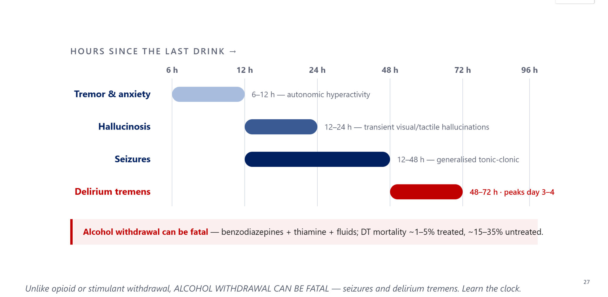

### 2.13 Wernicke–Korsakoff (Slide 29) ⭐⭐
| | **Wernicke's encephalopathy** | **Korsakoff syndrome** |
|---|---|---|
| Nature | ⭐ **Acute neurological EMERGENCY** | **Chronic, often irreversible** |
| Cause | ⭐ **Thiamine (B1) deficiency** | Untreated or repeated Wernicke's |
| Features | ⭐ **Triad: confusion · ophthalmoplegia · gait ataxia** | ⭐ **Anterograde amnesia + confabulation** |
| Action | ⭐ **GIVE THIAMINE BEFORE GLUCOSE**: a glucose load can precipitate it | Largely supportive; **prevention is the treatment** |

**Mnemonic *[added]*: "COAT RACK"**:
- **C**onfusion, **O**phthalmoplegia, **A**taxia, **T**hiamine (Wernicke)
- **R**etrograde/anterograde **A**mnesia, **C**onfabulation, **K**orsakoff

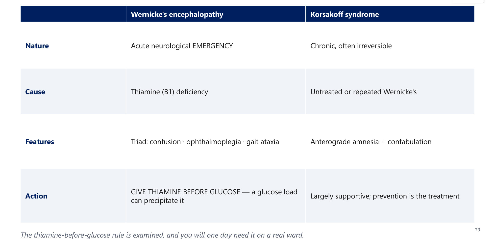

### 2.14 Managing Withdrawal and Chronic Harm (Slides 30–31)
| ⭐ Benzodiazepines: gold standard | Supportive |
|---|---|
| **Long-acting: diazepam, chlordiazepoxide** | **Thiamine**, fluids, electrolytes (**Mg, K, glucose**) |
| ⭐ **Lorazepam if liver disease** | Anticonvulsant cover if seizures |
| **Symptom-triggered against CIWA-Ar**, or fixed schedule | Right setting; monitor |

**Chronic alcohol use:** ⭐ life-span shortened by **~15 years**.

| System | Harms |
|---|---|
| Hepatic/GI | Fatty liver → hepatitis → cirrhosis; gastritis, **pancreatitis**, **oesophageal varices**; GI and liver cancers |
| Neuro/cardiac | **Peripheral neuropathy**, **cerebellar degeneration**, dementia, Wernicke–Korsakoff; **cardiomyopathy**, arrhythmia, hypertension |
| Other | **Macrocytosis, thrombocytopenia**; sexual dysfunction, **hypogonadism**; fetal alcohol syndrome |

### 2.15 Medications for Alcohol Use Disorder (Slide 32) ⭐⭐
| Drug | Mechanism | Notes |
|---|---|---|
| ⭐ **Naltrexone (first-line)** | **μ-opioid antagonist** → ↓ craving and reward | **Avoid in liver failure or current opioid use** |
| ⭐ **Acamprosate (first-line)** | **Glutamate/GABA modulation** | Maintains abstinence; ⭐ **renal dosing** (*[added]* safe in liver disease) |
| **Disulfiram (second-line)** | ⭐ **Aldehyde dehydrogenase inhibitor** → aversive reaction (flushing, nausea, tachycardia) | Adherence-dependent; **no longer first-line** |

⭐ **Don't confuse NALTREXONE (alcohol anti-craving) with NALOXONE (opioid overdose reversal).** A classic exam and prescribing error. Plus psychosocial care: AA, motivational enhancement, CBT, relapse prevention.

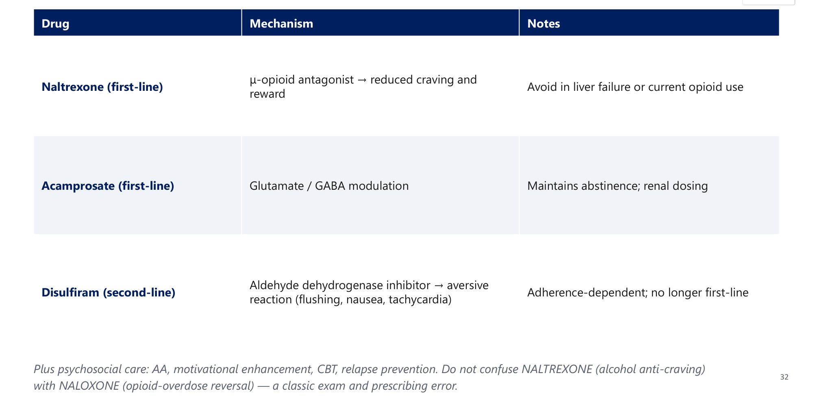

### 2.16 Benzodiazepines and Sedatives (Slides 33–35)
**Case (slides 33–34):**
- 41-year-old businessman, **insomnia for 3 days** after running short of "sleeping pills"
- asks for a **Roche** drug, **2 mg** tablets, takes **5 per night**

→ ⭐ **B: benzodiazepine abuse** (*[added]* Roche 2 mg = flunitrazepam/Rohypnol or clonazepam/Rivotril). Abrupt cessation causes rebound insomnia, anxiety and ⭐ **seizures**.

| Pharmacology | Intoxication (DSM-5) | Overdose & withdrawal |
|---|---|---|
| Potentiate **GABA at GABA-A** (chloride channel) | Slurred speech, incoordination, unsteady gait | ⭐ **Flumazenil** = antagonist, but **may precipitate seizures** |
| ⭐ **Cross-tolerance and cross-dependence with alcohol** | Nystagmus | ⭐ **Withdrawal like alcohol: CAN BE FATAL** |
| Intoxication and withdrawal resemble alcohol | Cognitive impairment; stupor/coma | ⭐ **Gradual taper, never an abrupt stop** |

### 2.17 Opioids (Slides 36–41) ⭐⭐
| Types | Intoxication (DSM-5) | Killer and antidote |
|---|---|---|
| **Natural:** opium, morphine, codeine | **A.** recent use; **B.** euphoria then apathy, dysphoria, psychomotor change, impaired judgement | ⭐ **Pinpoint pupils, bradycardia, constipation** |
| **Semi-synthetic:** heroin | **C.** ⭐ **pupillary constriction** (or **dilation from anoxia** in severe overdose) + ≥ 1 of drowsiness/coma, slurred speech, attention/memory impairment | ⭐ **RESPIRATORY DEPRESSION is the cause of death** |
| **Synthetic:** **fentanyl**, pethidine, **methadone** | — | ⭐ **Naloxone + airway + oxygen**; **take-home naloxone kits save lives** |

**Case (slides 37–38):**
- 33-year-old jailed after reckless driving at 3 a.m.
- next day: **lacrimation, rhinorrhoea, vomiting, abdominal cramps**, consciousness intact

→ ⭐ **D: opioid withdrawal** (precipitated by incarceration). **Miserable but not life-threatening.**

**Opioid withdrawal (slide 39):**
- **≥ 3** within minutes to days:
  - dysphoria
  - nausea/vomiting
  - **muscle aches**
  - ⭐ **lacrimation/rhinorrhoea**
  - ⭐ **pupillary dilation, piloerection, sweating**
  - **diarrhoea; yawning**; fever; insomnia
- craving from **~6 h**, peaks **36–48 h**
- graded with **COWS** (pulse, pupils, tremor)

**Mnemonic *[added]*:** withdrawal is the **opposite** of intoxication:

| Intoxication | Withdrawal |
|---|---|
| Pinpoint pupils | **Dilated** |
| Constipation | **Diarrhoea** |
| Drowsy | **Insomnia, yawning** |
| Dry | **Runny nose, tears**, goosebumps ("cold turkey") |

**Treatment (slide 40) ⭐**

| Symptom control | Maintenance (MAT) | Harm reduction |
|---|---|---|
| ⭐ **Clonidine or lofexidine** (α2-agonists; lofexidine FDA 2018) for autonomic symptoms | ⭐ **Methadone**: **full μ-agonist**, clinic-based | **Needle and syringe exchange** |
| NSAIDs (pain), **loperamide** (diarrhoea), antiemetics | ⭐ **Buprenorphine/naloxone**: **partial agonist**, office-based | **Take-home naloxone** |
| — | **Naltrexone XR**: antagonist, **after detox** | **Blood-borne virus screening** |

*[added]* Buprenorphine given too early (while full-agonist opioids are still on receptors) causes **precipitated withdrawal**: start it once withdrawal has begun.

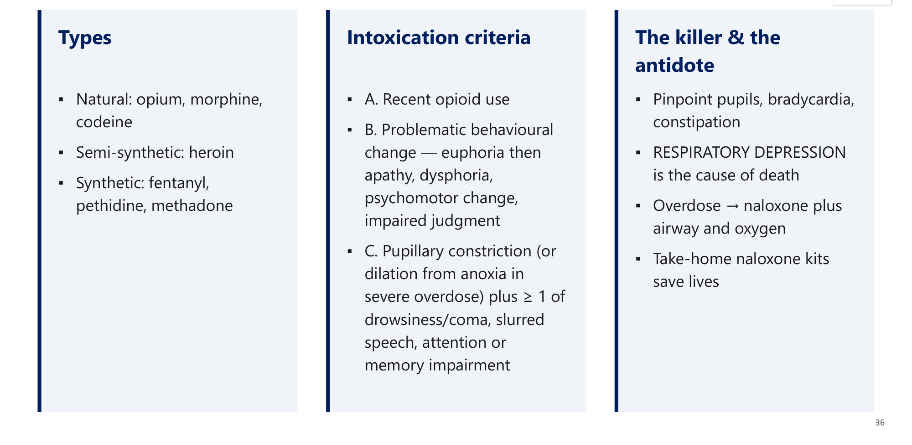 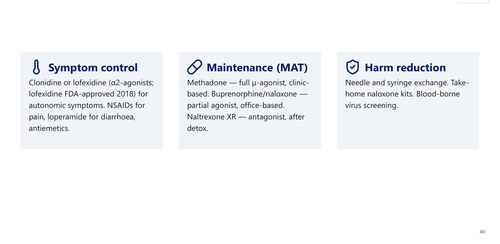

**Injecting drug use complications (slide 41):**

| Local | Systemic | Blood-borne |
|---|---|---|
| **Track marks** | ⭐ **Infective endocarditis** | ⭐ **HIV** |
| Cellulitis, **abscess** | **Sepsis** | ⭐ **Hepatitis B and C** |
| Thrombophlebitis | Vascular damage, **DVT** | — |

### 2.18 Inhalants (Slides 42–44)
**Case (slides 42–43):** a **16-year-old** with slurred speech, incoordination, nausea and a ⭐ **rash around the mouth and nose** → ⭐ **C: volatile substance (inhalant)**: "**glue-sniffer's rash**".
- **What:** glue, solvents, acetone, benzene, aerosols, **nitrous oxide**. CNS depressants; **adolescent experimentation**; rapid, brief effect.
- **Harm:**
  - **multi-organ damage** (brain, liver, kidney, marrow)
  - ⭐ **"Sudden sniffing death"**: fatal **arrhythmia, even on first use**

> 🔁 **Recap: Depressants.**
> - **Alcohol:** ≥ 1 sign intoxication; 0.08% driving limit, > 400 mg% fatal; GGT, MCV, AST:ALT > 2.
> - **Withdrawal clock:** tremor 6–12 h, hallucinosis 12–24 h, seizures 12–48 h, **DTs 48–72 h** (1–5% treated, 15–35% untreated). Benzodiazepines (lorazepam if liver disease), thiamine; avoid antipsychotic monotherapy.
> - **Wernicke triad → thiamine before glucose.**
> - **AUD MAT:** naltrexone, acamprosate > disulfiram.
> - **Benzodiazepines:** cross-tolerant with alcohol; withdrawal can kill; taper; flumazenil → seizures.
> - **Opioids:** pinpoint pupils + low RR → naloxone. Withdrawal is not fatal. MAT: methadone, buprenorphine, naltrexone XR.
> - **Inhalants:** perioral rash, sudden sniffing death.
>
> ▶️ **Up next: Stimulants, hallucinogens, cannabis.**

---

### 2.19 Stimulants (Slides 47–54) ⭐
**Case (slides 47–48):**
- **Khalid, 20**, arrested for **high-speed drifting** and violence
- **over-suspicious, agitated, over-talkative**

→ ⭐ **B: stimulant intoxication**. In KSA, think **amphetamine/Captagon**.

| The drugs | Psychological effects | Physical effects |
|---|---|---|
| Cocaine; amphetamine/methamphetamine; **MDMA** | Euphoria; ↑ confidence, sociability; **over-talkative** | ↓ fatigue and appetite |
| ⭐ **Captagon, khat** | Overactivity, **insomnia** | ⭐ **Dilated pupils**, tremor, **↑ HR/BP/temperature** |
| Caffeine, nicotine | High dose: ⭐ **paranoid psychosis, visual hallucinations, aggression** | High dose: **arrhythmia, severe hypertension, hyperthermia, seizures, stroke** |

**Cocaine (slide 50):**
- **forms:** HCl (intranasal/IV); **freebase/crack** (smoked); rapid, intense, short high → **bingeing**
- **harms:**
  - ⭐ **arrhythmia, MI, aortic dissection**
  - **seizures, stroke**
  - ⭐ **nasal septum perforation** (intranasal)

#### Captagon and Khat: the Regional Picture (Slide 51) ⭐⭐
⭐ **Amphetamine-type stimulants are the leading substance among patients in Saudi addiction treatment:**
- **~40–70%** depending on centre and era
- **48% of 12,743 first admissions to Al-Amal Dammam (1986–2006)**

| **Captagon (fenethylline)** | **Khat (*Catha edulis*)** |
|---|---|
| Amphetamine-type stimulant **tablet** | **Leaves chewed**; active alkaloid ⭐ **cathinone** |
| ⭐ **THE dominant illicit stimulant in Saudi Arabia and the region** | Common in **south-west KSA and Yemen** |
| Paranoia, aggression, insomnia, CV risk | Mild–moderate stimulant; **oral/dental disease, psychosis, dependence** |

⭐ **In this setting, think Captagon before cocaine.**

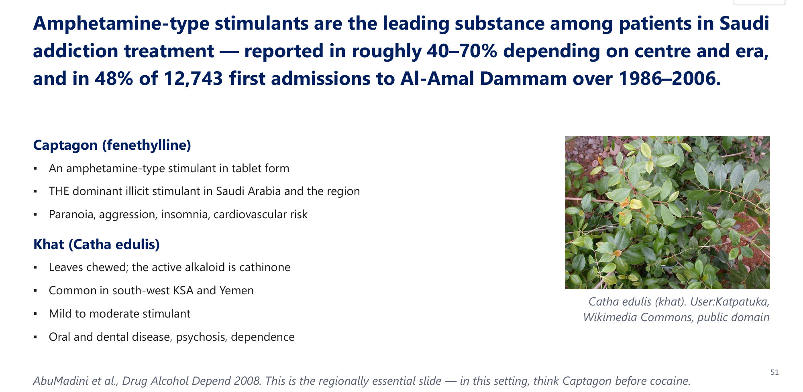

| **Stimulant intoxication (DSM-5)** | **Stimulant withdrawal: the "crash"** |
|---|---|
| **B.** euphoria or blunting; changed sociability; **hypervigilance**; interpersonal sensitivity; anxiety/anger; **stereotyped behaviour**; impaired judgement | **A.** cessation of prolonged use; **B.** ⭐ **dysphoric mood + ≥ 2:** **fatigue, vivid unpleasant dreams, insomnia/hypersomnia, ↑ appetite, psychomotor change** |
| **C.** ⭐ **≥ 2 signs:** tachy/bradycardia · **pupillary dilation** · ↑/↓ BP · sweating/chills · nausea · weight loss · psychomotor change · weakness, respiratory depression, **chest pain, arrhythmia** · confusion, **seizures**, dyskinesias, dystonias, coma | **Not life-threatening** in itself; malaise, **hypersomnolence, anhedonia, hunger** |
| — | ⭐ **CAN BECOME SUICIDAL**: monitor mood and safety |

| Treatment: intoxication | Treatment: withdrawal |
|---|---|
| **Mild:** reassurance + **benzodiazepines** | **Supportive**; monitor mood and **suicide risk** |
| **Severe agitation/psychosis:** antipsychotic (**haloperidol**) | ⭐ **NO approved medication-assisted treatment** |
| ⭐ **Treat hyperthermia aggressively (cooling)**; control BP and arrhythmia | **CBT, contingency management** |

**Case (slides 55–56):**
- 32-year-old, **4 weeks** of irritability, insomnia, hypervigilance, unpredictable mood
- **accuses his wife of affairs**

→ ⭐ **C: amphetamine abuse**: stimulant-induced **paranoia and morbid jealousy**. **Screen for stimulants before diagnosing primary psychosis.**

### 2.20 Caffeine (Slide 57)
| Intoxication | Withdrawal |
|---|---|
| The world's **most widely used** psychoactive drug | **Headache**, lethargy, low mood |
| Restlessness, insomnia, **diuresis**, GI upset | Poor concentration, irritability |
| Muscle twitching, tachycardia/**arrhythmia** at high doses | ⭐ **Onset ~12–24 h; lasts 2–9 days** |

DSM-5 recognises **caffeine intoxication and withdrawal**: "legal" ≠ no withdrawal.

### 2.21 Hallucinogens (Slide 58)
- **Drugs:** **LSD** (synthetic), **psilocybin** (magic mushrooms).
- **Effects:**
  - perceptual distortion; visual/tactile hallucinations
  - altered time/space; euphoria, anxiety, panic, paranoia
  - ⭐ **flashbacks (HPPD)**
  - physically: **mydriasis**, ↑ HR/BP/temperature
- ⭐ **Minimal tolerance; NO physical dependence; no withdrawal syndrome.**
- The risk comes from **behaviour under the influence**: accidents, "bad trips", occasionally suicide or violence.

### 2.22 Cannabis (Slides 59–65) ⭐
**Case (slides 59–60):** a 43-year-old with episodic euphoria, talkativeness, disinhibition, ⭐ **red eyes most of the time** → ⭐ **B: cannabis abuse**.

| **Intoxication (DSM-5)** | **Withdrawal (DSM-5)** |
|---|---|
| Active ingredient ⭐ **THC: partial CB1 agonist** | **≥ 3 within ~1 week** of stopping heavy use |
| **B.** impaired coordination, euphoria, anxiety, ⭐ **sensation of slowed time**, impaired judgement, social withdrawal | **Irritability/anger**, nervousness, **sleep difficulty/disturbing dreams**, ⭐ **↓ appetite/weight**, restlessness, depressed mood |
| **C.** ⭐ **≥ 2 within 2 hours:** **conjunctival injection (red eyes), ↑ appetite, dry mouth, tachycardia** | + ≥ 1 physical symptom: abdominal pain, tremor, sweating, fever, chills, headache |
| — | Only in **heavy, daily** users; not dangerous, but ⭐ **a major reason for relapse** (normalise it) |

| Products (rising potency) | Endocannabinoid system |
|---|---|
| **Marijuana** (dried leaves/flowers) → **hashish** (resin) → **hash oil** (highest THC) | **CB1** (CNS) and **CB2** (immune) receptors; endogenous ligands **anandamide and 2-AG** |
| **THC** = psychoactive; **CBD** = non-intoxicating (epilepsy: **Epidiolex**; anxiety) | Regulates appetite, mood, memory, pain, immunity, **neurodevelopment** → heavy **adolescent** use is concerning |
| Potency has risen sharply → psychosis risk is **dose- and potency-dependent** | — |

**Dependence and psychosis (slide 65):**

| Pattern | Risk of cannabis use disorder |
|---|---|
| All users | ⭐ **~9%** |
| **Adolescent onset** | ⭐ **~17%** |
| **Daily users** | ⭐ **25–50%** |

- Adolescent, frequent, **high-potency** use raises **psychosis/schizophrenia** risk dose-dependently.
- ⭐ **KSA (MOH Al-Amal): cannabis and amphetamines are the leading substances presenting for treatment.**

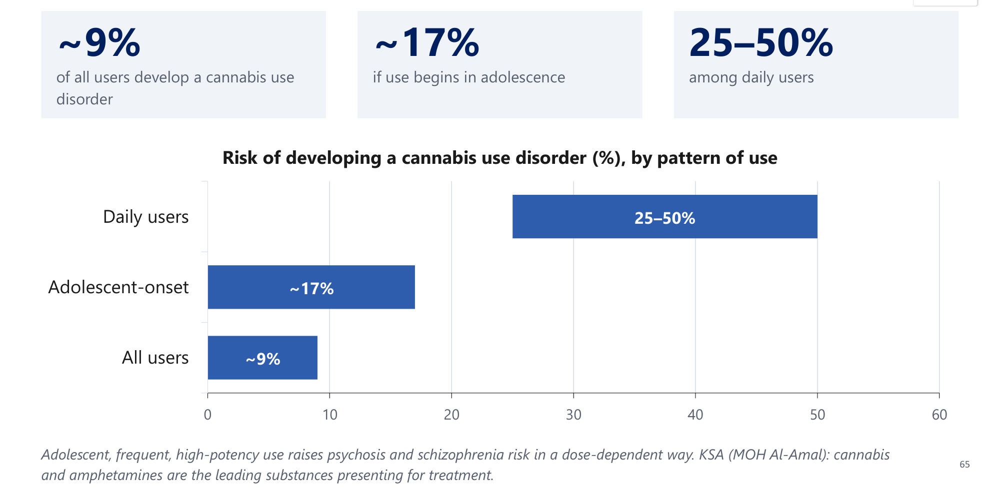

### 2.23 Novel Psychoactive Substances (Slide 66)
| Families | Why dangerous |
|---|---|
| **Synthetic cannabinoids** ("Spice", "K2") | **Highly variable potency**: some **fentanyl analogues ~10,000× morphine** |
| **Synthetic cathinones** ("bath salts") | Unpredictable, severe toxicity |
| **Synthetic opioids** (fentanyl analogues) | ⭐ **Often MISSED on standard drug screens** |
| **Designer benzodiazepines** | — |

⭐ **Suspect NPS when the clinical picture is extreme but the routine screen is negative.**

### 2.24 Nicotine (Slide 67)
| Pharmacokinetics | Treatment |
|---|---|
| Reaches the brain in ⭐ **7–10 SECONDS** | ⭐ **Varenicline**: **α4β2 nicotinic partial agonist** |
| Withdrawal begins **~30 min** after the last cigarette | **Bupropion**: dopamine/noradrenaline reuptake inhibitor |
| **Cotinine** detectable **7–14 days** | **NRT**: patch, gum, lozenge, spray, inhaler |
| Faster metabolisers → higher dependence and cancer risk | ⭐ **ALWAYS add behavioural support** |

**Vaping:** one pod ≈ a pack of cigarettes; drives adolescent dependence. ⭐ **EVALI** is linked to **vitamin-E acetate in THC vapes**.

---

### 2.25 Pattern Recognition: Intoxication (Slide 69) ⭐⭐
⭐ **Reach for the pupils first: PINPOINT = opioids · DILATED = stimulants or hallucinogens.**

| Substance | Action | Pupils | Key signs |
|---|---|---|---|
| **Cocaine/amphetamine** | Stimulant | ⭐ **Dilated** | ↑ HR/BP/temperature/energy, paranoia, euphoria, ↓ fatigue and appetite, hallucinations, prolonged wakefulness |
| **Alcohol/sedatives** | Sedative | Normal | Slurred speech, ataxia, disinhibition, ↓ respiration → coma, death |
| **Heroin/opioids** | Sedative, analgesic | ⭐ **Pinpoint** | "Nodding", euphoria, constipation, ↓ respiration, seizures; **track marks** |
| **Cannabis** | Euphoriant | Normal | ⭐ **Red eyes, ↑ appetite, slowed time**, ↓ intraocular pressure; high dose → hallucinations |
| **Caffeine** | Stimulant | Normal | Restlessness, insomnia, diuresis, twitching, arrhythmia |
| **Nicotine** | Stimulant | Normal | Mild arousal; most symptoms come from withdrawal |

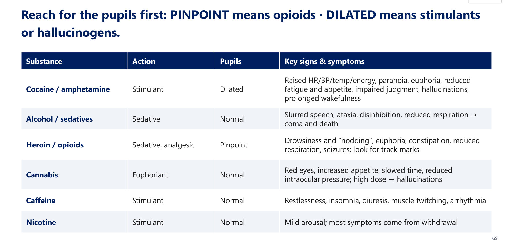

### 2.26 Withdrawal: Which Ones Kill (Slide 70) ⭐⭐
| Substance | Onset | Duration & key signs | Danger |
|---|---|---|---|
| **Alcohol** | **6–72 h** | 5–7 days; tremor, autonomic storm, **seizures, DTs** | ⭐ **DANGEROUS** |
| **Sedatives/benzodiazepines** | Variable (half-life) | Like alcohol; **seizures** | ⭐ **DANGEROUS** |
| **Opioids** | **6–48 h** | 4–7 days; lacrimation, GI upset, aches, **dilated pupils** | **Not life-threatening** |
| **Stimulants** | Hours–days | 3–4-day "**crash**"; fatigue, hypersomnia, low mood | ⭐ **Watch suicidality** |
| **Cannabis** | ~1 day | Up to weeks; irritability, insomnia, ↓ appetite | Mild |
| **Caffeine/nicotine** | 2–24 h | Days–weeks; headache, irritability, craving | Not dangerous |

⭐ **ONLY alcohol and sedative/benzodiazepine withdrawal are directly life-threatening.**

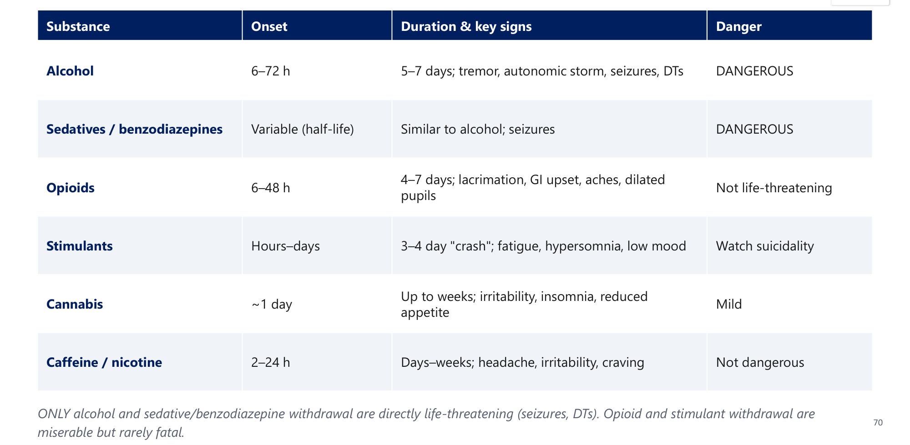

### 2.27 Antidotes and Overdose (Slide 71) ⭐
| Emergency | First step / antidote |
|---|---|
| ⭐ **Opioid overdose** (pinpoint, low RR) | ⭐ **Naloxone + airway + oxygen**: **short-acting, may need repeating**; can precipitate withdrawal |
| **Benzodiazepine overdose** | **Supportive airway/ventilation**; ⭐ **flumazenil rarely used** (seizures, especially in dependence or mixed overdose) |
| **Alcohol withdrawal/DTs** | **Benzodiazepines + thiamine + fluids/electrolytes** |
| ⭐ **Wernicke's** | ⭐ **THIAMINE BEFORE GLUCOSE** |
| **Stimulant toxicity** | **No antidote**: benzodiazepines, **active cooling**, control BP and arrhythmia |

### 2.28 Integrative Case: Mr. K, 48 (Slides 72–73) ⭐
**Presentation:**
- **day 3 after hip repair** (admitted after a fall)
- "agitated and confused overnight"
- **tremulous, drenched in sweat, HR 118, BP 168/98, T 37.8 °C**
- disoriented, pulling at lines, **insects crawling on the sheets**
- **lucid yesterday morning**
- wife: a bottle of spirits every 2–3 days; **morning shakes for years**, relieved by the first drink
- **brief seizure 6 h ago**
- **↑ MCV, markedly ↑ GGT**; poor nutrition

| Question | Model answer (lecture) |
|---|---|
| 1. Diagnosis? | ⭐ **Delirium tremens**: onset **48–72 h** after the last drink (lucid on day 2), preceded by a **withdrawal seizure** (6–48 h) |
| 2. Why an emergency? | DTs is **the one withdrawal syndrome that kills** (arrhythmia, seizures, hyperthermia, collapse). Needs **monitoring**, not a quiet side room |
| 3. First-line; avoid? | ⭐ **Benzodiazepines, symptom-triggered** against a withdrawal scale + fluids, electrolytes, **search for infection**. ⭐ **AVOID an antipsychotic first-line** (lowers seizure threshold) |
| 4. Before glucose? | ⭐ **Thiamine before glucose**: carbohydrate in a thiamine-depleted patient can precipitate **Wernicke's** → irreversible **Korsakoff** |
| 5. Longer term? | **Naltrexone, acamprosate or disulfiram**; psychosocial treatment; screen for **dual diagnosis** and chronic alcohol harm |

**Twist:** the same picture on **day 1** → simple withdrawal or another cause of delirium.

---

## 3. High-Yield Comparison Tables

### Table A: Intoxication vs Withdrawal by Class
| Class | Intoxication | Withdrawal | Lethal withdrawal? |
|---|---|---|---|
| Alcohol | Slurred, ataxia, nystagmus, disinhibition | Tremor → hallucinosis → seizures → **DTs** | ✅ **Yes** |
| Benzodiazepines | As alcohol | As alcohol; seizures | ✅ **Yes** |
| Opioids | **Pinpoint**, ↓ RR, constipation, nodding | **Dilated pupils**, lacrimation, rhinorrhoea, yawning, diarrhoea, piloerection | ❌ No |
| Stimulants | **Dilated**, ↑ HR/BP/T, paranoia, agitation | **Crash**: hypersomnia, hunger, dysphoria, **suicidality** | ❌ No (watch suicide) |
| Cannabis | **Red eyes**, ↑ appetite, slowed time, dry mouth | Irritability, insomnia, **↓ appetite** | ❌ Mild |
| Hallucinogens | Hallucinations, mydriasis, flashbacks | **None** | — |
| Inhalants | Depressant + **perioral rash** | — | **Sudden sniffing death** (intoxication) |
| Caffeine | Restless, diuresis, twitching | Headache 12–24 h, 2–9 days | ❌ |
| Nicotine | Mild arousal | From ~30 min; craving, irritability | ❌ |

### Table B: Medication-Assisted Treatment
| Substance | Medication | Mechanism |
|---|---|---|
| Alcohol (withdrawal) | **Diazepam/chlordiazepoxide** (lorazepam if liver disease) + thiamine | GABA-A |
| Alcohol (abstinence) | **Naltrexone**, **acamprosate** (first-line); disulfiram (second-line) | μ-antagonist; glutamate/GABA; ALDH inhibitor |
| Opioid (withdrawal) | **Clonidine/lofexidine** + symptomatic | α2-agonist |
| Opioid (maintenance) | **Methadone**, **buprenorphine/naloxone**, naltrexone XR | Full / partial agonist / antagonist |
| Opioid (overdose) | **Naloxone** | Antagonist |
| Nicotine | **Varenicline**, bupropion, NRT | α4β2 partial agonist; DA/NA reuptake inhibitor |
| Stimulants | **None approved** | — |
| Benzodiazepine overdose | Supportive (flumazenil rarely) | GABA-A antagonist |

### Table C: Naltrexone vs Naloxone vs Disulfiram
| | Naltrexone | Naloxone | Disulfiram |
|---|---|---|---|
| Use | **Alcohol craving** (and opioid relapse prevention, XR) | **Opioid overdose reversal** | Alcohol aversion |
| Mechanism | μ-antagonist, long-acting oral | μ-antagonist, short-acting IV/IM/IN | ALDH inhibitor |
| Caution | Liver failure; current opioid use | Repeat doses; precipitates withdrawal | Adherence-dependent |

### Table D: UDS Pearls
| Issue | Detail |
|---|---|
| Longest window | **Cannabis ~30 days** (chronic) |
| False amphetamine | **Pseudoephedrine, bupropion** |
| False PCP | **Dextromethorphan, ketamine** |
| False opiate | **Poppy seeds** |
| Missed | **Fentanyl**, methadone, oxycodone, clonazepam/lorazepam, synthetic cannabinoids/cathinones |
| Confirm with | **GC-MS / LC-MS** |

### Table E: Alcohol Withdrawal Clock
| Time | Event |
|---|---|
| 6–12 h | Tremor, anxiety, autonomic |
| 12–24 h | Hallucinosis (visual/tactile) |
| 12–48 h | Seizures |
| 48–72 h (peak day 3–4) | **DTs** (3–5 days; 1–5% / 15–35% mortality) |

---

## 4. Rules, Exceptions, Patterns
- **Tolerance + physical dependence ≠ addiction** (cancer patient on opioids). Don't withhold analgesia.
- **≥ 2 of 11 in 12 months**; 2–3 mild, 4–5 moderate, ≥ 6 severe = addiction.
- **Relapse ≠ failure** (40–60%, like T2DM).
- **Legal drugs kill most** (tobacco 8 M, alcohol 2.6 M vs illicit 0.6 M).
- **Pupils:** pinpoint = opioids; dilated = stimulants/hallucinogens (or opioid withdrawal, or anoxic opioid overdose).
- **Only alcohol and sedative withdrawal kill.** Opioid withdrawal is miserable, not fatal. Stimulant withdrawal → suicide risk.
- **DTs → benzodiazepines + thiamine**; **no antipsychotic monotherapy**.
- **Thiamine before glucose.**
- **Lorazepam if liver disease** (no active metabolites *[added]*).
- **Naltrexone ≠ naloxone.** Naltrexone is contraindicated in liver failure and current opioid use; **acamprosate needs renal dosing**.
- **Disulfiram is second-line.**
- **Flumazenil is rarely used** (seizures).
- **Naloxone is short-acting**: re-dose; observe.
- **No MAT for stimulants.**
- **Hallucinogens:** no physical dependence or withdrawal.
- **UDS misses fentanyl/NPS**: an extreme picture with a negative screen = suspect NPS.
- **Captagon before cocaine** in KSA; **cannabis + amphetamines** lead treatment admissions.
- **Treat dual diagnosis concurrently**; re-assess after abstinence.
- **Gambling = the only DSM-5 behavioural addiction.**

---

## 5. Clinical Correlations
- **Cardiology:**
  - **cocaine → MI, arrhythmia, aortic dissection** (*[added]* avoid pure β-blockers in cocaine chest pain; use benzodiazepines)
  - **alcohol → cardiomyopathy, AF, HTN**
  - **inhalants → sudden arrhythmic death**
- **Infective endocarditis:** IV drug users → **tricuspid valve, *S. aureus***, septic pulmonary emboli.
- **Hepatology/GI:**
  - alcohol: **AST:ALT > 2**, GGT, cirrhosis, varices, **pancreatitis**
  - **HBV/HCV** in injectors
- **Haematology:** **macrocytosis, thrombocytopenia** in alcohol use.
- **Neurology:**
  - **Wernicke** (confusion, ophthalmoplegia, ataxia)
  - **Korsakoff** (anterograde amnesia, confabulation)
  - cerebellar degeneration, neuropathy
  - withdrawal seizures
- **Surgery:** post-op day 2–3 delirium in a drinker = **DTs** (lecture case). Thiamine before dextrose.
- **ENT:** **nasal septum perforation** (cocaine).
- **Obstetrics:** **FAS**, **neonatal abstinence syndrome**, **placental abruption (cocaine)**, low birth weight (tobacco).
- **Endocrine:** alcohol → **hypogonadism**; hypoglycaemia in drinkers *[added]*.
- **Pain management:** don't withhold analgesia from a dependent patient; buprenorphine/methadone continuity.

---

## 6. Rapid Revision (Last-Day)
1. **SUD = ≥ 2 of 11 in 12 months:**
   - impaired control (4)
   - social (3)
   - risky (2)
   - pharmacological (2)

   **2–3 / 4–5 / ≥ 6. Addiction = severe.** 4 C's: compulsion, craving, control, consequences.
2. **Mesolimbic:** VTA → NAc → PFC; down-regulation; cue craving.
3. **Tolerance and physical dependence are normal; addiction is the disease.**
4. **Heritability 40–60%; relapse 40–60%** (T2DM 45–76%).
5. **Deaths:** tobacco ~8 M, alcohol 2.6 M, illicit 0.6 M. **Cannabis 256 M users.**
6. **Classes:** depressants (alcohol, benzodiazepines, opioids, inhalants) · stimulants (cocaine, amphetamine, **Captagon, khat**, caffeine, nicotine) · hallucinogens/cannabis/NPS.
7. **Stages of change** + MI (roll with resistance, develop discrepancy, autonomy).
8. **UDS:**
   - alcohol 12 h; stimulants/opioids 1–3 days; **cannabis 30 days**
   - false positives (pseudoephedrine, bupropion, DXM, poppy seeds)
   - **misses fentanyl, methadone, NPS**
9. **Dual diagnosis:** treat concurrently. **Gambling** = the only behavioural addiction.
10. **Pregnancy:** FAS (alcohol), NAS (opioids), LBW (tobacco), **abruption (cocaine)**.
11. **Alcohol:**
    - intoxication ≥ 1 sign
    - **0.08% = driving limit**; > 400 mg% = coma/death
    - **GGT > 35, ↑ MCV, AST:ALT > 2:1**
    - CAGE ≥ 2
12. **Alcohol withdrawal clock:**
    - tremor 6–12 h
    - hallucinosis 12–24 h
    - seizures 12–48 h
    - **DTs 48–72 h** (peak day 3–4, 3–5 days; **1–5% treated, 15–35% untreated**)
13. **DTs Rx:** ICU; benzodiazepines (diazepam/chlordiazepoxide; **lorazepam if liver disease**); CIWA-Ar; thiamine; fluids; **avoid antipsychotic monotherapy**.
14. **Wernicke:** confusion + ophthalmoplegia + ataxia → **thiamine before glucose**. Korsakoff: anterograde amnesia + confabulation.
15. **Chronic alcohol:** −15 years; cirrhosis, pancreatitis, varices, neuropathy, cerebellar degeneration, cardiomyopathy, macrocytosis, hypogonadism.
16. **AUD MAT:** **naltrexone** (μ-antagonist; not in liver failure/opioids) · **acamprosate** (renal dosing) · disulfiram (ALDH, second-line). **Naltrexone ≠ naloxone.**
17. **Benzodiazepines:** GABA-A; cross-tolerant with alcohol; **withdrawal can kill**; taper; **flumazenil → seizures**.
18. **Opioids:**
    - pinpoint pupils, ↓ RR, constipation → **naloxone** (short-acting; repeat)
    - **withdrawal:** dilated pupils, lacrimation, rhinorrhoea, yawning, piloerection, diarrhoea; craving 6 h, **peak 36–48 h**; COWS; **not fatal**
19. **Opioid Rx:**
    - withdrawal: clonidine/lofexidine, loperamide, NSAIDs
    - MAT: **methadone** (full agonist), **buprenorphine/naloxone** (partial), naltrexone XR
    - harm reduction: needle exchange, take-home naloxone, BBV screen
20. **IVDU:** track marks, abscess, **IE**, sepsis, DVT, **HIV, HBV, HCV**.
21. **Inhalants:** adolescent, **perioral rash**, **sudden sniffing death**.
22. **Stimulants:**
    - **dilated pupils**, ↑ HR/BP/T, paranoia, aggression, **morbid jealousy**
    - cocaine → MI, dissection, **septal perforation**
    - **Captagon (fenethylline)** = the dominant drug in KSA (48% of Al-Amal admissions); khat = cathinone
23. **Stimulant intoxication ≥ 2 signs:** benzodiazepines; haloperidol if psychotic; **cooling**. **Withdrawal crash:** hypersomnia, hunger, **suicidality**; **no MAT**.
24. **Caffeine withdrawal:** 12–24 h, 2–9 days, headache.
25. **Hallucinogens:** LSD, psilocybin; HPPD flashbacks; **no dependence or withdrawal**.
26. **Cannabis:**
    - THC = partial CB1 agonist
    - **red eyes, ↑ appetite, dry mouth, tachycardia (≥ 2 within 2 h)**; slowed time
    - withdrawal ≥ 3 in 1 week (irritability, insomnia, **↓ appetite**)
    - CUD risk **9% / 17% adolescent / 25–50% daily**
    - CB1/CB2; anandamide, 2-AG; CBD = Epidiolex
27. **NPS:** Spice/K2, bath salts, fentanyl analogues (~10,000× morphine). **Missed on UDS.**
28. **Nicotine:** brain in 7–10 s; withdrawal 30 min; cotinine 7–14 days; **varenicline (α4β2 partial agonist)**, bupropion, NRT + behavioural support. EVALI = vitamin-E acetate.

---

## 7. Exam-Style Questions

**Q1 (lecture, slides 37–38).** A 33-year-old is jailed after reckless driving at 3 a.m. Next day: excessive lacrimation, runny nose, repeated vomiting, abdominal cramps; consciousness intact. Most likely?
A. Cannabis abuse · B. Methadone intoxication · C. Naloxone abuse · **D. Opioid withdrawal**

> **Answer: D** (lecture key).
> - Lacrimation, rhinorrhoea, vomiting, cramps, dilated pupils, intact consciousness.
> - Miserable but not life-threatening.

**Q2 (lecture, slides 33–34).** A 41-year-old businessman has 3 days of insomnia after running out of "sleeping pills". He asks for a Roche drug, 2 mg tablets, 5 per night. Most likely?
A. Heroin · **B. Benzodiazepine abuse** · C. Methadone · D. Painkiller abuse

> **Answer: B** (lecture key).
> - Escalating branded 2 mg hypnotic = benzodiazepine with tolerance and dependence.
> - Abrupt cessation → rebound insomnia, anxiety, **seizures**.

**Q3 (lecture, slides 42–43).** A 16-year-old has slurred speech, incoordination, nausea and a rash around his mouth and nose. Substance?
A. Cannabis · B. Alcohol · **C. Volatile substance (inhalant)** · D. Morphine

> **Answer: C** (lecture key).
> - Glue-sniffer's perioral rash + CNS depression.
> - Risk of **sudden sniffing death**.

**Q4 (lecture, slides 55–56).** A 32-year-old has 4 weeks of irritability, insomnia, hypervigilance and unpredictable mood, and accuses his wife of affairs. Most likely?
A. Heroin · B. GAD · **C. Amphetamine abuse** · D. Paranoid schizophrenia

> **Answer: C** (lecture key).
> - Stimulant-induced paranoia and **morbid jealousy**.
> - Screen for stimulants before diagnosing primary psychosis.

**Q5 (lecture, slides 59–60).** A 43-year-old has episodic euphoria, talkativeness and disinhibition; his eyes are red most of the time. Most likely?
A. Alcohol · **B. Cannabis** · C. Amphetamine · D. Cocaine

> **Answer: B** (lecture key). Conjunctival injection + euphoria + disinhibition (+ ↑ appetite) = cannabis intoxication.

**Lecture board one-liners (slide 74) + extra lecture MCQ:**

| # | Question | Answer |
|---|---|---|
| 1 | Two directly life-threatening withdrawal syndromes? | **Alcohol and sedative/benzodiazepine** |
| 2 | Pinpoint pupils + respiratory depression: diagnosis and antidote? | **Opioid intoxication → naloxone** + airway/O₂ |
| 3 | First-line medications for AUD? | **Naltrexone, acamprosate** (disulfiram second-line) |
| 4 | Confusion + ophthalmoplegia + ataxia? | **Wernicke's → thiamine BEFORE glucose** |
| 5 | Adolescent, slurred speech, ataxia, perioral rash? | **Inhalant** use |
| (slides 47–48) | Arrested for drifting; over-suspicious, agitated, over-talkative | **Stimulant intoxication** (think **Captagon**) |

---

## 8. Exam Pitfalls & Traps
| Trap | Correct thinking |
|---|---|
| Cancer patient on morphine with withdrawal on stopping = addicted | ❌ Tolerance + physical dependence ≠ addiction |
| Withholding analgesia from a known opioid user | ❌ Treat pain; don't withhold analgesia |
| Relapse = treatment failure | ❌ Expected in chronic disease (40–60%); adjust treatment |
| Opioid withdrawal is life-threatening | ❌ Miserable, **not fatal**. Alcohol/benzodiazepine withdrawal kill |
| Stimulant withdrawal is benign | ⚠️ Not lethal itself, but **suicidality** in the crash |
| Haloperidol alone for DTs | ❌ Lowers seizure threshold. **Benzodiazepines** first-line |
| Dextrose first for a confused drinker | ❌ **Thiamine before glucose** |
| Chlordiazepoxide in cirrhosis | ❌ Use **lorazepam** in liver disease |
| Naltrexone for opioid overdose | ❌ That's **naloxone**; naltrexone = alcohol craving |
| Naltrexone in a patient on methadone | ❌ Precipitates withdrawal; contraindicated with current opioid use |
| Flumazenil for every benzodiazepine overdose | ❌ Rarely used: precipitates **seizures** |
| One naloxone dose and discharge | ❌ Short-acting; opioid may outlast it. Observe/repeat |
| Negative opiate screen excludes opioid overdose | ❌ **Fentanyl, methadone, oxycodone** are missed |
| Positive amphetamine screen = amphetamine use | ⚠️ Pseudoephedrine/bupropion false positives; confirm with GC-MS |
| Positive cannabis screen = recent use | ⚠️ Detectable up to ~30 days in chronic users |
| Hallucinogen withdrawal syndrome | ❌ **None**; no physical dependence |
| Cannabis withdrawal ↑ appetite | ❌ Withdrawal = **↓ appetite**; intoxication = ↑ appetite |
| Cocaine before Captagon in Saudi practice | ❌ Think **Captagon** first in KSA |
| Illicit drugs cause the most deaths | ❌ **Tobacco and alcohol** |
| Wait for abstinence before treating depression in a drinker | ❌ Treat comorbidity **concurrently**; reassess after abstinence |
| Disulfiram first-line | ❌ Second-line; naltrexone/acamprosate first |
| β-blockers alone in cocaine chest pain *[added]* | ❌ Unopposed α → worse vasospasm; benzodiazepines first |
