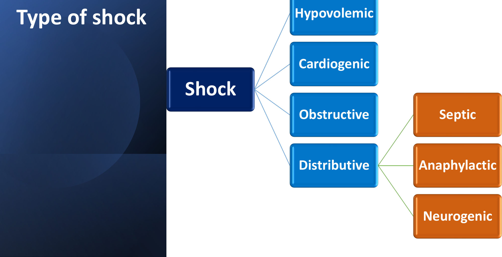
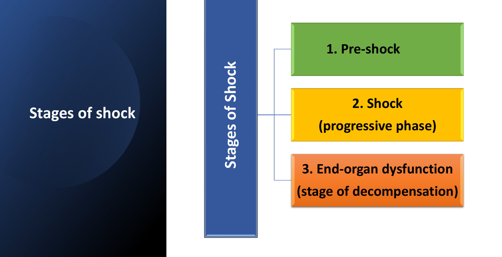
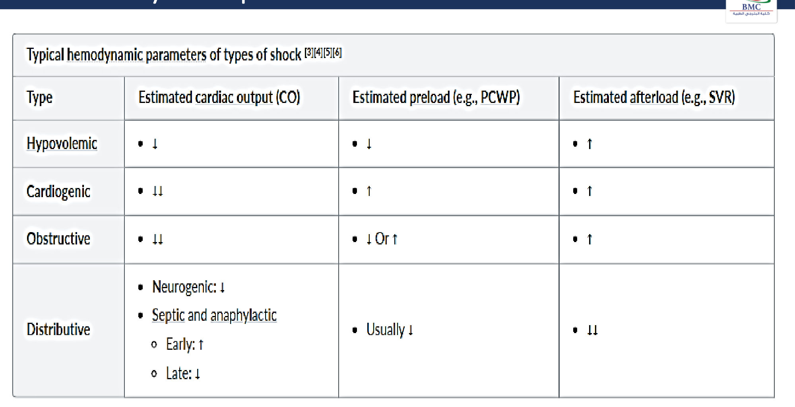
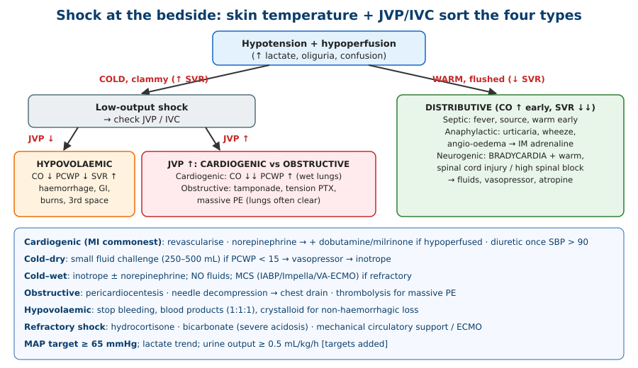
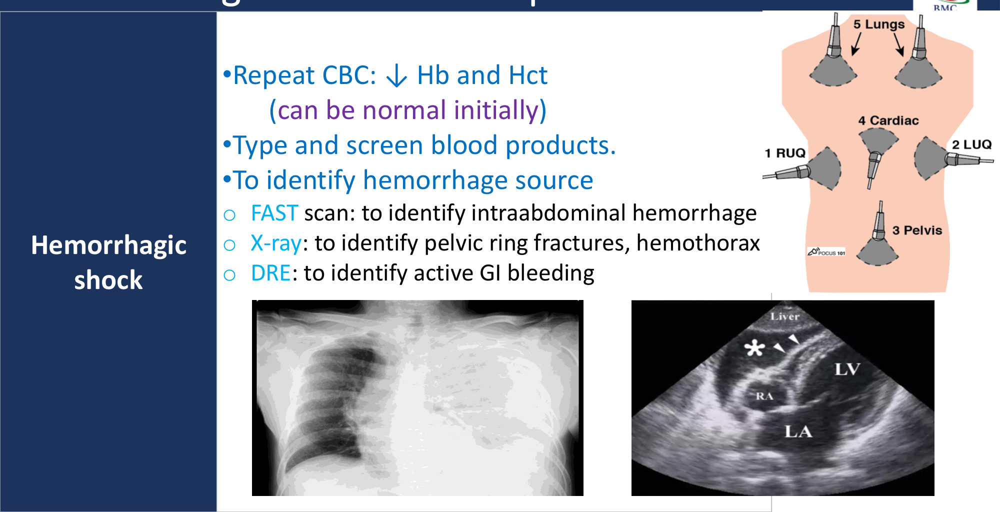
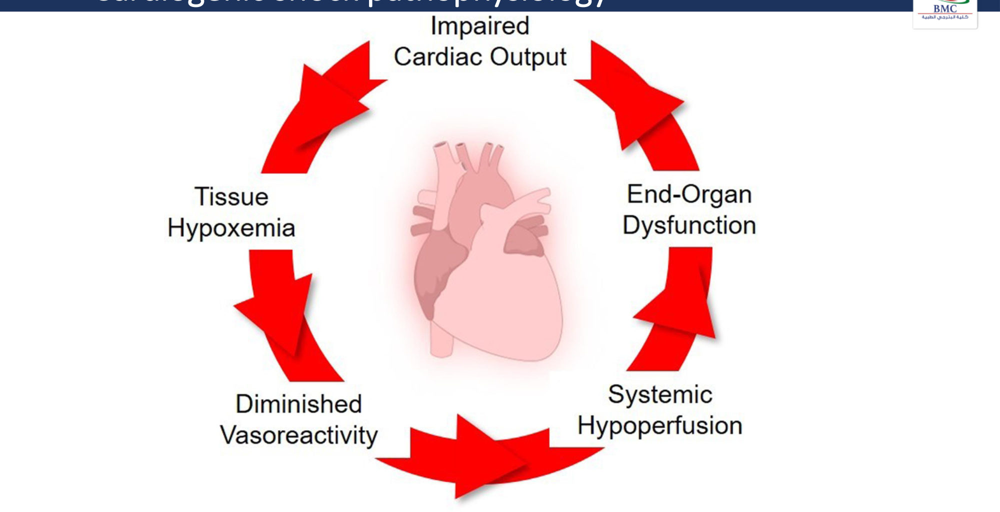
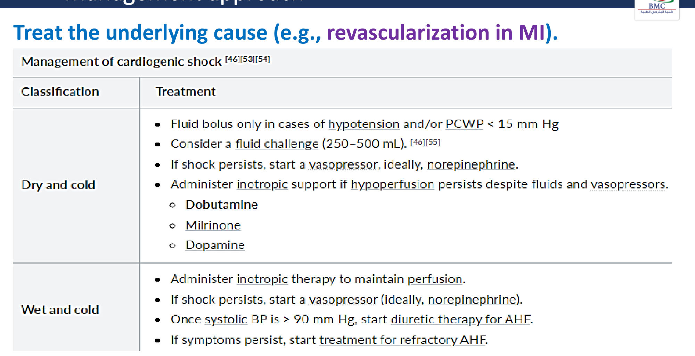
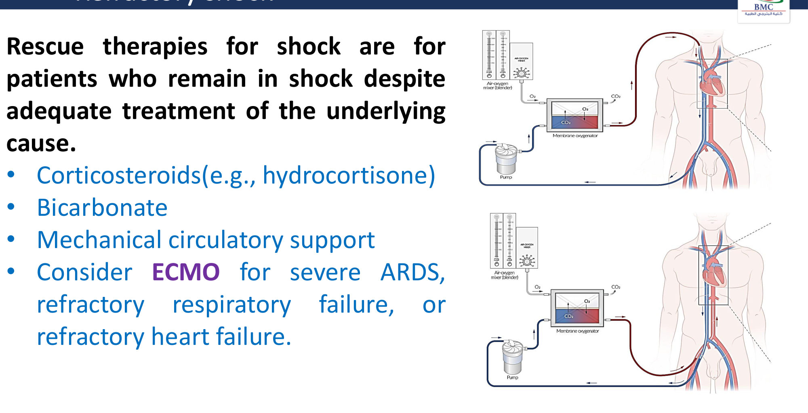

# Shock & Cardiogenic Shock: An Approach to a Case of Syncope
**Dr. Muhammad Reihan, Internal Medicine** | Source: `Reihan_cardiogenic_shock.pdf` (28 slides)

> **Legend:** ⭐ = high-yield · *[added]* = not on slides. Images marked "Slide N" come from the lecture; "Added diagram" = drawn for these notes. The opening-case answer is **reasoned by me; the key is not on the slides**.

> 🔗 **Bridge from earlier lectures:**
> - **Heart Failure (same lecturer):** the **"warm/cold, wet/dry"** profiles; cardiogenic shock is the **cold–wet** extreme of acute HF.
> - **CAD:** **MI is the commonest cause** of cardiogenic shock; **revascularisation**; mechanical complications (**VSD, free-wall rupture, papillary-muscle rupture → acute MR**).
> - **Cardiomyopathies:** DCM, myocarditis, **RCM** (listed under obstructive shock here).
> - **Pericardial disease:** **tamponade** (Beck's triad) and constriction = obstructive shock; **pericardiocentesis**.
> - **Pulmonary vascular:** **massive PE** → obstructive shock → **thrombolysis**.
> - **Pleural diseases:** **tension pneumothorax** → needle decompression.
> - **Adrenal II:** **adrenal crisis** = refractory shock → **hydrocortisone**.
> - **ARDS lecture:** ECMO; sepsis is the leading cause of both ARDS and distributive shock.

---

## 1. Title / Objectives

| Domain | Objective | Likely tested as |
|---|---|---|
| Knowledge | ⭐ Define shock; **stages** (pre-shock, progressive, end-organ dysfunction) | Stage features |
| Knowledge | Work-up: routine + aetiology-specific | Lactate; FAST; echo; CTPA; tryptase |
| Skill | ⭐ **Aetiology-directed management** of cardiogenic and obstructive shock | Revascularise MI; pericardiocentesis; thrombolysis; needle decompression |
| Skill | Stabilisation and **rescue therapy** for refractory shock | Steroids, bicarbonate, MCS/ECMO |

**Main subtopics:**
- overview, definition, pathophysiology, stages
- **types** (cardiogenic, hypovolaemic, obstructive, distributive) and **haemodynamics**
- diagnostics (routine and type-specific)
- **refractory shock** (rescue therapies)

---

## 2. Main Content (Lecture Order)

### 2.0 Opening Case (Slides 5–6)
**Presentation:**
- **28-year-old** having a skin graft; tibial ORIF 4 weeks ago
- **spinal anaesthesia: intrathecal bupivacaine at L3–L4**
- **30 minutes later:** dyspnoea, light-headedness, **loss of consciousness**
- **HR 38 (bradycardia)**, **BP 82/50**, RR 24, **flushed skin**
- withdraws the **upper limbs only to pain above the navel** (sensory level ~T10 or higher)
- **lungs clear**

**Most likely cause?** → ⭐ **A. Loss of sympathetic vascular tone** *[reasoning added; key not on slides]*:
- a **high spinal block** blocks sympathetic outflow (T1–L2) → **vasodilatation (↓ SVR), venous pooling**
- if it reaches **T1–T4 (cardioaccelerator fibres)** → **bradycardia**
- this is **neurogenic/distributive shock** physiology: **hypotension + bradycardia + warm, flushed skin**
- *[added]* treat with fluids, **vasopressors (phenylephrine/ephedrine)**, **atropine**, airway support

**Why not the others:**
- **B (septic)** and **F (anaphylaxis)** cause **tachycardia** (anaphylaxis also has urticaria and wheeze)
- **C (PE)** → tachycardia, hypoxaemia, raised JVP
- **D (hypovolaemia)** → **cold** skin with tachycardia
- **E (fat/marrow embolism)** → within **24–72 h** of a fracture, with petechiae, hypoxaemia and confusion; the fracture was 4 weeks ago

### 2.1 Definition and Types (Slides 7–8) ⭐
⭐ **Shock** = a **life-threatening circulatory disorder** → **tissue hypoxia** and **microcirculatory disturbance** → **metabolic derangement** → ultimately **irreversible organ damage**.

*[added]* In simple terms: **O₂ delivery < demand**. **MAP = CO × SVR.**

| Type | Subtypes / examples |
|---|---|
| **Hypovolaemic** | Haemorrhagic; non-haemorrhagic (GI, renal, third-space, insensible losses) |
| ⭐ **Cardiogenic** | Pump failure (MI…) |
| **Obstructive** | Tamponade, tension PTX, massive PE… |
| **Distributive** | ⭐ **Septic · anaphylactic · neurogenic** |

### 2.2 Stages of Shock (Slides 9–12) ⭐
| Stage | Features |
|---|---|
| **1. Pre-shock (compensated)** | ⭐ **Peripheral vasoconstriction**: **cold, clammy extremities, ↑ capillary refill time** (*may be absent in distributive shock*). ↓ capillary hydrostatic pressure → **interstitial fluid drawn into the vessels** (autotransfusion). ⭐ **Tachycardia** (*neurogenic shock may be bradycardic*). **Oliguria** |
| **2. Shock (progressive)** | **Worsening hypotension**; tissue hypoperfusion → **worsening tachypnoea**. **Precapillary dilation + postcapillary constriction** → capillary pooling and stasis → ↓ CO + **microthrombi → DIC**. **Acidosis**, cerebral hypoperfusion → **altered mental status** |
| **3. End-organ dysfunction (decompensation)** | Cerebral hypoxia → **autonomic dysfunction**; **myocardial ischaemia → ↓ CO**; widespread necrosis → **lysosomal enzymes** (more injury) and **cytokines** (DIC); **bowel ischaemia → bacteraemic sepsis**; ⭐ a **vicious cycle → irreversible multi-organ failure** |

### 2.3 Haemodynamic Parameters (Slide 13) ⭐⭐
| Type | **CO** | **Preload (PCWP)** | **Afterload (SVR)** |
|---|---|---|---|
| **Hypovolaemic** | ↓ | ⭐ **↓** | ↑ |
| ⭐ **Cardiogenic** | **↓↓** | ⭐ **↑** | ↑ |
| **Obstructive** | **↓↓** | **↓ or ↑** (*[added]* ↑ RA/CVP; PCWP ↓ in PE, equalised ↑ in tamponade) | ↑ |
| **Distributive** | **Neurogenic ↓**; **septic/anaphylactic: early ↑, late ↓** | **Usually ↓** | ⭐ **↓↓** |

**Key patterns:**
- ⭐ **Cardiogenic = the only one with high PCWP** (wet lungs).
- ⭐ **Distributive = the only one with low SVR** (warm peripheries).

*[added]* **Mixed venous O₂ (SvO₂):** ↓ in low-output shock (hypovolaemic, cardiogenic, obstructive); ↑ in septic shock (poor O₂ extraction).

> 🔁 **Recap: Shock basics.**
> - Shock = tissue hypoxia from circulatory failure.
> - Four types (distributive = septic, anaphylactic, neurogenic).
> - Stages: compensated (cold, tachycardic, oliguric) → progressive (hypotension, acidosis, DIC, confusion) → end-organ failure (vicious cycle).
> - **Cardiogenic: CO ↓↓, PCWP ↑, SVR ↑. Distributive: SVR ↓↓.**
>
> ▶️ **Up next: Diagnostics.**

---

### 2.4 Diagnostics (Slides 14–19) ⭐
**Routine:**
- **global hypoperfusion:** ⭐ **↑ lactate**, **ABG**
- **aetiology:** **BMP**
- **end-organ damage:** **renal function, LFTs, coagulation panel**

| Shock type | Specific studies |
|---|---|
| ⭐ **Haemorrhagic** | **Repeat CBC** (↓ Hb/Hct, *can be normal initially*); **type and screen**. Find the source: ⭐ **FAST** (intra-abdominal blood; *[added]* RUQ, LUQ, pelvis, cardiac, lungs), **X-ray** (pelvic ring fracture, haemothorax), **DRE** (GI bleeding) |
| **Non-haemorrhagic hypovolaemic** | **Insensible losses:** fever work-up. **Third-space:** **CT abdomen** (pancreatitis, bowel obstruction). **GI:** nausea, vomiting, diarrhoea. **Renal:** urine electrolytes, urine creatinine |
| ⭐ **Cardiogenic** | **BNP/NT-proBNP vs baseline**; **ECG** (MI, arrhythmia, ventricular hypertrophy); **troponin I/T** (ACS); ⭐ **echo**: valvular lesions, ventricular dysfunction, **pericardial effusion** |
| ⭐ **Obstructive** | **Echo/POCUS** (depends on cause); **CXR or CT chest** (pneumothorax); ⭐ **CTPA or V/Q** (PE), CT for aortic dissection |
| **Septic** | **Cultures** (blood, urine); **ESR, CRP, procalcitonin** |
| **Anaphylactic** | Mostly **clinical**; ⭐ **serum mast-cell tryptase** if uncertain |
| **Neurogenic** | **CT/MRI spine or brain** to find the injury |

---

### 2.5 Cardiogenic Shock: Aetiology and Pathophysiology (Slides 20–21) ⭐⭐
**Causes:**
- ⭐ **myocardial infarction: the most common cause** (*[added]* usually ≥ 40% of LV lost, or a mechanical complication)
- **arrhythmias**
- **heart failure** (decompensated)
- **cardiomyopathy**
- **myocarditis**
- ⭐ **VSD, ventricular (free-wall) rupture** (*[added]* post-MI days 3–5)
- **valve defects: severe AR or MR** (*[added]* papillary-muscle rupture, IE)
- **blunt cardiac trauma**
- ⭐ **drugs: β-blockers, calcium-channel blockers** (overdose)

**Mnemonic *[added]*: "MI PUMPS"**:
- **MI** (± mechanical complications)
- **P**apillary/valve rupture (acute MR/AR)
- **U**nstable rhythm (arrhythmia)
- **M**yocarditis / cardio**M**yopathy
- **P**oisoning (β-blocker/CCB)
- **S**eptal rupture (VSD) / free-wall rupture

**Downward spiral (slide 21):**
1. **impaired CO**
2. **systemic hypoperfusion**
3. **diminished vasoreactivity**
4. **tissue hypoxaemia**
5. **end-organ dysfunction**
6. → further ↓ CO

*[added]* Coronary perfusion falls with hypotension → more ischaemia → a worse pump.

### 2.6 Cardiogenic Shock: Management (Slide 22) ⭐⭐
⭐ **Treat the underlying cause** (e.g. **revascularisation in MI**: *[added]* emergency PCI of the culprit vessel, SHOCK trial).

| Profile | Treatment |
|---|---|
| ⭐ **Dry and cold** (low CO, low filling pressure) | **Fluid bolus only if hypotensive and/or PCWP < 15 mmHg**; consider a **fluid challenge (250–500 mL)** → if shock persists, a **vasopressor, ideally norepinephrine** → if hypoperfusion persists despite fluids and pressors, **inotropes**: **dobutamine**, **milrinone**, **dopamine** |
| ⭐ **Wet and cold** (classic cardiogenic shock) | **Inotropic therapy** to maintain perfusion → if shock persists, a **vasopressor (norepinephrine)** → ⭐ **once SBP > 90 mmHg, start diuretics** for acute HF → if symptoms persist, **refractory AHF** treatment |

*[added]*
- **Norepinephrine is the first-line pressor**: dopamine causes more arrhythmias (SOAP II), which is why the slide lists dopamine only as an inotrope option.
- **Avoid:** **β-blockers, nitrates/vasodilators, negative inotropes** while in shock.
- **Mechanical circulatory support** if refractory: **IABP** (no mortality benefit in IABP-SHOCK II), **Impella**, **VA-ECMO**.
- **Targets:** **MAP ≥ 65**, falling lactate, urine output ≥ 0.5 mL/kg/h.

### 2.7 Obstructive Shock (Slides 23–24) ⭐⭐
| Mechanism | Causes |
|---|---|
| **↓ Diastolic filling** | ⭐ **Cardiac tamponade**, **constrictive pericarditis**, **restrictive cardiomyopathy** |
| **↓ Venous return** | ⭐ **Tension pneumothorax**, intrathoracic tumour |
| **↑ Ventricular afterload** | ⭐ **Massive PE**, **aortic dissection**, **aortic stenosis**, large systemic emboli, **severe pulmonary hypertension** |

| Cause | Treatment (slide 24) |
|---|---|
| ⭐ **Cardiac tamponade** | **Pericardiocentesis** |
| ⭐ **Massive PE** | **Thrombolytic therapy** (*[added]* or embolectomy if contraindicated) |
| ⭐ **Tension pneumothorax** | **Needle thoracostomy → chest tube** (or surgery) |

*[added]* **Bedside clues:**
- **Tamponade:** **Beck's triad** (hypotension, ↑ JVP, muffled heart sounds), **pulsus paradoxus**, electrical alternans.
- **Tension PTX:** absent breath sounds, hyperresonance, **tracheal deviation away**, ↑ JVP. A **clinical** diagnosis: decompress before the X-ray.
- **Massive PE:** ↑ JVP, RV dilatation on POCUS (McConnell's sign), hypoxaemia, S1Q3T3.

### 2.8 Complications and Refractory Shock (Slides 25–26) ⭐
- **Complications:**
  - **general:** **cardiovascular collapse**, **acute renal failure**
  - **specific:** **pulmonary oedema** (cardiogenic)
  - *[added]* also ARDS, DIC, ischaemic hepatitis ("shock liver"), mesenteric ischaemia
- ⭐ **Refractory shock** = still in shock **despite adequate treatment of the underlying cause** → **rescue therapies:**
  1. ⭐ **corticosteroids (hydrocortisone)** (*[added]* septic shock on escalating pressors; adrenal insufficiency)
  2. **bicarbonate** (*[added]* severe metabolic acidosis, pH < 7.2 with AKI)
  3. ⭐ **mechanical circulatory support**
  4. ⭐ **ECMO** for **severe ARDS, refractory respiratory failure, or refractory heart failure** (*[added]* **VV-ECMO** = lung support; **VA-ECMO** = heart + lung support)

> 🔁 **Recap: Cardiogenic and obstructive shock.**
> - **Cardiogenic:** MI commonest (plus arrhythmia, HF, CM, myocarditis, VSD/rupture, AR/MR, trauma, β-blocker/CCB). Echo, troponin, ECG, BNP.
>   - **Revascularise.**
>   - Dry–cold: small fluids → norepinephrine → inotrope.
>   - Wet–cold: inotrope → norepinephrine → diuretic when SBP > 90.
> - **Obstructive:** tamponade (pericardiocentesis), tension PTX (needle → drain), massive PE (thrombolysis).
> - **Refractory:** hydrocortisone, bicarbonate, MCS/ECMO.

---

## 3. High-Yield Comparison Tables

### Table A: The Four Shock Types
| | Hypovolaemic | Cardiogenic | Obstructive | Distributive |
|---|---|---|---|---|
| CO | ↓ | **↓↓** | ↓↓ | ↑ early (septic/anaphylaxis), ↓ neurogenic/late |
| PCWP | **↓** | **↑** | ↓ or ↑ | ↓ |
| SVR | ↑ | ↑ | ↑ | **↓↓** |
| JVP | Flat | **↑** | **↑** | Flat/normal |
| Skin | Cold | Cold | Cold | **Warm** |
| Lungs | Clear | **Crackles** | Clear (PE, tamponade) / absent sounds (PTX) | Clear (± wheeze in anaphylaxis) |
| First treatment | **Volume/blood** | **Revascularise; inotrope ± norepinephrine** | **Relieve the obstruction** | **Fluids + norepinephrine** (septic); **IM adrenaline** (anaphylaxis); fluids + pressor + atropine (neurogenic) |

### Table B: Distributive Shock Subtypes *[slides 8, 10, 19 + added]*
| | Septic | Anaphylactic | Neurogenic |
|---|---|---|---|
| Trigger | Infection | Allergen (IgE) | **Spinal cord injury (≥ T6)**, **high spinal/epidural block** |
| HR | **Tachycardia** | **Tachycardia** | ⭐ **Bradycardia** |
| Skin | Warm (early) → cold (late) | Urticaria, flushing, angio-oedema | **Warm, dry, flushed** |
| Test | Cultures, lactate, procalcitonin | **Tryptase** | CT/MRI spine |
| Treatment | Antibiotics within 1 h, 30 mL/kg crystalloid, **norepinephrine**, ± hydrocortisone | ⭐ **IM adrenaline 0.5 mg (1:1000)**, fluids, antihistamine, steroid | Fluids, **norepinephrine/phenylephrine**, **atropine** |

### Table C: Cardiogenic Shock Profiles (Slide 22)
| | Dry–cold | Wet–cold |
|---|---|---|
| Filling | Low (PCWP < 15) | High |
| Step 1 | **Fluid challenge 250–500 mL** | **Inotrope** (dobutamine/milrinone) |
| Step 2 | **Norepinephrine** | **Norepinephrine** if still shocked |
| Step 3 | **Inotrope** | **Diuretic once SBP > 90** |
| Refractory | MCS/ECMO | Refractory AHF therapy / MCS |

### Table D: Obstructive Shock: Diagnosis and Fix
| Cause | Key sign | Test | Fix |
|---|---|---|---|
| Tamponade | Beck's triad, pulsus paradoxus | **Echo** (RA/RV diastolic collapse) | **Pericardiocentesis** |
| Tension PTX | Absent breath sounds, tracheal shift | **Clinical** (X-ray/US) | **Needle → chest drain** |
| Massive PE | ↑ JVP, hypoxaemia, RV strain | **CTPA / echo** | **Thrombolysis** |
| Aortic dissection | Tearing pain, pulse deficit | **CT angiography** | Surgery (type A) |

---

## 4. Rules, Exceptions, Patterns
- **Shock = tissue hypoperfusion**; hypotension is not required in pre-shock (compensated).
- **Pre-shock:** cold, clammy, ↑ CRT, **tachycardia**, oliguria. **Exceptions:** distributive (warm) and **neurogenic (bradycardia)**.
- **Cardiogenic = the only high-PCWP shock; distributive = the only low-SVR shock.**
- **Obstructive and cardiogenic both raise the JVP**; lungs are wet in cardiogenic, clear in obstructive.
- **MI is the commonest cause of cardiogenic shock → revascularise.**
- **Dry–cold: fluid only if PCWP < 15. Wet–cold: no fluid; inotrope first.**
- **Diuretics only once SBP > 90.**
- **Norepinephrine is the preferred vasopressor.**
- **Lactate** measures global hypoperfusion; trend it.
- **FAST** for haemorrhage; **tryptase** for anaphylaxis; **CTPA/V/Q** for PE.
- **Refractory shock → hydrocortisone, bicarbonate, MCS/ECMO.**

---

## 5. Clinical Correlations
- **Post-MI day 3–5 new murmur + shock** → **papillary-muscle rupture (acute MR)** or **VSD** → urgent echo and surgery (CAD lecture).
- **β-blocker/CCB overdose** → cardiogenic shock with bradycardia → *[added]* glucagon (β-blocker), calcium, **high-dose insulin**, pacing.
- **Spinal/epidural anaesthesia or cord injury** → neurogenic shock (lecture case).
- **Trauma:** haemorrhagic shock (FAST, pelvic X-ray) vs tension PTX vs tamponade vs neurogenic shock.
- **Adrenal crisis** → refractory shock unresponsive to pressors → **IV hydrocortisone 100 mg** (Adrenal II).
- **Sepsis** (next ID lectures) → distributive shock; lactate > 2 + pressors = septic shock.
- **Massive PE** (Pulmonary Vascular lecture) → obstructive shock → thrombolysis.
- **Tamponade** after cardiac surgery or in malignancy (Pericardial lecture).
- **ECMO** for ARDS (VV) vs cardiogenic shock (VA) (ARDS lecture).

---

## 6. Rapid Revision (Last-Day)
1. **Shock** = life-threatening circulatory failure → tissue hypoxia, microcirculatory disturbance → metabolic derangement → irreversible organ damage.
2. **Types:** hypovolaemic, **cardiogenic**, obstructive, distributive (**septic, anaphylactic, neurogenic**).
3. **Stages:**
   - **pre-shock:** vasoconstriction (cold, clammy, ↑ CRT; not in distributive), tachycardia (not in neurogenic), oliguria, fluid shift into the vessels
   - **progressive:** hypotension, tachypnoea, capillary pooling, microthrombi, **DIC**, acidosis, confusion
   - **end-organ:** autonomic dysfunction, myocardial ischaemia, lysosomal enzymes, cytokines, **gut ischaemia → sepsis** → MOF
4. **Haemodynamics:**
   - hypovolaemic: CO ↓, PCWP ↓, SVR ↑
   - **cardiogenic: CO ↓↓, PCWP ↑, SVR ↑**
   - obstructive: CO ↓↓, PCWP ↓/↑, SVR ↑
   - **distributive: SVR ↓↓**, PCWP ↓, CO ↑ early (septic/anaphylactic) or ↓ (neurogenic/late)
5. **Routine tests:** **lactate**, ABG, BMP, renal, LFTs, coagulation.
6. **Haemorrhagic:** serial CBC (may be normal early), type and screen, **FAST**, X-ray (pelvis, haemothorax), DRE.
7. **Non-haemorrhagic hypovolaemic:** fever work-up, **CT abdomen** (pancreatitis, obstruction), GI losses, urine electrolytes.
8. **Cardiogenic tests:** BNP vs baseline, **ECG**, **troponin**, **echo** (valves, function, effusion).
9. **Obstructive tests:** echo/POCUS, CXR/CT (PTX), **CTPA/V/Q** (PE), CT (dissection).
10. **Distributive tests:** cultures + CRP/ESR/procalcitonin (septic); **tryptase** (anaphylaxis); CT/MRI spine/brain (neurogenic).
11. **Cardiogenic causes:** **MI (commonest)**, arrhythmia, HF, cardiomyopathy, myocarditis, **VSD/rupture**, **severe AR/MR**, blunt trauma, **β-blockers/CCBs**.
12. **Cardiogenic spiral:** ↓ CO → hypoperfusion → ↓ vasoreactivity → hypoxaemia → organ dysfunction → ↓ CO.
13. **Treatment:** **revascularise MI.**
    - **Dry–cold:** fluid only if hypotensive/PCWP < 15 (250–500 mL) → **norepinephrine** → inotrope (**dobutamine, milrinone, dopamine**).
    - **Wet–cold:** **inotrope** → norepinephrine → **diuretic once SBP > 90** → refractory AHF.
14. **Obstructive causes:** ↓ filling (**tamponade**, constriction, RCM), ↓ venous return (**tension PTX**, tumour), ↑ afterload (**massive PE**, dissection, AS, emboli, severe PH).
15. **Obstructive treatment:** **pericardiocentesis**; **thrombolysis**; **needle thoracostomy → chest tube**.
16. **Complications:** CV collapse, **AKI**, pulmonary oedema.
17. **Refractory shock:** **hydrocortisone, bicarbonate, MCS, ECMO** (severe ARDS, refractory respiratory or heart failure).

---

## 7. Exam-Style Questions

**Q1 (lecture case, slides 5–6).** A 28-year-old has **intrathecal bupivacaine (L3–L4)** for a skin graft. 30 minutes later: dyspnoea, syncope, **HR 38**, **BP 82/50**, **flushed skin**, sensory level above the navel, clear lungs. Most likely mechanism?
**A. Loss of sympathetic vascular tone** · B. Bacterial toxin vasodilation · C. PA thrombus · D. Volume depletion · E. Bone-marrow embolism · F. Type I hypersensitivity

> **Answer: A** *[reasoning added; key not on slides]*.
> - **High spinal block** → sympathectomy → vasodilatation and venous pooling; block of cardioaccelerator fibres (T1–T4) → **bradycardia**.
> - **Hypotension + bradycardia + warm, flushed skin** = **neurogenic/distributive** physiology (slide 10: "neurogenic shock may present with bradycardia").
> - Septic, anaphylactic, PE and hypovolaemic shock are all **tachycardic**.
> - Fat/marrow embolism occurs within 72 h of a fracture, not at 4 weeks.

**Q2.** A 62-year-old 6 hours into an anterior STEMI has BP 78/50, HR 118, cold clammy peripheries, confusion, **bibasal crackles**, lactate 5.2. Echo: LVEF 20%, no mechanical complication. Best immediate strategy?
A. 2 L crystalloid bolus · **B. Emergency PCI of the culprit vessel with inotrope/vasopressor support (norepinephrine ± dobutamine)** · C. IV furosemide 80 mg now · D. IV metoprolol · E. Nitroglycerin infusion

> **Answer: B** (slides 20, 22).
> - **MI is the commonest cause** → **revascularisation**.
> - He is **wet–cold** → **inotrope**, ± norepinephrine.
> - Why not the others:
>   - **Diuretics only once SBP > 90.**
>   - Fluids would worsen the oedema.
>   - **β-blockers and nitrates are contraindicated** in shock.

**Q3.** After a stab wound to the chest, a man has BP 70/40, HR 130, **distended neck veins**, **muffled heart sounds** and clear, equal breath sounds. Immediate treatment?
A. Needle thoracostomy · **B. Pericardiocentesis** · C. Thrombolysis · D. Norepinephrine alone · E. 2 L crystalloid

> **Answer: B** (slides 23–24).
> - **Beck's triad** = **tamponade** → obstructive shock → **pericardiocentesis** (*[added]* definitive: thoracotomy).
> - Tension PTX would show **absent breath sounds** and tracheal deviation → needle thoracostomy.

**Q4.** Which haemodynamic profile is typical of cardiogenic shock?
A. CO ↑, PCWP ↓, SVR ↓ · B. CO ↓, PCWP ↓, SVR ↑ · **C. CO ↓↓, PCWP ↑, SVR ↑** · D. CO ↓, PCWP ↓, SVR ↓↓

> **Answer: C** (slide 13).
> - A = early septic shock.
> - B = hypovolaemic.
> - D = neurogenic/late distributive.

**Q5.** A patient remains hypotensive on escalating norepinephrine despite source control and adequate fluids for septic shock. Which rescue therapy does the lecture list?
A. Stop vasopressors · **B. IV hydrocortisone** · C. Oral prednisolone next day · D. β-blocker · E. More crystalloid indefinitely

> **Answer: B** (slide 26).
> - **Corticosteroids (hydrocortisone)**, **bicarbonate**, **MCS/ECMO** are the rescue therapies for refractory shock.
> - *[added]* Hydrocortisone 200 mg/day in septic shock on vasopressors.

---

## 8. Exam Pitfalls & Traps
| Trap | Correct thinking |
|---|---|
| Shock = low BP | ❌ Shock = **tissue hypoperfusion**; BP may be maintained in pre-shock (check lactate, urine output, CRT) |
| All shock is tachycardic | ❌ **Neurogenic** (and β-blocker/CCB toxicity) → **bradycardia** |
| All shock has cold peripheries | ❌ **Distributive** (early septic, anaphylactic, neurogenic) = **warm** |
| Cardiogenic shock: give fluids | ❌ Only if **dry–cold with PCWP < 15** (small challenge); wet–cold → **inotrope**, no fluids |
| Furosemide straight away in cardiogenic shock | ❌ **Diuretics only once SBP > 90** |
| Dopamine is the first-line pressor | ⚠️ **Norepinephrine** is preferred (*[added]* dopamine → more arrhythmias) |
| Nitrates / β-blockers in cardiogenic shock | ❌ Worsen hypotension and the pump; avoid |
| Raised JVP = cardiogenic shock | ⚠️ **Obstructive** shock also raises the JVP (tamponade, tension PTX, PE); check the lungs and echo |
| Waiting for a CXR in suspected tension PTX | ❌ **Clinical** diagnosis; decompress first |
| Normal Hb excludes haemorrhagic shock | ❌ **Hb can be normal initially**; repeat CBC |
| Anaphylaxis diagnosed by tryptase | ❌ **Clinical**; tryptase only if uncertain; treat with **IM adrenaline** immediately |
| RCM as a cause of cardiogenic shock only | ⚠️ The slide lists **restrictive CM and constriction** under **obstructive** (↓ diastolic filling) |
| IABP routinely in MI shock *[added]* | ❌ No mortality benefit (IABP-SHOCK II); Impella/VA-ECMO in selected patients |
