# Cardiomyopathies: An Approach to a Case of Dyspnoea
**Dr. Muhammad Reihan, Internal Medicine** | Source: `Reihan_Cardiomyopathies.pdf` (29 slides)

> **Legend:** ⭐ = high-yield · *[added]* = not on slides. Images marked "Slide N" come from the lecture; "Added diagram" = drawn for these notes. The case answer is **reasoned by me; the key is not on the slides**.

> 🔗 **Bridge from earlier lectures:**
> - **Heart Failure (same lecturer):** DCM = **HFrEF** (all GDMT applies); HCM and RCM = **HFpEF** physiology; the **ICD criteria** (EF ≤ 35%, NYHA II–III, 3 months GDMT) come from there.
> - **Valvular heart disease:** the **HOCM murmur vs aortic stenosis**; both crescendo–decrescendo; **SAM → MR**.
> - **Pericardial disease:** **restrictive cardiomyopathy vs constrictive pericarditis**, the classic look-alike.
> - **Arrhythmias:** **tachycardia-induced cardiomyopathy** (AF); HCM → AF and **VT/SCD**.
> - **Substance use / psychotropics:** **alcohol**, **cocaine**, **beriberi (thiamine)**; *[added]* **clozapine myocarditis**.
> - **Endocrine:** thyroid disease and **acromegaly** (secondary DCM); **haemochromatosis** (RCM).
> - **Restrictive lung / sarcoid / amyloid:** infiltrative causes overlap.

---

## 1. Title / Objectives

| Domain | Objective | Likely tested as |
|---|---|---|
| Knowledge | ⭐ Aetiology of **dilated, hypertrophic, restrictive** cardiomyopathy | ABCCCDD; PLEASe Help |
| Knowledge | ⭐ Pathophysiology of each | Eccentric vs concentric hypertrophy; SAM |
| Skill | ⭐ Features that warrant an **ICD** for sudden-death risk | HCM risk factors; EF ≤ 35% |
| Skill | Evidence-based management of each type | β-blockers in HCM; avoid nitrates/diuretics |

**Main subtopics:**
1. overview and classification
2. **DCM** (epidemiology, ABCCCDD, pathophysiology, features, diagnostics, management)
3. **HCM** (epidemiology, genetics, obstructive vs non-obstructive, features, examination, diagnostics, management)
4. **RCM** (PLEASe Help, pathophysiology, features, diagnostics, management)
5. ⭐ **echo differentiation** (LV cavity, EF, wall thickness)

---

## 2. Main Content (Lecture Order)

### 2.0 Opening Case (Slides 4–5, 26)
**Presentation:**
- **48-year-old woman**, 2 months of progressive exertional dyspnoea and fatigue
- no illness or medication; **father died of amyloidosis**; no smoking or alcohol
- **HR 124**, BP 98/60, no murmurs, **bibasal coarse crackles**
- **ECG: irregularly irregular, absent P waves (AF)**
- **CXR:** globular cardiomegaly, prominent hila, bilateral fluffy infiltrates (pulmonary oedema)
- **echo: DILATED LV, EF 40%**

**Most likely cause?** → ⭐ **d. Chronic tachycardia** (tachycardia-induced cardiomyopathy) *[reasoning added; key not on slides]*:
- **DCM** (dilated LV, ↓ EF) in a patient with **persistent fast AF** and **no other cause** (no alcohol, no CAD risk profile, no thiamine deficiency) fits **tachycardia-mediated DCM**
- slide 9 lists "**chronic tachycardia**" as a secondary cause of DCM
- *[added]* it is **reversible** with rate or rhythm control

**Why not the others:**
- **a. amyloid** (the distractor via the father's history): **restrictive** CM with a **non-dilated, thick-walled** LV (and low-voltage ECG)
- **b. stress (takotsubo):** acute apical ballooning after a trigger
- **c. thiamine:** needs malnutrition or alcohol
- **e. coronary occlusion:** ischaemic history, regional wall-motion abnormality

### 2.1 Overview and Classification (Slide 6) ⭐
- ⭐ **Cardiomyopathies are diseases of the heart muscle itself**, occurring **in the absence of pressure overload, volume overload, or CAD**.
- **Types:** **dilated · hypertrophic · restrictive** (*[added]* plus **ARVC** and unclassified, e.g. takotsubo).

| Type | Morphology (slide 6/25) |
|---|---|
| **HCM** | ⭐ **↑ LV wall thickness, septal predominance** |
| **DCM** | **Ventricular dilation**, **↓ wall thickness**, possible atrial dilation |
| **RCM** | ⭐ **Atrial dilation**, **ventricular stiffness** (normal-sized ventricles) |

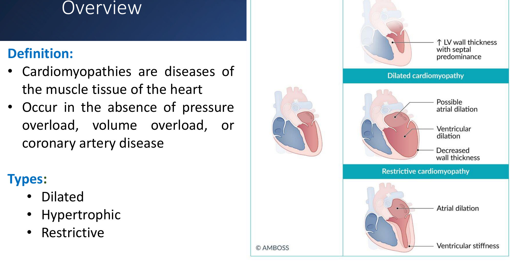

---

### 2.2 Dilated Cardiomyopathy (Slides 7–12) ⭐⭐
**Epidemiology:**
- incidence **6/100,000/year**
- ⭐ **the most common cardiomyopathy**
- ⭐ **M:F ≈ 3:1**

**Definition:** ⭐ **↓ contractile function** of the ventricles → **cardiac enlargement and systolic dysfunction**.

**Aetiology of HF / DCM (slide 8, Felker NEJM 2000):**
- **Causes of HF:** **ischaemic 40%**, **DCM 37%**, valvular 12%, HTN 11%.
- **Within DCM:**

| Cause | Share |
|---|---|
| ⭐ **Idiopathic** | **50%** (of which ⭐ **~40% familial**) |
| **Myocarditis** | 10% |
| Infiltrative | 5% |
| Toxins (**EtOH, cocaine**) | 4% |
| **Peripartum** | 4% |
| HIV | 4% |
| Connective tissue disease | 3% |
| **Chemotherapy (adriamycin)** | 1% |
| **Other** (tachycardia, congenital HD, stress-related, **Chagas**) | 17% |

**Secondary causes (slide 9):**
- ⭐ **peripartum cardiomyopathy**
- ⭐ **infection: Coxsackie B, Chagas disease**
- **sarcoidosis**
- **radiation and chemotherapy**
- toxic substances
- **malnutrition (thiamine deficiency)**
- ⭐ **chronic (prolonged) tachycardia** (slide lists it twice)
- **endocrinopathies**

⭐ **Mnemonic ABCCCDD:**
- **A**lcohol
- **B**eriberi (thiamine)
- **C**ocaine
- **C**oxsackie B
- **C**hagas
- **D**oxorubicin/**D**aunorubicin

*[added]*
- **Anthracycline cardiotoxicity** is **dose-dependent** (cumulative doxorubicin > 450–550 mg/m²), so monitor EF.
- **Trastuzumab** is **reversible** (dose-independent).
- **Peripartum CM** = last month of pregnancy to 5 months postpartum.
- **Alcoholic CM is reversible** with abstinence.

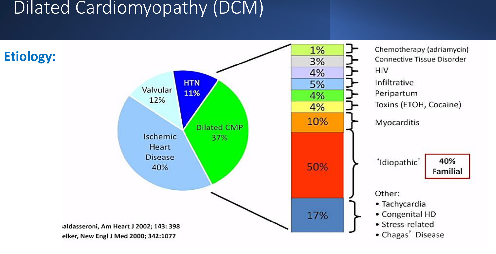

**Pathophysiology (slide 10):**
1. causative factors **↓ contractility**
2. ⭐ **ECCENTRIC hypertrophy: sarcomeres added in SERIES**
3. **ventricular dilation**
4. **systolic dysfunction, ↓ EF**
5. **heart failure**

*[added]* Dilation also stretches the mitral annulus → **functional MR**.

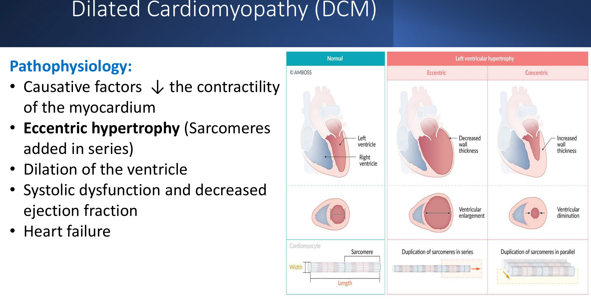

| **Symptoms** | **Signs** |
|---|---|
| ⭐ **Exertional dyspnoea** | ⭐ **S3 gallop** |
| **Ankle oedema, ascites** | ⭐ **Displaced LV impulse** |
| **Angina** | **JVD** |
| **Palpitations** | **Bilateral rales** |
| — | **Diffuse abdominal and peripheral oedema** |

**Diagnostics (slide 12):**
- **↑ BNP**
- **troponin and CK-MB**
- ⭐ **echocardiography**
- **CXR** (signs of HF)
- **ECG** (nonspecific)
- *[added]* **coronary angiography/CTCA to exclude ischaemic cause**; cardiac MRI (myocarditis, sarcoid); genetic testing if familial

| **DCM echo** | |
|---|---|
| **LV cavity** | ⭐ **Significantly ↑** |
| **EF** | ⭐ **Significantly ↓** (systolic dysfunction) |
| **Wall thickness** | **Normal or ↓** |

**Management:** ⭐ **treat the underlying disease** + ⭐ **treat HF** (full HFrEF GDMT, ICD/CRT as per the HF lecture).
- *[added]* **Anticoagulate** if AF or LV thrombus.

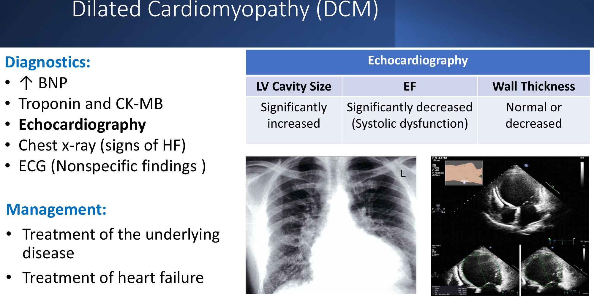

> 🔁 **Recap: DCM.**
> - Commonest CM (6/100,000; M 3:1); ↓ contractility → eccentric hypertrophy (series) → dilated, thin LV → ↓ EF.
> - Idiopathic 50% (40% familial).
> - **ABCCCDD**; also peripartum, sarcoid, radiation, **chronic tachycardia**, endocrine.
> - S3, displaced apex, HF signs.
> - Echo: big cavity, low EF, thin/normal walls → **treat the cause + HFrEF GDMT**.

---

### 2.3 Hypertrophic Cardiomyopathy (Slides 13–19) ⭐⭐
**Definition:**
- ⭐ **LV hypertrophy with non-dilated chambers without an apparent cause** (no HTN or AS)
- ⭐ **genetic, autosomal dominant**

**Epidemiology:**
- ⭐ **1 in 500** people
- ⭐ **one of the most frequent causes of sudden cardiac death in the young, especially athletes**

**Genetics (slide 14):**
- **autosomal dominant**: 50% of children of an affected parent
- **sarcomere mutations:** ⭐ **myosin-binding protein C** and ⭐ **β-myosin heavy chain**
- some cases are **spontaneous mutations**

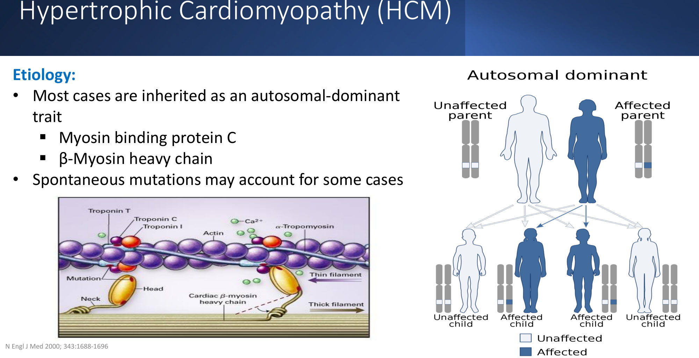

**Pathophysiology (slide 15):**
1. ⭐ **CONCENTRIC hypertrophy: sarcomeres added in PARALLEL**
2. ⭐ **↓ ventricular relaxation** → **↓ diastolic filling** and ↓ systolic output (diastolic dysfunction)
3. ⭐ **Obstructive type (HOCM):** **LVOT obstruction** (asymmetric septal hypertrophy) + **mitral regurgitation** from ⭐ **systolic anterior motion (SAM)** of the mitral valve

*[added]*
- **Non-obstructive vs obstructive:** about ⅓ obstructed at rest, ⅓ only on provocation, ⅓ never.
- Ischaemia comes from thick muscle with high O₂ demand and compressed small vessels.

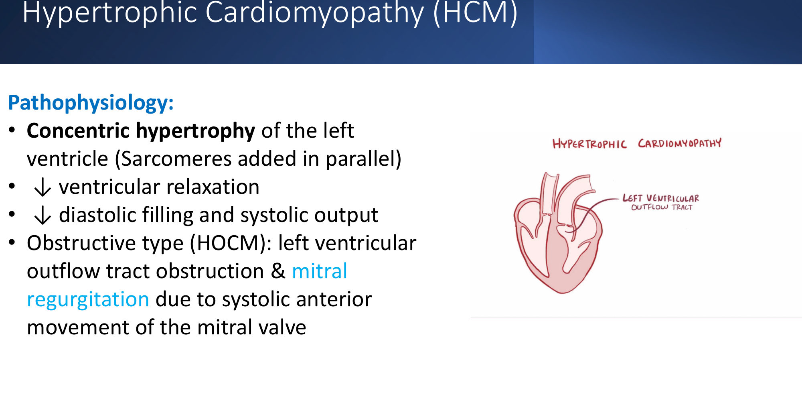

**Symptoms (slide 16):**
- ⭐ **many are asymptomatic**
- **HF symptoms**
- **angina**
- ⭐ **syncope/presyncope** (*[added]* exertional)
- **palpitations, arrhythmias** (*[added]* AF, VT)
- ⭐ **sudden cardiac death, particularly during or after intense exercise**

**Examination (slide 17):**
- ⭐ **systolic ejection (crescendo–decrescendo) murmur** (*[added]* left sternal edge, **no carotid radiation**; **↑ with Valsalva/standing, ↓ with squatting/handgrip**)
- ⭐ **S4 gallop**
- ⭐ **pulsus bisferiens:** LVOT obstruction gives a **quick rise of the pulse, then a slower, longer rise** (double-peaked)
- *[added]* "**jerky**" pulse; **double/triple apical impulse**

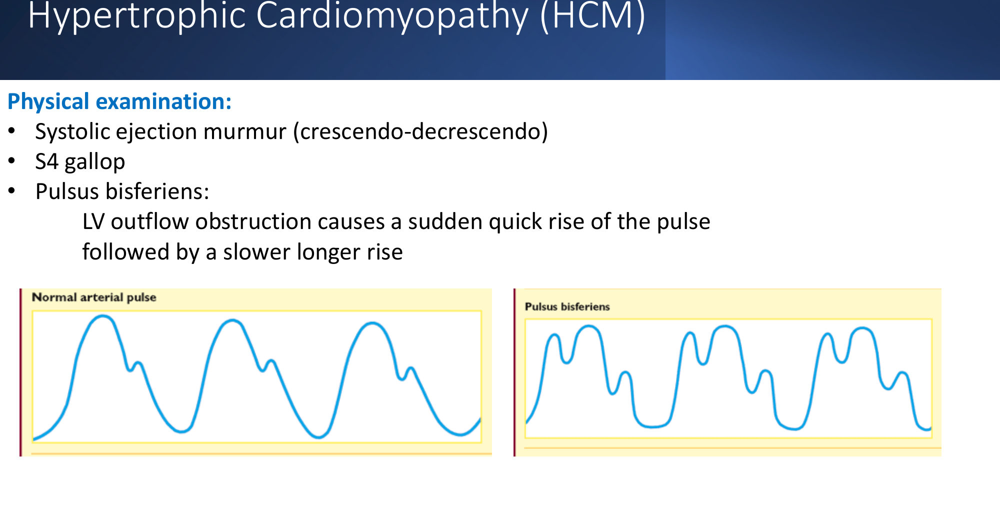

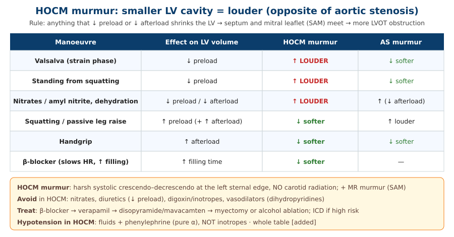

**Diagnostics (slide 18):**
- **ECG:** septal/LVH (*[added]* deep narrow "dagger" Q waves in inferolateral leads; **apical HCM → giant T-wave inversion**)
- ⭐ **echo: wall thickness ≥ 15 mm**
- **MRI** case by case (*[added]* LGE fibrosis = SCD risk)
- ⭐ **genetic testing** to confirm and **screen family members**

| **HCM echo** | |
|---|---|
| **LV cavity** | ⭐ **↓** |
| **EF** | **Normal** (diastolic dysfunction; *[added]* often **hyperdynamic > 70%**) |
| **Wall thickness** | ⭐ **Significantly ↑** (≥ 15 mm; *[added]* ≥ 13 mm in relatives) |

**Management (slide 19):**
- ⭐ **avoid strenuous exercise** (competitive sports)
- ⭐ **β-blockers** (first line)
- ⭐ **non-DHP CCB (verapamil)**
- **surgery for severe disease** (*[added]* **septal myectomy** or **alcohol septal ablation** for refractory LVOT gradient ≥ 50 mmHg)
- ⭐ **ICD for SCD prevention, guided by risk factors**
- *[added]* **mavacamten** (cardiac myosin inhibitor) for symptomatic obstructive HCM
- *[added]* **AVOID:** **nitrates, diuretics (high dose), digoxin, vasodilators, inotropes** (they worsen the obstruction)
- *[added]* **AF in HCM → anticoagulate regardless of CHA₂DS₂-VASc**

*[added]* **HCM SCD risk factors (ICD indications):**
1. **prior cardiac arrest / sustained VT** (secondary prevention)
2. **family history of SCD**
3. **unexplained syncope**
4. **massive LVH ≥ 30 mm**
5. **NSVT on Holter**
6. **LV apical aneurysm**
7. **EF < 50%**
8. **extensive LGE on MRI**

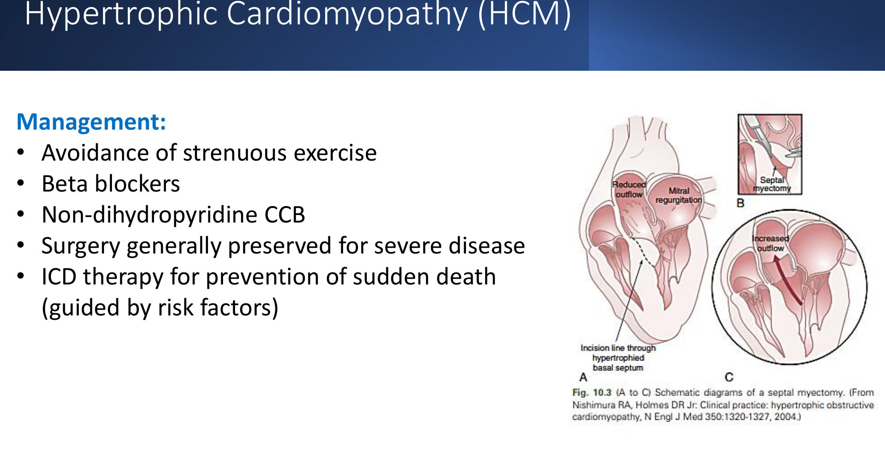

> 🔁 **Recap: HCM.**
> - AD (MYBPC3, MYH7), 1/500; SCD in young athletes.
> - Concentric hypertrophy (parallel) → diastolic dysfunction; HOCM = LVOT obstruction + **SAM → MR**.
> - Syncope, angina, HF, SCD on exertion.
> - Systolic murmur (↑ Valsalva, ↓ squat), **S4, pulsus bisferiens**.
> - Echo: wall ≥ 15 mm, small cavity, normal EF; genetic family screening.
> - **β-blocker / verapamil**, no strenuous exercise, myectomy, **ICD by risk**; avoid preload reducers.

---

### 2.4 Restrictive Cardiomyopathy (Slides 20–24) ⭐
**Definition:** ⭐ **impaired ventricular filling of NON-dilated ventricles**; genetic or acquired.

**Epidemiology:**
- ⭐ **rarest: 2–5%** of cardiomyopathies
- **HF in > 80%** of patients

**Aetiology (slide 21):**
- ⭐ **amyloidosis** (*[added]* commonest in adults; AL or transthyretin)
- ⭐ **sarcoidosis**
- ⭐ **hereditary haemochromatosis**
- **hypereosinophilia (Löffler endocarditis)**
- **endocardial fibroelastosis**
- **radiotherapy**
- **cardiac surgery**

⭐ **Mnemonic "PLEASe Help":**
- **P**ost-radiation / **P**ost-surgery fibrosis
- **L**öffler endocarditis
- **E**ndocardial fibroelastosis
- **A**myloidosis
- **S**arcoidosis
- **H**aemochromatosis

**Pathophysiology (slide 22):**
1. ⭐ **infiltration** (abnormal proteins, glycogen, eosinophils, granulomas, **iron**) or **fibrosis**
2. **↓ myocardial elasticity → ↓ compliance → ↓ diastolic filling**
3. ⭐ **↑ left- and right-sided filling pressures** → ⭐ **↑ atrial size (biatrial enlargement)**
4. **pulmonary AND systemic venous congestion**

**Clinical features (slide 23):**
- **pulmonary and systemic congestion**
- dyspnoea, palpitations, fatigue, weakness
- ⭐ **hepatosplenomegaly, ascites** (right-sided signs prominent)
- **signs of the underlying disease**
- *[added]* **Kussmaul's sign**, **S3** may be present, prominent **JVP** with rapid y-descent
- *[added]* **amyloid clues:** **low-voltage ECG despite thick walls**, macroglossia, periorbital purpura, carpal tunnel, nephrotic syndrome, "**apple-green birefringence** on Congo red"

**Diagnostics (slide 24):**
- **echocardiography**
- ⭐ **cardiac MRI** (*[added]* amyloid: diffuse subendocardial LGE)
- **CXR** (pulmonary congestion)
- ⭐ **endomyocardial biopsy** (definitive tissue diagnosis)

| **RCM echo (slide)** | |
|---|---|
| **LV cavity** | **Typically normal** |
| **EF** | **Normal** (diastolic dysfunction) |
| **Wall thickness** | **Typically normal** |

⚠️ **Caveat:** in **infiltrative RCM (amyloid, Fabry, haemochromatosis) the walls ARE thickened** ("pseudo-hypertrophy"), with **biatrial enlargement** and a **granular "sparkling" myocardium**. "Typically normal" applies mainly to fibrotic causes.

**Management:**
- ⭐ **treat the underlying cause**
  - *[added]* amyloid: **tafamidis** for transthyretin; chemo for AL
  - haemochromatosis: **phlebotomy**/chelation
  - sarcoid: steroids
- **manage HF** (cautious diuretics; *[added]* **avoid digoxin in amyloid**: toxicity)

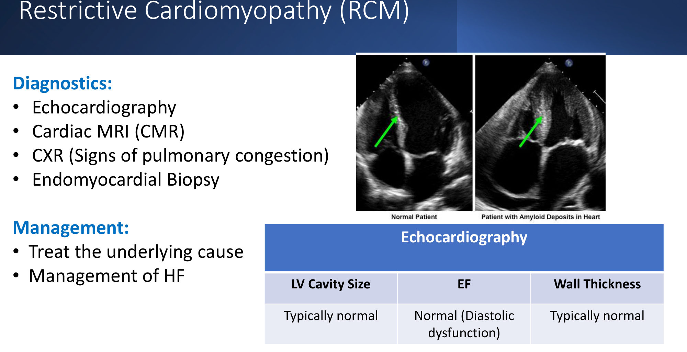

### 2.5 Summary Diagram (Slide 25)
- Normal vs **HCM** (septal hypertrophy) vs **DCM** (atrial and ventricular enlargement, myocardial thinning) vs **RCM** (atrial enlargement, ventricular stiffness).
- **Obstructive HCM:** LVOT obstruction from **septal hypertrophy + SAM**.

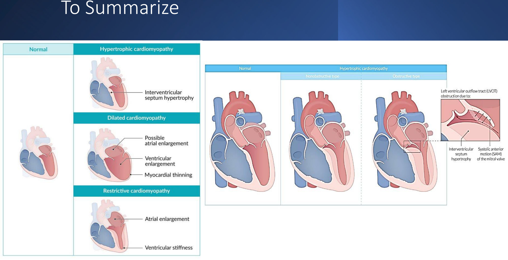

> 🔁 **Recap: RCM.** Rarest (2–5%); non-dilated, stiff ventricles; ↑ filling pressures → **biatrial enlargement**, systemic > pulmonary congestion. **PLEASe Help** (amyloid, sarcoid, haemochromatosis, Löffler, EFE, post-radiation/surgery). Echo/MRI/**endomyocardial biopsy**; treat the cause + HF.

---

## 3. High-Yield Comparison Tables

### Table A: Echo Differentiation (Slides 12, 18, 24) ⭐⭐
| | **DCM** | **HCM** | **RCM** |
|---|---|---|---|
| **LV cavity** | **↑↑** | **↓** | **Normal** |
| **EF** | **↓↓** (systolic) | **Normal/↑** (diastolic) | **Normal** (diastolic) |
| **Wall thickness** | Normal/↓ | **↑↑ (≥ 15 mm)** | Normal (*[added]* ↑ if infiltrative) |
| Atria | Possibly dilated | ± LA enlargement | ⭐ **Biatrial enlargement** |
| Hypertrophy | **Eccentric (series)** | **Concentric (parallel)** | — |
| Gallop | **S3** | **S4** | S3/S4 |
| HF type | **HFrEF** | HFpEF | HFpEF |

### Table B: The Three at a Glance
| | DCM | HCM | RCM |
|---|---|---|---|
| Frequency | **Commonest** (6/100,000) | 1 in 500 | **Rarest** (2–5%) |
| Genetics | 40% of idiopathic are familial | **AD** (MYBPC3, MYH7) | Genetic or acquired |
| Classic causes | **ABCCCDD**, peripartum, tachycardia, myocarditis | Sarcomere mutations | **PLEASe Help** |
| Hallmark | Big floppy heart, ↓ EF | **SCD in young athletes**, SAM, LVOT obstruction | Stiff heart, big atria, **right-sided congestion** |
| Key exam sign | S3, displaced apex | **Murmur ↑ Valsalva, S4, bisferiens** | ↑ JVP, Kussmaul's, HSM, ascites |
| Key test | Echo (+ exclude CAD) | Echo ≥ 15 mm + **genetics** | **CMR, endomyocardial biopsy** |
| Treatment | **HFrEF GDMT**, ICD/CRT | **β-blocker, verapamil**, avoid exertion, myectomy, **ICD** | **Treat the cause**, diuretics |

### Table C: HOCM vs Aortic Stenosis *[added]*
| | HOCM | AS |
|---|---|---|
| Age | Young | Elderly (calcific) / bicuspid |
| Murmur site | Left sternal edge, **no carotid radiation** | Right 2nd ICS → **carotids** |
| Valsalva/standing | **↑** | ↓ |
| Squatting/handgrip | **↓** | ↑ / ↓ |
| Pulse | **Bisferiens / jerky** | **Slow-rising (parvus et tardus)** |
| Echo | Septal hypertrophy, **SAM** | Calcified valve, small orifice |

### Table D: RCM vs Constrictive Pericarditis *[added]*
| | RCM | Constrictive pericarditis |
|---|---|---|
| Pericardium | Normal | **Thick/calcified** (CT/MRI) |
| Ventricular interdependence | No | **Yes** (respiratory septal bounce) |
| BNP | **High** | Normal/mildly ↑ |
| Biopsy | **Infiltration/fibrosis** | Normal myocardium |
| Treatment | Treat the cause | **Pericardiectomy** (curable) |

---

## 4. Rules, Exceptions, Patterns
- **Cardiomyopathy = intrinsic muscle disease**, not from pressure or volume overload or CAD.
- **DCM is the commonest; RCM the rarest.**
- **Series = eccentric = DCM (dilated); parallel = concentric = HCM (thick).**
- **ABCCCDD** (DCM) · **PLEASe Help** (RCM).
- **Tachycardia-induced DCM is reversible**; so is alcoholic DCM (abstinence) and often peripartum CM.
- **HCM = AD, 1/500, SCD in young athletes**; **β-blocker / verapamil**; avoid strenuous exercise.
- **HOCM murmur ↑ with ↓ preload** (Valsalva, standing, nitrates); **↓ with squatting/handgrip**.
- **Pulsus bisferiens** in HOCM (also severe AR / mixed AR+AS *[added]*).
- **Echo ≥ 15 mm wall** = HCM; **screen first-degree relatives** (echo + genetics).
- **RCM:** normal-sized ventricles, **big atria**, diastolic dysfunction; biopsy diagnoses.
- **ICD decisions:** DCM via EF ≤ 35% after GDMT (HF lecture); HCM via **risk factors**.

---

## 5. Clinical Correlations
- **Young athlete collapses on the field** → HCM (or ARVC, long QT, commotio cordis *[added]*); pre-participation ECG screening.
- **Alcohol use disorder** → DCM (reversible) and **wet beriberi** (thiamine; Substance Use lecture).
- **Chemotherapy (doxorubicin)** → baseline and serial echo (oncology).
- **Pregnancy, last month to 5 months postpartum** → peripartum CM; *[added]* bromocriptine is sometimes used; avoid ACEi in pregnancy.
- **Coxsackie B myocarditis** → DCM; **Chagas** (Latin America): apical aneurysm, conduction disease, megacolon.
- **Haemochromatosis** (bronze diabetes) → RCM/DCM; phlebotomy.
- **Sarcoidosis** → heart block, VT, RCM/DCM; CMR/PET.
- **Amyloidosis** → RCM with low-voltage ECG; also nephrotic syndrome, neuropathy, carpal tunnel.
- **Persistent fast AF** → tachycardia-mediated DCM (lecture case) → rate/rhythm control can restore EF.

---

## 6. Rapid Revision (Last-Day)
1. **Cardiomyopathy** = heart-muscle disease without pressure or volume overload or CAD. Types: **dilated, hypertrophic, restrictive**.
2. **DCM:**
   - **commonest** (6/100,000/year), **M:F 3:1**
   - ↓ contractility → **eccentric** hypertrophy (series) → dilation → ↓ EF → HF
3. **DCM causes:**
   - idiopathic 50% (40% familial)
   - myocarditis 10%
   - **ABCCCDD** (alcohol, beriberi, cocaine, Coxsackie B, Chagas, doxorubicin/daunorubicin)
   - peripartum, sarcoid, radiation, **chronic tachycardia**, endocrinopathies, HIV
4. **DCM features:** exertional dyspnoea, oedema/ascites, angina, palpitations; **S3, displaced apex**, JVD, rales.
5. **DCM tests:** ↑ BNP, troponin/CK-MB, **echo (big LV, ↓ EF, normal/thin walls)**, CXR, ECG (nonspecific). **Rx:** treat the cause + HF.
6. **HCM:**
   - **AD** (MYBPC3, β-MHC), **1 in 500**, **SCD in young athletes**
   - **concentric** hypertrophy (parallel) → ↓ relaxation → ↓ filling
   - **HOCM:** LVOT obstruction + **MR from SAM**
7. **HCM symptoms:** often none; HF, angina, **syncope**, palpitations, **SCD with exertion**.
8. **HCM signs:** crescendo–decrescendo systolic murmur, **S4**, **pulsus bisferiens**.
9. **HCM tests:** ECG (LVH/septal), **echo wall ≥ 15 mm** (small cavity, normal EF), MRI selectively, **genetic testing + family screening**.
10. **HCM Rx:** **avoid strenuous exercise**, **β-blockers**, **non-DHP CCB**, surgery if severe, **ICD by risk factors**.
11. **RCM:** **rarest (2–5%)**; **non-dilated** ventricles with impaired filling; **HF in > 80%**.
12. **RCM causes (PLEASe Help):** **P**ost-radiation/surgery, **L**öffler, **E**ndocardial fibroelastosis, **A**myloid, **S**arcoid, **H**aemochromatosis.
13. **RCM pathophysiology:** infiltration/fibrosis → ↓ compliance → ↑ filling pressures → **↑ atria** → pulmonary + systemic congestion.
14. **RCM features:** dyspnoea, fatigue, palpitations, **HSM, ascites**, underlying disease.
15. **RCM tests:** echo (normal cavity, EF, walls), **CMR**, CXR, **endomyocardial biopsy**. **Rx:** treat the cause + HF.
16. **Echo key:**
    - **DCM:** cavity ↑↑, EF ↓↓
    - **HCM:** cavity ↓, walls ↑↑
    - **RCM:** all ~normal + big atria

---

## 7. Exam-Style Questions

**Q1 (lecture case, slides 4–5, 26).** A 48-year-old woman (father died of amyloidosis) has 2 months of exertional dyspnoea. HR 124, BP 98/60, basal crackles; ECG **AF**; CXR globular heart and pulmonary oedema; echo **dilated LV, EF 40%**. Most likely cause?
a. Amyloid deposition · b. Acute psychological stress · c. Thiamine deficiency · **d. Chronic tachycardia** · e. Coronary artery occlusion

> **Answer: d** *[reasoning added; key not on slides]*.
> - **Dilated** LV with ↓ EF and **persistent fast AF** with no other cause = **tachycardia-induced DCM** (slide 9).
> - **Amyloid** causes **restrictive** CM with a non-dilated, thick-walled LV; the family history is a distractor.
> - **Takotsubo** is acute and trigger-related; **beriberi** needs malnutrition or alcohol; CAD would show regional wall-motion loss.

**Q2.** A 17-year-old footballer collapses during a match and is resuscitated. His father died suddenly at 35. A harsh systolic murmur at the left sternal edge **increases on standing** and **decreases on squatting**. Echo: septum 22 mm, SAM of the mitral valve. Diagnosis and inheritance?
A. Aortic stenosis; sporadic · **B. Hypertrophic (obstructive) cardiomyopathy; autosomal dominant** · C. DCM; X-linked · D. ARVC; recessive

> **Answer: B** (slides 13–17).
> - **HCM:** AD sarcomere mutation (MYBPC3/MYH7).
> - **SCD in young athletes**; the murmur rises with ↓ preload.
> - He needs an **ICD** (survived arrest) and **family screening**.

**Q3.** In the patient above, which drug should be **avoided**?
A. Bisoprolol · B. Verapamil · **C. Nitroglycerin** · D. Disopyramide

> **Answer: C** *[added; principle from slides 15, 19]*.
> - Nitrates (and diuretics, vasodilators, digoxin) **↓ preload/afterload → worsen LVOT obstruction**.
> - β-blockers and verapamil are first line (slide 19).

**Q4.** A 60-year-old man has dyspnoea, ascites, hepatomegaly and **raised JVP rising on inspiration**. ECG: **low voltage**; echo: **thick walls, biatrial enlargement, normal EF, small LV cavity**; nephrotic-range proteinuria. Diagnosis and best confirmatory test?
A. HCM; genetic testing · **B. Restrictive cardiomyopathy (amyloidosis); biopsy (endomyocardial or fat pad)** · C. Constrictive pericarditis; pericardiectomy · D. DCM; coronary angiography

> **Answer: B** (slides 20–24).
> - **Low voltage despite thick walls** = infiltrative amyloid.
> - **Biatrial enlargement**, diastolic failure, right-sided congestion.
> - **Endomyocardial biopsy** (slide 24) or *[added]* fat-pad biopsy with **Congo red: apple-green birefringence**.

**Q5.** A 28-year-old woman develops dyspnoea and oedema 3 weeks after delivery; echo shows a dilated LV with EF 30%. Most likely?
A. HCM · **B. Peripartum cardiomyopathy (DCM)** · C. Restrictive CM · D. Takotsubo

> **Answer: B** (slide 9 lists peripartum CM among the secondary DCM causes; *[added]* window = last month of pregnancy to 5 months postpartum).
> - Treat as HFrEF (avoid ACEi/ARNI/MRA while pregnant; they're usable postpartum, with caution if breastfeeding).
> - Anticoagulate if EF is very low.

---

## 8. Exam Pitfalls & Traps
| Trap | Correct thinking |
|---|---|
| Cardiomyopathy from long-standing HTN or CAD | ❌ By definition **not** due to pressure/volume overload or CAD (that's hypertensive/ischaemic heart disease) |
| HCM = commonest cardiomyopathy | ❌ **DCM** is the commonest; RCM the rarest |
| Eccentric hypertrophy = thick walls | ❌ Eccentric (series) = **dilated** (DCM); concentric (parallel) = thick (HCM) |
| Family history of amyloid → amyloid CM despite a dilated LV | ❌ Amyloid = **restrictive**, non-dilated; dilated + AF = **tachycardia-induced DCM** |
| HOCM murmur louder with squatting | ❌ **Softer** with squatting/handgrip; **louder** with Valsalva/standing |
| Nitrates or diuretics for HOCM angina/dyspnoea | ❌ Worsen obstruction; **β-blocker/verapamil** |
| Digoxin in HCM or amyloid *[added]* | ❌ Avoid (↑ obstruction; toxicity in amyloid) |
| HCM echo threshold 10 mm | ❌ **≥ 15 mm** (*[added]* ≥ 13 mm in relatives) |
| HCM has a low EF | ❌ EF **normal or high**; diastolic dysfunction |
| RCM echo always shows normal walls | ⚠️ Infiltrative causes (amyloid) give **thick walls**; slide says "typically normal" |
| RCM = constrictive pericarditis | ❌ Different: pericardial thickening, septal bounce, BNP normal in constriction; biopsy abnormal in RCM |
| ICD for every HCM patient | ❌ Guided by **risk factors** (prior arrest, FHx SCD, syncope, wall ≥ 30 mm, NSVT…) |
| Only the patient needs evaluation in HCM | ❌ **Screen first-degree relatives** (AD: 50% risk) |
| Peripartum CM only during pregnancy | ⚠️ Last month of pregnancy up to **5 months postpartum** *[added]* |
