# ECG Interpretation
**Dr. Muhammad Reihan, Internal Medicine** | Source: `ECG.pdf` (121 slides)

> **Legend:** ⭐ = high-yield · *[added]* = not on slides · **🔎 my reading** = my interpretation of an **unlabelled** practice strip. The lecturer explained these live; check them against your own class notes.

> **How this deck is built:** about 90 of the 121 slides are ECG images with only a heading ("Voltage", "Axis", "Rhythm", "P-wave abnormalities"…). The lecturer walks through the **same 11-step comment** for every strip. These notes keep the strips in order, and where a strip has no caption I give my reading.

> 🔗 **Bridge from earlier lectures (same lecturer):**
> - **Cardiac arrhythmias:** the rhythm strips (AF, flutter, SVT, AV blocks, VT, VF) were covered there; this lecture teaches how to **read** them.
> - **CAD:** ST elevation by territory and reciprocal change.
> - **Pericardial:** diffuse ST↑ + PR↓, low voltage.
> - **HTN / valvular:** LVH voltage criteria, P mitrale (MS), P pulmonale (pulmonary HTN).

---

## 1. Title / Objectives

| Domain | Objective | Likely tested as |
|---|---|---|
| Knowledge | ⭐ Describe **in sequence** the steps of ECG interpretation | The 11-step list |
| Knowledge | Identify rhythm, site of origin, causes and significance of ECG changes | Strip → diagnosis |
| Skill | ⭐ Apply a **systematic approach** to a 12-lead ECG | Comment on an ECG |
| Skill | ⭐ Distinguish **normal** from common **abnormal** findings | Normal values |

**Main subtopics:** basics (conduction system, ECG principles) · leads (limb/chest, bipolar/unipolar) · systematic interpretation: identification → standardisation → voltage → axis → heart rate → P wave → PR → QRS → ST → T.

---

## 2. Main Content (Lecture Order)

### 2.1 Opening Quiz & History (Slides 4–6)
**Slide 4 quiz:** label hearts 1–5 on a PQRST complex. *[added]* Read left to right, they are 1 = **P wave**, 4 = **Q**, 3 = **R**, 2 = **S**, 5 = **T wave**.

- **Einthoven 1893** (the first "EKG", 1901) → Nobel Prize 1924 *[added]*.

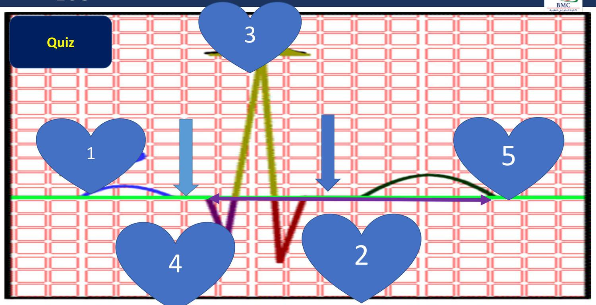

### 2.2 Cardiac Conduction System (Slides 7–8) ⭐
**SA node** (pacemaker) → atria → **AV node** → **bundle of His** → **right and left bundle branches** in the septum → **Purkinje fibres**.

⭐ **The "fail-safe" system: inherent (escape) rates**

| Pacemaker | Rate |
|---|---|
| **SA node** | **60–100/min** |
| **AV node (junctional)** | **40–60/min** |
| **Ventricles** | **20–40/min** |
| **Emergency rates** (ectopic tachycardias) | **150–250/min** |

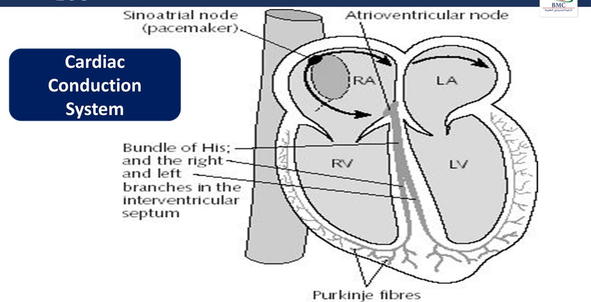 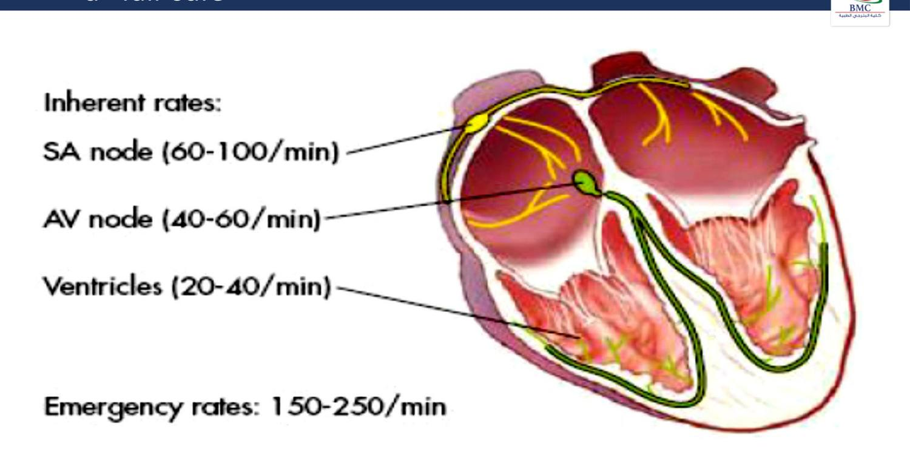

> **Use:** in complete heart block, an escape at **40–60** with a narrow QRS = **junctional**; **20–40** with a wide QRS = **ventricular** (worse).

### 2.3 Leads (Slides 9–16) ⭐

| Group | Leads | Type |
|---|---|---|
| **Limb leads** | **I, II, III** | **Bipolar** (Einthoven's triangle) |
| | **aVR, aVL, aVF** | **Unipolar** (augmented) |
| **Chest (precordial) leads** | **V1–V6** | **Unipolar** |

- **Placement (slide 11):**
    - **V1** 4th ICS right sternal edge; **V2** 4th ICS left
    - **V3** between V2 and V4; **V4** 5th ICS **midclavicular**
    - **V5** anterior axillary line; **V6** midaxillary line *[added: standard]*
- **Groups (slide 12):**
    - **V1–V2 = septal**
    - **V3–V4 = anterior**
    - **V5–V6 = lateral**
- **Hexaxial angles (slide 14):**
    - **I = 0°**
    - **II = +60°**
    - **aVF = +90°**
    - **III = +120°**
    - **aVL = −30°**
    - **aVR = −150°**

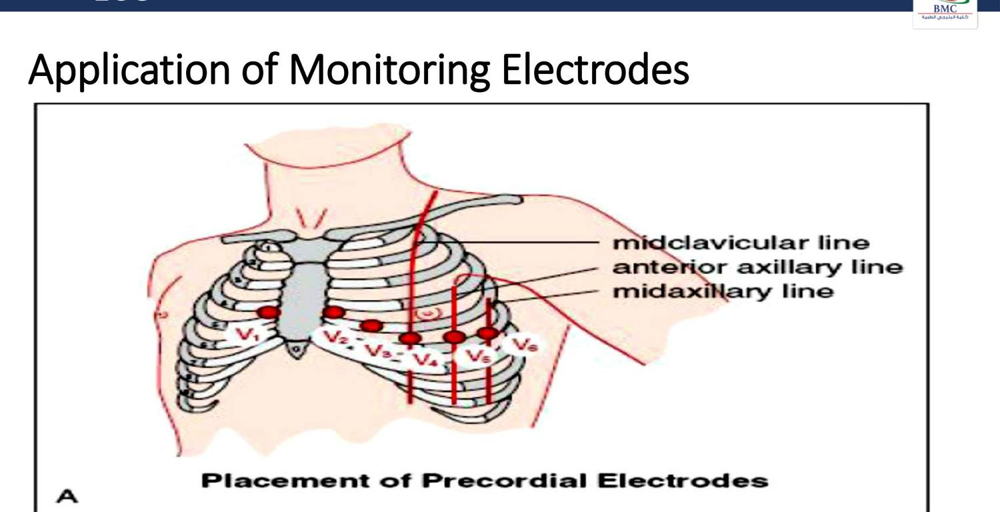 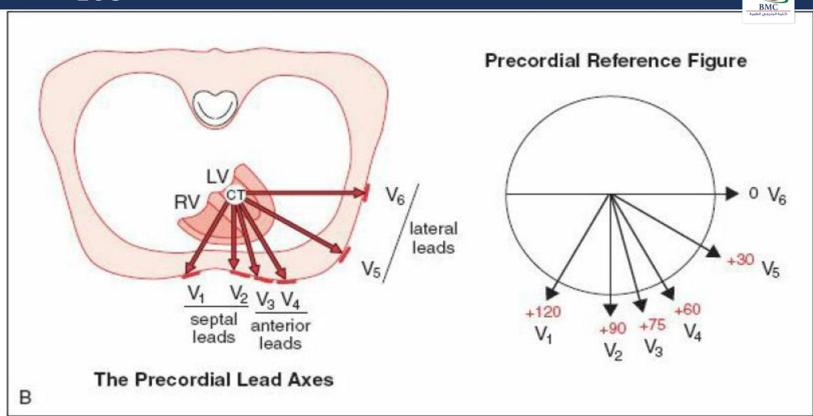

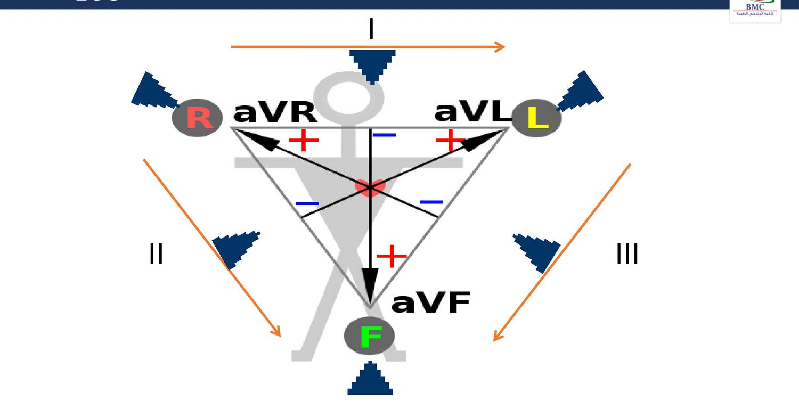 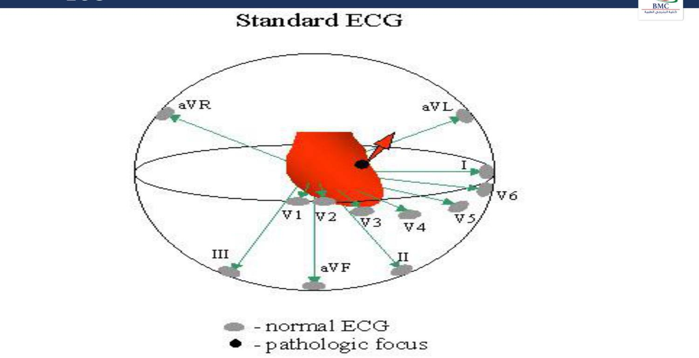

### 2.4 Principles & Paper (Slides 17–20) ⭐
- ⭐ **Depolarisation moving toward a positive electrode → upward deflection**; moving away → downward.
- **Paper speed 25 mm/s**:
    - **1 small square = 0.04 s** (1 mm, 0.1 mV)
    - **1 big square = 0.20 s** (5 mm, 0.5 mV)
    - **5 big squares = 1 s**
- **1 min = 60 s = 300 big squares = 1500 small squares.**
- **Calibration:** 1 mV = 10 mm high.

**Normal values (slide 19):**

| Component | Normal |
|---|---|
| **P wave** | **0.08–0.10 s** |
| **PR interval** | **0.12–0.20 s** |
| **QRS** | **0.06–0.10 s** |
| **QTc** | **≤ 0.44 s**; **QTc = QT/√RR** (Bazett) |

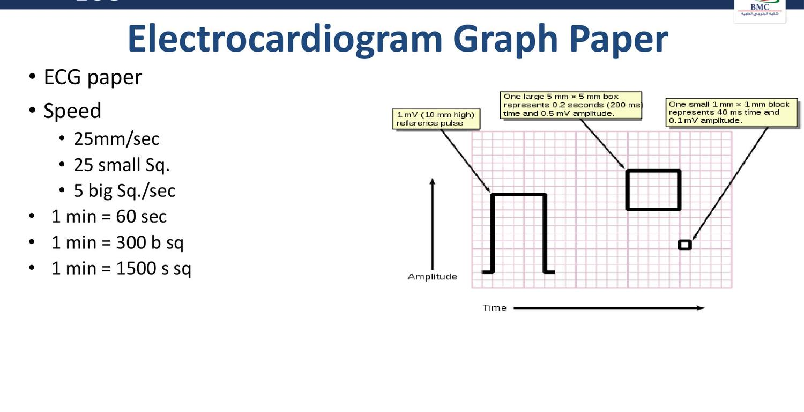 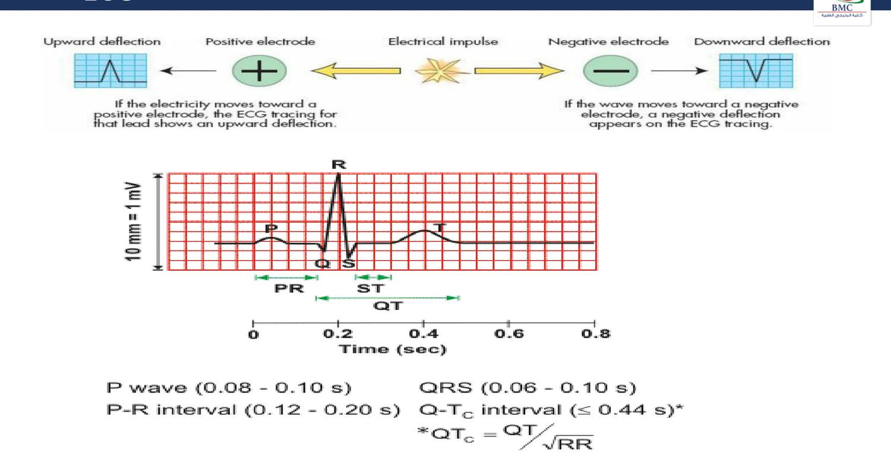

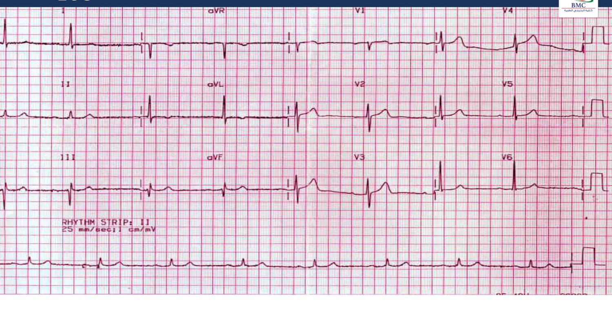

> 🔁 **Recap: Basics.** SA 60–100 → AV 40–60 → ventricles 20–40 (fail-safe). 6 limb leads (I, II, III bipolar; aVR, aVL, aVF unipolar) + V1–V6. Toward + = up. 25 mm/s: small square 0.04 s, big square 0.2 s, 300 big squares/min. Normal: P ≤ 0.10, PR 0.12–0.20, QRS ≤ 0.10, QTc ≤ 0.44.
> 🔗 **Link:** With the grid and the leads understood, every ECG is read in the same order.
> ▶️ **Up next: the 11-step comment.**

---

### 2.5 The 11-Step "ECG Comment" (Slide 21) ⭐
> **1. Identification → 2. Standardisation → 3. Voltage → 4. Axis → 5. Rhythm → 6. Rate → 7. P wave → 8. PR interval → 9. QRS → 10. ST segment → 11. T wave**
>
> *(Slides 33, 67, 83 and 90 swap 5 and 6 to "rate, rhythm". The content is the same.)*
>
> **Mnemonic** *[added]*: **"I Saw Very Angry Rabbits Running; Puppies Played Quietly, Sleeping Together"**.

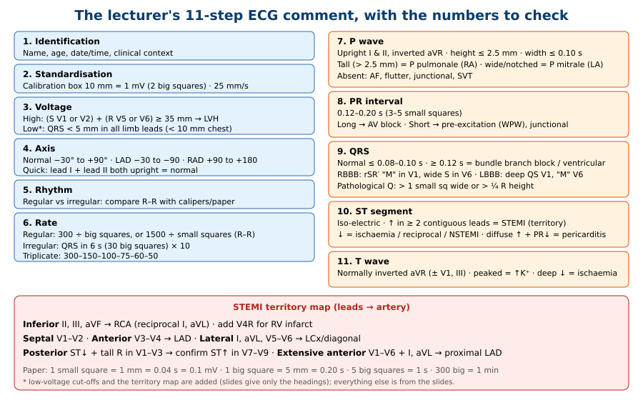

### 2.6 Steps 1–2: Identification & Standardisation (Slides 23–25)
- **Identification:** patient name, age, date and time, clinical context *[added detail]*.
- **Standardisation:** the calibration box at the start of each row.
    - ⭐ **Full standard = 10 mm (2 big boxes)** tall (slide 24).
    - Slide 23: **A = full standard (10 mm)** · **B = half standard (5 mm**; complexes look half-size) · **C = double standard (20 mm**; complexes look twice as big).
- ⭐ **Always check calibration before judging voltage.** A half-standard trace mimics low voltage; double standard mimics LVH.

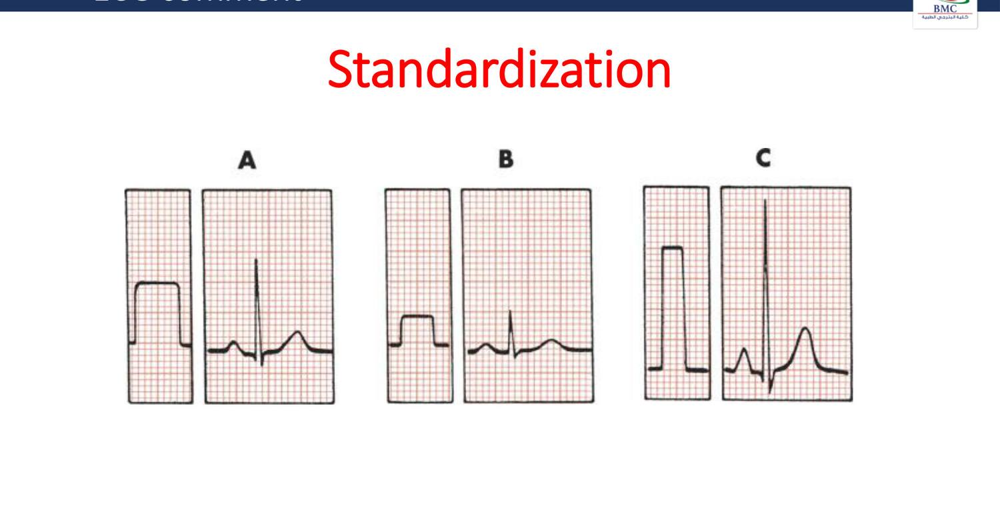 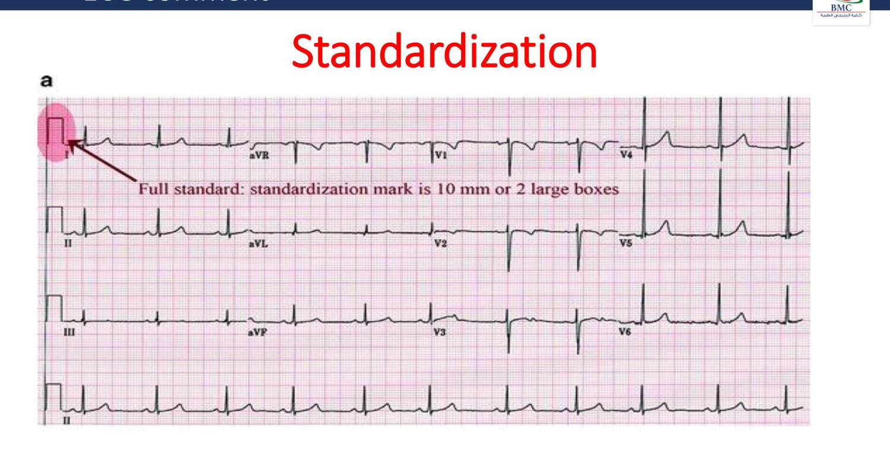

### 2.7 Step 3: Voltage (Slides 27–32) ⭐
- **High voltage:** ⭐ **(S in V1 or V2) + (R in V5 or V6) ≥ 35 mm** = **LVH** (Sokolow–Lyon).
- **Low voltage** *[added: criteria not on slides]*: QRS **< 5 mm in all limb leads** or **< 10 mm in all chest leads**. Causes: **pericardial effusion**, obesity, COPD/emphysema, hypothyroidism, infiltration (amyloid), pleural effusion.
- **Normal voltage**.

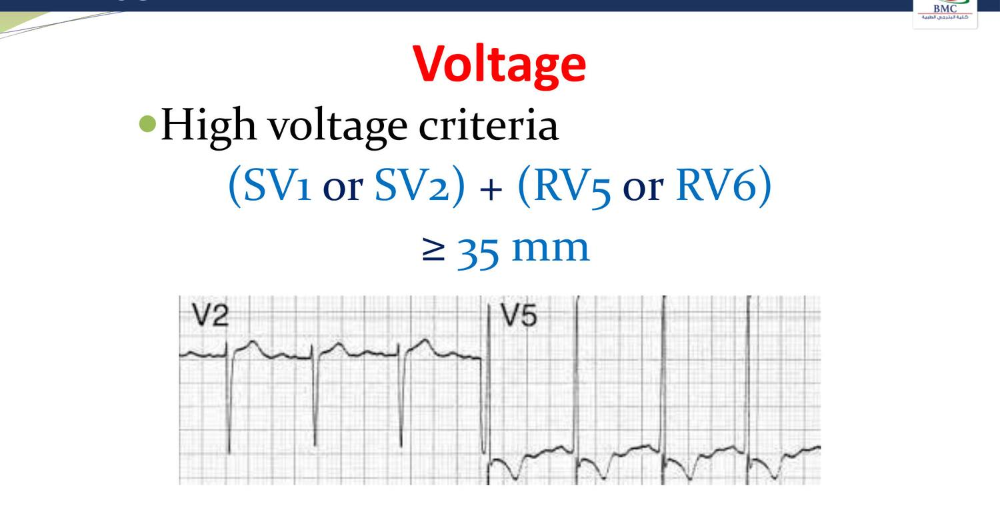 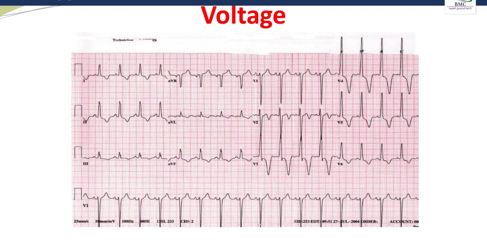

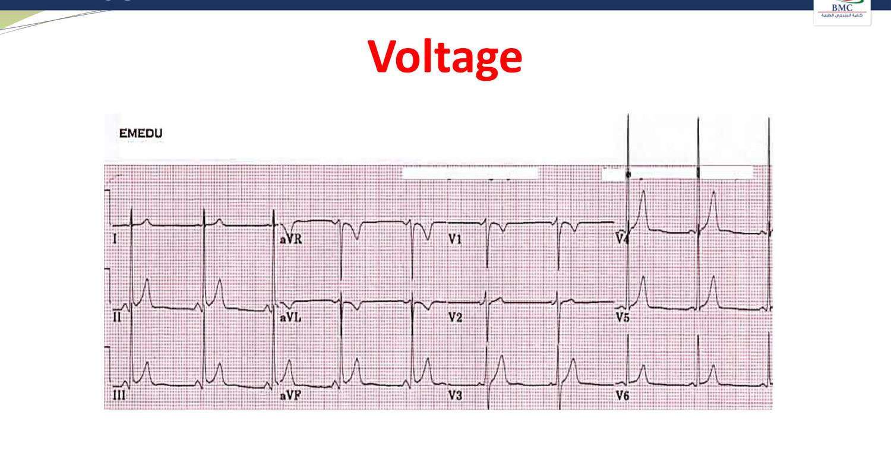 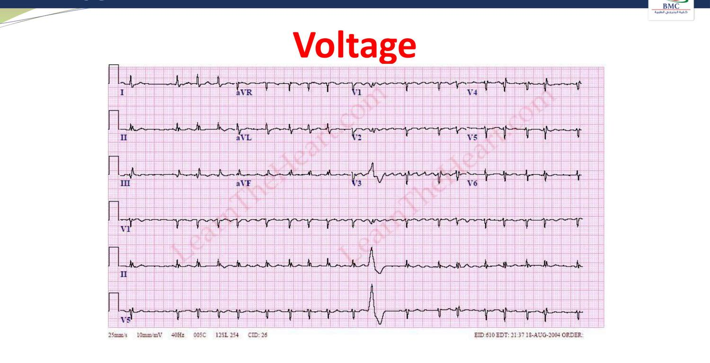

### 2.8 Step 4: Axis (Slides 34–41) ⭐
**Categories:** normal · right axis deviation · left axis deviation · **odd axis ("no man's land")**.

| Axis | Range | Lead I | Lead II | Lead III / aVF |
|---|---|---|---|---|
| ⭐ **Normal** | **0° to +90°** (slide 35 figure: **−30° to +90°**) | ↑ | ↑ | ↑ |
| **Left, physiological** | **0° to −30°** | ↑ | ↑ / biphasic | ↓ |
| ⭐ **Left, pathological** | **−30° to −90°** | ↑ | **↓** | ↓ |
| ⭐ **Right** | **+90° to +180°** | **↓** | ↑ | ↑ |
| **Extreme ("no man's land")** | **−90° to ±180°** | ↓ | ↓ | ↓ |
| **Indeterminate** | ? | biphasic | biphasic | biphasic |

> **Quick rule** *[added]*: **"Leaving" (left)** = leads I and aVF point **away** from each other (I up, aVF down). **"Reaching" (right)** = I and aVF point **toward** each other (I down, aVF up). Then use **lead II** to split physiological from pathological left axis.

*[added]:*
- **LAD causes:** **left anterior fascicular block**, inferior MI, LVH, WPW.
- **RAD causes:** **RVH** (pulmonary HTN, PE, COPD), lateral MI, left posterior fascicular block, dextrocardia, normal in children and thin adults.

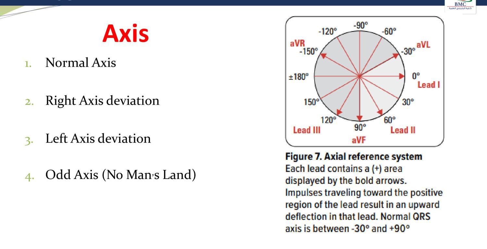 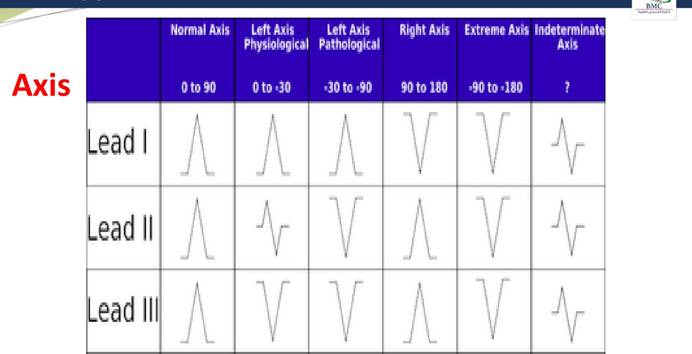

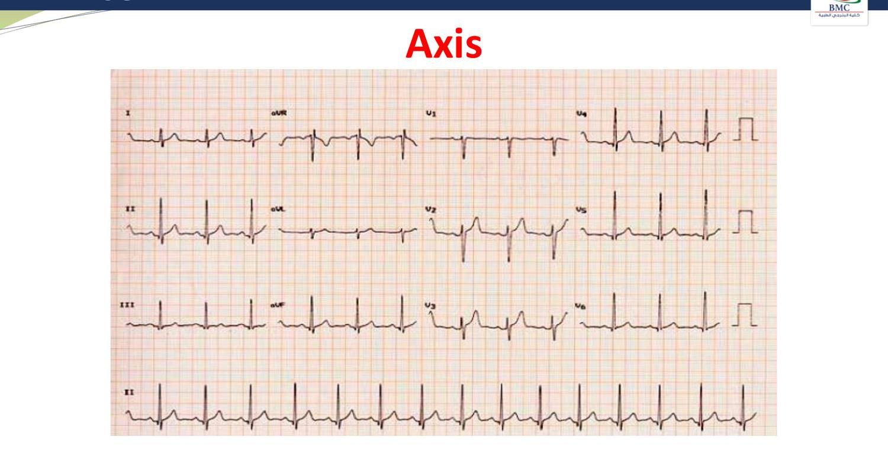 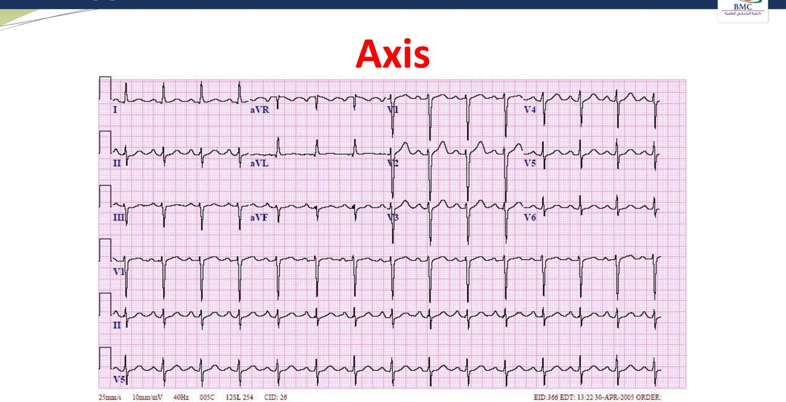

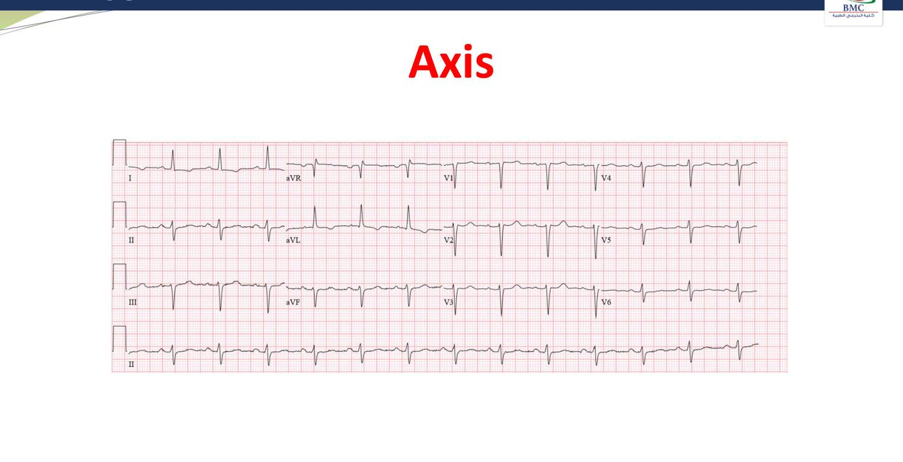 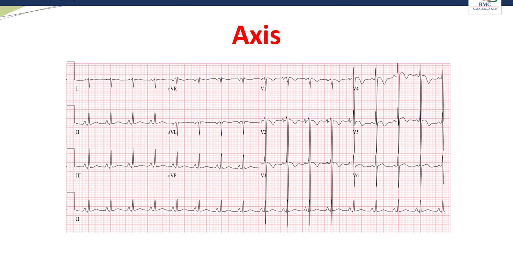

> 🔁 **Recap: Steps 1–4.** Identify the patient and context. Check calibration (10 mm = full standard). Voltage: S V1/V2 + R V5/V6 ≥ 35 → LVH; small complexes → effusion, obesity, COPD, hypothyroid. Axis: normal −30 to +90 (I and II up); LAD = I up, aVF and II down; RAD = I down, aVF up.
> 🔗 **Link:** Next is the timing of the beats: regular or not, and how fast.
> ▶️ **Up next: Rhythm and rate.**

---

### 2.9 Step 5: Rhythm (Slides 43–55) ⭐
**Regular vs irregular** (slide 44). Measure the **R–R intervals**:
1. by eye
2. with **calipers**
3. by **counting small squares** between R waves

Equal intervals mean the rhythm is regular.

**Slide 45 (irregular patterns):**

| Strip | 🔎 Reading |
|---|---|
| A | Regular |
| B | Irregular (varying R–R: 22, 19, 35, 21, 20 small squares) |
| C | Occasional irregularity from premature beats |
| D | Irregular with **PVCs** (labelled) |

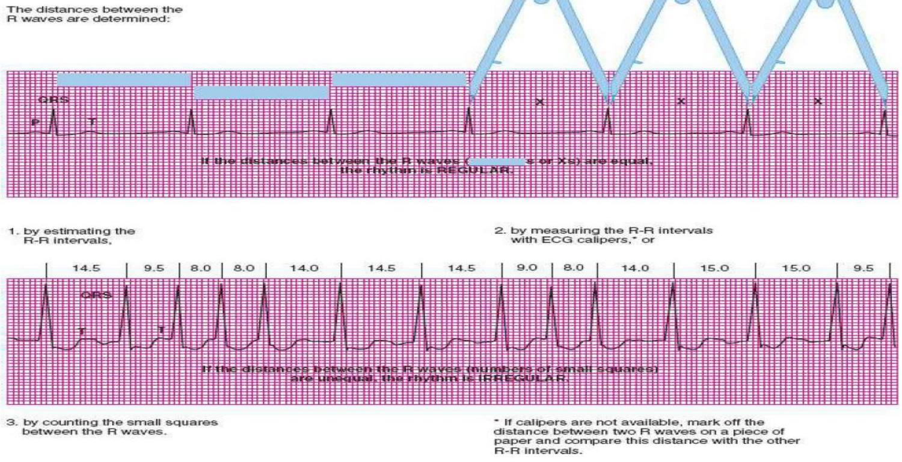 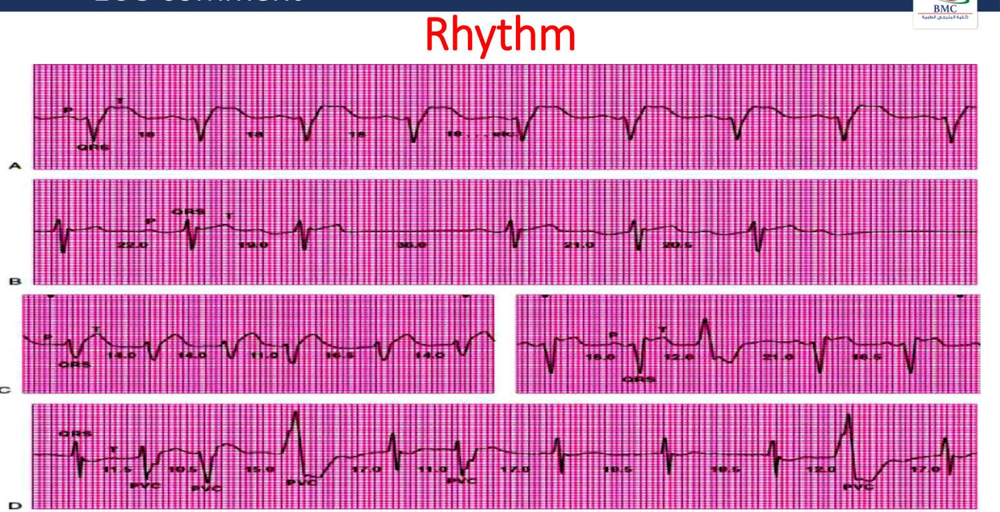

**Rhythm practice strips:**

| Slide | 🔎 Reading |
|---|---|
| **47** | **SVT** (labelled): regular narrow-complex tachycardia, no visible P |
| **48** | Irregularly irregular narrow complexes, no clear P waves → **AF** |
| **49** | Sinus rhythm with **one PVC** (wide, bizarre, early, compensatory pause) |
| **50** | Irregular, fibrillatory baseline in V1 → **AF (controlled rate)** |
| **51** | Irregularly irregular narrow complexes on rhythm strips → **AF** |
| **52** | Sinus with **frequent PVCs** (multifocal wide beats) |
| **53** | Sinus with **a single PVC** |

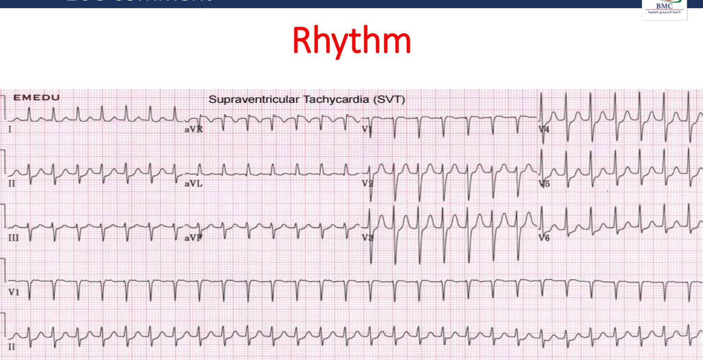 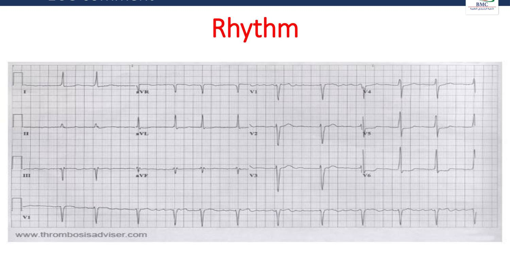

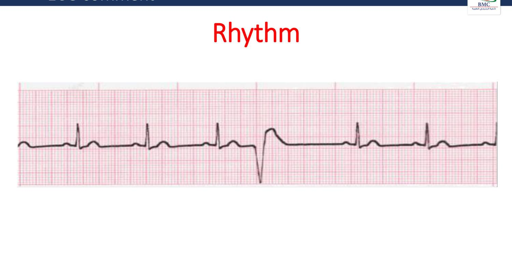 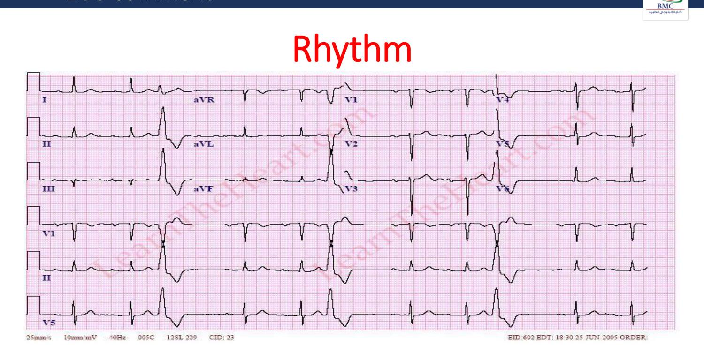

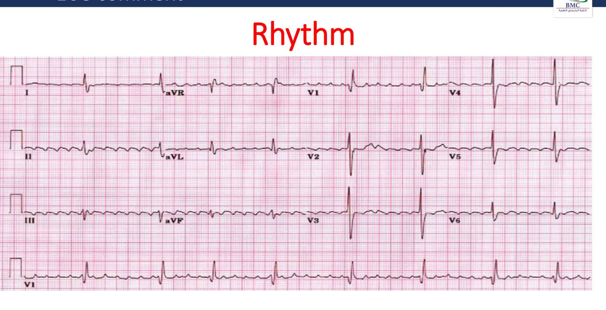 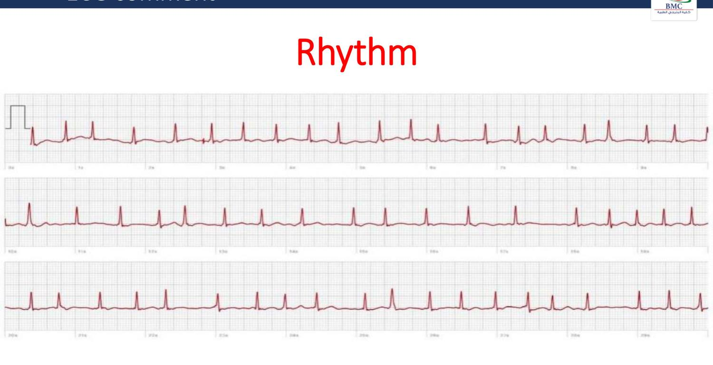

**Lecturer's quiz answers (slides 54–55):**

| Slide | Standardisation | Voltage | Axis | Rhythm |
|---|---|---|---|---|
| **54** | Normal | Normal | **Left** | **Occasional irregularity** (*🔎 ectopic beats*) |
| **55** | Normal | **Normal–high** | **Right** | **Regular** (*🔎 consistent with RVH*) |

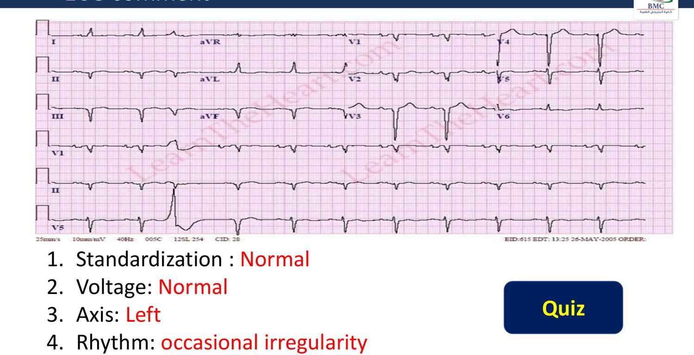 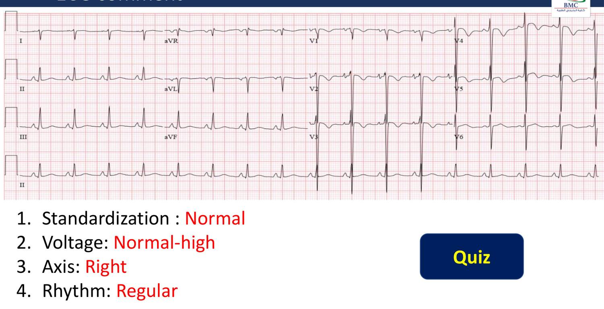

### 2.10 Step 6: Rate (Slides 57–65) ⭐

| Method | Use | Formula |
|---|---|---|
| **Heart-rate ruler** (slide 57) | Any | Read the scale at the 3rd complex |
| ⭐ **Triplicate / sequence method** (slide 58) | **Regular** | Start at an R on a heavy line; count the next heavy lines **300 – 150 – 100 – 75 – 60 – 50** (example ≈ **70**) |
| ⭐ **R–R method** (slides 59–60) | **Regular** | **HR = 300 ÷ big squares** between R waves · **HR = 1500 ÷ small squares** |
| ⭐ **6-second count** (slides 61–62) | **Irregular** | **QRS in 6 s (= 30 big squares = 1/10 min) × 10**. ⭐ **The least accurate method** |

*Slide 59 logic:* rate = QRS in 1 min × 1 = QRS in ½ min × 2 = … = **QRS in 1/10 min × 10**.

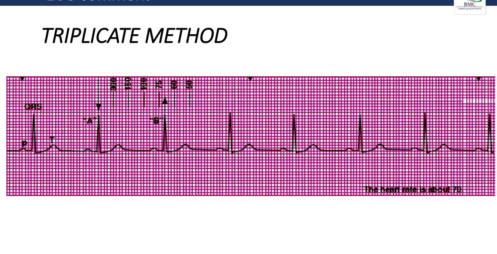 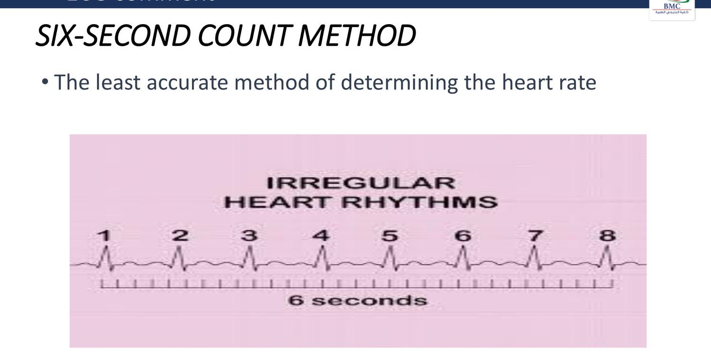

> **Mnemonic:** **"300-150-100, 75-60-50."**

> 🔁 **Recap: Steps 5–6.** Rhythm: compare R–R intervals (eye, calipers, small squares). Rate: regular → 300/big squares or 1500/small squares (or the 300-150-100 sequence); irregular → beats in 6 s × 10 (least accurate).
> 🔗 **Link:** Then go through each wave and interval in order of the cardiac cycle, starting with atrial depolarisation.
> ▶️ **Up next: Waves and intervals.**

---

### 2.11 Waves, Segments, Intervals (Slide 66)
- **Wave:** direction, amplitude, duration, shape.
- **Segment:** duration, deviation.
- **Interval:** duration.

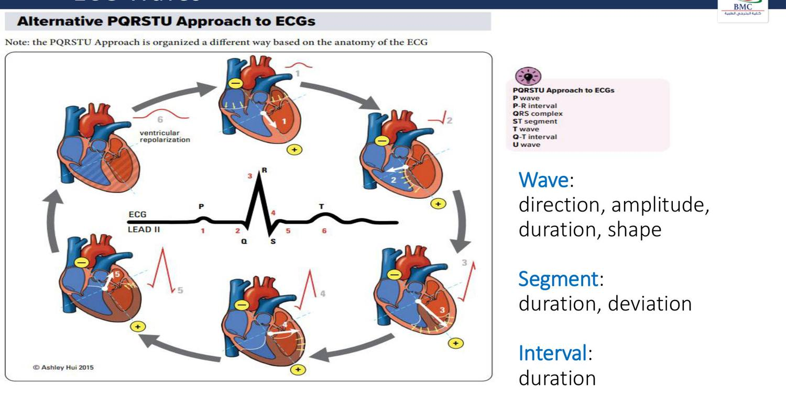

### 2.12 Step 7: P Wave (Slides 68–82) ⭐

| Feature | Normal |
|---|---|
| **Direction** | ⭐ **Upright in I** (and II); **inverted in aVR** |
| **Amplitude** (right atrium) | **≤ 2.5 mm** |
| **Duration** (left atrium) | **≤ 2.5 mm = 0.10 s** |
| **Shape** | Best seen in **II and V1** (biphasic in V1; terminal negative part < 0.04 s) |

**Analyse the P waves (slide 69):**
1. Present?
2. Regular?
3. One P per QRS, and a QRS after every P?
4. Upright or inverted?
5. All alike? (Alike and regular means the same origin.)

| ⭐ Abnormality | Criterion | Meaning |
|---|---|---|
| **Abnormal direction** | Not upright in I / not inverted in aVR | **Ectopic atrial / junctional rhythm**; *[added]* limb-lead reversal, dextrocardia |
| ⭐ **P pulmonale** | **Height > 2.5 mm** (II) | **Right atrial enlargement** (*[added]* pulmonary HTN, COPD, TR) |
| ⭐ **P mitrale** | **Width > 0.10 s (> 2.5 mm)**, **notched**, notch > 40 ms; **P terminal force in V1 > 0.04 s** | **Left atrial enlargement** (*[added]* **mitral stenosis**, MR, LVH) |
| **Absent / replaced** | **Fibrillatory** (AF), **flutter** waves, **nodal** rhythm, **SVT** | Non-sinus rhythm |

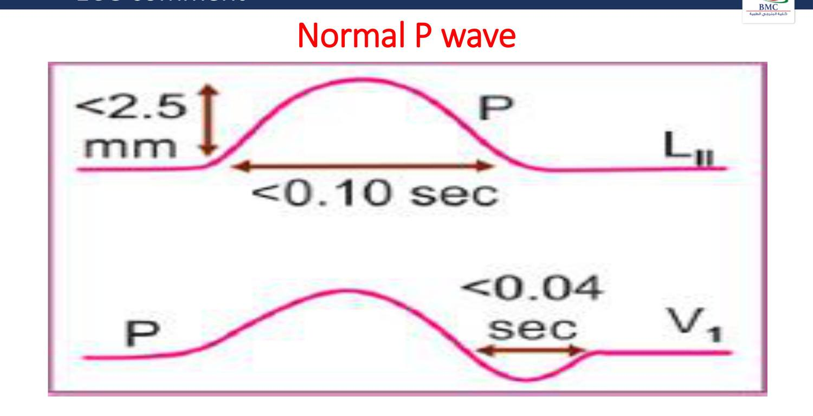 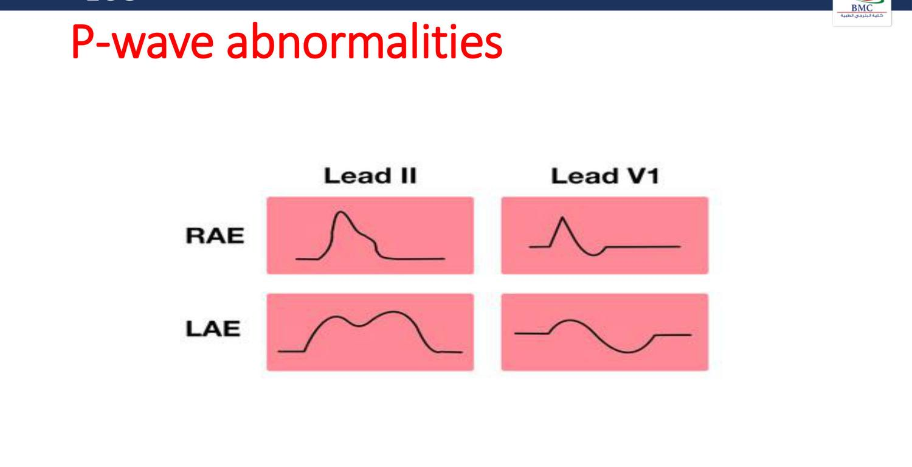

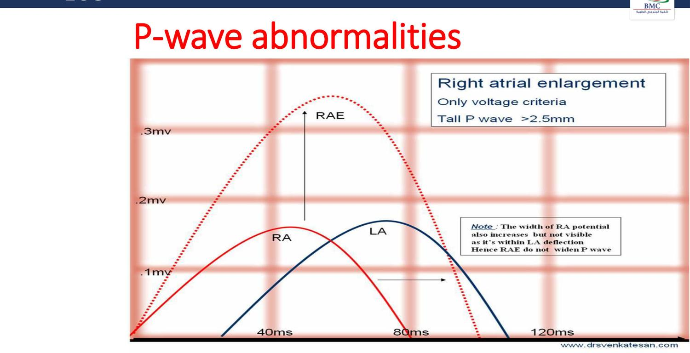 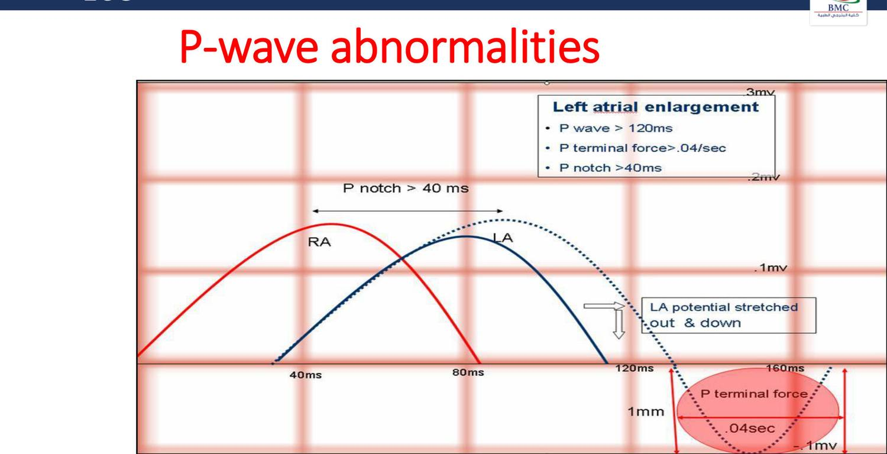

**P-wave practice strips:**

| Slide | 🔎 Reading |
|---|---|
| **77** | Notched, bifid P waves → **P mitrale (LAE)** |
| **78** | Tall, peaked P → **P pulmonale (RAE)** |
| **79** | **SVT** (labelled): no visible P |
| **80** | **AVNRT** (labelled "slow-fast"): **P wave follows the QRS** (retrograde) |
| **81** | P waves positioned around/after the QRS → junctional / retrograde P |
| **82** | **Atrial flutter** (labelled): sawtooth flutter waves on the V1 rhythm strip |

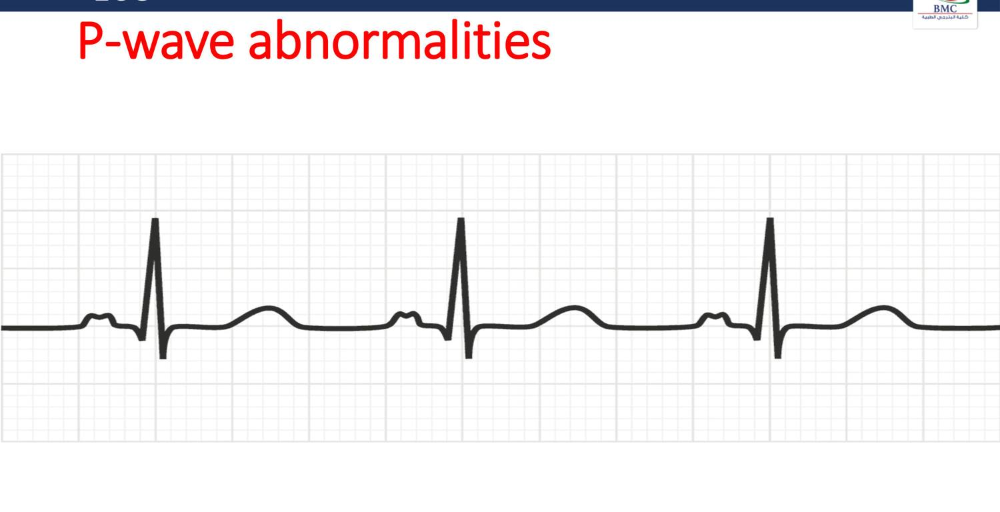 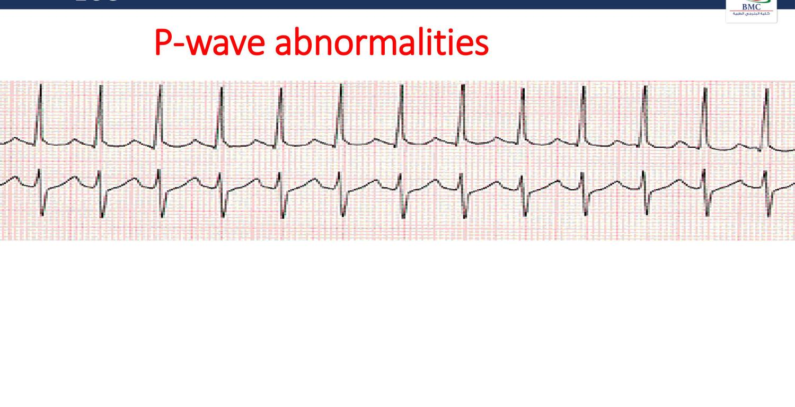

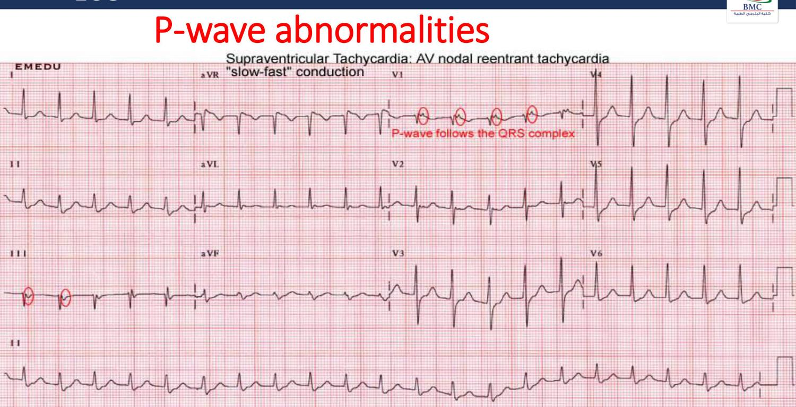 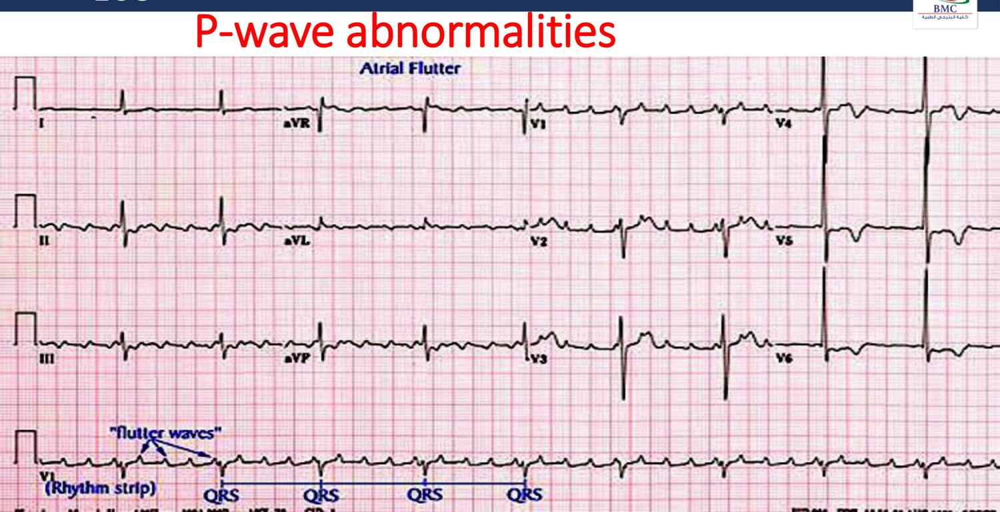

### 2.13 Step 8: PR Interval (Slides 84–89) ⭐
- **Definition** *[added]*: from the start of P to the start of QRS. **Represents** conduction from the atria through the **AV node** and His–Purkinje system.
- ⭐ **Normal: 3–5 small squares = 0.12–0.20 s.**
- **Prolonged** → **AV block**:
    - **1st degree**: PR > 0.20 s, every P conducted. Slide 86: **PR = 0.34 s**.
    - **2nd degree Mobitz I (Wenckebach)** (slide 87): conduction **intermittent**; PR **increasingly prolonged** until a QRS is dropped in a **repeating pattern**; QRS **< 0.12 s**.
    - *[added]* **Mobitz II**: constant PR, sudden dropped QRS. **3rd degree**: AV dissociation.
- **Shortened** *[added]*: **pre-excitation (WPW: short PR + delta wave)**, LGL, junctional rhythm.

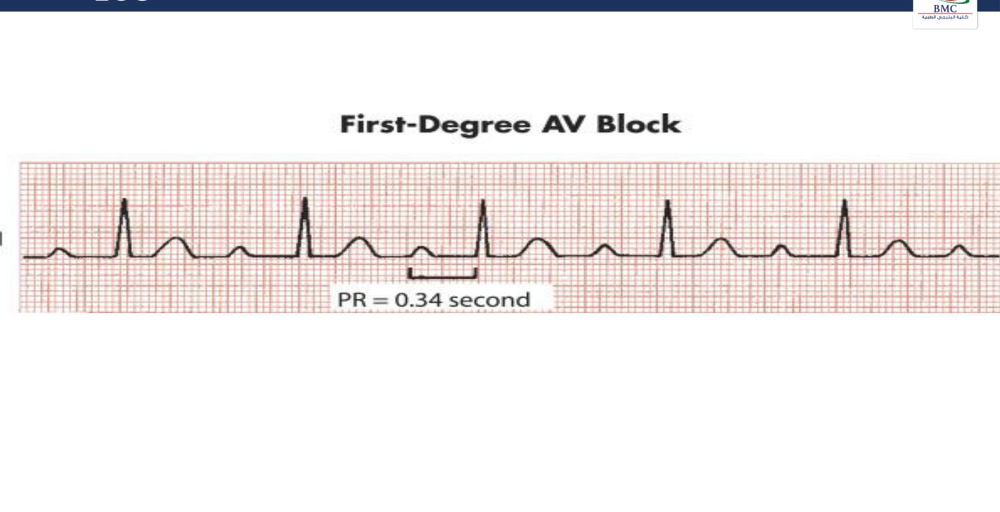 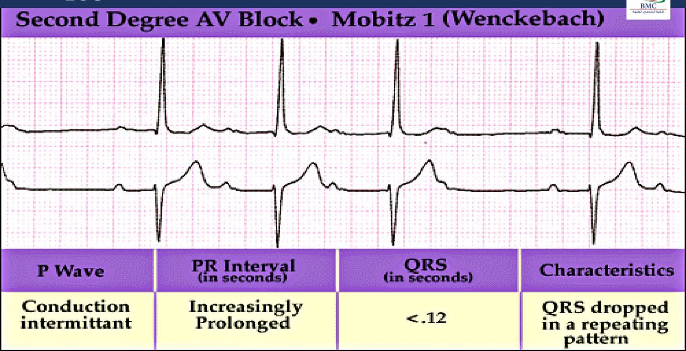

**PR practice strips:**

| Slide | 🔎 Reading |
|---|---|
| **85** | 12-lead for PR assessment (*🔎 short PR; check for a delta wave*) |
| **88** | Lead II: **more P waves than QRS**, some P waves not conducted → **2nd-degree AV block** (*🔎 constant PR on conducted beats suggests Mobitz II/2:1*) |
| **89** | Slow rate, P waves marching through independently of the QRS → **complete (3rd-degree) heart block** |

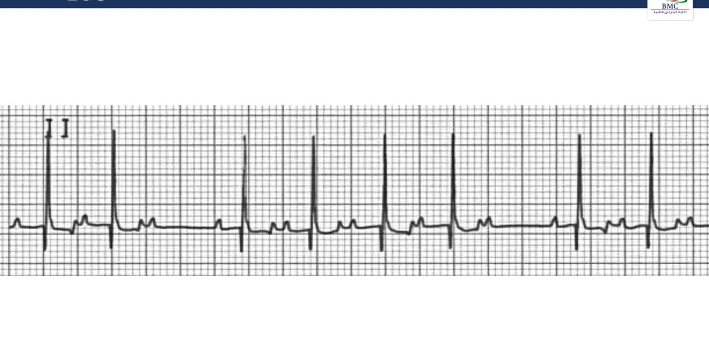 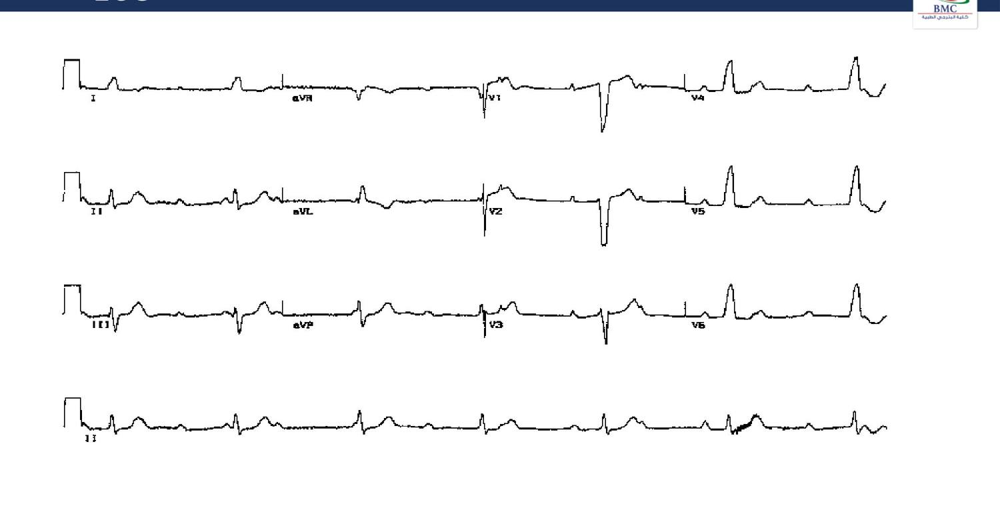

> 🔁 **Recap: P and PR.** P upright in I/II, inverted in aVR; ≤ 2.5 mm tall and ≤ 0.10 s wide. Tall = RA (pulmonale); wide/notched = LA (mitrale). Absent = AF/flutter/junctional/SVT; retrograde after QRS = AVNRT. PR 0.12–0.20: long = AV block (1st 0.34 s; Wenckebach progressive); short = WPW/junctional.
> 🔗 **Link:** After the AV node, conduction runs down the bundle branches, so the QRS tells you whether that is normal.
> ▶️ **Up next: QRS.**

---

### 2.14 Step 9: QRS Complex (Slides 91–104) ⭐

| Feature | Normal |
|---|---|
| **Direction** | Positive in **I, aVF, V5–V6**; **negative in aVR**; **V1 mostly negative (rS)**. R wave grows V1→V6 (**R-wave progression**) |
| **Amplitude** | See voltage |
| ⭐ **Duration** | **≤ 2 small squares = 0.08 s** (slide 19: 0.06–0.10 s). **Increased = abnormal ventricular conduction** |
| **Naming** | **QS, qR, Qr, qRs, R, Rs, rS** (capital = big, small = small; R′ = second positive wave) |

- **Rules (slides 93–94):**
    - **R** = any upward deflection; **Q** = negative **before** R; **S** = negative **after** R; **QS** = entirely negative.
    - **Net positive vs net negative** complexes decide the axis.
- **Slide 95, Quiz 5:** name 10 complexes using QS/qR/Rs/rS/RSR′…

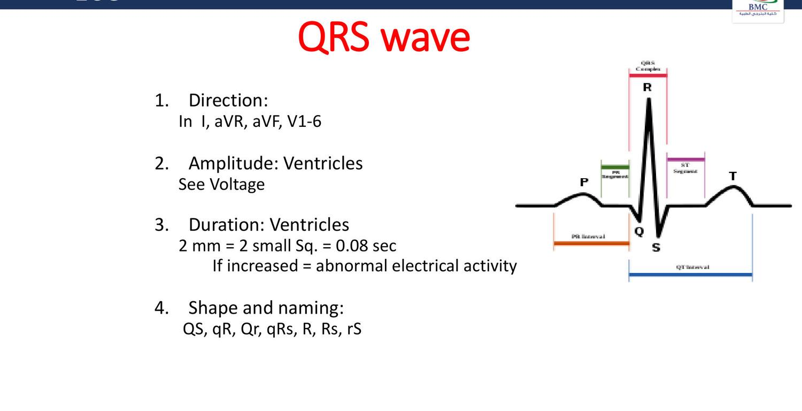 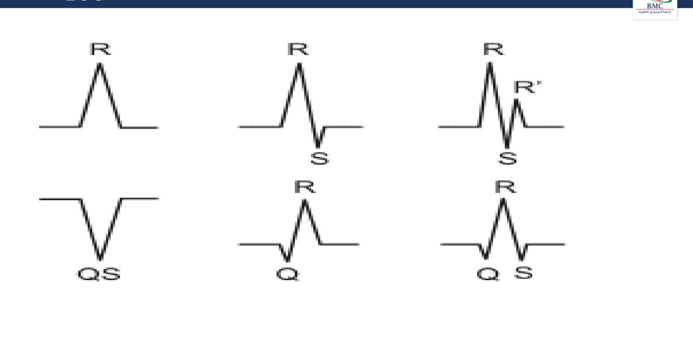

 

**Bundle branch blocks (slides 97–100)** ⭐

| | **V1** | **V6** |
|---|---|---|
| **Normal** | rS | qR |
| ⭐ **RBBB** | **rSR′ ("M" / rabbit ears)**, T inverted | **qRS with wide, slurred S** |
| ⭐ **LBBB** | **Deep, wide QS / rS** ("W") | **Broad, notched R ("M")**, T inverted, no q |

- **QRS ≥ 0.12 s** in both (slide 100: RBBB QRS **154 ms**).

> **Mnemonic** *[added]*: **"WiLLiaM MaRRoW"**: **LBBB = W in V1, M in V6**; **RBBB = M in V1, W in V6**.

 

 

**QRS practice strips:**

| Slide | 🔎 Reading |
|---|---|
| **101** | Deep **Q waves in III and aVF** (inferior) → **pathological Q / old inferior MI** |
| **102** | **Wide-complex tachycardia** → **VT** until proven otherwise |
| **104** | Chaotic polymorphic complexes changing amplitude → **torsades / polymorphic VT → VF** |

 

*[added] **Pathological Q**: > 1 small square (0.04 s) wide or > ¼ of the R height, or any Q in V1–V3. It marks an old transmural MI.*

### 2.15 Step 10: ST Segment (Slides 106–117) ⭐
- **Definition** *[added]*: from the end of the QRS (J point) to the start of the T wave. It **represents** the plateau of ventricular depolarisation (early repolarisation).
- ⭐ **Normal: iso-electric.**
- **Deviation:** **elevated** (STEMI) or **depressed** (NSTEMI / ischaemia). T inversion can also be NSTEMI.

| Slide | Finding |
|---|---|
| **108** | Single beat with **ST elevation** |
| ⭐ **109** | **Acute INFERIOR MI**: ST↑ **3–4 mm in II, III, aVF**; **reciprocal change in I, aVL** |
| ⭐ **110** | **Acute SEPTAL MI**: ST↑ **V2–V3**; reciprocal change in II, III, aVF |
| **111** | **Inferior ST elevation with reciprocal change** (aVL, V2, V5 labelled) |
| **112** | Inferior ST↑ with **posterior leads V7, V8, V9** recorded (handwritten) → 🔎 **infero-posterior MI** |
| ⭐ **113** | **Acute inferior + right ventricular MI**: Q waves and domed ST↑ in **II, III, aVF**; **ST↑ in V4R, V5R, V6R** = RV involvement; ST↓ in I, aVL = reciprocal |
| **114** | 🔎 Leads grouped I–III / aVR–aVF / V1–V3 / V4–V6 for territory practice: diffuse ST change |
| ⭐ **115** | 🔎 **Extensive anterior (antero-lateral) STEMI**: tombstone ST↑ V1–V6 + I, aVL → proximal LAD |
| **116** | 🔎 **Inferior STEMI** (II, III, aVF) with **reciprocal ST↓ in I, aVL** ± anterior ST↓ |
| **117** | 🔎 **ST depression** in lateral leads → ischaemia / **NSTEMI** |

 

 

 

 

 

### 2.16 Step 11: T Wave (Slides 119–120)
- ⭐ **Direction:** **inverted in aVR** (and may be inverted in **V1–V2**); **upright in the others**.
- Amplitude, duration and shape are listed but left blank on the slide.
    - *[added]* T < 5 mm in limb leads and < 10 mm in chest leads; asymmetric.
    - *[added]* **Peaked** = hyperkalaemia, hyperacute MI. **Deep symmetric inversion** = ischaemia, Wellens, PE (V1–V4), RVH strain, LVH strain, BBB (secondary).
- **Slide 120 (T-wave abnormalities):** 🔎 **deep T-wave inversion in V2–V6 (and I, aVL)** → anterior ischaemia / evolving anterior MI (Wellens pattern if symmetric in V2–V3).

> 🔁 **Recap: QRS, ST, T.** QRS ≤ 0.10 (lecturer 0.08), named QS/qR/rS…. ≥ 0.12 = BBB: RBBB M in V1; LBBB W in V1, M in V6. Pathological Q = old MI. ST normally iso-electric; ↑ in ≥ 2 contiguous leads = STEMI (inferior II/III/aVF → RCA, add V4R; septal V1–V2; anterior V3–V4; lateral I/aVL/V5–V6; posterior V7–V9) with reciprocal ↓. ↓ = ischaemia/NSTEMI. T upright except aVR (± V1–V2); peaked → K⁺; deep inversion → ischaemia.

---

## 3. High-Yield Comparison Tables

### Table A: Normal Values (Slides 8, 17, 19, 68, 84, 91)
| Item | Normal |
|---|---|
| Paper | 25 mm/s · small square 0.04 s · big square 0.2 s · 300 big squares/min |
| Calibration | 10 mm = 1 mV |
| SA / AV / ventricular rates | 60–100 / 40–60 / 20–40 |
| Axis | −30° to +90° |
| P | ≤ 2.5 mm tall · ≤ 0.10 s wide · upright I/II, inverted aVR |
| PR | 0.12–0.20 s (3–5 small squares) |
| QRS | ≤ 0.08–0.10 s |
| QTc | ≤ 0.44 s (QT/√RR) |
| ST | Iso-electric |
| T | Upright except aVR (± V1–V2) |

### Table B: Heart-Rate Methods
| Method | Rhythm | Formula | Accuracy |
|---|---|---|---|
| R–R big squares | Regular | 300 ÷ big squares | Good |
| R–R small squares | Regular | 1500 ÷ small squares | **Best** |
| Triplicate | Regular | 300-150-100-75-60-50 | Quick |
| 6-second | **Irregular** | QRS in 30 big squares × 10 | **Least accurate** |

### Table C: Axis
| | Lead I | aVF (II) | Causes *[added]* |
|---|---|---|---|
| Normal | + | + | — |
| LAD | + | − | LAFB, inferior MI, LVH, WPW |
| RAD | − | + | RVH, PE, COPD, lateral MI, LPFB |
| Extreme | − | − | VT, severe hyperkalaemia, lead reversal |

### Table D: Atrial Enlargement
| | RAE (P pulmonale) | LAE (P mitrale) |
|---|---|---|
| Lead II | **Tall, peaked > 2.5 mm** | **Wide > 0.10 s, notched (> 40 ms between peaks)** |
| V1 | Tall initial positive part | **Deep, wide terminal negative part (> 0.04 s)** |
| Causes *[added]* | Pulmonary HTN, COPD, PE, TR | MS, MR, LVH, HTN |

### Table E: STEMI Territories *[added; consistent with slides 109–116]*
| Leads with ST↑ | Territory | Artery | Reciprocal |
|---|---|---|---|
| **II, III, aVF** | Inferior | **RCA** (80%) / LCx | I, aVL |
| + **V4R** | Right ventricle | Proximal RCA | — |
| **V7–V9** (ST↓ + tall R V1–V3) | Posterior | RCA / LCx | V1–V3 |
| **V1–V2** | Septal | LAD (septal) | (inferior) |
| **V3–V4** | Anterior | LAD | Inferior |
| **I, aVL, V5–V6** | Lateral | LCx / diagonal | Inferior |
| **V1–V6 + I, aVL** | Extensive anterior | **Proximal LAD** | Inferior |

---

## 4. Rules, Exceptions, Patterns

| Rule | Exception / nuance |
|---|---|
| Big complexes = LVH | Check **calibration**: double standard doubles everything |
| Small complexes = low voltage | Half standard halves everything; real causes include effusion, obesity, COPD, hypothyroid |
| P upright everywhere | **Inverted in aVR** is normal; inverted in I suggests lead reversal/dextrocardia *[added]* |
| One P per QRS | Extra P waves = **2nd/3rd-degree block**; P after QRS = **AVNRT/junctional** |
| PR long = block | Short PR + delta wave = **WPW** |
| QRS ≤ 0.10 s | ≥ 0.12 s = BBB, ventricular rhythm, paced, hyperkalaemia |
| T upright | Normally inverted in **aVR**, may be in **V1–V2** (and III) |
| ST↑ = STEMI | Also **pericarditis** (diffuse, PR↓), **LBBB**, LVH, early repolarisation, ventricular aneurysm *[added]* |
| Inferior STEMI | **Always record V4R** (RV infarct: avoid nitrates, give fluids *[CAD link]*) |
| Rate by 300/big squares | **Irregular rhythm → 6-second × 10** |

---

## 5. Clinical Correlations
- **Hypertensive patient: S V1 + R V5 = 40 mm with lateral T inversion** → **LVH with strain**.
- **Mitral stenosis:** **P mitrale** → later **AF** (no P waves, irregularly irregular).
- **COPD / pulmonary HTN:** **P pulmonale + right axis deviation** (± RBBB).
- **Large pericardial effusion:** **low voltage** ± electrical alternans *[Pericardial lecture]*.
- **Hypotension and bradycardia in an inferior STEMI** → **RV infarct** (V4R ST↑) → fluids, avoid nitrates.
- **Young patient, palpitations, short PR + delta wave** → **WPW** → avoid AV-nodal blockers in AF.
- **Syncope with P waves marching through a slow wide escape** → **complete heart block** → pacing.
- **Renal failure with peaked T and wide QRS** → **hyperkalaemia** *[added]*.

---

## 6. Rapid Revision (Last-Day)
1. **SA 60–100 · AV 40–60 · ventricle 20–40** (emergency 150–250).
2. **Limb: I, II, III bipolar; aVR, aVL, aVF unipolar. Chest V1–V6 unipolar.** V1–V2 septal, V3–V4 anterior, V5–V6 lateral.
3. Toward + electrode = upward deflection.
4. **25 mm/s: small square 0.04 s, big square 0.2 s; 300 big squares = 1 min; 10 mm = 1 mV.**
5. **11 steps:** ID · standardisation · voltage · axis · rhythm · rate · P · PR · QRS · ST · T.
6. **Full standard = 10 mm** (half 5, double 20).
7. **LVH: SV1/V2 + RV5/V6 ≥ 35 mm.**
8. **Axis:** normal −30° to +90°; LAD physiological 0 to −30, pathological −30 to −90; RAD +90 to +180; extreme −90 to ±180.
9. **Rhythm:** compare R–R intervals.
10. **Rate:** 300/big · 1500/small · 300-150-100-75-60-50 · irregular → 6 s × 10 (least accurate).
11. **P:** upright I/II, inverted aVR, ≤ 2.5 mm, ≤ 0.10 s. **Tall = RAE (pulmonale), wide/notched = LAE (mitrale).** Absent = AF/flutter/nodal/SVT.
12. **PR 0.12–0.20 s.** Long = block (1st > 0.20; Wenckebach progressive). Short = WPW/junctional.
13. **QRS ≤ 0.08–0.10 s.** Names: QS, qR, Qr, qRs, R, Rs, rS. **≥ 0.12 = BBB**: **RBBB rSR′ in V1 + wide S in V6; LBBB QS in V1 + notched R in V6.**
14. **QTc ≤ 0.44 s = QT/√RR.**
15. **ST iso-electric.** ↑ inferior II/III/aVF (reciprocal I, aVL); septal V1–V2; anterior V3–V4; lateral I/aVL/V5–V6; RV → V4R; posterior → V7–V9.
16. **T upright except aVR (± V1–V2).** Deep inversion → ischaemia.

---

## 7. Exam-Style Questions

**Q1.** On a regular ECG the R–R interval is 4 big squares. What is the heart rate?
A. 50 · **B. 75** · C. 100 · D. 150 · E. 300

> **Answer: B.** 300 ÷ 4 = **75/min** (slide 60).

**Q2.** An irregularly irregular rhythm has 9 QRS complexes in 30 big squares. What is the heart rate?
A. 45 · B. 60 · **C. 90** · D. 180 · E. Cannot be determined

> **Answer: C.**
> - **Irregular → count in 6 s (30 big squares) × 10** = 90 (slides 61–62).
> - This is the least accurate method, but the right one for irregular rhythms.

**Q3.** Lead I is positive and aVF is negative; lead II is also negative. What is the axis?
A. Normal · B. Physiological left axis · **C. Pathological left axis deviation** · D. Right axis deviation · E. Extreme axis

> **Answer: C.**
> - I up + aVF down = left axis. **Lead II negative** places it **beyond −30°**, so it is pathological (slide 36).
> - *[added]* Commonest cause: left anterior fascicular block.

**Q4.** Lead II shows a P wave 0.14 s wide with a notch 50 ms between the peaks, and V1 shows a deep terminal negative P component. What does this indicate?
A. RAE · **B. LAE (P mitrale)** · C. Atrial flutter · D. Junctional rhythm · E. Hyperkalaemia

> **Answer: B** (slides 70, 73, 75).
> - *[added]* Typical of mitral stenosis.

**Q5.** ST elevation in II, III and aVF with ST depression in I and aVL in a hypotensive, bradycardic patient. Which extra leads should be recorded, and why?
A. V7–V9 for posterior MI · **B. V4R–V6R for right ventricular infarction** · C. aVR for left main · D. None · E. Repeat in 24 h

> **Answer: B.**
> - Inferior STEMI with reciprocal change (slide 109). Hypotension and bradycardia raise suspicion of **RV involvement** → **right-sided leads** (slide 113).
> - *[added]* V7–V9 are also worth recording if V1–V3 show ST depression.

**Q6.** V1 shows rSR′ and V6 a wide slurred S wave; QRS is 0.15 s. Diagnosis?
A. LBBB · **B. RBBB** · C. WPW · D. LVH · E. Normal variant

> **Answer: B** (slides 97, 100).

---

## 8. Exam Pitfalls & Traps
- **Most strips in this deck have no caption.** Every reading marked 🔎 is mine. Check the starred/quiz ones (slides 54–55 have the lecturer's own answers) against your class notes.
- **Normal-axis range:** slide 36 says **0 to +90°** (with 0 to −30° as "physiological left"); slide 35 says **−30° to +90°**. Both mean the same: up to −30° is **not** pathological.
- **QRS duration:** slide 91 says **0.08 s (2 small squares)**; slide 19 says **0.06–0.10 s**. Only **≥ 0.12 s** defines a bundle branch block.
- **Step order:** the slides list "Rhythm then Rate" on some slides and "Rate then Rhythm" on others. Be consistent in the exam.
- **Calibration first:** half or double standard fakes low voltage or LVH.
- **The 6-second method is the least accurate.** Use it only for irregular rhythms.
- **P waves:** inverted in aVR is **normal**. Inverted in lead I suggests limb-lead reversal or dextrocardia *[added]*.
- **ST elevation is not always MI:** pericarditis (diffuse, PR↓), LBBB, LVH, early repolarisation *[added]*.
- **Inferior MI:** always look for **RV (V4R)** and **posterior (V7–V9)** extension.
- **Low-voltage criteria** were only a heading on slide 27. The cut-offs given here are standard textbook values *[added]*.
