# Heart Failure: An Approach to a Case of Dyspnoea
**Dr. Muhammad Reihan, Internal Medicine** | Source: `Reihan_HF.pdf` (49 slides)

> **Legend:** ⭐ = high-yield · *[added]* = not on slides. Images marked "Slide N" come from the lecture; "Added diagram" = drawn for these notes. The opening-case answer is **reasoned by me; the key is not on the slides**.

> 🔗 **Bridge from earlier lectures (same lecturer):**
> - **CAD:** **ischaemic heart disease is the commonest cause of HFrEF**; post-MI remodelling.
> - **Hypertension:** HTN → LVH → **HFpEF**; ACEi/ARB/β-blockers overlap.
> - **Valvular disease:** AS, MR and AR end in HF; **acute MR** (papillary rupture, endocarditis) → de novo acute HF.
> - **Arrhythmias:** AF triggers decompensation; **digoxin** (rate control) and its toxicity; ICD/CRT.
> - **Pericardial disease:** constrictive pericarditis mimics right HF.
> - **Thyroid / pituitary:** **thyrotoxicosis** and **acromegaly** → high-output HF; thyroid storm → de novo HF.
> - **Sleep apnoea:** HF → **Cheyne–Stokes central apnoea** (ASV contraindicated in HFrEF).
> - **ARDS lecture:** cardiogenic vs non-cardiogenic oedema (**BNP**, PCWP).

---

## 1. Title / Objectives

| Domain | Objective | Likely tested as |
|---|---|---|
| Knowledge | ⭐ Classify HF by **EF (HFrEF vs HFpEF)**, **ventricle (L/R/biventricular)**, **course (chronic compensated vs acute decompensated)** | Definitions |
| Knowledge | ⭐ **ACC/AHA stages A–D** and **Framingham criteria** | Staging MCQ; 2 major or 1 major + 2 minor |
| Skill | Apply Framingham to diagnose CHF | |
| Skill | ⭐ Formulate **GDMT** for HFrEF | Which drug ↓ mortality |
| Skill | ⭐ Emergency plan for **acute decompensated HF** | LMNOP-type management |

**Main subtopics:**
- definition and classification
- epidemiology
- pathophysiology and compensation
- clinical features
- ACC/AHA stages
- diagnostics (bloods, biomarkers, imaging, ECG, Framingham)
- management (lifestyle, HFrEF, HFpEF, invasive)
- high-output HF
- acute HF as a medical emergency

---

## 2. Main Content (Lecture Order)

### 2.0 Opening Case (Slides 5–6)
**Presentation:**
- **43-year-old man**, 1 month of progressive dyspnoea
- **two-pillow orthopnoea**, wakes **choking** (PND)
- **AV fistula created 5 months ago** (left upper arm); HTN; **CKD on haemodialysis** (reflux nephropathy)
- **HR 103, bounding pulse**; BP **106/58** (*[added]* wide pulse pressure); RR 22
- **bilateral pitting oedema, JVD**, a **prominent bruit over the fistula**, **bibasal crackles, S3 gallop**

**Most likely cause?** → ⭐ **F. High-output heart failure** *[reasoning added; key not on slides]*:
- the AV fistula shunts blood past the systemic resistance → **↓ afterload** → compensatory **↑ cardiac output**
- the heart eventually fails: congestion, S3, JVD
- bounding pulse + wide pulse pressure + tachycardia = a **hyperdynamic** circulation
- *[added]* **Nicoladoni–Branham sign:** compressing the fistula → reflex **bradycardia**

**Why not the others:**
- **dialysis disequilibrium:** neurological, during or right after dialysis
- **sepsis:** no fever
- **PE:** no S3 or congestion
- **constrictive pericarditis:** no S3; Kussmaul's sign, pericardial knock
- **fistula aneurysm:** a local swelling

### 2.1 Definition and Classification (Slides 7–8) ⭐
- **HF** = a **clinical syndrome** in which the heart **can't supply enough blood to meet the body's demands**.
- Caused by **structural or functional impairment of ventricular filling or ejection**.
- Cardinal **symptoms:** **dyspnoea, fatigue**. **Signs:** **oedema, rales**.

| Axis | Categories |
|---|---|
| **Ejection fraction** | ⭐ **HFrEF (systolic)** vs **HFpEF (diastolic)** |
| **Ventricle** | **Right** vs **left** vs **biventricular** |
| **Course** | **Chronic compensated** vs **acute decompensated** |

*[added]* **EF cut-offs (ACC/AHA 2022):**

| Class | LVEF |
|---|---|
| **HFrEF** | **≤ 40%** |
| **HFmrEF** (mildly reduced) | **41–49%** |
| **HFpEF** | **≥ 50%** |
| **HFimpEF** (improved) | previously ≤ 40%, now > 40% |

The slide's Osmosis diagram uses **normal ≈ 50–70%, borderline 40–50%, systolic HF < 40%**.

### 2.2 Epidemiology (Slide 9)
- A **leading cause of morbidity and mortality** worldwide.
- Prevalence **~2%** in adults (developed countries); **≥ 10% over age 70**.
- ⭐ **KSA: mean age 57–60 years**, **~10 years younger** than in developed countries.
- Incidence is **lower in women**, but because women live longer they account for **half of all cases**.

### 2.3 Aetiology (Slide 10) ⭐
**Main causes:**
1. ⭐ **CAD**
2. ⭐ **arterial hypertension**
3. ⭐ **diabetes mellitus**

**Then:**
- valvular heart disease
- renal disease
- infiltrative disease
- dilated cardiomyopathy
- arrhythmias
- myocarditis
- obesity, smoking, COPD
- drugs, **alcohol**

**The aetiology wheel** splits causes into **diseased myocardium** and **abnormal loading**:

| Diseased myocardium | Abnormal loading |
|---|---|
| Ischaemic | HTN |
| Toxic (alcohol, drugs, chemo, radiation) | Valvular/structural |
| Immune/infective (myocarditis) | Pericardial (constriction, effusion) |
| Infiltrative (amyloid, sarcoid, haemochromatosis) | Endomyocardial (HES, EMF) |
| Metabolic/hormonal (thyroid, GH, Addison's, nutritional) | **High-output states** (anaemia, sepsis, thyrotoxicosis) |
| Genetic (HCM, ARVC, dystrophies) | Volume overload (renal failure, iatrogenic) |
| Peripartum | — |

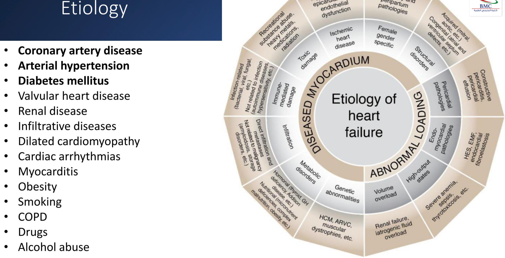

### 2.4 Pathophysiology (Slides 11–14) ⭐
- **Cardiac output = HR × SV:** 70 beats/min × 70 mL/beat ≈ **4.9 ≈ 5 L/min**.
- **Ejection fraction** = stroke volume ÷ end-diastolic volume. Example: 70/110 ≈ **64%** (normal).

| | **HFrEF (systolic)** | **HFpEF (diastolic)** |
|---|---|---|
| Problem | ⭐ **↓ Contractility**: "can't pump hard enough" | ⭐ **↓ Compliance**: "not filling enough" |
| Mechanism | Systolic dysfunction → **↓ LVEF** → ↓ CO | Stiff ventricle → **↓ filling, ↑ diastolic pressure** → ↓ CO with **normal EF** |
| Example (slide) | SV 44 / EDV 110 → **EF ≈ 40%** | SV 44 / EDV 69 → **EF ≈ 64%** (SV still low) |
| *[added]* Typical patient | Post-MI, DCM, younger man | **Elderly woman with HTN, obesity, DM, AF** |
| *[added]* Heart sound | **S3** (volume overload) | **S4** (stiff ventricle, atrial kick) |

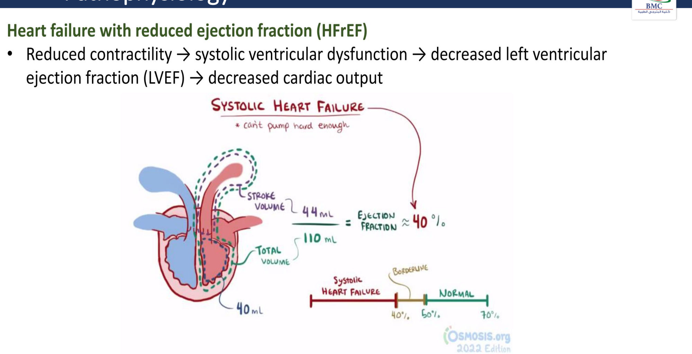 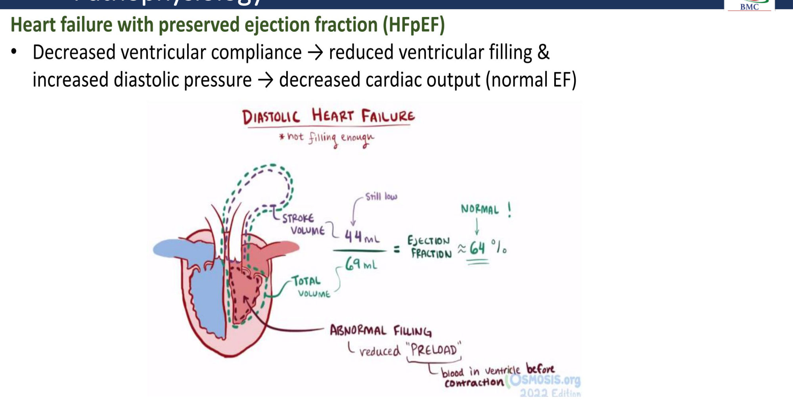

**Forward vs backward failure (slide 14):**
- ⭐ **Forward:** ↓ CO → poor organ perfusion → organ dysfunction.
- ⭐ **Backward:**
  - **LV failure** → backs up into the **lungs** (pulmonary congestion)
  - **RV failure** → **systemic venous congestion**

### 2.5 Compensation and Decompensation (Slides 15–16) ⭐
To maintain CO when stroke volume falls:
1. ⭐ **↑ Adrenergic (sympathetic) activity:** ↑ HR, ↑ contractility, vasoconstriction (↑ afterload)
2. ⭐ **↑ RAAS:** angiotensin II (vasoconstriction), **aldosterone (Na⁺/H₂O retention)**, ↑ preload; also **ADH**
3. ⭐ **BNP secretion:** natriuresis and vasodilatation (the "good" counter-regulator)

These short-term fixes cause ⭐ **cardiac remodelling** in the long run. That is **why ACEi/ARB/ARNI, β-blockers and MRAs reduce mortality**: they block these maladaptive loops.

**Slide 16 summary:**
- **Low-output HF:**
  - **systolic dysfunction:** injury/ischaemia, infarction/inflammation → thin, weak muscle
  - **diastolic dysfunction:** infiltration/fibrosis → thick, stiff myocardium
- **High-output HF:** increased cardiac demand.
- All → **↑ workload** (myocardial stress, volume and pressure overload) → **SNS and RAAS activation**.
  - **Compensation:** ↑ HR, ↑ contractility, ↑ blood volume.
  - **Decompensation:** deteriorating function, inability to maintain circulation.

| Left-sided HF | Right-sided HF | Biventricular |
|---|---|---|
| **Forward:** can't maintain CO. **Backward:** ↑ filling pressure, **pulmonary congestion** → apnoea, SOB, fatigue | **Backward:** venous congestion in the venae cavae, **oedema** of feet, ankles, legs, lower back, liver, abdomen; nausea | Long-term LHF → RHF; diseases affecting the whole myocardium |

*[added]* The **commonest cause of right HF is left HF**.

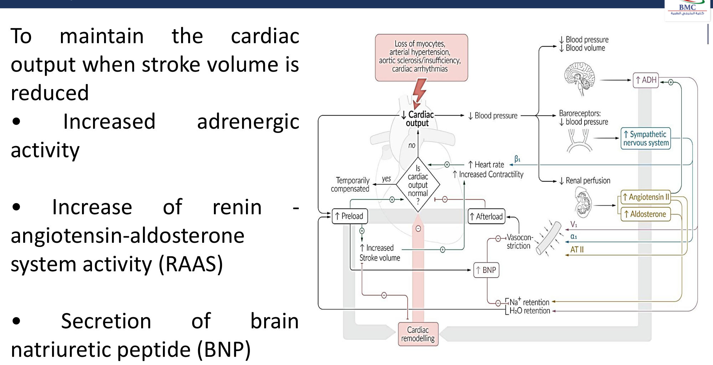
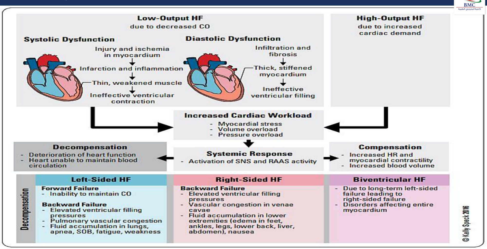

### 2.6 Clinical Features (Slides 17–19) ⭐
**General:**
- **nocturia**
- **fatigue**
- **tachycardia**, arrhythmias
- ⭐ **S3 gallop** (early diastolic; volume overload: HFrEF) and **S4 gallop** (late diastolic, before S1; stiff ventricle: HFpEF)
- **cachexia**

| **Left-sided HF** (pulmonary congestion) | **Right-sided HF** (fluid retention, ↑ CVP) |
|---|---|
| ⭐ **Dyspnoea, orthopnoea, PND**, pulmonary oedema | ⭐ **Peripheral pitting oedema** |
| ⭐ **Bilateral basal rales (crackles)** | **Abdominal pain**, nausea, **loss of appetite** (gut and liver congestion) |
| ⭐ **Laterally displaced apex beat** (cardiomegaly) | **Jaundice** (congestive hepatopathy) |
| **Cool, pale extremities** (↓ CO) | ⭐ **JVD**, ⭐ **hepatojugular reflux**, **hepatosplenomegaly** |

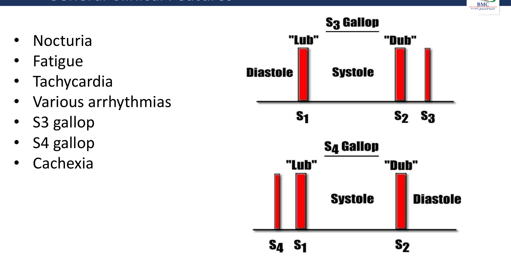

### 2.7 ACC/AHA Stages vs NYHA Class (Slide 20) ⭐⭐
| ACC/AHA stage | Description | Maps to NYHA |
|---|---|---|
| **A** | **At risk** for HF (HTN, DM, CAD): **no structural disease, no symptoms** | — |
| **B** | **Structural heart disease, asymptomatic** (e.g. LVH, low EF, prior MI) | **I** |
| **C** | Structural disease with **prior or current symptoms** | **I–IV** |
| **D** | **Refractory / advanced HF** | **IV** |

| NYHA class | Symptom severity |
|---|---|
| **I** | **No limitation**; ordinary activity causes no symptoms |
| **II** | **Slight limitation**; comfortable at rest; **ordinary** activity → symptoms (mild HF) |
| **III** | **Marked limitation**; **less than ordinary** activity → symptoms (moderate HF) |
| **IV** | **Symptoms at rest**; any activity worsens discomfort (severe HF) |

⭐ **ACC/AHA stages only progress** (they never go back): a stage C patient who improves stays stage C. **NYHA class changes** with symptoms.

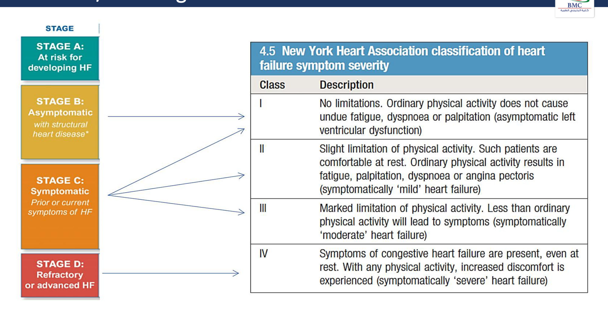

> 🔁 **Recap: Basics.**
> - HF = can't meet demand. HFrEF (EF ≤ 40%, can't pump) vs HFpEF (EF ≥ 50%, can't fill).
> - Causes: **CAD, HTN, DM**.
> - Compensation: SNS + RAAS + ADH (harmful long-term → remodelling) and BNP (helpful).
> - Left: orthopnoea, PND, crackles, displaced apex. Right: oedema, JVD, HJR, hepatomegaly. S3/S4.
> - Stages A–D (one-way) vs NYHA I–IV (symptoms).
>
> ▶️ **Up next: Diagnostics.**

---

### 2.8 Diagnostics: Bloods and Biomarkers (Slides 21–22) ⭐
| Everyone | Selected populations |
|---|---|
| **CBC** (anaemia) | **HIV** |
| **BMP**: ⭐ **↑ creatinine, ↓ Na⁺** (hyponatraemia = poor prognosis) | **Iron studies** (haemochromatosis; *[added]* iron deficiency → IV iron) |
| **Cardiac biomarkers** | **ANA** |
| **Glucose/HbA1c** | **Lyme serology** |
| **LFTs**, **lipids** | **TSH** |

⭐ **Natriuretic peptides (BNP or NT-proBNP):**
- released in response to **ventricular volume expansion and pressure overload** (wall stretch)
- ⭐ useful to **differentiate HF dyspnoea from COPD**
- *[added]* a **normal BNP effectively rules out HF** (high NPV); cut-offs: BNP < 100 pg/mL, NT-proBNP < 300 pg/mL in acute settings
- ⭐ **↑ with age and kidney dysfunction**
- ⭐ **falsely ↓ in obesity**
- *[added]* also **↑ on sacubitril** (neprilysin breaks BNP down), so use **NT-proBNP** on an ARNI

### 2.9 Diagnostics: Imaging and ECG (Slides 23–28) ⭐
| Test | Role |
|---|---|
| ⭐ **TTE** | **Every patient with suspected new-onset HF**: EF, wall motion, valves, diastolic function |
| ⭐ **CXR** | ⭐ **↑ cardiothoracic ratio (> 0.5)**, **upper-lobe diversion ("cephalisation")**, **Kerley B lines**, **pleural effusions** (*[added]* bat-wing alveolar oedema, fissure fluid) |
| **ECG** | **Chamber enlargement** (LVH, RVH), **ischaemic heart disease** (Q waves); arrhythmia (AF); *[added]* QRS width/LBBB → CRT |
| ⭐ **Cardiac MRI** | ⭐ **Gold standard** for ventricular volume, mass and EF; when TTE is uncertain or for specific diseases (myocarditis, amyloid, sarcoid) |
| **MUGA (radionuclide ventriculography)** | EF and volume when other modalities are inadequate or contraindicated |

*[added]* **CXR mnemonic "ABCDE":**
- **A**lveolar oedema (bat-wing)
- Kerley **B** lines
- **C**ardiomegaly
- **D**ilated upper-lobe vessels
- pleural **E**ffusion

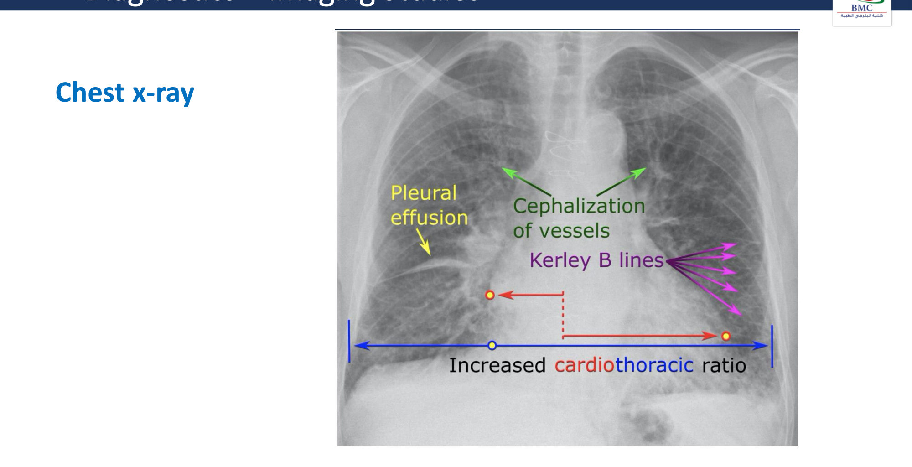

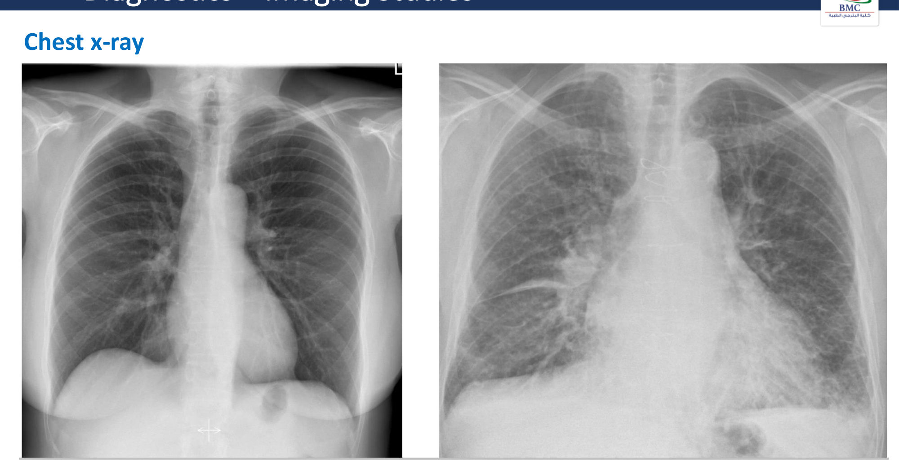 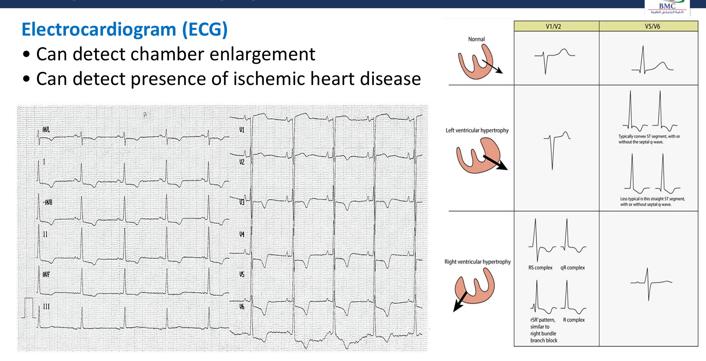

### 2.10 Framingham Criteria (Slide 29) ⭐⭐
⭐ **CHF = ≥ 2 major, OR 1 major + 2 minor criteria.**

| **Major criteria** | **Minor criteria** |
|---|---|
| **PND** | **Bilateral ankle oedema** |
| **Neck vein distension** | **Nocturnal cough** |
| **Rales** | **Dyspnoea on ordinary exertion** |
| **Radiographic cardiomegaly** | **Hepatomegaly** |
| **Acute pulmonary oedema** | **Pleural effusion** |
| **S3 gallop** | **↓ Vital capacity by one-third** of the maximum recorded |
| **↑ CVP (> 16 cmH₂O at the RA)** | **Tachycardia (HR > 120)** |
| **Hepatojugular reflux** | — |
| **Weight loss > 4.5 kg in 5 days in response to treatment** | — |

*[added]* Minor criteria count **only if they can't be attributed to another condition** (e.g. pulmonary hypertension, cirrhosis).

**Mnemonic *[added]* for the major criteria, "PANCHES + RAW":**
- **P**ND
- **A**cute pulmonary oedema
- **N**eck vein distension
- **C**ardiomegaly
- **H**epatojugular reflux
- **E**levated CVP
- **S**3
- **RA**les
- **W**eight loss (> 4.5 kg in 5 days on treatment)

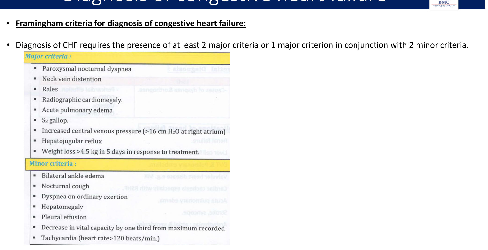

> 🔁 **Recap: Diagnosis.**
> - Bloods: CBC, BMP (↑ Cr, ↓ Na), biomarkers, HbA1c, LFTs, lipids, ± TSH, iron, HIV, ANA.
> - **BNP:** CHF vs COPD; ↑ with age and CKD; ↓ in obesity.
> - **TTE for all**; CXR (CTR > 0.5, cephalisation, Kerley B, effusion); ECG; **cardiac MRI = gold standard**; MUGA.
> - **Framingham: 2 major or 1 major + 2 minor.**
>
> ▶️ **Up next: Management.**

---

### 2.11 Management Overview and Lifestyle (Slides 30–31)
**Therapy branches (slide 30):**

| Branch | Components |
|---|---|
| **Etiologic** | Treat the cause |
| **HFrEF** | Mortality-improving therapy · symptomatic therapy · lifestyle and comorbidity management |
| **HFpEF** | Symptomatic therapy · lifestyle and comorbidities |
| **Invasive** | ICD, CRT |
| **Advanced HF** | Transplant, LVAD |
| **Acute decompensated HF** | Medical emergency |

⭐ **Lifestyle:**
- **sodium restriction (< 4 g/day)**
- **fluid restriction (1.5–2.0 L/day)**
- weight loss; smoking cessation; restrict alcohol
- **exercise programme** (cardiac rehab)
- ⭐ **daily weight monitoring** (*[added]* > 2 kg in 3 days → seek review)
- **immunisation** (influenza, pneumococcal)
- comorbidity management
- ⭐ **avoid medications that worsen HF** (*[added]* **NSAIDs, non-DHP CCBs (verapamil/diltiazem), thiazolidinediones, class I antiarrhythmics, some chemo**)

### 2.12 HFrEF Pharmacotherapy (Slides 32–34) ⭐⭐
**Stage A:** treat HTN, hyperlipidaemia, DM. **HF drugs not routinely recommended.**

**Stage B** (the slide applies this to "everyone with HFrEF"):

| Class | Examples | Indication | Effect |
|---|---|---|---|
| ⭐ **ACE inhibitors** | Enalapril, ramipril, lisinopril | **Everyone with HFrEF** | **Mortality ↓** |
| *or* **ARBs** | Candesartan, losartan, valsartan | **Can't tolerate an ACEi** (cough) | **Mortality ↓** |
| *or* ⭐ **ARNI** | **Sacubitril/valsartan** | Can't tolerate ACEi/ARB (slide); *[added]* now **preferred first-line** over ACEi in NYHA II–III | **Mortality ↓** |
| ⭐ **β-blockers** | **Bisoprolol, carvedilol, metoprolol** (*[added]* succinate) | **Everyone with HFrEF** | **Mortality ↓** |

**Stage C (add):**

| Class | Examples | Indication | Effect |
|---|---|---|---|
| ⭐ **Aldosterone antagonists (MRA)** | **Spironolactone, eplerenone** | **NYHA II–IV and LVEF ≤ 35%** | **Mortality ↓** |
| ⭐ **SGLT2 inhibitors** | **Dapagliflozin, empagliflozin** | **NYHA II–IV** | **Mortality ↓** |
| **Loop diuretics** | Torsemide, furosemide | **All patients with fluid retention** | ⭐ **Symptoms + ↓ hospitalisation (no mortality benefit)** |
| **Thiazide diuretics** | Chlorthalidone, HCTZ | (with loops: sequential nephron blockade *[added]*) | Symptoms |
| ⭐ **Hydralazine + ISDN** | BiDil or separate | **Angiotensin-system blockade intolerance** (*[added]* and **self-identified Black patients** on top of GDMT, A-HeFT) | **Mortality ↓** |

**Stage D:** most patients need **invasive interventions** or a shift to **palliative care**.

**Additional therapy (slide 34):**

| Drug | Indication | Effect |
|---|---|---|
| **Digoxin** | HFrEF with **persistent symptoms despite first-line therapy** | **Symptoms + ↓ hospitalisation** (*[added]* no mortality benefit, DIG trial) |
| **Ivabradine** | **All of:** **NYHA II–III**, stable **HFrEF ≤ 35%**, **sinus rhythm with HR ≥ 70** at rest on the **maximum tolerated β-blocker** | **Symptomatic** (*[added]* ↓ HF hospitalisation; If-channel blocker) |

⭐ **The "four pillars"** of HFrEF GDMT *[added framing, matching slides 33–34]*:
1. **ARNI/ACEi/ARB**
2. **β-blocker**
3. **MRA**
4. **SGLT2i**

All four reduce mortality; start early and titrate.

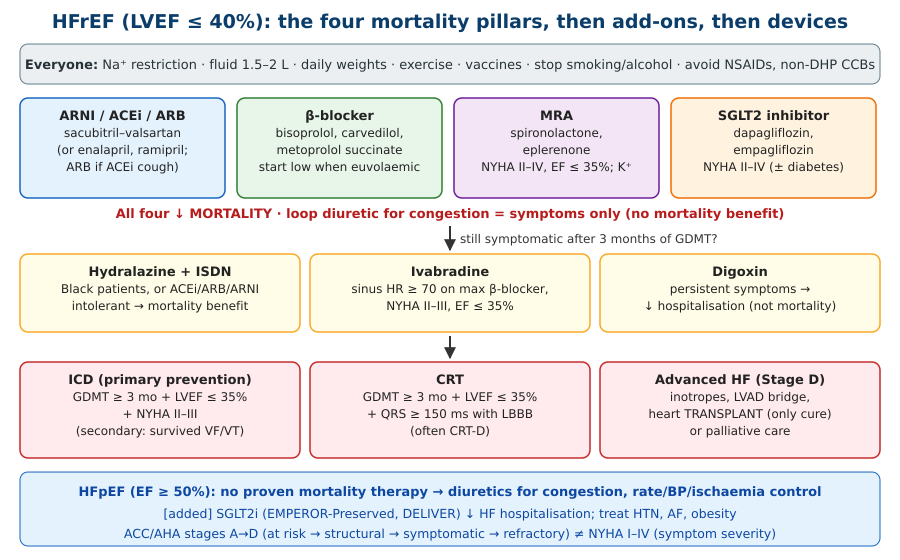

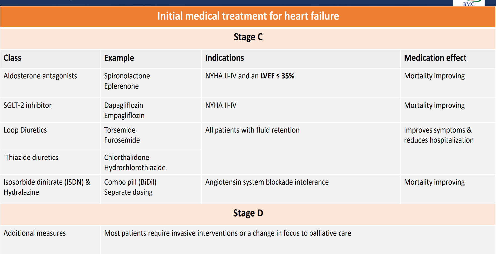 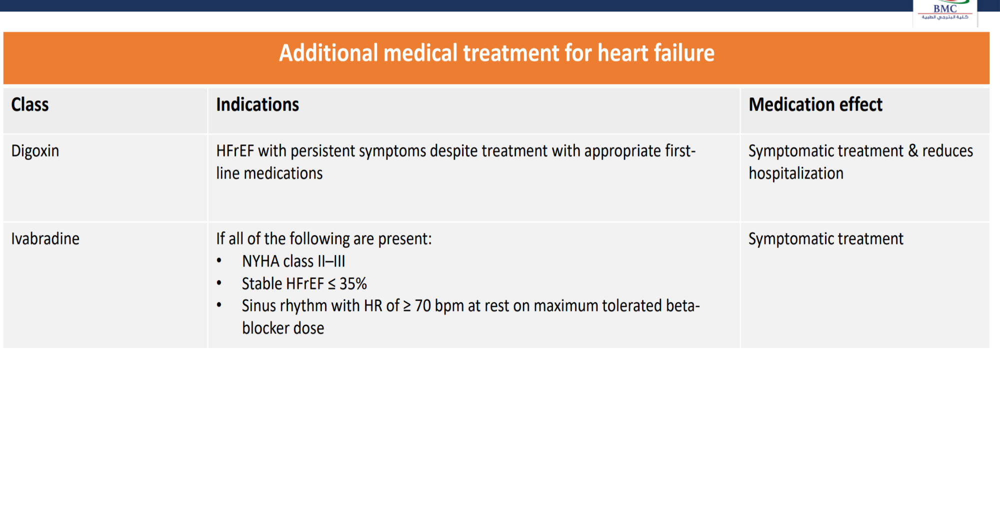

*[added]* **GDMT safety:**
- **ACEi/ARB/ARNI:** ↑ K⁺, ↑ creatinine (accept a rise ≤ 30%), angioedema (**36-hour washout ACEi → ARNI**), hypotension; contraindicated in pregnancy and bilateral renal artery stenosis.
- **β-blockers:** start low **when euvolaemic** (not during acute decompensation if hypoperfused); bradycardia.
- **MRA:** **hyperkalaemia** (avoid if K⁺ > 5.0 or eGFR < 30); **gynaecomastia** with spironolactone (→ eplerenone).
- **SGLT2i:** genital mycotic infection, **euglycaemic DKA**, volume depletion.

### 2.13 Digoxin and Digitalis Toxicity (Slides 34–35) ⭐⭐
- **Low therapeutic index** → monitor levels.
- ⭐ **Precipitants of toxicity:**
  - **old age**
  - **renal failure**
  - ⭐ **hypokalaemia**, **hypomagnesaemia**, **hypercalcaemia**
  - **thyroid disorders**
  - *[added]* interacting drugs: **amiodarone, verapamil, quinidine, macrolides**

| Clinical picture | Features |
|---|---|
| **GI** | ⭐ **Anorexia, nausea, vomiting: the 1st symptom** |
| **Neurological** | Psychosis/confusion, ⭐ **yellow (xanthopsia) vision** |
| **Cardiac** (the most life-threatening) | Arrhythmias: ⭐ **bigeminy/trigeminy**, **AV nodal block**. Any arrhythmia **except Mobitz II** (slide). *[added]* Classic: **paroxysmal atrial tachycardia with block**, **bidirectional VT**, junctional rhythm; hyperkalaemia in acute overdose |

**Treatment of toxicity:**
1. **stop digitalis**
2. **stop diuretics** (especially K⁺-losing); correct K⁺/Mg²⁺
3. ⭐ **digoxin-specific antibody fragments (Digibind/DigiFab)**
4. antiarrhythmics: **phenytoin, lidocaine** (ventricular), **amiodarone** (atrial)
   - *[added]* avoid DC cardioversion if possible; **don't give IV calcium**

**Prevention:**
- lower the dose / drug holidays
- monitor the serum level (slide: **N = 0.5–2 ng/mL**)
- *[added]* the HF target is **0.5–0.9 ng/mL** (higher levels ↑ mortality)

*[added]* **The digoxin ECG effect** ("reverse tick" / Salvador Dalí moustache: scooped ST depression) indicates **use, not toxicity**.

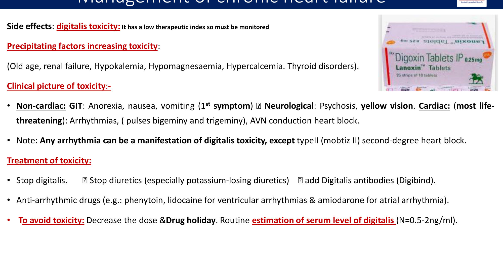

### 2.14 HFpEF Management (Slide 36)
- ⭐ **No therapy with proven mortality benefit.**
- ⭐ **Diuretics are the mainstay** for symptom control.
- **Induce bradycardia if tachycardic** (longer diastolic filling) and **relieve ischaemia**.
- Lifestyle and comorbidity management as for HFrEF.
- *[added]* **SGLT2 inhibitors** (EMPEROR-Preserved, DELIVER) **reduce HF hospitalisation** (class 2a); control **BP, AF, obesity** (± GLP-1 RA); MRA/ARNI may help in the lower-EF range.

### 2.15 Invasive Interventions and Advanced HF (Slides 37–39) ⭐⭐
Cardiomyopathy ↑ the risk of **ventricular arrhythmia and sudden cardiac death**.

| Device | Indication |
|---|---|
| ⭐ **ICD: primary prevention** (needs **all 3**) | ✓ **GDMT for 3 months** · ✓ **LVEF ≤ 35%** · ✓ **NYHA II–III** (*[added]* expected survival > 1 year; ≥ 40 days post-MI) |
| ⭐ **ICD: secondary prevention** | **Cardiac arrest from VF or VT** |
| ⭐ **CRT** | ✓ **GDMT 3 months** · ✓ **LVEF ≤ 35%** · ✓ **QRS > 150 ms with LBBB** (*[added]* NYHA II–ambulatory IV) |

**Advanced HF (slide 39):**
- ⭐ **cardiac transplant is the only cure** for end-stage HF
- **1- and 5-year survival rates are excellent**, but organs are scarce
- **bridging:** **inotropes** and **mechanical circulatory support** (LVAD)
- **non-candidates → palliative care**

### 2.16 High-Output Heart Failure (Slide 40) ⭐
- HF secondary to conditions with a **high-output state**: ↑ CO to meet peripheral O₂ demand.
- Can be **physiological (pregnancy)** or **pathological**: **severe anaemia, AV fistula, sepsis, beriberi, thyrotoxicosis**.
- ⭐ **Treatment: correct the underlying aetiology.**

| ↓ Peripheral vascular resistance (afterload) | ↑ Metabolic demand (HR, contractility, afterload) | Mixed (↓ SVR + direct myocardial effect) | Other |
|---|---|---|---|
| **Morbid obesity**, ⭐ **AV fistula**, **cirrhosis**, erythroderma, **carcinoid** | Myeloproliferative disorders, ⭐ **hyperthyroidism** | ⭐ **Sepsis**, **acromegaly**, mitochondrial disease, ⭐ **beriberi (thiamine)** | ⭐ **Anaemia**, chronic pulmonary disease |

*[added]* **Clues:**
- warm extremities, **bounding pulse**, **wide pulse pressure**, tachycardia
- **normal or high EF** with high CO on echo

**Mnemonic *[added]*: "A FAT PIG"**:
- **A**naemia
- AV **F**istula
- **A**cromegaly/alcohol
- **T**hyrotoxicosis/thiamine (beriberi)
- **P**regnancy/Paget's
- **I**nfection (sepsis)
- **G**ut (cirrhosis)/carcinoid

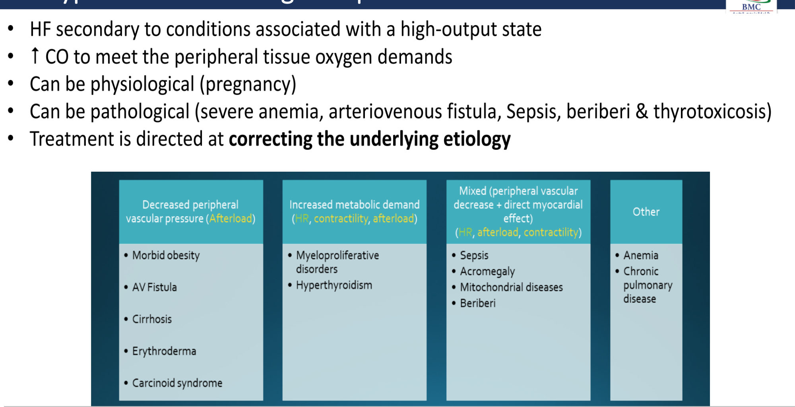

> 🔁 **Recap: Management.**
> - Lifestyle: Na < 4 g, fluid 1.5–2 L, daily weights, vaccines, avoid NSAIDs.
> - **HFrEF pillars:** ACEi/ARB/**ARNI** + **β-blocker** + **MRA** (EF ≤ 35%) + **SGLT2i** (all ↓ mortality). **Loop diuretic** for congestion. **H-ISDN** if RAAS-intolerant. **Digoxin** and **ivabradine** for symptoms.
> - **Digoxin toxicity:** GI first, yellow vision, bigeminy/AV block; ↓ K⁺/↓ Mg/↑ Ca and renal failure precipitate it; **Digibind**.
> - **HFpEF:** diuretics, rate control (*[added]* SGLT2i).
> - **ICD:** EF ≤ 35% + NYHA II–III + 3 months GDMT. **CRT:** + QRS > 150 + LBBB.
> - **Transplant** is the only cure.
> - **High-output HF** (AV fistula, anaemia, thyrotoxicosis, beriberi, sepsis) → treat the cause.
>
> ▶️ **Up next: Acute HF as a medical emergency.**

---

### 2.17 Acute Heart Failure (Slides 41–47) ⭐⭐
| Type | Definition |
|---|---|
| ⭐ **Acute decompensated HF (ADHF)** | Decompensation of **pre-existing** disease (**most common**) |
| **De novo HF** | First presentation, **without known cardiomyopathy** |

| **Triggers of ADHF** | **Triggers of de novo HF** |
|---|---|
| ⭐ **Medication non-compliance** (*[added]* and dietary salt/fluid) | **Acute myocardial dysfunction:** ⭐ **ACS**, **myocarditis**, **drug-induced cardiomyopathy**, ⭐ **peripartum cardiomyopathy**, **thyroid storm** |
| **Ischaemic heart disease** | **Acquired valvular pathology:** ⭐ **acute mitral regurgitation**, **bacterial endocarditis** |
| ⭐ **Arrhythmias** (AF) | — |
| **Serious infection/sepsis** | — |
| ⭐ **Drugs: NSAIDs, cocaine** | — |
| **Anaemia** | — |
| **Renal failure** | — |
| **Volume overload** | — |

**Mnemonic *[added]* for ADHF triggers, "FAILURE":**
- **F**orgot medication
- **A**rrhythmia/**A**naemia
- **I**schaemia/**I**nfection
- **L**ifestyle (salt, fluid)
- **U**pregulation (thyroid, pregnancy)
- **R**enal failure
- **E**mbolism/**E**ndocarditis

| Clinical features | |
|---|---|
| ⭐ **Congestion** | **Acute dyspnoea, orthopnoea**, ⭐ **flash pulmonary oedema**, ↑ work of breathing, **cough** (*[added]* pink frothy sputum), **coarse crackles** |
| ⭐ **Hypoperfusion** | **Weakness, fatigue, altered mental status**, **poor peripheral perfusion** (cold, clammy, oliguria) |

*[added]* **The bedside "warm/cold, wet/dry" profile** (Forrester/Stevenson):

| Profile | Meaning | Treatment |
|---|---|---|
| **Warm–wet** | Commonest | **Diuretics ± vasodilators** |
| **Cold–wet** | Low CO + congestion → **cardiogenic shock** (next lecture) | **Inotropes** ± vasopressors, then diuresis |
| **Cold–dry** | Hypovolaemic / low output | Cautious fluids, inotropes |
| **Warm–dry** | Compensated | Optimise GDMT |

**Differential diagnosis (slide 45):**
- ACS
- **pneumonia**
- **COPD/asthma**
- ⭐ **non-cardiogenic pulmonary oedema (ARDS)**
- **PE**
- ⭐ **TRALI** vs ⭐ **TACO** (*[added]* TACO = hydrostatic: **↑ BNP**, HTN, responds to diuretics; TRALI = permeability: **normal BNP**, fever, hypotension)
- **COVID-19**

**Diagnostics (slide 46):**
- **BNP/NT-proBNP**
- **troponin**
- BMP and electrolytes, CBC, LFTs
- **ECG, CXR, TTE**
- **COVID-19 and flu swab**
- **TSH** (right clinical setting)

**Management (slide 47) ⭐⭐**
1. **Respiratory support:**
   - ⭐ **upright position**
   - supplemental **O₂**
   - ⭐ **NIPPV (CPAP/BiPAP)**
   - mechanical ventilation if needed
2. ⭐ **IV loop diuretics:** monitor **urine output and electrolytes**
3. ⭐ **Vasodilators:** **IV nitroglycerin**, **sodium nitroprusside** (*[added]* if SBP > 110; avoid if hypotensive or with severe AS)
4. **Address the precipitant**
5. Once stable: **optimise GDMT** and **evaluate the aetiology**

**Mnemonic *[added]*: "LMNOP"**:
- **L**asix (furosemide IV)
- **M**orphine (*[added]* now **not routinely recommended**: ↑ mortality signal)
- **N**itrates
- **O**xygen / NIV
- **P**osition (sit upright)

*[added]* **Hypotensive or hypoperfused (cold–wet)** → **inotropes (dobutamine, milrinone)** ± norepinephrine; see Cardiogenic Shock.

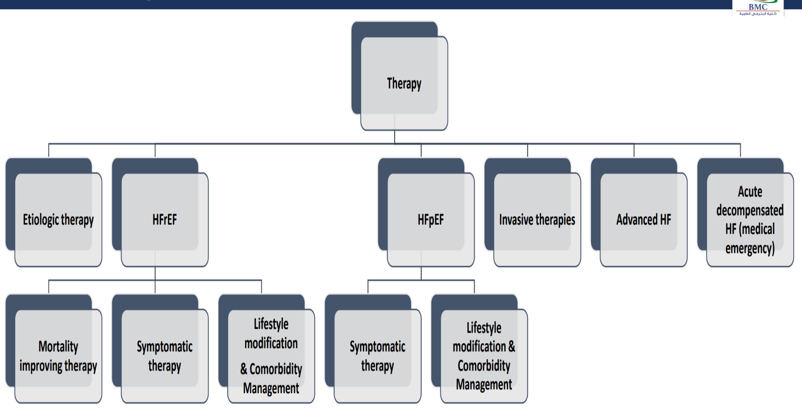

> 🔁 **Recap: Acute HF.**
> - ADHF (commonest; non-compliance, ischaemia, AF, infection, NSAIDs/cocaine, anaemia, CKD, volume) vs de novo (ACS, myocarditis, peripartum, thyroid storm, acute MR, IE).
> - Congestion vs hypoperfusion.
> - DDx: ARDS, TRALI/TACO, PE, pneumonia, COPD.
> - **Sit up, O₂/NIV, IV loop diuretic, IV nitrates, treat the trigger, then GDMT.**

---

## 3. High-Yield Comparison Tables

### Table A: HFrEF vs HFpEF
| | HFrEF | HFpEF |
|---|---|---|
| EF | **≤ 40%** | **≥ 50%** |
| Defect | **Contractility** (systolic) | **Compliance/relaxation** (diastolic) |
| Ventricle | **Dilated**, thin | **Thick (LVH)**, small cavity |
| Typical causes | **CAD/MI**, DCM, alcohol, myocarditis | **HTN**, elderly, female, DM, obesity, AF, **amyloid** |
| Gallop | **S3** | **S4** |
| Mortality-reducing drugs | **ARNI/ACEi/ARB, β-blocker, MRA, SGLT2i**; H-ISDN | **None proven** (SGLT2i ↓ hospitalisation *[added]*) |
| Symptom drugs | Loop diuretic, digoxin, ivabradine | **Diuretics**, rate control |
| Devices | ICD/CRT if EF ≤ 35% | — |

### Table B: Left vs Right HF
| Left HF | Right HF |
|---|---|
| Dyspnoea, **orthopnoea, PND**, cough | **Peripheral oedema**, ascites |
| **Basal crackles**, pulmonary oedema, effusion | **↑ JVP, hepatojugular reflux**, hepatosplenomegaly |
| **Displaced apex**, S3 | Anorexia, nausea, RUQ pain, **jaundice** |
| Cool extremities (low output) | Commonest cause: **left HF**; also cor pulmonale (COPD, OSA, PE) |

### Table C: ACC/AHA Stage → Therapy
| Stage | Therapy |
|---|---|
| A (at risk) | Treat HTN, lipids, DM; no HF drugs |
| B (structural, asymptomatic) | **ACEi/ARB(/ARNI) + β-blocker** if EF reduced |
| C (symptomatic) | **+ MRA + SGLT2i**, loop diuretic, H-ISDN, digoxin, ivabradine; ICD/CRT |
| D (refractory) | **Transplant, LVAD, inotropes, palliative care** |

### Table D: Drugs That Help vs Harm in HFrEF
| ↓ Mortality | Symptoms only | **Avoid** *[added]* |
|---|---|---|
| ARNI/ACEi/ARB, β-blockers (bisoprolol, carvedilol, metoprolol succinate), MRA, SGLT2i, H-ISDN | Loop/thiazide diuretics, digoxin, ivabradine | **NSAIDs**, **verapamil/diltiazem**, **thiazolidinediones** (pioglitazone), **class I antiarrhythmics**, dronedarone, saxagliptin |

### Table E: BNP Interpretation
| ↑ BNP | ↓ BNP (false-low) |
|---|---|
| HF, **age**, **CKD**, AF, PE, sepsis, *[added]* **ARNI therapy** (BNP, not NT-proBNP) | **Obesity**, *[added]* flash oedema (very early), constrictive pericarditis, mitral stenosis |

---

## 4. Rules, Exceptions, Patterns
- **CAD, HTN, DM** are the top causes; KSA patients are **~10 years younger** (57–60).
- **S3 = volume overload (HFrEF); S4 = stiff ventricle (HFpEF).**
- **ACC/AHA stages never regress; NYHA class can.**
- **Framingham: 2 major or 1 major + 2 minor.**
- **TTE for every new suspected HF; cardiac MRI is the gold standard for EF.**
- **BNP rules out HF** (CHF vs COPD); ↑ with age and CKD; ↓ in obesity.
- **The four pillars ↓ mortality; diuretics don't** (symptoms and hospitalisation only).
- **MRA needs EF ≤ 35% + NYHA II–IV**; watch K⁺.
- **Ivabradine needs sinus rhythm, HR ≥ 70 on a maximal β-blocker**, EF ≤ 35%, NYHA II–III.
- **Digoxin toxicity ↑ with ↓ K⁺, ↓ Mg²⁺, ↑ Ca²⁺, renal failure, old age, thyroid disease**; GI first, yellow vision, bigeminy/AV block; **Digibind**.
- **ICD primary prevention = 3 months GDMT + EF ≤ 35% + NYHA II–III. CRT = + QRS > 150 + LBBB.**
- **Transplant = the only cure.**
- **High-output HF → treat the cause** (fistula, anaemia, thyroid, beriberi).
- **ADHF commonest trigger = non-compliance**; de novo = ACS, myocarditis, peripartum, acute MR.
- **Acute HF: sit up, O₂/NIV, IV loop, IV nitrates.**

---

## 5. Clinical Correlations
- **Dialysis patient with an AV fistula, bounding pulse, wide pulse pressure** → high-output HF (opening case).
- **Thyrotoxicosis / thyroid storm** → high-output HF; AF (Thyroid lecture).
- **Beriberi (thiamine deficiency)** in alcohol use → wet beriberi (high-output HF) (Substance Use lecture).
- **Acromegaly** → cardiomyopathy and high output (Pituitary I).
- **Post-MI acute MR / VSD** → de novo pulmonary oedema (CAD lecture).
- **Infective endocarditis** → acute AR/MR → acute HF (IE lecture).
- **Peripartum cardiomyopathy:** last month of pregnancy to 5 months postpartum *[added]* (next lecture).
- **NSAIDs** precipitate ADHF (Na⁺/water retention, ↓ diuretic efficacy).
- **COPD vs HF dyspnoea** → BNP; both cause cor pulmonale.
- **Hyponatraemia** in HF = neurohormonal activation and poor prognosis.
- **Iron deficiency** in HFrEF → IV ferric carboxymaltose improves symptoms *[added]*.

---

## 6. Rapid Revision (Last-Day)
1. **HF** = the heart can't meet demand; structural or functional filling/ejection impairment; dyspnoea, fatigue, oedema, rales.
2. **Classify:** HFrEF/HFpEF · L/R/biventricular · chronic compensated / acute decompensated.
3. **Epidemiology:** ~2% (≥ 10% over 70); KSA mean age **57–60**; women are half of all cases.
4. **Causes:** **CAD, HTN, DM**, valves, renal, infiltrative, DCM, arrhythmia, myocarditis, obesity, smoking, COPD, drugs, **alcohol**.
5. **CO = HR × SV** (~5 L/min); **EF = SV/EDV**.
6. **HFrEF:** ↓ contractility → ↓ EF. **HFpEF:** ↓ compliance → ↓ filling, normal EF.
7. **Forward failure** = hypoperfusion; **backward failure** = lungs (LV) / systemic veins (RV).
8. **Compensation:** **SNS, RAAS (+ ADH), BNP** → remodelling.
9. **General features:** nocturia, fatigue, tachycardia, arrhythmias, **S3/S4**, cachexia.
10. **LHF:** dyspnoea, orthopnoea, PND, oedema; basal rales, **displaced apex**, cool extremities. **RHF:** pitting oedema, abdominal pain, jaundice, nausea, anorexia; **JVD, HJR, HSM**.
11. **Stages A** (at risk) · **B** (structural, asymptomatic) · **C** (symptomatic) · **D** (refractory). **NYHA I–IV.**
12. **Bloods:** CBC, BMP (↑ Cr, ↓ Na), biomarkers, HbA1c, LFTs, lipids; ± HIV, iron, ANA, Lyme, TSH.
13. **BNP/NT-proBNP:** stretch; CHF vs COPD; ↑ with age and CKD; **↓ in obesity**.
14. **TTE** for all; **CXR** (↑ CTR, cephalisation, **Kerley B**, effusion); ECG (chambers, ischaemia); **cardiac MRI = gold standard**; MUGA.
15. **Framingham:** **2 major or 1 major + 2 minor**.
    - **Major:** PND, JVD, rales, cardiomegaly, acute pulmonary oedema, S3, CVP > 16, HJR, weight loss > 4.5 kg in 5 days on treatment
    - **Minor:** ankle oedema, nocturnal cough, DOE, hepatomegaly, effusion, VC ↓ ⅓, HR > 120
16. **Lifestyle:** Na < 4 g, fluid 1.5–2 L, weight loss, stop smoking, limit alcohol, exercise, **daily weights**, vaccines, avoid harmful drugs.
17. **HFrEF mortality drugs:**
    - **ACEi** (all) / **ARB** (ACEi-intolerant) / **ARNI** (sacubitril–valsartan)
    - **β-blocker** (bisoprolol, carvedilol, metoprolol)
    - **MRA** (NYHA II–IV + EF ≤ 35%)
    - **SGLT2i** (NYHA II–IV)
    - **H-ISDN** (RAAS-intolerant)
18. **Symptomatic:** **loop diuretics** (fluid retention), thiazides; **digoxin** (persistent symptoms); **ivabradine** (NYHA II–III, EF ≤ 35%, sinus HR ≥ 70 on max β-blocker).
19. **Digoxin toxicity:**
    - precipitants: old age, CKD, **↓ K, ↓ Mg, ↑ Ca**, thyroid
    - features: **GI first**, psychosis, **yellow vision**, bigeminy/trigeminy, AV block; any arrhythmia except Mobitz II
    - treatment: stop digoxin and diuretics, **Digibind**, phenytoin/lidocaine (ventricular), amiodarone (atrial)
    - level 0.5–2 ng/mL
20. **HFpEF:** no proven mortality benefit; **diuretics**; slow HR; relieve ischaemia.
21. **ICD primary:** 3 months GDMT + **EF ≤ 35%** + **NYHA II–III**. **Secondary:** VF/VT arrest. **CRT:** 3 months GDMT + EF ≤ 35% + **QRS > 150 + LBBB**.
22. **Transplant = the only cure**; bridges: inotropes, MCS; otherwise palliative care.
23. **High-output HF:** pregnancy; **anaemia, AV fistula, sepsis, beriberi, thyrotoxicosis**; obesity, cirrhosis, carcinoid, acromegaly → treat the cause.
24. **ADHF triggers:** non-compliance, ischaemia, arrhythmia, sepsis, **NSAIDs/cocaine**, anaemia, renal failure, volume. **De novo:** ACS, myocarditis, drug/peripartum CM, thyroid storm, **acute MR**, IE.
25. **Acute HF:** congestion (flash oedema, crackles) + hypoperfusion (confusion, cold peripheries). DDx: ACS, pneumonia, COPD, **ARDS**, PE, **TRALI/TACO**, COVID.
26. **Work-up:** BNP, troponin, BMP, CBC, LFTs, ECG, CXR, TTE, viral swabs, TSH.
27. **Management:** upright, O₂, **NIPPV**, ventilation; **IV diuretics**; **IV nitroglycerin/nitroprusside**; treat the trigger; then GDMT.

---

## 7. Exam-Style Questions

**Q1 (lecture opening case, slides 5–6).** A 43-year-old on haemodialysis via an **upper-arm AV fistula created 5 months ago** has orthopnoea, PND, **bounding pulse 103**, BP 106/58, oedema, JVD, a loud fistula bruit, bibasal crackles and an **S3**. Most likely cause?
A. AV fistula aneurysm · B. Dialysis disequilibrium · C. Sepsis · D. PE · E. Constrictive pericarditis · **F. High-output heart failure**

> **Answer: F** *[reasoning added; key not on slides]*.
> - The fistula ↓ systemic resistance → **↑ CO demand** → eventual congestive failure (S3, JVD, crackles).
> - Bounding pulse and wide pulse pressure = hyperdynamic circulation (slide 40 lists **AV fistula** as a cause).
> - Treatment = correct the cause (fistula banding/ligation).

**Q2.** A 65-year-old with ischaemic cardiomyopathy (**LVEF 30%**, NYHA II) is on ramipril and furosemide. Which addition will **most reduce mortality**?
A. Digoxin · B. Ivabradine · **C. Bisoprolol** · D. Increase furosemide · E. Amlodipine

> **Answer: C** (slide 33). β-blockers ↓ mortality in **everyone with HFrEF**. Then add an **MRA** (EF ≤ 35%) and an **SGLT2i**; consider switching ACEi → **ARNI**. Digoxin, ivabradine and diuretics are **symptomatic** only.

**Q3.** A woman on digoxin and furosemide for HFrEF presents with nausea, vomiting, confusion and **yellow-tinged vision**. ECG: **ventricular bigeminy**. K⁺ 2.9 mmol/L. Which factor precipitated this, and what is the antidote?
**A. Hypokalaemia; digoxin-specific antibody fragments** · B. Hyperkalaemia; calcium gluconate · C. Hypocalcaemia; calcium · D. Hypermagnesaemia; dialysis

> **Answer: A** (slide 35).
> - **Hypokalaemia** (from the loop diuretic) potentiates digoxin.
> - **Stop digoxin and diuretics, replace K⁺/Mg²⁺, give Digibind.**
> - *[added]* IV calcium is contraindicated.

**Q4.** A 58-year-old with HFrEF (LVEF 30%), NYHA III after **4 months** of optimal GDMT, has an ECG showing **LBBB with QRS 165 ms**. Best intervention?
A. ICD alone · **B. Cardiac resynchronisation therapy (± defibrillator, CRT-D)** · C. Heart transplant · D. Increase β-blocker

> **Answer: B** (slides 37–38).
> - CRT criteria: ≥ 3 months GDMT + **EF ≤ 35%** + **QRS > 150 ms with LBBB**.
> - He also meets ICD criteria, hence **CRT-D**.

**Q5.** A 72-year-old woman with long-standing hypertension has exertional dyspnoea and ankle oedema. Echo: **concentric LVH, LVEF 62%**, impaired relaxation. BNP elevated. Mainstay of therapy?
A. Sacubitril–valsartan for mortality benefit · **B. Diuretics for congestion, plus BP and rate control** · C. Digoxin · D. ICD

> **Answer: B** (slide 36).
> - **HFpEF:** no therapy with proven mortality benefit.
> - **Diuretics** for symptoms; control **HTN, AF, ischaemia**.
> - *[added]* An **SGLT2i** reduces HF hospitalisation.

---

## 8. Exam Pitfalls & Traps
| Trap | Correct thinking |
|---|---|
| Furosemide improves survival in HF | ❌ **Symptoms and hospitalisation only**; mortality = the four pillars (+ H-ISDN) |
| Digoxin ↓ mortality | ❌ ↓ **hospitalisation** only |
| ACC/AHA stage improves from C to B after treatment | ❌ Stages **never regress**; NYHA class can |
| NYHA I = stage A | ❌ Stage A has **no structural disease**; NYHA applies from stage B/C |
| β-blocker started at full dose in a wet, hypoperfused patient | ❌ Start low **when euvolaemic**; don't start in cardiogenic shock |
| MRA for every HFrEF patient | ⚠️ Slide: **NYHA II–IV + EF ≤ 35%**; check K⁺ and eGFR |
| Ivabradine in AF | ❌ Requires **sinus rhythm** with HR ≥ 70 |
| BNP normal in an obese patient excludes HF | ⚠️ BNP is **falsely low in obesity** |
| BNP high = HF | ⚠️ Also ↑ with **age, CKD**, PE, AF, sepsis |
| ICD 2 weeks after starting GDMT | ❌ Needs **3 months of GDMT** (and *[added]* ≥ 40 days post-MI) |
| CRT for any wide QRS | ⚠️ Best for **LBBB with QRS > 150 ms**, EF ≤ 35% |
| HFpEF has a proven mortality drug | ❌ None proven (SGLT2i ↓ hospitalisation *[added]*) |
| Verapamil for rate control in HFrEF *[added]* | ❌ Negative inotrope; use β-blocker or digoxin |
| NSAIDs for joint pain in HF *[added]* | ❌ Precipitate decompensation |
| IV calcium for hyperkalaemia in digoxin toxicity *[added]* | ❌ Avoid; use Digibind |
| High-output HF treated with standard GDMT alone | ❌ **Correct the cause** (fistula, anaemia, thyroid, thiamine) |
| Morphine routinely in acute pulmonary oedema *[added]* | ❌ No longer routine; nitrates, diuretics, NIV |
| Nitrates in hypotensive ADHF *[added]* | ❌ Avoid if SBP < 90–100 or severe AS → inotropes |
